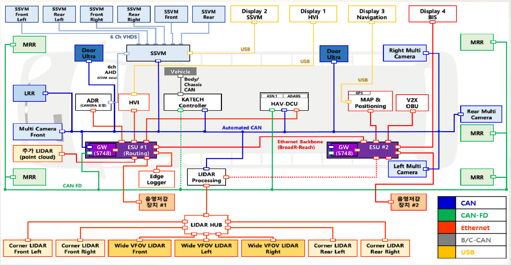

# HW1 과제 해설 — 커넥티드 자율주행과 CAN 기초

[레포지토리 안내](../../README.ko.md) | [English](Assignment-Explanation.md) | [한국어](Assignment-Explanation.ko.md)

> **최종 수정일:** 2026-11-16

> **학습 목표:**
> 1. 자율주행차가 V2X 통신을 갖춘 커넥티드 자율주행으로 발전해야 하는 이유와 안전, 편의 측면의 용도를 설명할 수 있다
> 2. 자율주행차 네트워크 아키텍처에서 차량용 이더넷에 연결되는 모듈을 고르고 그 이유를 설명할 수 있다
> 3. 운전자동화 레벨 0\~5를 구분하는 기준과 레벨별 차이를 설명할 수 있다
> 4. CAN용 9핀 커넥터의 핀 배열과 종단 저항의 결선 방법, 역할을 설명할 수 있다
> 5. 버스형과 링형 토폴로지, 비트 스터핑, CAN ID의 우선순위가 정해지는 방식을 예를 들어 설명할 수 있다

---

## 목차

- [1. 과제 구성](#1-과제-구성)
- [2. 커넥티드 자율주행으로의 발전 (문제 1)](#2-커넥티드-자율주행으로의-발전-문제-1)
  - [2.1 V2X 통신이 필요한 이유](#21-v2x-통신이-필요한-이유)
  - [2.2 안전과 편의 측면의 용도](#22-안전과-편의-측면의-용도)
- [3. 차량용 이더넷의 활용 (문제 2)](#3-차량용-이더넷의-활용-문제-2)
  - [3.1 차량용 이더넷에 연결되는 모듈](#31-차량용-이더넷에-연결되는-모듈)
  - [3.2 차량용 이더넷을 쓰는 이유](#32-차량용-이더넷을-쓰는-이유)
- [4. 자율주행 레벨 (문제 3)](#4-자율주행-레벨-문제-3)
  - [4.1 레벨을 구분하는 핵심 기준](#41-레벨을-구분하는-핵심-기준)
  - [4.2 레벨별 차이](#42-레벨별-차이)
- [5. CAN 통신선 연결 (문제 4)](#5-can-통신선-연결-문제-4)
  - [5.1 9핀 커넥터의 핀 배열](#51-9핀-커넥터의-핀-배열)
  - [5.2 종단 저항의 결선](#52-종단-저항의-결선)
- [6. 버스형과 링형 토폴로지 (문제 5)](#6-버스형과-링형-토폴로지-문제-5)
- [7. 비트 스터핑 (문제 6)](#7-비트-스터핑-문제-6)
- [8. CAN ID의 우선순위 (문제 7)](#8-can-id의-우선순위-문제-7)
- [요약](#요약)
- [점검 문제](#점검-문제)
- [참고 문헌](#참고-문헌)

---

<br>

## 1. 과제 구성

> **풀어 보기:** 이 문서는 정답과 풀이를 담고 있다. 먼저 [과제 안내문](Original/Assignment.ko.md)의 문제를 직접 풀어 본 뒤 읽는다.

2주차와 3주차의 학습 내용을 묻는 서술형 과제이다. 과제는 일곱 문제로 이루어지며, 앞의 세 문제는 자율주행차와 통신의 관계를, 뒤의 네 문제는 CAN 버스와 LAN의 기초를 묻는다. 문제의 원문과 배점은 [과제 안내문](Original/Assignment.ko.md)에 있고, 2\~8절의 첫머리에도 그 절이 푸는 문제를 옮겨 두었다.

```text
Coursework/HW01_Connected-Driving-and-CAN-Basics/
├── Original/
│   ├── Assignment.ko.md            # 과제 안내문 (한국어)
│   └── Assignment.md               # 과제 안내문 (영어)
├── Assignment-Explanation.ko.md    # 과제 해설 (한국어)
└── Assignment-Explanation.md       # 과제 해설 (영어)
```

*그림 1. HW1 과제의 디렉토리 구성*

| 문제 | 묻는 내용 | 관련 단원 |
|:-----|:-----|:-----|
| 1 | 커넥티드 자율주행으로 발전하는 필요성(3가지 이상)과 안전, 편의 측면의 용도 | 1주차 |
| 2 | 자율주행차 네트워크 아키텍처에서 차량용 이더넷에 연결하는 모듈 2가지와 그 이유 | 2주차 |
| 3 | 자율주행 레벨을 구분하는 핵심 키워드와 레벨별 차이 | 2주차 |
| 4 | CAN 통신에 많이 쓰는 9핀 커넥터의 핀 배열, 종단 저항의 결선 방법 | 3주차, 9주차, 10주차 |
| 5 | LAN의 버스형과 링형 토폴로지의 그림과 특성 | 3주차, 6주차 |
| 6 | 오류 검출 방식인 비트 스터핑의 예시 | 3주차 |
| 7 | CAN ID에 의한 스크리닝 방식에서 ID의 우선순위가 부여되는 방법 | 3주차 |

*표 1. HW1의 문항 구성*

---

<br>

## 2. 커넥티드 자율주행으로의 발전 (문제 1)

**문제 1.1** 자율주행차가 V2X 통신이 적용된 커넥티드 자율주행으로 발전하게 되는 필요성에 대해서 3가지 이상 설명하시오.

**문제 1.2** 그리고 커넥티드 자율주행의 용도를 안전과 편의를 고려하여 설명하시오.

> **용어 정의:** **V2X(Vehicle to Everything)** 는 차량이 다른 차량(V2V), 도로 인프라(V2I), 보행자(V2P), 통신망(V2N)과 무선으로 정보를 주고받는 통신을 통틀어 이르는 말이다. **커넥티드 자율주행(connected automated driving)** 은 자율주행차가 자기 센서로 얻은 정보에 V2X로 받은 정보를 더해 판단하고 주행하는 방식이며, C-ITS(차세대 지능형 교통체계) 인프라와 협력할 때는 **자율협력주행**이라고도 부른다.

### 2.1 V2X 통신이 필요한 이유

센서만으로 달리는 자율주행차는 카메라, 레이더, 라이다가 직접 관측한 범위 안에서만 판단한다. V2X를 더해야 하는 이유는 다음 네 가지로 정리된다.

1. **가시권 밖의 정보와 광역 정보의 획득:** 센서는 시선이 닿는 곳(가시권)과 탐지 거리 안의 물체만 인식한다. 앞의 대형 트럭에 가려진 정지 차량, 교차로 건너편에서 오는 차량, 수 km 앞의 사고나 결빙 구간은 센서가 볼 수 없는 비가시권의 정보이다. V2X는 다른 차량과 도로변 센서가 인식한 정보를 받아 오므로 이 한계를 넘어선다.
2. **센서와의 상호 보완적 데이터 융합에 따른 객체 인식률 향상:** 카메라는 역광, 야간, 비, 안개에 약하고, 레이더는 물체의 종류를 가려내는 데 약하며, 라이다는 눈과 안개 속에서 성능이 떨어진다. V2X 메시지는 날씨와 조명과 무관한 경로로 다른 차량의 위치, 속도, 진행 방향, 제동 상태를 전해 주므로, 센서의 인식 결과와 융합하면 객체 인식률과 판단의 신뢰성이 높아진다.
3. **탑승자를 위한 편의 및 안전 서비스 제공:** 운전에서 벗어난 탑승자에게 실시간 교통 정보를 반영한 경로 안내, 인포테인먼트, 원격 차량 관리 같은 서비스를 제공하려면 차량이 외부와 연결되어 있어야 한다.
4. **연계 산업의 파급 효과 확대:** 커넥티드 자율주행은 자동차뿐 아니라 인터넷 서비스, 통신, 도로 인프라 산업을 함께 끌어들여 산업 전체의 파급 효과를 키운다.

여기에 덧붙여, 신호등의 현재 신호와 남은 시간처럼 **센서로는 원리상 측정할 수 없는 정보**도 V2I로 직접 받을 수 있다. 카메라로 신호등 색을 읽을 수는 있지만 신호가 몇 초 뒤에 바뀌는지는 인프라만 알고 있기 때문이다.

> **핵심:** 센서는 자기 차량의 시야 안에서 지금 보이는 것만 알려 주고, V2X는 다른 차량과 인프라가 보거나 알고 있는 것을 알려 준다. 두 정보원은 서로를 대체하지 않고 보완한다.

### 2.2 안전과 편의 측면의 용도

커넥티드 자율주행의 용도는 안전과 편의로 나뉘며, 두 용도는 통신에 요구하는 성능이 다르다.

| 구분 | 서비스 | 예 | 통신에 요구되는 성능 |
|:-----|:-----|:-----|:-----|
| 안전 | 원거리 인지 공유, C-ITS | 도로변 센서와 주변 차량의 인식 정보 공유, V2V 기반 전방 충돌 위험 자동 제동, V2I 기반 전방 결빙 구간 경고, V2P 기반 교차로 안전 제동 | 작은 데이터를 정해진 시간(예: 10 ms) 안에 반드시 전달해야 하므로 지연 시간이 중요하다 |
| 편의 | 인포테인먼트, 자율주행 서비스 지원 | 모바일 오피스, 모바일 인터넷, 원격 차량 관리, 자동 지도 갱신, 원격 자율주행 소프트웨어 업데이트(OTA), 원격 차량 조작, 무인 택배, 보험, 발레 파킹 | 영상과 인터넷 같은 대용량 데이터를 빠르게 전송해야 하므로 전송 속도가 중요하다 |

*표 2. 커넥티드 자율주행의 안전 용도와 편의 용도*

안전 용도의 메시지는 위치, 속도, 급제동 여부처럼 수백 바이트 이하의 작은 데이터이지만, 늦게 도착하면 쓸모가 없다. 반대로 편의 용도의 데이터는 지연이 조금 생겨도 되지만 양이 많다. 이 차이 때문에 안전 서비스에는 기지국을 거치지 않고 차량끼리 직접 통신하는 WAVE나 C-V2X 직접 통신이, 편의 서비스에는 전송 속도가 빠른 이동통신망이 주로 쓰인다(13, 14주차).

> **주의:** 안전 용도는 "빠른 통신"이 아니라 "제때 도착하는 통신"을 요구한다. 전송 속도(초당 비트 수)와 지연 시간(송신에서 수신까지 걸리는 시간)은 서로 다른 성능 지표이다.

---

<br>

## 3. 차량용 이더넷의 활용 (문제 2)

**문제 2.1** 자율주행 차량의 네트워크 아키텍처에서, Automotive Ethernet에 연결하는 모듈 부품을 2가지 나열하시오. (자율주행차 핵심 모듈부품: RADAR, LIDAR, Camera, HVI, ADR, DCU, Map 모듈, Positioning 모듈, V2X OBU, BIS 디스플레이, ESU 등 중에서 Automotive Ethernet을 사용하는 모듈은?)

**문제 2.2** 이 부품들이 Automotive Ethernet을 사용하는 이유를 설명하시오.

### 3.1 차량용 이더넷에 연결되는 모듈

보기의 모듈 가운데 차량용 이더넷(Automotive Ethernet)을 쓰는 모듈은 2주차에서 다룬 대형버스용 자율주행 시스템의 네트워크 토폴로지에서 읽어 낸다.



*그림 2. 대형버스용 자율주행 시스템의 네트워크 토폴로지*

그림 2의 선 색은 네트워크 종류를 나타낸다. 파란색은 CAN, 초록색은 CAN FD, 빨간색은 이더넷, 회색은 차체와 섀시용 CAN(B/C-CAN), 노란색은 USB이다. 두 ESU 사이는 이더넷 백본(BroadR-Reach)으로 이어진다. 보기의 모듈을 연결 네트워크별로 나누면 다음과 같다.

| 모듈 | 연결 네트워크 | 하는 일 |
|:-----|:-----|:-----|
| LIDAR (코너 4개, 광시야각 3개, 추가 LIDAR) | 이더넷 (LIDAR HUB를 거쳐 LIDAR Processing으로) | 주변을 3차원 점군(point cloud)으로 측정한다 |
| MAP & Positioning | 이더넷 (GPS 입력), USB | 정밀 지도와 차량의 정밀 위치를 제공한다 |
| ADR (카메라 포함) | 이더넷 | 카메라 영상을 포함한 주행 데이터를 기록하는 버스용 다채널 기록 장치이다 |
| HVI | 이더넷, USB | 운전자에게 정보를 보여 주고 입력을 받는 인터페이스 장치(버스용 HMI)이다 |
| HAV-DCU | 이더넷, CAN, CAN FD | 인지 결과를 모아 판단과 제어를 맡는 자율주행 제어기이다 |
| V2X OBU | 이더넷 | 차량에 탑재한 V2X 통신 단말이다 |
| Display 4 BIS | 이더넷 | 버스 정보 시스템(BIS)의 표시 장치이다 |
| ESU #1, #2 | 이더넷 백본, CAN, CAN FD | 게이트웨이(GW)와 함께 놓여 네트워크 사이의 라우팅을 맡는다 |
| 장거리 레이더(LRR) | CAN | 전방의 먼 물체를 탐지한다 |
| 중거리 레이더(MRR) | CAN FD | 차량 둘레의 물체를 탐지한다 |
| 다중 카메라(Multi Camera) | CAN | 영상에서 인식한 물체 정보를 보낸다 |

*표 3. 대형버스 아키텍처의 모듈별 연결 네트워크*

따라서 보기 가운데 이더넷을 쓰는 대표적인 모듈 두 가지는 **LIDAR**와 **Map/Positioning 모듈**이며, ADR, HVI, DCU, V2X OBU, BIS 디스플레이, ESU를 들어도 이 아키텍처에 맞는 답이다. 반면 RADAR와 Camera는 이 아키텍처에서 CAN과 CAN FD에 연결된다.

> **주의:** 어떤 모듈이 이더넷을 쓰는지는 아키텍처마다 다르다. 이 문제는 2주차에서 다룬 대형버스 아키텍처를 기준으로 한다. 원시 영상을 그대로 중앙 제어기로 보내는 카메라는 이더넷이나 영상 전용 고속 링크로 연결되며, 그림 2의 다중 카메라처럼 카메라 안에서 인식을 마치고 결과만 보내는 경우에는 CAN으로 충분하다.

### 3.2 차량용 이더넷을 쓰는 이유

이더넷을 쓰는 핵심 이유는 **대역폭**이다. 표준 CAN의 최대 전송 속도는 1 Mbit/s이고 실제 차량에서는 250 kbit/s나 500 kbit/s로 운용한다. 반면 BroadR-Reach를 표준화한 100BASE-T1 차량용 이더넷은 꼬임쌍선 한 쌍으로 100 Mbit/s를 전송한다 [1].

라이다가 만드는 데이터의 양을 계산하면 차이가 분명해진다. 1주차에서 다룬 64채널 라이다(Velodyne HDL-64)는 초당 약 220만 개의 점을 출력한다. 점 하나를 거리 2바이트와 반사 강도 1바이트, 모두 3바이트로 나타낸다고 가정하면 다음과 같다.

```math
2.2 \times 10^{6}\ \text{점/s} \times 3\ \text{B/점} \times 8\ \text{bit/B} = 52.8\ \text{Mbit/s}
```

이 값은 1 Mbit/s인 CAN 대역폭의 50배가 넘으므로 CAN으로는 보낼 수 없고, 100 Mbit/s 이더넷에는 실을 수 있다. 반면 라이다 안에서 물체 인식까지 마치고 거리, 방위각, 물체 종류만 보내면 초당 약 5 kB(40 kbit/s)로 줄어들어 CAN으로도 충분하다. 레이더와 그림 2의 다중 카메라가 CAN에 연결된 것은 이처럼 처리된 물체 정보만 보내기 때문이다.

Map/Positioning 모듈도 같은 이유로 이더넷을 쓴다. 정밀 지도는 차선 단위의 도로 형상과 속성을 담고 있어 데이터가 크며, 차량이 움직이는 동안 전방 경로의 지도 정보와 정밀 위치를 끊임없이 제어기로 보내야 한다. 이 밖에 이더넷은 스위치를 거친 점대점 연결이어서 링크마다 대역폭을 공유하지 않고, 전이중(full duplex)으로 송신과 수신을 동시에 하며, IP 기반의 상위 프로토콜과 소프트웨어 업데이트에 그대로 쓸 수 있다는 장점이 있다. 또 QoS와 TSN(시간 민감 네트워킹)을 지원하므로 우선순위가 높은 실시간 데이터를 정해진 지연 안에 전달할 수 있다(9주차).

> **핵심:** 원시 데이터(점군, 영상, 지도)를 보내는 모듈은 이더넷에, 처리된 물체 정보나 제어 명령을 보내는 모듈은 CAN과 CAN FD에 연결한다. 대역폭 요구가 네트워크 선택을 결정한다.

---

<br>

## 4. 자율주행 레벨 (문제 3)

**문제 3.1** 자율주행 레벨(SAE 레벨 = ISO 레벨) 각 단계를 구분하는 핵심 키워드를 도출하시오.

**문제 3.2** 이를 기반으로 레벨별 차이점을 설명하시오.

### 4.1 레벨을 구분하는 핵심 기준

운전자동화 레벨은 SAE J3016이 정의하며 [2], 운전에 필요한 일을 누가 맡는지로 레벨을 나눈다. 핵심 키워드는 다음 네 가지이다.

> **용어 정의:** **DDT(dynamic driving task, 동적 운전 작업)** 는 도로에서 차량을 운행하는 데 실시간으로 필요한 모든 조작과 판단이다. 지속적인 **횡 방향(조향)과 종 방향(가속, 감속) 차량 모션 제어**와 **OEDR(object and event detection and response, 객체 및 사건 감지와 대응)**, 즉 주변을 감시하고 상황에 대응하는 일로 이루어진다. **DDT 폴백(fallback)** 은 시스템 고장이나 운행 조건 이탈이 생겼을 때 운전을 이어받거나 차량을 **위험 최소화 상태(MRC, minimal risk condition)** 로 만드는 일이다. **ODD(operational design domain, 운행 설계 영역)** 는 시스템이 작동하도록 설계된 조건(도로 종류, 속도 범위, 날씨, 시간대 등)이다.

이 기준은 직관적으로 손(조향), 발(가속과 제동), 눈(주변 감시)에 빗대어 hands-off, feet-off, eyes-off로 표현하기도 한다(2주차). 레벨이 올라갈수록 손이나 발, 이어서 손과 발, 마지막으로 눈의 순서로 운전자의 일이 시스템으로 넘어가고, 레벨 4와 5는 운전 전환에 대한 사람의 대응까지 전제하지 않는다.

### 4.2 레벨별 차이

| 레벨 | 명칭 | 지속적인 횡, 종 방향 제어 | OEDR | DDT 폴백 | ODD | 직관적 표현 |
|:-----|:-----|:-----|:-----|:-----|:-----|:-----|
| 0 | 운전자동화 없음 | 운전자 | 운전자 | 운전자 | 해당 없음 | 손, 발, 눈 모두 운전자 |
| 1 | 운전자 보조 | 운전자와 시스템 | 운전자 | 운전자 | 제한됨 | 손 또는 발 하나를 시스템이 대신함 |
| 2 | 부분 운전자동화 | 시스템 | 운전자 | 운전자 | 제한됨 | hands-off, feet-off, eyes-on |
| 3 | 조건부 운전자동화 | 시스템 | 시스템 | 폴백 대비 사용자 (폴백 동안 운전자가 됨) | 제한됨 | hands-off, feet-off, 조건부 eyes-off |
| 4 | 고도 운전자동화 | 시스템 | 시스템 | 시스템 | 제한됨 | hands-off, feet-off, eyes-off |
| 5 | 완전 운전자동화 | 시스템 | 시스템 | 시스템 | 무제한 | ODD의 제한 없이 eyes-off |

*표 4. 운전자동화 레벨 요약*

인접한 레벨 사이의 경계는 다음과 같다.

- **레벨 0과 1:** 레벨 1에서는 시스템이 횡 방향 또는 종 방향 제어 가운데 하나를 지속적으로 수행한다(예: 적응형 순항 제어 또는 차로 유지 보조). 경고나 긴급 제동처럼 순간적으로만 개입하는 기능은 레벨 0에 속한다.
- **레벨 1과 2:** 레벨 2에서는 시스템이 횡 방향과 종 방향 제어를 동시에 수행한다. 그러나 주변 감시(OEDR)는 여전히 운전자의 일이어서 운전자는 시스템을 계속 감독해야 한다.
- **레벨 2와 3:** 레벨 3에서는 OEDR까지 시스템이 맡으므로, ODD 안에서는 운전자가 주변을 계속 보고 있지 않아도 된다. 다만 사용자는 시스템의 운전 전환 요구에 응할 준비가 된 폴백 대비 사용자여야 한다.
- **레벨 3과 4:** 레벨 4에서는 DDT 폴백도 시스템이 맡는다. 고장이 나거나 ODD를 벗어나면 시스템이 스스로 **위험 최소화 조작(MRM)** 을 수행해 갓길 정차 같은 위험 최소화 상태에 이른다.
- **레벨 4와 5:** 레벨 5는 ODD의 제한이 없어, 사람이 운전할 수 있는 모든 조건에서 시스템이 운전한다.

2주차의 예로 정리하면, 자동 차선 변경을 하는 동안 손과 발은 놓지만 눈으로 운전해야 하면 레벨 2, 도로를 주시하지 않아도 되지만 요청이 오면 넘겨받아야 하면 레벨 3, 차선 변경을 마칠 때까지 손, 발, 눈이 모두 자유로우면 레벨 4이다.

> **참고:** No Automation, Function-specific Automation, Combined Function Automation, Limited Self-Driving Automation, Full Self-Driving Automation은 미국 NHTSA가 2013년에 정한 레벨 0\~4의 이름이다 [3]. NHTSA의 레벨 4가 SAE의 레벨 4(제한된 ODD)와 레벨 5(무제한 ODD)로 나뉘었다고 보면 두 체계가 대응한다.

> **주의:** hands-off, eyes-off는 이해를 돕는 비유이며, 레벨을 정하는 것은 손을 떼는지 여부가 아니라 DDT, OEDR, DDT 폴백을 누가 맡는지이다. 실제로 레벨 2 시스템 다수는 운전자가 운전대를 잡고 있도록 요구한다.

---

<br>

## 5. CAN 통신선 연결 (문제 4)

**문제 4.1** CAN 통신에서 많이 사용되는 9핀의 핀배열을 그리시오.

**문제 4.2** CAN 버스에 종단저항을 결선하는 방법을 설명하시오.

### 5.1 9핀 커넥터의 핀 배열

CAN 장비와 계측 장비는 D-sub 9핀 커넥터를 많이 쓰며, 핀 배열은 CAN in Automation(CiA)의 CiA 303-1 권고안을 따른다 [4]. 9주차의 ISO 11898-2 노드 구성과 10주차의 CAN 신호선 연결에서도 이 배열을 다룬다.

```text
   _____________________________
   \   1    2    3    4    5   /
    \    6    7    8    9     /
     \_______________________/
```

*그림 3. 수 커넥터를 접속면에서 본 D-sub 9핀 커넥터의 핀 번호*

| 핀 | 신호 | 설명 |
|:-----|:-----|:-----|
| 1 | - | 예약 (연결하지 않음) |
| 2 | CAN_L | CAN 저전위 신호선 |
| 3 | CAN_GND | CAN 접지 |
| 4 | - | 예약 (연결하지 않음) |
| 5 | CAN_SHLD | 케이블 차폐 (선택) |
| 6 | GND | 전원 접지 (선택) |
| 7 | CAN_H | CAN 고전위 신호선 |
| 8 | - | 예약 (연결하지 않음) |
| 9 | CAN_V+ | 외부 전원 공급 (선택) |

*표 5. CAN용 D-sub 9핀 커넥터의 핀 배열*

통신에 반드시 필요한 핀은 2번(CAN_L)과 7번(CAN_H)이며, 노드 사이의 기준 전위를 맞추려면 3번(CAN_GND)도 연결한다. CAN_H와 CAN_L은 서로 꼬은 한 쌍의 선(꼬임쌍선)으로 배선한다. 차량 진단 단자인 OBD-II 16핀 커넥터는 배열이 달라 6번이 CAN_H, 14번이 CAN_L이므로 두 커넥터를 혼동하지 않아야 한다(3주차).

### 5.2 종단 저항의 결선

고속 CAN(ISO 11898-2)은 버스의 **양 끝**에 공칭 120 Ω의 **종단 저항(termination resistor)** 을 하나씩, CAN_H와 CAN_L 사이에 연결한다 [5]. 노드가 매달린 중간 지점이나 분기선(drop cable)에는 달지 않는다.

```text
        한쪽 끝                                    다른 쪽 끝
CAN_H  ●───┬──────────┬──────────┬──────────┬───●
           │          │          │          │
        [120 Ω]     노드 1     노드 2    [120 Ω]
           │          │          │          │
CAN_L  ●───┴──────────┴──────────┴──────────┴───●
```

*그림 4. 버스 양 끝에 연결한 두 종단 저항*

종단 저항이 하는 일은 두 가지이다.

1. **신호 반사의 억제:** CAN 버스에 쓰는 꼬임쌍선의 특성 임피던스는 약 120 Ω이다. 선로 끝의 저항이 특성 임피던스와 같으면 끝에 도달한 신호의 에너지가 저항에서 흡수되어 되돌아오지 않는다. 끝이 열려 있으면 신호가 반사되어 뒤따르는 비트와 겹치고, 전송 속도가 빠를수록 비트가 왜곡된다.
2. **열성 상태로의 복귀:** 트랜시버는 우성(dominant) 비트에서 CAN_H를 끌어올리고 CAN_L을 끌어내려 두 선 사이에 전압 차를 만들고, 열성(recessive) 비트에서는 출력을 놓아 버린다. 이때 두 선 사이에 걸린 종단 저항이 전압 차를 빠르게 0으로 되돌려 열성 상태를 만든다.

두 저항은 CAN_H와 CAN_L 사이에서 병렬로 연결되므로 버스 전체의 합성 저항은 다음과 같다.

```math
R_{\text{합성}} = \frac{1}{\dfrac{1}{120\ \Omega} + \dfrac{1}{120\ \Omega}} = 60\ \Omega
```

이 값은 배선 점검에 쓰인다. 전원을 끈 상태에서 CAN_H와 CAN_L 사이의 저항을 재면 정상일 때 약 60 Ω이 나온다. 약 120 Ω이면 종단 저항 하나가 빠졌거나 선이 끊긴 것이고, 약 40 Ω이면 120 Ω 저항이 하나 더 달린 것(세 개 병렬)이며, 0 Ω에 가까우면 두 선이 단락된 것이다.

> **주의:** 60 Ω 저항 하나를 한곳에 다는 방법은 트랜시버가 보는 직류 부하는 같게 만들지만, 버스의 양 끝이 모두 정합되지 않아 반사를 막지 못한다. 매우 짧은 실습용 배선이 아니라면 120 Ω 두 개를 버스의 양 끝에 단다. 10주차 실습처럼 120 Ω이 내장된 D-sub 9핀 커넥터를 버스 끝에 끼우는 방법도 쓰인다.

---

<br>

## 6. 버스형과 링형 토폴로지 (문제 5)

**문제 5.** LAN(Local Area Network)의 버스형과 링형 토폴로지를 그림으로 그리고, 그 특성에 대해 각각 설명하시오.

**토폴로지(topology)** 는 스테이션(노드)들이 전송 매체로 서로 연결된 모양이다(6주차).

```text
 [A]        [B]        [C]
  │          │          │
■─┴──────────┴──────────┴──────────┬──────────┬───■
                                   │          │
                                  [D]        [E]

■: 양 끝의 터미네이터
```

*그림 5. 버스형 토폴로지*

```text
        [A] ────▶ [B]
         ▲         │
         │         ▼
        [E]       [C]
         ▲         │
         └── [D] ◀─┘
```

*그림 6. 링형 토폴로지 (화살표는 데이터가 흐르는 방향)*

**버스형 토폴로지**는 하나의 전송 매체(버스)에 모든 스테이션이 탭으로 직접 연결된 형태이다. 한 스테이션이 보낸 신호는 매체를 따라 양쪽으로 퍼져 모든 스테이션에 도달하므로 동작이 브로드캐스트이고, 경로를 고르는 라우팅이 필요 없다. 신호는 양 끝의 터미네이터에서 흡수된다. 매체를 함께 쓰므로 한 번에 한 스테이션만 보낼 수 있고, 동시에 보내면 충돌이 생기므로 매체 접근 제어(CSMA/CD 등, 7주차)가 필요하다. 프레임에는 목적지 주소를 넣고, 주소가 맞지 않는 스테이션은 프레임을 무시한다. CAN도 양 끝에 종단 저항을 단 버스형이다.

**링형 토폴로지**는 리피터들이 점대점 링크로 이어져 닫힌 고리를 이루고, 각 스테이션이 리피터에 연결된 형태이다. 링크에는 방향이 있어 데이터는 한 방향(시계 방향 또는 반시계 방향)으로만 돈다. 각 리피터는 받은 비트를 다음 리피터로 넘기면서 목적지 주소가 자기 스테이션이면 프레임을 복사한다. 프레임은 고리를 한 바퀴 돌아 송신 스테이션으로 돌아오며, 신호를 흡수하는 끝이 없으므로 송신 스테이션(또는 정해진 리피터)이 이 프레임을 고리에서 제거해야 한다. 돌아온 프레임을 보고 목적지가 프레임을 복사했는지 확인할 수 있어 수신 확인이 자연스럽게 이루어지고, 모든 리피터를 거치므로 브로드캐스트와 멀티캐스트도 지원한다. 누가 보낼지를 정하기 위해 토큰 같은 접근 제어가 필요하다.

| 항목 | 버스형 | 링형 |
|:-----|:-----|:-----|
| 연결 | 모든 스테이션이 하나의 매체에 탭으로 연결 | 리피터가 점대점 링크로 닫힌 고리를 이룸 |
| 데이터 흐름 | 매체를 따라 양쪽으로 퍼짐 | 한 방향으로 리피터를 차례로 거침 |
| 신호 제거 | 양 끝의 터미네이터가 흡수 | 송신 스테이션이 한 바퀴 돈 프레임을 제거 |
| 장점 | 구조가 단순하고 케이블이 적으며 스테이션 추가가 쉬움 | 점대점 링크라 장거리와 광케이블에 유리하고, 모든 노드의 권한이 같음 |
| 단점 | 매체 고장이 전체에 영향을 주고, 스테이션이 늘수록 충돌과 성능 저하가 커짐 | 노드나 링크 하나가 고장 나면 전체가 멈추고(이중 링으로 보완), 노드가 늘수록 지연이 커짐 |

*표 6. 버스형 토폴로지와 링형 토폴로지의 특성*

---

<br>

## 7. 비트 스터핑 (문제 6)

**문제 6.** 에러 검출 방식인 Bit Stuffing에 대해 예시를 들어 설명하시오.

CAN은 비트 1과 0을 전압의 높고 낮음으로만 나타내는 NRZ(Non-Return-to-Zero) 부호를 쓴다. NRZ는 같은 비트가 이어지면 신호가 변하지 않아 수신기가 비트 경계를 다시 맞출 에지가 사라진다. CAN에는 별도의 클록 선이 없어 수신기는 신호의 에지로 동기를 맞추므로, 에지가 오래 없으면 비트를 잘못 세게 된다.

**비트 스터핑(bit stuffing)** 은 이를 막는 규칙이다 [6].

- 송신기는 같은 극성의 비트가 5개 연속되면 그 뒤에 반대 극성의 비트(스터핑 비트) 하나를 넣는다.
- 수신기는 같은 비트 5개를 받은 뒤 오는 비트를 스터핑 비트로 보고 제거한다(디스터핑).
- 스터핑 비트도 다음 연속 구간의 첫 비트로 센다.
- 적용 범위는 SOF부터 CRC 시퀀스까지이며, 형식이 고정된 CRC 구분자, ACK 필드, EOF에는 적용하지 않는다.

3주차의 예에서 d는 우성(0), r은 열성(1), Sd와 Sr은 넣은 스터핑 비트이다.

```text
보낼 비트열      r d r r r r r r   d r d d d d d    r
스터핑 후        r d r r r r r Sd r d r d d d d d Sr r
디스터핑 후      r d r r r r r r   d r d d d d d    r
```

*그림 7. 비트 스터핑과 디스터핑의 예*

3\~7번째 비트에서 r이 5개 이어졌으므로 그 뒤에 Sd를 넣고, 다시 11\~15번째 비트에서 d가 5개 이어졌으므로 Sr을 넣는다. 16비트가 18비트로 늘어나지만 어느 구간에도 같은 비트가 6개 이상 이어지지 않는다. 스터핑 비트가 다음 구간의 첫 비트로 세어지는 경우도 확인할 필요가 있다.

```text
보낼 비트열      r r r r r    d d d d    r
스터핑 후        r r r r r Sd d d d d Sr r
```

*그림 8. 스터핑 비트가 다음 구간에 포함되는 예*

r 5개 뒤에 넣은 Sd와 원래의 d 4개가 합쳐 d 5개가 되므로, 그 뒤에 다시 Sr을 넣는다.

이 규칙은 오류 검출에도 쓰인다. 스터핑이 적용되는 구간에서 같은 비트가 6개 이어지면 송신기가 규칙을 지켰을 리 없으므로, 수신기는 **스터핑 오류(stuff error)** 로 판단하고 오류 프레임을 보낸다. 예를 들어 위의 보낼 비트열을 스터핑 없이 받으면 3\~8번째 비트에서 r이 6개 이어지므로 오류가 검출된다. CAN의 오류 프레임은 이 성질을 거꾸로 이용해 우성 비트 6개를 일부러 보내 모든 노드에 오류를 알린다(9주차).

> **핵심:** 비트 스터핑의 일차 목적은 수신기의 재동기화를 위한 에지를 보장하는 것이며, 스터핑 규칙 위반을 감지하는 것은 그 결과로 얻는 오류 검출 기능이다. CAN의 다섯 가지 오류 검출 방식 가운데 비트 수준의 두 가지는 비트 모니터링과 비트 스터핑이다.

---

<br>

## 8. CAN ID의 우선순위 (문제 7)

**문제 7.** CAN ID에 의한 스크리닝 방식에 있어서 ID의 우선순위는 어떻게 부여되는지 설명하시오.

CAN 프레임에는 송신 노드나 수신 노드의 주소가 없고, 대신 메시지의 내용을 나타내는 **식별자(ID)** 가 있다. 모든 노드가 모든 프레임을 받는 방송형 통신이므로, 각 노드는 수신한 프레임의 ID를 검사해 자기에게 필요한 메시지만 받아들인다. 이처럼 ID로 메시지를 걸러 받는 것이 ID에 의한 스크리닝(수신 필터링)이다.

ID는 버스를 누가 쓸지 정하는 **우선순위**도 겸한다. 규칙은 **ID의 이진값이 작을수록 우선순위가 높다**는 것이며, 그 이유는 버스의 전기적 성질에 있다.

1. CAN 버스는 우성 비트(0)와 열성 비트(1)가 동시에 나오면 우성이 이기는 구조(wired-AND)이다.
2. 버스가 비어 있을 때 여러 노드가 동시에 프레임을 보내기 시작하면, 각 노드는 중재 필드의 ID를 최상위 비트부터 한 비트씩 보내면서 버스의 실제 값을 읽는다.
3. 열성(1)을 보냈는데 버스에서 우성(0)이 읽히면 더 작은 ID를 가진 노드가 있다는 뜻이므로, 그 노드는 즉시 송신을 멈추고 수신 노드가 된다.
4. 끝까지 남은 노드, 즉 가장 작은 ID를 가진 노드는 프레임이 전혀 손상되지 않은 채 송신을 이어 간다. 진 노드는 버스가 다시 빌 때 재전송한다.

이 방식을 **비트 단위 중재(bit-wise arbitration)** 라 하며, 충돌한 프레임을 버리지 않으므로 비파괴적이다. 이를 CSMA/CD + AMP(Arbitration on Message Priority)라고도 부른다(3주차, 9주차). 10주차의 예처럼 ID 0x65F, 0x67F, 0x659인 세 노드가 동시에 송신하면 다음과 같이 진행된다.

```text
비트 위치     b10 b9 b8 b7 b6 b5 b4 b3 b2 b1 b0
0x659          1  1  0  0  1  0  1  1  0  0  1   ← 끝까지 송신
0x65F          1  1  0  0  1  0  1  1  1         ← b2에서 패배
0x67F          1  1  0  0  1  1                  ← b5에서 패배
버스           1  1  0  0  1  0  1  1  0  0  1
```

*그림 9. ID 0x659, 0x65F, 0x67F의 비트 단위 중재*

b10\~b6은 세 ID가 같다. b5에서 0x67F만 열성(1)을 보내므로 버스의 우성(0)을 읽고 물러난다. b2에서 0x65F가 열성(1)을 보내고 0x659가 우성(0)을 보내므로 0x65F가 물러난다. 결국 가장 작은 ID인 0x659(10진수 1625)가 버스를 차지한다.

ID 다음의 RTR 비트도 중재에 참여하므로, 같은 ID라면 RTR이 우성인 데이터 프레임이 RTR이 열성인 리모트 프레임을 이긴다. 시스템 설계자는 이 성질을 이용해 제동이나 조향처럼 늦으면 위험한 메시지에 작은 ID를 배정하고, 정보 표시처럼 급하지 않은 메시지에 큰 ID를 배정한다.

> **주의:** 중재는 서로 다른 ID 사이에서만 승패를 가린다. 한 네트워크에서 두 노드가 같은 ID의 데이터 프레임을 보내면 중재 필드에서 승패가 나지 않은 채 두 노드가 함께 송신을 이어 가고, 뒤따르는 제어 필드나 데이터 필드의 비트가 서로 다르면 비트 오류가 생기므로, 데이터 프레임의 ID는 송신 노드마다 겹치지 않게 배정한다.

---

<br>

## 요약

| 개념 | 핵심 요약 |
|:-----|:-----|
| 커넥티드 자율주행의 필요성 | 가시권 밖 정보와 광역 정보, 센서와의 상호 보완적 융합, 탑승자 서비스, 연계 산업의 파급 효과 때문에 자율주행차에 V2X가 필요하다. |
| 안전 용도와 편의 용도 | 안전 용도는 작은 데이터를 정해진 시간 안에 전달하는 낮은 지연 시간을, 편의 용도는 대용량 데이터를 위한 높은 전송 속도를 요구한다. |
| 차량용 이더넷 | 라이다 점군(약 52.8 Mbit/s)이나 정밀 지도 같은 원시 데이터를 보내는 모듈은 100 Mbit/s급 이더넷에, 처리된 물체 정보를 보내는 레이더와 카메라는 CAN과 CAN FD에 연결한다. |
| 운전자동화 레벨 | 지속적인 횡, 종 방향 제어, OEDR, DDT 폴백을 누가 맡는지와 ODD의 제한 여부로 레벨 0\~5를 나눈다. |
| CAN 9핀 커넥터 | CiA 303-1 배열에서 2번은 CAN_L, 7번은 CAN_H, 3번은 CAN_GND이다. |
| 종단 저항 | 버스 양 끝의 CAN_H와 CAN_L 사이에 120 Ω을 하나씩 달아 반사를 막고 열성 상태로 되돌리며, 합성 저항은 60 Ω이다. |
| 버스형과 링형 | 버스형은 하나의 매체를 공유하고 끝에서 신호를 흡수하며, 링형은 한 방향의 닫힌 고리에서 송신 스테이션이 프레임을 제거한다. |
| 비트 스터핑 | 같은 비트 5개 뒤에 반대 비트를 넣어 재동기화 에지를 보장하며, 같은 비트 6개가 보이면 스터핑 오류로 판단한다. |
| ID 우선순위 | 우성(0)이 이기는 버스에서 ID를 최상위 비트부터 비교하므로 이진값이 가장 작은 ID가 비파괴적으로 중재에서 이긴다. |

---

<br>

## 점검 문제

1. **지연 시간과 전송 속도:** V2V 기반 전방 충돌 위험 자동 제동과 원격 소프트웨어 업데이트가 통신에 요구하는 성능은 각각 무엇인가?

   <details>
   <summary>정답</summary>

   자동 제동은 작은 메시지를 정해진 시간(예: 10 ms) 안에 반드시 전달해야 하므로 낮은 지연 시간이 중요하다. 소프트웨어 업데이트는 조금 늦어도 되지만 데이터가 크므로 높은 전송 속도가 중요하다.

   </details>

2. **대역폭 계산:** 초당 100만 개의 점을 출력하고 점 하나를 3바이트로 나타내는 라이다의 원시 데이터를 500 kbit/s로 운용하는 CAN에 실을 수 있는가?

   <details>
   <summary>정답</summary>

   실을 수 없다. $`10^{6} \times 3 \times 8 = 24\ \text{Mbit/s}`$로, 500 kbit/s의 48배이다. 원시 점군은 이더넷으로 보내고, CAN에는 처리된 물체 정보만 보낸다.

   </details>

3. **레벨 2와 3:** 차선 유지와 적응형 순항 제어를 동시에 수행하는 시스템이 레벨 3이 되려면 무엇을 더 맡아야 하는가?

   <details>
   <summary>정답</summary>

   주변 감시와 대응(OEDR)을 시스템이 맡아야 한다. 레벨 2에서는 운전자가 OEDR을 수행하며 시스템을 감독하고, 레벨 3에서는 ODD 안에서 시스템이 OEDR까지 수행하며 운전자는 운전 전환 요구에 응할 준비만 한다.

   </details>

4. **종단 저항 점검:** 전원을 끈 CAN 버스에서 CAN_H와 CAN_L 사이의 저항이 120 Ω으로 측정되었다. 무엇이 문제인가?

   <details>
   <summary>정답</summary>

   정상이면 120 Ω 두 개가 병렬이어서 60 Ω이어야 한다. 120 Ω이 나왔으므로 종단 저항 하나가 빠졌거나, 한쪽 끝까지 가는 선이 끊겼다.

   </details>

5. **비트 스터핑:** 우성 비트(d) 10개를 보낼 때 스터핑 후의 비트열을 쓰라.

   <details>
   <summary>정답</summary>

   d d d d d Sr d d d d d Sr이다. d 5개 뒤에 Sr을 넣고, Sr 다음의 d부터 다시 세어 d 5개가 이어지면 또 Sr을 넣는다.

   </details>

6. **중재:** ID 0x123과 0x121인 두 노드가 동시에 송신을 시작했다. 어느 노드가 이기며, 몇 번째 비트에서 승패가 갈리는가?

   <details>
   <summary>정답</summary>

   0x123은 00100100011, 0x121은 00100100001이다. 최상위 비트부터 9비트는 같고, 10번째로 보내는 b1에서 0x123은 열성(1), 0x121은 우성(0)을 보낸다. 따라서 0x121이 이긴다.

   </details>

---

<br>

## 참고 문헌

1. IEEE, "IEEE Standard for Ethernet Amendment 1: Physical Layer Specifications and Management Parameters for 100 Mb/s Operation over a Single Balanced Twisted Pair Cable (100BASE-T1)," IEEE Std 802.3bw-2015, 2016.
2. SAE International, "Taxonomy and Definitions for Terms Related to Driving Automation Systems for On-Road Motor Vehicles," SAE J3016_202104, 2021.
3. National Highway Traffic Safety Administration, "Preliminary Statement of Policy Concerning Automated Vehicles," U.S. Department of Transportation, Washington, DC, USA, 2013.
4. CAN in Automation, "CiA 303-1: Cabling and Connector Pin Assignment," version 1.9.0, CAN in Automation, Nuremberg, Germany, 2017.
5. ISO, "Road Vehicles: Controller Area Network (CAN), Part 2: High-Speed Medium Access Unit," ISO 11898-2:2016, 2016.
6. Robert Bosch GmbH, "CAN Specification Version 2.0," Stuttgart, Germany, 1991.
