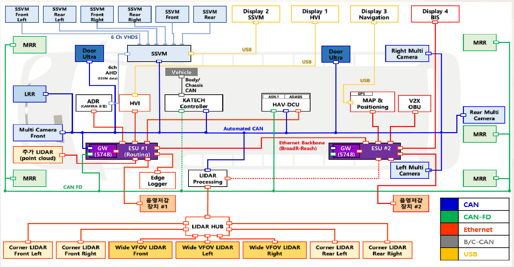

# HW1 Assignment Explanation — Connected Automated Driving and CAN Basics

[Repository Guide](../../README.md) | [English](Assignment-Explanation.md) | [한국어](Assignment-Explanation.ko.md)

> **Last Updated:** 2026-11-16

> **Learning Objectives:**
> 1. Explain why autonomous vehicles must evolve into connected automated driving with V2X communication, and its uses for safety and convenience
> 2. Identify the modules connected to automotive Ethernet in an autonomous vehicle network architecture and explain why
> 3. Explain the criteria that separate driving automation levels 0-5 and the differences between the levels
> 4. Explain the pin assignment of the 9-pin connector for CAN and how termination resistors are wired and what they do
> 5. Explain bus and ring topologies, bit stuffing, and how the priority of CAN IDs is decided, with examples

---

## Table of Contents

- [1. Assignment Layout](#1-assignment-layout)
- [2. Toward Connected Automated Driving (Question 1)](#2-toward-connected-automated-driving-question-1)
  - [2.1 Why V2X Communication Is Needed](#21-why-v2x-communication-is-needed)
  - [2.2 Safety and Convenience Uses](#22-safety-and-convenience-uses)
- [3. Use of Automotive Ethernet (Question 2)](#3-use-of-automotive-ethernet-question-2)
  - [3.1 Modules Connected to Automotive Ethernet](#31-modules-connected-to-automotive-ethernet)
  - [3.2 Why Automotive Ethernet Is Used](#32-why-automotive-ethernet-is-used)
- [4. Autonomous Driving Levels (Question 3)](#4-autonomous-driving-levels-question-3)
  - [4.1 Key Criteria That Separate the Levels](#41-key-criteria-that-separate-the-levels)
  - [4.2 Differences Between the Levels](#42-differences-between-the-levels)
- [5. Wiring CAN Lines (Question 4)](#5-wiring-can-lines-question-4)
  - [5.1 Pin Assignment of the 9-Pin Connector](#51-pin-assignment-of-the-9-pin-connector)
  - [5.2 Wiring the Termination Resistors](#52-wiring-the-termination-resistors)
- [6. Bus and Ring Topologies (Question 5)](#6-bus-and-ring-topologies-question-5)
- [7. Bit Stuffing (Question 6)](#7-bit-stuffing-question-6)
- [8. Priority of CAN IDs (Question 7)](#8-priority-of-can-ids-question-7)
- [Summary](#summary)
- [Self-Check Questions](#self-check-questions)
- [References](#references)

---

<br>

## 1. Assignment Layout

> **Try It First:** This document contains the answers and solutions. Solve the problems in the [assignment handout](Original/Assignment.md) yourself before reading on.

This is an essay assignment on the material of weeks 2 and 3. The assignment has seven questions: the first three ask about the relationship between autonomous vehicles and communication, and the last four ask about the basics of the CAN bus and LANs. The original questions and their points are in the [assignment handout](Original/Assignment.md), and each of Sections 2-8 also opens with the question it answers.

```text
Coursework/HW01_Connected-Driving-and-CAN-Basics/
├── Original/
│   ├── Assignment.ko.md            # assignment handout (Korean)
│   └── Assignment.md               # assignment handout (English)
├── Assignment-Explanation.ko.md    # assignment explanation (Korean)
└── Assignment-Explanation.md       # assignment explanation (English)
```

*Figure 1. Directory layout of HW1*

| Question | What It Asks | Related Units |
|:-----|:-----|:-----|
| 1 | Why vehicles evolve into connected automated driving (three or more reasons) and its uses for safety and convenience | Week 1 |
| 2 | Two modules connected to automotive Ethernet in an autonomous vehicle network architecture, and why | Week 2 |
| 3 | Key keywords that separate the autonomous driving levels, and the differences between the levels | Week 2 |
| 4 | Pin assignment of the 9-pin connector widely used for CAN, and how to wire the termination resistors | Weeks 3, 9, and 10 |
| 5 | Drawings and characteristics of the bus and ring topologies of a LAN | Weeks 3 and 6 |
| 6 | An example of bit stuffing as an error detection method | Week 3 |
| 7 | How ID priority is assigned in the screening method based on CAN IDs | Week 3 |

*Table 1. Questions of HW1*

---

<br>

## 2. Toward Connected Automated Driving (Question 1)

**Question 1.1** Explain three or more reasons why autonomous vehicles need to evolve into connected automated driving with V2X communication.

**Question 1.2** Then explain the uses of connected automated driving with safety and convenience in mind.

> **Definition:** **V2X (vehicle to everything)** collectively refers to wireless communication in which a vehicle exchanges information with other vehicles (V2V), road infrastructure (V2I), pedestrians (V2P), and networks (V2N). **Connected automated driving** is a way of driving in which an autonomous vehicle adds information received over V2X to the information from its own sensors when it decides and drives, and when it cooperates with C-ITS (cooperative intelligent transport systems) infrastructure it is also called **cooperative automated driving**.

### 2.1 Why V2X Communication Is Needed

An autonomous vehicle that drives on its sensors alone decides only within the range its cameras, radars, and lidars observe directly. The reasons to add V2X come down to the following four.

1. **Information beyond line of sight and wide-area information:** Sensors recognize only objects within their line of sight and detection range. A stopped vehicle hidden behind a large truck ahead, a vehicle approaching from across an intersection, and an accident or icy section several kilometers ahead are information outside the sensors' view. V2X brings in information recognized by other vehicles and roadside sensors and so overcomes this limit.
2. **Higher object recognition rates through data fusion that complements the sensors:** Cameras are weak against backlight, night, rain, and fog, radars are weak at telling what kind of object they detect, and lidar performance drops in snow and fog. V2X messages deliver the position, speed, heading, and braking state of other vehicles through a channel unaffected by weather and lighting, so fusing them with the sensors' recognition results raises the object recognition rate and the reliability of decisions.
3. **Convenience and safety services for occupants:** To offer occupants freed from driving services such as route guidance that reflects real-time traffic information, infotainment, and remote vehicle management, the vehicle must be connected to the outside world.
4. **Wider ripple effects on related industries:** Connected automated driving draws in not only automobiles but also the internet service, communication, and road infrastructure industries, enlarging the ripple effect on industry as a whole.

In addition, **information that sensors cannot measure in principle**, such as the current state of a traffic light and the time remaining, can be received directly over V2I. A camera can read the color of a traffic light, but only the infrastructure knows how many seconds remain before the signal changes.

> **Key Point:** Sensors report only what is visible now within the vehicle's own field of view, and V2X reports what other vehicles and the infrastructure see or know. The two sources of information do not replace each other but complement each other.

### 2.2 Safety and Convenience Uses

The uses of connected automated driving fall into safety and convenience, and the two place different demands on communication.

| Category | Service | Examples | Required Communication Performance |
|:-----|:-----|:-----|:-----|
| Safety | Sharing long-range perception, C-ITS | Sharing the perception of roadside sensors and nearby vehicles, V2V-based automatic braking for forward collision risk, V2I-based warnings of icy sections ahead, V2P-based safety braking at intersections | Small data must be delivered within a fixed time (for example, 10 ms), so latency matters |
| Convenience | Infotainment, support for autonomous driving services | Mobile office, mobile internet, remote vehicle management, automatic map updates, remote software updates for autonomous driving (OTA), remote vehicle operation, unmanned delivery, insurance, valet parking | Large data such as video and internet content must be transferred quickly, so data rate matters |

*Table 2. Safety and convenience uses of connected automated driving*

Safety messages are small, a few hundred bytes or less, such as position, speed, and whether the vehicle is braking hard, but they are useless if they arrive late. Convenience data, conversely, can tolerate some delay but is large. Because of this difference, safety services mainly use WAVE or C-V2X direct communication, in which vehicles talk to each other without going through a base station, and convenience services mainly use mobile networks with high data rates (Weeks 13 and 14).

> **Caution:** Safety uses require not "fast communication" but "communication that arrives on time". Data rate (bits per second) and latency (time from transmission to reception) are different performance metrics.

---

<br>

## 3. Use of Automotive Ethernet (Question 2)

**Question 2.1** In the network architecture of an autonomous vehicle, list two module components connected to Automotive Ethernet. (Core module components of an autonomous vehicle: among RADAR, LIDAR, Camera, HVI, ADR, DCU, the Map module, the Positioning module, the V2X OBU, the BIS display, the ESU, and others, which modules use Automotive Ethernet?)

**Question 2.2** Explain why these components use Automotive Ethernet.

### 3.1 Modules Connected to Automotive Ethernet

Which of the listed modules use automotive Ethernet is read from the network topology of the autonomous driving system for large buses covered in Week 2.



*Figure 2. Network topology of the autonomous driving system for large buses*

The line colors in Figure 2 indicate the network type: blue is CAN, green is CAN FD, red is Ethernet, gray is the CAN for the body and chassis (B/C-CAN), and yellow is USB. The two ESUs are joined by an Ethernet backbone (BroadR-Reach). Sorting the modules in the question by the network they connect to gives the following.

| Module | Connected Network | What It Does |
|:-----|:-----|:-----|
| LIDAR (four corner units, three wide-field units, an additional LIDAR) | Ethernet (through the LIDAR HUB to LIDAR Processing) | Measures the surroundings as a 3D point cloud |
| MAP & Positioning | Ethernet (with GPS input), USB | Provides the precision map and the vehicle's precise position |
| ADR (with camera) | Ethernet | A multi-channel recorder for buses that records driving data including camera video |
| HVI | Ethernet, USB | An interface device that shows information to the driver and takes input (the HMI for buses) |
| HAV-DCU | Ethernet, CAN, CAN FD | The autonomous driving controller that gathers perception results and handles decision and control |
| V2X OBU | Ethernet | The V2X communication unit mounted in the vehicle |
| Display 4 BIS | Ethernet | The display of the bus information system (BIS) |
| ESU #1, #2 | Ethernet backbone, CAN, CAN FD | Placed with the gateways (GW), they route traffic between the networks |
| Long-range radar (LRR) | CAN | Detects distant objects ahead |
| Mid-range radar (MRR) | CAN FD | Detects objects around the vehicle |
| Multi camera | CAN | Sends information about the objects recognized in the images |

*Table 3. Network of each module in the large bus architecture*

Therefore the two representative modules in the list that use Ethernet are the **LIDAR** and the **map/positioning module**, and naming the ADR, HVI, DCU, V2X OBU, BIS display, or ESU is also correct for this architecture. RADAR and Camera, on the other hand, connect to CAN and CAN FD in this architecture.

> **Caution:** Which modules use Ethernet differs from architecture to architecture. This question is based on the large bus architecture covered in Week 2. A camera that sends raw video to a central controller connects through Ethernet or a dedicated high-speed video link, while a camera that completes recognition internally and sends only the results, like the multi cameras in Figure 2, is well served by CAN.

### 3.2 Why Automotive Ethernet Is Used

The key reason for using Ethernet is **bandwidth**. The maximum data rate of standard CAN is 1 Mbit/s, and real vehicles run it at 250 kbit/s or 500 kbit/s. 100BASE-T1 automotive Ethernet, which standardized BroadR-Reach, carries 100 Mbit/s over a single twisted pair [1].

Computing the amount of data a lidar produces makes the difference clear. The 64-channel lidar covered in Week 1 (Velodyne HDL-64) outputs about 2.2 million points per second. Assuming each point is represented with 2 bytes of distance and 1 byte of reflectance intensity, 3 bytes in total, gives the following.

```math
2.2 \times 10^{6}\ \text{points/s} \times 3\ \text{B/point} \times 8\ \text{bit/B} = 52.8\ \text{Mbit/s}
```

This is more than 50 times the 1 Mbit/s bandwidth of CAN, so it cannot be sent over CAN but fits on 100 Mbit/s Ethernet. If the lidar instead completes object recognition internally and sends only distance, azimuth, and object type, the data shrinks to about 5 kB per second (40 kbit/s), and CAN is sufficient. The radars and the multi cameras in Figure 2 are connected to CAN because they send only such processed object information.

The map/positioning module uses Ethernet for the same reason. A precision map holds lane-level road geometry and attributes, so its data is large, and while the vehicle moves, the map information for the route ahead and the precise position must be sent to the controller continuously. Ethernet also has the advantages that its switched point-to-point links do not share bandwidth between links, that it transmits and receives at the same time in full duplex, and that it can be used directly for IP-based higher-layer protocols and software updates. It also supports QoS and TSN (time-sensitive networking), so it can deliver high-priority real-time data within a bounded delay (Week 9).

> **Key Point:** Modules that send raw data (point clouds, video, maps) connect to Ethernet, and modules that send processed object information or control commands connect to CAN and CAN FD. The bandwidth requirement decides the choice of network.

---

<br>

## 4. Autonomous Driving Levels (Question 3)

**Question 3.1** Derive the key keywords that separate the stages of the autonomous driving levels (SAE levels = ISO levels).

**Question 3.2** Based on these, explain the differences between the levels.

### 4.1 Key Criteria That Separate the Levels

The driving automation levels are defined by SAE J3016 [2], which separates the levels by who performs the work needed for driving. The key keywords are the following four.

> **Definition:** The **DDT (dynamic driving task)** is all of the real-time operational and tactical functions needed to operate a vehicle on the road. It consists of sustained **lateral (steering) and longitudinal (acceleration and deceleration) vehicle motion control** and **OEDR (object and event detection and response)**, that is, monitoring the surroundings and responding to situations. The **DDT fallback** is the work of taking over driving or bringing the vehicle to a **minimal risk condition (MRC)** when a system failure or a departure from the operating conditions occurs. The **ODD (operational design domain)** is the set of conditions under which the system is designed to work (road type, speed range, weather, time of day, and so on).

These criteria are also expressed intuitively through the hands (steering), feet (acceleration and braking), and eyes (monitoring the surroundings) as hands-off, feet-off, and eyes-off (Week 2). As the level rises, the driver's work passes to the system in the order of first hands or feet, then both, and finally the eyes, and levels 4 and 5 no longer assume any human response to a request to take over.

### 4.2 Differences Between the Levels

| Level | Name | Sustained Lateral and Longitudinal Control | OEDR | DDT Fallback | ODD | Intuitive Expression |
|:-----|:-----|:-----|:-----|:-----|:-----|:-----|
| 0 | No driving automation | Driver | Driver | Driver | Not applicable | Hands, feet, and eyes all on the driver |
| 1 | Driver assistance | Driver and system | Driver | Driver | Limited | The system takes over either hands or feet |
| 2 | Partial driving automation | System | Driver | Driver | Limited | Hands-off, feet-off, eyes-on |
| 3 | Conditional driving automation | System | System | Fallback-ready user (becomes the driver during fallback) | Limited | Hands-off, feet-off, conditionally eyes-off |
| 4 | High driving automation | System | System | System | Limited | Hands-off, feet-off, eyes-off |
| 5 | Full driving automation | System | System | System | Unlimited | Eyes-off without ODD limits |

*Table 4. Summary of driving automation levels*

The boundaries between adjacent levels are as follows.

- **Levels 0 and 1:** At level 1 the system continuously performs either lateral or longitudinal control (for example, adaptive cruise control or lane keeping assistance). Functions that intervene only momentarily, such as warnings or emergency braking, belong to level 0.
- **Levels 1 and 2:** At level 2 the system performs lateral and longitudinal control at the same time. Monitoring the surroundings (OEDR), however, is still the driver's work, so the driver must keep supervising the system.
- **Levels 2 and 3:** At level 3 the system also takes over OEDR, so within the ODD the driver does not have to keep watching the surroundings. The user, however, must be a fallback-ready user prepared to respond to the system's requests to take over.
- **Levels 3 and 4:** At level 4 the system also takes over the DDT fallback. When a failure occurs or the vehicle leaves the ODD, the system performs a **minimal risk maneuver (MRM)** on its own and reaches a minimal risk condition such as stopping on the shoulder.
- **Levels 4 and 5:** Level 5 has no ODD limits, and the system drives under every condition in which a human could drive.

Summarized with the example from Week 2, if during an automatic lane change the hands and feet are off but the eyes must drive, it is level 2; if the driver need not watch the road but must take over when requested, it is level 3; and if the hands, feet, and eyes are all free until the lane change is complete, it is level 4.

> **Note:** No Automation, Function-specific Automation, Combined Function Automation, Limited Self-Driving Automation, and Full Self-Driving Automation are the names of levels 0-4 set by the U.S. NHTSA in 2013 [3]. The two systems correspond if NHTSA level 4 is viewed as split into SAE level 4 (limited ODD) and level 5 (unlimited ODD).

> **Caution:** Hands-off and eyes-off are metaphors that aid understanding; what decides the level is not whether the hands come off but who performs the DDT, OEDR, and DDT fallback. In fact, many level 2 systems require the driver to keep their hands on the steering wheel.

---

<br>

## 5. Wiring CAN Lines (Question 4)

**Question 4.1** Draw the pin assignment of the 9-pin connector widely used in CAN communication.

**Question 4.2** Explain how to wire termination resistors to a CAN bus.

### 5.1 Pin Assignment of the 9-Pin Connector

CAN devices and measurement equipment often use the D-sub 9-pin connector, whose pin assignment follows the CiA 303-1 recommendation of CAN in Automation (CiA) [4]. The ISO 11898-2 node configuration in Week 9 and the CAN wiring in Week 10 also cover this assignment.

```text
   _____________________________
   \   1    2    3    4    5   /
    \    6    7    8    9     /
     \_______________________/
```

*Figure 3. Pin numbers of a D-sub 9-pin male connector seen from the mating face*

| Pin | Signal | Description |
|:-----|:-----|:-----|
| 1 | - | Reserved (not connected) |
| 2 | CAN_L | CAN low line |
| 3 | CAN_GND | CAN ground |
| 4 | - | Reserved (not connected) |
| 5 | CAN_SHLD | Cable shield (optional) |
| 6 | GND | Power ground (optional) |
| 7 | CAN_H | CAN high line |
| 8 | - | Reserved (not connected) |
| 9 | CAN_V+ | External power supply (optional) |

*Table 5. Pin assignment of the D-sub 9-pin connector for CAN*

The pins required for communication are 2 (CAN_L) and 7 (CAN_H), and pin 3 (CAN_GND) is also connected to align the reference potential between nodes. CAN_H and CAN_L are wired as a single pair of wires twisted together (a twisted pair). The OBD-II 16-pin connector, the vehicle diagnostic port, has a different assignment with pin 6 as CAN_H and pin 14 as CAN_L, so the two connectors must not be confused (Week 3).

### 5.2 Wiring the Termination Resistors

High-speed CAN (ISO 11898-2) connects one **termination resistor** of nominally 120 Ω between CAN_H and CAN_L at **each end** of the bus [5]. None is attached at the intermediate points where nodes hang or on the stubs (drop cables).

```text
        One end                                    Other end
CAN_H  ●───┬──────────┬──────────┬──────────┬───●
           │          │          │          │
        [120 Ω]     Node 1     Node 2    [120 Ω]
           │          │          │          │
CAN_L  ●───┴──────────┴──────────┴──────────┴───●
```

*Figure 4. Two termination resistors connected at both ends of the bus*

The termination resistors do two things.

1. **Suppressing signal reflections:** The characteristic impedance of the twisted pair used for a CAN bus is about 120 Ω. When the resistance at the end of the line equals the characteristic impedance, the energy of a signal reaching the end is absorbed in the resistor and does not come back. If the end is left open, the signal reflects and overlaps the bits that follow, and the higher the data rate, the more the bits are distorted.
2. **Returning to the recessive state:** For a dominant bit the transceiver pulls CAN_H up and CAN_L down to create a voltage difference between the two lines, and for a recessive bit it releases its outputs. The termination resistors across the two lines then quickly bring the voltage difference back to 0, producing the recessive state.

The two resistors are connected in parallel between CAN_H and CAN_L, so the equivalent resistance of the whole bus is as follows.

```math
R_{\text{eq}} = \frac{1}{\dfrac{1}{120\ \Omega} + \dfrac{1}{120\ \Omega}} = 60\ \Omega
```

This value is used to check the wiring. Measuring the resistance between CAN_H and CAN_L with the power off gives about 60 Ω when everything is normal. About 120 Ω means one termination resistor is missing or a wire is broken, about 40 Ω means one extra 120 Ω resistor is attached (three in parallel), and close to 0 Ω means the two lines are shorted.

> **Caution:** Attaching a single 60 Ω resistor at one place gives the transceivers the same DC load, but neither end of the bus is matched, so reflections are not prevented. Unless the wiring is a very short bench setup, two 120 Ω resistors are attached at both ends of the bus. As in the Week 10 practice, D-sub 9-pin connectors with a built-in 120 Ω resistor are also plugged into the ends of the bus.

---

<br>

## 6. Bus and Ring Topologies (Question 5)

**Question 5.** Draw the bus and ring topologies of a LAN (local area network), and explain the characteristics of each.

A **topology** is the shape in which stations (nodes) are connected to each other through the transmission medium (Week 6).

```text
 [A]        [B]        [C]
  │          │          │
■─┴──────────┴──────────┴──────────┬──────────┬───■
                                   │          │
                                  [D]        [E]

■: terminators at both ends
```

*Figure 5. Bus topology*

```text
        [A] ────▶ [B]
         ▲         │
         │         ▼
        [E]       [C]
         ▲         │
         └── [D] ◀─┘
```

*Figure 6. Ring topology (arrows show the direction in which data flows)*

In a **bus topology**, all stations are connected directly to a single transmission medium (the bus) through taps. A signal sent by one station spreads both ways along the medium and reaches every station, so the operation is broadcast and no routing to choose a path is needed. The signal is absorbed by the terminators at both ends. Because the medium is shared, only one station can send at a time, and simultaneous transmissions collide, so medium access control (such as CSMA/CD, Week 7) is needed. Frames carry a destination address, and stations whose address does not match ignore the frame. CAN is also a bus topology with termination resistors at both ends.

In a **ring topology**, repeaters are joined by point-to-point links into a closed loop, and each station is attached to a repeater. The links are directional, so data travels around in one direction only (clockwise or counterclockwise). Each repeater passes the bits it receives to the next repeater and copies the frame if the destination address is that of its station. A frame travels once around the loop and returns to the sending station, and because there is no end that absorbs the signal, the sending station (or a designated repeater) must remove the frame from the loop. Looking at the returned frame shows whether the destination copied it, so acknowledgment happens naturally, and because the frame passes every repeater, broadcast and multicast are also supported. Access control such as a token is needed to decide who sends.

| Aspect | Bus | Ring |
|:-----|:-----|:-----|
| Connection | All stations attach to one medium through taps | Repeaters form a closed loop with point-to-point links |
| Data flow | Spreads both ways along the medium | Passes the repeaters in turn in one direction |
| Signal removal | Absorbed by the terminators at both ends | The sending station removes the frame after one round |
| Advantages | Simple structure, little cable, and easy addition of stations | Point-to-point links favor long distances and optical fiber, and all nodes have equal rights |
| Disadvantages | A medium failure affects everything, and collisions and performance loss grow as stations are added | One failed node or link stops the whole ring (mitigated by dual rings), and delay grows as nodes are added |

*Table 6. Characteristics of the bus and ring topologies*

---

<br>

## 7. Bit Stuffing (Question 6)

**Question 6.** Explain bit stuffing, an error detection method, with an example.

CAN uses NRZ (non-return-to-zero) coding, which represents bits 1 and 0 only by high and low voltage. With NRZ the signal does not change while identical bits continue, so the edges a receiver uses to realign the bit boundaries disappear. CAN has no separate clock line, and receivers synchronize on the edges of the signal, so if there is no edge for a long time they miscount the bits.

**Bit stuffing** is the rule that prevents this [6].

- After five consecutive bits of the same polarity, the transmitter inserts one bit of the opposite polarity (a stuff bit).
- After receiving five identical bits, the receiver treats the next bit as a stuff bit and removes it (destuffing).
- A stuff bit also counts as the first bit of the next run.
- The rule applies from the SOF through the CRC sequence, and not to the fixed-form CRC delimiter, ACK field, and EOF.

In the example from Week 3, d is dominant (0), r is recessive (1), and Sd and Sr are inserted stuff bits.

```text
Bits to send     r d r r r r r r   d r d d d d d    r
After stuffing   r d r r r r r Sd r d r d d d d d Sr r
After destuffing r d r r r r r r   d r d d d d d    r
```

*Figure 7. Example of bit stuffing and destuffing*

Bits 3-7 are five r's in a row, so Sd is inserted after them, and bits 11-15 are five d's in a row, so Sr is inserted. The 16 bits grow to 18 bits, but no segment contains six or more identical bits in a row. The case in which a stuff bit counts as the first bit of the next run also needs checking.

```text
Bits to send     r r r r r    d d d d    r
After stuffing   r r r r r Sd d d d d Sr r
```

*Figure 8. Example in which a stuff bit belongs to the next run*

The Sd inserted after five r's and the original four d's together make five d's, so Sr is inserted again after them.

The rule is also used for error detection. If six identical bits appear in a row within the stuffed region, the transmitter cannot have followed the rule, so the receiver judges a **stuff error** and sends an error frame. For example, if the bits to send above are received without stuffing, bits 3-8 are six r's in a row and the error is detected. The CAN error frame uses this property in reverse, deliberately sending six dominant bits to signal an error to all nodes (Week 9).

> **Key Point:** The primary purpose of bit stuffing is to guarantee edges for receiver resynchronization, and detecting violations of the stuffing rule is an error detection capability gained as a result. Of the five error detection methods of CAN, the two at the bit level are bit monitoring and bit stuffing.

---

<br>

## 8. Priority of CAN IDs (Question 7)

**Question 7.** In the screening method based on CAN IDs, explain how the priority of IDs is assigned.

A CAN frame carries no address of a sending or receiving node, but an **identifier (ID)** that indicates the content of the message. Communication is broadcast, with every node receiving every frame, so each node checks the ID of each frame it receives and accepts only the messages it needs. Filtering messages by ID in this way is the screening (acceptance filtering) based on IDs.

The ID also serves as the **priority** that decides who uses the bus. The rule is that **the smaller the binary value of the ID, the higher the priority**, and the reason lies in the electrical property of the bus.

1. A CAN bus is built so that when a dominant bit (0) and a recessive bit (1) appear at the same time, the dominant bit wins (wired-AND).
2. When several nodes start sending frames at the same time while the bus is idle, each node sends the ID in the arbitration field one bit at a time from the most significant bit and reads the actual value on the bus.
3. If a node sends recessive (1) but reads dominant (0) on the bus, a node with a smaller ID exists, so the node stops sending at once and becomes a receiver.
4. The node that remains to the end, the one with the smallest ID, continues sending with its frame completely intact. The losing nodes retransmit when the bus becomes idle again.

This method is called **bit-wise arbitration**, and it is non-destructive because the colliding frame is not discarded. It is also called CSMA/CD + AMP (arbitration on message priority) (Weeks 3 and 9). As in the Week 10 example, when three nodes with IDs 0x65F, 0x67F, and 0x659 start sending at the same time, arbitration proceeds as follows.

```text
Bit position  b10 b9 b8 b7 b6 b5 b4 b3 b2 b1 b0
0x659          1  1  0  0  1  0  1  1  0  0  1   ← sends to the end
0x65F          1  1  0  0  1  0  1  1  1         ← loses at b2
0x67F          1  1  0  0  1  1                  ← loses at b5
Bus            1  1  0  0  1  0  1  1  0  0  1
```

*Figure 9. Bit-wise arbitration of IDs 0x659, 0x65F, and 0x67F*

Bits b10-b6 are the same for all three IDs. At b5 only 0x67F sends recessive (1), so it reads the dominant (0) on the bus and backs off. At b2, 0x65F sends recessive (1) while 0x659 sends dominant (0), so 0x65F backs off. In the end, the smallest ID, 0x659 (1625 in decimal), takes the bus.

The RTR bit after the ID also takes part in arbitration, so for the same ID a data frame, whose RTR is dominant, beats a remote frame, whose RTR is recessive. System designers use this property to assign small IDs to messages that are dangerous if late, such as braking and steering, and large IDs to messages that are not urgent, such as information displays.

> **Caution:** Arbitration decides only between different IDs. If two nodes on one network send data frames with the same ID, arbitration produces no winner in the arbitration field, both nodes keep transmitting together, and bit errors arise if the bits of the following control or data field differ, so data frame IDs are assigned so that they do not overlap between sending nodes.

---

<br>

## Summary

| Concept | Key Summary |
|:-----|:-----|
| Need for connected automated driving | Autonomous vehicles need V2X for information beyond line of sight and wide-area information, fusion that complements sensors, services for occupants, and ripple effects on related industries. |
| Safety and convenience uses | Safety uses require low latency to deliver small data within a fixed time, and convenience uses require high data rates for large data. |
| Automotive Ethernet | Modules that send raw data such as lidar point clouds (about 52.8 Mbit/s) or precision maps connect to 100 Mbit/s-class Ethernet, and radars and cameras that send processed object information connect to CAN and CAN FD. |
| Driving automation levels | Levels 0-5 are separated by who performs sustained lateral and longitudinal control, OEDR, and the DDT fallback, and by whether the ODD is limited. |
| CAN 9-pin connector | In the CiA 303-1 assignment, pin 2 is CAN_L, pin 7 is CAN_H, and pin 3 is CAN_GND. |
| Termination resistors | One 120 Ω resistor between CAN_H and CAN_L at each end of the bus suppresses reflections and restores the recessive state, and the equivalent resistance is 60 Ω. |
| Bus and ring | A bus shares one medium and absorbs the signal at its ends, and in a ring, a one-way closed loop, the sending station removes the frame. |
| Bit stuffing | Inserting an opposite bit after five identical bits guarantees resynchronization edges, and six identical bits are judged a stuff error. |
| ID priority | IDs are compared from the most significant bit on a bus where dominant (0) wins, so the ID with the smallest binary value wins arbitration non-destructively. |

---

<br>

## Self-Check Questions

1. **Latency and data rate:** What communication performance do V2V-based automatic braking for forward collision risk and remote software updates each require?

   <details>
   <summary>Answer</summary>

   Automatic braking must deliver small messages within a fixed time (for example, 10 ms), so low latency matters. A software update can arrive somewhat late but is large, so a high data rate matters.

   </details>

2. **Bandwidth calculation:** Can the raw data of a lidar that outputs one million points per second, with 3 bytes per point, be carried on CAN running at 500 kbit/s?

   <details>
   <summary>Answer</summary>

   It cannot. $`10^{6} \times 3 \times 8 = 24\ \text{Mbit/s}`$, which is 48 times 500 kbit/s. Raw point clouds are sent over Ethernet, and only processed object information is sent over CAN.

   </details>

3. **Levels 2 and 3:** What more must a system that performs lane keeping and adaptive cruise control at the same time take over to become level 3?

   <details>
   <summary>Answer</summary>

   The system must take over monitoring of and response to the surroundings (OEDR). At level 2 the driver performs OEDR and supervises the system, and at level 3 the system also performs OEDR within the ODD, while the driver only stays ready to respond to requests to take over.

   </details>

4. **Checking termination:** On a CAN bus with the power off, the resistance between CAN_H and CAN_L measures 120 Ω. What is wrong?

   <details>
   <summary>Answer</summary>

   Normally two 120 Ω resistors in parallel give 60 Ω. Measuring 120 Ω means one termination resistor is missing or the wire to one end is broken.

   </details>

5. **Bit stuffing:** Write the bit sequence after stuffing when ten dominant bits (d) are sent.

   <details>
   <summary>Answer</summary>

   It is d d d d d Sr d d d d d Sr. Sr is inserted after five d's, and counting starts again from the d after Sr, so when five more d's follow, Sr is inserted again.

   </details>

6. **Arbitration:** Two nodes with IDs 0x123 and 0x121 start sending at the same time. Which node wins, and at which bit is the outcome decided?

   <details>
   <summary>Answer</summary>

   0x123 is 00100100011 and 0x121 is 00100100001. The first nine bits from the most significant bit are the same, and at b1, the tenth bit sent, 0x123 sends recessive (1) and 0x121 sends dominant (0). Therefore 0x121 wins.

   </details>

---

<br>

## References

1. IEEE, "IEEE Standard for Ethernet Amendment 1: Physical Layer Specifications and Management Parameters for 100 Mb/s Operation over a Single Balanced Twisted Pair Cable (100BASE-T1)," IEEE Std 802.3bw-2015, 2016.
2. SAE International, "Taxonomy and Definitions for Terms Related to Driving Automation Systems for On-Road Motor Vehicles," SAE J3016_202104, 2021.
3. National Highway Traffic Safety Administration, "Preliminary Statement of Policy Concerning Automated Vehicles," U.S. Department of Transportation, Washington, DC, USA, 2013.
4. CAN in Automation, "CiA 303-1: Cabling and Connector Pin Assignment," version 1.9.0, CAN in Automation, Nuremberg, Germany, 2017.
5. ISO, "Road Vehicles: Controller Area Network (CAN), Part 2: High-Speed Medium Access Unit," ISO 11898-2:2016, 2016.
6. Robert Bosch GmbH, "CAN Specification Version 2.0," Stuttgart, Germany, 1991.
