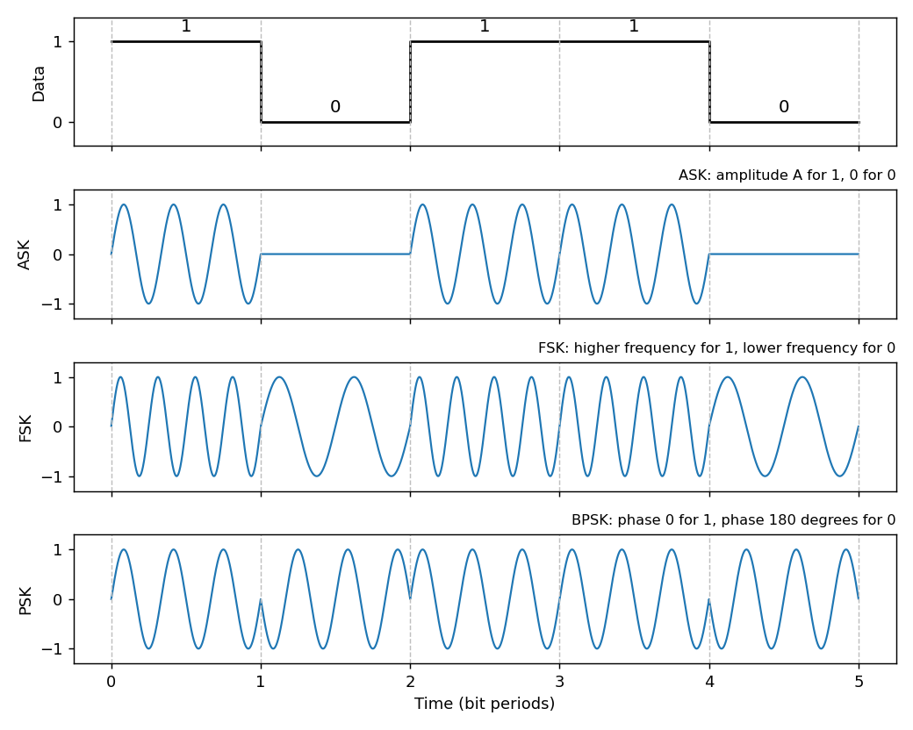
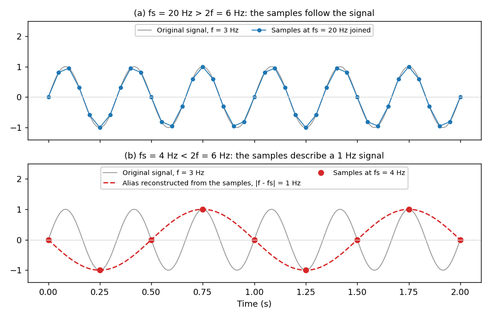

# HW2 과제 해설 — 변조, 다중화, TCP/IP

[레포지토리 안내](../../README.ko.md) | [English](Assignment-Explanation.md) | [한국어](Assignment-Explanation.ko.md)

> **최종 수정일:** 2026-11-04

> **학습 목표:**
> 1. ASK, FSK, PSK가 반송파의 어떤 특성을 바꾸는지와 각 방식의 장단점을 비교할 수 있다
> 2. 샘플링 주파수가 신호의 최고 주파수의 2배보다 커야 하는 이유를 에일리어싱으로 설명하고 에일리어스 주파수를 계산할 수 있다
> 3. FDM과 TDM, 동기식 TDM과 비동기식 TDM의 차이를 설명할 수 있다
> 4. TCP/IP 5계층의 기능을 OSI 7계층과 대응시키고, IPv4 헤더의 각 필드가 하는 일을 설명할 수 있다
> 5. 네트워크 계층과 전송 계층의 역할을 통신 범위, 주소, 데이터 단위, 신뢰성으로 비교할 수 있다

---

## 목차

- [1. 과제 구성](#1-과제-구성)
- [2. ASK, FSK, PSK (문제 1)](#2-ask-fsk-psk-문제-1)
- [3. 샘플링 주파수와 에일리어싱 (문제 2)](#3-샘플링-주파수와-에일리어싱-문제-2)
- [4. FDM과 TDM (문제 3)](#4-fdm과-tdm-문제-3)
- [5. TCP/IP 5계층과 OSI 7계층 (문제 4)](#5-tcpip-5계층과-osi-7계층-문제-4)
- [6. IP 헤더 (문제 5)](#6-ip-헤더-문제-5)
  - [6.1 IP 헤더가 붙는 이유](#61-ip-헤더가-붙는-이유)
  - [6.2 IPv4 헤더의 필드](#62-ipv4-헤더의-필드)
  - [6.3 단편화의 예](#63-단편화의-예)
- [7. 네트워크 계층과 전송 계층 (문제 6)](#7-네트워크-계층과-전송-계층-문제-6)
- [요약](#요약)
- [점검 문제](#점검-문제)
- [참고 문헌](#참고-문헌)

---

<br>

## 1. 과제 구성

4주차와 5주차의 학습 내용을 묻는 서술형 과제이다. 문제지는 여섯 문제로 이루어지며, 앞의 세 문제는 4주차의 신호 인코딩과 다중화를, 뒤의 세 문제는 5주차의 프로토콜 계층 구조를 묻는다.

```text
Coursework/HW02_Modulation-Multiplexing-and-TCP-IP/
├── Original/
│   └── Assignment-Weeks-4-5.pdf    # 과제 문제지
└── Solution/
    └── Assignment-Report.pdf       # 제출한 보고서
```

*그림 1. HW2 과제의 디렉토리 구성*

| 문제 | 묻는 내용 | 관련 단원 |
|:-----|:-----|:-----|
| 1 | 진폭 편이 변조(ASK), 주파수 편이 변조(FSK), 위상 편이 변조(PSK)의 특징 | 4주차 |
| 2 | 신호 샘플링에서 샘플링 주파수가 아날로그 신호 주파수의 2배 이상이어야 하는 이유 (그림과 설명) | 4주차 |
| 3 | 주파수 분할 다중화(FDM)와 시간 분할 다중화(TDM)의 특징과 차이점 | 4주차 |
| 4 | TCP/IP 5계층의 특징과 OSI 7계층과의 대응 | 5주차 |
| 5 | IP 데이터그램에 IP 헤더가 추가되는 이유와 역할 | 5주차 |
| 6 | 네트워크 계층과 전송 계층의 특징과 역할의 차이 | 5주차 |

*표 1. HW2의 문항 구성*

---

<br>

## 2. ASK, FSK, PSK (문제 1)

디지털 데이터를 전화선이나 무선처럼 아날로그 신호만 지나가는 매체로 보내려면, 일정한 주파수의 사인파인 **반송파(carrier)** 의 특성을 데이터에 따라 바꾼다. 이 과정을 **변조(modulation)** 라 한다. 반송파는 다음과 같이 진폭 $A$, 주파수 $f$, 위상 $\phi$ 세 가지 특성을 가지며, 어느 것을 바꾸는지에 따라 세 가지 기본 방식이 나뉜다.

```math
s(t) = A \cos(2\pi f t + \phi)
```

- **진폭 편이 변조(ASK, amplitude-shift keying):** 비트 1과 0에 서로 다른 진폭을 배정한다. 가장 단순한 형태는 1이면 반송파를 보내고 0이면 보내지 않는 온오프 방식이다.
- **주파수 편이 변조(FSK, frequency-shift keying):** 진폭과 위상은 그대로 두고, 반송 주파수 근처의 두 주파수 $f_1$, $f_2$를 비트 1과 0에 배정한다.
- **위상 편이 변조(PSK, phase-shift keying):** 반송파의 위상을 바꾼다. 2진 PSK(BPSK)는 1을 위상 0°, 0을 위상 180°로 보낸다.



*그림 2. 같은 비트열 10110을 ASK, FSK, BPSK로 변조한 파형*

| 방식 | 바꾸는 특성 | 장점 | 단점 | 쓰이는 곳 |
|:-----|:-----|:-----|:-----|:-----|
| ASK | 진폭 | 구현이 가장 간단하다 | 잡음과 감쇠가 진폭을 직접 바꾸므로 오류에 민감하다. 음성급 회선에서 1,200 bps 이하로 쓴다 | 광섬유 통신에서 빛을 켜고 끄는 방식 |
| FSK | 주파수 | 진폭에 실린 잡음의 영향을 덜 받아 ASK보다 오류에 강하다 | 두 주파수를 쓰므로 대역폭을 더 차지한다 | 음성급 회선(1,200 bps 이하), 3\~30 MHz 무선 전송, 동축 케이블 LAN, 저주파 무선 |
| PSK | 위상 | 잡음에 가장 강하고, 한 심볼에 여러 비트를 실어 대역폭 효율이 높다 | 수신기가 반송파의 위상을 정확히 복원해야 하므로 복조가 복잡하다 | 무선 LAN, 이동통신, 위성 통신 |

*표 2. ASK, FSK, PSK의 비교*

PSK는 위상을 두 가지보다 많이 쓰면 한 번의 신호 변화(심볼)에 여러 비트를 실을 수 있다. 위상 0°, 90°, 180°, 270°의 네 가지를 쓰는 QPSK는 한 심볼에 2비트를, 여덟 가지 위상을 쓰는 8PSK는 3비트를 싣는다. 초당 심볼 수를 **보 속도(baud rate)** $B_s$, 심볼의 종류 수를 $M$이라 하면 데이터 전송 속도 $R$은 다음과 같다.

```math
R = B_s \times \log_2 M
```

예를 들어 2,400 baud로 QPSK($`M = 4`$)를 쓰면 $R = 2400 \times 2 = 4800$ bps이고, 같은 보 속도로 8PSK($`M = 8`$)를 쓰면 $R = 2400 \times 3 = 7200$ bps이다. 보 속도가 같으면 신호가 차지하는 대역폭도 거의 같으므로, $M$을 늘리면 같은 대역폭으로 더 많은 비트를 보낸다. 다만 위상 사이의 간격이 좁아져 잡음에 의한 오판이 늘어나므로 $M$을 무한정 키울 수는 없다.

> **핵심:** 진폭은 잡음이 가장 직접 더해지는 특성이어서 ASK가 오류에 가장 약하고, 위상은 진폭 잡음의 영향을 거의 받지 않아 PSK가 가장 강하다. 실제 고속 통신은 진폭과 위상을 함께 바꾸는 QAM처럼 이 방식들을 결합해 쓴다.

---

<br>

## 3. 샘플링 주파수와 에일리어싱 (문제 2)

아날로그 정보를 디지털로 보내는 **펄스 부호 변조(PCM)** 는 신호의 값을 일정한 간격으로 측정하는 **샘플링**, 측정값을 정해진 단계로 반올림하는 **양자화**, 그 단계를 비트로 나타내는 **부호화**로 이루어진다. 1초에 측정하는 횟수를 **샘플링 주파수(sampling rate)** $f_s$라 한다.

**샘플링 정리(sampling theorem)** 는 최고 주파수가 $f_{\max}$인 신호를 샘플로부터 정확히 복원하려면 다음 조건을 만족해야 한다고 말한다 [1].

```math
f_s > 2 f_{\max}
```

$2 f_{\max}$를 **나이퀴스트 율(Nyquist rate)** 이라 한다. 조건을 만족하지 않으면 원래보다 낮은 주파수의 다른 신호가 같은 샘플을 만들어 내어 둘을 구별할 수 없다. 이 현상을 **에일리어싱(aliasing)** 이라 하고, 잘못 복원되는 낮은 주파수를 **에일리어스(alias)** 라 한다.



*그림 3. 3 Hz 사인파를 20 Hz와 4 Hz로 샘플링한 결과*

그림 3에서 원래 신호는 $x(t) = \sin(2\pi \cdot 3t)$, 즉 3 Hz 사인파이며 나이퀴스트 율은 6 Hz이다.

- **(a) $f_s = 20$ Hz:** 6 Hz보다 크므로 한 주기에 6개 이상의 샘플이 찍혀 파형의 오르내림을 모두 담는다. 샘플을 이으면 원래 신호의 모양이 드러나고, 저역 통과 필터로 매끄럽게 하면 원래 신호가 복원된다.
- **(b) $f_s = 4$ Hz:** 6 Hz보다 작으므로 샘플이 부족하다. $n$번째 샘플의 시각은 $t = n/4$이고, 샘플 값은 다음과 같이 위상이 반대인 1 Hz 신호 $-\sin(2\pi \cdot 1 \cdot t)$의 샘플과 정확히 같다.

  ```math
  \sin\!\left(2\pi \cdot 3 \cdot \frac{n}{4}\right) = \sin\!\left(2\pi \cdot \frac{3n}{4} - 2\pi n\right) = \sin\!\left(2\pi \cdot (3 - 4) \cdot \frac{n}{4}\right) = -\sin\!\left(2\pi \cdot 1 \cdot \frac{n}{4}\right)
  ```

  첫 번째 등호는 사인 함수의 각에서 $2\pi n$을 빼도 값이 변하지 않는다는 주기성을, 마지막 등호는 $\sin(-x) = -\sin x$를 쓴 것이다. 따라서 4 Hz로 찍은 샘플만 보고서는 3 Hz 신호인지 1 Hz 신호인지 알 수 없고, 복원하면 1 Hz 신호(그림의 빨간 점선)가 나온다.

일반적으로 주파수 $f$인 성분을 $f_s$로 샘플링하면, 정수 $k$에 대해 $\lvert f - k f_s \rvert$인 주파수들과 같은 샘플이 나오며, 그중 $f_s/2$ 이하인 것이 복원된다. 위의 예에서는 $\lvert 3 - 1 \times 4 \rvert = 1$ Hz이다. 주파수 영역에서 보면 샘플링은 신호의 스펙트럼을 $f_s$ 간격으로 복제하는데, $f_s \le 2 f_{\max}$이면 복제된 스펙트럼이 원래 스펙트럼과 겹쳐 분리할 수 없게 된다.

부등호가 등호를 포함하지 않는 이유도 확인할 필요가 있다. $f_s = 2f$로 사인파를 샘플링하면 반 주기마다 한 번 샘플을 찍는데, 샘플이 마침 0을 지나는 순간에 찍히면 모든 샘플이 0이 되어 신호가 사라진다. 그 밖의 경우에도 샘플 값의 크기는 샘플이 찍히는 위상에 따라 0과 원래 진폭 사이에서 달라지므로, 샘플만으로는 원래 신호의 진폭과 위상을 정할 수 없다. 따라서 확실한 복원에는 $2f$보다 큰 샘플링 주파수가 필요하다. 실제 시스템은 샘플링 전에 **에일리어싱 방지 필터**로 $f_s/2$ 이상의 성분을 먼저 제거하고, 여유를 두고 샘플링한다.

4주차의 전화 음성이 대표적인 예이다. 음성 신호의 에너지 대부분은 4 kHz 이하에 있으므로 그 2배인 8,000 Hz로 샘플링하고, 각 샘플을 8비트(256단계)로 양자화한다. 샘플링 전의 필터가 4 kHz보다 낮은 주파수까지만 통과시키므로 8,000 Hz는 신호에 남은 최고 주파수의 2배보다 크다. 음성 한 채널의 전송 속도는 $8000 \times 8 = 64000$ bps, 즉 64 kbps이다.

> **주의:** 샘플링 정리의 기준은 신호의 대표 주파수가 아니라 신호에 들어 있는 **최고** 주파수이다. 음성처럼 여러 주파수가 섞인 신호는 가장 높은 성분을 기준으로 샘플링 주파수를 정한다.

---

<br>

## 4. FDM과 TDM (문제 3)

**다중화(multiplexing)** 는 여러 개의 저속 채널을 하나의 고속 전송로에 함께 싣는 기술이며, 받는 쪽에서 원래 채널로 나누는 과정을 **역다중화(demultiplexing)** 라 한다. 두 대표 방식은 전송로의 자원을 나누는 축이 다르다.

**주파수 분할 다중화(FDM)** 는 전송로의 전체 주파수 대역을 여러 개의 좁은 대역(채널)으로 나누어 사용자마다 하나씩 배정한다. 각 사용자의 신호는 자기 채널의 반송 주파수로 변조되어 모든 사용자가 **동시에** 전송한다. 이웃 채널끼리 간섭하지 않도록 채널 사이에 비워 두는 대역을 **가드 밴드(guard band)** 라 한다. 신호의 대역폭이 매체의 대역폭보다 훨씬 작을 때 쓸 수 있으며, 주로 아날로그 신호 전송(라디오와 TV 방송, 옛 전화 중계)에 쓰인다.

```text
주파수 ▲
       │ ████████████████████████████  채널 C
       │ ░░░░░░░░░ 가드 밴드 ░░░░░░░░░
       │ ████████████████████████████  채널 B
       │ ░░░░░░░░░ 가드 밴드 ░░░░░░░░░
       │ ████████████████████████████  채널 A
       └─────────────────────────────▶ 시간
```

*그림 4. FDM: 주파수 축을 나누어 모든 채널이 동시에 전송*

**시간 분할 다중화(TDM)** 는 전송로를 쓰는 시간을 짧은 **타임 슬롯**으로 나누어 사용자에게 차례로 배정한다. 어느 순간에는 한 사용자만 전송로 전체의 대역을 쓰지만, 슬롯이 매우 빠르게 돌아가므로 모든 사용자가 동시에 쓰는 것처럼 보인다. 슬롯이 한 바퀴 도는 단위를 **프레임**이라 한다. 신호의 전송 속도가 매체의 전송 속도보다 훨씬 작을 때 쓸 수 있으며, 주로 디지털 신호 전송(디지털 전화 회선 등)에 쓰인다.

```text
주파수 ▲
       │ ┌──┬──┬──┬──┬──┬──┬──┬──┬──┐
       │ │A │B │C │A │B │C │A │B │C │
       │ └──┴──┴──┴──┴──┴──┴──┴──┴──┘
       │  프레임 1  프레임 2  프레임 3
       └─────────────────────────────▶ 시간
```

*그림 5. TDM: 시간 축을 나누어 채널이 차례로 전체 대역을 사용*

TDM은 슬롯을 배정하는 방식에 따라 둘로 나뉜다.

- **동기식 TDM:** 슬롯을 사용자에게 고정 배정한다. 사용자 A, B, C에게 매 프레임 한 슬롯씩 배정하면 A에게 보낼 데이터가 없을 때도 A의 슬롯이 비어 있는 채로 전송되어 용량이 낭비된다. 대신 슬롯의 위치가 곧 사용자를 뜻하므로 주소가 필요 없다.
- **비동기식(통계적) TDM:** 보낼 데이터가 있는 사용자에게만 슬롯을 동적으로 배정해 낭비를 줄인다. 슬롯의 위치로 사용자를 알 수 없으므로 슬롯마다 주소 정보를 붙여야 한다.

| 항목 | FDM | TDM |
|:-----|:-----|:-----|
| 나누는 자원 | 주파수 대역 | 시간 |
| 각 사용자가 쓰는 것 | 좁은 주파수 대역을 항상 | 전체 대역을 자기 슬롯 동안만 |
| 채널 사이의 보호 | 가드 밴드 | 슬롯 사이의 보호 시간과 동기 |
| 주로 다루는 신호 | 아날로그 신호 | 디지털 신호 |
| 조건 | 신호 대역폭이 매체 대역폭보다 훨씬 작음 | 신호 전송 속도가 매체 전송 속도보다 훨씬 작음 |
| 단점 | 가드 밴드만큼 대역이 낭비되고, 채널마다 필터와 변조기가 필요함 | 송수신 측의 정밀한 시간 동기가 필요하고, 동기식은 빈 슬롯이 낭비됨 |

*표 3. FDM과 TDM의 비교*

> **핵심:** FDM은 모두가 동시에 서로 다른 주파수로, TDM은 모두가 같은 주파수 대역을 서로 다른 시간에 쓴다. 두 방식은 함께 쓰일 수도 있어서, 주파수 채널을 나눈 뒤 각 채널을 다시 타임 슬롯으로 나누는 시스템도 있다.

---

<br>

## 5. TCP/IP 5계층과 OSI 7계층 (문제 4)

통신 기능을 계층으로 나누면 각 계층은 바로 아래 계층의 서비스를 이용해 바로 위 계층에 서비스를 제공하고, 한 계층의 구현을 바꾸어도 다른 계층은 영향을 받지 않는다. **OSI 모델**은 ISO가 만든 7계층의 참조 모델이고, **TCP/IP**는 인터넷에서 실제로 쓰이며 사실상의 표준이 된 프로토콜 구조이다. 5주차는 TCP/IP를 물리, 네트워크 접근, 인터넷, 전송, 응용의 5계층으로 나눈다.

| TCP/IP 계층 | 하는 일 | 데이터 단위 | 주소 | 프로토콜과 장비의 예 | 대응하는 OSI 계층 |
|:-----|:-----|:-----|:-----|:-----|:-----|
| 응용 계층 | 사용자 응용 프로그램에 통신 서비스를 제공한다 | 메시지 | - | HTTP, SMTP, FTP, SSH | 응용, 표현, 세션 (7, 6, 5계층) |
| 전송 계층 (host-to-host) | 종단 호스트의 프로세스 사이에서 데이터를 전달하고, 신뢰성과 순서를 보장한다 | 세그먼트 | 포트 번호 | TCP, UDP | 전송 (4계층) |
| 인터넷 계층 | 여러 네트워크를 거쳐 데이터그램을 목적지 호스트까지 라우팅한다 | 데이터그램(패킷) | IP 주소 | IP, ICMP, ARP; 라우터 | 네트워크 (3계층) |
| 네트워크 접근 계층 | 같은 네트워크 안에서 패킷을 프레임으로 만들어 주고받는다 | 프레임 | MAC 주소 | 이더넷, PPP, 토큰 링; 스위치, 브리지 | 데이터 링크 (2계층) |
| 물리 계층 | 비트를 전송 매체의 신호로 바꾸어 보낸다 | 비트 | - | 전압, 주파수, 커넥터 규격; 리피터, 허브 | 물리 (1계층) |

*표 4. TCP/IP 5계층의 기능과 OSI 7계층과의 대응*

OSI의 세션 계층(대화의 시작과 종료, 동기점 관리)과 표현 계층(데이터 형식 변환, 암호화, 압축)은 TCP/IP에서 따로 두지 않고, 필요하면 응용 프로그램이 직접 처리한다. 또한 물리 계층과 네트워크 접근 계층을 합쳐 TCP/IP를 4계층으로 설명하기도 한다.

데이터는 송신 측에서 위 계층부터 아래 계층으로 내려가며 계층마다 헤더가 붙는데, 이를 **캡슐화(encapsulation)** 라 한다. 수신 측은 반대로 아래 계층부터 헤더를 하나씩 떼어 낸다.

```text
응용 계층                                 [  데이터  ]
전송 계층                       [TCP 헤더][  데이터  ]               세그먼트
인터넷 계층             [IP 헤더][TCP 헤더][  데이터  ]               데이터그램
네트워크 접근 계층 [MAC 헤더][IP 헤더][TCP 헤더][  데이터  ][트레일러]  프레임
물리 계층          0 1 1 0 1 0 0 1 ...                                비트
```

*그림 6. TCP/IP 계층을 내려가며 이루어지는 캡슐화*

> **핵심:** OSI는 계층의 기능을 정교하게 정의한 개념 모델로 학습과 설계의 기준이 되고, TCP/IP는 인터넷에 먼저 보급되어 실제 구현의 표준이 되었다. 두 모델은 전송 계층과 네트워크(인터넷) 계층에서 정확히 대응한다.

---

<br>

## 6. IP 헤더 (문제 5)

### 6.1 IP 헤더가 붙는 이유

인터넷 계층은 전송 계층에서 받은 세그먼트 앞에 IP 헤더를 붙여 **IP 데이터그램**을 만든다. 데이터그램의 페이로드는 TCP 세그먼트일 수도 있고 UDP 데이터그램이나 ICMP 메시지일 수도 있다. IP 헤더가 필요한 이유는 데이터그램이 출발지에서 목적지까지 **서로 다른 여러 네트워크와 라우터를 거쳐야** 하기 때문이다. 중간의 라우터들은 데이터그램의 내용을 모르고, 헤더만 보고 다음 행선지를 정한다. 따라서 헤더에는 다음 정보가 들어 있어야 한다.

1. **주소 지정과 라우팅:** 라우터가 다음 홉을 고를 수 있도록 목적지 IP 주소를, 응답을 돌려보낼 수 있도록 출발지 IP 주소를 담는다. IP 주소는 경로 전체에서 바뀌지 않지만, 네트워크 접근 계층의 MAC 주소는 홉마다 바뀐다.
2. **단편화와 재조립:** 네트워크마다 한 프레임에 실을 수 있는 최대 크기(MTU)가 다르므로, 큰 데이터그램을 작은 조각(단편)으로 나누고 목적지에서 다시 합칠 정보가 필요하다.
3. **수명 관리:** 경로 설정이 잘못되어 데이터그램이 라우터 사이를 계속 돌지 않도록 거칠 수 있는 라우터 수를 제한한다.
4. **상위 프로토콜의 구분:** 목적지가 페이로드를 TCP, UDP, ICMP 가운데 어디로 넘길지 알려 준다.
5. **헤더 오류 검출:** 전송 중에 헤더가 손상되면 잘못된 곳으로 배달될 수 있으므로 헤더의 오류를 검사한다.

### 6.2 IPv4 헤더의 필드

IPv4 헤더는 옵션이 없을 때 20바이트이고, 옵션을 포함하면 최대 60바이트이다 [2].

```text
 0       4       8               16    19                       31
┌───────┬───────┬───────────────┬───────────────────────────────┐
│  VER  │ HLEN  │      DS       │         Total length          │
├───────┴───────┴───────────────┼─────┬─────────────────────────┤
│        Identification         │Flags│  Fragmentation offset   │
├───────────────┬───────────────┼─────┴─────────────────────────┤
│ Time to live  │   Protocol    │        Header checksum        │
├───────────────┴───────────────┴───────────────────────────────┤
│                       Source IP address                       │
├───────────────────────────────────────────────────────────────┤
│                    Destination IP address                     │
├───────────────────────────────────────────────────────────────┤
│                      Options and padding                      │
└───────────────────────────────────────────────────────────────┘
```

*그림 7. IPv4 헤더의 구조 (한 줄이 32비트)*

| 필드 | 크기 | 역할 |
|:-----|:-----|:-----|
| VER (버전) | 4비트 | IP의 버전이다. IPv4는 4이다. |
| HLEN (헤더 길이) | 4비트 | 헤더 길이를 4바이트 단위로 나타낸다. 헤더 길이는 옵션에 따라 달라지므로 수신자는 이 값에 4를 곱해 데이터가 시작하는 위치를 안다. 최솟값 5는 20바이트, 최댓값 15는 60바이트이다. |
| DS (차등 서비스) | 8비트 | 데이터그램을 어떻게 처리할지를 정한다. 앞 6비트(DSCP)는 처리 우선순위 같은 서비스 등급을, 뒤 2비트는 혼잡 알림(ECN)을 나타낸다 [3], [4]. |
| Total length (전체 길이) | 16비트 | 헤더와 데이터를 합친 데이터그램 전체의 바이트 수이다. 16비트이므로 최대 $2^{16} - 1 = 65535$바이트이다. |
| Identification (식별자) | 16비트 | 출발지가 보내는 데이터그램마다 붙이는 번호이다. 한 데이터그램에서 나온 단편들은 같은 값을 가지므로, 목적지는 출발지 주소와 이 값으로 어느 단편끼리 합칠지 안다. |
| Flags (플래그) | 3비트 | 첫 비트는 예약되어 0이다. 둘째 비트 DF(Don't Fragment)가 1이면 단편화를 금지하고, 셋째 비트 MF(More Fragments)가 1이면 뒤에 단편이 더 있으며 0이면 마지막 단편이거나 단편화되지 않은 데이터그램이다. |
| Fragmentation offset (단편화 오프셋) | 13비트 | 이 단편의 데이터가 원래 데이터그램의 데이터에서 시작하는 위치를 8바이트 단위로 나타낸다. |
| Time to live (생존 시간) | 8비트 | 데이터그램이 거칠 수 있는 최대 라우터 수이다. 라우터를 지날 때마다 1씩 줄고, 0이 되면 데이터그램을 버린다. |
| Protocol (프로토콜) | 8비트 | 페이로드를 넘겨줄 상위 프로토콜의 번호이다. ICMP는 1, TCP는 6, UDP는 17이다. |
| Header checksum (헤더 검사합) | 16비트 | 헤더만 검사하며 데이터는 검사하지 않는다. TTL이 라우터마다 바뀌므로 라우터마다 다시 계산한다. |
| Source IP address (출발지 IP 주소) | 32비트 | 데이터그램을 보낸 호스트의 IP 주소이다. |
| Destination IP address (목적지 IP 주소) | 32비트 | 데이터그램을 받을 호스트의 IP 주소이다. |
| Options (옵션) | 0\~40바이트 | 경로 기록 같은 선택 기능이다. 헤더 길이가 4바이트의 배수가 되도록 패딩을 붙인다. |

*표 5. IPv4 헤더 필드의 크기와 역할*

> **참고:** Identification은 출발지 호스트를 구분하는 값이 아니라 출발지가 보낸 데이터그램 하나하나를 구분하는 값이다. 호스트는 출발지 IP 주소로 구분하고, 같은 출발지에서 온 여러 데이터그램의 단편들이 섞이지 않게 하는 것이 Identification의 역할이다.

### 6.3 단편화의 예

헤더 20바이트와 데이터 3,980바이트로 이루어진 4,000바이트의 데이터그램이 MTU가 1,500바이트인 네트워크를 지나야 하는 경우를 예로 든다. 단편 하나도 헤더 20바이트가 필요하므로 데이터는 최대 $1500 - 20 = 1480$바이트를 실을 수 있다. 오프셋이 8바이트 단위이므로 마지막 단편이 아닌 단편의 데이터 길이는 8의 배수여야 하며, 1480은 $8 \times 185$이므로 조건을 만족한다.

| 단편 | 데이터 범위 (바이트) | 데이터 길이 | Total length | Fragmentation offset | MF |
|:-----|:-----|:-----|:-----|:-----|:-----|
| 1 | 0\~1479 | 1,480 | 1,500 | 0 / 8 = 0 | 1 |
| 2 | 1480\~2959 | 1,480 | 1,500 | 1480 / 8 = 185 | 1 |
| 3 | 2960\~3979 | 1,020 | 1,040 | 2960 / 8 = 370 | 0 |

*표 6. 4,000바이트 데이터그램을 MTU 1,500바이트로 단편화한 결과*

세 단편의 데이터 길이를 더하면 $1480 + 1480 + 1020 = 3980$바이트로 원래 데이터와 같다. 세 단편은 모두 같은 Identification 값을 가지며, 목적지는 오프셋 순서로 데이터를 이어 붙이고 MF가 0인 단편으로 끝을 안다.

---

<br>

## 7. 네트워크 계층과 전송 계층 (문제 6)

두 계층 모두 송신 측에서 수신 측으로 데이터를 전달하지만, 책임지는 범위가 다르다. 네트워크 계층은 **호스트에서 호스트까지** 여러 네트워크를 거쳐 데이터를 옮기는 일을, 전송 계층은 도착한 데이터를 **호스트 안의 올바른 프로세스까지** 믿을 수 있게 전달하는 일을 맡는다.

| 항목 | 네트워크 계층 (OSI 3계층) | 전송 계층 (OSI 4계층) |
|:-----|:-----|:-----|
| 통신 범위 | 호스트와 호스트 사이 (홉 단위로 라우터를 거침) | 프로세스와 프로세스 사이 (종단 간, end-to-end) |
| 동작하는 곳 | 종단 호스트와 경로의 모든 라우터 | 종단 호스트에서만 |
| 주소 | 논리 주소 (IP 주소) | 포트 번호 (예: HTTP 80, HTTPS 443, SMTP 25) |
| 데이터 단위 | 패킷 (IP 데이터그램) | 세그먼트 (TCP), 데이터그램 (UDP) |
| 핵심 기능 | 라우팅, 포워딩, 단편화 | 다중화와 역다중화, 연결 관리, 오류 제어, 흐름 제어, 혼잡 제어 |
| 신뢰성 | IP는 최선형(best-effort) 전달로, 도착, 순서, 중복 없음을 보장하지 않는다 | TCP는 순서 번호, 확인 응답(ACK), 재전송으로 신뢰성을 보장하고, UDP는 보장하지 않는다 |
| 대표 프로토콜과 장비 | IP, ICMP, ARP; 라우터 | TCP, UDP |

*표 7. 네트워크 계층과 전송 계층의 비교*

경로 위의 중간 노드(라우터)는 1\~3계층만 처리하는 중계기로 동작하고, 4계층 이상은 종단 시스템 사이에서만 동작한다. 그래서 전송 계층을 종단 간 통신을 다루는 최하위 계층이라고 한다. 출발지와 목적지가 하나의 점대점 링크로 직접 연결되어 있으면 경로를 고를 필요가 없으므로 네트워크 계층 없이 데이터 링크 계층만으로도 통신할 수 있다.

전송 계층의 크기와 복잡도는 네트워크 계층이 제공하는 서비스의 종류에 따라 달라진다 [5]. 네트워크 계층이 가상 회선처럼 순서와 도착을 보장하는 신뢰성 있는 서비스를 제공하면 전송 계층은 최소한의 기능만으로 충분하다. 반대로 IP처럼 데이터그램을 보장 없이 전달하는 비신뢰성 서비스 위에서는 손실, 순서 뒤바뀜, 중복을 모두 전송 계층이 처리해야 하므로 TCP처럼 복잡한 전송 프로토콜이 필요하다.

> **참고:** 5주차 강의자료는 "3계층의 virtual circuit 기능을 위해서는 최소 4계층이 필요"로 적지만, 원래 뜻은 네트워크 계층이 신뢰성 있는 가상 회선 서비스를 제공하면 최소한의(minimal) 전송 계층으로 충분하다는 것이다 [5]. 네트워크 계층이 신뢰성을 더 많이 책임질수록 전송 계층은 단순해진다.

> **핵심:** 네트워크 계층은 "어느 경로로, 어느 호스트에" 보낼지를, 전송 계층은 "그 호스트의 어느 프로세스에, 빠짐없이 순서대로" 보낼지를 책임진다.

---

<br>

## 요약

| 개념 | 핵심 요약 |
|:-----|:-----|
| ASK, FSK, PSK | 반송파의 진폭, 주파수, 위상을 데이터에 따라 바꾸며, 오류에 강한 순서는 PSK, FSK, ASK이다. |
| 보 속도와 데이터 전송 속도 | 심볼 종류가 $M$개이면 한 심볼에 $\log_2 M$비트를 실으므로 $R = B_s \log_2 M$이다. |
| 샘플링 정리 | 최고 주파수가 $f_{\max}$인 신호는 $f_s > 2 f_{\max}$로 샘플링해야 복원할 수 있다. |
| 에일리어싱 | 샘플링 주파수가 부족하면 $\lvert f - k f_s \rvert$의 낮은 주파수 신호와 구별할 수 없게 된다. |
| FDM과 TDM | FDM은 주파수 대역을, TDM은 시간을 나누어 여러 채널을 한 전송로에 싣는다. |
| 동기식과 비동기식 TDM | 동기식은 슬롯을 고정 배정해 빈 슬롯이 낭비되고, 비동기식은 데이터가 있는 채널에만 주소를 붙여 슬롯을 배정한다. |
| TCP/IP 5계층 | 물리, 네트워크 접근, 인터넷, 전송, 응용 계층은 OSI의 물리, 데이터 링크, 네트워크, 전송, 세션과 표현과 응용 계층에 대응한다. |
| IP 헤더 | 여러 네트워크를 거치는 데 필요한 주소, 단편화, TTL, 상위 프로토콜, 헤더 검사합 정보를 담으며 기본 길이는 20바이트이다. |
| 네트워크 계층과 전송 계층 | 네트워크 계층은 IP 주소로 호스트 사이의 경로를, 전송 계층은 포트 번호로 프로세스 사이의 신뢰성 있는 전달을 책임진다. |

---

<br>

## 점검 문제

1. **데이터 전송 속도:** 보 속도가 1,000 baud인 16PSK 신호의 데이터 전송 속도는 얼마인가?

   <details>
   <summary>정답</summary>

   $M = 16$이므로 한 심볼에 $\log_2 16 = 4$비트를 싣는다. $R = 1000 \times 4 = 4000$ bps이다.

   </details>

2. **에일리어스:** 5 kHz 성분을 8 kHz로 샘플링하면 어떤 주파수로 복원되는가?

   <details>
   <summary>정답</summary>

   나이퀴스트 율 10 kHz보다 샘플링 주파수가 작아 에일리어싱이 생긴다. $\lvert 5 - 8 \rvert = 3$ kHz이고 3 kHz는 $f_s/2 = 4$ kHz 이하이므로 3 kHz 신호로 복원된다.

   </details>

3. **동기식 TDM의 효율:** 사용자 네 명에게 매 프레임 한 슬롯씩 고정 배정한 동기식 TDM에서, 어느 순간 두 명만 데이터를 보낸다면 전송로의 몇 %가 낭비되는가?

   <details>
   <summary>정답</summary>

   프레임의 슬롯 4개 가운데 2개가 빈 채로 전송되므로 50%가 낭비된다. 비동기식 TDM은 데이터가 있는 두 사용자에게만 슬롯을 배정해 이 낭비를 줄인다.

   </details>

4. **헤더 길이:** IPv4 헤더의 HLEN 필드가 6이다. 헤더의 길이와 옵션의 길이는 얼마인가?

   <details>
   <summary>정답</summary>

   헤더 길이는 $6 \times 4 = 24$바이트이고, 기본 헤더 20바이트를 빼면 옵션(패딩 포함)은 4바이트이다.

   </details>

5. **단편화:** 헤더 20바이트와 데이터 2,000바이트인 데이터그램이 MTU 1,000바이트인 네트워크를 지난다. 각 단편의 데이터 길이와 오프셋 값을 쓰라.

   <details>
   <summary>정답</summary>

   단편 하나에 실을 수 있는 데이터는 $1000 - 20 = 980$바이트이지만 8의 배수여야 하므로 976바이트이다. 단편은 데이터 976바이트(오프셋 0, MF 1), 976바이트(오프셋 976 / 8 = 122, MF 1), 48바이트(오프셋 1952 / 8 = 244, MF 0)이며, $976 + 976 + 48 = 2000$이다.

   </details>

6. **주소의 범위:** 데이터그램이 라우터 세 개를 거쳐 목적지에 도착할 때, 경로 중에 바뀌는 주소와 바뀌지 않는 주소는 무엇인가?

   <details>
   <summary>정답</summary>

   네트워크 접근 계층의 MAC 주소는 링크마다 새 프레임이 만들어지므로 홉마다 바뀐다. 출발지와 목적지 IP 주소, 그리고 전송 계층의 포트 번호는 경로 전체에서 바뀌지 않는다.

   </details>

---

<br>

## 참고 문헌

1. C. E. Shannon, "Communication in the presence of noise," *Proc. IRE*, vol. 37, no. 1, pp. 10-21, 1949.
2. J. Postel, "Internet Protocol," RFC 791, Sep. 1981.
3. K. Nichols, S. Blake, F. Baker, and D. Black, "Definition of the Differentiated Services Field (DS Field) in the IPv4 and IPv6 Headers," RFC 2474, Dec. 1998.
4. K. Ramakrishnan, S. Floyd, and D. Black, "The Addition of Explicit Congestion Notification (ECN) to IP," RFC 3168, Sep. 2001.
5. W. Stallings, *Data and Computer Communications*, 10th ed. Boston, MA, USA: Pearson, 2014.
