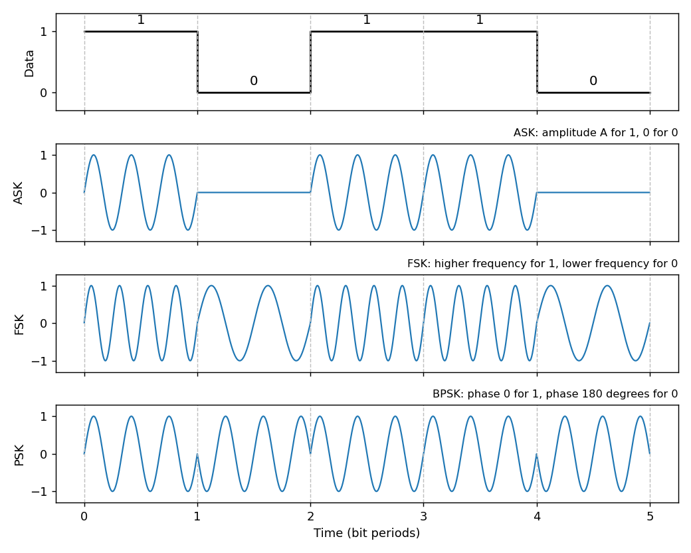
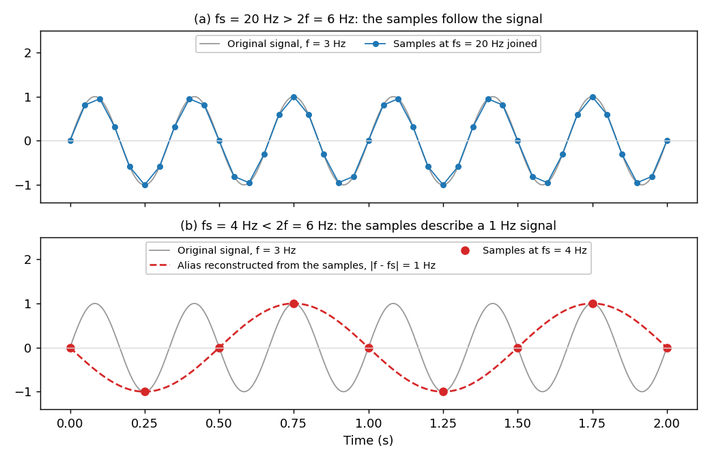

# HW2 Assignment Explanation — Modulation, Multiplexing, and TCP/IP

[Repository Guide](../../README.md) | [English](Assignment-Explanation.md) | [한국어](Assignment-Explanation.ko.md)

> **Last Updated:** 2026-11-16

> **Learning Objectives:**
> 1. Compare which property of the carrier ASK, FSK, and PSK change and the strengths and weaknesses of each method
> 2. Explain why the sampling rate must exceed twice the highest frequency of a signal, and compute the frequency recovered when the condition is violated
> 3. Explain the differences between FDM and TDM and between synchronous and asynchronous TDM
> 4. Map the functions of the five TCP/IP layers to the seven OSI layers and explain what each field of the IPv4 header does
> 5. Compare the characteristics and roles of the network layer and the transport layer

---

## Table of Contents

- [1. Assignment Layout](#1-assignment-layout)
- [2. ASK, FSK, and PSK (Question 1)](#2-ask-fsk-and-psk-question-1)
- [3. Condition on the Sampling Rate (Question 2)](#3-condition-on-the-sampling-rate-question-2)
- [4. FDM and TDM (Question 3)](#4-fdm-and-tdm-question-3)
- [5. The Five TCP/IP Layers and the Seven OSI Layers (Question 4)](#5-the-five-tcpip-layers-and-the-seven-osi-layers-question-4)
- [6. The IP Header (Question 5)](#6-the-ip-header-question-5)
  - [6.1 Why the IP Header Is Added](#61-why-the-ip-header-is-added)
  - [6.2 Fields of the IPv4 Header](#62-fields-of-the-ipv4-header)
  - [6.3 An Example of Computing Header Field Values](#63-an-example-of-computing-header-field-values)
- [7. The Network Layer and the Transport Layer (Question 6)](#7-the-network-layer-and-the-transport-layer-question-6)
- [Summary](#summary)
- [Self-Check Questions](#self-check-questions)
- [References](#references)

---

<br>

## 1. Assignment Layout

> **Try It First:** This document contains the answers and solutions. Solve the problems in the [assignment handout](Original/Assignment.md) yourself before reading on.

This is an essay assignment on the material of weeks 4 and 5. The assignment has six questions: the first three ask about signal encoding and multiplexing from Week 4, and the last three ask about the layered protocol architecture from Week 5. The original questions and their points are in the [assignment handout](Original/Assignment.md), and each of Sections 2-7 also opens with the question it answers.

```text
Coursework/HW02_Modulation-Multiplexing-and-TCP-IP/
├── Original/
│   ├── Assignment.ko.md            # assignment handout (Korean)
│   └── Assignment.md               # assignment handout (English)
├── Assignment-Explanation.ko.md    # assignment explanation (Korean)
└── Assignment-Explanation.md       # assignment explanation (English)
```

*Figure 1. Directory layout of HW2*

| Question | What It Asks | Related Units |
|:-----|:-----|:-----|
| 1 | Characteristics of amplitude-shift keying (ASK), frequency-shift keying (FSK), and phase-shift keying (PSK) | Week 4 |
| 2 | Why the sampling rate must be at least twice the frequency of the analog signal when sampling a signal (with a figure and explanation) | Week 4 |
| 3 | Characteristics of and differences between frequency-division multiplexing (FDM) and time-division multiplexing (TDM) | Week 4 |
| 4 | Characteristics of the five TCP/IP layers and their correspondence to the seven OSI layers | Week 5 |
| 5 | Why an IP header is added to an IP datagram, and what it does | Week 5 |
| 6 | Differences in the characteristics and roles of the network layer and the transport layer | Week 5 |

*Table 1. Questions of HW2*

---

<br>

## 2. ASK, FSK, and PSK (Question 1)

**Question 1.** Explain the characteristics of each of the amplitude modulation method (amplitude-shift keying; ASK), the frequency modulation method (frequency-shift keying; FSK), and the phase modulation method (phase-shift keying; PSK).

To send digital data over a medium that carries only analog signals, such as a telephone line or radio, a property of the **carrier**, a sine wave of fixed frequency, is changed according to the data. This process is called **modulation**. As shown below, the carrier has three properties, amplitude $A$, frequency $f$, and phase $\phi$, and the three basic methods differ in which one they change.

```math
s(t) = A \cos(2\pi f t + \phi)
```

- **Amplitude-shift keying (ASK):** Different amplitudes are assigned to bits 1 and 0. The simplest form is on-off keying, which sends the carrier for 1 and nothing for 0.
- **Frequency-shift keying (FSK):** The amplitude and phase stay fixed, and two frequencies $f_1$ and $f_2$ near the carrier frequency are assigned to bits 1 and 0.
- **Phase-shift keying (PSK):** The phase of the carrier is changed. Binary PSK (BPSK) sends 1 with phase 0° and 0 with phase 180°.



*Figure 2. The same bit sequence 10110 modulated with ASK, FSK, and BPSK*

| Method | Property Changed | Strengths | Weaknesses | Where It Is Used |
|:-----|:-----|:-----|:-----|:-----|
| ASK | Amplitude | The simplest to implement | Noise and attenuation change the amplitude directly, so it is sensitive to errors. Used at 1,200 bps or less on voice-grade lines | Switching light on and off in optical fiber communication |
| FSK | Frequency | Less affected by noise on the amplitude, so more robust to errors than ASK | Uses two frequencies and so occupies more bandwidth | Voice-grade lines (1,200 bps or less), 3-30 MHz radio transmission, coaxial cable LANs, low-frequency radio |
| PSK | Phase | The most robust to noise, and carrying several bits per symbol gives high bandwidth efficiency | The receiver must recover the carrier phase accurately, so demodulation is complex | Wireless LANs, mobile communication, satellite communication |

*Table 2. Comparison of ASK, FSK, and PSK*

When PSK uses more than two phases, one signal change (a symbol) can carry several bits. QPSK, which uses the four phases 0°, 90°, 180°, and 270°, carries 2 bits per symbol, and 8PSK, which uses eight phases, carries 3 bits. If the number of symbols per second is the **baud rate** $B_s$ and the number of distinct symbols is $M$, the data rate $R$ is as follows.

```math
R = B_s \times \log_2 M
```

For example, QPSK ($`M = 4`$) at 2,400 baud gives $R = 2400 \times 2 = 4800$ bps, and 8PSK ($`M = 8`$) at the same baud rate gives $R = 2400 \times 3 = 7200$ bps. At the same baud rate the signal occupies almost the same bandwidth, so increasing $M$ sends more bits in the same bandwidth. The phases, however, move closer together and noise causes more misjudgments, so $M$ cannot grow without limit.

> **Key Point:** Amplitude is the property to which noise is added most directly, so ASK is the most vulnerable to errors, and phase is hardly affected by amplitude noise, so PSK is the most robust. Real high-speed communication combines these methods, as in QAM, which changes amplitude and phase together.

---

<br>

## 3. Condition on the Sampling Rate (Question 2)

**Question 2.** When sampling a signal to encode an analog signal into digital form, explain why the sampling rate must be at least twice the frequency of the analog signal. Include a figure and an explanation.

**Pulse code modulation (PCM)**, which sends analog information digitally, consists of **sampling**, which measures the value of the signal at regular intervals, **quantization**, which rounds each measurement to a fixed step, and **encoding**, which represents the step in bits. The number of measurements per second is called the **sampling rate** $f_s$.

The **sampling theorem** states that to reconstruct a signal whose highest frequency is $f_{\max}$ exactly from its samples, the following condition must hold [1].

```math
f_s > 2 f_{\max}
```

$2 f_{\max}$ is called the **Nyquist rate**. If the condition does not hold, a different signal of lower frequency produces the same samples, and the two cannot be told apart. This phenomenon is called **aliasing**, and the lower frequency that is wrongly reconstructed is called an **alias**.



*Figure 3. A 3 Hz sine wave sampled at 20 Hz and at 4 Hz*

In Figure 3 the original signal is $x(t) = \sin(2\pi \cdot 3t)$, a 3 Hz sine wave, and the Nyquist rate is 6 Hz.

- **(a) $f_s = 20$ Hz:** This exceeds 6 Hz, so more than six samples fall in each period and capture every rise and fall of the waveform. Joining the samples reveals the shape of the original signal, and smoothing them with a low-pass filter reconstructs it.
- **(b) $f_s = 4$ Hz:** This is below 6 Hz, so there are too few samples. The $`n`$th sample is taken at $t = n/4$, and its value equals exactly the sample of the 1 Hz signal of opposite phase, $-\sin(2\pi \cdot 1 \cdot t)$, as follows.

  ```math
  \sin\!\left(2\pi \cdot 3 \cdot \frac{n}{4}\right) = \sin\!\left(2\pi \cdot \frac{3n}{4} - 2\pi n\right) = \sin\!\left(2\pi \cdot (3 - 4) \cdot \frac{n}{4}\right) = -\sin\!\left(2\pi \cdot 1 \cdot \frac{n}{4}\right)
  ```

  The first equality uses the periodicity that subtracting $2\pi n$ from the angle of a sine does not change its value, and the last equality uses $\sin(-x) = -\sin x$. Therefore the samples taken at 4 Hz alone cannot tell whether the signal is 3 Hz or 1 Hz, and reconstruction yields a 1 Hz signal (the red dashed line in the figure).

In general, sampling a component of frequency $f$ at $f_s$ gives the same samples as the frequencies $\lvert f - k f_s \rvert$ for integers $k$, and the one at or below $f_s/2$ is what is reconstructed. In the example above it is $\lvert 3 - 1 \times 4 \rvert = 1$ Hz. Viewed in the frequency domain, sampling replicates the spectrum of the signal at intervals of $f_s$, and if $f_s \le 2 f_{\max}$, the replicated spectra overlap the original spectrum and can no longer be separated.

The reason the inequality excludes equality also needs checking. Sampling a sine wave at $f_s = 2f$ takes one sample every half period, and if the samples happen to fall at the instants the wave crosses 0, every sample is 0 and the signal vanishes. In other cases, too, the magnitude of the samples ranges between 0 and the original amplitude depending on the phase at which they are taken, so the samples alone cannot determine the amplitude and phase of the original signal. Reliable reconstruction therefore needs a sampling rate greater than $2f$. Real systems first remove components at or above $f_s/2$ with an **anti-aliasing filter** before sampling, and sample with a margin.

Telephone voice in Week 4 is a typical example. Most of the energy of a voice signal lies below 4 kHz, so it is sampled at twice that, 8,000 Hz, and each sample is quantized to 8 bits (256 levels). The filter before sampling passes only frequencies below 4 kHz, so 8,000 Hz exceeds twice the highest frequency left in the signal. The data rate of one voice channel is $8000 \times 8 = 64000$ bps, that is, 64 kbps.

> **Caution:** The sampling theorem is based not on a representative frequency of the signal but on the **highest** frequency it contains. For a signal that mixes many frequencies, such as voice, the sampling rate is set by its highest component.

---

<br>

## 4. FDM and TDM (Question 3)

**Question 3.** Explain the characteristics of frequency-division multiplexing (FDM) and time-division multiplexing (TDM), and present their differences.

**Multiplexing** is the technique of carrying several low-speed channels together over one high-speed link, and separating them back into the original channels at the receiver is called **demultiplexing**. The two representative methods differ in the axis along which they divide the resources of the link.

**Frequency-division multiplexing (FDM)** divides the whole frequency band of the link into several narrow bands (channels) and assigns one to each user. Each user's signal is modulated onto the carrier frequency of its channel, and all users transmit **at the same time**. The band left empty between channels so that neighboring channels do not interfere is called a **guard band**. FDM is usable when the bandwidth of the signals is much smaller than the bandwidth of the medium, and it is used mainly for analog signal transmission (radio and TV broadcasting, older telephone trunks).

```text
Freq.  ▲
       │ ████████████████████████████  Channel C
       │ ░░░░░░░░░ guard band ░░░░░░░░
       │ ████████████████████████████  Channel B
       │ ░░░░░░░░░ guard band ░░░░░░░░
       │ ████████████████████████████  Channel A
       └─────────────────────────────▶ Time
```

*Figure 4. FDM: the frequency axis is divided and all channels transmit at the same time*

**Time-division multiplexing (TDM)** divides the time the link is used into short **time slots** and assigns them to users in turn. At any instant only one user uses the whole band of the link, but the slots rotate so fast that all users appear to use it at the same time. One full cycle of the slots is called a **frame**. TDM is usable when the data rate of the signals is much smaller than the data rate of the medium, and it is used mainly for digital signal transmission (such as digital telephone lines).

```text
Freq.  ▲
       │ ┌──┬──┬──┬──┬──┬──┬──┬──┬──┐
       │ │A │B │C │A │B │C │A │B │C │
       │ └──┴──┴──┴──┴──┴──┴──┴──┴──┘
       │  Frame 1   Frame 2   Frame 3
       └─────────────────────────────▶ Time
```

*Figure 5. TDM: the time axis is divided and the channels use the whole band in turn*

TDM splits into two by how slots are assigned.

- **Synchronous TDM:** Slots are assigned to users permanently. If users A, B, and C each get one slot per frame, A's slot is sent empty even when A has no data, wasting capacity. In return, the position of a slot itself identifies the user, so no address is needed.
- **Asynchronous (statistical) TDM:** Slots are assigned dynamically only to users that have data to send, reducing the waste. The position of a slot no longer identifies the user, so address information must be attached to each slot.

| Aspect | FDM | TDM |
|:-----|:-----|:-----|
| Resource divided | Frequency band | Time |
| What each user gets | A narrow frequency band all the time | The whole band only during its slots |
| Protection between channels | Guard bands | Guard time between slots and synchronization |
| Signals mainly handled | Analog signals | Digital signals |
| Condition | Signal bandwidth much smaller than medium bandwidth | Signal data rate much smaller than medium data rate |
| Delay | Each user always has its own band, so it never waits for a turn | Each user must wait for its own slot, so delay must be considered |
| Weaknesses | Bandwidth is lost to guard bands, and each channel needs filters and modulators | Sender and receiver need precise time synchronization, and synchronous TDM wastes empty slots |

*Table 3. Comparison of FDM and TDM*

> **Key Point:** In FDM everyone transmits at the same time on different frequencies, and in TDM everyone uses the same frequency band at different times. The two can also be used together, and some systems divide the band into frequency channels and then divide each channel again into time slots.

---

<br>

## 5. The Five TCP/IP Layers and the Seven OSI Layers (Question 4)

**Question 4.** List the five layers of TCP/IP and explain the characteristics of each. Describe where each of the five layers falls in comparison with the OSI 7 layers.

When communication functions are divided into layers, each layer uses the services of the layer directly below to provide services to the layer directly above, and changing the implementation of one layer does not affect the others. The **OSI model** is a seven-layer reference model created by ISO, and **TCP/IP** is the protocol architecture actually used on the internet, which became the de facto standard. Week 5 divides TCP/IP into five layers: physical, network access, internet, transport, and application.

| TCP/IP Layer | What It Does | Data Unit | Address | Example Protocols and Devices | Corresponding OSI Layers |
|:-----|:-----|:-----|:-----|:-----|:-----|
| Application layer | Provides communication services to user applications | Message | - | HTTP, SMTP, FTP, SSH | Application, presentation, session (layers 7, 6, 5) |
| Transport layer (host-to-host) | Delivers data between processes on end hosts and guarantees reliability and order | Segment | Port number | TCP, UDP | Transport (layer 4) |
| Internet layer | Routes datagrams across several networks to the destination host | Datagram (packet) | IP address | IP, ICMP, ARP; routers | Network (layer 3) |
| Network access layer | Turns packets into frames and exchanges them within one network | Frame | MAC address | Ethernet, PPP, Token Ring; switches, bridges | Data link (layer 2) |
| Physical layer | Turns bits into signals on the transmission medium | Bit | - | Voltage, frequency, and connector specifications; repeaters, hubs | Physical (layer 1) |

*Table 4. Functions of the five TCP/IP layers and their correspondence to the seven OSI layers*

The OSI session layer (starting and ending dialogs, managing synchronization points) and presentation layer (data format conversion, encryption, compression) have no separate counterpart in TCP/IP, and applications handle these themselves when needed. TCP/IP is also sometimes described with four layers by merging the physical layer and the network access layer.

On the sending side, data goes down from the upper layers to the lower layers and gains a header at each layer, which is called **encapsulation**. The receiving side removes the headers one by one in the opposite order, from the lower layers up.

```text
Application layer                         [   data   ]
Transport layer                 [TCP hdr ][   data   ]               segment
Internet layer          [IP hdr ][TCP hdr ][   data   ]               datagram
Network access     [MAC hdr ][IP hdr ][TCP hdr ][   data   ][trailer]  frame
Physical layer     0 1 1 0 1 0 0 1 ...                                bits
```

*Figure 6. Encapsulation down the TCP/IP layers*

> **Key Point:** OSI is a conceptual model that defines the functions of each layer precisely and serves as the reference for study and design, while TCP/IP spread across the internet first and became the standard for real implementations. The two models correspond exactly at the transport layer and the network (internet) layer.

---

<br>

## 6. The IP Header (Question 5)

**Question 5.** Explain why the IP header is added in an IP datagram and what its role is.

### 6.1 Why the IP Header Is Added

The internet layer adds an IP header in front of the segment received from the transport layer to make an **IP datagram**. The payload of a datagram may be a TCP segment, a UDP datagram, or an ICMP message. The IP header is needed because a datagram must travel from source to destination **through several different networks and routers**. The routers along the way do not know what the datagram contains and choose the next destination from the header alone. The header must therefore carry the following information.

1. **Addressing and routing:** It holds the destination IP address so that routers can choose the next hop, and the source IP address so that replies can be sent back. The IP addresses do not change along the whole path, but the MAC addresses of the network access layer change at every hop.
2. **Fragmentation and reassembly:** The maximum size a frame can carry (the MTU) differs between networks, so information is needed to split a large datagram into small pieces (fragments) and join them again at the destination.
3. **Lifetime management:** It limits the number of routers a datagram may pass so that a datagram does not circle between routers forever when routing is misconfigured.
4. **Identifying the upper-layer protocol:** It tells the destination whether to hand the payload to TCP, UDP, or ICMP.
5. **Header error detection:** A header damaged in transit could be delivered to the wrong place, so the header is checked for errors.

### 6.2 Fields of the IPv4 Header

The IPv4 header is 20 bytes without options and up to 60 bytes with options [2].

```text
 0       4       8               16    19                       31
┌───────┬───────┬───────────────┬───────────────────────────────┐
│  VER  │ HLEN  │      DS       │         Total length          │
├───────┴───────┴───────────────┼─────┬─────────────────────────┤
│        Identification         │Flags│  Fragmentation offset   │
├───────────────┬───────────────┼─────┴─────────────────────────┤
│ Time to live  │   Protocol    │        Header checksum        │
├───────────────┴───────────────┴───────────────────────────────┤
│                       Source IP address                       │
├───────────────────────────────────────────────────────────────┤
│                    Destination IP address                     │
├───────────────────────────────────────────────────────────────┤
│                      Options and padding                      │
└───────────────────────────────────────────────────────────────┘
```

*Figure 7. Structure of the IPv4 header (each row is 32 bits)*

| Field | Size | Role |
|:-----|:-----|:-----|
| VER (version) | 4 bits | The IP version. It is 4 for IPv4. |
| HLEN (header length) | 4 bits | The header length in units of 4 bytes. The header length varies with the options, so the receiver multiplies this value by 4 to find where the data begins. The minimum value 5 means 20 bytes, and the maximum value 15 means 60 bytes. |
| DS (differentiated services) | 8 bits | Decides how the datagram is handled. The first 6 bits (DSCP) indicate the service class, such as processing priority, and the last 2 bits indicate congestion notification (ECN) [3], [4]. |
| Total length | 16 bits | The number of bytes of the whole datagram, header and data together. With 16 bits it is at most $2^{16} - 1 = 65535$ bytes. |
| Identification | 16 bits | A number attached to each datagram the source sends. Fragments from one datagram carry the same value, so the destination uses the source address and this value to know which fragments belong together. |
| Flags | 3 bits | The first bit is reserved and 0. If the second bit, DF (Don't Fragment), is 1, fragmentation is forbidden; if the third bit, MF (More Fragments), is 1, more fragments follow, and if it is 0, this is the last fragment or an unfragmented datagram. |
| Fragmentation offset | 13 bits | The position, in units of 8 bytes, at which the data of this fragment starts within the data of the original datagram. |
| Time to live | 8 bits | The maximum number of routers the datagram may pass. It decreases by 1 at each router, and the datagram is discarded when it reaches 0. |
| Protocol | 8 bits | The number of the upper-layer protocol that receives the payload. ICMP is 1, TCP is 6, and UDP is 17. |
| Header checksum | 16 bits | Checks only the header, not the data. TTL changes at every router, so every router recomputes it. |
| Source IP address | 32 bits | The IP address of the host that sent the datagram. |
| Destination IP address | 32 bits | The IP address of the host that is to receive the datagram. |
| Options | 0-40 bytes | Optional functions such as recording the route. Padding is added so that the header length is a multiple of 4 bytes. |

*Table 5. Sizes and roles of the IPv4 header fields*

> **Note:** Identification is not a value that distinguishes source hosts but a value that distinguishes each datagram sent by the source. Hosts are distinguished by the source IP address, and the role of Identification is to keep the fragments of different datagrams from the same source from being mixed up.

### 6.3 An Example of Computing Header Field Values

An example shows how the values of the header fields are set when fragmentation occurs. Consider a 4,000-byte datagram made of a 20-byte header and 3,980 bytes of data that must cross a network with an MTU of 1,500 bytes. Each fragment also needs a 20-byte header, so it can carry at most $1500 - 20 = 1480$ bytes of data. Because the offset is in units of 8 bytes, the data length of every fragment except the last must be a multiple of 8, and 1480 is $8 \times 185$, so the condition holds.

| Fragment | Data Range (bytes) | Data Length | Total Length | Fragmentation Offset | MF |
|:-----|:-----|:-----|:-----|:-----|:-----|
| 1 | 0-1479 | 1,480 | 1,500 | 0 / 8 = 0 | 1 |
| 2 | 1480-2959 | 1,480 | 1,500 | 1480 / 8 = 185 | 1 |
| 3 | 2960-3979 | 1,020 | 1,040 | 2960 / 8 = 370 | 0 |

*Table 6. Fragmenting a 4,000-byte datagram for an MTU of 1,500 bytes*

Adding the data lengths of the three fragments gives $1480 + 1480 + 1020 = 3980$ bytes, the same as the original data. All three fragments carry the same Identification value, and the destination joins the data in offset order and recognizes the end by the fragment whose MF is 0.

---

<br>

## 7. The Network Layer and the Transport Layer (Question 6)

**Question 6.** Among the OSI 7 layers, explain the differences in the characteristics and roles of the network layer and the transport layer.

Both layers deliver data from the sender to the receiver, but their scopes of responsibility differ. The network layer moves data **from host to host** across several networks, and the transport layer delivers the arriving data reliably **to the right process within the host**.

| Aspect | Network Layer (OSI Layer 3) | Transport Layer (OSI Layer 4) |
|:-----|:-----|:-----|
| Scope | Between hosts (hop by hop through routers) | Between processes (end to end) |
| Where it runs | On the end hosts and every router on the path | Only on the end hosts |
| Address | Logical address (IP address) | Port number (for example, HTTP 80, HTTPS 443, SMTP 25) |
| Data unit | Packet (IP datagram) | Segment (TCP), datagram (UDP) |
| Key functions | Routing, forwarding, fragmentation | Multiplexing and demultiplexing, connection management (the TCP three-way handshake), error control, flow control (window-based), congestion control |
| Reliability | IP is best-effort delivery and guarantees neither arrival, order, nor absence of duplicates | TCP guarantees reliability with sequence numbers, acknowledgments (ACK), and retransmission, and UDP does not |
| Representative protocols and devices | IP, ICMP, ARP; routers | TCP, UDP; L4 switches |

*Table 7. Comparison of the network layer and the transport layer*

The intermediate nodes on the path (routers) act as relays that process only layers 1-3, and layer 4 and above run only between the end systems. This is why the transport layer is called the lowest layer that handles end-to-end communication. If the source and destination are connected directly by a single point-to-point link, no path needs to be chosen, so they can communicate with the data link layer alone and no network layer.

The size and complexity of the transport layer depend on the type of service the network layer provides [5]. If the network layer provides a reliable service that guarantees order and arrival, like a virtual circuit, a minimal transport layer is enough. Conversely, on top of an unreliable service that delivers datagrams without guarantees, like IP, the transport layer must handle loss, reordering, and duplication itself, so a complex transport protocol like TCP is needed. In addition, the network layer provides the functional and procedural means to deliver the quality of service (QoS) that the transport layer requires, and the transport layer also takes part in optimizing quality of service such as transmission delay (Week 5).

> **Note:** The Week 5 lecture material states that "at least layer 4 is required for the virtual circuit function of layer 3," but the original meaning is that a minimal transport layer is enough when the network layer provides a reliable virtual circuit service [5]. The more responsibility for reliability the network layer takes, the simpler the transport layer becomes.

> **Key Point:** The network layer is responsible for "by which path, to which host", and the transport layer for "to which process on that host, completely and in order".

---

<br>

## Summary

| Concept | Key Summary |
|:-----|:-----|
| ASK, FSK, PSK | They change the amplitude, frequency, or phase of the carrier according to the data, and in order of robustness to errors they rank PSK, FSK, ASK. |
| Baud rate and data rate | With $M$ distinct symbols, each symbol carries $\log_2 M$ bits, so $R = B_s \log_2 M$. |
| Sampling theorem | A signal whose highest frequency is $f_{\max}$ can be reconstructed only if sampled at $f_s > 2 f_{\max}$. |
| Aliasing | With too low a sampling rate, a signal cannot be told apart from the lower-frequency signal at $\lvert f - k f_s \rvert$. |
| FDM and TDM | FDM divides the frequency band and TDM divides time to carry several channels on one link. |
| Synchronous and asynchronous TDM | Synchronous TDM assigns slots permanently and wastes empty slots, and asynchronous TDM assigns slots with addresses only to channels that have data. |
| Five TCP/IP layers | The physical, network access, internet, transport, and application layers correspond to the OSI physical, data link, network, transport, and session, presentation, and application layers. |
| IP header | It carries the address, fragmentation, TTL, upper-layer protocol, and header checksum information needed to cross several networks, and its basic length is 20 bytes. |
| Network and transport layers | The network layer is responsible for the path between hosts using IP addresses, and the transport layer for reliable delivery between processes using port numbers. |

---

<br>

## Self-Check Questions

1. **Data rate:** What is the data rate of a 16PSK signal at 1,000 baud?

   <details>
   <summary>Answer</summary>

   With $M = 16$, each symbol carries $\log_2 16 = 4$ bits. $R = 1000 \times 4 = 4000$ bps.

   </details>

2. **Alias:** At what frequency is a 5 kHz component reconstructed when sampled at 8 kHz?

   <details>
   <summary>Answer</summary>

   The sampling rate is below the Nyquist rate of 10 kHz, so aliasing occurs. $\lvert 5 - 8 \rvert = 3$ kHz, and 3 kHz is at or below $f_s/2 = 4$ kHz, so it is reconstructed as a 3 kHz signal.

   </details>

3. **Efficiency of synchronous TDM:** In synchronous TDM that assigns one slot per frame to each of four users, what percentage of the link is wasted when only two users are sending at some moment?

   <details>
   <summary>Answer</summary>

   Two of the four slots in each frame are sent empty, so 50% is wasted. Asynchronous TDM reduces this waste by assigning slots only to the two users that have data.

   </details>

4. **Header length:** The HLEN field of an IPv4 header is 6. What are the lengths of the header and of the options?

   <details>
   <summary>Answer</summary>

   The header is $6 \times 4 = 24$ bytes, and subtracting the 20-byte basic header leaves 4 bytes of options (including padding).

   </details>

5. **Fragmentation:** A datagram with a 20-byte header and 2,000 bytes of data crosses a network with an MTU of 1,000 bytes. Give the data length and offset value of each fragment.

   <details>
   <summary>Answer</summary>

   A fragment can carry $1000 - 20 = 980$ bytes of data, but this must be a multiple of 8, so it is 976 bytes. The fragments carry 976 bytes (offset 0, MF 1), 976 bytes (offset 976 / 8 = 122, MF 1), and 48 bytes (offset 1952 / 8 = 244, MF 0), and $976 + 976 + 48 = 2000$.

   </details>

6. **Scope of addresses:** When a datagram passes three routers on its way to the destination, which addresses change along the path and which do not?

   <details>
   <summary>Answer</summary>

   The MAC addresses of the network access layer change at every hop because a new frame is built for each link. The source and destination IP addresses and the transport layer port numbers do not change along the whole path.

   </details>

---

<br>

## References

1. C. E. Shannon, "Communication in the presence of noise," *Proc. IRE*, vol. 37, no. 1, pp. 10-21, 1949.
2. J. Postel, "Internet Protocol," RFC 791, Sep. 1981.
3. K. Nichols, S. Blake, F. Baker, and D. Black, "Definition of the Differentiated Services Field (DS Field) in the IPv4 and IPv6 Headers," RFC 2474, Dec. 1998.
4. K. Ramakrishnan, S. Floyd, and D. Black, "The Addition of Explicit Congestion Notification (ECN) to IP," RFC 3168, Sep. 2001.
5. W. Stallings, *Data and Computer Communications*, 10th ed. Boston, MA, USA: Pearson, 2014.
