# 1주차 이론 — 미래차로의 변혁과 자동차 통신의 필요성

[레포지토리 안내](../../README.ko.md) | [English](Concepts_Lecture.md) | [한국어](Concepts_Lecture.ko.md)

> **최종 수정일:** 2026-11-04

> **학습 목표:**
> 1. 미래차 산업의 네 키워드 C.A.S.E.의 뜻을 설명하고, 각 분야의 시장 전망을 출처와 함께 해석할 수 있다
> 2. 미국, 유럽, 일본의 자율주행 정책 체계와 한국 자동차 산업의 구조적 특징을 비교할 수 있다
> 3. 자동차 통신을 차량 내부 네트워크(IVN)와 차량 무선통신(V2X)으로 나누고, ECU가 늘어나면서 버스형 네트워크가 필요해진 이유를 설명할 수 있다
> 4. V2X 통신의 네 가지 유형과 커넥티드 자율주행이 필요한 이유를 센서와 데이터량의 관점에서 설명할 수 있다
> 5. 이동통신, WAVE, C-V2X 방식을 비교하고, 미국, 유럽, 중국, 한국의 차량 통신 정책 동향을 설명할 수 있다

---

## 목차

- [1. 자동차 산업 현황과 변화](#1-자동차-산업-현황과-변화)
  - [1.1 미래차 산업의 키워드 C.A.S.E.](#11-미래차-산업의-키워드-case)
  - [1.2 커넥티드: 커넥티드카 시장과 서비스](#12-커넥티드-커넥티드카-시장과-서비스)
  - [1.3 자율주행: 자율주행차 시장 전망](#13-자율주행-자율주행차-시장-전망)
  - [1.4 공유: 공유 모빌리티 시장 전망](#14-공유-공유-모빌리티-시장-전망)
  - [1.5 전동화: 엔진차와 전기 구동차 시장 전망](#15-전동화-엔진차와-전기-구동차-시장-전망)
  - [1.6 주요국의 자율주행 정책](#16-주요국의-자율주행-정책)
  - [1.7 세계 자동차 시장의 규모와 현황](#17-세계-자동차-시장의-규모와-현황)
  - [1.8 한국 자동차 산업의 비중과 특징](#18-한국-자동차-산업의-비중과-특징)
  - [1.9 자동차 산업의 패러다임 변화](#19-자동차-산업의-패러다임-변화)
  - [1.10 국내 자동차 산업 현황](#110-국내-자동차-산업-현황)
  - [1.11 자율주행에서 커넥티드 자율주행으로](#111-자율주행에서-커넥티드-자율주행으로)
- [2. 자동차와 통신: 차량 내부 통신](#2-자동차와-통신-차량-내부-통신)
  - [2.1 자동차의 기본 구조](#21-자동차의-기본-구조)
  - [2.2 자동차 통신의 두 갈래: IVN과 V2X](#22-자동차-통신의-두-갈래-ivn과-v2x)
  - [2.3 차량 네트워크의 물리적 모습: 와이어링 하네스](#23-차량-네트워크의-물리적-모습-와이어링-하네스)
  - [2.4 네트워크가 필요한 이유](#24-네트워크가-필요한-이유)
  - [2.5 차량 내부 네트워크의 구성](#25-차량-내부-네트워크의-구성)
- [3. V2X 무선통신과 커넥티드카](#3-v2x-무선통신과-커넥티드카)
  - [3.1 V2X 통신의 분류](#31-v2x-통신의-분류)
  - [3.2 커넥티드카의 통신 모듈 방식: 임베디드와 테더드](#32-커넥티드카의-통신-모듈-방식-임베디드와-테더드)
  - [3.3 커넥티드카 트렌드](#33-커넥티드카-트렌드)
  - [3.4 커넥티드 자율주행이 필요한 이유](#34-커넥티드-자율주행이-필요한-이유)
  - [3.5 센서와 전송 데이터의 양](#35-센서와-전송-데이터의-양)
  - [3.6 차량용 V2X 통신 방식: 이동통신, WAVE, C-V2X](#36-차량용-v2x-통신-방식-이동통신-wave-c-v2x)
  - [3.7 해외의 커넥티드카 정책](#37-해외의-커넥티드카-정책)
  - [3.8 한국의 커넥티드카 정책](#38-한국의-커넥티드카-정책)
  - [3.9 자율협력주행: C-ITS와 자율주행](#39-자율협력주행-c-its와-자율주행)
- [개념 적용](#개념-적용)
- [요약](#요약)
- [점검 문제](#점검-문제)
- [참고 문헌](#참고-문헌)

---

<br>

## 1. 자동차 산업 현황과 변화

자동차는 오랫동안 엔진과 기계 부품이 중심인 제품이었지만, 지금은 전자 장치, 소프트웨어, 통신이 가치의 큰 부분을 차지하는 제품으로 바뀌고 있다. 이 절은 그 변화의 방향을 시장과 정책의 관점에서 정리하고, 왜 자동차에 통신이 필요해졌는지에 대한 배경을 제공한다. 이 절의 수치는 대부분 2019\~2022년 무렵에 나온 전망이므로, 수치 자체보다 변화의 방향과 크기를 읽는 데 의미가 있다.

### 1.1 미래차 산업의 키워드 C.A.S.E.

미래차 산업의 변화는 흔히 네 영어 단어의 머리글자인 **C.A.S.E.** 로 요약한다. 자동차는 커넥티드, 자율주행, 공유, 전기 구동의 네 방향으로 진화하고 있으며, 2030년에는 대부분의 신차가 커넥티드 기능과 자율주행 기능을 갖추고, 차량 공유와 전기차, 수소차 시장도 빠르게 성장할 것으로 전망된다.

> **용어 정의:** **C.A.S.E.** 는 Connected(커넥티드), Autonomous(자율주행), Shared(공유), Electric(전동화)의 머리글자이다. 커넥티드는 차량이 통신으로 외부와 데이터를 주고받는 것, 자율주행은 시스템이 운전 작업의 일부나 전부를 수행하는 것, 공유는 차량을 소유하지 않고 필요할 때 이용하는 것, 전동화는 내연기관 대신 전기 모터로 차를 움직이는 것을 말한다.

| 키워드 | 산업의 목표 | 2020년 현황 | 2030년 전망 |
|:-----|:-----|:-----|:-----|
| Connected | 소비자에게 새로운 디지털 경험을 제공하고, 데이터를 새로운 방식으로 활용해 운영을 효율화한다. | 전 세계 출하 신차의 48%가 통신 기능 내장 | 96% |
| Autonomous | 단기적으로 사고를 줄이고, 중기적으로 생산성을 높이며, 장기적으로 교통 흐름 전체를 관리한다. | 전 세계 출하 신차의 45%가 레벨 2 이상의 자율주행 기능 탑재 | 79% |
| Shared | 차량의 활용도를 극대화하고, 혼잡한 도시의 소비자에게 더 싼 이동을 제공한다. | 모빌리티 이익 중 새로운 수익원(온디맨드 모빌리티 등)의 비중 1% | 26% |
| Electric | 화석 연료 의존을 줄이고, 내연기관을 전기 모터로 바꿔 대기 질을 개선한다. | 판매 신차 중 전기차(BEV, PHEV 포함)의 비중 3% | 24% |

*표 1. C.A.S.E. 네 키워드의 목표와 2020년 현황, 2030년 전망*

표 1은 SBD Automotive가 정리한 자료이다 [1]. 표 1에서 가장 빠르게 보급되는 것은 커넥티드와 자율주행이다. 두 기능은 모두 통신을 전제로 하거나 통신과 결합할 때 효과가 커지므로, 이 과목이 다루는 자동차 통신은 미래차 변화의 중심에 있다고 할 수 있다.

### 1.2 커넥티드: 커넥티드카 시장과 서비스

> **용어 정의:** **커넥티드카(connected car)** 는 통신 모듈이나 스마트폰을 통해 외부 네트워크(인터넷, 다른 차량, 도로 인프라)와 데이터를 주고받는 차량이다.

북미와 유럽에서는 2022년에 신차의 평균 90%가 커넥티드 기능을 탑재할 것으로 전망되었다. 반면 한국은 커넥티드카 시장의 확대 속도가 상대적으로 느렸다. Frost & Sullivan의 2020년 전망에 따르면 세계 신차 중 커넥티드카의 비율은 2019년 66%에서 2025년 86%로 해마다 오를 것으로 예상되었다 [2]. 이 전망은 북미, 유럽, 중국, 일본, 한국, 남미 시장을 합한 것이며, 시장이 빠르게 확산되면서 커넥티드 기능이 신차의 기본 사양이 되어 가고 있음을 보여 준다.

커넥티드카로 제공되는 서비스는 크게 인포테인먼트, 스마트폰 통합, 전기차 서비스, 내비게이션, 텔레매틱스, 자율주행 서비스의 여섯 가지로 나눌 수 있다. Frost & Sullivan이 2020년에 정리한 앞의 다섯 가지의 현재와 미래는 표 2와 같다 [2].

> **용어 정의:** **인포테인먼트(infotainment)** 는 정보(information)와 오락(entertainment)을 합친 말로, 차 안에서 음악, 영상, 정보 서비스를 제공하는 기능이다. **텔레매틱스(telematics)** 는 통신(telecommunication)과 정보과학(informatics)을 합친 말로, 차량에 통신을 붙여 사고 자동 신고, 원격 진단, 위치 추적 같은 서비스를 제공하는 기술이다.

| 서비스 | 현재 | 미래 |
|:-----|:-----|:-----|
| 인포테인먼트 | 완성차 업체와 제3자 사이의 제휴가 적고, 서비스 대부분을 Apple CarPlay와 Android Auto로 제공한다. | 완성차 업체 자체 앱, 음악과 영상 스트리밍, 개인화된 콘텐츠, 어디서나 쓸 수 있는 와이파이 핫스폿 |
| 스마트폰 통합 | 자체 앱, CarPlay, Android Auto, MirrorLink가 일반적이다. | 미디어 스트리밍의 끊김 없는 이전, 무선 앱 연동, 모든 브랜드의 CarPlay와 Android Auto 지원, MirrorLink 채택 감소 |
| 전기차 서비스 | 충전 상태와 충전소 위치를 보여 준다. | 충전 예약, 주행 가능 거리를 반영한 동적 지도, 친환경 운전 분석, 주행 가능 거리를 고려한 경로 안내 |
| 내비게이션 | 교통, 날씨, 주차 정보를 주로 스마트폰 연결(테더링)로 받는다. | 교통과 주차의 예측 안내, 모든 차량의 실시간 교통 정보(RTTI), 첫 구간과 마지막 구간 안내, 3D 위성 영상 |
| 텔레매틱스 | 긴급 호출(eCall) 의무화와 전기차 출시가 텔레매틱스 도입을 이끈다. | 사용자 프로필과 맞춤 설정, 처방형 정비, 보안 경고, 모든 차량의 eCall |

*표 2. 커넥티드카 서비스의 현재와 미래*

> **용어 정의:** **eCall**은 사고가 나면 차량이 자동으로 긴급 구조 센터에 전화를 걸어 위치를 알리는 유럽의 긴급 호출 시스템이다. **RTTI(real-time traffic information)** 는 실시간 교통 정보를 뜻한다.

커넥티드카의 물리 계층, 즉 실제로 신호를 실어 나르는 통신 수단은 대부분 이동통신망이다. 통신 기능을 갖추는 방식은 차량에 통신 모듈을 직접 장착하는 **임베디드(embedded)** 방식과 스마트폰 같은 기기의 통신 기능을 빌려 쓰는 **테더링(tethering)** 방식으로 나뉘며, 2020년 무렵 두 방식의 비율은 약 6:4였다 [2]. 두 방식의 차이는 3.2절에서 자세히 다룬다.

### 1.3 자율주행: 자율주행차 시장 전망

자율주행 기능의 수준은 레벨 0(자동화 없음)부터 레벨 5(완전 자동화)까지의 **자율주행 레벨**로 나타낸다. 레벨의 정확한 정의는 2주차에서 다루며, 여기서는 레벨이 높을수록 시스템이 맡는 운전 작업이 많아진다는 점만 알면 충분하다.

| 레벨 | 2019년 | 2023년 | 2025년 | 2030년 |
|:-----|-----:|-----:|-----:|-----:|
| L0 | 49,885,000 | 34,466,000 | 23,694,000 | - |
| L1 | 39,908,000 | 51,699,000 | 58,988,000 | 62,998,000 |
| L2 | 907,000 | 8,163,000 | 11,998,000 | 25,513,000 |
| L3 | - | 397,000 | 1,160,000 | 2,572,000 |
| L4 | - | 1,210,000 | 4,079,000 | 15,519,000 |
| L5 | - | - | - | - |

*표 3. 자율주행 레벨별 신차 판매 전망 (단위: 대, 2019년 기준 시장 전망)*

표 3은 자율주행 기능이 전혀 없는 레벨 0 차량, 즉 **레벨 제로차**가 빠르게 줄어드는 모습을 보여 준다. 같은 전망에서 신차 중 레벨 0 차량의 비중은 2019년 55%에서 2023년 36%, 2025년 24%로 떨어지고, 2028년에는 2%가 되어 2030년에는 레벨 0 차량이 판매되지 않는다. 2023년부터 2030년까지 가장 많이 팔리는 것은 차선 유지나 적응형 순항 제어 중 하나만 돕는 레벨 1 차량이고, 운전자가 전혀 필요 없는 레벨 5 차량은 2030년까지도 판매되지 않을 것으로 보았다.

### 1.4 공유: 공유 모빌리티 시장 전망

> **용어 정의:** **DRT(demand-responsive transport, 수요 응답형 교통)** 는 정해진 노선과 시간표 없이 승객의 호출에 따라 경로를 바꾸며 운행하는 교통 서비스이다. **eHailing(차량 호출)** 은 Uber 같은 앱으로 차량과 운전자를 부르는 서비스이다. **MaaS(Mobility-as-a-Service)** 는 여러 교통수단을 하나의 서비스로 묶어 경로 검색, 예약, 결제를 한 번에 제공하는 개념이다. **GMV(gross merchandise value, 총거래액)** 는 플랫폼을 통해 거래된 금액의 합계이다.

| 분야 | 2019년 GMV (10억 달러) | 2020년 GMV (10억 달러) | 전년 대비 증감률 |
|:-----|-----:|-----:|-----:|
| eHailing | 809.4 | 818.0 | +1.1% |
| DRT | 0.78 | 0.77 | -1.3% |
| 자전거 공유 (북미, 유럽) | 0.51 | 0.57 | +11.8% |
| MaaS | 0.87 | 1.00 | +15.4% |

*표 4. 공유 모빌리티 분야별 총거래액*

표 4는 2019년을 기준 연도로 한 Frost & Sullivan의 자료이다 [3]. COVID-19의 영향으로 공유 모빌리티 시장 전체의 성장은 크지 않을 것으로 전망되었다. 다만 규모로는 eHailing이 압도적으로 커서 2020년에 8,180억 달러에 이를 것으로 보았다. 증감률은 두 해의 값으로 계산한다. 예를 들어 MaaS는 $(1.00 - 0.87) / 0.87 \approx 0.149$로 약 15% 성장이며, 표의 +15.4%와 조금 다른 것은 원자료의 값이 모두 반올림된 값이기 때문이다.

### 1.5 전동화: 엔진차와 전기 구동차 시장 전망

> **용어 정의:** **ICE(internal combustion engine)** 차량은 내연기관만으로 움직이는 차량이다. 전기 구동차(xEV)는 다음을 모두 포함한다. **BEV(battery electric vehicle)** 는 배터리와 전기 모터만으로 움직이는 순수 전기차, **PHEV(plug-in hybrid electric vehicle)** 는 외부 전원으로 충전할 수 있는 하이브리드차, **FHEV(full hybrid electric vehicle)** 는 전기 모터만으로도 짧게 주행할 수 있는 하이브리드차, **MHEV(mild hybrid electric vehicle)** 는 전기 모터가 엔진을 보조만 하는 하이브리드차, **FCEV(fuel cell electric vehicle)** 는 수소 연료전지로 전기를 만들어 달리는 수소차이다.

한 시장 전망에 따르면 2025년에 전기 구동차(전기차와 수소차 포함)는 전체 승용차 시장의 28.6%를 차지한다. 이 값은 2025년 ICE 비중 71.4%를 100%에서 뺀 것과 같다.

| 구동 방식 | ICE | BEV | FHEV | MHEV | PHEV | FCEV |
|:-----|-----:|-----:|-----:|-----:|-----:|-----:|
| 2025년 비중 | 71.4% | 7.7% | 6.3% | 8.3% | 6.3% | 0.1% |

*표 5. 2025년 승용차 시장의 구동 방식별 비중 전망*

이 전망에는 두 가지 흐름이 함께 들어 있다.

1. 2025년까지도 내연기관 차량 시장은 계속 성장한다. 승용차 시장 전체가 커지므로, 비중은 줄어도 판매 대수는 쉽게 줄지 않는다. 엔진차 시장이 줄어들기는 어렵다는 뜻이다.
2. 전기 구동차는 배터리 가격이 내려가고 성능이 좋아지면서 빠르게 성장한다. 전망의 주요 시점은 2018년 중국의 신에너지차(NEV) 정책, 2020년 하이브리드 확대로 인한 순수 ICE 감소 시작, 2022년 xEV 1,000만 대 돌파, 2023년 FCEV 10만 대 돌파, 2025년 하이브리드와 ICE가 줄고 전기차가 성장하는 단계이다.

### 1.6 주요국의 자율주행 정책

자율주행은 기술만으로 상용화할 수 없고, 안전 기준, 법과 제도, 인프라가 함께 갖춰져야 한다. 그래서 각국 정부는 정책 문서와 로드맵으로 방향을 제시한다.

**미국.** 미국 교통부(DOT)는 자율주행 가이드라인인 *Automated Driving Systems 2.0* (2017) [4], *Automated Vehicles 3.0* (2018) [5], *Automated Vehicles 4.0* (2020) [6]을 발간하여 시스템 안전, 운행 설계 영역(ODD), 위험 최소화 상태(MRC), 데이터, 법과 제도의 방향을 제시했다. 연구개발, 시험, 실증, 인프라 구축 지원도 DOT가 주도한다. DOT는 커넥티드카의 보급 계획과 운영 현황을 지도로 공개하고, 개념 증명, 응용 연구, 정책과 배치 준비로 이어지는 연구개발 로드맵을 운영한다.

> **용어 정의:** **ODD(operational design domain, 운행 설계 영역)** 는 자율주행 시스템이 정상적으로 작동하도록 설계된 조건(도로 종류, 속도, 날씨, 시간대 등)의 범위이다. **MRC(minimal risk condition, 위험 최소화 상태)** 는 시스템이 더 이상 운전을 계속할 수 없을 때 차량을 안전하게 세워 둔 상태이다. 두 용어는 2주차에서 다시 다룬다.

**유럽.** 유럽의 도로교통 연구 자문 기구인 ERTRAC은 *Connected Automated Driving Roadmap* (2019)에서 승용차, 화물차, 도심 모빌리티 각각의 개발 로드맵을 제시했다 [7]. 스마트 시스템 기술 플랫폼인 EPoSS는 2015년 로드맵에서 차량 내부 기술, 인프라, 빅데이터, 시스템 통합과 검증, 시스템 설계, 표준화, 법과 제도, 인식 제고의 8개 활동 분야마다 연구개발, 시연, 상용화 단계를 제시했다 [8]. EPoSS 로드맵의 이정표는 2020년 저속, 단순 환경의 조건부 자율주행(레벨 3), 2025년 고속도로의 고도 자율주행(레벨 4), 2030년 도심의 고도 자율주행(레벨 4)이다. 유럽연합은 HAVEit, InteractIVe, AdaptIVe, L3Pilot 같은 고도 자율주행 과제, SARTRE, ENSEMBLE 같은 운전자 보조와 군집주행 과제, DRIVE C2X, AUTONET 같은 인프라 연결과 협력 주행 과제, EuroFOT, CARTRE, SCOUT, ARCADE 같은 네트워킹, 조정과 지원 과제를 2010년대에 연이어 수행했으며, 2017년과 2019년에는 유럽 커넥티드 자율주행 회의(EUCAD)를 열었다.

**일본.** 일본은 총리실(내각부) 산하에 범부처 거버넌스 체계인 **SIP 자율주행(SIP-adus, Automated Driving for Universal Services)** 을 두었다. 1기는 2014\~2018년, 2기는 2018\~2022년이며, 총무성, 경제산업성, 경찰청, 국토교통성 등이 참여한다. 프로그램 디렉터(PD)는 도요타 출신의 Seigo Kuzumaki로, 2016년에 임명되었다. 정부 기구 안에서 운영되지만 완성차 업계의 전문가가 총괄하므로, 국가가 일방적으로 끌고 가기보다 산업계가 주도하여 일종의 사회적 합의를 만들어 가는 구조라고 할 수 있다. 추진 조직은 PD가 의장을 맡고 내각부가 사무국을 맡는 추진 위원회(내각관방, 경찰청, 총무성, 경제산업성, 국토교통성 등 참여) 아래에 시스템 실용화, 차세대 교통, 국제 협력의 세 작업반과 2020년 도쿄 임해부도심 실증 실험 태스크포스를 두고, 연구 과제의 관리는 신에너지산업기술종합개발기구(NEDO)가 맡는 구조이다.

SIP 2기의 추진 전략은 자율주행의 운행 영역을 고속도로에서 간선도로와 일반도로로 넓히고, 대중교통과 물류 같은 모빌리티 서비스로 확장하는 것이다. 이를 통해 교통사고와 정체를 줄이고, 교통 약자의 이동을 돕고, 물류의 운전자 부족 문제를 해결하여 누구나 안전하고 편안하게 이동하는 사회를 목표로 한다. 개인 소유 차량(완성차 양산)과 물류, 모빌리티 서비스 차량을 별도의 경로로 추진한다는 점이 특징이다. 1기(\~2018)에는 고정밀 3D 지도와 연계한 정적 정보 인프라(다이내믹 맵의 기본 개념)를 확립했고, 2기(\~2022)에는 V2X를 이용한 사고 감소와 교통 흐름 개선, 신호 정보 제공 같은 동적 교통 정보를 개발하고 도쿄 임해 지역에서 실증했다. 개인 차량의 목표는 2020년까지 일반도로 레벨 2, 2020년 무렵 고속도로 레벨 2\~3, 2025년 무렵 고속도로 레벨 4였다.

SIP-adus의 연구개발 계획은 Society 5.0의 참조 아키텍처를 따라 전략 수립, 법규제, 운영 체계, 비즈니스, 기능, 데이터, 데이터 수집, 기술(자산)의 8개 전략 분야를 정의한다 [9]. 전략 수립은 비전과 범위를, 법규제는 법과 규제를, 운영 체계는 실시 기관과 협의회 같은 운영 조직을, 비즈니스는 서비스, 계약, 생태계를, 기능은 서비스를 실현하는 개별 기능을, 데이터는 데이터 세트, 코드, 카탈로그를, 데이터 수집은 데이터의 수집, 통합, 정제와 IoT 장치 관리를, 기술(자산)은 센서, 액추에이터, 하드웨어, 네트워크를 다루며, 보안과 인증은 모든 분야에 걸친 축으로 둔다. 또한 지도(고정밀 3D 맵, 다이내믹 맵), 통신 인프라, 인지 기술, 판단 기술, 인간공학, 기능 안전, 사이버 보안, 소프트웨어 인력, 사회적 수용성, 안전성 평가의 10개 기술 분야별 로드맵을 따로 개발했으며, 특히 소프트웨어 인력과 경쟁력 확보를 강조한다. 이 가운데 인지 기술과 판단 기술 분야의 로드맵은 2020년도에 자가용 차량으로 고속도로 레벨 3과 일반도로 레벨 2를 실현하는 것을 목표로 한다. 제도 측면에서는 고속도로 레벨 2(차선 유지, 차선 변경)와 레벨 3(ALKS, automated lane keeping system)의 성능 기준, 자율주행 차량의 안전성 가이드라인, ALKS 안전 성능 확인 방법의 국제 기준을 국토교통성과 교통안전환경연구소가 마련한다. 연구개발 측면에서는 테스트 코스 정비와 일본자동차연구소(JARI)의 공공도로 주행 사전 평가, 레벨 3과 레벨 4에 필요한 인지 기술 연구와 도쿄 임해부 실증 실험, 주행 영상 데이터의 수집과 자동 태그 부착 기술 개발, 운전 행동 데이터를 이용한 운전자 모델 구축, 교통사고 데이터베이스 구축과 운용(교통사고종합분석센터, ITARDA)을 추진한다. 실증은 고속도로 휴게소, 라스트마일, 스마트 모빌리티 챌린지(대회), 공항 경내 도로, 스마트 시티 등에서 지자체별로 다양하게 진행되었다.

> **용어 정의:** **Society 5.0**은 사이버 공간과 물리 공간을 고도로 융합한 사회를 뜻하는 일본 정부의 국가 비전이다. 수렵, 농경, 공업, 정보 사회에 이은 다섯 번째 사회라는 의미이다.

| 국가 | 주요 정책 문서와 체계 | 특징 |
|:-----|:-----|:-----|
| 미국 | Automated Driving Systems 2.0 (2017), AV 3.0 (2018), AV 4.0 (2020) | 가이드라인으로 시스템 안전, ODD, MRC, 데이터, 법과 제도를 안내하고, DOT 주도로 연구개발과 실증을 지원한다. |
| 유럽 | ERTRAC Connected Automated Driving Roadmap (2019), EPoSS 로드맵 (2015) | 차종별 로드맵과 연구개발, 시연, 상용화 단계별 로드맵을 제시하고, EU 공동 과제를 연이어 수행한다. |
| 일본 | SIP-adus (1기 2014\~2018, 2기 2018\~2022) | 내각부 산하 범부처 거버넌스이며, 산업계 출신 PD가 총괄하고, 8개 전략 분야와 10개 기술 분야로 추진한다. |

*표 6. 미국, 유럽, 일본의 자율주행 정책 비교*

### 1.7 세계 자동차 시장의 규모와 현황

자동차 산업은 스마트폰이나 서비스 산업보다 수익률은 낮지만 시장 규모가 월등히 크고, 고용 규모도 큰 장치 산업이다.

| 분야 | 2019년 시장 규모 (10억 달러) |
|:-----|-----:|
| 자동차 | 2,972 |
| 자동차 보험 | 880 |
| 이동통신 사업자 | 799 |
| 모바일 앱 | 462 |
| 스마트폰 | 389 |
| 이동통신 장비 | 160 |
| Google 광고 | 135 |
| SNS 광고 | 90 |
| 배달 플랫폼 (2018년 주문액) | 82 |
| 모바일 게임 (2020년 전망) | 77 |
| 모빌리티 플랫폼 (2021년 전망) | 61 이상 |
| 인포테인먼트 | 24 이상 |
| 자동차 기능용 소프트웨어 | 13 이상 |

*표 7. 2019년 자동차와 ICT 관련 시장의 규모 비교*

자동차 시장은 스마트폰과 이동통신 장비 시장을 합친 것의 약 5.4배이다. 계산은 $2{,}972 / (389 + 160) = 2{,}972 / 549 \approx 5.4$이다.

2021년 세계 자동차 판매량은 약 8,113만 대였다 [10]. 지역별로는 아시아태평양 4,059만 대(50.0%), 북미 1,821만 대(22.4%), 유럽 1,634만 대(20.1%), 중남미 323만 대(4.0%), 중동과 아프리카 등 276만 대(3.4%)이다.

| 순위 | 그룹 | 2021년 판매량 (천 대) |
|:-----|:-----|-----:|
| 1 | Toyota | 10,496 |
| 2 | Volkswagen | 8,576 |
| 3 | Renault-Nissan | 7,793 |
| 4 | 현대자동차그룹(현대, 기아) | 6,667 |
| 5 | Stellantis | 6,583 |
| 6 | GM | 6,291 |
| 7 | Honda | 4,121 |
| 8 | Ford | 3,942 |
| 9 | Suzuki | 2,764 |
| 10 | Mercedes-Benz | 2,751 |

*표 8. 2021년 그룹별 자동차 판매량 상위 10개사*

국가별 판매량은 중국(2,625만 대), 미국(1,549만 대), 일본(445만 대), 인도(376만 대), 독일(292만 대) 순이며, 한국은 171만 대였다 [10]. 생산 대수는 표 9와 같다.

| 국가 | 2017년 | 2018년 | 2019년 | 2020년 | 2021년 | 2021년 비중 |
|:-----|-----:|-----:|-----:|-----:|-----:|-----:|
| 중국 | 29,073 | 27,768 | 25,699 | 25,171 | 26,057 | 34.1% |
| 미국 | 11,190 | 11,327 | 10,921 | 8,773 | 9,123 | 11.9% |
| 일본 | 9,559 | 9,575 | 9,509 | 7,973 | 7,778 | 10.2% |
| 인도 | 4,780 | 5,174 | 4,516 | 3,393 | 4,396 | 5.8% |
| 한국 | 4,115 | 4,028 | 3,951 | 3,507 | 3,462 | 4.5% |
| 독일 | 5,919 | 5,293 | 4,998 | 3,713 | 3,353 | 4.4% |
| 멕시코 | 3,932 | 3,916 | 3,751 | 3,032 | 2,982 | 3.9% |

*표 9. 국가별 자동차 생산 대수 (단위: 천 대)*

2021년 세계 생산량은 약 7,642만 대이며, 중국이 2,606만 대로 1위, 한국이 346만 대로 5위이다. 비중은 생산 대수를 세계 생산량으로 나눈 값이다. 예를 들어 중국은 $26{,}057 / 76{,}424 \approx 0.341$이다.

### 1.8 한국 자동차 산업의 비중과 특징

**산업의 비중.** 자동차 산업은 양질의 일자리를 공급하고 다른 산업으로 대체하기 어려운 산업이다. 부품 기업은 경기(1,859개), 경남(1,988개), 충남(1,490개), 대구(1,038개), 경북(738개), 인천(508개), 울산(455개), 전북(378개), 광주(302개), 충북(266개)처럼 전국에 분포하여 지역 경제를 떠받친다 [11]. 자동차 산업은 생산 193조 원(제조업의 13%), 고용 40만 명(제조업의 11%), 수출 640억 달러(전체 수출의 11%)를 차지한다 [12]. 2018년 통계청 자료를 인용한 보도에 따르면 산업별 고용 인원은 표 10과 같다 [13].

| 산업 | 고용 인원 |
|:-----|-----:|
| 전 산업 | 2,682만 명 |
| 제조업 | 451.0만 명 |
| 자동차 | 49.6만 명 |
| 전자 | 22.6만 명 |
| 반도체 | 12.8만 명 |
| 철강 | 10.7만 명 |
| 의약품 | 9.7만 명 |

*표 10. 산업별 고용 현황 (2018년)*

**자동차 산업 관점에서 본 한국의 특징.** 한국은 다음 세 가지 점에서 미래차 산업에 유리한 조건을 갖고 있다.

1. **전자 산업과 자동차 산업을 모두 보유한 국가이다.** 일본은 전자 전공자가 도요타를 선호할 정도로 소니 TV, 파나소닉으로 대표되던 전자 산업의 기반이 예전 같지 않다. 프랑스와 독일을 비롯한 유럽은 ST, Bosch 같은 전자 기업과 Renault, PSA, BMW, Volvo, Volkswagen 같은 자동차 기반을 보유하지만, 가전과 스마트폰 같은 소비재 전자 산업에서 발 빠른 시장 대응이 없다. 미국은 빅테크 중심의 전자, ICT 분야에서 독보적인 경쟁력과 대규모 자동차 산업 기반을 함께 갖고 있다.
2. **전자와 자동차 분야의 다양한 부품 기업군을 보유한 국가이다.** 세계 100대 자동차 부품 기업에 현대모비스, 현대케피코, 현대트랜시스, 현대위아, 만도, 한온시스템, SL, 서연이화 등이 포함된다 [14].
3. **전국 단위의 단일 인프라를 구축하고 서비스를 제공할 수 있는 국가이다.** 미국은 국토가 넓어 주정부나 지자체 단위로 인프라 구축 사업을 진행하므로, 지자체의 재정 사정에 따라 인프라 구성의 편차가 크고 서비스 가능 지역이 제한된다. 유럽은 국가별 산업과 재정 특성, 정치적 헤게모니에 따라 인프라를 구축하며, 표준화 논의는 가장 먼저 시작하지만 표준 제정, 인프라 구축, 서비스 제공까지 가장 오래 걸린다. 일본은 차량용 VICS 단말 7,155만 대(2020년 말 기준) [15]와 대규모 통신 기지국 인프라를 바탕으로 다양한 서비스를 제공하지만, 주력인 VICS는 FM 다중 방송(76\~90 MHz), 2.5 GHz 전파 비컨, 적외선(IR) 비컨의 세 방식으로 비교적 저속의 정보 제공에 머문다. 한국은 국토교통부가 인프라 구축, 인허가, 자동차 인증에 관한 강력한 법적 권한으로 단일화된 인프라를 일관되게 구축할 수 있고, 과학기술정보통신부도 정보통신 분야의 강한 리더십을 시장에 반영할 수 있다.

> **용어 정의:** **VICS(Vehicle Information and Communication System)** 는 일본의 도로 교통 정보 제공 시스템으로, 정체, 사고, 통제 정보를 내비게이션 단말에 실시간으로 보낸다.

### 1.9 자동차 산업의 패러다임 변화

**인력 구조의 개편.** 미래차 기술 경쟁의 핵심은 전문 인력의 확보이며, 선진 업체들은 산업 전환을 위한 소프트웨어 인력과 엔지니어를 늘리고 있다.

| 구분 | 해외 | 한국 |
|:-----|:-----|:-----|
| 미래차 인력 | 미국의 친환경차 인력 25만 명(2019년, 한국의 6배), 소프트웨어 전문 인력 2만 3천 명 | 친환경차 인력은 미국의 약 1/6 수준 |
| 소프트웨어 인력 계획 | 도요타는 2022년부터 신규 채용의 40% 이상을 소프트웨어 인력으로 채용해 소프트웨어 전문가 1만 8,000명을 확보할 계획 | 약 1,000명 |
| 자동차 분야 엔지니어 | 독일 12만 6,400명, 미국 11만 명 | 총 4만여 명 |

*표 11. 미래차 인력의 국가별 비교*

**부품 공급 체계의 개편.** 미래차 부품의 70%는 전기, 전자 부품이다. 미국은 금융위기 이후 부품 업체의 20% 이상을 친환경차 부품 생산 기업으로 전환하는 것을 추진했지만, 한국은 전장 부품 생산 기업의 비중이 5%에 불과하다. 미국은 세계 최고 수준의 소프트웨어 경쟁력을 바탕으로 소프트웨어 기반 부품 중심의 **소프트웨어 정의 차량(SDV, software-defined vehicle)** 생산을 준비하고 있다.

> **용어 정의:** **완성차 업체(OEM)** 는 차량을 설계하고 조립해 판매하는 기업이다. **1차 협력사(tier 1)** 는 완성차 업체에 모듈이나 시스템을 직접 납품하는 기업이고, **2차 협력사(tier 2)** 는 1차 협력사에 부품을 납품하는 기업이다. **SDV**는 차량의 기능과 성능이 하드웨어보다 소프트웨어로 정의되고, 출시 후에도 소프트웨어 갱신으로 기능이 바뀌는 차량이다.

공급 체계의 변화는 차량의 전기전자(E/E) 아키텍처 변화와 맞물려 있다. 기존 구조와 미래 구조를 비교하면 표 12와 같으며, 핵심은 기능을 늘리기 위해 연산을 중앙으로 모으는 것이다.

| 항목 | 기존 (분산형) | 미래 (중앙 집중형) |
|:-----|:-----|:-----|
| 연산 | 기능마다 별도 ECU와 전용 마이크로컨트롤러 | 중앙 컴퓨팅 플랫폼 |
| 센서와 구동 | 스마트 센서와 구동기 | 분산된 센서와 구동기 |
| 통신 | 주로 저속, 중속 데이터 버스 | 고속 버스(이더넷, LVDS, HDBaseT) |
| 전력 분배 | 전통적인 전력 분배망 | 이중화를 지원하는 고장 허용 전력 분배 |
| 소프트웨어 | AUTOSAR, ECU마다 운영체제 하나 | Adaptive AUTOSAR, 하이퍼바이저 위의 다중 운영체제 |
| 확장성 | 프로세서를 빼거나 더하여 확장 | 컴퓨팅 플랫폼의 처리 능력으로 확장 |
| 사이버 보안 | 보안 위험이 큼 | 침입 탐지와 OTA를 갖춘 보안 내장 설계 |

*표 12. 차량 E/E 아키텍처의 기존 구조와 미래 구조*

> **용어 정의:** **AUTOSAR(AUTomotive Open System ARchitecture)** 는 차량용 ECU 소프트웨어의 표준 아키텍처이고, **하이퍼바이저(hypervisor)** 는 한 하드웨어 위에서 여러 운영체제를 동시에 실행하게 해 주는 소프트웨어이다. **OTA(over-the-air)** 는 무선 통신으로 소프트웨어를 원격 갱신하는 방식이다. E/E 아키텍처의 발전 단계는 2주차에서 자세히 다룬다.

**전기차와 자율주행차.** 전기차 분야에서 주요국은 대규모 전기차 하부 구조(충전 인프라)에 투자하면서, 해외에 진출한 자국 기업의 **리쇼어링(reshoring, 제조업의 본국 회귀)** 과 중국으로부터의 출구 전략을 유도하고 있다. 자율주행차는 상용화가 예상보다 지연되고 있으나, 주요국이 법과 제도를 제정하거나 개정하고 시험 주행의 허용 범위를 넓히고 있다.

국가와 기업의 자율주행 준비도 평가도 이 흐름을 보여 준다. KPMG의 2020년 자율주행차 준비 지수에서 상위국은 싱가포르(1위), 네덜란드(2위), 노르웨이(3위), 미국(4위), 핀란드(5위), 스웨덴(6위), 한국(7위) 순이며, 한국은 2019년 13위에서 7위로 올랐다 [16]. Navigant Research의 2020년 자율주행 경쟁력 평가에서는 Waymo, Ford, GM Cruise, Baidu가 선도 그룹(leaders)이었고, Intel-Mobileye, Aptiv-Hyundai(현재의 Motional), Zoox, Yandex, Volkswagen, Toyota, Daimler-Bosch, May Mobility, BMW, Voyage가 경쟁 그룹(contenders)이었다 [17].

### 1.10 국내 자동차 산업 현황

**산업 규모와 연구개발 투자.** 자동차는 직접 고용 36만 명, 간접 고용 154만 명의 국가 기간 산업이지만 [18], 연구개발 투자는 독일의 14%에 불과하다. 산업 구조도 미래차 부품 업계의 점유율이 오르고 기존 부품 업계의 점유율이 떨어지는 방향으로 바뀌고 있다.

| 부품군 | 내연기관차 (개) | 전기차 (개) |
|:-----|-----:|-----:|
| 엔진 부품 | 6,900 | 0 |
| 구동, 전달 부품 | 5,700 | 3,600 |
| 차체 부품 | 4,500 | 4,500 |
| 현가, 제동 부품 | 4,500 | 4,500 |
| 전장 부품 | 3,000 | 900 |
| 합계 | 24,600 | 13,500 |

*표 13. 내연기관차와 전기차의 부품 수 비교*

일본자동차부품공업회의 자료인 표 13에 따르면 [19] 전기차의 부품 수는 내연기관차보다 $1 - 13{,}500 / 24{,}600 \approx 0.451$, 즉 약 45% 적다. 엔진 부품이 통째로 사라지기 때문이며, 엔진 부품을 만들던 기업은 사업 전환이 불가피하다.

**새로운 경쟁자의 등장.** Tesla 같은 해외 기업의 진입과 배터리(LG화학), 통신(SKT, KT) 업체의 영향력 확대로 기존 업체들의 주도권이 약해지고 있다. 전기차는 배터리, 모터, 구동 장치를 평평한 하부 차대에 모은 **스케이트보드 플랫폼(skateboard platform)** 으로 만들 수 있어, 그 위에 여러 차체를 얹는 방식으로 다양한 차종을 빠르게 개발할 수 있다. Volkswagen의 MEB가 대표적인 예이다.

**인력 개편 전망.** 기존 자동차 기술 인력은 줄고 미래차 관련 기술 인력의 수요는 늘어 인력 구조의 전환이 불가피할 전망이다.

- 국내: 전기차 생산 비중이 10.5% 늘면(2022년) 일자리 4,718개가 줄고(산업연구원), 전기차 생산 비중이 전체의 25%(2030년)에 이르면 5,044명의 고용이 줄 것으로 전망되었다(현대자동차).
- 해외: 독일 국가미래모빌리티플랫폼(NPM)은 2030년까지 8.8만\~40만 명의 실직을 경고했고, 영국 Cambridge Econometrics는 차량 1만 대를 만드는 데 필요한 인력이 전기차가 기존 차량보다 5,870명 적다고 분석했다.

**전속 거래 의존과 미래차 대비.** 국내 1차 부품사의 현대자동차와 기아에 대한 지나친 의존도(전속 거래)는 미래 모빌리티 분야에서 산업의 글로벌 경쟁력을 약하게 만든다. 한국자동차산업협회(KAMA)의 2020년 조사에 따르면 국내 부품사의 39.6%만 미래차 개발과 생산에 대응하고 있고, 전체적으로 60%의 기업은 대응하지 않고 있다 [18].

| 미대응 기업의 사유 | 비율 | 대응 기업의 단계 (유효 응답 101개사) | 비율 |
|:-----|-----:|:-----|-----:|
| 현재 제품으로 대응 가능 | 59.5% | 연구개발 단계 | 31.7% |
| 대응 방법(생산 품목 등)을 모름 | 17.6% | 양산 시작, 수익성 미확보 | 21.8% |
| 자금 부족 | 10.8% | 시제품 제작 단계 | 18.8% |
| 현재 제품과 기술 특성상 미래차 대응 포기 | 6.8% | 양산 단계, 수익 발생 | 17.8% |
| 인적 자원 부족 | 5.4% | 기존 제품 외 제품, 서비스 개발 중 | 9.9% |

*표 14. 국내 부품사의 미래차 대응 실태*

표 14에서 대응하지 않는 기업의 약 60%는 현재 제품으로도 대응할 수 있다고 답했고, 대응 중인 기업도 수익을 내는 양산 단계에 이른 곳은 17.8%에 그친다.

### 1.11 자율주행에서 커넥티드 자율주행으로

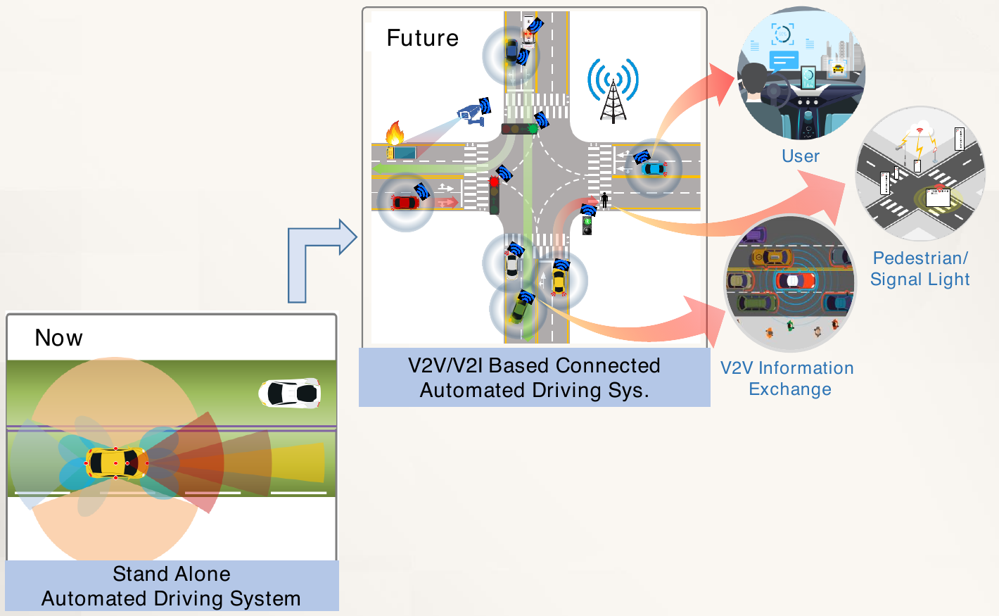

*그림 1. 독립형 자율주행 시스템에서 V2V, V2I 기반 커넥티드 자율주행 시스템으로의 발전*

현재의 자율주행은 대부분 **독립형(stand-alone) 자율주행 시스템**이다. 그림 1의 왼쪽 아래처럼 차량은 자기 센서가 볼 수 있는 범위(반원 모양의 감지 영역) 안의 정보만으로 판단한다. 미래의 자율주행은 그림 1의 오른쪽처럼 **V2V, V2I 기반 커넥티드 자율주행 시스템**으로 발전한다. 차량은 교차로의 다른 차량과 정보를 주고받고(V2V 정보 교환), 보행자와 신호등의 정보를 받으며, 사용자(탑승자)와도 연결된다. 센서가 보지 못하는 곳의 정보까지 통신으로 얻으므로, 자율주행은 통신과 결합하여 커넥티드 자율주행으로 발전한다. 이것이 3절에서 다루는 V2X 통신이 필요한 이유이다.

---

<br>

## 2. 자동차와 통신: 차량 내부 통신

### 2.1 자동차의 기본 구조

자동차는 약 2만 개의 부품으로 이루어지며, 기능에 따라 네 계통으로 나눌 수 있다.

| 계통 | 역할 | 예 |
|:-----|:-----|:-----|
| 파워트레인(powertrain) | 동력을 만들어 바퀴까지 전달한다. | 엔진, 구동 모터, 배터리, HEV와 EV의 파워트레인 |
| 섀시(chassis) | 차체를 받치고 차의 움직임을 제어한다. | 프레임, 조향 장치(전동 스티어링), 제동 장치(브레이크), 현가 장치 |
| 바디(body) | 사람과 짐을 담는 차체와 그 부품이다. | 차체 프레임, 선루프, 헤드램프 |
| 멀티미디어(전기전자) | 전기, 전자, 전장 부품과 정보 기기이다. | 와이어 하네스, 멀티미디어 기기 |

*표 15. 자동차의 네 계통과 주요 부품*

자동차 통신은 이 가운데 전기전자 계통에 속하지만, 파워트레인, 섀시, 바디의 모든 제어기를 서로 잇는다는 점에서 차량 전체에 걸친 기반 기술이다.

### 2.2 자동차 통신의 두 갈래: IVN과 V2X

자동차 통신은 차량 내부의 네트워크와 외부와의 무선 네트워크로 나뉜다.

> **용어 정의:** **차량 내부 네트워크(IVN, in-vehicle network)** 는 자동차 내부의 ECU, 센서, 액추에이터 등을 연결하는, 주로 유선인 통신 네트워크이다. **차량 무선통신(V2X, vehicle-to-everything)** 은 자동차와 도로 인프라, 다른 자동차, 보행자 등을 연결하는 무선 통신 네트워크이다.

> **용어 정의:** **ECU(electronic control unit, 전자 제어 장치)** 는 센서의 값을 읽고 계산하여 액추에이터를 제어하는 차량용 소형 컴퓨터이다. **센서(sensor)** 는 온도, 속도, 위치 같은 물리량을 전기 신호로 바꾸는 장치이고, **액추에이터(actuator)** 는 전기 신호를 받아 모터, 밸브, 램프처럼 실제 동작을 만드는 장치이다.

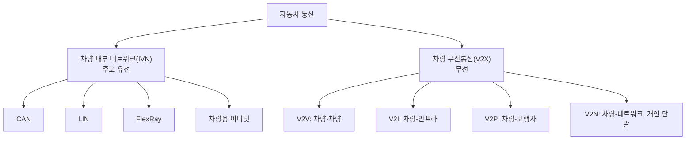

*그림 2. 자동차 통신의 분류*

| 구분 | IVN | V2X |
|:-----|:-----|:-----|
| 연결 대상 | 차량 안의 ECU, 센서, 액추에이터 | 다른 차량, 도로 인프라, 보행자, 네트워크 |
| 전송 매체 | 주로 유선(구리선, 일부 광섬유) | 무선(전파) |
| 대표 기술 | CAN, LIN, FlexRay, 차량용 이더넷 | WAVE(IEEE 802.11p), C-V2X, 이동통신 |
| 주요 목적 | 차량 내부 제어기 사이의 실시간 제어 정보 교환 | 센서 범위 밖의 정보 획득, 협력 주행, 서비스 제공 |

*표 16. 차량 내부 네트워크와 차량 무선통신의 비교*

> **참고:** 이 과목은 두 갈래를 모두 다룬다. 3주차와 9\~10주차는 CAN을 중심으로 한 IVN을, 4\~7주차는 두 갈래의 바탕이 되는 데이터 통신과 네트워크의 기초(전송 매체, 프로토콜과 계층 구조, 토폴로지, 매체 접근 제어)를, 11\~14주차는 V2X 메시지, 각국의 커넥티드 자율주행, DSRC와 WAVE, C-V2X를 다룬다.

### 2.3 차량 네트워크의 물리적 모습: 와이어링 하네스

차량 내부 네트워크는 실제로는 수많은 전선을 묶은 **와이어링 하네스(wiring harness)** 의 형태로 존재한다. 하네스는 멀티미디어(전기전자) 계통의 핵심 부품이며, 생산에 많은 인력이 필요하여 고용 창출 효과가 높은 고부가가치 부품이다.

> **용어 정의:** **하네스(harness)** 는 원래 말이나 짐승을 수레에 매기 위해 몸에 두르는 마구를 뜻한다. 이 말이 차체 곳곳에 뻗어 있는 전선 뭉치를 가리키는 말로 발전했다. 그림 3의 오른쪽 위와 아래를 비교하면 차체를 감싸며 뻗은 전선 뭉치가 마구와 닮았음을 알 수 있다.

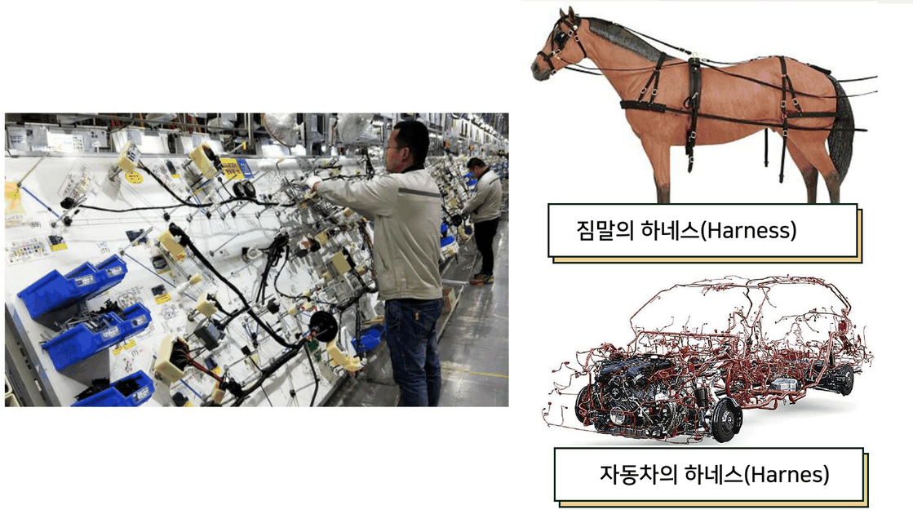

*그림 3. 하네스 조립 공장, 짐말의 하네스, 자동차의 하네스*

하네스는 자동차의 신경망 역할을 하므로 한 종류만 모자라도 차를 완성할 수 없다. 2022년에는 중국의 코로나19 봉쇄와 러시아-우크라이나 전쟁 때문에 하네스 수급 대란이 일어나 세계 곳곳의 자동차 생산이 멈췄다. 하네스는 그림 3의 왼쪽처럼 작업자가 조립판 위에서 전선을 손으로 배치하는 노동 집약적 부품이어서, 공장이 주로 임금이 낮은 국가에 있다. 하네스 시장은 2027년에 95조 원 규모로 성장할 전망이며, 업계는 자동화 도입과 생산지 다변화로 대응하고 있다.

국내의 주요 IVN과 하네스 기업으로는 유라코퍼레이션(유라테크 그룹, 2021년 매출 2조 222억 원), 경신(경신홀딩스 그룹, 2021년 매출 1조 7,352억 원), 모베이스전자(모베이스 그룹, 2021년 매출 6,010억 원) 등이 있다.

### 2.4 네트워크가 필요한 이유

차량에는 많은 제어기가 있고, 이들을 연결하는 신호선과 전원선이 필요하다.

1. 중형차에는 70\~140개의 ECU가 장착된다.
2. 예전에는 ECU, 센서, 액추에이터를 각각 개별 선으로 연결했다. 그 결과 하네스의 무게가 늘었고, 결선 오류로 인한 고장률과 수리의 어려움도 늘었다.
3. 근래에는 하나의 네트워크(버스)에 여러 ECU를 연결하는 버스 형태를 쓴다. 그 결과 하네스의 무게가 줄고, 고장이 줄고, 구조가 간편해지고, 전송 속도가 빨라졌다. 예를 들어 바디 제어기와 헤드라이트 제어기를 각각 따로 배선하던 구성이 하나의 네트워크로 묶인다.

> **용어 정의:** **버스(bus)** 는 여러 장치가 하나의 공유된 전송로를 함께 쓰는 연결 방식이다. 한 장치가 보낸 신호는 버스에 연결된 모든 장치에 전달된다.

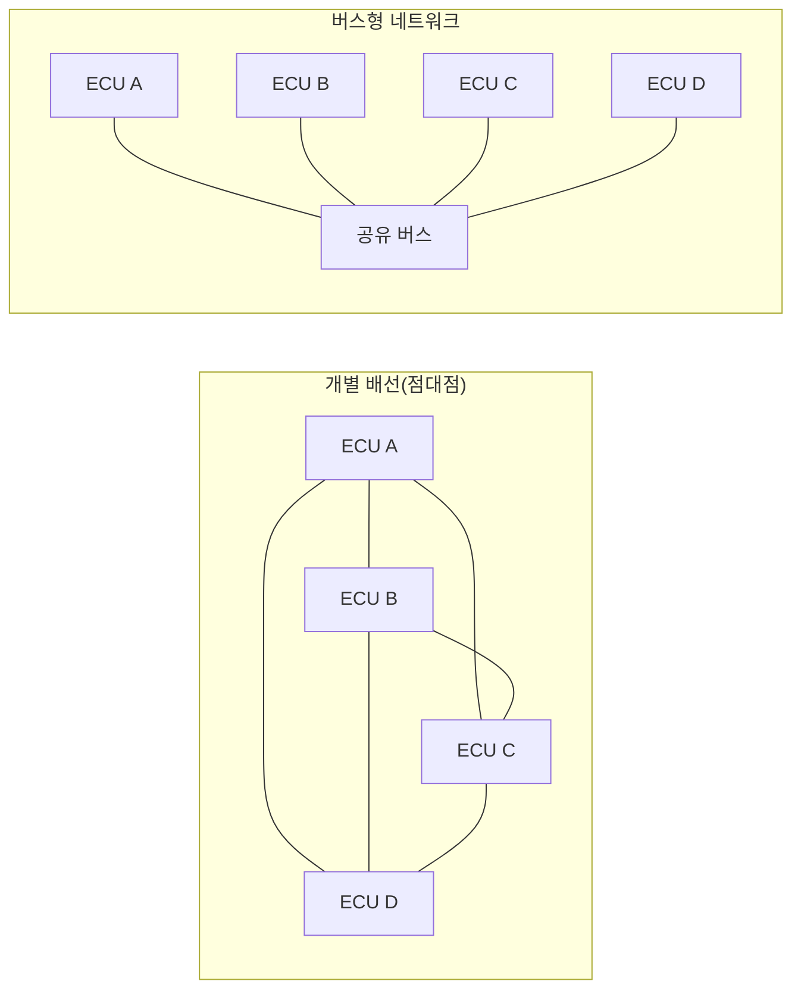

*그림 4. 개별 배선과 버스형 네트워크의 비교*

두 방식의 차이는 연결 수로 확인할 수 있다. ECU $n$개가 서로 모두 직접 통신하려면 두 ECU마다 선이 하나씩 필요하므로 연결 수는 $\binom{n}{2} = \frac{n(n-1)}{2}$이다. 그림 4처럼 $n = 4$이면 $4 \times 3 / 2 = 6$개, $n = 10$이면 $10 \times 9 / 2 = 45$개, $n = 100$이면 $100 \times 99 / 2 = 4{,}950$개이다. 버스형에서는 ECU 수와 관계없이 공유 버스 하나에 각 ECU가 한 번씩만 연결되므로 연결 수가 $n$에 비례하여 늘어난다. 실제 차량에서 모든 ECU가 서로 직접 연결되지는 않지만, ECU 수가 늘수록 개별 배선의 선 수가 급격히 늘어난다는 점이 버스형 네트워크를 쓰는 근본적인 이유이다.

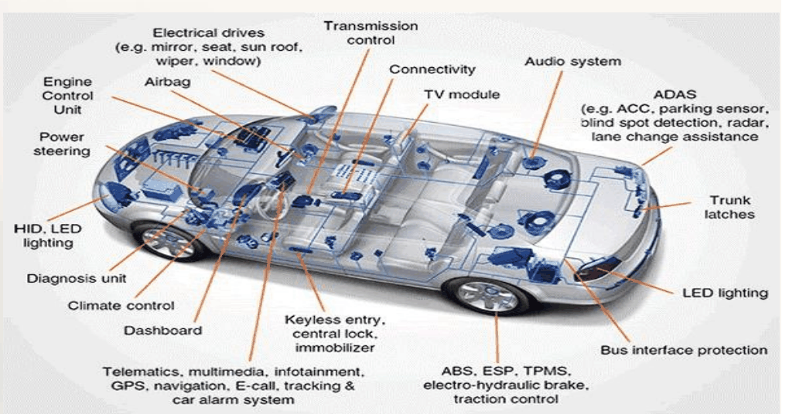

*그림 5. 차량에 장착되는 주요 ECU*

그림 5는 한 차량 안의 주요 ECU를 보여 준다. 엔진 제어 장치, 변속기 제어, 파워 스티어링, 에어백, 전동 장치(미러, 시트, 선루프, 와이퍼, 창문), 공조, 계기판, 진단 장치, 텔레매틱스와 인포테인먼트(GPS, 내비게이션, eCall, 도난 경보), 오디오, TV 모듈, 커넥티비티, ADAS(적응형 순항 제어, 주차 센서, 사각지대 감지, 레이더, 차선 변경 보조), 키리스 엔트리와 중앙 잠금, 이모빌라이저, ABS, ESP, TPMS, 전자 유압 브레이크, 트랙션 제어, 트렁크 잠금, HID와 LED 조명, 버스 인터페이스 보호 장치가 차체 곳곳에 흩어져 있다.

> **용어 정의:** **ADAS(advanced driver assistance systems)** 는 운전자를 보조하는 첨단 시스템이고, **ABS(anti-lock braking system)** 는 급제동 때 바퀴가 잠기지 않게 하는 제동 장치, **ESP(electronic stability program)** 는 차체의 미끄러짐을 막는 자세 제어 장치, **TPMS(tire pressure monitoring system)** 는 타이어 공기압 감시 장치이다.

### 2.5 차량 내부 네트워크의 구성

차량 내부 네트워크에는 용도와 속도가 다른 여러 프로토콜이 함께 쓰인다. 대표적인 것은 CAN, LIN, FlexRay, 차량용 이더넷이며, 그중 CAN이 가장 대중적이면서 중요도가 높다. 각 프로토콜의 최대 전송 속도와 주요 용도는 표 17과 같다 [20], [21].

| 프로토콜 | 최대 전송 속도 | 주요 용도 |
|:-----|:-----|:-----|
| LIN(Local Interconnect Network) | 20 kbit/s | 도어, 시트, 미러 같은 바디 전장품의 저가 제어 |
| CAN(Controller Area Network) | 1 Mbit/s | 파워트레인, 섀시, 바디의 실시간 제어 |
| FlexRay | 10 Mbit/s | 고장 허용과 시간 결정성이 필요한 섀시 제어, X-by-wire |
| 차량용 이더넷 | 100 Mbit/s 이상 | 카메라, 인포테인먼트, 고속 백본 |

*표 17. 주요 차량 내부 네트워크 프로토콜*

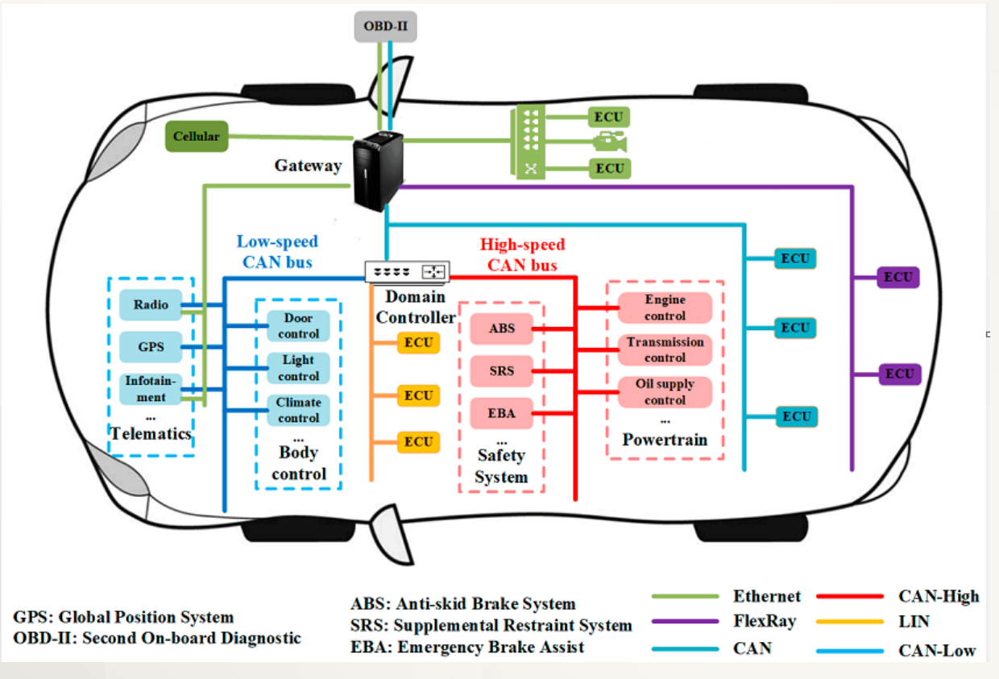

*그림 6. 게이트웨이를 중심으로 구성된 차량 내부 네트워크*

그림 6은 실제 차량의 IVN 구성 예이다 [22]. 중앙의 **게이트웨이(gateway)** 가 서로 다른 네트워크를 잇는다. 게이트웨이에는 진단 단자인 OBD-II와 이동통신 모듈(cellular), 그리고 이더넷 스위치를 거쳐 카메라와 ECU가 연결된다. 저속 CAN 버스에는 라디오, GPS, 인포테인먼트, 텔레매틱스와 도어, 조명, 공조 같은 바디 제어 ECU가 연결된다. 고속 CAN 버스에는 ABS, SRS(에어백), EBA(긴급 제동 보조) 같은 안전 시스템과 엔진, 변속기, 오일 공급 제어 같은 파워트레인 ECU가 연결된다. 도메인 컨트롤러는 게이트웨이와 CAN으로 이어지고 저속 CAN 버스와 고속 CAN 버스 사이에 놓이며, 그 아래에는 LIN으로 연결된 ECU들이 하위 네트워크로 붙는다. 이 밖에 게이트웨이에서 뻗은 별도의 CAN 버스와 FlexRay 버스에도 ECU가 연결된다. 그림의 범례에서 CAN-High(빨간 선)와 CAN-Low(파란 선)는 각각 고속 CAN 버스와 저속 CAN 버스를 가리킨다. ISO 11898의 고속 CAN과 저속 내결함 CAN은 모두 CAN_H와 CAN_L 두 선의 전압 차이로 신호를 전달하며, 이 원리는 3주차에서 다룬다.

> **용어 정의:** **게이트웨이(gateway)** 는 프로토콜이나 속도가 다른 네트워크 사이에서 메시지를 변환하고 전달하는 장치이다. **OBD-II(On-Board Diagnostics II)** 는 차량의 고장 진단 정보를 외부 장비로 읽기 위한 표준 진단 인터페이스이다.

CAN의 동작은 3주차에서, LIN, FlexRay, 차량용 이더넷, CAN FD는 9주차에서 자세히 다룬다.

---

<br>

## 3. V2X 무선통신과 커넥티드카

### 3.1 V2X 통신의 분류

V2X는 통신 상대에 따라 네 가지로 나뉜다.

| 유형 | 이름 | 통신 상대 | 예 |
|:-----|:-----|:-----|:-----|
| V2V | Vehicle to Vehicle | 다른 차량 | 앞차의 급제동 정보 수신, 교차로 충돌 경고 |
| V2I | Vehicle to Infrastructure | 신호등, 노변 기지국 같은 도로 인프라 | 신호 정보 수신, 전방 결빙 구간 경고 |
| V2P | Vehicle to Pedestrian | 보행자의 단말 | 횡단보도 보행자 경고 |
| V2N | Vehicle to Nomadic device / Network | 개인 단말, 이동통신망과 서버 | 스마트폰 연동, 원격 서비스 |

*표 18. V2X 통신의 네 가지 유형*

> **참고:** V2N의 N은 개인이 들고 다니는 단말(nomadic device)로 풀이하기도 하지만, 3GPP 표준에서 V2N은 차량이 기지국과 코어망을 거쳐 서버와 통신하는 vehicle-to-network를 뜻한다 [23]. 오늘날에는 후자의 뜻이 더 널리 쓰인다.

### 3.2 커넥티드카의 통신 모듈 방식: 임베디드와 테더드

차량에 통신 기능을 넣는 방식은 두 가지이다.

- **임베디드(embedded):** 통신 모듈을 차량에 직접 장착한다. 차량 자체의 회선이 있으므로 통신 요금이 별도로 부과되는 구조이다.
- **테더드(tethered):** 스마트폰 같은 통신 기기와 블루투스 등으로 연결하여 그 기기의 통신 기능을 빌려 쓴다. 차량에 별도 요금이 없다.

추세는 임베디드가 테더드보다 많아지는 쪽이다. Frost & Sullivan에 따르면 통신 기능을 갖춘 신차는 2016년 2,330만 대에서 2017년 2,660만 대로 14.2% 늘었다 [24].

| 지역 | 테더드 | 임베디드 (LTE) | 임베디드 (3G, 2G) | 합계 |
|:-----|-----:|-----:|-----:|-----:|
| 북미 | 4.8 | 2.2 | 5.0 | 12.0 |
| 유럽 | 2.5 | 1.0 | 4.3 | 7.8 |
| 중국 | 1.8 | 0.3 | 4.5 | 6.6 |

*표 19. 2017년 지역별 커넥티드 신차의 통신 방식 (단위: 백만 대)*

같은 자료는 지역별 사정을 다음과 같이 해석했다 [24]. LTE의 채택은 수요에 따라 움직이는 완성차 업체의 결정에 달려 있다. 미국 소비자는 안전과 보안 서비스에 돈을 낼 의향이 있다. 유럽은 시장의 다양성 때문에 표준 서비스의 보급이 더디다. 브라질은 경제 혼란으로 성장이 둔화되었다.

### 3.3 커넥티드카 트렌드

Frost & Sullivan은 2019년에 커넥티드카의 주요 기능 트렌드로 차량 내 마켓플레이스(차 안의 전자상거래), 주문형 기능(Features on Demand), V2X 통신 프로토콜, 차량 내 결제, 디지털 비서(Alexa 등), 자동차 생체 인식을 꼽았다 [25].

**마켓플레이스.** 많은 완성차 업체가 차량 내 결제를 통합하고 있다. VISA의 연구에 따르면 출퇴근 중의 구매는 2,000억 달러를 넘으며, 평균 출퇴근 시간은 15\~60분이다. 자율주행이 보급되면 차 안의 광고가 구매로 이어질 가능성이 커진다. 마켓플레이스는 차량 안에서 직접 거래하는 형태와 차량 접근 권한을 이용하는 형태(예: 트렁크 배송)로 나뉜다. 대표 사례는 주유와 주차 결제, 음식 주문과 결제, 식당과 호텔 예약, 목적지 안내, 대리점의 정비 서비스 제안, 제휴 브랜드와 할인 정보 검색이다. 운전자의 주의 분산을 막기 위해 선택지를 제한하며, 예를 들어 Starbucks 주문은 이전에 주문한 몇 가지 중에서만 고르게 한다. 현대자동차의 Blue Link와 Genesis Connected Services는 Alexa와 통합되었다.

> **용어 정의:** **주문형 기능(FoD, Features on Demand)** 은 차량에 하드웨어를 미리 넣어 두고, 사용자가 원할 때 돈을 내면 소프트웨어로 해당 기능을 켜 주는 사업 모델이다. 일회성 구매와 정기 구독 방식이 있다.

주문형 기능으로 제공할 수 있는 서비스는 30가지가 넘으며, 대리점의 후장착이나 OTA로 출시된다. Tesla는 현재 일회성 구매 방식으로 제공하며, 장기적으로는 정기 구독형 구매도 가능해질 것으로 전망되었다. 범주별 예는 표 20과 같다 [25].

| 범주 | 주문형 기능의 예 |
|:-----|:-----|
| 인포테인먼트와 텔레매틱스 | 차량 내 와이파이, 미디어 패키지, 생산성 도구, 컨시어지, 스마트폰 연동과 엔터테인먼트 앱, 개인 디지털 비서, 원격 진단과 예측 정비, 게임 |
| ADAS와 자율주행 | 언덕과 고속도로 주행 보조, 적응형과 예측형 순항 제어, 자동 발레 주차, 오토파일럿, 정체 구간과 교차로 보조, 악천후 패키지, 운전자 모니터링, 원격 차량 조작, 기업용 군집주행 |
| 위치 기반 서비스 | 주유, 통행료, 주차, 충전, 출장 수리, 지오펜스 관심 지점, 지도 |
| 모빌리티 서비스 | 여정 계획, 라스트마일 이동, 차량 호출, 대중교통 시간표와 승차권 구매, 완성차 프로그램의 렌터카와 카셰어링 |
| 파워트레인 성능과 전기차 | 주행 모드 갱신(조향, 현가, 변속), 오프로드 패키지, 가속 성능과 출력, 전기차 주행 거리 연장, 자동과 수동 변속 전환, 최고 속도 제한 상향, 급속 충전 |
| 부가 가치 | 주문형 보험, 해마다 두 가지 무료 기능 업그레이드 |
| 스마트 실내외 | 조명, 향기, 공조의 개인화, 프로젝터와 주문형 화면, 사용자 인터페이스 스킨, 시트 리클라인과 영화 모드, 고급 오디오, 자동 공조, 파노라마 지붕, 추가 수납 공간, 트렁크 배송 |

*표 20. 주문형 기능의 범주와 예*

**V2X 참여 기업.** C-V2X 진영에서는 업체 간 제휴가 늘면서 C-V2X 채택이 뚜렷해졌고, 시스템 통합 업체들은 DSRC와 C-V2X를 모두 지원하는 제품을 내놓았다. Keysight는 5G로 확장할 수 있는 C-V2X 시험 장비를, 5GAA는 CES 2019에서 2020년까지 5G C-V2X를 도로에 적용하겠다는 계획을 발표했다. Ford는 2022년부터 모든 신모델에 C-V2X를 탑재하겠다고 발표하고 중국에서 시범 운영을 했으며, Lexus는 호주 정부, Telstra와 함께 RX 450h F Sport로 4G C-V2X를 시험했다. LG이노텍과 Quectel은 Qualcomm 9150 칩셋 기반의 C-V2X 모듈을, Danlaw는 같은 칩셋 기반의 차량 탑재 장치(OBU)와 노변 기지국(RSU)을 내놓았다. Qorvo는 CES 2019에서 C-V2X와 DSRC를 모두 지원하는 모듈을, Autotalks는 두 방식을 모두 지원하는 칩셋을, Continental은 4G와 5G 망에서 C-V2X와 DSRC를 모두 지원하는 하이브리드 V2X를, Savari는 두 방식을 모두 지원하는 StreetWAVE 2000을 선보였다. 5G 상용화가 진행되면서 C-V2X가 선호되었고, Toyota와 GM을 제외하면 DSRC는 규제의 지원이 부족해 뒤로 밀렸다 [25].

**지역별 동향.** 대부분의 지역은 C-V2X를 선호했고, 5G가 본격화되기 전이므로 2019년 상용 출시는 LTE 기반으로 시작했다 [25].

| 지역 | 동향 |
|:-----|:-----|
| 유럽 | ITS-G5(IEEE 802.11p)와 5G(LTE) 사이의 논쟁이 이어졌다. C2C-CC와 ETSI는 ITS-G5를 지지하고, 이동통신사는 C-V2X를 밀었다. |
| 미국 | 5GAA(Qualcomm 등)가 5G C-V2X를 밀었고, 여러 기술 공급 업체가 하이브리드 솔루션을 내놓았으며, 완성차 업체들은 이르면 2020년부터 DSRC와 C-V2X를 모두 도입할 것으로 보았다. |
| 중국 | 공업정보화부(MIIT)가 5,905\~5,925 MHz를 실험 대역으로 지정했고, Qualcomm은 완성차 업체와 LTE C-V2X에서 협력했다. |
| 일본 | 정부 주도로 V2X 표준화를 진행했고, 5.8 GHz DSRC를 배치했다. ITS Connect와 ITS Japan 컨소시엄이 V2V, V2I 안전 응용을 이끌었다. |

*표 21. 지역별 V2X 동향*

> **참고:** 일본의 ITS Connect는 760 MHz 대역의 V2V, V2I 통신을 쓰는 안전 운전 지원 시스템으로, Toyota가 2015년 10월에 출시한 Crown부터 양산차에 적용했다 [26]. 5.8 GHz DSRC는 일본에서 주로 통행료 징수(ETC)와 도로 정보 제공에 쓰인다.

### 3.4 커넥티드 자율주행이 필요한 이유

자율주행차에 무선 통신을 결합하면 다음 효과를 얻는다.

1. 센서의 가시권과 비가시권 모두에서 자율주행 정보를 얻고, 신뢰할 수 있는 광역 정보를 얻는다.
2. 기존 센서와 상호 보완적인 데이터를 융합하여 객체 인식률을 높인다.
3. 자율주행차 탑승자를 위한 편의 서비스와 안전 서비스를 제공한다.
4. 자동차, 인터넷, 통신, 인프라 같은 연계 산업으로 파급 효과가 커진다.

| 분류 | 서비스 | 내용 |
|:-----|:-----|:-----|
| 안전 (지연 시간이 중요) | 원거리 인지 공유 | 도로변 센서와 주변 차량의 인식 정보를 공유한다. |
| 안전 (지연 시간이 중요) | C-ITS | V2V 기반 전방 충돌 위험 자동 제동, V2I 기반 전방 결빙 구간 경고, V2P 기반 교차로 안전 제동 |
| 편의 (전송 속도가 중요) | 인포테인먼트 | 모바일 오피스, 모바일 인터넷, 원격 차량 관리 |
| 편의 (전송 속도가 중요) | 자율주행 서비스 지원 | 자동 지도 갱신, 원격 자율주행 소프트웨어 업데이트, 원격 차량 조작, 무인 택배, 보험, 발레 주차 |

*표 22. 커넥티드 자율주행 서비스의 분류*

안전 서비스와 편의 서비스가 통신에 요구하는 성능은 다르다. 안전 서비스는 작은 데이터를 반드시 정해진 시간 안에(예: 10 ms) 전달해야 하므로 **지연 시간(latency)** 이 중요하다. 편의 서비스는 영상, 인터넷 같은 대용량 데이터를 빠르게 전달해야 하므로 **전송 속도(throughput)** 가 중요하다.

> **용어 정의:** **C-ITS(Cooperative Intelligent Transport Systems, 차세대 지능형 교통체계)** 는 차량이 다른 차량, 도로 인프라와 실시간으로 정보를 주고받아 사고를 예방하는 협력형 교통 시스템이다. **지연 시간**은 데이터를 보낸 순간부터 받는 순간까지 걸리는 시간이고, **전송 속도**는 단위 시간에 보낼 수 있는 데이터의 양이다.

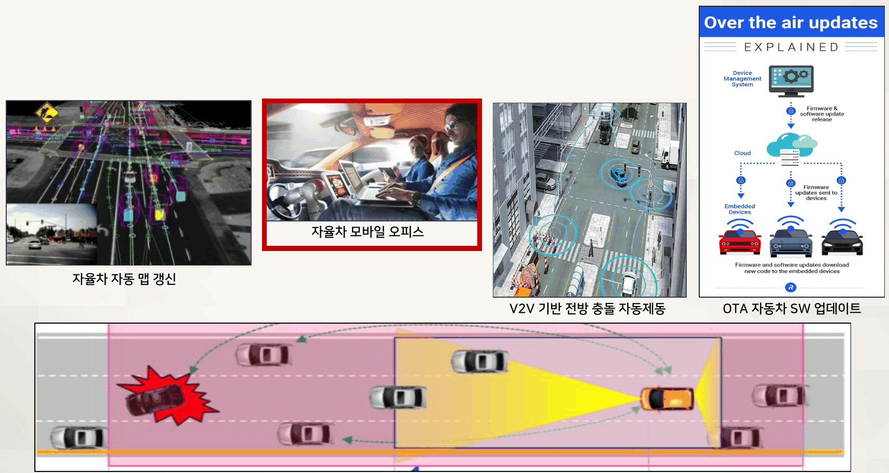

*그림 7. 커넥티드 자율주행 서비스의 예*

그림 7의 위쪽은 왼쪽부터 자율주행차의 자동 지도 갱신, 자율주행차 안의 모바일 오피스, V2V 기반 전방 충돌 자동 제동, OTA 소프트웨어 업데이트이다. OTA에서는 장치 관리 시스템이 펌웨어와 소프트웨어 업데이트를 클라우드에 올리고, 클라우드가 이를 각 차량의 임베디드 장치로 보내면 차량이 내려받아 설치한다. 그림 7의 아래쪽은 센서 범위를 넘어서는 거리의 교통 안전이다. 앞쪽에서 사고가 났지만 사이에 있는 차량에 가려 자차의 센서(노란 부채꼴)로는 볼 수 없을 때, V2V로 사고 정보를 받으면 미리 감속할 수 있다.

### 3.5 센서와 전송 데이터의 양

자율주행차는 데이터가 많아서 반드시 5G가 필요하다는 주장이 있다. 이 주장을 판단하려면 센서의 원시(raw) 데이터를 보내는지, 인식 처리를 마친 결과만 보내는지를 구분해야 한다.

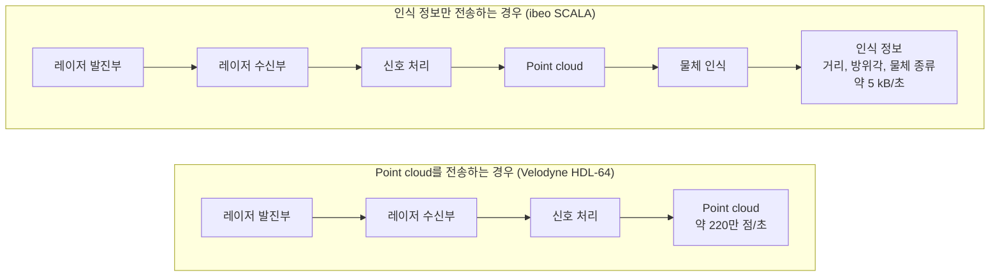

*그림 8. 라이다 출력의 두 형태와 데이터량*

> **용어 정의:** **라이다(LiDAR)** 는 레이저를 쏘고 반사되어 돌아오는 시간으로 거리를 재는 센서이다. **포인트 클라우드(point cloud)** 는 라이다가 측정한 반사 지점의 3차원 좌표를 모은 점들의 집합이다.

그림 8처럼 360도 회전형 라이다인 Velodyne HDL-64는 초당 약 220만 개의 점을 출력한다. 반면 ibeo SCALA처럼 센서 안에서 물체 인식까지 마치고 거리, 방위각, 물체 종류 같은 인식 정보만 내보내면 데이터량은 초당 약 5 kB에 불과하다. 라이다 외의 다른 센서가 출력하는 인식 데이터도 CAN에 실을 수 있을 정도의 크기이다.

두 경우의 차이를 비트 전송률로 비교한다. 점 하나를 x, y, z 좌표와 반사 강도의 네 값으로 나타내고 각 값을 4바이트 부동소수점으로 저장한다고 가정하면, 점 하나는 16바이트이다.

```math
2{,}200{,}000 \times 16\ \text{B/s} = 35{,}200{,}000\ \text{B/s} \approx 35.2\ \text{MB/s} = 281.6\ \text{Mbit/s}
```

```math
5{,}000\ \text{B/s} \times 8 = 40{,}000\ \text{bit/s} = 40\ \text{kbit/s}
```

원시 데이터는 인식 정보의 약 $281.6 / 0.04 \approx 7{,}000$배이다. 원시 point cloud는 최대 1 Mbit/s인 CAN은 물론 웬만한 무선 링크로도 실시간 전송이 어렵지만, 인식 정보는 CAN으로도 충분하다. 따라서 차량 간에 인식 결과만 주고받는다면 대용량 통신이 반드시 필요하지는 않으며, 5G의 필요성은 원시 데이터 공유, 고정밀 지도 내려받기, 원격 주행 영상처럼 대용량 서비스에서 주로 생긴다. 단, 점 하나의 크기는 센서와 데이터 형식에 따라 다르므로 위 계산은 크기의 규모를 보이기 위한 것이다.

### 3.6 차량용 V2X 통신 방식: 이동통신, WAVE, C-V2X

대표적인 차량용 V2X 통신 표준은 세 가지이다.

| 방식 | 장점 | 단점 |
|:-----|:-----|:-----|
| 이동통신(LTE, 5G) | 고속 전송이 가능하여 전송 속도가 빠르다. | 네트워크 기지국을 거치므로 지연 시간이 길어 긴급 경고나 제동에 부적합하다. |
| WAVE | 차량 안전 서비스에 특화된 저지연, 무료 기술이다. | 인프라를 설치해야 하고, 전송 속도가 느리다. |
| C-V2X | 사물 간 통신(IoT)이 가능하고, 고속 전송이 가능하다. 5G C-V2X는 저지연을 달성할 수 있다. | 이동통신 산업 중심으로 구축되며, 서비스 비용 구조가 이동통신사에 달려 있다. |

*표 23. 차량용 V2X 통신 방식의 장단점*

> **용어 정의:** **WAVE(Wireless Access in Vehicular Environments)** 는 무선 LAN(와이파이) 기술인 IEEE 802.11을 차량 환경에 맞게 바꾼 IEEE 802.11p를 물리 계층과 MAC 계층으로 쓰는 차량 통신 방식으로, 넓은 의미의 DSRC(Dedicated Short Range Communications)에 해당한다. **C-V2X(Cellular V2X)** 는 이동통신 표준 단체인 3GPP가 LTE와 5G를 바탕으로 정의한 V2X 기술이다. **IEEE**는 미국 전기전자공학회로 와이파이 같은 통신 표준을 만들고, **3GPP(3rd Generation Partnership Project)** 는 이동통신 표준을 만드는 국제 표준화 단체이다.

| 구분 | WAVE | C-V2X | 이동통신 |
|:-----|:-----|:-----|:-----|
| 세부 방식 | IEEE 802.11p, IEEE 802.11bd | LTE-V2X, LTE-eV2X, 5G NR-V2X | LTE, 5G |
| 표준 기구 | IEEE | 3GPP | 3GPP |
| 이동성 지원 | 200 km/h(802.11p), 500 km/h(802.11bd) | | |
| 실증 사례 | 802.11p는 국내외 다수, 802.11bd는 출시 예정 | LTE-V2X는 국내외 다수, LTE-eV2X와 NR-V2X는 출시 예정 | 국내외 다수 |
| 단말기 간 통신 | V2V 가능 | V2V 가능 | V2V 불가 |
| 주요 서비스 | 안전 | 안전, 편의 | 편의 |
| 통신 비용 | 무료 | 유료 | 유료 |
| 인프라 구축비 | 정부, 지자체 재정 | 이동통신사 | 이동통신사 |
| 주도 부처 | 국토교통부 | 과학기술정보통신부 | 과학기술정보통신부 |
| 주도 업계 | 교통, 자동차 업계 | 이동통신 산업계 | 이동통신 산업계 |

*표 24. WAVE, C-V2X, 이동통신 방식의 비교 (한국 기준)*

표 24에서 이동통신 방식이 V2V를 할 수 없는 것은 모든 데이터가 기지국을 거쳐야 하기 때문이다. WAVE와 C-V2X는 기지국 없이 단말끼리 직접 통신할 수 있다.

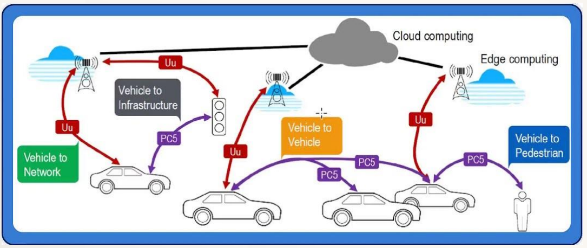

*그림 9. C-V2X의 두 통신 인터페이스 Uu와 PC5*

그림 9처럼 C-V2X에는 두 가지 통신 인터페이스가 있다. **Uu**는 차량이 기지국과 통신하는 일반 이동통신 링크로, 기지국 너머의 클라우드 컴퓨팅이나 엣지 컴퓨팅 서버와 연결되는 V2N에 쓰인다. **PC5**는 기지국을 거치지 않고 단말끼리 직접 통신하는 링크(사이드링크)로, V2V, V2I, V2P에 쓰인다. PC5 직접 통신은 이동통신망의 커버리지가 없는 곳에서도 동작할 수 있다 [27].

> **참고:** 표 24에서 C-V2X를 유료로 분류한 것은 Uu를 쓰는 서비스와 이동통신사가 인프라를 구축하는 사업 구조를 반영한 것이다. PC5 직접 통신은 기지국을 거치지 않으므로 통신 자체에는 이동통신 요금이 생기지 않을 수 있다.

Frost & Sullivan은 2019년에 V2X 프로토콜의 구도를 다음과 같이 정리했다 [25].

| 구분 | C-V2X | DSRC | 하이브리드 |
|:-----|:-----|:-----|:-----|
| 무엇인가 | 4G, LTE, 5G 대역의 이동통신망 접속을 바탕으로 한 셀룰러 기반 V2X | IEEE 802.11p 와이파이를 바탕으로 한 V2V, V2I 통신 | 두 방식을 함께 쓰는 혼합형 |
| 완성차 업체 | Audi, BMW Group, Ford, Geely, Honda, Lexus, Mercedes-Benz, PSA Group | GM, JLR, Toyota, Volkswagen | 미정 |
| 공급 업체 | Qualcomm, Quectel, Keysight, LG이노텍 | Qualcomm, Savari | Autotalks, Qorvo |
| 시기 | 2019\~2020년 준비 완료, 규제 기관의 지원 필요 | 시험을 거쳐 이르면 2019년 배치 | 2019년 하이브리드 칩 출시 |

*표 25. V2X 프로토콜별 참여 기업과 시기*

C-V2X의 직접 통신(PC5)과 WAVE(DSRC)는 모두 5.9 GHz 대역을 쓴다(일본은 예외로 760 MHz 대역의 ITS Connect와 5.8 GHz DSRC를 쓴다). 같은 자료는 C-V2X가 DSRC보다 유망하며, 어느 쪽이 채택되든 이동통신 기업은 이익을 얻는다고 보았다. 두 방식은 기술적으로 모두 차량 안전 통신을 구현할 수 있으므로, 실제 선택을 가르는 것은 기술적인 문제보다 주파수 배분, 인프라 투자 주체, 산업 이해관계 같은 정책적인 문제이다.

### 3.7 해외의 커넥티드카 정책

**미국.** 미국 연방통신위원회(FCC)는 2020년 11월에 5.9 GHz 대역 75 MHz(5.850\~5.925 GHz)의 용도를 바꾸는 규정을 의결했고, 이 규정은 2021년 7월에 발효되었다. 하위 45 MHz는 비면허(와이파이) 용도로 돌리고, ITS 주파수의 상위 30 MHz(5.895\~5.925 GHz)는 C-V2X 용도로 남겼으며, WAVE 기술은 ITS 주파수 사용에서 배제했다 [28]. 2024년 11월에는 C-V2X의 세부 운용 규정을 확정하고 DSRC의 단계적 종료 기간을 정했다 [29].

미국은 그 이전에 WAVE 기반 커넥티드카를 의무화하려 했다. 2014년에 미국 도로교통안전국(NHTSA)은 V2X 통신 모듈을 승용차와 소형 트럭에 의무 장착하는 연방 자동차 안전 기준 FMVSS No. 150(49 CFR Part 571)의 사전 공고를 냈고, 2017년 1월에 규칙 제정안(NPRM)을 공고했다. 그러나 트럼프 행정부에서 정책이 바뀌며 중단되었고, 바이든 행정부에서 정책이 다시 바뀌었다. NHTSA는 새로운 V2V 통신 방식의 등장과 FCC의 5.9 GHz 규정 변경을 이유로 2023년 11월에 이 규칙 제정안을 공식 철회했다 [30].

| 시기 | 미국 교통부의 커넥티드카 이정표 (2015년 기준 계획) |
|:-----|:-----|
| 2014년 8월 | NHTSA가 V2V 규칙 제정 사전 공고(ANPRM)를 발표 |
| 2015년 5월 | 교통부 장관 Foxx가 V2V 규칙 제정 가속화를 발표 |
| 2015년 여름 | 연방도로청(FHWA)이 V2I 배치 지침을 발표 |
| 2015년 가을 | 1차 커넥티드카 시범 사업 착수 |
| 2015년 말 | V2V 규칙 제정안(NPRM)을 부처 간 검토에 회부 |
| 2017년 | 커넥티드카 기술을 갖춘 신차 출시 예상 |

*표 26. 미국의 커넥티드 자율주행 이정표 (2015년 계획)*

**유럽.** 유럽은 2020년 3월에 ITS 주파수 대역을 70 MHz 대역폭에서 80 MHz 대역폭으로 확장했다. 2019년 1월에는 유럽 도로에서 C-ITS 구축을 촉진할 법적 기반으로 ITS-G5(WAVE)를 강제하는 EC 위임 규정(delegated regulation)이 제출되었으나, 2019년 7월 EU 각료이사회에서 최종 부결되었다. 이후 C-V2X까지 포함하는 새로운 규정을 2021년에 제정할 예정이었다.

> **용어 정의:** **ITS-G5**는 IEEE 802.11p를 바탕으로 유럽 표준화 기구 ETSI가 정한 유럽의 차량 통신 표준이다. 미국의 WAVE와 같은 계열의 기술이다.

**중국.** 중국은 2018년 10월에 C-V2X 직접 통신용으로 5.905\~5.925 GHz 범위의 주파수를 공식 지정했다. 10개 이상의 지역에 C-V2X 기술 기반의 국가 단위 테스트베드를 구축했고, 2022년까지 10여 개 완성차 업체가 C-V2X 직접 통신이 가능한 차량을 출시할 예정이었다.

### 3.8 한국의 커넥티드카 정책

한국은 2016년에 5.9 GHz 대역(5.855\~5.925 GHz)의 70 MHz를 ITS 용도로 할당했으나 통신 방식은 지정하지 않았다 [31]. 2020년 7월 한국판 뉴딜의 사회간접자본(SOC) 디지털화 사업에 포함된 C-ITS 인프라 구축 계획은 2022년까지 전국 고속국도의 절반에 해당하는 2,085 km에, 2025년까지 전 구간인 4,075 km에 C-ITS를 설치하겠다고 발표했다 [32].

통신 방식을 정하기 위한 절차는 다음과 같이 계획되었다.

1. **공동작업반 구성:** 2021년 7월 26일 과학기술정보통신부와 국토교통부는 C-ITS 인프라 전국 구축을 위한 협의를 진행하고 공동작업반을 구성했다.
2. **실증:** 통신 방식을 결정하기 위해 2021년 4분기부터 2022년 4분기까지 인증 절차를 포함하여 LTE-V2X를 실증한다.
3. **선정:** LTE-V2X 실증이 끝나면 2023년에 WAVE와 LTE-V2X를 함께 쓰는 듀얼 모드 시범 사업(2,000 km 구간)으로 성능을 비교한 뒤 단일 V2X 통신 방식을 선정한다.
4. **구축:** 2024년부터 선정된 통신 방식을 기반으로 C-ITS 인프라 구축 본사업을 진행한다.

> **참고:** 두 방식의 시범 사업을 위해 2022년 3월에 70 MHz 가운데 하위 20 MHz는 LTE-V2X, 상위 30 MHz는 WAVE에 배치하고, 사이의 20 MHz는 두 기술 사이의 간섭을 막는 보호 대역으로 두었다 [31]. 이후 과학기술정보통신부와 국토교통부는 2023년 12월에 전문가 위원회의 제안에 따라 C-ITS의 단일 통신 방식을 LTE-V2X로 정하고 기술 기준 개정 등 후속 조치를 예고했다 [33].

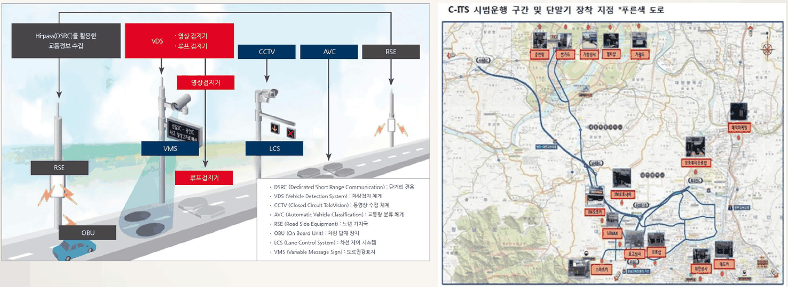

*그림 10. 한국 C-ITS의 구성 요소와 시범 운행 구간*

그림 10의 왼쪽은 도로에 설치되는 C-ITS 구성 요소이고, 오른쪽은 C-ITS 시범 운행 구간과 단말기 장착 지점을 표시한 지도이다. 구성 요소의 뜻은 표 27과 같다.

| 약어 | 이름 | 역할 |
|:-----|:-----|:-----|
| DSRC | 단거리 전용 통신 | 하이패스 단말을 활용한 교통 정보 수집 |
| VDS | 차량 검지 체계 | 영상 검지기, 루프 검지기로 교통량과 속도 수집 |
| CCTV | 동영상 수집 체계 | 도로 상황 영상 수집 |
| AVC | 차종 분류 체계 | 통과 차량의 차종 분류 |
| RSE | 노변 장치 | 도로변에서 차량과 무선 통신(노변 기지국(RSU)과 같은 뜻) |
| OBU | 차량 탑재 장치 | 차량에서 노변 기지국, 다른 차량과 통신 |
| LCS | 차선 제어 시스템 | 차로별 통행 가능 여부 표시 |
| VMS | 도로 전광 표지 | 운전자에게 교통 정보 표시 |

*표 27. 한국 C-ITS의 구성 요소*

### 3.9 자율협력주행: C-ITS와 자율주행

자율주행차가 C-ITS와 협력하는 **자율협력주행**을 실현하려면 신호 정보가 차량까지 끊김 없이 전달되어야 한다. 그러나 실제 인프라에는 다음과 같은 문제가 있다.

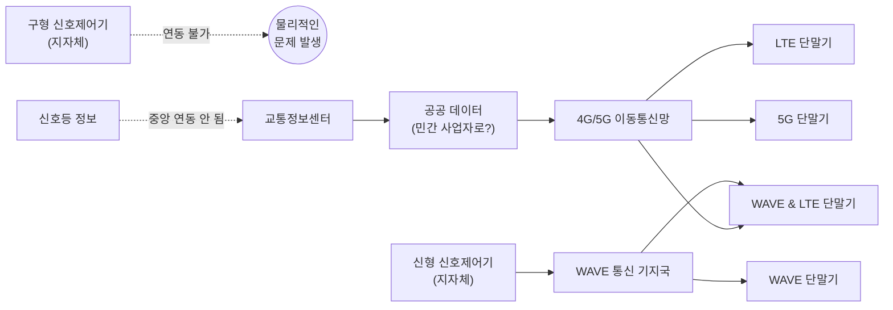

*그림 11. 신호 정보 전달 경로와 C-ITS 인프라의 문제*

1. 지자체가 관리하는 구형 신호제어기는 통신 기지국과 연동할 수 없다. 신형 신호제어기만 WAVE 통신 기지국을 통해 WAVE 단말기로 신호 정보를 보낼 수 있다.
2. 신호등 정보가 교통정보센터로 중앙 연동되지 않는다.
3. 교통정보센터의 정보를 공공 데이터로 민간 사업자에게 넘겨 이동통신망으로 서비스할지도 정해지지 않았다.

정부는 6조 원을 투입하여 전국 C-ITS 인프라를 구축할 계획을 세웠다(지능형교통체계(ITS) 기본계획 2030(안) 공청회). 이 계획의 핵심은 차량용 V2X 단말기의 보급률이다. 인프라가 있어도 단말기를 단 차량이 적으면 협력 주행의 효과가 나타나지 않기 때문이다. 또한 신호 체계의 정비뿐 아니라 교통 시설과 교통 안전 인프라 전반의 개선을 함께 추진해야 한다.

> **핵심:** 커넥티드 자율주행의 성패는 통신 기술의 우열보다 주파수 정책, 인프라 투자, 단말기 보급 같은 제도적 요인에 크게 좌우된다. 한국은 전국 단위의 단일 인프라를 구축할 수 있는 조건(1.8절)을 갖추고 있지만, 그 장점을 살리려면 신호 정보의 중앙 연동과 단말기 보급이 함께 이루어져야 한다.

---

<br>

## 개념 적용

다음 상황에서 어떤 개념이 판단의 근거가 되는지 연결한다.

| 상황 | 연결할 개념과 이유 |
|:-----|:-----|
| 앞차 너머에서 난 사고를 자차 센서로는 볼 수 없다. | **V2V와 커넥티드 자율주행.** 다른 차량이 보낸 사고 정보로 센서 범위 밖의 위험을 미리 알 수 있다. |
| 긴급 제동 경고를 LTE 이동통신망으로 보내려 한다. | **지연 시간.** 이동통신 방식은 기지국을 거치므로 지연 시간이 길어 긴급 경고와 제동에 부적합하다. |
| 차량 한 대에 ECU가 100개 넘게 늘어났다. | **버스형 네트워크.** 개별 배선은 연결 수가 $n(n-1)/2$로 급증하므로, 공유 버스로 묶어 하네스의 무게와 결선 오류를 줄인다. |
| 차량 간에 주변 물체의 위치를 공유하려 한다. | **센서 데이터량.** 원시 point cloud 대신 인식 정보만 보내면 초당 수 kB로 충분하다. |
| 스마트폰을 연결해야만 차량의 원격 서비스를 쓸 수 있다. | **테더드 방식.** 차량에 통신 모듈이 없고 스마트폰의 통신 기능을 빌려 쓴다. |
| 전기차 전환으로 엔진 부품 업체의 매출이 줄어든다. | **부품 공급 체계의 개편.** 전기차에는 엔진 부품이 필요 없어 부품 수가 약 45% 줄어든다. |

*표 28. 상황별로 연결할 개념과 그 이유*

**T/F 점검:**

| 문장 | 판단과 근거 |
|:-----|:-----|
| IVN은 차량과 도로 인프라를 무선으로 연결하는 네트워크이다. | **F.** IVN은 차량 내부의 ECU, 센서, 액추에이터를 주로 유선으로 연결한다. 차량과 인프라의 무선 연결은 V2X이다. |
| 이동통신 방식으로는 기지국 없이 차량끼리 직접 통신할 수 없다. | **T.** 모든 데이터가 기지국을 거치므로 단말기 간 직접 통신(V2V)이 불가능하다. |
| 자율주행차는 어떤 경우든 5G가 반드시 필요하다. | **F.** 인식 처리된 정보만 보내면 데이터량이 초당 약 5 kB로 작아 CAN으로도 실을 수 있다. |
| 미국 FCC는 5.9 GHz 대역의 상위 30 MHz를 C-V2X 용도로 정했다. | **T.** 하위 45 MHz는 비면허 용도로 돌리고 상위 30 MHz를 C-V2X에 남겼다. |
| 일본 SIP-adus는 경제산업성 한 부처가 단독으로 운영한다. | **F.** 내각부 산하의 범부처 거버넌스이며 총무성, 경제산업성, 경찰청, 국토교통성 등이 참여한다. |

---

<br>

## 요약

| 개념 | 핵심 요약 |
|:--------|:------------|
| C.A.S.E. | 미래차는 커넥티드, 자율주행, 공유, 전동화의 네 방향으로 진화하며, 2030년에는 신차 대부분이 커넥티드와 자율주행 기능을 갖출 전망이다. |
| 커넥티드카 | 통신으로 외부와 데이터를 주고받는 차량이며, 인포테인먼트, 스마트폰 통합, 전기차, 내비게이션, 텔레매틱스, 자율주행 서비스를 제공한다. |
| 주요국 정책 | 미국은 DOT 가이드라인, 유럽은 ERTRAC과 EPoSS 로드맵, 일본은 내각부 산하 범부처 체계인 SIP-adus로 자율주행을 추진한다. |
| 한국 자동차 산업 | 고용과 수출의 큰 몫을 차지하며, 전자와 자동차 산업, 부품 기업군, 전국 단위 단일 인프라를 갖춘 반면 소프트웨어 인력과 미래차 대응은 부족하다. |
| 산업 구조 변화 | 전기차 전환으로 부품 수가 줄고, 연산이 중앙으로 모이는 E/E 아키텍처와 SDV로 가치의 중심이 소프트웨어와 전기전자 부품으로 옮겨 간다. |
| IVN과 V2X | 자동차 통신은 차량 내부를 주로 유선으로 잇는 IVN과 차량 외부를 무선으로 잇는 V2X로 나뉜다. |
| 버스형 네트워크 | ECU가 70\~140개로 늘면서 개별 배선 대신 공유 버스를 써서 하네스의 무게, 고장, 결선 오류를 줄였다. |
| IVN 프로토콜 | LIN, CAN, FlexRay, 차량용 이더넷이 용도와 속도에 따라 함께 쓰이고 게이트웨이가 이들을 잇는다. |
| V2X 유형 | V2V, V2I, V2P, V2N의 네 가지가 있으며, 안전 서비스는 지연 시간이, 편의 서비스는 전송 속도가 중요하다. |
| 센서 데이터량 | 원시 point cloud는 초당 수백 Mbit 규모이지만 인식 정보는 초당 약 5 kB이므로, 통신 요구량은 무엇을 보내는지에 달려 있다. |
| V2X 방식 | 이동통신은 빠르지만 지연이 길고, WAVE는 저지연이지만 인프라가 필요하며, C-V2X는 Uu와 PC5로 원거리 통신과 직접 통신을 모두 지원한다. |
| 차량 통신 정책 | 미국과 중국은 C-V2X를 택했고, 유럽은 ITS-G5 강제안이 부결되었으며, 한국은 실증을 거쳐 2023년 12월 LTE-V2X를 단일 방식으로 정했다. |
| 자율협력주행 | C-ITS와 협력하려면 신호 정보의 중앙 연동, 인프라 정비, V2X 단말기 보급이 함께 필요하다. |

---

<br>

## 점검 문제

1. **C.A.S.E.:** C.A.S.E.의 네 키워드를 쓰고, 그중 자동차 통신과 가장 직접적으로 관련된 두 가지를 이유와 함께 고르라.

   <details>
   <summary>정답</summary>

   Connected(커넥티드), Autonomous(자율주행), Shared(공유), Electric(전동화)이다. 커넥티드는 차량이 통신으로 외부와 데이터를 주고받는 것 자체이고, 자율주행은 센서 범위 밖의 정보를 V2X로 얻을 때 안전성과 인식률이 높아지므로 두 키워드가 통신과 가장 직접적으로 관련된다.

   </details>

2. **버스형 네트워크:** ECU 12개가 서로 모두 직접 통신하도록 개별 배선으로 연결하면 연결이 몇 개 필요한가? 버스형 네트워크가 이 문제를 어떻게 해결하는지 설명하라.

   <details>
   <summary>정답</summary>

   두 ECU마다 연결이 하나씩 필요하므로 $12 \times 11 / 2 = 66$개이다. 버스형 네트워크에서는 모든 ECU가 하나의 공유 버스에 한 번씩만 연결되므로 연결 수가 ECU 수에 비례하여 늘어난다. 그 결과 하네스의 무게, 결선 오류로 인한 고장, 수리의 어려움이 줄고 구조가 간단해진다.

   </details>

3. **IVN의 구성:** 게이트웨이를 중심으로 한 차량 내부 네트워크에서 저속 CAN과 고속 CAN에 각각 어떤 ECU가 연결되는지 예를 들고, 게이트웨이의 역할을 설명하라.

   <details>
   <summary>정답</summary>

   저속 CAN에는 라디오, GPS, 인포테인먼트, 텔레매틱스, 도어, 조명, 공조 같은 바디와 편의 ECU가 연결된다. 고속 CAN에는 ABS, 에어백(SRS), 긴급 제동 보조(EBA) 같은 안전 시스템과 엔진, 변속기 같은 파워트레인 ECU가 연결된다. 게이트웨이는 속도나 프로토콜이 다른 네트워크(저속 CAN, 고속 CAN, FlexRay, 이더넷, OBD-II, 이동통신 모듈) 사이에서 메시지를 변환하고 전달한다.

   </details>

4. **V2X의 분류:** V2V, V2I, V2P, V2N을 각각 설명하고, V2N의 N이 두 가지로 풀이되는 이유를 쓰라.

   <details>
   <summary>정답</summary>

   V2V는 차량과 차량, V2I는 차량과 신호등이나 노변 기지국 같은 도로 인프라, V2P는 차량과 보행자(의 단말), V2N은 차량과 네트워크 또는 개인 단말 사이의 통신이다. N은 개인이 들고 다니는 단말(nomadic device)로 풀이하기도 하지만, 3GPP 표준에서는 기지국과 코어망을 거쳐 서버와 통신하는 vehicle-to-network를 뜻한다.

   </details>

5. **안전과 편의:** 커넥티드 자율주행 서비스를 안전 서비스와 편의 서비스로 나눌 때, 각각 통신에 요구하는 핵심 성능이 무엇인지 예와 함께 설명하라.

   <details>
   <summary>정답</summary>

   안전 서비스(V2V 기반 전방 충돌 자동 제동, V2I 기반 결빙 구간 경고 등)는 작은 데이터를 정해진 시간(예: 10 ms) 안에 반드시 전달해야 하므로 지연 시간이 중요하다. 편의 서비스(모바일 오피스, 자동 지도 갱신, OTA 업데이트 등)는 영상이나 소프트웨어 같은 대용량 데이터를 빠르게 보내야 하므로 전송 속도가 중요하다.

   </details>

6. **센서 데이터량:** 초당 220만 개의 점을 출력하는 라이다에서 점 하나가 16바이트일 때 원시 데이터의 비트 전송률을 구하고, 인식 정보만 보내는 경우(초당 5 kB)와 비교하라.

   <details>
   <summary>정답</summary>

   $2{,}200{,}000 \times 16 = 35{,}200{,}000$ B/s이고, 8을 곱하면 $281.6$ Mbit/s이다. 인식 정보는 $5{,}000 \times 8 = 40$ kbit/s이므로 원시 데이터가 약 7,000배 크다. 원시 데이터는 최대 1 Mbit/s인 CAN으로 보낼 수 없지만 인식 정보는 CAN으로도 충분하다.

   </details>

7. **통신 방식 비교:** 이동통신, WAVE, C-V2X를 지연 시간, 단말기 간 직접 통신, 인프라 구축 주체의 관점에서 비교하라.

   <details>
   <summary>정답</summary>

   이동통신은 기지국을 거치므로 지연 시간이 길고 단말기 간 직접 통신이 불가능하며, 인프라는 이동통신사가 구축한다. WAVE는 저지연이고 V2V 직접 통신이 가능하며, 인프라는 정부와 지자체 재정으로 구축한다. C-V2X는 PC5로 V2V 직접 통신이 가능하고 5G C-V2X는 저지연을 달성할 수 있으며, 인프라는 이동통신사가 구축한다.

   </details>

8. **정책:** 미국, 유럽, 한국이 차량 통신 방식을 어떻게 정했는지 정리하고, 방식의 선택이 기술보다 정책의 문제라고 하는 이유를 설명하라.

   <details>
   <summary>정답</summary>

   미국은 FCC가 5.9 GHz 대역의 상위 30 MHz를 C-V2X에 배정하고 WAVE(DSRC)를 배제했다. 유럽은 ITS-G5(WAVE)를 강제하는 위임 규정이 2019년에 부결된 뒤 C-V2X를 포함하는 규정을 추진했다. 한국은 70 MHz를 할당한 뒤 방식을 정하지 않다가 실증과 비교를 거쳐 2023년 12월 LTE-V2X를 단일 방식으로 정했다. 두 방식 모두 차량 안전 통신을 구현할 수 있으므로, 실제 선택은 주파수 배분, 인프라 투자 주체(정부 재정 또는 이동통신사), 산업 이해관계(교통, 자동차 업계 또는 이동통신 업계)에 따라 갈린다.

   </details>

---

<br>

## 참고 문헌

1. SBD Automotive, "Change personified in four letters: C-A-S-E," infographic, reproduced in *ZDNet*.
2. Frost & Sullivan, *Global Connected Car Market Outlook, 2020*, May 2020.
3. Frost & Sullivan, "Mobility outlook: Gross market value forecast by new mobility services type, global, 2019 and 2020," chart, 2020.
4. U.S. Department of Transportation and NHTSA, *Automated Driving Systems 2.0: A Vision for Safety*, Washington, DC, USA, 2017.
5. U.S. Department of Transportation, *Preparing for the Future of Transportation: Automated Vehicles 3.0*, Washington, DC, USA, 2018.
6. National Science and Technology Council and U.S. Department of Transportation, *Ensuring American Leadership in Automated Vehicle Technologies: Automated Vehicles 4.0*, Washington, DC, USA, Jan. 2020.
7. ERTRAC, *Connected Automated Driving Roadmap*, Brussels, Belgium, 2019.
8. EPoSS, *European Roadmap Smart Systems for Automated Driving*, Berlin, Germany, 2015.
9. Cabinet Office, Government of Japan, *SIP Automated Driving for Universal Services (SIP-adus) R&D Plan*, 2018.
10. 한국자동차연구원, 세계 자동차 판매와 생산 현황 자료, 2022년 1월.
11. 관계부처 합동, "제조업 활력 회복 및 혁신 전략," 2018.
12. 관계부처 합동, "미래자동차 산업 발전 전략," 2019.
13. 이데일리, 산업별 고용 현황 보도(2018년 통계청 자료 인용), 2020.
14. Automotive News, "Top 100 global suppliers," June 2021.
15. VICS Center, VICS 단말 출하 대수(2020년 말 기준). https://www.vics.or.jp
16. KPMG International, *2020 Autonomous Vehicles Readiness Index*, 2020.
17. Navigant Research (Guidehouse Insights), *Leaderboard: Automated Driving Vehicles*, 2020.
18. 한국자동차산업협회(KAMA), 자동차 산업 현황과 부품 업계 미래차 대응 실태 조사, 2020.
19. 일본자동차부품공업회(JAPIA), 내연기관차와 전기차의 부품 수 비교 자료.
20. N. Navet, Y. Song, F. Simonot-Lion, and C. Wilwert, "Trends in automotive communication systems," *Proceedings of the IEEE*, vol. 93, no. 6, pp. 1204-1223, 2005.
21. IEEE Std 802.3bw-2015, *Physical Layer Specifications and Management Parameters for 100 Mb/s Operation over a Single Balanced Twisted Pair Cable (100BASE-T1)*, 2015.
22. H. Zhang, X. Meng, X. Zhang, and Z. Liu, "CANsec: A practical in-vehicle controller area network security evaluation tool," *Sensors*, vol. 20, no. 17, art. 4900, 2020.
23. 3GPP TS 22.185, *Service requirements for V2X services*, Release 14, 2017.
24. Frost & Sullivan, *Global Connected Car Market Outlook, 2017*, 2017.
25. Frost & Sullivan, *Global Connected Car Market Outlook, 2019*, 2019.
26. Toyota Motor Corporation, "Toyota bringing advanced ITS technology to mass-market models," news release, Sep. 30, 2015. https://global.toyota/en/detail/9676551
27. 3GPP TS 23.285, *Architecture enhancements for V2X services*, Release 14, 2017.
28. Federal Communications Commission, *Use of the 5.850-5.925 GHz Band*, First Report and Order, FCC 20-164, ET Docket No. 19-138, Nov. 2020.
29. Federal Communications Commission, *Use of the 5.850-5.925 GHz Band*, Second Report and Order, FCC 24-123, ET Docket No. 19-138, Nov. 2024.
30. NHTSA, "Federal Motor Vehicle Safety Standards; V2V Communications," withdrawal of notice of proposed rulemaking, *Federal Register*, vol. 88, no. 222, pp. 80685-80686, Nov. 20, 2023.
31. 과학기술정보통신부, 국토교통부, "자율주행 시대를 앞당기기 위해 과기정통부와 국토부 맞손," 보도자료, 2022년 3월 16일.
32. 관계부처 합동, "한국판 뉴딜 종합계획," 2020년 7월.
33. 김병욱, "정부, 지능형 교통체계 통신방식 'LTE-V2X'로 통합 추진," *뉴데일리*, 2023년 12월 12일.
