# Week 1 Lecture — Future Vehicles and the Need for Automotive Communication

[Repository Guide](../../README.md) | [English](Concepts_Lecture.md) | [한국어](Concepts_Lecture.ko.md)

> **Last Updated:** 2026-11-17

> **Learning Objectives:**
> 1. Explain the four keywords of the future vehicle industry, C.A.S.E., and interpret the market outlook of each area together with its source
> 2. Compare the autonomous driving policy frameworks of the United States, Europe, and Japan with the structural characteristics of the Korean automotive industry
> 3. Divide automotive communication into in-vehicle networks (IVN) and vehicle-to-everything (V2X) communication, and explain why bus-type networks became necessary as the number of ECUs grew
> 4. Explain the four types of V2X communication and why connected automated driving is needed, from the viewpoint of sensors and data volume
> 5. Compare cellular, WAVE, and C-V2X communication and explain the vehicle communication policies of the United States, Europe, China, and Korea

---

## Table of Contents

- [1. The Automotive Industry Today and Its Transformation](#1-the-automotive-industry-today-and-its-transformation)
  - [1.1 The Keywords of the Future Vehicle Industry: C.A.S.E.](#11-the-keywords-of-the-future-vehicle-industry-case)
  - [1.2 Connected: The Connected Car Market and Services](#12-connected-the-connected-car-market-and-services)
  - [1.3 Autonomous: The Autonomous Vehicle Market Outlook](#13-autonomous-the-autonomous-vehicle-market-outlook)
  - [1.4 Shared: The Shared Mobility Market Outlook](#14-shared-the-shared-mobility-market-outlook)
  - [1.5 Electric: The Market Outlook for Engine Vehicles and Electrified Vehicles](#15-electric-the-market-outlook-for-engine-vehicles-and-electrified-vehicles)
  - [1.6 Autonomous Driving Policies of Major Countries](#16-autonomous-driving-policies-of-major-countries)
  - [1.7 Size and State of the Global Automotive Market](#17-size-and-state-of-the-global-automotive-market)
  - [1.8 Weight and Characteristics of the Korean Automotive Industry](#18-weight-and-characteristics-of-the-korean-automotive-industry)
  - [1.9 Paradigm Shift in the Automotive Industry](#19-paradigm-shift-in-the-automotive-industry)
  - [1.10 The State of the Korean Automotive Industry](#110-the-state-of-the-korean-automotive-industry)
  - [1.11 From Autonomous Driving to Connected Automated Driving](#111-from-autonomous-driving-to-connected-automated-driving)
- [2. Vehicles and Communication: In-Vehicle Communication](#2-vehicles-and-communication-in-vehicle-communication)
  - [2.1 Basic Structure of a Vehicle](#21-basic-structure-of-a-vehicle)
  - [2.2 Two Branches of Automotive Communication: IVN and V2X](#22-two-branches-of-automotive-communication-ivn-and-v2x)
  - [2.3 The Physical Form of the Vehicle Network: Wiring Harnesses](#23-the-physical-form-of-the-vehicle-network-wiring-harnesses)
  - [2.4 Why a Network Is Needed](#24-why-a-network-is-needed)
  - [2.5 Composition of the In-Vehicle Network](#25-composition-of-the-in-vehicle-network)
- [3. V2X Wireless Communication and Connected Cars](#3-v2x-wireless-communication-and-connected-cars)
  - [3.1 Classification of V2X Communication](#31-classification-of-v2x-communication)
  - [3.2 Communication Module Types of Connected Cars: Embedded and Tethered](#32-communication-module-types-of-connected-cars-embedded-and-tethered)
  - [3.3 Connected Car Trends](#33-connected-car-trends)
  - [3.4 Why Connected Automated Driving Is Needed](#34-why-connected-automated-driving-is-needed)
  - [3.5 Sensors and the Volume of Transmitted Data](#35-sensors-and-the-volume-of-transmitted-data)
  - [3.6 V2X Communication Methods for Vehicles: Cellular, WAVE, and C-V2X](#36-v2x-communication-methods-for-vehicles-cellular-wave-and-c-v2x)
  - [3.7 Connected Car Policies Abroad](#37-connected-car-policies-abroad)
  - [3.8 Connected Car Policy in Korea](#38-connected-car-policy-in-korea)
  - [3.9 Cooperative Automated Driving: C-ITS and Autonomous Driving](#39-cooperative-automated-driving-c-its-and-autonomous-driving)
- [Concept Applications](#concept-applications)
- [Summary](#summary)
- [Self-Check Questions](#self-check-questions)
- [References](#references)

---

<br>

## 1. The Automotive Industry Today and Its Transformation

For a long time the automobile was a product centered on the engine and mechanical parts, but it is now becoming a product in which electronics, software, and communication account for a large part of the value. This section summarizes the direction of that change from the viewpoint of markets and policy and provides the background for why vehicles came to need communication. Most figures in this section are forecasts published around 2019-2022, so their value lies in showing the direction and magnitude of change rather than in the numbers themselves.

### 1.1 The Keywords of the Future Vehicle Industry: C.A.S.E.

The transformation of the future vehicle industry is often summarized as **C.A.S.E.**, the initials of four English words. Vehicles are evolving in four directions, namely connected, autonomous, shared, and electric, and by 2030 most new vehicles are expected to have connected and autonomous driving functions, while the markets for car sharing, electric vehicles, and hydrogen vehicles are expected to grow rapidly.

> **Definition:** **C.A.S.E.** stands for Connected, Autonomous, Shared, and Electric. Connected means that the vehicle exchanges data with the outside world through communication; autonomous means that a system performs part or all of the driving task; shared means using a vehicle when needed instead of owning it; electric means moving the vehicle with electric motors instead of an internal combustion engine.

| Keyword | Industry's Mission | 2020 Status | 2030 Forecast |
|:-----|:-----|:-----|:-----|
| Connected | Deliver new digital experiences to consumers and leverage data in new ways to streamline operations. | 48% of new vehicles shipped globally with built-in connectivity | 96% |
| Autonomous | Reduce accidents in the short term, help productivity in the mid-term, and fully manage traffic flow in the long term. | 45% of new vehicles shipped globally with Level 2 autonomy or higher | 79% |
| Shared | Maximize the utilization of vehicles and deliver lower-cost journeys to consumers in congested cities. | 1% of mobility profits derived from new sources (on-demand mobility, etc.) | 26% |
| Electric | Reduce the reliance on fossil fuels and improve air quality by replacing internal combustion engines with electric motors. | 3% of new cars sold are EVs (including BEV and PHEV) | 24% |

*Table 1. Missions, 2020 status, and 2030 forecasts of the four C.A.S.E. keywords*

Table 1 is based on data compiled by SBD Automotive [1]. In Table 1, connected and autonomous functions spread fastest. Both either presuppose communication or become more effective when combined with it, so automotive communication can be said to lie at the center of the transformation toward future vehicles.

### 1.2 Connected: The Connected Car Market and Services

> **Definition:** A **connected car** is a vehicle that exchanges data with external networks (the internet, other vehicles, road infrastructure) through a communication module or a smartphone.

In North America and Europe, an average of 90% of new cars were expected to have connected functions in 2022. Korea, by contrast, expanded its connected car market relatively slowly. According to a 2020 forecast by Frost & Sullivan, the share of connected cars among new vehicles worldwide was expected to rise every year from 66% in 2019 to 86% in 2025 [2]. The forecast combines the North American, European, Chinese, Japanese, Korean, and South American markets, and it shows that connected functions are becoming standard equipment in new cars as the market spreads rapidly.

Services delivered through connected cars fall into six broad groups: infotainment, smartphone integration, electric vehicle services, navigation, telematics, and autonomous driving services. The present and future of the first five, as summarized by Frost & Sullivan in 2020, are shown in Table 2 [2].

> **Definition:** **Infotainment** combines information and entertainment and refers to functions that provide music, video, and information services inside the car.

> **Definition:** **Telematics** combines telecommunication and informatics and refers to technology that attaches communication to a vehicle to provide services such as automatic crash notification, remote diagnostics, and location tracking.

| Service | Current | Future |
|:-----|:-----|:-----|
| Infotainment | There are few partnerships between automakers and third parties, and most services are delivered through Apple CarPlay and Android Auto. | Automakers' own apps, music and video streaming, personalized content, ubiquitous Wi-Fi hotspots |
| Smartphone integration | Proprietary apps, CarPlay, Android Auto, and MirrorLink are common. | Seamless transfer of media streaming, wireless app integration, CarPlay and Android Auto on all brands, declining MirrorLink adoption |
| Electric vehicle services | Shows the charge status and the locations of charging stations. | Charge scheduling, dynamic maps reflecting the remaining range, eco-driving analysis, range-optimized routing |
| Navigation | Traffic, weather, and parking information arrives mostly through a smartphone connection (tethering). | Predictive traffic and parking assistance, real-time traffic information (RTTI) on all vehicles, first-mile and last-mile guidance, 3D satellite imagery |
| Telematics | Mandated emergency calls (eCall) and electric vehicle launches drive the introduction of telematics. | User profiles and customization, prescriptive maintenance, security alerts, eCall on all vehicles |

*Table 2. Present and future of connected car services*

> **Definition:** **eCall** is the European emergency call system in which a vehicle that has crashed automatically calls an emergency center and reports its location.

> **Definition:** **RTTI** stands for real-time traffic information.

The physical layer of connected cars, that is, the communication means that actually carries the signals, is mostly the cellular network. A vehicle obtains communication capability either by the **embedded** method, which mounts a communication module directly in the vehicle, or by **tethering**, which borrows the communication function of a device such as a smartphone, and around 2020 the ratio of the two was about 6:4 [2]. The difference between the two methods is covered in detail in Section 3.2.

### 1.3 Autonomous: The Autonomous Vehicle Market Outlook

The level of autonomous driving capability is expressed by **levels of driving automation**, from Level 0 (no automation) to Level 5 (full automation). The precise definitions of the levels are covered in Week 2; here it is enough to know that the higher the level, the more of the driving task the system takes over.

| Level | 2019 | 2023 | 2025 | 2030 |
|:-----|-----:|-----:|-----:|-----:|
| L0 | 49,885,000 | 34,466,000 | 23,694,000 | - |
| L1 | 39,908,000 | 51,699,000 | 58,988,000 | 62,998,000 |
| L2 | 907,000 | 8,163,000 | 11,998,000 | 25,513,000 |
| L3 | - | 397,000 | 1,160,000 | 2,572,000 |
| L4 | - | 1,210,000 | 4,079,000 | 15,519,000 |
| L5 | - | - | - | - |

*Table 3. New vehicle sales forecast by level of driving automation (units, market forecast with base year 2019)*

Table 3 shows that Level 0 vehicles, which have no autonomous driving function at all and are called **level-zero vehicles**, decline quickly. In the same forecast, the share of Level 0 vehicles among new cars falls from 55% in 2019 to 36% in 2023 and 24% in 2025, reaches 2% in 2028, and no Level 0 vehicles are sold in 2030. From 2023 to 2030 the best-selling vehicles are Level 1 vehicles, which assist with only one of lane keeping or adaptive cruise control, and Level 5 vehicles, which need no driver at all, were expected not to be sold even by 2030.

### 1.4 Shared: The Shared Mobility Market Outlook

> **Definition:** **DRT (demand-responsive transport)** is a transport service that runs without fixed routes and timetables, changing its route according to passenger requests.

> **Definition:** **eHailing** is a service for calling a vehicle and driver through an app such as Uber.

> **Definition:** **MaaS (Mobility-as-a-Service)** is the concept of bundling several modes of transport into one service that offers route search, booking, and payment at once.

> **Definition:** **GMV (gross merchandise value)** is the total amount of transactions made through a platform.

| Segment | 2019 GMV (USD billion) | 2020 GMV (USD billion) | Year-over-Year Growth |
|:-----|-----:|-----:|-----:|
| eHailing | 809.4 | 818.0 | +1.1% |
| DRT | 0.78 | 0.77 | -1.3% |
| Bikesharing (North America, Europe) | 0.51 | 0.57 | +11.8% |
| MaaS | 0.87 | 1.00 | +15.4% |

*Table 4. Gross merchandise value of shared mobility segments*

Table 4 is based on Frost & Sullivan data with 2019 as the base year [3]. Because of COVID-19, the shared mobility market as a whole was not expected to grow much. In size, however, eHailing is overwhelmingly the largest and was expected to reach USD 818 billion in 2020. The growth rate is computed from the values of the two years. For example, for MaaS $(1.00 - 0.87) / 0.87 \approx 0.149$, which is growth of about 15%; it differs slightly from the +15.4% in the table because all values in the source are rounded.

### 1.5 Electric: The Market Outlook for Engine Vehicles and Electrified Vehicles

> **Definition:** An **ICE (internal combustion engine)** vehicle is driven by an internal combustion engine alone. Electrified vehicles (xEV) include all of the following BEVs, PHEVs, FHEVs, MHEVs, and FCEVs.

> **Definition:** A **BEV (battery electric vehicle)** is a pure electric vehicle driven only by a battery and electric motors.

> **Definition:** A **PHEV (plug-in hybrid electric vehicle)** is a hybrid that can be charged from an external power source.

> **Definition:** An **FHEV (full hybrid electric vehicle)** is a hybrid that can drive short distances on its electric motor alone.

> **Definition:** An **MHEV (mild hybrid electric vehicle)** is a hybrid whose electric motor only assists the engine.

> **Definition:** An **FCEV (fuel cell electric vehicle)** is a hydrogen vehicle that runs on electricity produced by a hydrogen fuel cell.

According to one market forecast, electrified vehicles (including electric and hydrogen vehicles) account for 28.6% of the entire passenger car market in 2025. This value equals 100% minus the 2025 ICE share of 71.4%.

| Powertrain | ICE | BEV | FHEV | MHEV | PHEV | FCEV |
|:-----|-----:|-----:|-----:|-----:|-----:|-----:|
| 2025 share | 71.4% | 7.7% | 6.3% | 8.3% | 6.3% | 0.1% |

*Table 5. Forecast shares of passenger car powertrains in 2025*

This forecast contains two trends at once.

1. The internal combustion engine vehicle market keeps growing until 2025. Because the passenger car market as a whole is growing, unit sales do not fall easily even though the share declines. In other words, the engine vehicle market is unlikely to shrink.
2. Electrified vehicles grow rapidly as battery prices fall and performance improves. The key points of the forecast are China's new energy vehicle (NEV) policy in 2018, the beginning of the decline of pure ICE vehicles in 2020 due to the spread of hybrids, xEVs exceeding 10 million units in 2022, FCEVs exceeding 100,000 units in 2023, and in 2025 a stage in which hybrids and ICE vehicles shrink while electric vehicles grow.

### 1.6 Autonomous Driving Policies of Major Countries

Autonomous driving cannot be commercialized by technology alone; safety standards, laws and institutions, and infrastructure must be in place as well. Governments therefore set the direction through policy documents and roadmaps.

**United States.** The U.S. Department of Transportation (DOT) published the autonomous driving guidelines *Automated Driving Systems 2.0* (2017) [4], *Automated Vehicles 3.0* (2018) [5], and *Automated Vehicles 4.0* (2020) [6], which set out directions for system safety, the operational design domain (ODD), the minimal risk condition (MRC), data, and laws and institutions. The DOT also leads support for research and development, testing, demonstration, and infrastructure. It publishes maps of planned and operational connected vehicle deployments and runs a research and development roadmap that proceeds from proof of concept through applied research to policy and deployment preparation.

> **Definition:** The **ODD (operational design domain)** is the range of conditions (road type, speed, weather, time of day, etc.) under which an automated driving system is designed to operate properly.

> **Definition:** The **MRC (minimal risk condition)** is the state in which the vehicle has been brought to a safe stop when the system can no longer continue driving. Both terms are revisited in Week 2.

**Europe.** ERTRAC, the European road transport research advisory council, presented separate development roadmaps for passenger cars, freight vehicles, and urban mobility in its *Connected Automated Driving Roadmap* (2019) [7]. EPoSS, the technology platform for smart systems, presented in its 2015 roadmap the research and development, demonstration, and commercialization stages for each of eight activity fields: technology inside the car, infrastructure, big data, system integration and validation, system design, standardization, legal frameworks, and awareness measures [8]. The milestones of the EPoSS roadmap are conditional automated driving (Level 3) at low speeds in simple environments in 2020, highly automated driving (Level 4) on highways in 2025, and highly automated driving (Level 4) in cities in 2030. Throughout the 2010s the European Union carried out a series of projects: highly automated driving projects such as HAVEit, InteractIVe, AdaptIVe, and L3Pilot, driver assistance and platooning projects such as SARTRE and ENSEMBLE, infrastructure connectivity and cooperative driving projects such as DRIVE C2X and AUTONET, and networking, coordination, and support projects such as EuroFOT, CARTRE, SCOUT, and ARCADE. The EU also held the European Conference on Connected and Automated Driving (EUCAD) in 2017 and 2019.

**Japan.** Japan established a cross-ministry governance system, **SIP Automated Driving for Universal Services (SIP-adus)**, under the Cabinet Office. Phase 1 ran from 2014 to 2018 and phase 2 from 2018 to 2022, with the Ministry of Internal Affairs and Communications, the Ministry of Economy, Trade and Industry, the National Police Agency, and the Ministry of Land, Infrastructure, Transport and Tourism among the participants. The program director (PD) is Seigo Kuzumaki, formerly of Toyota, appointed in 2016. Although the program runs within a government body, an expert from the automotive industry leads it, so it can be described as a structure in which industry takes the lead in building a kind of social consensus rather than one driven unilaterally by the state. The implementation organization places, under a promoting committee chaired by the PD with the Cabinet Office as secretariat (with the Cabinet Secretariat, the National Police Agency, the Ministry of Internal Affairs and Communications, the Ministry of Economy, Trade and Industry, the Ministry of Land, Infrastructure, Transport and Tourism, and others participating), three working groups for system implementation, next-generation transport, and international cooperation and a task force for the 2020 field operational test in the Tokyo waterfront city area, while the New Energy and Industrial Technology Development Organization (NEDO) manages the research projects.

The strategy of SIP phase 2 is to extend the operational domain of autonomous driving from expressways to arterial and general roads and to expand into mobility services such as public transport and logistics. Through this it aims to reduce traffic accidents and congestion, support the mobility of vulnerable people, and solve the driver shortage in logistics, toward a society in which everyone can travel safely and comfortably. A distinctive feature is that privately owned vehicles (mass-produced by automakers) and logistics and mobility service vehicles are pursued on separate tracks. Phase 1 (until 2018) established the static information infrastructure linked with high-definition 3D maps (the basic concept of the dynamic map), and phase 2 (until 2022) developed dynamic traffic information such as V2X-based accident reduction, traffic flow improvement, and signal information, and demonstrated it in the Tokyo waterfront area. The targets for private vehicles were Level 2 on general roads by 2020, Level 2-3 on expressways around 2020, and Level 4 on expressways around 2025.

Following the reference architecture of Society 5.0, the SIP-adus R&D plan defines eight strategic fields: strategy, rules, organization, business, functions, data, data collection, and technology (assets) [9]. Strategy covers the vision and scope; rules cover laws and regulations; organization covers operating bodies such as implementing agencies and councils; business covers services, contracts, and ecosystems; functions cover the individual functions that realize services; data covers data sets, codes, and catalogs; data collection covers the collection, integration, and cleansing of data and IoT device management; and technology (assets) covers sensors, actuators, hardware, and networks, while security and authentication form an axis spanning all fields. It also developed separate roadmaps for ten technology fields, namely maps (high-definition 3D maps, dynamic maps), communication infrastructure, perception, decision-making, human factors, functional safety, cybersecurity, software talent, social acceptance, and safety assessment, with particular emphasis on securing software talent and competitiveness. Among these, the roadmap for the perception and decision-making fields targets Level 3 on expressways and Level 2 on general roads for private vehicles in fiscal 2020. On the institutional side, the Ministry of Land, Infrastructure, Transport and Tourism and the National Traffic Safety and Environment Laboratory prepare performance criteria for Level 2 on expressways (lane keeping, lane changes) and Level 3 (ALKS, automated lane keeping system), safety guidelines for automated vehicles, and international standards on methods for confirming ALKS safety performance. On the research side, the roadmap pursues test course improvement and pre-evaluation for public road driving by the Japan Automobile Research Institute (JARI), research on the perception technology needed for Levels 3 and 4 with the Tokyo waterfront field operational test, collection of driving video data and development of automatic tagging technology, driver models built from driving behavior data, and the construction and operation of a traffic accident database (Institute for Traffic Accident Research and Data Analysis, ITARDA). Demonstrations were carried out in many forms by local governments, at expressway rest areas, for last-mile transport, in the Smart Mobility Challenge (a competition), on airport roads, and in smart cities.

> **Definition:** **Society 5.0** is a national vision of the Japanese government for a society that highly integrates cyberspace and physical space. It means the fifth society, following the hunting, agrarian, industrial, and information societies.

| Country | Main Policy Documents and Framework | Characteristics |
|:-----|:-----|:-----|
| United States | Automated Driving Systems 2.0 (2017), AV 3.0 (2018), AV 4.0 (2020) | Guidelines address system safety, ODD, MRC, data, and laws and institutions, and the DOT leads support for R&D and demonstrations. |
| Europe | ERTRAC Connected Automated Driving Roadmap (2019), EPoSS roadmap (2015) | Presents roadmaps by vehicle type and by stage (R&D, demonstration, commercialization), and carries out a series of joint EU projects. |
| Japan | SIP-adus (phase 1 2014-2018, phase 2 2018-2022) | Cross-ministry governance under the Cabinet Office, led by a PD from industry, pursued through eight strategic fields and ten technology fields. |

*Table 6. Comparison of autonomous driving policies in the United States, Europe, and Japan*

### 1.7 Size and State of the Global Automotive Market

The automotive industry has lower profit margins than the smartphone or service industries, but its market is far larger and it is an equipment-intensive industry with large employment.

| Segment | 2019 Market Size (USD billion) |
|:-----|-----:|
| Automobiles | 2,972 |
| Automobile insurance | 880 |
| Mobile network operators | 799 |
| Mobile apps | 462 |
| Smartphones | 389 |
| Mobile network equipment | 160 |
| Google advertising | 135 |
| SNS advertising | 90 |
| Delivery platforms (2018 order value) | 82 |
| Mobile games (2020 forecast) | 77 |
| Mobility platforms (2021 forecast) | 61 or more |
| Infotainment | 24 or more |
| Software for vehicle functions | 13 or more |

*Table 7. Comparison of the 2019 market sizes of automobiles and ICT-related segments*

The automobile market is about 5.4 times the combined smartphone and mobile network equipment markets. The calculation is $2{,}972 / (389 + 160) = 2{,}972 / 549 \approx 5.4$.

Global vehicle sales in 2021 were about 81.13 million units [10]. By region, Asia-Pacific accounted for 40.59 million (50.0%), North America 18.21 million (22.4%), Europe 16.34 million (20.1%), Central and South America 3.23 million (4.0%), and the Middle East, Africa, and others 2.76 million (3.4%).

| Rank | Group | 2021 Sales (thousand units) |
|:-----|:-----|-----:|
| 1 | Toyota | 10,496 |
| 2 | Volkswagen | 8,576 |
| 3 | Renault-Nissan | 7,793 |
| 4 | Hyundai Motor Group (Hyundai, Kia) | 6,667 |
| 5 | Stellantis | 6,583 |
| 6 | GM | 6,291 |
| 7 | Honda | 4,121 |
| 8 | Ford | 3,942 |
| 9 | Suzuki | 2,764 |
| 10 | Mercedes-Benz | 2,751 |

*Table 8. Top 10 automotive groups by sales in 2021*

By country, sales were highest in China (26.25 million), followed by the United States (15.49 million), Japan (4.45 million), India (3.76 million), and Germany (2.92 million), and Korea sold 1.71 million [10]. Production volumes are shown in Table 9.

| Country | 2017 | 2018 | 2019 | 2020 | 2021 | 2021 Share |
|:-----|-----:|-----:|-----:|-----:|-----:|-----:|
| China | 29,073 | 27,768 | 25,699 | 25,171 | 26,057 | 34.1% |
| United States | 11,190 | 11,327 | 10,921 | 8,773 | 9,123 | 11.9% |
| Japan | 9,559 | 9,575 | 9,509 | 7,973 | 7,778 | 10.2% |
| India | 4,780 | 5,174 | 4,516 | 3,393 | 4,396 | 5.8% |
| Korea | 4,115 | 4,028 | 3,951 | 3,507 | 3,462 | 4.5% |
| Germany | 5,919 | 5,293 | 4,998 | 3,713 | 3,353 | 4.4% |
| Mexico | 3,932 | 3,916 | 3,751 | 3,032 | 2,982 | 3.9% |

*Table 9. Vehicle production by country (thousand units)*

World production in 2021 was about 76.42 million units, with China first at 26.06 million and Korea fifth at 3.46 million. The share is the production volume divided by world production. For China, for example, $26{,}057 / 76{,}424 \approx 0.341$.

### 1.8 Weight and Characteristics of the Korean Automotive Industry

**Weight of the industry.** The automotive industry supplies high-quality jobs and is hard to replace with other industries. Parts companies are spread across the country, for example Gyeonggi (1,859 companies), Gyeongnam (1,988), Chungnam (1,490), Daegu (1,038), Gyeongbuk (738), Incheon (508), Ulsan (455), Jeonbuk (378), Gwangju (302), and Chungbuk (266), supporting regional economies [11]. The automotive industry accounts for 193 trillion won of production (13% of manufacturing), 400,000 jobs (11% of manufacturing), and USD 64 billion of exports (11% of total exports) [12]. According to a news report citing 2018 Statistics Korea data, employment by industry is as shown in Table 10 [13].

| Industry | Employment |
|:-----|-----:|
| All industries | 26.82 million |
| Manufacturing | 4.510 million |
| Automobiles | 496,000 |
| Electronics | 226,000 |
| Semiconductors | 128,000 |
| Steel | 107,000 |
| Pharmaceuticals | 97,000 |

*Table 10. Employment by industry (2018)*

**Korea's characteristics from the viewpoint of the automotive industry.** Korea has favorable conditions for the future vehicle industry in the following three respects.

1. **It is a country with both an electronics industry and an automotive industry.** In Japan, the electronics base once represented by Sony TVs and Panasonic is not what it used to be, to the point that electronics graduates prefer Toyota. European countries such as France and Germany have electronics companies such as ST and Bosch and an automotive base such as Renault, PSA, BMW, Volvo, and Volkswagen, but they have shown no agile response in consumer electronics such as home appliances and smartphones. The United States has both unrivaled competitiveness in electronics and ICT, centered on big tech, and a large automotive industrial base.
2. **It is a country with diverse groups of parts companies in electronics and automobiles.** The world's top 100 automotive suppliers include Hyundai Mobis, Hyundai Kefico, Hyundai Transys, Hyundai Wia, Mando, Hanon Systems, SL, and Seoyon E-Hwa [14].
3. **It is a country that can build a single nationwide infrastructure and provide services on it.** Because the United States is large, infrastructure projects are carried out by state or local governments, so the infrastructure varies widely with each local government's finances and the service areas are limited. Europe builds infrastructure according to each country's industrial and fiscal characteristics and political hegemony; it starts standardization discussions first but takes the longest to enact standards, build infrastructure, and provide services. Japan provides a variety of services based on 71.55 million in-vehicle VICS units (as of the end of 2020) [15] and a large base station infrastructure, but VICS relies mainly on three methods, FM multiplex broadcasting (76-90 MHz), 2.5 GHz radio beacons, and infrared (IR) beacons, and remains limited to relatively low-speed information delivery. In Korea, the Ministry of Land, Infrastructure and Transport can consistently build a unified infrastructure thanks to its strong legal authority over infrastructure construction, permits, and vehicle certification, and the Ministry of Science and ICT can likewise bring its strong leadership in information and communications to the market.

> **Definition:** **VICS (Vehicle Information and Communication System)** is Japan's road traffic information system, which sends congestion, accident, and restriction information to navigation devices in real time.

### 1.9 Paradigm Shift in the Automotive Industry

**Restructuring of the workforce.** The key to technological competition in future vehicles is securing specialized talent, and leading companies are expanding their software workforce and engineers for the industrial transition.

| Item | Abroad | Korea |
|:-----|:-----|:-----|
| Future vehicle workforce | 250,000 eco-friendly vehicle workers in the United States (2019, six times Korea), 23,000 software specialists | About one-sixth of the U.S. eco-friendly vehicle workforce |
| Software workforce plans | From 2022 Toyota plans to fill more than 40% of new hires with software staff to secure 18,000 software experts | About 1,000 |
| Automotive engineers | Germany 126,400, United States 110,000 | About 40,000 in total |

*Table 11. Comparison of future vehicle workforces by country*

**Restructuring of the supply chain.** About 70% of future vehicle parts are electrical and electronic parts. After the financial crisis, the United States pushed to convert more than 20% of its parts suppliers into producers of eco-friendly vehicle parts, whereas in Korea only 5% of parts makers produce electrical and electronic parts. Building on world-class software competitiveness, the United States is preparing to produce **software-defined vehicles (SDV)** centered on software-based parts.

> **Definition:** An **automaker (OEM)** is a company that designs, assembles, and sells vehicles.

> **Definition:** A **tier-1 supplier** delivers modules or systems directly to automakers.

> **Definition:** A **tier-2 supplier** delivers parts to tier-1 suppliers.

> **Definition:** An **SDV** is a vehicle whose functions and performance are defined by software rather than hardware and whose functions change through software updates even after release.

The change in the supply chain goes hand in hand with the change in the vehicle's electrical/electronic (E/E) architecture. Table 12 compares the existing and future structures; the key point is that computation is centralized in order to increase functionality.

| Item | Yesterday (distributed) | Tomorrow (centralized) |
|:-----|:-----|:-----|
| Computation | A separate ECU with a dedicated microcontroller for each function | Central computing platforms |
| Sensing and actuation | Smart sensors and actuators | Distributed sensors and actuators |
| Communication | Mainly low- and mid-speed data buses | High-speed buses (Ethernet, LVDS, HDBaseT) |
| Power distribution | Conventional power distribution network | Fault-tolerant power distribution supporting redundancy |
| Software | AUTOSAR, one operating system per ECU | Adaptive AUTOSAR, multiple operating systems on a hypervisor |
| Scalability | Scaled by removing or adding processors | Scaled by the processing power of the computing platform |
| Cybersecurity | High security risks | Security built in, with intrusion detection and OTA |

*Table 12. Existing and future structures of the vehicle E/E architecture*

> **Definition:** **AUTOSAR (AUTomotive Open System ARchitecture)** is a standard architecture for vehicle ECU software.

> **Definition:** A **hypervisor** is software that lets several operating systems run simultaneously on one piece of hardware.

> **Definition:** **OTA (over-the-air)** is the method of updating software remotely over wireless communication. The stages of E/E architecture evolution are covered in detail in Week 2.

**Electric and autonomous vehicles.** In electric vehicles, major countries are investing in large-scale EV infrastructure (charging infrastructure) while encouraging **reshoring** (the return of manufacturing to the home country) of their companies operating abroad and an exit strategy from China. The commercialization of autonomous vehicles is behind earlier expectations, but major countries are enacting or revising laws and institutions and widening the scope of permitted test driving.

Readiness assessments of countries and companies reflect this trend. In KPMG's 2020 Autonomous Vehicles Readiness Index, the top countries were Singapore (1st), the Netherlands (2nd), Norway (3rd), the United States (4th), Finland (5th), Sweden (6th), and Korea (7th), with Korea rising from 13th in 2019 to 7th [16]. In Navigant Research's 2020 assessment of automated driving competitiveness, Waymo, Ford, GM Cruise, and Baidu were leaders, and Intel-Mobileye, Aptiv-Hyundai (now Motional), Zoox, Yandex, Volkswagen, Toyota, Daimler-Bosch, May Mobility, BMW, and Voyage were contenders [17].

### 1.10 The State of the Korean Automotive Industry

**Industry size and R&D investment.** The automotive industry is a key national industry with 360,000 direct and 1.54 million indirect jobs [18], but its R&D investment is only 14% of Germany's. The industrial structure is also shifting, with the market share of future vehicle parts makers rising and that of traditional parts makers falling.

| Part Group | ICE Vehicle (parts) | Electric Vehicle (parts) |
|:-----|-----:|-----:|
| Engine parts | 6,900 | 0 |
| Drive and transmission parts | 5,700 | 3,600 |
| Body parts | 4,500 | 4,500 |
| Suspension and brake parts | 4,500 | 4,500 |
| Electrical parts | 3,000 | 900 |
| Total | 24,600 | 13,500 |

*Table 13. Comparison of the number of parts in ICE and electric vehicles*

According to Table 13, data from the Japan Auto Parts Industries Association [19], an electric vehicle has $1 - 13{,}500 / 24{,}600 \approx 0.451$, or about 45%, fewer parts than an ICE vehicle. Engine parts disappear entirely, so companies that made engine parts have no choice but to change their business.

**Arrival of new competitors.** The entry of foreign companies such as Tesla and the growing influence of battery (LG Chem) and telecommunications (SKT, KT) companies are weakening the dominance of incumbent firms. Electric vehicles can be built on a **skateboard platform**, which gathers the battery, motors, and drivetrain in a flat underbody, so various vehicle types can be developed quickly by mounting different bodies on top. Volkswagen's MEB is a representative example.

**Workforce restructuring outlook.** As the traditional automotive workforce shrinks and demand for future vehicle technicians grows, a structural transition of the workforce is expected to be unavoidable.

- Korea: an increase of 10.5% in the share of electric vehicle production (2022) was expected to eliminate 4,718 jobs (Korea Institute for Industrial Economics and Trade), and an electric vehicle share of 25% of total production (2030) was expected to cut employment by 5,044 (Hyundai Motor).
- Abroad: Germany's National Platform Future of Mobility (NPM) warned of 88,000-400,000 job losses by 2030, and the UK's Cambridge Econometrics found that building 10,000 electric vehicles requires 5,870 fewer workers than building conventional vehicles.

**Dependence on captive transactions and preparation for future vehicles.** The excessive dependence of Korean tier-1 suppliers on Hyundai Motor and Kia (captive transactions) weakens the industry's global competitiveness in future mobility. According to a 2020 survey by the Korea Automobile Manufacturers Association (KAMA), only 39.6% of Korean parts makers are responding to the development and production of future vehicles, and overall 60% of companies are not responding [18].

| Reasons of Non-Responding Companies | Share | Stage of Responding Companies (101 valid responses) | Share |
|:-----|-----:|:-----|-----:|
| Current products are sufficient | 59.5% | R&D stage | 31.7% |
| Do not know how to respond (what to produce, etc.) | 17.6% | Mass production started, not yet profitable | 21.8% |
| Lack of funds | 10.8% | Prototype stage | 18.8% |
| Gave up on future vehicles due to the nature of current products and technology | 6.8% | Mass production stage, profitable | 17.8% |
| Lack of human resources | 5.4% | Developing products or services other than existing ones | 9.9% |

*Table 14. How Korean parts makers are responding to future vehicles*

In Table 14, about 60% of the non-responding companies answered that their current products are sufficient, and even among the responding companies only 17.8% have reached a profitable mass production stage.

### 1.11 From Autonomous Driving to Connected Automated Driving

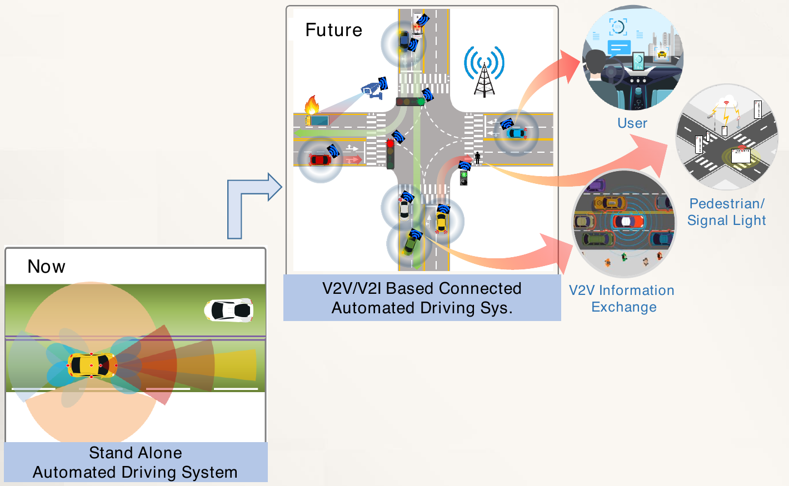

*Figure 1. Evolution from a stand-alone automated driving system to a V2V/V2I-based connected automated driving system*

Most autonomous driving today is a **stand-alone automated driving system**. As in the lower left of Figure 1, the vehicle decides based only on information within the range its own sensors can see (the semicircular sensing area). Future autonomous driving evolves into the **V2V/V2I-based connected automated driving system** on the right of Figure 1. The vehicle exchanges information with other vehicles at the intersection (V2V information exchange), receives information from pedestrians and traffic lights, and is also connected to the user (occupant). Because it obtains even information about places its sensors cannot see through communication, autonomous driving combines with communication and evolves into connected automated driving. This is why the V2X communication covered in Section 3 is needed.

---

<br>

## 2. Vehicles and Communication: In-Vehicle Communication

### 2.1 Basic Structure of a Vehicle

A vehicle consists of about 20,000 parts, which can be divided into four systems by function.

| System | Role | Examples |
|:-----|:-----|:-----|
| Powertrain | Generates power and delivers it to the wheels. | Engine, drive motor, battery, HEV and EV powertrains |
| Chassis | Supports the body and controls the vehicle's motion. | Frame, steering system (electric power steering), braking system, suspension |
| Body | The body and its parts that carry people and cargo. | Body frame, sunroof, headlamps |
| Multimedia (electrical/electronic) | Electrical, electronic, and electrical-equipment parts and information devices. | Wiring harness, multimedia devices |

*Table 15. The four systems of a vehicle and their main parts*

Automotive communication belongs to the electrical/electronic system among these, but it is a foundational technology spanning the entire vehicle in that it connects all the controllers of the powertrain, chassis, and body.

### 2.2 Two Branches of Automotive Communication: IVN and V2X

Automotive communication is divided into the network inside the vehicle and wireless networks with the outside.

> **Definition:** An **in-vehicle network (IVN)** is a communication network, mostly wired, that connects the ECUs, sensors, actuators, and other devices inside a vehicle.

> **Definition:** **Vehicle-to-everything (V2X)** communication is a wireless communication network that connects the vehicle with road infrastructure, other vehicles, pedestrians, and so on.

> **Definition:** An **ECU (electronic control unit)** is a small in-vehicle computer that reads sensor values, computes, and controls actuators.

> **Definition:** A **sensor** is a device that converts a physical quantity such as temperature, speed, or position into an electrical signal.

> **Definition:** An **actuator** is a device that receives an electrical signal and produces an actual action, such as a motor, valve, or lamp.

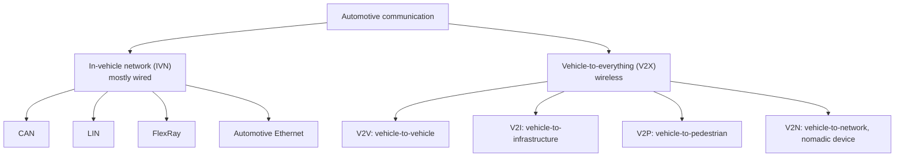

*Figure 2. Classification of automotive communication*

| Item | IVN | V2X |
|:-----|:-----|:-----|
| What it connects | ECUs, sensors, and actuators inside the vehicle | Other vehicles, road infrastructure, pedestrians, networks |
| Transmission medium | Mostly wired (copper wire, some optical fiber) | Wireless (radio waves) |
| Representative technologies | CAN, LIN, FlexRay, automotive Ethernet | WAVE (IEEE 802.11p), C-V2X, cellular |
| Main purpose | Real-time exchange of control information among in-vehicle controllers | Obtaining information beyond sensor range, cooperative driving, providing services |

*Table 16. Comparison of in-vehicle networks and V2X communication*

> **Note:** This course covers both branches. Weeks 3 and 9-10 cover IVNs centered on CAN; Weeks 4-7 cover the basics of data communication and networking that underlie both branches (transmission media, protocols and layered architecture, topologies, medium access control); and Weeks 11-14 cover V2X messages, connected automated driving by country, DSRC and WAVE, and C-V2X.

### 2.3 The Physical Form of the Vehicle Network: Wiring Harnesses

In reality, the in-vehicle network exists in the form of a **wiring harness**, a bundle of many wires. The harness is a core part of the multimedia (electrical/electronic) system and a high value-added part with a strong job creation effect, because producing it requires a large workforce.

> **Definition:** A **harness** originally means the gear fastened around a horse or draft animal to hitch it to a cart. The word developed into a name for the bundle of wires that runs throughout the vehicle body. Comparing the upper and lower right of Figure 3 shows that the wire bundle wrapping around the body resembles the gear of a horse.

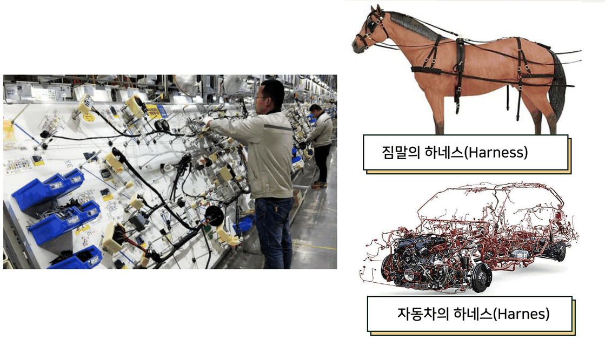

*Figure 3. A harness assembly plant, the harness of a draft horse, and the harness of a car*

The harness acts as the vehicle's nervous system, so a vehicle cannot be completed if even one type is missing. In 2022, COVID-19 lockdowns in China and the Russia-Ukraine war caused a harness supply crisis that halted vehicle production around the world. As on the left of Figure 3, a harness is a labor-intensive part whose wires workers lay out by hand on an assembly board, so the factories are mainly in low-wage countries. The harness market is expected to grow to 95 trillion won by 2027, and the industry is responding with automation and diversification of production sites.

Major Korean IVN and harness companies include Yura Corporation (Yura Tech Group, 2021 revenue of 2.0222 trillion won), Kyungshin (Kyungshin Holdings Group, 2021 revenue of 1.7352 trillion won), and Mobase Electronics (Mobase Group, 2021 revenue of 601.0 billion won).

### 2.4 Why a Network Is Needed

A vehicle has many controllers, and the signal and power lines connecting them are necessary.

1. A mid-size car is equipped with 70-140 ECUs.
2. In the past, ECUs, sensors, and actuators were each connected by individual wires. As a result the harness became heavier, and failures caused by wiring errors and the difficulty of repairs increased.
3. Recently a bus form is used in which several ECUs are attached to one network (bus). As a result the harness became lighter, failures decreased, the structure became simpler, and transmission speed increased. For example, a body controller and a headlight controller that used to be wired separately are tied into one network.

> **Definition:** A **bus** is a connection method in which several devices share one common transmission path. A signal sent by one device is delivered to all devices connected to the bus.

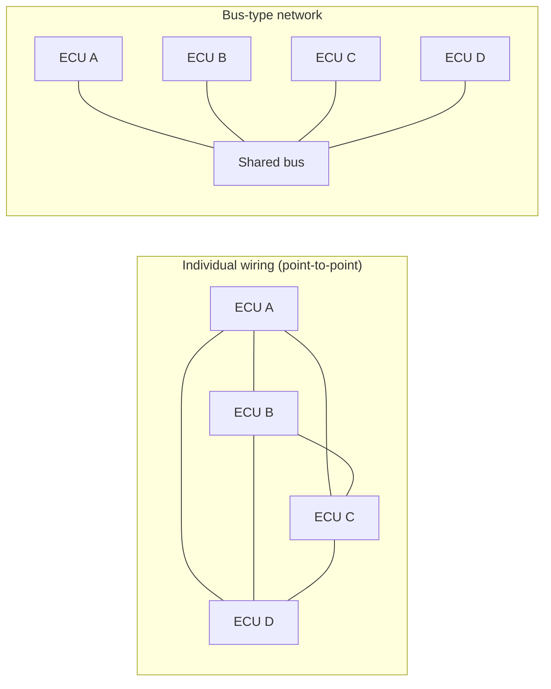

*Figure 4. Comparison of individual wiring and a bus-type network*

The difference between the two methods can be seen in the number of connections. For $n$ ECUs to communicate directly with every other ECU, one wire is needed for every pair of ECUs, so the number of connections is $\binom{n}{2} = \frac{n(n-1)}{2}$. With $n = 4$ as in Figure 4 there are $4 \times 3 / 2 = 6$ connections, with $n = 10$ there are $10 \times 9 / 2 = 45$, and with $n = 100$ there are $100 \times 99 / 2 = 4{,}950$. In a bus-type network, each ECU is connected only once to the single shared bus regardless of the number of ECUs, so the number of connections grows in proportion to $n$. In a real vehicle not every ECU is connected directly to every other one, but the fundamental reason for using bus-type networks is that the number of wires in individual wiring grows sharply as the number of ECUs grows.

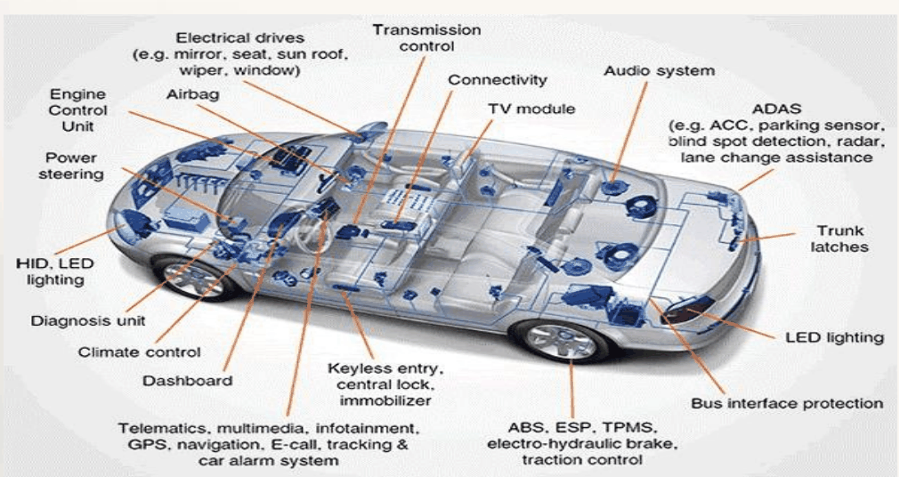

*Figure 5. Major ECUs installed in a vehicle*

Figure 5 shows the major ECUs in one vehicle. The engine control unit, transmission control, power steering, airbags, electrical drives (mirrors, seats, sunroof, wipers, windows), climate control, dashboard, diagnosis unit, telematics and infotainment (GPS, navigation, eCall, tracking and car alarm), audio, TV module, connectivity, ADAS (adaptive cruise control, parking sensors, blind spot detection, radar, lane change assistance), keyless entry and central locking, immobilizer, ABS, ESP, TPMS, electro-hydraulic brakes, traction control, trunk latches, HID and LED lighting, and bus interface protection are scattered throughout the body.

> **Definition:** **ADAS (advanced driver assistance systems)** are advanced systems that assist the driver.

> **Definition:** **ABS (anti-lock braking system)** is a braking system that prevents the wheels from locking during hard braking.

> **Definition:** **ESP (electronic stability program)** is a stability control system that prevents the body from skidding.

> **Definition:** **TPMS (tire pressure monitoring system)** monitors tire pressure.

### 2.5 Composition of the In-Vehicle Network

Several protocols with different uses and speeds are used together in an in-vehicle network. The representative ones are CAN, LIN, FlexRay, and automotive Ethernet, and among them CAN is both the most widespread and the most important. The maximum data rate and main use of each protocol are shown in Table 17 [20], [21].

| Protocol | Maximum Data Rate | Main Use |
|:-----|:-----|:-----|
| LIN (Local Interconnect Network) | 20 kbit/s | Low-cost control of body electronics such as doors, seats, and mirrors |
| CAN (Controller Area Network) | 1 Mbit/s | Real-time control of the powertrain, chassis, and body |
| FlexRay | 10 Mbit/s | Chassis control and X-by-wire requiring fault tolerance and temporal determinism |
| Automotive Ethernet | 100 Mbit/s or more | Cameras, infotainment, high-speed backbone |

*Table 17. Major in-vehicle network protocols*

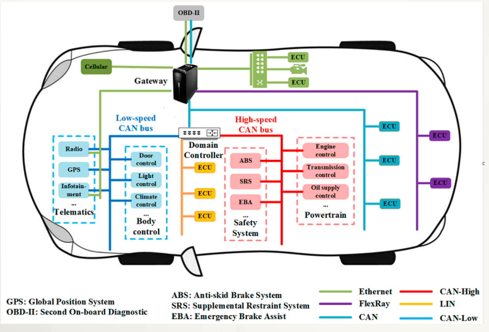

*Figure 6. An in-vehicle network organized around a gateway*

Figure 6 is an example of the IVN configuration of a real vehicle [22]. The central **gateway** connects the different networks. The OBD-II diagnostic port, the cellular module, and, through an Ethernet switch, cameras and ECUs are connected to the gateway. The low-speed CAN bus connects the radio, GPS, infotainment, and telematics, as well as body control ECUs such as door, light, and climate control. The high-speed CAN bus connects safety systems such as ABS, SRS (airbags), and EBA (emergency brake assist) and powertrain ECUs such as engine, transmission, and oil supply control. The domain controller is linked to the gateway by CAN and sits between the low-speed and high-speed CAN buses, and ECUs connected by LIN hang below it as a sub-network. In addition, ECUs are attached to a separate CAN bus and a FlexRay bus that branch from the gateway. In the legend of the figure, CAN-High (red line) and CAN-Low (blue line) denote the high-speed and low-speed CAN buses, respectively. ISO 11898 high-speed CAN and low-speed fault-tolerant CAN both carry signals as the voltage difference between two wires, CAN_H and CAN_L, a principle covered in Week 3.

> **Definition:** A **gateway** is a device that converts and forwards messages between networks with different protocols or speeds.

> **Definition:** **OBD-II (On-Board Diagnostics II)** is the standard diagnostic interface for reading a vehicle's fault diagnosis information with external equipment.

The operation of CAN is covered in detail in Week 3, and LIN, FlexRay, automotive Ethernet, and CAN FD in Week 9.

---

<br>

## 3. V2X Wireless Communication and Connected Cars

### 3.1 Classification of V2X Communication

V2X is divided into four types according to the communication partner.

| Type | Name | Communication Partner | Examples |
|:-----|:-----|:-----|:-----|
| V2V | Vehicle to Vehicle | Other vehicles | Receiving the hard-braking information of the car ahead, intersection collision warning |
| V2I | Vehicle to Infrastructure | Road infrastructure such as traffic lights and roadside units | Receiving signal information, warning of an icy road section ahead |
| V2P | Vehicle to Pedestrian | Pedestrians' devices | Warning of pedestrians at a crosswalk |
| V2N | Vehicle to Nomadic device / Network | Personal devices, cellular network and servers | Smartphone integration, remote services |

*Table 18. The four types of V2X communication*

> **Note:** The N in V2N is sometimes read as a device that a person carries (nomadic device), but in the 3GPP standards V2N means vehicle-to-network, in which the vehicle communicates with a server through the base station and core network [23]. Today the latter meaning is more widely used.

### 3.2 Communication Module Types of Connected Cars: Embedded and Tethered

There are two ways to give a vehicle communication capability.

- **Embedded:** A communication module is mounted directly in the vehicle. Because the vehicle has its own line, a separate communication fee is charged.
- **Tethered:** The vehicle connects to a communication device such as a smartphone via Bluetooth or similar and borrows that device's communication function. There is no separate fee for the vehicle.

The trend is for embedded to outnumber tethered. According to Frost & Sullivan, new vehicles with connectivity grew by 14.2%, from 23.3 million in 2016 to 26.6 million in 2017 [24].

| Region | Tethered | Embedded (LTE) | Embedded (3G, 2G) | Total |
|:-----|-----:|-----:|-----:|-----:|
| North America | 4.8 | 2.2 | 5.0 | 12.0 |
| Europe | 2.5 | 1.0 | 4.3 | 7.8 |
| China | 1.8 | 0.3 | 4.5 | 6.6 |

*Table 19. Connectivity types of new connected vehicles by region in 2017 (million units)*

The same source interpreted the regional situation as follows [24]. LTE adoption depends on the decisions of automakers driven by demand. U.S. consumers are willing to pay for safety and security services. In Europe, market diversity slows the rollout of standard services. In Brazil, growth slowed because of economic turmoil.

### 3.3 Connected Car Trends

In 2019, Frost & Sullivan identified the main feature trends of connected cars as the in-vehicle marketplace (e-commerce inside the car), Features on Demand, V2X communication protocols, in-vehicle payments, digital assistants (such as Alexa), and automotive biometrics [25].

**Marketplace.** Many automakers are integrating in-vehicle payments. According to a VISA study, purchases made during commutes exceed USD 200 billion, and the average commute lasts 15-60 minutes. As automated driving spreads, in-car advertisements become more likely to turn into purchases. Marketplaces are divided into those that transact directly inside the vehicle and those that use access to the vehicle (for example, trunk delivery). Representative use cases are paying for fuel and parking, ordering and paying for food, booking restaurants and hotels, navigating to the destination, service offers from dealerships, and finding partner brands and offers. To prevent driver distraction, the options are limited; for example, a Starbucks order is chosen only from a few previous orders. Hyundai's Blue Link and Genesis Connected Services have been integrated with Alexa.

> **Definition:** **Features on Demand (FoD)** is a business model in which hardware is installed in the vehicle in advance and the corresponding function is enabled by software when the user pays for it. It comes as one-time purchases or recurring subscriptions.

More than 30 services can be offered as Features on Demand, launched through dealership retrofits or OTA. Tesla currently offers one-time purchases, and recurring purchases were expected to become available in the longer term. Examples by category are shown in Table 20 [25].

| Category | Examples of Features on Demand |
|:-----|:-----|
| Infotainment and telematics | In-vehicle Wi-Fi, media packages, productivity suite, concierge, smartphone interfacing and entertainment apps, personal digital assistants, remote diagnostics and predictive maintenance, gaming |
| ADAS and autonomous driving | Hill and highway assist, adaptive and predictive cruise control, autonomous valet parking, autopilot, traffic jam and intersection assist, severe climate package, driver monitoring, remote vehicle operation, platooning for businesses |
| Location-based services | Fueling, tolling, parking, charging, on-demand repair, geofenced points of interest, mapping |
| Mobility services | Journey planning, last-mile travel, e-hailing, public transport schedules and ticket purchase, car rental and car sharing in automaker programs |
| Powertrain performance and EV | Drive mode updates (steering, suspension, transmission), off-road package, acceleration and power, EV range extension, switching between automatic and manual transmission, raising speed limits, supercharging |
| Value adds | On-demand insurance, two free feature upgrades every year |
| Smart interiors and exteriors | Personalized lighting, fragrance, and climate, projectors and on-demand screens, user interface skins, seat recline and movie mode, premium audio, automatic climate adjustment, panoramic roof, additional storage, trunk deliveries |

*Table 20. Categories and examples of Features on Demand*

**V2X players.** In the C-V2X camp, adoption of C-V2X became evident as partnerships between companies increased, and system integrators released products supporting both DSRC and C-V2X. Keysight offered C-V2X test equipment that can be extended to 5G, and 5GAA announced at CES 2019 a plan to put 5G C-V2X on the road by 2020. Ford announced that all its new models would carry C-V2X from 2022 and ran a pilot in China, and Lexus tested 4G C-V2X on the RX 450h F Sport with the Australian government and Telstra. LG Innotek and Quectel released C-V2X modules based on the Qualcomm 9150 chipset, and Danlaw released an on-board unit (OBU) and roadside unit (RSU) based on the same chipset. Qorvo presented at CES 2019 a module supporting both C-V2X and DSRC, Autotalks a chipset supporting both, Continental a hybrid V2X supporting both C-V2X and DSRC over 4G and 5G networks, and Savari the StreetWAVE 2000 supporting both. As 5G commercialization progressed, C-V2X was preferred, and apart from Toyota and GM, DSRC took a back seat for lack of regulatory support [25].

**Regional trends.** Most regions favored C-V2X, and because 5G was not yet in full swing, commercial launches in 2019 began with LTE [25].

| Region | Trend |
|:-----|:-----|
| Europe | The debate between ITS-G5 (IEEE 802.11p) and 5G (LTE) continued. The C2C-CC and ETSI supported ITS-G5, while mobile network operators pushed C-V2X. |
| United States | 5GAA (Qualcomm and others) pushed 5G C-V2X, many technology providers introduced hybrid solutions, and automakers were expected to introduce both DSRC and C-V2X as early as 2020. |
| China | The Ministry of Industry and Information Technology (MIIT) designated 5,905-5,925 MHz as an experimental band, and Qualcomm partnered with automakers on LTE C-V2X. |
| Japan | V2X standardization was government-led, and 5.8 GHz DSRC was deployed. The ITS Connect and ITS Japan consortia led V2V and V2I safety applications. |

*Table 21. V2X trends by region*

> **Note:** Japan's ITS Connect is a safe driving support system using V2V and V2I communication in the 760 MHz band, which Toyota began applying to production vehicles with the Crown launched in October 2015 [26]. In Japan, 5.8 GHz DSRC is used mainly for electronic toll collection (ETC) and road information services.

### 3.4 Why Connected Automated Driving Is Needed

Combining wireless communication with autonomous vehicles brings the following benefits.

1. Autonomous driving information is obtained both within and beyond the sensors' line of sight, along with reliable wide-area information.
2. Fusing data that complements existing sensors improves object recognition rates.
3. Convenience and safety services are provided for the occupants of autonomous vehicles.
4. The ripple effect on related industries such as automobiles, the internet, communication, and infrastructure grows.

| Category | Service | Content |
|:-----|:-----|:-----|
| Safety (latency is critical) | Sharing long-range perception | Sharing the perception information of roadside sensors and nearby vehicles. |
| Safety (latency is critical) | C-ITS | V2V-based automatic braking for forward collision risk, V2I-based warning of icy road sections ahead, V2P-based safety braking at intersections |
| Convenience (throughput is critical) | Infotainment | Mobile office, mobile internet, remote vehicle management |
| Convenience (throughput is critical) | Autonomous driving service support | Automatic map updates, remote autonomous driving software updates, remote vehicle operation, unmanned delivery, insurance, valet parking |

*Table 22. Classification of connected automated driving services*

Safety services and convenience services place different demands on communication. Safety services must deliver small data within a fixed time (for example, 10 ms) without fail, so **latency** is critical. Convenience services must deliver large data such as video and internet content quickly, so **throughput** is critical.

> **Definition:** **C-ITS (Cooperative Intelligent Transport Systems)** is a cooperative traffic system in which vehicles exchange information with other vehicles and road infrastructure in real time to prevent accidents.

> **Definition:** **Latency** is the time from the moment data is sent to the moment it is received.

> **Definition:** **Throughput** is the amount of data that can be sent per unit time.

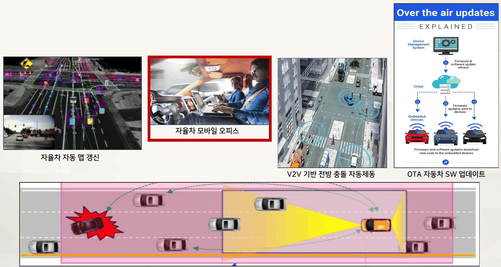

*Figure 7. Examples of connected automated driving services*

The top of Figure 7 shows, from the left, automatic map updates for autonomous vehicles, a mobile office inside an autonomous vehicle, V2V-based automatic braking for forward collisions, and OTA software updates. In OTA, a device management system uploads firmware and software updates to the cloud, the cloud sends them to the embedded devices of each vehicle, and the vehicle downloads and installs them. The bottom of Figure 7 shows traffic safety at distances beyond the sensor range. When an accident has occurred ahead but is hidden by vehicles in between so that the ego vehicle's sensors (yellow fan) cannot see it, receiving the accident information over V2V allows the vehicle to slow down in advance.

### 3.5 Sensors and the Volume of Transmitted Data

There is a claim that autonomous vehicles produce so much data that they absolutely need 5G. To judge this claim, one must distinguish whether the raw data of the sensors is sent or only the results after perception processing.

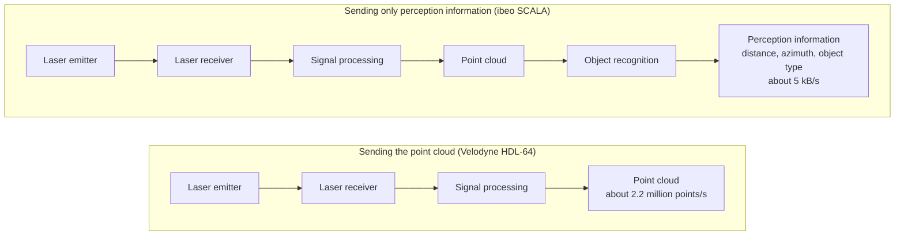

*Figure 8. Two forms of LiDAR output and their data volumes*

> **Definition:** **LiDAR** is a sensor that measures distance by emitting a laser and timing the reflection that returns.

> **Definition:** A **point cloud** is the set of points made up of the 3D coordinates of the reflection points measured by the LiDAR.

As in Figure 8, the Velodyne HDL-64, a 360-degree rotating LiDAR, outputs about 2.2 million points per second. By contrast, if object recognition is completed inside the sensor, as in the ibeo SCALA, and only perception information such as distance, azimuth, and object type is output, the data volume is only about 5 kB per second. The perception data output by sensors other than LiDAR is also small enough to be carried on CAN.

Let us compare the two cases as bit rates. Assuming that each point is represented by four values, the x, y, and z coordinates and the reflection intensity, and that each value is stored as a 4-byte floating-point number, one point takes 16 bytes.

```math
2{,}200{,}000 \times 16\ \text{B/s} = 35{,}200{,}000\ \text{B/s} \approx 35.2\ \text{MB/s} = 281.6\ \text{Mbit/s}
```

```math
5{,}000\ \text{B/s} \times 8 = 40{,}000\ \text{bit/s} = 40\ \text{kbit/s}
```

The raw data is about $281.6 / 0.04 \approx 7{,}000$ times the perception information. A raw point cloud is hard to transmit in real time not only over CAN, whose maximum is 1 Mbit/s, but also over most wireless links, whereas perception information fits comfortably on CAN. Therefore, if vehicles exchange only perception results, high-capacity communication is not strictly necessary, and the need for 5G arises mainly from high-capacity services such as sharing raw data, downloading high-definition maps, and video for remote driving. Note that the size of one point differs by sensor and data format, so the calculation above only illustrates the order of magnitude.

### 3.6 V2X Communication Methods for Vehicles: Cellular, WAVE, and C-V2X

There are three representative V2X communication standards for vehicles.

| Method | Advantages | Disadvantages |
|:-----|:-----|:-----|
| Cellular (LTE, 5G) | High-speed transmission is possible, so throughput is high. | Data passes through network base stations, so latency is long, which makes it unsuitable for emergency warnings or braking. |
| WAVE | A low-latency, free technology specialized for vehicle safety services. | Infrastructure must be installed, and throughput is low. |
| C-V2X | Enables communication among things (IoT) and high-speed transmission. 5G C-V2X can achieve low latency. | It is built around the mobile communication industry, and its service cost structure depends on mobile network operators. |

*Table 23. Advantages and disadvantages of V2X communication methods for vehicles*

> **Definition:** **WAVE (Wireless Access in Vehicular Environments)** is a vehicle communication method that uses IEEE 802.11p, an adaptation of the wireless LAN (Wi-Fi) technology IEEE 802.11 to the vehicle environment, as its physical and MAC layers, and it corresponds to DSRC (Dedicated Short Range Communications) in the broad sense.

> **Definition:** **C-V2X (Cellular V2X)** is the V2X technology defined by the mobile communication standards body 3GPP on the basis of LTE and 5G.

> **Definition:** The **IEEE** is the Institute of Electrical and Electronics Engineers, based in the United States, which makes communication standards such as Wi-Fi.

> **Definition:** **3GPP (3rd Generation Partnership Project)** is the international standards body that makes mobile communication standards.

| Item | WAVE | C-V2X | Cellular |
|:-----|:-----|:-----|:-----|
| Variants | IEEE 802.11p, IEEE 802.11bd | LTE-V2X, LTE-eV2X, 5G NR-V2X | LTE, 5G |
| Standards body | IEEE | 3GPP | 3GPP |
| Mobility support | 200 km/h (802.11p), 500 km/h (802.11bd) | | |
| Deployments | Many in Korea and abroad for 802.11p, 802.11bd upcoming | Many in Korea and abroad for LTE-V2X, LTE-eV2X and NR-V2X upcoming | Many in Korea and abroad |
| Direct communication between devices | V2V possible | V2V possible | V2V not possible |
| Main services | Safety | Safety, convenience | Convenience |
| Communication cost | Free | Paid | Paid |
| Infrastructure cost | Central and local government budgets | Mobile network operators | Mobile network operators |
| Lead ministry | Ministry of Land, Infrastructure and Transport | Ministry of Science and ICT | Ministry of Science and ICT |
| Lead industry | Transport and automotive industries | Mobile communication industry | Mobile communication industry |

*Table 24. Comparison of WAVE, C-V2X, and cellular methods (Korean context)*

In Table 24, the cellular method cannot perform V2V because all data must pass through the base station. WAVE and C-V2X allow devices to communicate directly with each other without a base station.

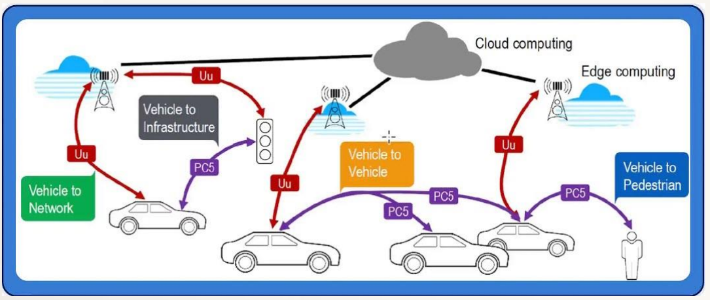

*Figure 9. The two communication interfaces of C-V2X, Uu and PC5*

As in Figure 9, C-V2X has two communication interfaces. **Uu** is the ordinary cellular link in which the vehicle communicates with a base station, used for V2N connections to cloud computing or edge computing servers beyond the base station. **PC5** is the link in which devices communicate directly with each other without passing through a base station (the sidelink), used for V2V, V2I, and V2P. PC5 direct communication can operate even where there is no cellular network coverage [27].

> **Note:** Table 24 classifies C-V2X as paid because it reflects services that use Uu and the business structure in which mobile network operators build the infrastructure. PC5 direct communication does not pass through a base station, so the communication itself may incur no mobile network charges.

In 2019, Frost & Sullivan summarized the landscape of V2X protocols as follows [25].

| Item | C-V2X | DSRC | Hybrid |
|:-----|:-----|:-----|:-----|
| What | Cellular-based V2X relying on network access in the 4G, LTE, and 5G bands | V2V and V2I communication relying on IEEE 802.11p Wi-Fi | A mix of the two methods |
| Automakers | Audi, BMW Group, Ford, Geely, Honda, Lexus, Mercedes-Benz, PSA Group | GM, JLR, Toyota, Volkswagen | Unknown |
| Suppliers | Qualcomm, Quectel, Keysight, LG Innotek | Qualcomm, Savari | Autotalks, Qorvo |
| When | Ready in 2019-2020, regulatory support required | Deployed as early as 2019 after trials | Hybrid chips introduced in 2019 |

*Table 25. Participants and timing by V2X protocol*

Direct C-V2X communication (PC5) and WAVE (DSRC) both use the 5.9 GHz band (Japan is an exception, using ITS Connect in the 760 MHz band and 5.8 GHz DSRC). The same source judged C-V2X more promising than DSRC and expected cellular companies to benefit whichever is adopted. Since both methods can technically implement vehicle safety communication, what actually decides the choice is less a technical question than a policy question of spectrum allocation, who invests in infrastructure, and industrial interests.

### 3.7 Connected Car Policies Abroad

**United States.** In November 2020 the U.S. Federal Communications Commission (FCC) adopted rules repurposing the 75 MHz of the 5.9 GHz band (5.850-5.925 GHz), and the rules took effect in July 2021. The lower 45 MHz was moved to unlicensed (Wi-Fi) use, the upper 30 MHz of the ITS spectrum (5.895-5.925 GHz) was kept for C-V2X, and WAVE technology was excluded from the use of the ITS spectrum [28]. In November 2024 the FCC finalized the detailed operating rules for C-V2X and set a transition period for phasing out DSRC [29].

Before that, the United States had tried to mandate WAVE-based connected cars. In 2014 the National Highway Traffic Safety Administration (NHTSA) issued an advance notice for Federal Motor Vehicle Safety Standard FMVSS No. 150 (49 CFR Part 571), which would require V2X communication modules in passenger cars and light trucks, and in January 2017 it published a notice of proposed rulemaking (NPRM). However, it was halted when policy changed under the Trump administration, and policy changed again under the Biden administration. In November 2023 NHTSA formally withdrew the proposed rule, citing the emergence of a new V2V communication protocol and the FCC's changes to the 5.9 GHz rules [30].

| Date | U.S. DOT Connected Vehicle Milestones (plan as of 2015) |
|:-----|:-----|
| August 2014 | NHTSA issues the V2V advance notice of proposed rulemaking (ANPRM) |
| May 2015 | Secretary of Transportation Foxx announces acceleration of V2V rulemaking |
| Summer 2015 | The Federal Highway Administration (FHWA) issues V2I deployment guidance |
| Fall 2015 | The first wave of connected vehicle pilots begins |
| End of 2015 | The V2V NPRM is sent to interagency review |
| 2017 | New cars with connected vehicle technology expected |

*Table 26. U.S. connected automated driving milestones (2015 plan)*

**Europe.** In March 2020 Europe extended the ITS frequency band from a 70 MHz bandwidth to an 80 MHz bandwidth. In January 2019 an EC delegated regulation mandating ITS-G5 (WAVE) was submitted as the legal basis for promoting C-ITS deployment on European roads, but it was finally rejected by the Council of the EU in July 2019. A new regulation that would also include C-V2X was then expected to be enacted in 2021.

> **Definition:** **ITS-G5** is the European vehicle communication standard defined by the European standards body ETSI on the basis of IEEE 802.11p. It belongs to the same family of technology as WAVE in the United States.

**China.** In October 2018 China officially designated the 5.905-5.925 GHz range for C-V2X direct communication. It built national-level testbeds based on C-V2X technology in more than ten regions, and about ten automakers were expected to launch vehicles capable of C-V2X direct communication by 2022.

### 3.8 Connected Car Policy in Korea

In 2016 Korea allocated 70 MHz of the 5.9 GHz band (5.855-5.925 GHz) for ITS use but did not specify the communication method [31]. The C-ITS infrastructure plan included in the social overhead capital (SOC) digitalization projects of the Korean New Deal in July 2020 announced that C-ITS would be installed on 2,085 km, half of the national expressways, by 2022, and on the entire 4,075 km by 2025 [32].

The procedure for deciding the communication method was planned as follows.

1. **Joint working group:** On July 26, 2021, the Ministry of Science and ICT and the Ministry of Land, Infrastructure and Transport held consultations on nationwide C-ITS infrastructure deployment and formed a joint working group.
2. **Demonstration:** To decide the communication method, LTE-V2X is demonstrated, including certification procedures, from the fourth quarter of 2021 to the fourth quarter of 2022.
3. **Selection:** After the LTE-V2X demonstration, a dual-mode pilot project using both WAVE and LTE-V2X (a 2,000 km section) compares performance in 2023, and then a single V2X communication method is selected.
4. **Deployment:** From 2024, the main C-ITS infrastructure deployment project proceeds based on the selected method.

> **Note:** For the pilot projects of the two methods, in March 2022 the lower 20 MHz of the 70 MHz was assigned to LTE-V2X and the upper 30 MHz to WAVE, with the 20 MHz between them kept as a guard band to prevent interference between the two technologies [31]. Then, in December 2023, the Ministry of Science and ICT and the Ministry of Land, Infrastructure and Transport, following the recommendation of an expert committee, chose LTE-V2X as the single communication method for C-ITS and announced follow-up measures such as revising the technical standards [33].

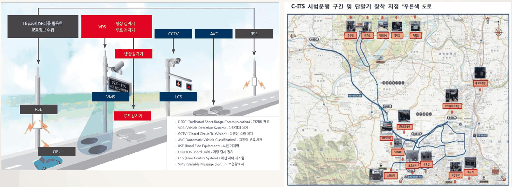

*Figure 10. Components of Korean C-ITS and the pilot operation section*

The left of Figure 10 shows the C-ITS components installed on the road, and the right is a map of the C-ITS pilot operation section and the points where terminals were installed. The meanings of the components are given in Table 27.

| Abbreviation | Name | Role |
|:-----|:-----|:-----|
| DSRC | Dedicated short-range communication | Collecting traffic information using Hi-pass terminals |
| VDS | Vehicle detection system | Collecting traffic volume and speed with video and loop detectors |
| CCTV | Video collection system | Collecting video of road conditions |
| AVC | Automatic vehicle classification | Classifying the types of passing vehicles |
| RSE | Roadside equipment | Communicating wirelessly with vehicles at the roadside (same meaning as roadside unit, RSU) |
| OBU | On-board unit | Communicating from the vehicle with roadside equipment and other vehicles |
| LCS | Lane control system | Showing whether each lane is open |
| VMS | Variable message sign | Displaying traffic information to drivers |

*Table 27. Components of Korean C-ITS*

### 3.9 Cooperative Automated Driving: C-ITS and Autonomous Driving

To realize **cooperative automated driving**, in which autonomous vehicles cooperate with C-ITS, signal information must reach the vehicle without interruption. The actual infrastructure, however, has the following problems.

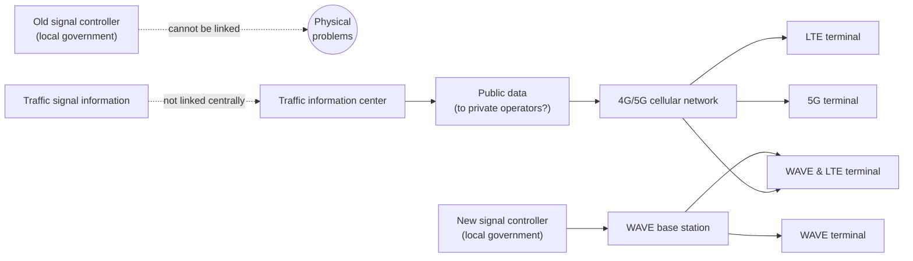

*Figure 11. The delivery path of signal information and the problems of C-ITS infrastructure*

1. Old signal controllers managed by local governments cannot be linked with communication base stations. Only new signal controllers can send signal information to WAVE terminals through WAVE base stations.
2. Traffic signal information is not linked centrally to the traffic information center.
3. It has not been decided whether information from the traffic information center will be handed over to private operators as public data and served over cellular networks.

The government planned to invest 6 trillion won to build C-ITS infrastructure nationwide (public hearing on the draft Intelligent Transport Systems (ITS) Master Plan 2030). The key to this plan is the penetration rate of in-vehicle V2X terminals, because even with the infrastructure in place, cooperative driving has no effect if few vehicles carry terminals. In addition, not only the signal system but traffic facilities and traffic safety infrastructure as a whole must be improved together.

> **Key Point:** The success of connected automated driving depends more on institutional factors such as spectrum policy, infrastructure investment, and terminal penetration than on the superiority of one communication technology over another. Korea has the conditions to build a single nationwide infrastructure (Section 1.8), but to make use of that advantage, central linking of signal information and terminal penetration must go together.

---

<br>

## Concept Applications

Connect each situation with the concept that serves as the basis for judgment.

| Situation | Concept to Connect and Reason |
|:-----|:-----|
| An accident beyond the car ahead cannot be seen by the ego vehicle's sensors. | **V2V and connected automated driving.** Accident information sent by other vehicles reveals risks beyond sensor range in advance. |
| An emergency braking warning is to be sent over the LTE cellular network. | **Latency.** The cellular method passes through base stations, so latency is long and it is unsuitable for emergency warnings and braking. |
| The number of ECUs in one vehicle has grown beyond 100. | **Bus-type network.** With individual wiring the number of connections grows sharply as $n(n-1)/2$, so tying the ECUs to a shared bus reduces harness weight and wiring errors. |
| Vehicles are to share the positions of surrounding objects. | **Sensor data volume.** Sending only perception information instead of the raw point cloud needs just a few kB per second. |
| The vehicle's remote services work only when a smartphone is connected. | **Tethered method.** The vehicle has no communication module and borrows the smartphone's communication function. |
| An engine parts supplier's sales fall due to the shift to electric vehicles. | **Restructuring of the supply chain.** Electric vehicles need no engine parts, so the number of parts falls by about 45%. |

*Table 28. Concepts to connect to each situation and the reasons*

**True/False Check:**

| Statement | Judgment and Reason |
|:-----|:-----|
| An IVN is a network that wirelessly connects the vehicle and road infrastructure. | **F.** An IVN connects the ECUs, sensors, and actuators inside the vehicle, mostly by wire. The wireless connection between the vehicle and infrastructure is V2X. |
| With the cellular method, vehicles cannot communicate directly with each other without a base station. | **T.** All data passes through the base station, so direct communication between devices (V2V) is impossible. |
| Autonomous vehicles need 5G in every case. | **F.** If only processed perception information is sent, the data volume is small, about 5 kB per second, and can be carried even on CAN. |
| The U.S. FCC designated the upper 30 MHz of the 5.9 GHz band for C-V2X. | **T.** It moved the lower 45 MHz to unlicensed use and kept the upper 30 MHz for C-V2X. |
| Japan's SIP-adus is run solely by the Ministry of Economy, Trade and Industry. | **F.** It is cross-ministry governance under the Cabinet Office, with the Ministry of Internal Affairs and Communications, the Ministry of Economy, Trade and Industry, the National Police Agency, and the Ministry of Land, Infrastructure, Transport and Tourism among the participants. |

---

<br>

## Summary

| Concept | Key Summary |
|:--------|:------------|
| C.A.S.E. | Future vehicles evolve in four directions, connected, autonomous, shared, and electric, and by 2030 most new vehicles are expected to have connected and autonomous driving functions. |
| Connected car | A vehicle that exchanges data with the outside through communication, providing infotainment, smartphone integration, EV, navigation, telematics, and autonomous driving services. |
| Policies of major countries | The United States pursues autonomous driving through DOT guidelines, Europe through the ERTRAC and EPoSS roadmaps, and Japan through SIP-adus, a cross-ministry framework under the Cabinet Office. |
| Korean automotive industry | It accounts for a large share of employment and exports and has electronics and automotive industries, groups of parts companies, and a single nationwide infrastructure, but lacks software talent and preparation for future vehicles. |
| Industrial structural change | The shift to electric vehicles reduces the number of parts, and with E/E architectures that centralize computation and SDVs, the center of value moves to software and electrical and electronic parts. |
| IVN and V2X | Automotive communication is divided into IVNs, which connect the inside of the vehicle mostly by wire, and V2X, which connects the vehicle with the outside wirelessly. |
| Bus-type network | As ECUs grew to 70-140, a shared bus replaced individual wiring, reducing harness weight, failures, and wiring errors. |
| IVN protocols | LIN, CAN, FlexRay, and automotive Ethernet are used together according to use and speed, and a gateway connects them. |
| V2X types | There are four types, V2V, V2I, V2P, and V2N; latency is critical for safety services and throughput for convenience services. |
| Sensor data volume | A raw point cloud is on the order of hundreds of Mbit per second, but perception information is about 5 kB per second, so the communication requirement depends on what is sent. |
| V2X methods | Cellular is fast but has long latency, WAVE has low latency but needs infrastructure, and C-V2X supports both long-range and direct communication through Uu and PC5. |
| Vehicle communication policies | The United States and China chose C-V2X, the proposal to mandate ITS-G5 was rejected in Europe, and Korea chose LTE-V2X as its single method in December 2023 after demonstrations. |
| Cooperative automated driving | Cooperation with C-ITS requires central linking of signal information, infrastructure improvement, and the penetration of V2X terminals together. |

---

<br>

## Self-Check Questions

1. **C.A.S.E.:** Write the four keywords of C.A.S.E. and choose the two most directly related to automotive communication, with reasons.

   <details>
   <summary>Answer</summary>

   They are Connected, Autonomous, Shared, and Electric. Connected is itself the exchange of data between the vehicle and the outside through communication, and autonomous driving becomes safer and recognizes objects better when it obtains information beyond sensor range through V2X, so these two keywords are most directly related to communication.

   </details>

2. **Bus-type network:** How many connections are needed to wire 12 ECUs individually so that each can communicate directly with every other? Explain how a bus-type network solves this problem.

   <details>
   <summary>Answer</summary>

   One connection is needed for every pair of ECUs, so $12 \times 11 / 2 = 66$. In a bus-type network every ECU is connected only once to a single shared bus, so the number of connections grows in proportion to the number of ECUs. As a result the harness weight, failures caused by wiring errors, and the difficulty of repairs decrease, and the structure becomes simpler.

   </details>

3. **Composition of the IVN:** In an in-vehicle network organized around a gateway, give examples of the ECUs connected to the low-speed CAN and the high-speed CAN, and explain the role of the gateway.

   <details>
   <summary>Answer</summary>

   Body and comfort ECUs such as the radio, GPS, infotainment, telematics, doors, lights, and climate control are connected to the low-speed CAN. Safety systems such as ABS, airbags (SRS), and emergency brake assist (EBA) and powertrain ECUs such as the engine and transmission are connected to the high-speed CAN. The gateway converts and forwards messages between networks with different speeds or protocols (low-speed CAN, high-speed CAN, FlexRay, Ethernet, OBD-II, the cellular module).

   </details>

4. **Classification of V2X:** Explain V2V, V2I, V2P, and V2N, and state why the N in V2N is read in two ways.

   <details>
   <summary>Answer</summary>

   V2V is communication between vehicles, V2I between the vehicle and road infrastructure such as traffic lights and roadside units, V2P between the vehicle and pedestrians (their devices), and V2N between the vehicle and a network or personal device. The N is sometimes read as a device that a person carries (nomadic device), but in the 3GPP standards it means vehicle-to-network, communication with a server through the base station and core network.

   </details>

5. **Safety and convenience:** When connected automated driving services are divided into safety and convenience services, explain with examples the key communication performance each requires.

   <details>
   <summary>Answer</summary>

   Safety services (V2V-based automatic forward collision braking, V2I-based icy road warnings, etc.) must deliver small data within a fixed time (for example, 10 ms) without fail, so latency is critical. Convenience services (mobile office, automatic map updates, OTA updates, etc.) must send large data such as video or software quickly, so throughput is critical.

   </details>

6. **Sensor data volume:** For a LiDAR that outputs 2.2 million points per second with 16 bytes per point, compute the bit rate of the raw data and compare it with sending only perception information (5 kB per second).

   <details>
   <summary>Answer</summary>

   $2{,}200{,}000 \times 16 = 35{,}200{,}000$ B/s, and multiplying by 8 gives $281.6$ Mbit/s. Perception information is $5{,}000 \times 8 = 40$ kbit/s, so the raw data is about 7,000 times larger. The raw data cannot be sent over CAN, whose maximum is 1 Mbit/s, but perception information fits comfortably on CAN.

   </details>

7. **Comparison of methods:** Compare cellular, WAVE, and C-V2X in terms of latency, direct communication between devices, and who builds the infrastructure.

   <details>
   <summary>Answer</summary>

   Cellular passes through base stations, so its latency is long and direct communication between devices is impossible, and mobile network operators build its infrastructure. WAVE has low latency and supports direct V2V communication, and its infrastructure is built with central and local government budgets. C-V2X supports direct V2V communication through PC5, 5G C-V2X can achieve low latency, and mobile network operators build its infrastructure.

   </details>

8. **Policy:** Summarize how the United States, Europe, and Korea decided on vehicle communication methods, and explain why the choice of method is said to be more a question of policy than of technology.

   <details>
   <summary>Answer</summary>

   In the United States, the FCC assigned the upper 30 MHz of the 5.9 GHz band to C-V2X and excluded WAVE (DSRC). In Europe, after a delegated regulation mandating ITS-G5 (WAVE) was rejected in 2019, a regulation that includes C-V2X was pursued. Korea allocated 70 MHz without deciding the method and then, after demonstrations and comparison, chose LTE-V2X as its single method in December 2023. Because both methods can implement vehicle safety communication, the actual choice depends on spectrum allocation, who invests in infrastructure (government budgets or mobile network operators), and industrial interests (the transport and automotive industries or the mobile communication industry).

   </details>

---

<br>

## References

1. SBD Automotive, "Change personified in four letters: C-A-S-E," infographic, reproduced in *ZDNet*.
2. Frost & Sullivan, *Global Connected Car Market Outlook, 2020*, May 2020.
3. Frost & Sullivan, "Mobility outlook: Gross market value forecast by new mobility services type, global, 2019 and 2020," chart, 2020.
4. U.S. Department of Transportation and NHTSA, *Automated Driving Systems 2.0: A Vision for Safety*, Washington, DC, USA, 2017.
5. U.S. Department of Transportation, *Preparing for the Future of Transportation: Automated Vehicles 3.0*, Washington, DC, USA, 2018.
6. National Science and Technology Council and U.S. Department of Transportation, *Ensuring American Leadership in Automated Vehicle Technologies: Automated Vehicles 4.0*, Washington, DC, USA, Jan. 2020.
7. ERTRAC, *Connected Automated Driving Roadmap*, Brussels, Belgium, 2019.
8. EPoSS, *European Roadmap Smart Systems for Automated Driving*, Berlin, Germany, 2015.
9. Cabinet Office, Government of Japan, *SIP Automated Driving for Universal Services (SIP-adus) R&D Plan*, 2018.
10. 한국자동차연구원, 세계 자동차 판매와 생산 현황 자료, 2022년 1월.
11. 관계부처 합동, "제조업 활력 회복 및 혁신 전략," 2018.
12. 관계부처 합동, "미래자동차 산업 발전 전략," 2019.
13. 이데일리, 산업별 고용 현황 보도(2018년 통계청 자료 인용), 2020.
14. Automotive News, "Top 100 global suppliers," June 2021.
15. VICS Center, VICS 단말 출하 대수(2020년 말 기준). https://www.vics.or.jp
16. KPMG International, *2020 Autonomous Vehicles Readiness Index*, 2020.
17. Navigant Research (Guidehouse Insights), *Leaderboard: Automated Driving Vehicles*, 2020.
18. 한국자동차산업협회(KAMA), 자동차 산업 현황과 부품 업계 미래차 대응 실태 조사, 2020.
19. 일본자동차부품공업회(JAPIA), 내연기관차와 전기차의 부품 수 비교 자료.
20. N. Navet, Y. Song, F. Simonot-Lion, and C. Wilwert, "Trends in automotive communication systems," *Proceedings of the IEEE*, vol. 93, no. 6, pp. 1204-1223, 2005.
21. IEEE Std 802.3bw-2015, *Physical Layer Specifications and Management Parameters for 100 Mb/s Operation over a Single Balanced Twisted Pair Cable (100BASE-T1)*, 2015.
22. H. Zhang, X. Meng, X. Zhang, and Z. Liu, "CANsec: A practical in-vehicle controller area network security evaluation tool," *Sensors*, vol. 20, no. 17, art. 4900, 2020.
23. 3GPP TS 22.185, *Service requirements for V2X services*, Release 14, 2017.
24. Frost & Sullivan, *Global Connected Car Market Outlook, 2017*, 2017.
25. Frost & Sullivan, *Global Connected Car Market Outlook, 2019*, 2019.
26. Toyota Motor Corporation, "Toyota bringing advanced ITS technology to mass-market models," news release, Sep. 30, 2015. https://global.toyota/en/detail/9676551
27. 3GPP TS 23.285, *Architecture enhancements for V2X services*, Release 14, 2017.
28. Federal Communications Commission, *Use of the 5.850-5.925 GHz Band*, First Report and Order, FCC 20-164, ET Docket No. 19-138, Nov. 2020.
29. Federal Communications Commission, *Use of the 5.850-5.925 GHz Band*, Second Report and Order, FCC 24-123, ET Docket No. 19-138, Nov. 2024.
30. NHTSA, "Federal Motor Vehicle Safety Standards; V2V Communications," withdrawal of notice of proposed rulemaking, *Federal Register*, vol. 88, no. 222, pp. 80685-80686, Nov. 20, 2023.
31. 과학기술정보통신부, 국토교통부, "자율주행 시대를 앞당기기 위해 과기정통부와 국토부 맞손," 보도자료, 2022년 3월 16일.
32. 관계부처 합동, "한국판 뉴딜 종합계획," 2020년 7월.
33. 김병욱, "정부, 지능형 교통체계 통신방식 'LTE-V2X'로 통합 추진," *뉴데일리*, 2023년 12월 12일.
