# 2주차 이론 — 자동차 아키텍처 변화와 산업 변혁

[레포지토리 안내](../../README.ko.md) | [English](Concepts_Lecture.md) | [한국어](Concepts_Lecture.ko.md)

> **최종 수정일:** 2026-11-04

> **학습 목표:**
> 1. DDT, OEDR, ODD, 폴백의 개념으로 SAE 운전자동화 레벨을 정의하고, 운전자의 개입 정도로 레벨 2, 3, 4를 구분할 수 있다
> 2. 자율주행 레벨에 따른 센서 구성과 서비스, 클라우드, 소프트웨어, 하드웨어, E/E, 섀시 플랫폼의 발전 방향을 설명할 수 있다
> 3. 빅테크의 자동차 산업 진출과 분산형 ECU에서 도메인 구조, SDV로 가는 E/E 아키텍처의 변화가 부품 산업에 주는 영향을 설명할 수 있다
> 4. 대형버스용 자율주행 시스템의 센서 레이아웃, 네트워크 토폴로지, 시스템 아키텍처를 읽고 각 구성 요소의 역할을 설명할 수 있다
> 5. 점대점 배선에서 IVN으로의 발전, X-by-wire 시스템, SAE의 Class A, B, C 분류를 설명할 수 있다
> 6. 한국자동차연구원의 역할, 조직, 연구 분야와 주요 자율주행 과제를 설명할 수 있다

---

## 목차

- [1. 자동차 아키텍처 변화와 산업 변혁](#1-자동차-아키텍처-변화와-산업-변혁)
  - [1.1 자율주행 레벨의 정의](#11-자율주행-레벨의-정의)
  - [1.2 레벨 3과 레벨 4의 구분: 폴백과 MRM](#12-레벨-3과-레벨-4의-구분-폴백과-mrm)
  - [1.3 운전자동화 레벨 요약](#13-운전자동화-레벨-요약)
  - [1.4 자율주행 레벨별 센서 구성 전망](#14-자율주행-레벨별-센서-구성-전망)
  - [1.5 자율주행차의 플랫폼 분류](#15-자율주행차의-플랫폼-분류)
  - [1.6 자율주행차 생태계의 비즈니스 섹터](#16-자율주행차-생태계의-비즈니스-섹터)
  - [1.7 빅테크의 자동차 산업 진출](#17-빅테크의-자동차-산업-진출)
  - [1.8 빅테크와 완성차의 체급 비교](#18-빅테크와-완성차의-체급-비교)
  - [1.9 E/E 아키텍처와 SDV](#19-ee-아키텍처와-sdv)
- [2. 자율주행 아키텍처: 대형버스용 자율주행 부품과 시스템 개발 사례](#2-자율주행-아키텍처-대형버스용-자율주행-부품과-시스템-개발-사례)
  - [2.1 과제의 개요](#21-과제의-개요)
  - [2.2 승용차와 대형차의 부품과 활용 범위](#22-승용차와-대형차의-부품과-활용-범위)
  - [2.3 주요 부품](#23-주요-부품)
  - [2.4 센서 레이아웃](#24-센서-레이아웃)
  - [2.5 시스템 아키텍처 설계서](#25-시스템-아키텍처-설계서)
  - [2.6 네트워크와 전원 아키텍처](#26-네트워크와-전원-아키텍처)
  - [2.7 네트워크 토폴로지](#27-네트워크-토폴로지)
  - [2.8 Automotive CAN 네트워크](#28-automotive-can-네트워크)
  - [2.9 시스템 컨텍스트 다이어그램](#29-시스템-컨텍스트-다이어그램)
  - [2.10 시스템 아키텍처](#210-시스템-아키텍처)
- [3. 차량용 네트워크의 발전: IVN과 X-by-wire](#3-차량용-네트워크의-발전-ivn과-x-by-wire)
  - [3.1 자동차의 전장 기능](#31-자동차의-전장-기능)
  - [3.2 점대점 배선과 그 문제점](#32-점대점-배선과-그-문제점)
  - [3.3 IVN의 개념](#33-ivn의-개념)
  - [3.4 네트워크 방식의 진화](#34-네트워크-방식의-진화)
  - [3.5 IVN의 장점](#35-ivn의-장점)
  - [3.6 IVN 적용 사례: Daimler](#36-ivn-적용-사례-daimler)
  - [3.7 X-by-wire: FBW, SBW, BBW](#37-x-by-wire-fbw-sbw-bbw)
  - [3.8 IVN 적용 사례: Volvo S80](#38-ivn-적용-사례-volvo-s80)
  - [3.9 실시간성과 전송 속도에 따른 IVN 분류](#39-실시간성과-전송-속도에-따른-ivn-분류)
- [4. 부록: 한국자동차연구원(KATECH)](#4-부록-한국자동차연구원katech)
  - [4.1 설립 목적과 연혁](#41-설립-목적과-연혁)
  - [4.2 본원과 지역 조직](#42-본원과-지역-조직)
  - [4.3 주요 역할과 조직](#43-주요-역할과-조직)
  - [4.4 연구 현황과 연구 분야](#44-연구-현황과-연구-분야)
  - [4.5 장비 현황](#45-장비-현황)
  - [4.6 자율주행기술연구소](#46-자율주행기술연구소)
  - [4.7 주요 자율주행 과제](#47-주요-자율주행-과제)
- [개념 적용](#개념-적용)
- [요약](#요약)
- [점검 문제](#점검-문제)
- [참고 문헌](#참고-문헌)

---

 

## 1. 자동차 아키텍처 변화와 산업 변혁

### 1.1 자율주행 레벨의 정의

자율주행 기술의 수준을 나누는 기준으로는 미국 자동차공학회(SAE)의 레벨 0\~5와 미국 도로교통안전국(NHTSA)이 2013년에 제시한 레벨 0\~4가 있다 [1], [2]. 두 기준은 레벨 0\~3이 서로 대응하고, SAE는 NHTSA의 레벨 4를 운행 설계 영역(ODD)이 제한된 레벨 4와 제한이 없는 레벨 5로 나눈다. NHTSA는 2016년부터 SAE의 기준을 채택했다 [3]. 레벨 1\~2의 시스템은 운전자를 돕는 **차량 자동화 시스템(vehicle automation systems)** 이고(레벨 0에는 운전자동화 시스템이 없다), 레벨 3 이상의 시스템은 시스템이 운전 전체를 맡는 **자율주행 시스템(ADS, automated driving systems)** 이다.

| SAE 레벨 | NHTSA 레벨 | NHTSA 명칭 | 운전자의 손, 발, 눈 |
|:-----|:-----|:-----|:-----|
| 0 | 0 | 자동화 없음(경고만 제공) | 손, 발, 눈 모두 운전에 사용 |
| 1 | 1 | 특정 기능 자동화(function-specific) | 손이나 발 중 하나를 뗄 수 있음(예: 적응형 순항 제어를 켜면 발을 뗌) |
| 2 | 2 | 복합 기능 자동화(combined function) | 손과 발을 떼지만 눈은 도로를 주시(hands-off, feet-off, eyes-on) |
| 3 | 3 | 제한적 자율주행(limited self-driving) | 손과 발을 떼고, 조건부로 눈도 뗄 수 있음(conditionally eyes-off) |
| 4 (ODD 제한) | 4 | 완전 자율주행(full self-driving) | 손, 발, 눈 모두 뗄 수 있음(eyes-off) |
| 5 (ODD 무제한) | 4 | 완전 자율주행(full self-driving) | 손, 발, 눈 모두 뗄 수 있음(eyes-off) |

*표 1. SAE 레벨과 NHTSA 레벨의 대응과 운전자의 역할*

### 1.2 레벨 3과 레벨 4의 구분: 폴백과 MRM

자동 차선 변경 기능이 있으면 레벨 3인가라는 질문은 레벨의 기준을 잘 보여 준다. 레벨은 기능의 종류가 아니라 **자율주행 중 운전자가 개입해야 하는 정도**로 나뉜다. 같은 차선 변경을 하더라도 다음과 같이 레벨이 달라진다.

- 손발은 놓지만 눈으로는 운전(도로 주시)해야 하면 레벨 2이다.
- 손발을 놓고, 시스템이 작동하는 동안 도로를 주시하지 않아도 되지만 운전전환요구가 오면 넘겨받아야 하면 레벨 3이다.
- 차선 변경을 마칠 때까지 손, 발, 눈이 모두 자유로우면 레벨 4이다.

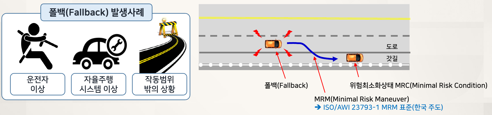

*그림 1. 폴백의 발생 사례와 위험 최소화 조작*

레벨 3과 레벨 4를 가르는 핵심 개념은 **폴백(fallback)** 이다. 그림 1의 왼쪽처럼 폴백은 운전자에게 이상이 생긴 경우, 자율주행 시스템에 이상이 생긴 경우, 차량이 작동 범위(ODD) 밖의 상황을 만난 경우에 일어난다. 이때 차량은 **위험 최소화 조작(MRM, minimal risk maneuver)** 을 수행하여 **위험 최소화 상태(MRC, minimal risk condition)** 에 도달한다. 그림 1의 오른쪽은 주행 차로에서 폴백이 일어나자 차량이 차선을 바꿔 갓길로 이동한 뒤 정지하는 MRM의 예이다.

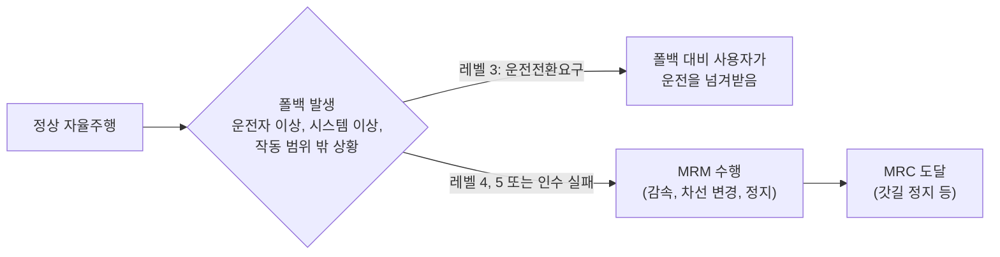

*그림 2. 폴백에서 MRM을 거쳐 MRC에 이르는 과정*

레벨 3에서는 시스템이 운전전환요구를 보내면 운전석에 앉은 사람(폴백 대비 사용자)이 운전을 넘겨받아야 한다. 레벨 4와 5에서는 사람이 넘겨받는 것을 전제하지 않으며, 시스템이 스스로 MRM을 수행해 MRC에 도달해야 한다.

> **참고:** MRM의 최소 요구사항을 정한 국제 표준은 한국이 주도하여 ISO/AWI 23793-1이라는 작업 항목으로 시작했고, 2024년에 ISO 23793-1:2024로 발행되었다 [4]. 이 표준은 MRM의 분류 체계와 함께 가장 단순한 두 유형인 직진 정지(type 1)와 차로 내 정지(type 2)의 제어 전략과 시험 요구사항을 정한다.

### 1.3 운전자동화 레벨 요약

SAE J3016은 레벨을 다음 용어로 정의한다 [1].

> **용어 정의:** **DDT(dynamic driving task, 동적 운전 작업)** 는 차량을 도로에서 운행하는 데 필요한 실시간 조작과 판단 전체이며, 경로 계획 같은 전략적 기능은 제외한다. **OEDR(object and event detection and response, 객체 및 사건 감지와 대응)** 은 DDT 가운데 주변의 객체와 사건을 감시하고 적절히 대응하는 하위 작업이다. **DDT 폴백(DDT fallback)** 은 시스템 고장이나 ODD 이탈 때 DDT를 이어받거나 MRC에 도달하는 대응이다. **폴백 대비 사용자(DDT fallback-ready user)** 는 레벨 3에서 운전전환요구에 응할 준비가 되어 있어야 하는 사람이다.

<table>
<tr><th rowspan="2">구분</th><th rowspan="2">레벨</th><th rowspan="2">명칭</th><th rowspan="2">설명적 정의</th><th colspan="2">DDT</th><th rowspan="2">DDT 폴백</th><th rowspan="2">ODD</th></tr>
<tr><th>지속적인 횡 방향과 종 방향 차량 모션 제어</th><th>OEDR</th></tr>
<tr><td rowspan="3">운전자 보조 (운전자가 DDT의 일부 또는 전체를 수행)</td><td>0</td><td>운전자동화 없음</td><td>능동 안전 시스템에 의해 향상된 경우에도 운전자가 전체 DDT를 수행</td><td>운전자</td><td>운전자</td><td>운전자</td><td>해당 없음</td></tr>
<tr><td>1</td><td>운전자 보조</td><td>운전자가 DDT의 나머지를 수행하는 것을 전제로, 특정한 ODD에서 운전자동화 시스템이 횡 방향 또는 종 방향 차량 모션 제어 하위 작업(동시에 둘 다 수행하지는 않음)을 지속적으로 수행</td><td>운전자와 시스템</td><td>운전자</td><td>운전자</td><td>제한됨</td></tr>
<tr><td>2</td><td>부분 운전자동화</td><td>운전자가 OEDR 하위 작업을 완수하며 시스템을 감독하는 것을 전제로, 특정한 ODD에서 운전자동화 시스템이 횡 방향과 종 방향 차량 모션 제어 하위 작업을 지속적으로 수행</td><td>시스템</td><td>운전자</td><td>운전자</td><td>제한됨</td></tr>
<tr><td rowspan="3">자율주행 (작동하는 동안 ADS가 전체 DDT를 수행)</td><td>3</td><td>조건부 운전자동화</td><td>폴백 대비 사용자가 ADS의 운전전환요구와 차량의 다른 시스템의 DDT 관련 고장에 대응할 준비가 되어 있다는 것을 전제로, 특정한 ODD에서 ADS가 전체 DDT를 지속적으로 수행</td><td>시스템</td><td>시스템</td><td>폴백 대비 사용자(폴백 동안 운전자가 됨)</td><td>제한됨</td></tr>
<tr><td>4</td><td>고도 운전자동화</td><td>사용자가 운전전환요구에 대응하는 것을 전혀 전제하지 않고, 특정한 ODD에서 ADS가 전체 DDT와 DDT 폴백을 지속적으로 수행</td><td>시스템</td><td>시스템</td><td>시스템</td><td>제한됨</td></tr>
<tr><td>5</td><td>완전 운전자동화</td><td>사용자가 운전전환요구에 대응하는 것을 전제하지 않고, 무조건적으로(특정한 ODD가 아니라) ADS가 전체 DDT와 DDT 폴백을 지속적으로 수행</td><td>시스템</td><td>시스템</td><td>시스템</td><td>무제한</td></tr>
</table>

*표 2. 운전자동화 레벨 요약*

표 2를 열 단위로 읽으면 레벨의 차이가 분명해진다. 레벨 1에서 2로 가면 모션 제어가 운전자와 시스템의 분담에서 시스템 전담으로 바뀐다. 레벨 2에서 3으로 가면 OEDR, 즉 주변 감시가 시스템으로 넘어간다. 레벨 3에서 4로 가면 DDT 폴백까지 시스템이 맡는다. 레벨 4에서 5로 가면 ODD의 제한이 사라진다.

### 1.4 자율주행 레벨별 센서 구성 전망

레벨이 높아질수록 시스템이 맡는 일이 늘어나므로 필요한 센서의 수와 종류도 늘어난다. Frost & Sullivan의 2018년 전망은 표 3과 같다 [5].

| 센서 | 레벨 1 (2012) | 레벨 2 (2016) | 레벨 3 (2018) | 레벨 4 (2020) | 레벨 5 (2025) |
|:-----|:-----|:-----|:-----|:-----|:-----|
| 초음파 센서 | 4 | 8 | 8 | 8 | 8\~10 |
| 장거리 레이더(LRR) | 1 | 1 | 2 | 2 | 2 |
| 단거리 레이더(SRR) | 2 | 2\~4 | 4 | 4 | 4 |
| 카메라 또는 단거리 라이다 | 1 | 2\~4 (카메라) | | | |
| 장거리 카메라 | | | 2 | 2/3 (스테레오 또는 3안) | 2/3 |
| 서라운드 카메라 | | | 4 | 4 | 4 |
| 스테레오 카메라 | | | 1 | 1 | 2 |
| μbolo (열화상, 적외선 센서) | | | 1 | 1 | 1/2 |
| 라이다 | | | 1 | 2/4 | 4 |
| 추측 항법 장치 | | | 1 | 1 | 1 |
| 합계 | 약 6.8 | 약 17 | 약 24\~26 | 약 25\~28 | 약 28\~32 |
| 주요 기능 | 횡 방향 또는 종 방향 보조 | 주변 환경 관찰 | 제어권 인계를 위한 상황 인지 | 운전자 개입 없음 | 운전자 없음 |

*표 3. 자율주행 레벨별 평균 센서 수 전망*

> **용어 정의:** **레이더(radar)** 는 전파를 쏘아 물체까지의 거리와 상대 속도를 재는 센서이다. **μbolo**는 마이크로볼로미터(microbolometer)의 줄임말로, 야간 시야를 위한 열화상 카메라나 적외선 센서를 가리킨다. **추측 항법(dead reckoning)** 은 바퀴 속도와 관성 센서로 이동 거리와 방향을 누적하여 현재 위치를 추정하는 방법이다. 표의 "2/3"처럼 빗금으로 쓴 값은 2개 또는 3개라는 뜻이다.

레벨 1의 센서는 약 7개이지만 레벨 5에서는 약 30개로 네 배 이상 늘어난다. 특히 레벨 3부터 라이다, 서라운드 카메라, 추측 항법이 추가되는데, 이는 레벨 3부터 시스템이 OEDR을 맡아 주변 전체를 스스로 감시해야 하기 때문이다. 센서가 늘면 센서 데이터를 모으는 차량 내부 네트워크의 대역폭 요구도 함께 커진다.

### 1.5 자율주행차의 플랫폼 분류

Frost & Sullivan은 자율주행차를 여섯 개의 플랫폼으로 나누고, 각각의 발전 방향을 현재(2018), 차세대(2020\~2025), 미래(2030)로 정리했다 [6].

| 플랫폼 | 현재 (2018) | 차세대 (2020\~2025) | 미래 (2030) |
|:-----|:-----|:-----|:-----|
| 서비스 | 소유 차량의 레벨 2, 2+, 3 기능(고속도로 주행 보조, 자동 차선 변경, 발레 주차) | 소유 차량의 레벨 3, 4(자동 고속도로 주행, 자동 호출)와 이용형 서비스의 레벨 4(도심 주행, 지역 셔틀, 택시) | 레벨 5 개발 |
| 클라우드 | 데이터 저장과 레이블링 | 시간 제약이 없는 데이터 처리(예측 센싱, V2I, V2P), 차량 데이터와 지도 데이터의 융합 | 차량, 지도, 서비스 데이터의 융합 |
| 소프트웨어 | ADAS 기능마다 결정론적 소프트웨어 묶음 | 핵심 자율주행 소프트웨어(객체 분류, 경로 계획)에 AI를 쓰고, 시간 제약이 엄격한 연산에는 결정론적 소프트웨어를 함께 씀 | 운전자의 건강과 안녕(건강 추적, 긴급 서비스) |
| 하드웨어 | 기능마다 이중화한 전용 센서(레이더, 카메라, 라이다 등) | 모든 ADAS와 자율주행 기능의 센서 융합과 센서 간 교차 이중화(라이다와 카메라의 측위, 레이더와 카메라의 레이블링) | 저지연, 전천후 감지를 위한 스마트 센서와 데이터 융합 |
| E/E | 기능마다 개별 ECU, 여러 프로토콜(CAN, LIN, FlexRay, 이더넷) | ECU(ADAS ECU, 인포테인먼트 ECU)와 프로토콜(CAN FD, 이더넷)의 통합 | 중앙 집중형과 분산형을 결합한 E/E 아키텍처(도메인 컨트롤러, 스마트 센서) |
| 섀시 | 기존 플랫폼을 고쳐 이중화를 추가 | 레벨 3, 4를 위한 기계적, 전기적 이중화 전용 장착 구조 | 레벨 1\~5를 모두 지원하는 유연하고 확장 가능한 플랫폼 |

*표 4. 자율주행차 플랫폼별 발전 로드맵*

> **용어 정의:** **결정론적(deterministic) 소프트웨어**는 같은 입력에 대해 항상 같은 출력을 정해진 시간 안에 내는 소프트웨어이다. 학습 기반 AI는 인식 성능이 뛰어나지만 동작을 완전히 예측하기 어려우므로, 제동처럼 시간 제약이 엄격한 기능에는 결정론적 소프트웨어를 함께 쓴다. **이중화(redundancy)** 는 하나가 고장 나도 기능을 유지하도록 같은 역할의 부품이나 경로를 둘 이상 두는 설계이다.

표 4의 E/E 행은 이 과목과 직접 관련된다. 기능마다 ECU와 프로토콜을 따로 쓰던 구조가 ECU와 프로토콜의 통합(CAN FD, 이더넷)을 거쳐 도메인 컨트롤러 중심의 구조로 바뀐다. 이 변화는 1.9절에서 다시 다룬다.

### 1.6 자율주행차 생태계의 비즈니스 섹터

자율주행차 생태계의 사업 영역은 네 가지로 나눌 수 있다 [6].

| 섹터 | 세부 영역 | 내용 |
|:-----|:-----|:-----|
| (1) 하드웨어 | 센서 | 레이더, 라이다, 카메라 등 |
| (2) 소프트웨어 | 차량 내부(in-car) | 운영체제, 미들웨어, API |
| (2) 소프트웨어 | 차량 외부(outside) | V2X, V2V 통신 |
| (2) 소프트웨어 | AI | 인지와 판단을 위한 인공지능 |
| (3) 클라우드 | 서비스 | 자율주행, 커넥티비티 서비스 |
| (3) 클라우드 | HD 맵 | 고정밀 지도 |
| (4) 차량 관리 서비스 | 플릿 관리 | 차량 공유, 호출, 운행 관리 |

*표 5. 자율주행차 생태계의 네 비즈니스 섹터*

완성차 업체는 섹터마다 다른 기업과 손잡는다. 예를 들어 BMW는 HELLA, Innoviz, Continental, Aptiv의 하드웨어, IBM Watson의 AI와 클라우드, HERE의 HD 맵, Car2Go와 ParkNow 같은 모빌리티 서비스와 연결되었고, Google은 Velodyne의 라이다, 자회사 Waymo의 소프트웨어와 HD 맵, Uber의 차량 호출 서비스와 연결되었다. Ford는 Velodyne, Princeton Lightwave, Aptiv, Continental의 하드웨어, Autotalks의 V2X, Argo의 AI, Civil Maps와 DeepMap의 HD 맵, Chariot과 TransLoc의 모빌리티 서비스와 연결되었다. GM은 Veoneer, LG, Strobe의 하드웨어, Cruise의 소프트웨어와 HD 맵, OnStar의 차량 외부 통신, IBM Watson의 클라우드, Lyft와 Maven의 차량 호출과 공유 서비스와 연결되었고, Volvo는 HELLA, Autoliv, Aptiv, Veoneer의 하드웨어, Zenuity의 소프트웨어, Cisco의 클라우드, TomTom의 HD 맵, Uber의 차량 호출과 자율주행 시범 프로그램 DriveMe와 연결되었다. 소프트웨어, 클라우드, 차량 관리 서비스(섹터 2\~4)는 전통적인 완성차와 부품사의 영역 밖에 있으며, 이 영역에서 새로운 기업이 생태계에 들어온다.

### 1.7 빅테크의 자동차 산업 진출

미국의 빅테크 기업들은 센서, 반도체, 소프트웨어, 통신 같은 미래차 플랫폼을 장악하여 자동차 생태계를 개편하려는 움직임을 시작했다.

- **Intel, NVIDIA, Qualcomm, Microsoft, Amazon:** 방대한 자본력과 소프트웨어 전문 인력을 바탕으로 부가가치가 높은 반도체, AI, 클라우드, 서비스를 장악한다.
- **기존 완성차와 부품사:** 빅테크는 이들을 부가가치가 낮은 하드웨어에 머물게 하는 방향으로 생태계 개편을 추진한다.

| 기업 | 차량 | 레이더 | 카메라 | 라이다 | 칩 | 자율주행 머신러닝 | 자율주행 지도 |
|:-----|:-----:|:-----:|:-----:|:-----:|:-----:|:-----:|:-----:|
| GM | O | | | O | | O | |
| Ford | O | | | | | O | |
| Tesla | O | | | | O | O | |
| Luminar | | | | O | | | |
| Intel | | | O | | O | | |
| Nvidia | | | | | O | | |
| Waymo | | | | O | | O | O |
| Uber ATG | | | | | | O | |
| Carmera | | | | | | | O |

*표 6. 미국 기업의 자율주행 개발 참여 분야 (예시이며 전체 목록은 아님)*

표 6에서 Tesla와 Waymo처럼 여러 분야에 걸친 기업도 있지만, Intel과 Nvidia는 칩과 카메라 같은 핵심 부품에 집중한다.

**Intel의 사례.** Intel은 다음 단계로 자동차 시장을 공략했다.

1. 2017년 3월 자율주행용 카메라 기업 Mobileye를 153억 달러(당시 약 17조 원)에 인수했다. Mobileye를 통해 카메라 센서와 자동차용 고성능 프로세서(AP) 사업을 추진하며, Mobileye의 2020년 매출은 9억 6,700만 달러였다 [7]. 자율주행차 관련 반도체 개발을 위해 구축 중인 메가칩 설계 센터의 인력은 약 6,000명에 이른다.
2. 110조 원을 투입하여 유럽에 주로 차량용 반도체를 생산하는 반도체 공장 2개를 새로 짓겠다고 발표했다. Intel CEO Pat Gelsinger는 2021년 9월에 프리미엄 차량의 부품 원가에서 반도체가 차지하는 비율이 2019년 4%에서 2025년 12%, 2030년 20%로 늘어날 것으로 전망했다 [8]. Intel은 데이터센터, 5G, HMI, 차량 내 컴퓨팅을 아우르는 자율주행 플랫폼을 내세운다.
3. 2022년 2월 Intel Foundry Services(IFS)에 자동차 전담 그룹을 만들었다. 이 그룹은 완성차가 차세대 솔루션을 구축할 수 있는 컴퓨팅 플랫폼인 개방형 중앙 컴퓨팅 아키텍처(Open Central Compute Architecture), 차량용 응용과 고객의 요건을 만족하는 제조 기술인 차량용 파운드리 플랫폼(Automotive-Grade Foundry Platform), 완성차의 첨단 공정과 패키징 기술 전환을 위한 설계 서비스와 IP 제공(Transition to Advanced Technologies)을 맡는다.

> **용어 정의:** **AP(application processor)** 는 운영체제와 복잡한 응용 프로그램을 실행하는 고성능 프로세서이고, **파운드리(foundry)** 는 다른 회사가 설계한 반도체를 위탁받아 생산하는 사업이다.

### 1.8 빅테크와 완성차의 체급 비교

빅테크는 거대한 시가총액과 막대한 자본 동원력을 갖고 있으며, 매출액 대비 이익률이 완성차보다 월등히 높다. 2021년 매출과 이익, 2022년 4월의 시가총액을 비교하면 표 7과 같다 [9].

| 기업 | 구분 | 시가총액 | 매출 | 영업이익 | 자료의 이익률 | 영업이익/매출 (계산) |
|:-----|:-----|-----:|-----:|-----:|-----:|-----:|
| GM | 완성차 | 58 | 127 | 9.3 | 7.9% | 7.3% |
| Toyota | 완성차 | 274 | 245 | 22.8 | 10.0% | 9.3% |
| Volkswagen | 완성차 | 99 | 250 | 20.7 | 5.9% | 8.3% |
| 현대자동차 | 완성차 | 42 | 96 | 5.4 | 5.6% | 5.6% |
| NXP | 차량용 반도체 | 44.6 | 11 | 2.6 | 16.9% | 23.6% |
| Tesla | 전기차 | 1,002 | 54 | 6.5 | 10.3% | 12.0% |
| Intel | 빅테크 | 184 | 79 | 19.5 | 25.1% | 24.7% |
| NVIDIA | 빅테크 | 533 | 17 | 4.5 | 36.2% | 26.5% |
| Qualcomm | 빅테크 | 154 | 34 | 9.8 | 26.8% | 28.8% |
| Microsoft | 빅테크 | 2,100 | 168 | 70 | 36.4% | 41.7% |

*표 7. 빅테크와 완성차의 시가총액, 매출, 영업이익 (단위: 10억 달러)*

> **참고:** 표 7의 "자료의 이익률"은 영업이익을 매출로 나눈 값과 일치하지 않는 기업이 많다. 예를 들어 Microsoft는 $70 / 168 \approx 0.417$이지만 자료의 값은 36.4%이다. 자료는 이 이익률의 산출 기준을 밝히지 않으며, 마지막 열은 영업이익을 매출로 나눈 값이다. 어느 기준으로 보든 빅테크의 이익률이 완성차보다 높다는 결론은 같다.

반면 국내 부품사의 수익성은 낮다. 국내 110개 자동차 부품사의 매출액은 2020년에 70조 6,296억 원이었고, 평균 영업이익률은 2019년 3.8%에서 2020년 2.8%로 떨어졌다. 대기업은 4.08%에서 2.99%로, 중소기업은 2.02%에서 1.34%로 낮아졌다 [10]. 자동차 산업은 완성차를 정점으로 1차 협력사, 2차 협력사가 아래에 놓인 피라미드 구조이며, 아래로 갈수록 이익률이 낮다.

### 1.9 E/E 아키텍처와 SDV

> **용어 정의:** **E/E 아키텍처(electrical/electronic architecture)** 는 차량의 ECU, 센서, 액추에이터, 배선, 통신 네트워크, 전원을 어떻게 배치하고 연결할지를 정한 전체 구조이다. **MCU(microcontroller unit)** 는 프로세서, 메모리, 입출력을 한 칩에 담은 저가의 제어용 칩이다.

자동차의 E/E 아키텍처는 **소프트웨어 정의 차량(SDV)** 으로 발전하고 있다. 그림 3처럼 변화는 세 단계로 나눌 수 있다.

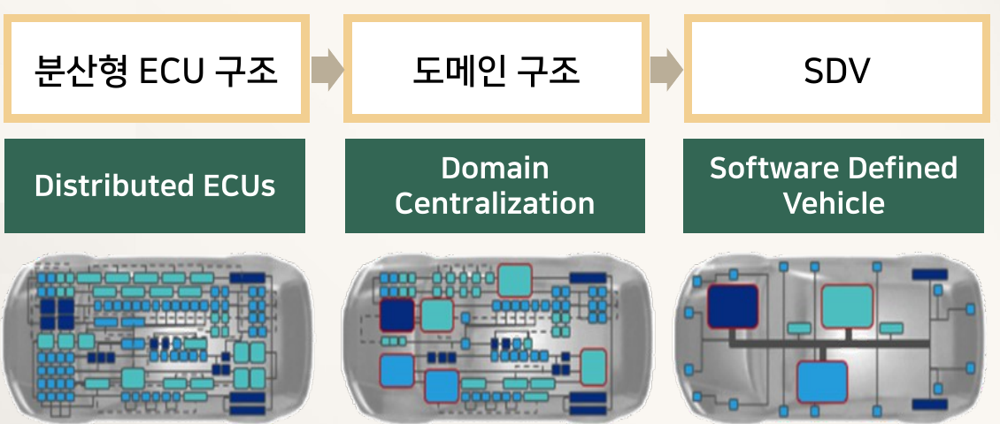

*그림 3. 분산형 ECU 구조에서 도메인 구조를 거쳐 SDV로의 발전*

1. **분산형 ECU 구조(distributed ECUs):** 기능마다 ECU를 하나씩 두어 차량 전체에 100개가 넘는 작은 ECU가 흩어져 있다.
2. **도메인 구조(domain centralization):** 파워트레인, 섀시, 바디, 인포테인먼트, ADAS처럼 기능 영역(도메인)마다 도메인 컨트롤러를 두고 관련 ECU를 묶는다.
3. **SDV:** 소수의 고성능 중앙 컴퓨터가 대부분의 기능을 소프트웨어로 처리하고, 출시 후에도 OTA로 기능을 바꾸거나 더한다.

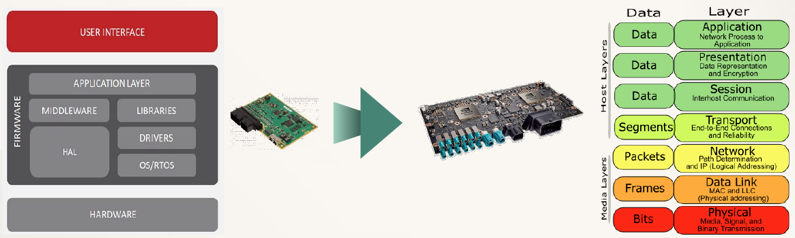

*그림 4. 저속 MCU 기반 ECU에서 고성능 AP 기반 컴퓨터로의 전환과 소프트웨어 계층*

그림 4처럼 SDV로의 전환은 100여 개의 저가, 저속 MCU 체제에서 3\~5개의 고성능 AP 체제로 바뀌는 것이다. 왼쪽의 소프트웨어 스택은 하드웨어 위에 펌웨어(운영체제 또는 RTOS, 드라이버, HAL, 라이브러리, 미들웨어, 응용 계층)와 사용자 인터페이스가 층층이 쌓인 구조이고, 오른쪽은 통신 기능을 일곱 계층으로 나눈 OSI 참조 모델이다. 고성능 AP는 여러 기능을 한 칩에서 처리하므로, 그 위의 소프트웨어도 이처럼 계층으로 나누어 설계해야 복잡도를 다룰 수 있다. OSI 모델은 5주차에서 자세히 다룬다.

> **용어 정의:** **RTOS(real-time operating system)** 는 작업이 정해진 시간 안에 끝나는 것을 보장하는 실시간 운영체제이고, **HAL(hardware abstraction layer)** 은 하드웨어의 차이를 감추어 위 계층의 소프트웨어가 하드웨어에 덜 의존하게 하는 계층이다. **미들웨어(middleware)** 는 운영체제와 응용 프로그램 사이에서 통신, 데이터 관리 같은 공통 기능을 제공하는 소프트웨어이다.

E/E 아키텍처의 변화는 곧 납품 구조의 변화이다.

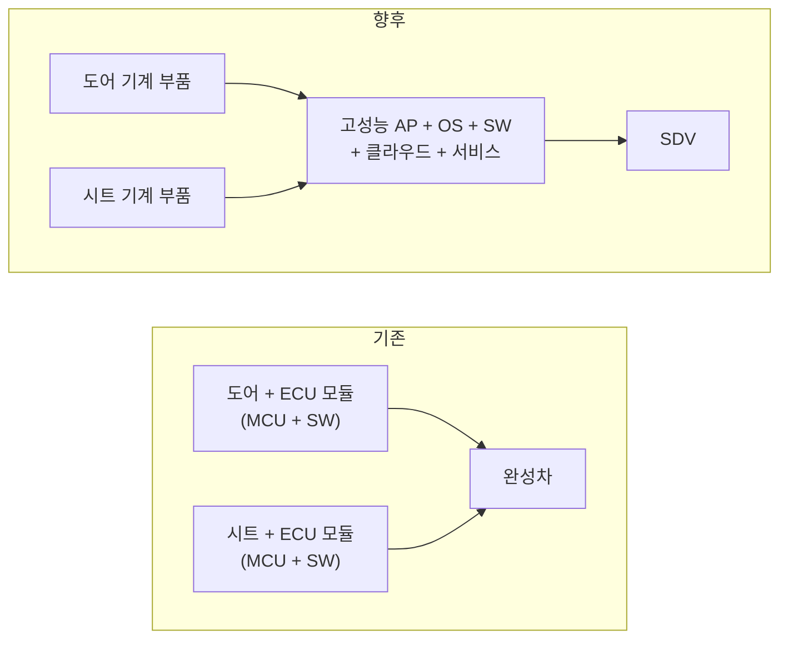

*그림 5. E/E 아키텍처 변화에 따른 납품 구조의 변화*

- **기존:** 부품사가 부품에 MCU(Renesas, NXP, Infineon 등의 칩)와 소프트웨어를 넣은 ECU를 포함하여 도어 모듈, 시트 모듈 단위로 납품한다.
- **향후:** 부품사는 기계 부품만 납품하고, 완성차가 고성능 AP를 장착한 중앙 컴퓨터(Qualcomm, NVIDIA, Intel의 칩과 Google, Microsoft의 소프트웨어 등)로 이를 제어한다.

그 결과 부품 기업들은 소프트웨어, 반도체, 서비스 플랫폼을 제외한 저수익 사업으로 밀려날 위험이 있다. 1.8절에서 본 부품사의 낮은 이익률은 이런 구조 변화 속에서 더 큰 문제가 된다.

---

 

## 2. 자율주행 아키텍처: 대형버스용 자율주행 부품과 시스템 개발 사례

이 절은 한국자동차연구원(KATECH)이 총괄한 대형버스용 자율주행 부품과 시스템 개발 과제를 사례로, 실제 자율주행 시스템이 어떤 부품과 네트워크로 구성되는지 살펴본다.

### 2.1 과제의 개요

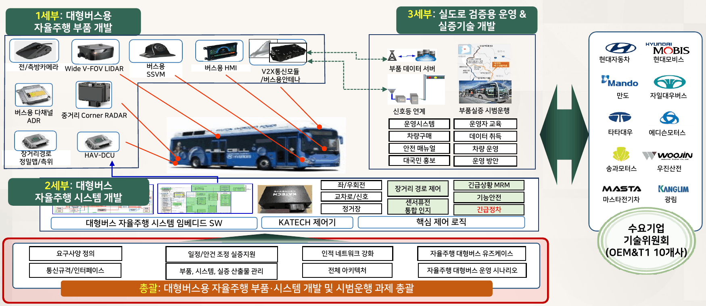

*그림 6. 대형버스용 자율주행 부품과 시스템 개발 과제의 구성*

이 과제는 대형버스용 자율주행 부품과 시스템을 개발하고 친환경 수소 자율주행 버스를 시범 운행하는 과제이며, 세 개의 세부 과제와 총괄로 이루어진다.

| 구성 | 내용 |
|:-----|:-----|
| 1세부: 대형버스용 자율주행 부품 개발 | 전방과 측방 카메라, 넓은 수직 시야의 라이다(Wide V-FOV LIDAR), 버스용 SSVM, 버스용 HMI, V2X 통신 모듈과 버스용 안테나, 버스용 다채널 ADR, 중거리 코너 레이더, 장거리 경로용 정밀 지도와 측위, 자율주행 통합 제어기(HAV-DCU) |
| 2세부: 대형버스 자율주행 시스템 개발 | 대형버스 자율주행 시스템의 임베디드 소프트웨어, KATECH 제어기, 핵심 제어 로직(좌회전과 우회전, 교차로와 신호, 정거장 정차, 장거리 경로 제어, 센서 융합과 통합 인지, 긴급 상황 MRM, 기능 안전, 긴급 정차) |
| 3세부: 실도로 검증용 운영과 실증 기술 개발 | 부품 데이터 서버, 신호등 연계, 운영 시스템, 차량 구매, 안전 매뉴얼, 대국민 홍보, 운영자 교육, 데이터 취득, 차량 운영, 운영 방안 |
| 총괄 | 요구 사양 정의, 통신 규격과 인터페이스, 일정과 안건 조정, 실증 지원, 부품, 시스템, 실증 산출물 관리, 인적 네트워크 강화, 전체 아키텍처, 자율주행 대형버스 유즈케이스와 운영 시나리오 |

*표 8. 대형버스용 자율주행 과제의 구성*

과제에는 현대자동차, 현대모비스, 만도, 자일대우버스, 타타대우, 에디슨모터스, 송과모터스, 우진산전, 마스타전기차, 광림 등 완성차와 1차 협력사 10개사로 이루어진 **수요기업 기술위원회**가 참여하여 개발 결과를 검토했다.

> **용어 정의:** **SSVM(smart surround view monitoring)** 은 차량 주위의 여러 카메라 영상을 합성해 위에서 내려다본 화면을 만드는 장치이다. **HMI(human-machine interface)** 는 운전자와 시스템이 정보를 주고받는 화면과 조작 장치이다. **ADR**은 카메라 영상을 포함한 주행 데이터를 기록하는 장치이고, **HAV-DCU**는 고도 자율주행차(highly automated vehicle)의 인지, 판단을 맡는 통합 제어기(domain control unit)이다.

개발된 부품과 시스템은 다음 순서로 검증되었다.

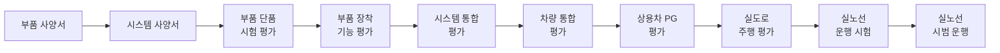

*그림 7. 대형버스 자율주행 부품과 시스템의 검증 단계*

부품 하나를 따로 시험하는 데서 시작하여 차량에 장착한 기능, 시스템 통합, 차량 통합을 차례로 확인한 뒤, 주행 시험장(PG, proving ground)과 실제 도로, 실제 버스 노선으로 범위를 넓힌다. 차량에는 지도 데이터를 전달하는 ADASIS 3.0 인터페이스와 주행 데이터를 수집하는 엣지 데이터 로거가 있고, 관제 서버와 부품 데이터 서버가 데이터를 받아 부품 데이터 분석과 시스템 기능 안전 검증에 쓴다.

### 2.2 승용차와 대형차의 부품과 활용 범위

| 구분 | 승용차용 자율주행 부품 | 대형차량용 자율주행 부품 |
|:-----|:-----|:-----|
| 정부 사업 | 자율주행 핵심기술 개발사업(정부 780억 원, 2017\~2021년) | 대형버스용 자율주행 부품, 시스템 개발(정부 217억 원, 2019\~2021년) |
| 주요 부품 | 전방 카메라, V2X 통신 모듈, ADR, 라이다, DCU, HMI | 전방 카메라, V2X 통신 모듈, ADR, 레이더, DCU, SSVM |
| 차량 플랫폼 | 완성차 양산 차량, 온디맨드 자율주행 차량 | 자율주행 소형 트럭, 미니버스, 대형 트럭, 대형버스 |
| 서비스 | 자율주행 택시, 카셰어링, 장애인과 노약자 이동 | 자율주행 택배, 자동 이동식 식당, 셔틀버스, 온디맨드 상점, 트럭 군집주행, 노선버스, 멀티모달 대중교통 |

*표 9. 승용차와 대형차의 자율주행 부품과 활용 범위*

> **용어 정의:** **군집주행(platooning)** 은 여러 대의 트럭이 V2V 통신으로 가속과 제동을 맞추어 짧은 간격으로 줄지어 달리는 주행 방식이다. **멀티모달(multimodal) 대중교통**은 버스, 철도, 공유 차량 같은 여러 교통수단을 연계한 대중교통이다.

### 2.3 주요 부품

- **A.I.Matics:** 대형 차량용 전방, 전측방, 후방 카메라 세트를 개발했다. 대형버스는 차체가 길고 높아 승용차보다 사각지대가 넓으므로 여러 방향의 카메라가 필요하다.
- **와이즈오토모티브:** 대형 차량용 SSVM을 개발했다. 차체 주위의 카메라 영상을 합성하여 버스 전체를 위에서 내려다본 화면을 만든다.

### 2.4 센서 레이아웃

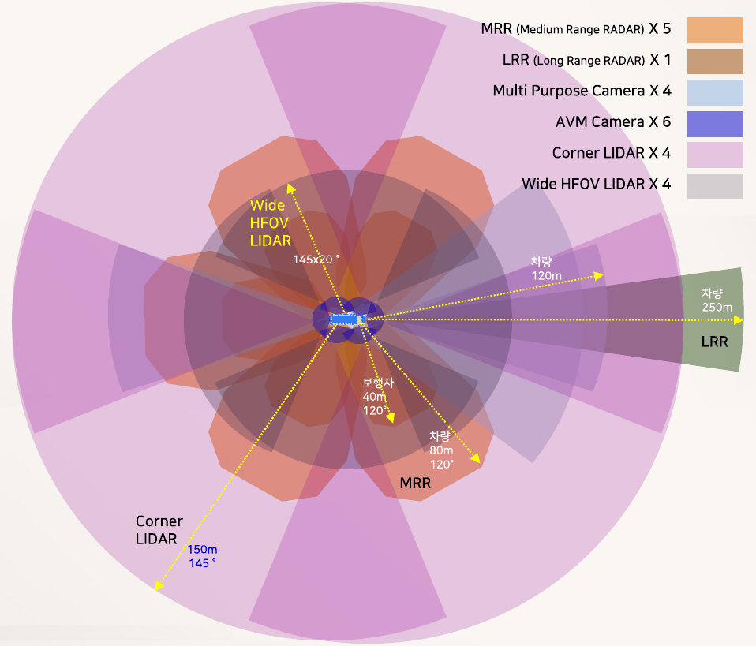

*그림 8. 대형버스의 센서 배치와 감지 범위*

| 센서 | 수량 | 감지 범위 |
|:-----|-----:|:-----|
| 중거리 레이더(MRR, medium range radar) | 5 | 차량 80 m, 보행자 40 m, 시야각 120° |
| 장거리 레이더(LRR, long range radar) | 1 | 차량 250 m |
| 다목적 카메라(multi purpose camera) | 4 | 차량 120 m |
| AVM 카메라 | 6 | 차량 바로 주변 |
| 코너 라이다(corner LIDAR) | 4 | 150 m, 시야각 145° |
| 넓은 수평 시야 라이다(wide HFOV LIDAR) | 4 | 수평 시야각 145°, 수직 시야각 20° |

*표 10. 대형버스의 센서 구성*

그림 8에서 버스는 가운데의 작은 사각형이고, 색칠한 부채꼴과 원이 각 센서의 감지 영역이다. 장거리 레이더는 전방으로 가장 멀리(250 m) 보고, 코너 라이다는 차체 네 모서리에서 넓게 보며, AVM 카메라(around view monitoring)는 차체 바로 주변의 사각지대를 본다. 서로 다른 원리의 센서가 같은 영역을 겹쳐 보므로 한 센서가 고장 나거나 악천후로 성능이 떨어져도 다른 센서가 보완한다. 센서 레이아웃(그림 8)은 넓은 시야 라이다를 수평 시야(HFOV) 라이다 4개로, 네트워크 토폴로지(그림 9)는 수직 시야(VFOV) 라이다 3개(전방, 좌측, 우측)로 그린다.

### 2.5 시스템 아키텍처 설계서

자율주행 시스템 아키텍처 설계서는 다음 순서로 작성되었다.

1. **자율주행 필요 부품 선정:** 자율주행 개발 부품 10종(전측방 카메라, 버스용 SSVM, HAV-DCU, 장거리 경로 정밀 지도와 측위, 버스용 다채널 ADR, Wide V-FOV 라이다, V2X 통신 모듈과 버스용 안테나, 버스용 HMI, 중거리 코너 레이더, ESU)을 선정하고, 자율주행을 위해 개조 설계할 부품 8종을 정했다.
2. **대형버스용 부품 요구사항 정의:** 기능 요구사항(개발 부품 10종에 15개), 품질 요구사항(안전 설계 목표를 포함한 3개), 인터페이스 요구사항(전원과 소모 전력을 포함한 11개), 제약 조건(소프트웨어, 하드웨어, 물리적 제약)을 정의했다.
3. **부품 간 인터페이스 정의:** 차량 내부 네트워크와 인프라 연동 네트워크의 인터페이스를 정의했다.
4. **수요기업 기술위원회 검토 의견 수렴:** 7개 의견(대항목) 가운데 5개를 받아들였다.

수용된 검토 의견에는 다음이 있다.

- 안정성 검증을 위해 ASIL 기준을 세우고 검증한다.
- 동기화된 통신 데이터의 시스템 검증 방법을 보완한다.
- 원격 정지(remote stop)는 중요한 스위치이므로 오작동이 없도록 안전장치를 적용한다.
- 주요 전장품의 고온 현상, 배터리, 후진 시스템, 보조 시스템의 과전압 등으로 의도하지 않은 가속이나 감속이 일어날 수 있으므로, 이에 대한 안전 설계와 이중화 설계를 반영한다.

> **용어 정의:** **ASIL(Automotive Safety Integrity Level)** 은 차량용 기능 안전 표준 ISO 26262가 정한 안전 무결성 등급으로, 고장이 낼 수 있는 위험의 심각도, 노출 빈도, 제어 가능성에 따라 A(가장 낮음)부터 D(가장 높음)까지 매긴다. 등급이 높을수록 더 엄격한 설계와 검증이 요구된다.

### 2.6 네트워크와 전원 아키텍처

자율주행 시스템을 설계하려면 다음 네 가지 설계서가 필요하다.

1. **네트워크 아키텍처:** 어떤 장치가 어떤 네트워크(CAN, CAN FD, 이더넷 등)로 연결되는지 정한다. 이 과제에서는 CAN, CAN FD, 이더넷의 메시지 데이터베이스(DB)를 통합하고, 센서 진단과 안전 알고리즘을 함께 설계했다.
2. **SW 컴포넌트 아키텍처:** 소프트웨어를 어떤 구성 요소로 나누고 서로 어떻게 데이터를 주고받는지 정한다.
3. **물리적 아키텍처:** 부품을 차체의 어디에 장착하고 배선을 어떻게 지나가게 할지 정한다.
4. **전원 아키텍처:** 각 부품에 전원을 어떻게 공급하고 보호할지 정한다. 이 과제의 전원 네트워크는 전원 스위치를 켜면 자율주행 시스템 모드를 확인하고, 우선순위에 따라 자율주행 부품에 전원을 공급한 뒤 센서를 진단하며, 이상이 있으면 복구를 시도하거나 전원을 차단하고 오류 메시지를 전달하는 흐름으로 설계되었다.

네트워크와 전원 아키텍처의 상세 도면은 비공개 자료이다.

### 2.7 네트워크 토폴로지

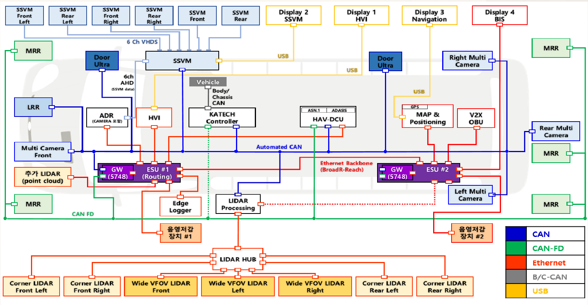

*그림 9. 대형버스 자율주행 시스템의 네트워크 토폴로지*

그림 9는 선의 색으로 네트워크 종류를 구분한다. 파란색은 CAN, 초록색은 CAN FD, 빨간색은 이더넷, 회색은 차량의 바디와 섀시 CAN(B/C-CAN), 노란색은 USB이다.

| 영역 | 구성 요소와 연결 |
|:-----|:-----|
| 중심 | 두 개의 게이트웨이(GW)와 라우팅 장치(ESU #1, ESU #2)가 이더넷 백본(BroadR-Reach)으로 연결되어, 각 네트워크의 데이터를 모으고 전달한다. |
| CAN (Automated CAN) | 전방, 후방, 좌우 다목적 카메라, 장거리 레이더(LRR), 좌우 도어 초음파 센서, SSVM, KATECH 제어기, HAV-DCU, 라이다 처리 장치, 두 GW |
| CAN FD | 중거리 레이더(MRR) 5개, HAV-DCU, 두 GW |
| 이더넷 | 라이다 허브에 연결된 코너 라이다 4개(전방 좌우, 후방 좌우)와 Wide VFOV 라이다 3개(전방, 좌측, 우측), 라이다 처리 장치, 추가 라이다(포인트 클라우드), ADR, HVI, HAV-DCU, 지도와 측위 장치(GPS), V2X OBU, 디스플레이 4(BIS), 엣지 로거, 음영 저감 장치 2개 |
| 영상과 USB | SSVM 카메라 6개(전방 좌우, 후방 좌우, 전방, 후방)는 6채널 영상으로 SSVM에 연결되고, SSVM은 6채널 AHD 영상(SSVM 데이터)으로 ADR에 연결된다. 디스플레이 1(HVI), 2(SSVM), 3(내비게이션)은 USB로 각각 HVI, SSVM, 지도와 측위 장치에 연결된다. |
| 차량 | KATECH 제어기는 차량의 바디와 섀시 CAN에 연결되어 실제 차량을 제어한다. |

*표 11. 대형버스 네트워크 토폴로지의 구성*

> **용어 정의:** **BroadR-Reach**는 꼬임 쌍선 한 쌍으로 100 Mbit/s를 전송하는 차량용 이더넷 기술로, IEEE 802.3bw(100BASE-T1)로 표준화되었다 [11]. **HVI(human-vehicle interface)** 는 HMI와 같은 뜻으로 쓰이며, **OBU(on-board unit)** 는 V2X 통신을 맡는 차량 탑재 장치이다. **BIS(bus information system)** 는 버스의 운행 정보를 승객에게 보여 주는 시스템이다.

그림 9에서 HAV-DCU에는 ASN.1과 ADASIS라는 두 처리 블록이 붙어 있다. **ASN.1(Abstract Syntax Notation One)** 은 V2X 메시지의 구조를 정의하고 부호화하는 표기법으로, SAE J2735의 V2X 메시지가 이 방식으로 부호화된다 [12]. **ADASIS(ADAS Interface Specification)** 는 지도 데이터를 차량 앞쪽 도로 정보(전자 수평선, electronic horizon)의 형태로 ADAS 제어기에 전달하는 표준 인터페이스이다 [13]. 즉 HAV-DCU는 V2X로 받은 메시지와 지도 정보를 해석하여 판단에 쓴다. V2X 메시지는 11주차에서 다룬다.

데이터량에 따라 네트워크를 나누어 쓴 점에 주목할 필요가 있다. 라이다의 포인트 클라우드처럼 대용량 데이터는 이더넷으로, 레이더의 물체 정보처럼 중간 크기의 데이터는 CAN FD로, 제어 명령과 상태 정보처럼 작은 데이터는 CAN으로 보낸다. 이는 1주차에서 본 센서 데이터량의 차이를 네트워크 설계에 반영한 것이다.

### 2.8 Automotive CAN 네트워크

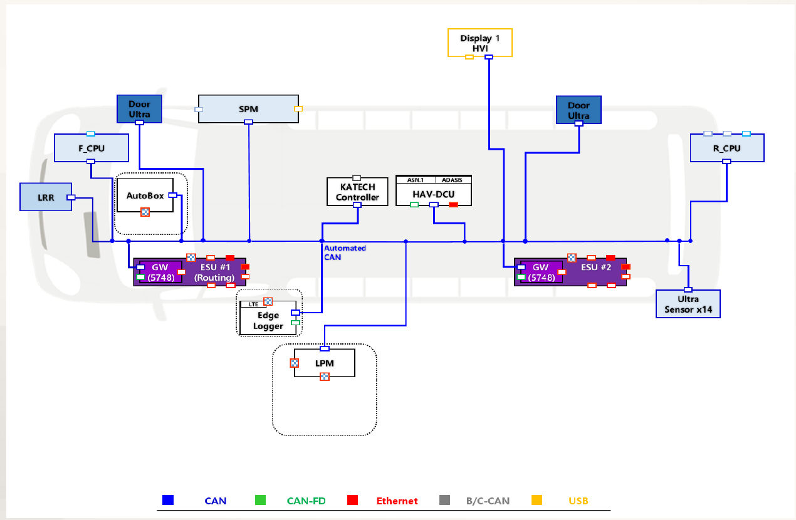

*그림 10. 자율주행용 CAN(Automated CAN)의 연결*

그림 10은 그림 9에서 자율주행용 CAN(Automated CAN, 파란색)에 연결된 장치만 뽑아 차체 위에 나타낸 것이다. 하나의 CAN 버스가 버스 앞뒤로 길게 지나가고, 전방 CPU(F_CPU)와 후방 CPU(R_CPU), 시험용 차량 제어 컴퓨터(AutoBox), SPM, 좌우 도어의 초음파 센서, 장거리 레이더, KATECH 제어기, HAV-DCU, 두 GW와 ESU, 엣지 로거(LTE 통신 포함), 라이다 처리 장치(LPM), 초음파 센서 14개가 모두 이 버스에 연결된다. 디스플레이 1(HVI)도 버스에 연결된다. 차체가 긴 대형버스에서 하나의 CAN 버스로 장치들을 잇는 것은 3주차에서 다룰 버스형 토폴로지와 종단 저항의 실제 적용 사례이다.

### 2.9 시스템 컨텍스트 다이어그램

> **용어 정의:** **시스템 컨텍스트 다이어그램(system context diagram)** 은 설계 대상 시스템을 가운데 두고, 그 시스템과 정보를 주고받는 외부 요소와 데이터의 흐름을 나타낸 그림이다. 시스템의 경계를 정하는 데 쓴다.

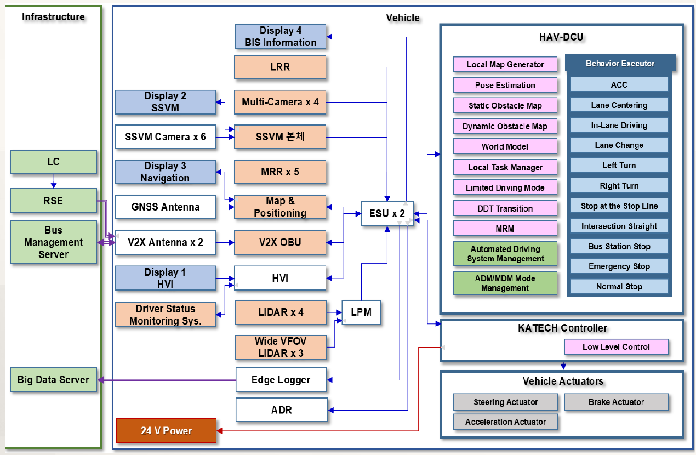

*그림 11. 대형버스 자율주행 시스템의 컨텍스트 다이어그램*

그림 11의 왼쪽은 **인프라**로, 신호제어기(LC, local controller), 노변 기지국(RSE), 버스 관리 서버, 빅데이터 서버가 있다. 오른쪽은 **차량**으로, 다음 요소가 연결된다.

- **입력 장치:** 디스플레이 2(SSVM), SSVM 카메라 6개, 디스플레이 3(내비게이션), GNSS 안테나, V2X 안테나 2개, 디스플레이 1(HVI), 운전자 상태 모니터링 시스템, 장거리 레이더, 다목적 카메라 4개, SSVM 본체, 중거리 레이더 5개, 지도와 측위 장치, V2X OBU, HVI, 라이다 4개와 Wide VFOV 라이다 3개(라이다 처리 장치 LPM으로 연결), 엣지 로거, ADR, 24 V 전원.
- **ESU 2개:** 입력 장치의 데이터를 모아 HAV-DCU로 전달한다.
- **HAV-DCU:** 지역 지도 생성, 자세 추정, 정적 장애물 지도, 동적 장애물 지도, 월드 모델, 지역 과업 관리, 제한 주행 모드, DDT 전환, MRM, 자율주행 시스템 관리, 자율주행과 수동 주행 모드(ADM/MDM) 관리 기능과, 판단 결과를 실행하는 행동 실행기(behavior executor)를 갖는다.
- **행동 실행기의 행동:** 적응형 순항 제어(ACC), 차로 중앙 유지, 차로 내 주행, 차로 변경, 좌회전, 우회전, 정지선 정지, 교차로 직진, 정류장 정차, 긴급 정지, 일반 정지.
- **KATECH 제어기:** 저수준 제어(low level control)를 맡아 HAV-DCU의 명령을 실제 액추에이터 명령으로 바꾼다.
- **차량 액추에이터:** 조향 액추에이터, 제동 액추에이터, 가속 액추에이터.

엣지 로거의 데이터는 인프라의 빅데이터 서버로 올라가고, V2X OBU는 인프라의 신호제어기, 노변 기지국과 통신한다.

### 2.10 시스템 아키텍처

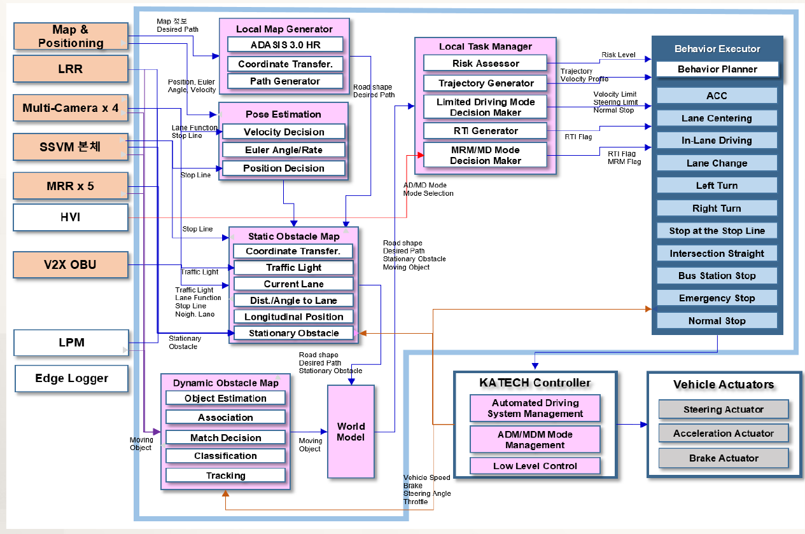

*그림 12. 대형버스 자율주행 시스템의 소프트웨어 아키텍처*

그림 12는 HAV-DCU 안의 소프트웨어 구성 요소와 그 사이의 데이터 흐름을 자세히 보여 준다. 흐름을 단순화하면 그림 13과 같다.

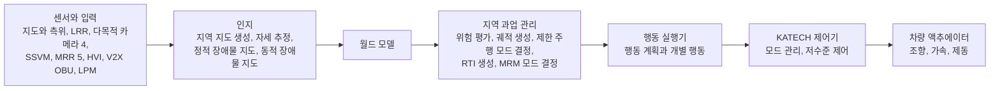

*그림 13. 대형버스 자율주행 소프트웨어의 데이터 흐름*

| 구성 요소 | 하위 기능 | 역할 |
|:-----|:-----|:-----|
| 지역 지도 생성 | ADASIS 3.0 HR, 좌표 변환, 경로 생성 | 정밀 지도에서 차량 주변의 도로 형상과 목표 경로를 만든다. |
| 자세 추정 | 속도 결정, 오일러 각과 각속도, 위치 결정 | 차량의 위치, 속도, 자세(오일러 각)를 추정한다. |
| 정적 장애물 지도 | 좌표 변환, 신호등, 현재 차로, 차로까지의 거리와 각도, 종 방향 위치, 정지 장애물 | 움직이지 않는 환경(차로, 신호, 정지 물체)을 정리한다. |
| 동적 장애물 지도 | 객체 추정, 연관, 매칭 결정, 분류, 추적 | 움직이는 물체를 센서 간에 연관하고 분류하여 추적한다. |
| 월드 모델 | | 위 정보를 모아 차량 주변 세계의 통합 모델을 만든다. |
| 지역 과업 관리 | 위험 평가, 궤적 생성, 제한 주행 모드 결정, RTI 생성, MRM/MD 모드 결정 | 위험을 평가하고 궤적을 만들며, 운전전환요구와 MRM이 필요한지 결정한다. |
| 행동 실행기 | 행동 계획과 ACC, 차로 유지, 차로 변경, 회전, 정지 등 | 결정된 행동을 구체적인 주행 동작으로 실행한다. |
| KATECH 제어기 | 자율주행 시스템 관리, ADM/MDM 모드 관리, 저수준 제어 | 차량 속도, 제동, 조향각, 스로틀 명령을 만들어 액추에이터에 보낸다. |

*표 12. 대형버스 자율주행 소프트웨어의 구성 요소*

> **용어 정의:** **RTI(request to intervene)** 는 SAE J3016의 운전전환요구로, 레벨 3 시스템이 폴백 대비 사용자에게 운전을 넘겨받으라고 알리는 요청이다. 3.8절의 Volvo 사례에 나오는 RTI(road traffic information)와는 다른 말이다. **오일러 각(Euler angle)** 은 롤, 피치, 요의 세 각도로 물체의 자세를 나타내는 방법이다.

이 구조는 인지, 판단, 제어로 이어지는 자율주행 소프트웨어의 전형적인 흐름을 따른다. 각 구성 요소는 서로 다른 ECU나 프로세스에서 실행될 수 있으므로, 구성 요소 사이의 데이터 흐름이 곧 네트워크 설계(2.7절)의 요구사항이 된다.

---

 

## 3. 차량용 네트워크의 발전: IVN과 X-by-wire

### 3.1 자동차의 전장 기능

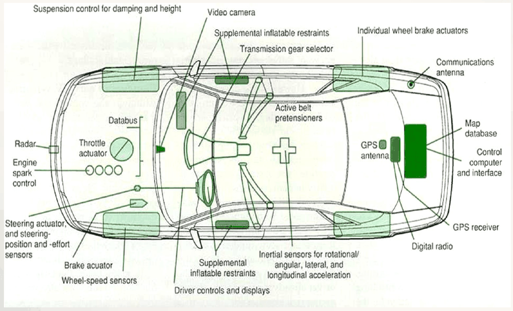

*그림 14. 자동차의 기본적인 전장 기능*

그림 14는 차량 곳곳에 배치된 전장 기능을 보여 준다. 현가 장치의 감쇠력과 차고 제어, 영상 카메라, 에어백(supplemental inflatable restraints), 변속 레버, 바퀴별 브레이크 액추에이터, 통신 안테나, 능동형 안전띠 프리텐셔너, 데이터 버스, 스로틀 액추에이터, 레이더, 엔진 점화 제어, GPS 안테나와 수신기, 지도 데이터베이스, 제어 컴퓨터와 인터페이스, 조향 액추에이터와 조향 위치, 조향력 센서, 브레이크 액추에이터, 바퀴 속도 센서, 회전, 횡 방향, 종 방향 가속도를 재는 관성 센서, 운전자 조작 장치와 디스플레이, 디지털 라디오가 있다. 이 기능들은 다시 안전 기능과 인포테인먼트 기능으로 묶을 수 있다.

| 분류 | 전장 기능 |
|:-----|:-----|
| 안전 기능 | 시야 향상용 적외선 영상 카메라, 차선 인식 카메라, 원격 키리스 엔트리 수신기, 측면 차량 감지기, 교차로, 횡단보도, 위치별 경보를 받는 통신 안테나, 양방향 디지털 무선, 전방 장애물 감지기와 적응형 순항 제어, 후방 장애물 감지기, 사고 기록 장치(safety event recorder), 충돌 강도를 재는 관성 센서, 통합 휴대전화, 스로틀, 조향, 제동 액추에이터 |
| 인포테인먼트 기능 | 승객용 영상 디스플레이, 멀티미디어 프로세서, ITS 게이트웨이, 뒷좌석 디스플레이, 다채널 안테나와 수신기, 음성 인식과 합성, 차량용 미디어 재생 장치(CD, DVD), DSRC 통행료 태그, 재구성 가능한 계기판과 헤드업 디스플레이 |

*표 13. 자동차의 안전 기능과 인포테인먼트 기능*

이 많은 기능이 서로 정보를 주고받아야 하므로, 이들을 어떻게 연결하느냐가 차량 설계의 핵심 문제가 된다.

### 3.2 점대점 배선과 그 문제점

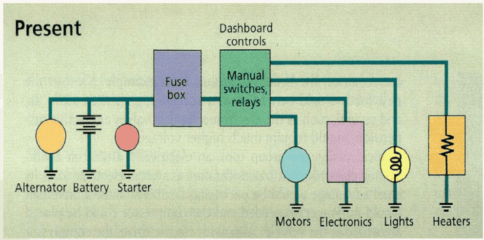

*그림 15. 아날로그 시대의 점대점 배선 방식*

아날로그 시대의 배선은 **점대점(point-to-point)** 방식이었다. 그림 15처럼 발전기, 배터리, 시동 모터에서 나온 전원이 퓨즈 박스를 거쳐 계기판의 수동 스위치와 릴레이로 가고, 거기서 모터, 전자 장치, 조명, 히터 같은 부하마다 전선이 하나씩 따로 연결된다. 스위치를 켜면 그 전선으로 전류가 흘러 부하가 동작하므로, 기능 하나마다 전선 하나가 필요하다.

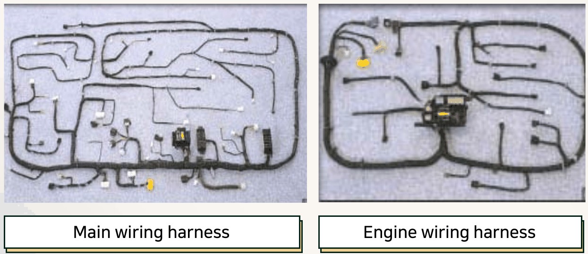

*그림 16. 아반떼 차량의 하네스*

그림 16은 실제 차량(아반떼)의 메인 와이어링 하네스와 엔진 와이어링 하네스이다. 점대점 방식에서는 엔진 제어, ABS, 조명, 에어컨, 파워 도어락, 에어백, 파워 윈도, 파워 시트, 능동형 현가 장치, 변속기 제어, 계기판이 서로 정보를 주고받기 위해 거미줄처럼 얽힌 전선으로 연결된다. 아날로그 배선 방식의 문제점은 다음과 같다.

1. 생산 비용과 불량률이 늘어난다.
2. 차량 중량이 늘어나고, 그에 따라 연비가 나빠진다.
3. 공간이 부족하여 설계와 설치 작업이 어렵다.
4. 설계를 수정할 때의 유연성이 부족하다.
5. 전기 시스템의 고장을 진단하고 찾아내기 어렵다.

### 3.3 IVN의 개념

**IVN(in-vehicle network)** 은 통신망을 차량에 적용한 것이다. 기능마다 전선을 따로 두는 대신 다음 세 가지 특징을 갖는다.

- **통신망을 차량에 적용한다:** ECU들이 메시지를 주고받는 네트워크를 구성한다.
- **디지털 직렬 통신을 쓴다:** 정보를 0과 1의 비트로 바꾸어 한 줄로 차례로 보낸다.
- **통신 매체를 공유한다:** 여러 ECU가 같은 전선을 함께 쓴다.

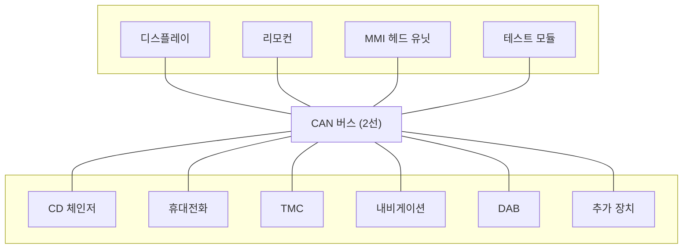

*그림 17. CAN 버스를 공유하는 인포테인먼트 장치들*

그림 17에서 디스플레이, 리모컨, MMI 헤드 유닛, 테스트 모듈, CD 체인저, 휴대전화, 교통 정보 수신기(TMC), 내비게이션, 디지털 라디오(DAB)는 모두 두 가닥의 전선으로 하나의 CAN 버스에 연결된다. 새 장치를 더할 때도 버스에 두 가닥만 연결하면 된다.

> **용어 정의:** **직렬(serial) 통신**은 데이터를 한 비트씩 차례로 한 선으로 보내는 방식이고, **병렬(parallel) 통신**은 여러 비트를 여러 선으로 동시에 보내는 방식이다. 직렬 통신은 선 수가 적어 차량처럼 배선을 줄여야 하는 환경에 알맞다. **TMC(Traffic Message Channel)** 는 FM 라디오 신호에 교통 정보를 실어 보내는 서비스이고, **DAB(Digital Audio Broadcasting)** 는 디지털 라디오 방송이다.

### 3.4 네트워크 방식의 진화

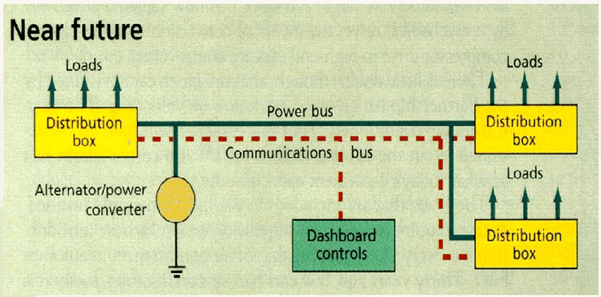

*그림 18. 가까운 미래의 연결 방식: 전원 버스와 통신 버스*

최근의 차량은 그림 18처럼 네트워크 방식으로 진화했다. 발전기와 전력 변환기에서 나온 전원은 **전원 버스(power bus)** 를 따라 여러 배전 박스(distribution box)로 가고, 각 배전 박스가 주변의 부하에 전원을 나누어 준다. 계기판의 스위치 신호는 점선으로 표시된 **통신 버스(communications bus)** 를 따라 배전 박스로 전달되며, 배전 박스가 그 명령에 따라 해당 부하를 켜고 끈다. 전원선과 신호선이 분리되고, 신호는 하나의 통신 버스를 공유한다.

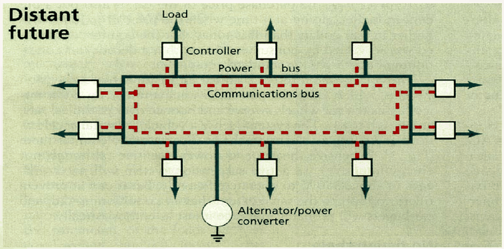

*그림 19. 먼 미래의 연결 방식: 고리형 전원 버스와 통신 버스*

향후의 연결 방식은 그림 19처럼 전원 버스와 통신 버스가 차체를 고리 모양으로 두르고, 각 부하 옆에 작은 제어기를 두어 버스에서 전원과 명령을 바로 받는 구조이다. 배전 박스가 없어지고 부하마다 제어기가 붙으므로, 부하를 더하거나 옮기기 쉽고 배선이 가장 짧아진다.

### 3.5 IVN의 장점

차량 내부 네트워크는 다음 장점을 갖는다.

1. 차량 내 배선이 줄어든다.
2. 전장 시스템을 쉽게 설치할 수 있다.
3. 전체 시스템의 신뢰성이 높아진다.
4. 전장 시스템을 유연하게 설계할 수 있다.
5. 유지와 보수가 쉽다.
6. 배기가스 규제에서 요구하는 기능(엔진, 변속기, 배기 장치의 정밀한 협조 제어와 진단)을 만족할 수 있다.

### 3.6 IVN 적용 사례: Daimler

**Daimler-Chrysler(현재의 Mercedes-Benz Group)** 는 CAN을 처음으로 엔진 관리(engine management)에 적용했고, 지금은 대부분의 승용차와 트럭에 CAN을 탑재한다. CAN은 Bosch가 1986년에 발표한 직렬 버스이며, Mercedes-Benz는 1991년부터 고급 승용차에 CAN을 써 왔다 [14].

1995년의 **Vario Research Car**는 바디 부품만 교체하여 15분 만에 세단, 왜건, 오픈카, 픽업으로 바꿀 수 있는 개념차였다. 차체 부품을 갈아 끼워도 전장 기능이 동작하려면 부품 사이의 연결이 네트워크로 표준화되어 있어야 한다.

Daimler는 핸들과 페달을 없앤 **drive-by-wire** 개념도 연구했다. 운전자의 조작을 기계적 연결 대신 전기 신호로 전달하는 방식이며, 이를 일반화한 것이 3.7절의 X-by-wire이다.

### 3.7 X-by-wire: FBW, SBW, BBW

> **용어 정의:** **X-by-wire**는 조향, 제동, 가속 같은 조작(X)을 기계적, 유압적 연결 대신 전선(wire)으로 전달되는 전기 신호와 전자 제어로 수행하는 기술이다. 운전자의 조작은 센서가 읽어 신호로 바꾸고, 제어기가 계산한 명령을 액추에이터가 실행한다.

**FBW(fly-by-wire).** By-wire 시스템은 항공기에서 시작되었다. 비행기의 조종간과 조종면(날개의 움직이는 면)을 잇던 케이블과 유압관을 전선과 비행 제어 컴퓨터로 바꾼 것이 FBW이다. F-16 전투기는 FBW를 전면 적용하여 양산된 대표적인 기체이고, NASA의 F-8은 디지털 FBW를 시험한 항공기이다.

> **참고:** 기계식 백업 없이 디지털 FBW만으로 비행한 최초의 항공기는 1972년 5월에 첫 비행을 한 NASA의 F-8 DFBW(Digital Fly-By-Wire)이며, 이 기체는 F-16에 쓰인 사이드스틱 조종간의 시험에도 쓰였다 [15].

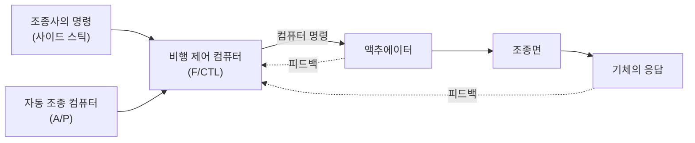

*그림 20. FBW 시스템의 구성*

그림 20처럼 FBW에서는 조종사가 사이드 스틱으로 낸 명령과 자동 조종 컴퓨터의 명령이 비행 제어 컴퓨터로 들어간다. 비행 제어 컴퓨터는 명령을 계산해 액추에이터를 움직이고, 액추에이터가 조종면을 움직여 기체가 반응한다. 액추에이터의 위치와 기체의 응답은 다시 컴퓨터로 되돌아와(피드백) 명령과 실제 움직임의 차이를 줄인다.

**SBW(steer-by-wire).** 자동차의 조향에 by-wire를 적용한 것이다.

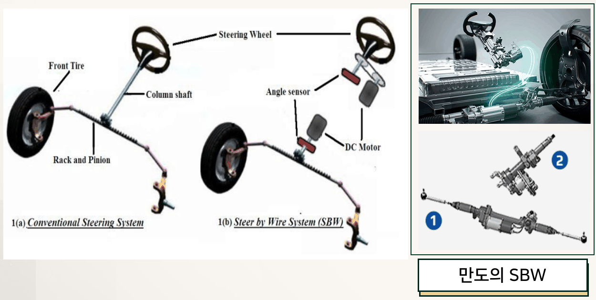

*그림 21. 기존 조향 장치와 SBW의 비교*

그림 21의 왼쪽인 기존 조향 장치에서는 운전대(steering wheel)의 회전이 조향축(column shaft)을 거쳐 랙과 피니언(rack and pinion)으로 전달되어 앞바퀴를 돌린다. 가운데의 SBW에서는 조향축이 없다. 운전대의 각도 센서가 회전 각도를 읽어 신호로 보내면, 제어기가 계산한 명령에 따라 DC 모터가 랙을 움직여 바퀴를 돌린다. 운전대 쪽에도 모터를 두어 노면의 반력을 운전자에게 전달한다. 오른쪽은 국내 부품사 만도가 개발한 SBW이다.

**BBW(brake-by-wire).** 제동에 by-wire를 적용한 것이다. 브레이크 페달을 밟는 힘을 유압으로 직접 전달하는 대신, 페달의 움직임을 센서로 읽어 전자 제어 장치가 각 바퀴의 제동력을 정한다. 만도의 BBW 구성에는 통합 전자식 브레이크(IDB, integrated dynamic brake), 캘리퍼에 모터를 단 전자식 주차 브레이크(MoC, motor on caliper), ABS와 ESC, 캘리퍼 브레이크, 디자인을 강조한 프리미엄 캘리퍼가 있다.

| 시스템 | 대상 | 없어지는 기계적 연결 | 신호의 흐름 |
|:-----|:-----|:-----|:-----|
| FBW | 항공기 조종 | 조종간과 조종면 사이의 케이블, 유압관 | 사이드 스틱 → 비행 제어 컴퓨터 → 액추에이터 → 조종면 |
| SBW | 자동차 조향 | 운전대와 랙 사이의 조향축 | 각도 센서 → 제어기 → 조향 모터 → 랙과 바퀴 |
| BBW | 자동차 제동 | 페달과 브레이크 사이의 유압 직결 | 페달 센서 → 제어기 → 전자식 제동 장치 → 바퀴 |

*표 14. FBW, SBW, BBW의 비교*

X-by-wire는 기계적 연결이 없어 배치가 자유롭고 자율주행 시스템이 조향과 제동을 직접 제어하기 쉽다. 반면 전기 신호와 제어기가 고장 나면 조작 자체가 불가능해지므로, 전원과 통신, 제어기를 이중화하고 고장 허용성과 시간 결정성이 보장되는 네트워크가 필요하다. 1주차에서 본 FlexRay가 X-by-wire를 위해 설계된 네트워크이다.

### 3.8 IVN 적용 사례: Volvo S80

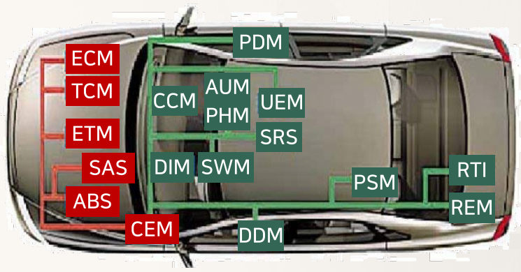

*그림 22. Volvo S80의 두 CAN 버스와 연결된 모듈*

Volvo S80은 속도가 다른 두 개의 CAN 버스를 쓴다. 그림 22에서 빨간색이 250 kbit/s의 고속 버스(red bus)이고, 초록색이 125 kbit/s의 저속 버스(green bus)이다.

| 버스 | 약어 | 이름 | 역할 |
|:-----|:-----|:-----|:-----|
| 고속 (250 kbit/s) | ECM | Engine Control Module | 엔진 제어 |
| 고속 (250 kbit/s) | ETM | Electronic Throttle Module | 전자식 스로틀 제어 |
| 고속 (250 kbit/s) | TCM | Transmission Control Module | 변속기 제어 |
| 고속 (250 kbit/s) | SAS | Steering Angle Sensor | 조향각 측정 |
| 고속 (250 kbit/s) | ABS | Antilock Braking System | 바퀴 잠김 방지 제동 |
| 두 버스 모두 | CEM | Central Electronic Module | 두 버스를 잇는 게이트웨이 |
| 저속 (125 kbit/s) | AUM | Audio Module | 오디오 |
| 저속 (125 kbit/s) | CCM | Climate Control Module | 공조 |
| 저속 (125 kbit/s) | DDM, PDM | Driver, Passenger Door Module | 운전석과 조수석 도어 |
| 저속 (125 kbit/s) | PHM | Phone Module | 전화 |
| 저속 (125 kbit/s) | PSM | Power Seat Module | 전동 시트 |
| 저속 (125 kbit/s) | REM | Rear Electronics Module | 후방 전장 |
| 저속 (125 kbit/s) | RTI | Road Traffic Information | 도로 교통 정보 |
| 저속 (125 kbit/s) | SRS | Safety Restraint System | 에어백 등 승객 보호 |
| 저속 (125 kbit/s) | DIM | Driver Information Module | 계기판 |
| 저속 (125 kbit/s) | SWM | Steering Wheel Module | 운전대 스위치 |
| 저속 (125 kbit/s) | UEM | Upper Electronic Module | 상부 전장(실내등, 선루프 등) |

*표 15. Volvo S80의 CAN 모듈 구성*

> **참고:** Volvo의 정비 자료에서 TCM은 변속기 제어 모듈(Transmission Control Module), ETM은 전자식 스로틀 모듈(Electronic Throttle Module)이다 [16], [17]. 두 약어를 반대로 풀이하는 자료가 있으나 표 15는 Volvo의 용어를 따른다. 또 Volvo는 2005년에 고속 버스의 속도를 500 kbit/s로 높였다 [16].

이 구성은 기능의 성격에 따라 버스를 나누는 원칙을 보여 준다. 엔진, 변속기, 제동처럼 실시간성이 중요한 파워트레인과 섀시 기능은 고속 버스에, 오디오, 공조, 도어처럼 빠른 응답이 필요 없는 바디와 편의 기능은 저속 버스에 두고, 두 버스 사이의 정보는 CEM이 게이트웨이로서 전달한다. 예를 들어 계기판(DIM)에 엔진 회전수를 표시하려면 ECM이 고속 버스로 보낸 메시지를 CEM이 저속 버스로 옮겨 주어야 한다.

### 3.9 실시간성과 전송 속도에 따른 IVN 분류

SAE는 차량 네트워크의 도입기에 전송 속도와 실시간성에 따라 차량 네트워크를 Class A, B, C로 분류했다. 이후 1 Mbit/s를 넘는 Class D가 더해졌다 [18].

| 클래스 | 전송 속도 | 전달하는 정보 | 응용 예 | 대표 프로토콜 |
|:-----|:-----|:-----|:-----|:-----|
| Class A | 10 kbit/s 미만 | 지능이 없는 노드의 매우 짧은 정보 | 바디 제어(시트, 도어 잠금, 조명, 트렁크, 레인 센서) | LIN |
| Class B | 10\~125 kbit/s | 센서 정보를 공유하는 등 가치가 더 높은 정보의 분배 | 계기판, 진단 | 저속 CAN, J1850 |
| Class C | 125 kbit/s\~1 Mbit/s | 실시간 처리가 필수적인 정보 | 엔진 관리, 변속기, ABS | 고속 CAN |
| Class D | 1 Mbit/s 초과 | 멀티미디어 데이터, 예측 가능성과 고장 허용이 필요한 정보 | 멀티미디어, X-by-wire | MOST, FlexRay |

*표 16. SAE의 차량 네트워크 분류*

클래스가 올라갈수록 전송 속도와 실시간성이 모두 높아진다. 3.8절의 Volvo S80은 125 kbit/s의 저속 버스가 Class B에, 250 kbit/s의 고속 버스가 Class C에 해당한다. 같은 CAN이라도 속도를 달리하여 Class B와 Class C에 모두 쓰인다는 점에 주목할 필요가 있다. 이 분류는 3주차에서 차량용 프로토콜을 비교할 때 다시 쓰인다.

---

 

## 4. 부록: 한국자동차연구원(KATECH)

이 부록은 자율주행과 자동차 통신 연구를 수행하는 국내 기관인 한국자동차연구원(KATECH, Korea Automotive Technology Institute)을 소개한다. 2절의 대형버스 자율주행 과제를 총괄한 기관이기도 하다. 다른 나라의 자동차 연구 기관은 4주차(일본 JARI), 6주차(영국 HORIBA MIRA), 13주차(프랑스 UTAC)의 부록에서 다룬다.

### 4.1 설립 목적과 연혁

한국자동차연구원은 자동차 기술력 확보와 산업 육성을 위해 정부와 업계가 힘을 모아 설립한 연구 기관이며, 연구개발, 시험 인증, 교육과 정보 제공 등 다양한 지원을 수행한다.

| 시기 | 단계 | 주요 내용 |
|:-----|:-----|:-----|
| 1990\~1995년 | 설립과 기반 구축 | 국내 자동차 기술 연구의 기틀을 마련했다. 1990년 상공부의 설립 인가, 1995년 연구원 준공 |
| 1995\~2000년대 | 신뢰도 향상 | 공인 시험 기관 지정과 장비 구축. 1996년부터 연비 측정, KOLAS 등 국가 공인 시험 기관 지정, 신뢰성평가센터(RAC) 구축 |
| 2001\~2010년대 | 발전과 도약 | 부품 품질과 신뢰성 향상, 다양한 시험 장비 구축, 대구경북본부 설립 |
| 2011년\~ | 혁신의 시기 | 미래차 핵심 기술 개발, 지역 본부 확장, 2019년 11월 한국자동차연구원으로 사명 변경(국내 자동차 기술 개발 혁신의 주체로 변화) |

*표 17. 한국자동차연구원의 연혁*

> **용어 정의:** **KOLAS(Korea Laboratory Accreditation Scheme)** 는 시험 기관의 능력을 국가가 평가하여 인정하는 한국인정기구 제도이다. KOLAS 인정을 받은 기관의 시험 성적서는 국제적으로 통용된다.

### 4.2 본원과 지역 조직

| 조직 | 설립 | 주요 기능 |
|:-----|:-----|:-----|
| 천안 본원 | | 5개 연구 본부와 4개 지원 본부 운영, 직선 1 km 주행 시험로 |
| 서울 사무소 | | |
| 제조기술연구센터(시흥) | 2013년 1월 | 자동차 생산 기술과 뿌리 기술 지원, ODA 지원 사업 |
| 대경본부 | 2010년 3월 | 지능형 자동차와 그린카, 튜닝 지원 센터, 전기차 부품 등 주행 시험로 |
| 판교 센터 | 2019년 8월 | AI, 빅데이터 연구 |
| 광주본부 | 2011년 5월 | 친환경차와 소재 융합 연구, 미래 전장 연구 |
| 전남본부 | 2019년 8월 | E-모빌리티 연구센터(영광, 2013년 1월), 프리미엄 자동차 연구센터(영암, 2013년 1월) |
| 동남본부 | 2019년 12월 | 수소전기차 연구 |

*표 18. 한국자동차연구원의 본원과 지역 조직*

지역 본부는 대경, 광주, 전남, 동남의 네 곳이다. 천안 본원은 연구동 14개 동, 지원과 부대시설 3개 동, 길이 1 km, 폭 30 m의 주행 시험장으로 이루어지며, 전체 면적은 약 25만 m²(75,600평)이다. 연구동에는 환경 연구동, 종합 연구동, 자율주행 시험동, 복합 진동 실험동, 신뢰성 실험동, 충돌 예방 시스템 연구동, 진동 시험실동, 전자파 시험동, 배기가스와 엔진 연구동 등이 있다.

> **용어 정의:** **ODA(official development assistance, 공적 개발 원조)** 는 선진국 정부가 개발도상국의 발전을 위해 제공하는 원조이다. **뿌리 기술**은 주조, 금형, 용접, 열처리처럼 제조업의 바탕이 되는 공정 기술이다.

### 4.3 주요 역할과 조직

| 역할 | 내용 |
|:-----|:-----|
| 연구 개발 | 미래 모빌리티 분야의 국가 연구개발(R&D)을 수행한다. |
| 정책 지원 | 국내 자동차 산업을 위한 국가 정책과 대형 사업을 제안한다. |
| 분석, 평가 | 특화된 장비를 활용하여 분석과 신뢰성 평가를 수행한다. |
| 시험, 인증 | 국내외 완성차와 부품의 시험과 인증을 지원한다. |
| 기술 사업화 | 기술 이전 사업화와 기술 자문을 지원한다. |
| 교육과 정보 | 교육 훈련과 기술 정보를 제공한다. |

*표 19. 한국자동차연구원의 주요 역할*

조직은 원장 아래에 윤리감사실, 첨단기동체계사업부, 자율주행셔틀기술연구TF를 두고, 다섯 개의 연구소와 세 개의 본부로 이루어진다.

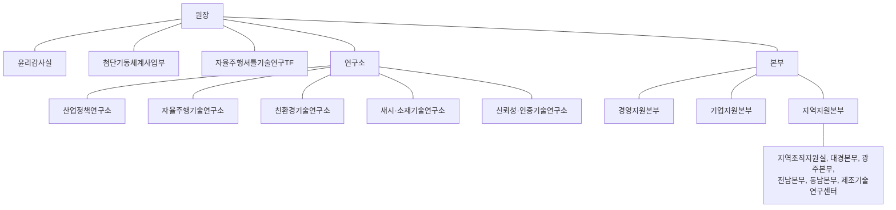

*그림 23. 한국자동차연구원의 조직*

조직 규모는 9개 본부, 4개 지역 본부, 28개 센터, 19개 실, 1개 단, 2개 TF, 1개 부이다. 총인원은 527명으로, 연구직이 472명(박사 118명, 석사 201명)으로 90%, 행정직이 55명으로 10%를 차지한다.

### 4.4 연구 현황과 연구 분야

연구원과 공동 연구개발을 수행하는 기업은 꾸준히 늘어 2015년 298개, 2016년 333개, 2017년 348개, 2018년 370개, 2019년 403개가 되었으며, 2020년 기준 403개 기업과 협업하고 있다. 2019년 수입은 정부 R&D가 78%, 민간 수탁이 12%, 시험 평가가 7%, 기타가 3%로, 정부 연구개발의 비중이 가장 크다.

| 연구 분야 | 세부 연구 |
|:-----|:-----|
| 친환경차 기술 | 전기차용 배터리, 수소전기차용 부품, xEV용 전장 부품 |
| 자율주행 기술 | 자율주행 부품, 자율주행 시스템 제어, ICT와 AI, 빅데이터 융합 |
| 융합 시스템 기술 | 주행 안전 제어, 스마트 섀시, 고효율 에너지 제어 |
| 신뢰성 향상 기술 | 신뢰성과 안전 향상, 내구성 향상, 전자파 |
| 첨단 소재 기술 | 초경량 소재, 고성능 화학 소재, 금속 소재 |

*표 20. 한국자동차연구원의 연구 분야*

### 4.5 장비 현황

연구원은 기술 개발과 평가를 위해 1,500종 이상의 다양한 최신 장비를 갖추고 있다.

| 분야 | 대표 장비 |
|:-----|:-----|
| 친환경 | EV 배터리 충방전 성능 시험기(배터리 수명 측정), xEV 모터 다이나모(고속 모터 성능 측정, 모터 역기전압 측정), 배기가스 분석 시스템(실시간 배기가스 분석) |
| 스마트 | 자율주행 시험 차량(센서 등 자율주행 부품의 실차 시험), 4륜 독립 구동형 섀시 다이나모(지능형 안전 시스템 주행 시험), ADAS 환경 시험실(자율주행 센서 기술 개발) |
| 경량, 첨단 소재 | 복합 환경 마모 시험기(마찰 특성 평가), 압출기(균일한 고분자 복합 재료 성형), 열전도도 측정기(재료의 열전도도 측정) |
| 신뢰성 향상 | 초가속 수명 시험기, HEV 부품 환경 요인 고려 신뢰성 평가 장비(진동 관련 신뢰성 평가), 전자파 복사 내성 시험 시스템(자동차 부품의 복사 내성 시험 평가) |

*표 21. 한국자동차연구원의 분야별 대표 장비*

> **용어 정의:** **다이나모(dynamometer)** 는 모터나 차량을 회전시키며 힘, 회전수, 출력을 재는 시험 장비이다. **전자파 복사 내성(radiated immunity)** 은 외부에서 날아오는 전자파를 받아도 전자 장치가 오동작하지 않는 능력이다.

### 4.6 자율주행기술연구소

자율주행기술연구소는 **무한 편의**(e-콕핏과 개인 맞춤형 HMI, 증강 현실과 콘텐츠 같은 인간 감성), **최고 안전**(첨단 운전자 지원 시스템, 무인 운전과 군집 운전 같은 자율주행), **완벽 연결**(스마트 차량 간 대화 서비스, 사물 인터넷과 클라우드를 통한 커넥티드)을 목표로 세 분야의 연구를 수행한다.

| 분야 | 연구 내용 |
|:-----|:-----|
| 커넥티드 | 커넥티드 부품과 서비스 기술, 고정밀 복합 측위와 동적 지도(LDM) 기술, 임베디드 ECU 설계와 소프트웨어 평가 |
| 자율주행 | 자율주행 부품과 시스템 기술, 지능형 센서 융합 시스템 기술, 차량용 HMI와 UI/UX 평가 |
| 자율협력 | NCAP 시스템(AEB(S) 등) 기술, 차세대 V2X 부품과 서비스 기술, 차량용 통신 보안 플랫폼과 평가 |

*표 22. 자율주행기술연구소의 연구 분야*

> **용어 정의:** **LDM(local dynamic map)** 은 정적인 지도 위에 주변 차량, 신호, 공사 구간 같은 동적 정보를 겹쳐 실시간으로 관리하는 지도이다. **NCAP(New Car Assessment Program)** 은 신차의 안전성을 시험해 등급을 공개하는 제도이며, **AEB(S)** 는 자동 긴급 제동 시스템(autonomous emergency braking system)이다. **UI/UX**는 사용자 인터페이스(user interface)와 사용자 경험(user experience)이다.

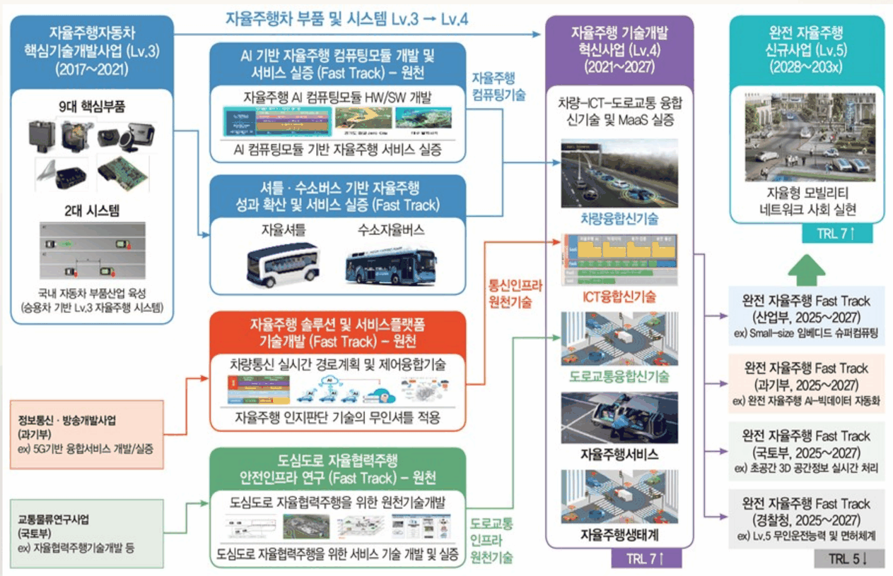

*그림 24. 자율주행 정부 과제의 단계별 추진 체계*

그림 24는 자율주행 관련 정부 과제가 레벨 3에서 레벨 5로 이어지는 흐름이다.

1. **자율주행자동차 핵심기술개발사업(레벨 3, 2017\~2021년):** 9대 핵심 부품과 2대 시스템을 개발하여 국내 자동차 부품 산업을 육성하고, 승용차 기반 레벨 3 자율주행 시스템을 만든다.
2. **Fast Track 과제(원천 기술):** AI 기반 자율주행 컴퓨팅 모듈 개발과 서비스 실증, 셔틀과 수소 버스 기반 자율주행 성과 확산과 서비스 실증(자율주행 컴퓨팅 기술), 자율주행 솔루션과 서비스 플랫폼 기술 개발(통신 인프라 원천 기술), 도심 도로 자율협력주행 안전 인프라 연구(도로 교통 인프라 원천 기술)가 있다. 과학기술정보통신부의 정보통신, 방송 개발 사업(5G 기반 융합 서비스 개발과 실증)과 국토교통부의 교통 물류 연구 사업(자율협력주행 기술 개발)이 함께 연계된다.
3. **자율주행 기술개발 혁신사업(레벨 4, 2021\~2027년):** 차량, ICT, 도로 교통의 융합 신기술과 MaaS를 실증하며, 차량 융합 신기술, ICT 융합 신기술, 도로 교통 융합 신기술, 자율주행 서비스, 자율주행 생태계의 다섯 분야로 나뉜다. 목표 기술 성숙도는 TRL 7 이상이다.
4. **완전 자율주행 신규 사업(레벨 5, 2028\~203x년):** 자율형 모빌리티 네트워크 사회를 실현하며, 목표 기술 성숙도는 TRL 7 이상이다. 이에 앞서 산업통상자원부, 과학기술정보통신부, 국토교통부, 경찰청이 2025\~2027년에 완전 자율주행 Fast Track(소형 임베디드 슈퍼컴퓨팅, AI와 빅데이터 자동화, 초공간 3D 공간 정보의 실시간 처리, 레벨 5 무인 운전 능력과 면허 체계)을 수행하며, 이 단계의 기술 성숙도는 TRL 5 이하이다.

> **용어 정의:** **TRL(technology readiness level, 기술 성숙도)** 은 기술이 기초 연구(1)에서 실제 운용(9)까지 어느 단계에 있는지를 1\~9로 나타낸 척도이다. TRL 7은 실제 환경에서 시스템 시제품을 시연하는 단계이다.

### 4.7 주요 자율주행 과제

| 항목 | 주요 과제 1 | 주요 과제 2 | 주요 과제 3 |
|:-----|:-----|:-----|:-----|
| 과제명 | 자동차전용도로, 도심로 자율주행 시스템 개발과 성능 평가 | AI 기반 자율주행 컴퓨팅 모듈 개발과 서비스 실증 | 자율주행 부품 성능 검증을 위한 자율셔틀 실증 기반 기술 개발 |
| 과제 기간 | 2017년 5월 \~ 2021년 12월 | 2019년 4월 \~ 2021년 12월 | 2018년 9월 \~ 2021년 12월 |
| 과제 예산 | 총 175억 원 | 총 280억 원 | 총 96억 원 |
| 과제 내용 | 주행 차로와 차간 거리 유지 외 레벨 3 자율주행 시스템 기술 5종 개발, TDP/TRS 개발과 공용 평가 환경 구축, 부품 업체 지원용 차량 플랫폼 개발 | 레벨 4 수준의 자율주행 AI 연산 성능을 확보할 수 있는 컴퓨팅 모듈 시작품 개발, 성능 검증을 위한 기술 실증과 표준화 | 국내 자율주행 부품의 성능과 신뢰성 향상을 지원하기 위한 EV 셔틀 구동 플랫폼, 자율주행 시스템, HMI 연계 시스템 개발과 시범 주행 |
| 추진 체계 | 총괄 KATECH, DNV-GL, 컨트롤웍스, 퓨전소프트, 만도, 오토노머스에이투지, 서울대, 한양대, 경일대, 국민대, KOTI, KIAPI | 총괄 현대모비스, KATECH, 베이리스, 유니트론텍, 레보텍, 텔레컨스, 트리플에스컨설팅, 인포뱅크, 스프링클라우드, 지오씨엔아이, 컨피테크, AI Matics, SML, 서울대, 국민대, 인하대, 한양대, KSA, KEA, KAATA | 총괄 KATECH, 마루이엔지, 스프링클라우드, 뉴텍, 퓨전소프트, 차세대융합기술연구원 |
| 주요 성과 | 인지, 판단, 제어, MRM 로직, 차량(G80 2대, 아이오닉 1대), 논문 국내 37건과 국외 22건, 특허 출원 17건과 등록 5건, 기술 이전 5건, 국제 표준 | 최대 240 TOPS 수준의 컴퓨팅 모듈, 승용과 다목적 실증 차량 2대, 산업통상자원부와 과학기술정보통신부의 AI 협력 모델, 자율주행 표준화 포럼(6개 분과) | 국산 센서 4종 탑재, 저속 자율주행 셔틀(LSAD)용 자율주행 소프트웨어, 자율셔틀 KAMO 3대, 대구와 세종 실증(2021년 12월까지), 전시회 2회, 민간 과제 2건 |

*표 23. 한국자동차연구원의 주요 자율주행 과제*

> **용어 정의:** **TOPS(tera operations per second)** 는 초당 1조 번의 연산을 뜻하는 AI 연산 성능의 단위이다. 240 TOPS는 초당 $2.4 \times 10^{14}$번의 연산이다. **LSAD(low-speed automated driving)** 는 정해진 구역을 저속으로 운행하는 자율주행 시스템이다.

주요 과제 1의 시스템은 운전자 사용성 평가, 실차와 가상 환경을 결합한 VILS(vehicle-in-the-loop simulation) 실차 평가, 주행 시험장(PG) 실차 평가로 검증되었다. 주요 과제 2의 컴퓨팅 모듈은 이 과목의 주제인 차량 통신 인터페이스를 여럿 갖추고 있다. 카메라 8채널은 GMSL2 직렬화 링크(MAX9295, MAX9296 SERDES, 링크 속도 6 Gbit/s)로 연결되며, 카메라 센서와 ISP의 조합은 AR0231과 AP0200(30 fps), AR0233과 GW5200(60 fps)이다. 이 밖에 차량용 이더넷 100BASE-T1 3포트(100 Mbit/s), 16채널 360° 기계식 라이다 4대를 연결하는 1000BASE-T 이더넷, 무선 인터페이스(GPS L1과 GLONASS 대역의 GNSS, 하향 150 Mbit/s와 상향 75 Mbit/s의 LTE Cat 4), 디스플레이 출력을 갖는다.

> **용어 정의:** **SERDES(serializer/deserializer)** 는 병렬 데이터를 고속 직렬 신호로 바꾸어 보내고 받는 쪽에서 다시 병렬로 되돌리는 회로이다. **GMSL(gigabit multimedia serial link)** 은 카메라 영상처럼 대용량 데이터를 한 가닥의 동축 케이블로 수 Gbit/s의 속도로 전송하는 차량용 직렬 링크이다.

---

 

## 개념 적용

다음 상황에서 어떤 개념이 판단의 근거가 되는지 연결한다.

| 상황 | 연결할 개념과 이유 |
|:-----|:-----|
| 차선 변경 중 운전자가 도로를 계속 주시해야 한다. | **레벨 2.** 손과 발은 놓아도 OEDR(주변 감시)을 운전자가 맡으므로 레벨 2이다. |
| 고속도로 자율주행 중 시스템이 고장 나자 차량이 스스로 갓길에 정지했다. | **DDT 폴백과 MRM.** 사람의 인수를 전제하지 않고 시스템이 MRM을 수행해 MRC에 도달했으므로 폴백까지 시스템이 맡는 레벨 4 이상의 동작이다. 레벨 3에서도 사용자가 운전을 넘겨받지 못하면 시스템이 MRM을 수행할 수 있다(그림 2). |
| 부품사가 도어 ECU 대신 도어 기계 부품만 납품하게 되었다. | **SDV와 납품 구조의 변화.** 완성차의 고성능 AP 기반 중앙 컴퓨터가 제어를 맡으므로 부품사의 부가가치가 낮아진다. |
| 라이다 포인트 클라우드를 레이더 정보와 같은 CAN 버스로 보내려 한다. | **데이터량에 따른 네트워크 분리.** 대용량 데이터는 이더넷, 중간 크기는 CAN FD, 작은 제어 데이터는 CAN으로 나누어 보낸다. |
| 계기판에 엔진 회전수를 표시해야 하지만 계기판은 저속 버스에 있다. | **게이트웨이.** CEM 같은 게이트웨이가 고속 버스의 메시지를 저속 버스로 전달한다. |
| 조향축이 없는 차량에서 운전대 신호가 끊기면 조향이 불가능해진다. | **X-by-wire의 이중화.** 기계적 연결이 없으므로 전원, 통신, 제어기를 이중화하고 고장 허용 네트워크를 써야 한다. |

*표 24. 상황별로 연결할 개념과 그 이유*

**T/F 점검:**

| 문장 | 판단과 근거 |
|:-----|:-----|
| 자동 차선 변경 기능이 있으면 레벨 3이다. | **F.** 레벨은 기능의 종류가 아니라 운전자의 개입 정도로 나뉜다. 차선 변경 중 도로를 주시해야 하면 레벨 2이다. |
| 레벨 3에서는 ADS가 작동하는 동안 OEDR을 시스템이 수행한다. | **T.** 레벨 3부터 OEDR을 포함한 전체 DDT를 ADS가 수행하고, 폴백만 사용자가 맡는다. |
| SAE Class C 네트워크는 10 kbit/s 미만의 바디 제어용이다. | **F.** 10 kbit/s 미만의 바디 제어용은 Class A이고, Class C는 125 kbit/s\~1 Mbit/s의 실시간 제어용이다. |
| Volvo S80의 CEM은 두 CAN 버스에 모두 연결된 게이트웨이이다. | **T.** CEM은 250 kbit/s 버스와 125 kbit/s 버스를 잇는다. |
| SBW에서는 운전대와 랙이 조향축으로 기계적으로 연결된다. | **F.** SBW에는 조향축이 없고, 각도 센서의 신호로 제어기와 모터가 랙을 움직인다. |

---

 

## 요약

| 개념 | 핵심 요약 |
|:--------|:------------|
| 자율주행 레벨 | SAE는 레벨 0\~5, NHTSA(2013)는 레벨 0\~4로 나누며, 레벨은 기능이 아니라 운전자의 개입 정도로 정해진다. |
| DDT와 폴백 | 레벨 2에서 3으로 가면 OEDR이, 3에서 4로 가면 DDT 폴백이 시스템으로 넘어가고, 레벨 5는 ODD의 제한이 없다. |
| MRM과 MRC | 폴백이 일어나면 시스템은 MRM을 수행해 MRC에 도달하며, MRM 표준은 ISO 23793-1로 발행되었다. |
| 센서 구성 | 평균 센서 수는 레벨 1의 약 7개에서 레벨 5의 약 30개로 늘고, 레벨 3부터 라이다와 서라운드 카메라가 더해진다. |
| 플랫폼 로드맵 | E/E 플랫폼은 기능별 ECU와 여러 프로토콜에서 ECU와 프로토콜(CAN FD, 이더넷)의 통합을 거쳐 도메인 컨트롤러 중심으로 바뀐다. |
| 빅테크의 진출 | Intel, NVIDIA, Qualcomm 같은 빅테크가 반도체, AI, 클라우드를 장악하며, 이들의 이익률은 완성차보다 월등히 높다. |
| E/E 아키텍처와 SDV | 분산형 ECU에서 도메인 구조를 거쳐 3\~5개의 고성능 AP로 기능을 처리하는 SDV로 바뀌며, 부품사는 기계 부품 납품으로 밀려날 위험이 있다. |
| 대형버스 자율주행 시스템 | 센서 24개 이상을 CAN, CAN FD, 이더넷으로 나누어 연결하고, HAV-DCU가 인지와 판단을, KATECH 제어기가 저수준 제어를 맡는다. |
| 시스템 아키텍처 | 인지(지도, 자세, 장애물), 월드 모델, 과업 관리, 행동 실행, 저수준 제어, 액추에이터로 데이터가 흐른다. |
| 점대점 배선 | 기능마다 전선을 두는 방식은 비용, 중량, 공간, 설계 유연성, 고장 진단에서 문제가 있다. |
| IVN | 통신망을 차량에 적용하여 디지털 직렬 통신으로 매체를 공유하며, 배선 감소, 신뢰성 향상, 유연한 설계, 쉬운 정비를 가져온다. |
| X-by-wire | FBW, SBW, BBW는 기계적 연결을 전기 신호와 제어기로 대체하므로, 이중화와 고장 허용 네트워크가 필요하다. |
| SAE 네트워크 분류 | Class A(10 kbit/s 미만, 바디), Class B(10\~125 kbit/s, 계기판과 진단), Class C(125 kbit/s\~1 Mbit/s, 실시간 제어)로 나뉜다. |
| 한국자동차연구원 | 정부와 업계가 설립한 자동차 연구 기관으로, 연구개발, 시험 인증, 정책 지원을 수행하며 레벨 3\~5 자율주행 정부 과제를 이끈다. |

---

 

## 점검 문제

1. **레벨 판별:** 고속도로에서 차선 변경까지 자동으로 하는 차량이 있다. (가) 운전자가 계속 도로를 주시해야 하는 경우, (나) 운전자가 도로를 주시하지 않아도 되지만 요청이 오면 운전을 넘겨받아야 하는 경우, (다) 차선 변경이 끝날 때까지 운전자가 아무것도 하지 않아도 되는 경우의 레벨을 각각 쓰라.

   

   
정답

   (가)는 레벨 2, (나)는 레벨 3, (다)는 레벨 4이다. (가)는 OEDR을 운전자가 맡고, (나)는 OEDR을 시스템이 맡지만 폴백은 사용자가 맡으며, (다)는 폴백까지 시스템이 맡는다.

   

2. **DDT와 폴백:** 표 2에서 레벨 2와 3, 레벨 3과 4, 레벨 4와 5를 가르는 열은 각각 무엇인가?

   

   
정답

   레벨 2와 3은 OEDR 열(운전자에서 시스템으로), 레벨 3과 4는 DDT 폴백 열(폴백 대비 사용자에서 시스템으로), 레벨 4와 5는 ODD 열(제한됨에서 무제한으로)이 다르다.

   

3. **MRM:** 폴백, MRM, MRC의 관계를 설명하고, 폴백이 일어나는 세 가지 경우를 쓰라.

   

   
정답

   폴백은 시스템이 정상 주행을 계속할 수 없을 때의 대응이고, MRM은 그 대응으로 수행하는 감속, 차선 변경, 정지 같은 조작이며, MRC는 MRM의 결과로 도달하는 안전한 정지 상태(예: 갓길 정지)이다. 폴백은 운전자에게 이상이 생긴 경우, 자율주행 시스템에 이상이 생긴 경우, 작동 범위(ODD) 밖의 상황을 만난 경우에 일어난다.

   

4. **SDV와 납품 구조:** 100여 개의 MCU 체제에서 3\~5개의 고성능 AP 체제로 바뀌면 부품사의 납품 방식과 수익 구조가 어떻게 달라지는지 설명하라.

   

   
정답

   기존에는 부품사가 MCU와 소프트웨어를 넣은 ECU를 포함하여 도어 모듈, 시트 모듈처럼 납품했다. 고성능 AP 체제에서는 완성차의 중앙 컴퓨터가 제어를 맡으므로 부품사는 기계 부품만 납품하게 된다. 부가가치가 높은 소프트웨어, 반도체, 서비스 플랫폼은 빅테크와 완성차가 가져가고, 부품사는 저수익 사업으로 밀려날 위험이 있다.

   

5. **네트워크 토폴로지:** 대형버스 자율주행 시스템에서 라이다, 중거리 레이더, 제어 명령을 각각 어떤 네트워크로 보내는지 쓰고 그렇게 나눈 이유를 설명하라.

   

   
정답

   라이다는 이더넷(라이다 허브와 이더넷 백본), 중거리 레이더는 CAN FD, 제어 명령과 상태 정보는 CAN으로 보낸다. 라이다의 포인트 클라우드는 초당 수십\~수백 Mbit 규모(점의 표현 방식에 따라 다르다)의 대용량 데이터라 이더넷이 필요하고, 레이더의 물체 정보는 CAN보다 큰 페이로드가 필요한 중간 크기 데이터이며, 제어 명령은 작지만 실시간성이 중요한 데이터이므로 CAN으로 충분하다.

   

6. **점대점 배선과 IVN:** 아날로그 점대점 배선 방식의 문제점 다섯 가지를 쓰고, IVN의 세 가지 특징이 이 문제를 어떻게 해결하는지 설명하라.

   

   
정답

   문제점은 생산 비용과 불량률 증가, 차량 중량 증가와 연비 악화, 공간 부족으로 인한 설계와 설치의 어려움, 설계 수정의 유연성 부족, 고장 진단의 어려움이다. IVN은 통신망을 차량에 적용하고, 디지털 직렬 통신을 쓰며, 통신 매체를 공유한다. 여러 ECU가 한 버스를 공유하므로 전선 수와 무게가 줄고, 새 장치는 버스에 연결만 하면 되어 설계가 유연해지며, 진단 장치를 버스에 연결해 모든 ECU의 상태를 읽을 수 있어 고장 진단이 쉬워진다.

   

7. **Volvo S80:** Volvo S80이 두 개의 CAN 버스를 쓰는 이유를 SAE 분류와 연결하여 설명하고, CEM의 역할을 쓰라.

   

   
정답

   엔진, 스로틀, 변속기, 조향각, ABS처럼 실시간성이 중요한 기능은 250 kbit/s의 고속 버스(SAE Class C)에, 오디오, 공조, 도어, 시트처럼 빠른 응답이 필요 없는 기능은 125 kbit/s의 저속 버스(SAE Class B)에 둔다. 기능의 요구에 맞는 속도를 쓰면 비용을 줄이고 고속 버스의 부하를 낮출 수 있다. CEM은 두 버스에 모두 연결된 게이트웨이로, 한 버스의 메시지를 다른 버스로 전달한다.

   

8. **X-by-wire:** SBW가 기존 조향 장치와 어떻게 다른지 설명하고, X-by-wire에 고장 허용 네트워크가 필요한 이유를 쓰라.

   

   
정답

   기존 조향 장치는 운전대의 회전을 조향축과 랙과 피니언으로 바퀴에 기계적으로 전달한다. SBW는 조향축이 없고, 운전대의 각도 센서가 읽은 값을 제어기가 계산하여 모터로 랙을 움직인다. 기계적 백업이 없으므로 신호를 전달하는 네트워크나 제어기가 고장 나면 조향 자체가 불가능해진다. 따라서 이중화와 고장 허용성, 정해진 시간 안의 전달(시간 결정성)을 보장하는 네트워크가 필요하다.

   

---

 

## 참고 문헌

1. SAE International, *Taxonomy and Definitions for Terms Related to Driving Automation Systems for On-Road Motor Vehicles*, SAE J3016_202104, 2021.
2. NHTSA, *Preliminary Statement of Policy Concerning Automated Vehicles*, Washington, DC, USA, May 2013.
3. U.S. Department of Transportation and NHTSA, *Federal Automated Vehicles Policy: Accelerating the Next Revolution in Roadway Safety*, Washington, DC, USA, Sep. 2016.
4. ISO 23793-1:2024, *Intelligent transport systems - Minimal risk manoeuvre (MRM) for automated driving - Part 1: Framework, straight-stop and in-lane stop*, International Organization for Standardization, 2024.
5. Frost & Sullivan, *Global Autonomous Driving Industry Outlook, 2018*, 2018.
6. Frost & Sullivan, *Global Autonomous Driving Industry Outlook, 2019*, 2019.
7. Intel Corporation, *2020 Annual Report on Form 10-K*, Santa Clara, CA, USA, 2021.
8. Intel Corporation, "Intel CEO predicts chips will be more than 20% of premium vehicle BOM by 2030," press release, *Business Wire*, Sep. 7, 2021. https://www.businesswire.com/news/home/20210907005345/en
9. Macrotrends and Investing.com, company financial data (revenue and operating income for 2021, market capitalization as of Apr. 2022).
10. 전자신문, 한국자동차연구원, 금융감독원, 국내 자동차 부품사 경영 실적 자료(2019, 2020년).
11. IEEE Std 802.3bw-2015, *Physical Layer Specifications and Management Parameters for 100 Mb/s Operation over a Single Balanced Twisted Pair Cable (100BASE-T1)*, 2015.
12. SAE International, *V2X Communications Message Set Dictionary*, SAE J2735_202007, 2020.
13. ADASIS Forum (ERTICO), *ADASIS v3 Protocol Specification*.
14. CAN in Automation, "History of CAN technology." https://www.can-cia.org/can-knowledge/history-of-can-technology
15. NASA Dryden Flight Research Center, "F-8 Digital Fly-By-Wire," NASA Facts FS-2002-09-024 DFRC. https://www.nasa.gov/centers/dryden/pdf/120282main_FS-024-DFRC.pdf
16. Automotive Tech Info, "Understanding Volvo networks and wiring," Jan. 2021. https://automotivetechinfo.com/2021/01/understanding-volvo-networks-and-wiring/
17. Volvo Car Corporation, *B6324S Functional Description* (S80, XC90, model year 2007). https://www.manualslib.com/manual/1758947/Volvo-B6324s.html
18. N. Navet, Y. Song, F. Simonot-Lion, and C. Wilwert, "Trends in automotive communication systems," *Proceedings of the IEEE*, vol. 93, no. 6, pp. 1204-1223, 2005.
