# Week 2 Lecture — Vehicle Architecture and Industry Transformation

[Repository Guide](../../README.md) | [English](Concepts_Lecture.md) | [한국어](Concepts_Lecture.ko.md)

> **Last Updated:** 2026-11-18

> **Learning Objectives:**
> 1. Define the SAE levels of driving automation with the concepts of DDT, OEDR, ODD, and fallback, and distinguish Levels 2, 3, and 4 by the degree of driver involvement
> 2. Explain the sensor configurations by level of automation and the evolution of the service, cloud, software, hardware, E/E, and chassis platforms
> 3. Explain the entry of big tech into the automotive industry and how the shift of E/E architecture from distributed ECUs through domain architectures to SDVs affects the parts industry
> 4. Read the sensor layout, network topology, and system architecture of an automated driving system for large buses and explain the role of each component
> 5. Explain the evolution from point-to-point wiring to IVNs, X-by-wire systems, and the SAE Class A, B, and C classification
> 6. Explain the roles, organization, research fields, and major autonomous driving projects of the Korea Automotive Technology Institute

---

## Table of Contents

- [1. Vehicle Architecture Change and Industry Transformation](#1-vehicle-architecture-change-and-industry-transformation)
  - [1.1 Definitions of Autonomous Driving Levels](#11-definitions-of-autonomous-driving-levels)
  - [1.2 Distinguishing Level 3 from Level 4: Fallback and MRM](#12-distinguishing-level-3-from-level-4-fallback-and-mrm)
  - [1.3 Summary of the Levels of Driving Automation](#13-summary-of-the-levels-of-driving-automation)
  - [1.4 Sensor Configuration Outlook by Level](#14-sensor-configuration-outlook-by-level)
  - [1.5 Platform Classification of Autonomous Vehicles](#15-platform-classification-of-autonomous-vehicles)
  - [1.6 Business Sectors of the Autonomous Vehicle Ecosystem](#16-business-sectors-of-the-autonomous-vehicle-ecosystem)
  - [1.7 Big Tech Entering the Automotive Industry](#17-big-tech-entering-the-automotive-industry)
  - [1.8 Comparing the Scale of Big Tech and Automakers](#18-comparing-the-scale-of-big-tech-and-automakers)
  - [1.9 E/E Architecture and the SDV](#19-ee-architecture-and-the-sdv)
- [2. Autonomous Driving Architecture: A Case Study of Developing Automated Driving Parts and Systems for Large Buses](#2-autonomous-driving-architecture-a-case-study-of-developing-automated-driving-parts-and-systems-for-large-buses)
  - [2.1 Overview of the Project](#21-overview-of-the-project)
  - [2.2 Parts and Applications for Passenger Cars and Heavy Vehicles](#22-parts-and-applications-for-passenger-cars-and-heavy-vehicles)
  - [2.3 Main Parts](#23-main-parts)
  - [2.4 Sensor Layout](#24-sensor-layout)
  - [2.5 The System Architecture Design Document](#25-the-system-architecture-design-document)
  - [2.6 Network and Power Architecture](#26-network-and-power-architecture)
  - [2.7 Network Topology](#27-network-topology)
  - [2.8 The Automotive CAN Network](#28-the-automotive-can-network)
  - [2.9 System Context Diagram](#29-system-context-diagram)
  - [2.10 System Architecture](#210-system-architecture)
- [3. Evolution of Vehicle Networks: IVN and X-by-wire](#3-evolution-of-vehicle-networks-ivn-and-x-by-wire)
  - [3.1 Electrical Functions of a Vehicle](#31-electrical-functions-of-a-vehicle)
  - [3.2 Point-to-Point Wiring and Its Problems](#32-point-to-point-wiring-and-its-problems)
  - [3.3 The Concept of an IVN](#33-the-concept-of-an-ivn)
  - [3.4 Evolution of Network Methods](#34-evolution-of-network-methods)
  - [3.5 Advantages of IVNs](#35-advantages-of-ivns)
  - [3.6 IVN Application Case: Daimler](#36-ivn-application-case-daimler)
  - [3.7 X-by-wire: FBW, SBW, BBW](#37-x-by-wire-fbw-sbw-bbw)
  - [3.8 IVN Application Case: Volvo S80](#38-ivn-application-case-volvo-s80)
  - [3.9 IVN Classification by Real-Time Capability and Data Rate](#39-ivn-classification-by-real-time-capability-and-data-rate)
- [4. Appendix: Korea Automotive Technology Institute (KATECH)](#4-appendix-korea-automotive-technology-institute-katech)
  - [4.1 Purpose and History](#41-purpose-and-history)
  - [4.2 Headquarters and Regional Organizations](#42-headquarters-and-regional-organizations)
  - [4.3 Main Roles and Organization](#43-main-roles-and-organization)
  - [4.4 Research Status and Research Fields](#44-research-status-and-research-fields)
  - [4.5 Equipment](#45-equipment)
  - [4.6 Autonomous Driving Technology Research Institute](#46-autonomous-driving-technology-research-institute)
  - [4.7 Major Autonomous Driving Projects](#47-major-autonomous-driving-projects)
- [Concept Applications](#concept-applications)
- [Summary](#summary)
- [Self-Check Questions](#self-check-questions)
- [References](#references)

---

 

## 1. Vehicle Architecture Change and Industry Transformation

### 1.1 Definitions of Autonomous Driving Levels

The standards that divide the levels of autonomous driving technology are the Levels 0-5 of SAE International and the Levels 0-4 that the U.S. National Highway Traffic Safety Administration (NHTSA) proposed in 2013 [1], [2]. Levels 0-3 of the two correspond to each other, and SAE splits NHTSA's Level 4 into Level 4, with a limited operational design domain (ODD), and Level 5, with no limit. NHTSA adopted the SAE levels in 2016 [3]. Systems at Levels 1-2 are **vehicle automation systems** that assist the driver (Level 0 has no driving automation system), and systems at Level 3 and above are **automated driving systems (ADS)** in which the system takes over the entire driving task.

| SAE Level | NHTSA Level | NHTSA Name | Driver's Hands, Feet, and Eyes |
|:-----|:-----|:-----|:-----|
| 0 | 0 | No automation (warnings only) | Hands, feet, and eyes all used for driving |
| 1 | 1 | Function-specific automation | Either hands or feet can be released (e.g., feet off when adaptive cruise control is on) |
| 2 | 2 | Combined function automation | Hands and feet off, but eyes on the road (hands-off, feet-off, eyes-on) |
| 3 | 3 | Limited self-driving automation | Hands and feet off, and eyes may be taken off conditionally (conditionally eyes-off) |
| 4 (limited ODD) | 4 | Full self-driving automation | Hands, feet, and eyes all free (eyes-off) |
| 5 (unlimited ODD) | 4 | Full self-driving automation | Hands, feet, and eyes all free (eyes-off) |

*Table 1. Correspondence between SAE and NHTSA levels and the role of the driver*

### 1.2 Distinguishing Level 3 from Level 4: Fallback and MRM

The question of whether a vehicle with automatic lane changing is Level 3 illustrates the criterion of the levels well. The levels are divided not by the type of function but by **the degree to which the driver must intervene during autonomous driving**. Even for the same lane change, the level differs as follows.

- If the driver may release hands and feet but must still drive with the eyes (watch the road), it is Level 2.
- If the driver may release hands and feet and need not watch the road while the system is engaged, but must take over when a takeover request comes, it is Level 3.
- If hands, feet, and eyes are all free until the lane change is completed, it is Level 4.

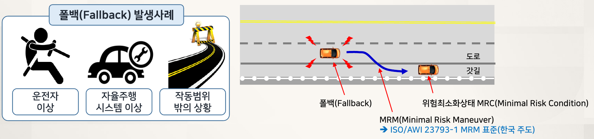

*Figure 1. Cases that trigger fallback and a minimal risk maneuver*

The key concept separating Level 3 and Level 4 is **fallback**. As on the left of Figure 1, fallback occurs when something is wrong with the driver, when something is wrong with the automated driving system, or when the vehicle meets a situation outside its operating range (ODD). The vehicle then performs a **minimal risk maneuver (MRM)** to reach a **minimal risk condition (MRC)**. The right of Figure 1 is an example of an MRM in which, after fallback occurs in the driving lane, the vehicle changes lanes, moves to the shoulder, and stops.

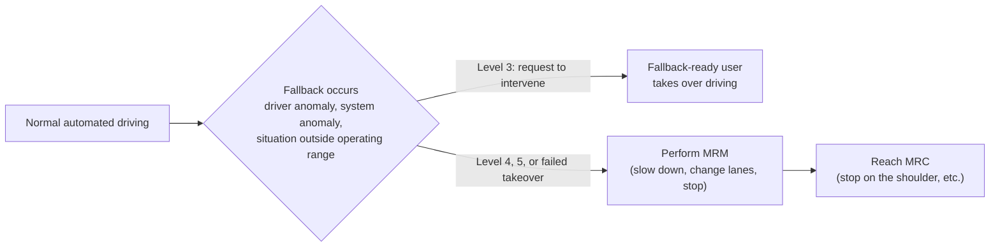

*Figure 2. From fallback through MRM to MRC*

At Level 3, when the system issues a request to intervene, the person in the driver's seat (the fallback-ready user) must take over driving. At Levels 4 and 5, takeover by a person is not assumed, and the system itself must perform an MRM to reach an MRC.

> **Note:** The international standard setting the minimum requirements for MRMs began, led by Korea, as the work item ISO/AWI 23793-1 and was published in 2024 as ISO 23793-1:2024 [4]. The standard defines a classification of MRMs and the control strategies and test requirements for the two simplest types, the straight stop (type 1) and the in-lane stop (type 2).

### 1.3 Summary of the Levels of Driving Automation

SAE J3016 defines the levels with the following terms [1].

> **Definition:** The **DDT (dynamic driving task)** is all of the real-time operational and tactical functions required to operate a vehicle on the road, excluding strategic functions such as trip planning.

> **Definition:** **OEDR (object and event detection and response)** is the subtask of the DDT that monitors surrounding objects and events and responds appropriately.

SAE J3016 also defines separate concepts for situations in which whoever is performing the DDT can no longer continue driving.

> **Definition:** The **DDT fallback** is the response that takes over the DDT or reaches an MRC when the system fails or leaves its ODD.

> **Definition:** The **DDT fallback-ready user** is the person who must be ready to respond to a request to intervene at Level 3.

<table>
<tr><th rowspan="2">Category</th><th rowspan="2">Level</th><th rowspan="2">Name</th><th rowspan="2">Narrative Definition</th><th colspan="2">DDT</th><th rowspan="2">DDT Fallback</th><th rowspan="2">ODD</th></tr>
<tr><th>Sustained lateral and longitudinal vehicle motion control</th><th>OEDR</th></tr>
<tr><td rowspan="3">Driver support (the driver performs part or all of the DDT)</td><td>0</td><td>No driving automation</td><td>The driver performs the entire DDT, even when enhanced by active safety systems</td><td>Driver</td><td>Driver</td><td>Driver</td><td>n/a</td></tr>
<tr><td>1</td><td>Driver assistance</td><td>The sustained and ODD-specific execution by a driving automation system of either the lateral or the longitudinal vehicle motion control subtask (but not both simultaneously), with the expectation that the driver performs the remainder of the DDT</td><td>Driver and system</td><td>Driver</td><td>Driver</td><td>Limited</td></tr>
<tr><td>2</td><td>Partial driving automation</td><td>The sustained and ODD-specific execution by a driving automation system of both the lateral and longitudinal vehicle motion control subtasks, with the expectation that the driver completes the OEDR subtask and supervises the system</td><td>System</td><td>Driver</td><td>Driver</td><td>Limited</td></tr>
<tr><td rowspan="3">Automated driving (the ADS performs the entire DDT while engaged)</td><td>3</td><td>Conditional driving automation</td><td>The sustained and ODD-specific performance by an ADS of the entire DDT, with the expectation that the fallback-ready user is receptive to requests to intervene issued by the ADS and to DDT-relevant failures in other vehicle systems</td><td>System</td><td>System</td><td>Fallback-ready user (becomes the driver during fallback)</td><td>Limited</td></tr>
<tr><td>4</td><td>High driving automation</td><td>The sustained and ODD-specific performance by an ADS of the entire DDT and DDT fallback, without any expectation that a user will respond to a request to intervene</td><td>System</td><td>System</td><td>System</td><td>Limited</td></tr>
<tr><td>5</td><td>Full driving automation</td><td>The sustained and unconditional (i.e., not ODD-specific) performance by an ADS of the entire DDT and DDT fallback, without any expectation that a user will respond to a request to intervene</td><td>System</td><td>System</td><td>System</td><td>Unlimited</td></tr>
</table>

*Table 2. Summary of the levels of driving automation*

Reading Table 2 column by column makes the differences between levels clear. Going from Level 1 to Level 2, motion control changes from being shared by driver and system to being done entirely by the system. Going from Level 2 to Level 3, OEDR, that is, monitoring the surroundings, passes to the system. Going from Level 3 to Level 4, the system also takes on the DDT fallback. Going from Level 4 to Level 5, the limit on the ODD disappears.

### 1.4 Sensor Configuration Outlook by Level

As the level rises, the system takes on more work, so the number and variety of required sensors also grow. Frost & Sullivan's 2018 outlook is shown in Table 3 [5].

| Sensor | Level 1 (2012) | Level 2 (2016) | Level 3 (2018) | Level 4 (2020) | Level 5 (2025) |
|:-----|:-----|:-----|:-----|:-----|:-----|
| Ultrasonic sensors | 4 | 8 | 8 | 8 | 8-10 |
| Long-range radar (LRR) | 1 | 1 | 2 | 2 | 2 |
| Short-range radar (SRR) | 2 | 2-4 | 4 | 4 | 4 |
| Camera or short-range LiDAR | 1 | 2-4 (camera) | | | |
| Long-range camera | | | 2 | 2/3 (stereo or trifocal) | 2/3 |
| Surround camera | | | 4 | 4 | 4 |
| Stereo camera | | | 1 | 1 | 2 |
| μbolo (thermal, infrared sensor) | | | 1 | 1 | 1/2 |
| LiDAR | | | 1 | 2/4 | 4 |
| Dead reckoning unit | | | 1 | 1 | 1 |
| Total | About 6.8 | About 17 | About 24-26 | About 25-28 | About 28-32 |
| Main function | Lateral or longitudinal assistance | Observation of the environment | Awareness for takeover | No driver interaction | No driver |

*Table 3. Outlook of the average number of sensors by level of automation*

> **Definition:** **Radar** is a sensor that emits radio waves to measure the distance and relative speed of objects.

> **Definition:** **μbolo** is short for microbolometer and refers to a thermal camera or infrared sensor for night vision.

> **Definition:** **Dead reckoning** is a method of estimating the current position by accumulating the distance and direction traveled from wheel speeds and inertial sensors. A value written with a slash, such as "2/3" in the table, means two or three.

Level 1 uses about 7 sensors, but Level 5 uses about 30, more than four times as many. In particular, LiDAR, surround cameras, and dead reckoning are added from Level 3, because from Level 3 the system takes on OEDR and must monitor all of its surroundings by itself. As sensors increase, the bandwidth demanded of the in-vehicle network that gathers sensor data also grows.

### 1.5 Platform Classification of Autonomous Vehicles

Frost & Sullivan divided autonomous vehicles into six platforms and summarized the evolution of each into current (2018), next-generation (2020-2025), and future (2030) stages [6].

| Platform | Current (2018) | Next Generation (2020-2025) | Future (2030) |
|:-----|:-----|:-----|:-----|
| Services | Level 2, 2+, and 3 functions for owned vehicles (highway assist, automatic lane change, valet parking) | Levels 3 and 4 for owned vehicles (automated highway driving, chauffeur and summon) and Level 4 for usership services (city pilot, geolocalized shuttles, taxis) | Level 5 development |
| Cloud | Data storage and annotation | Time-uncritical data processing (predictive sensing, V2I, V2P), convergence of in-vehicle and mapping data | Convergence of vehicle, map, and service data |
| Software | Deterministic software clusters for each ADAS application | AI for core autonomous driving software (object classification, path planning), together with deterministic software for time-critical computing | Driver health and wellbeing (fitness tracking, emergency services) |
| Hardware | Redundant, application-specific sensors (radar, camera, LiDAR, etc.) | Sensor fusion for all ADAS and autonomous driving functions and cross-redundancy between sensors (LiDAR and camera localization, radar and camera annotation) | Smart sensors and data fusion for low-latency, all-weather sensing |
| E/E | Individual ECUs per application, multiple protocols (CAN, LIN, FlexRay, Ethernet) | Consolidation of ECUs (ADAS ECU, infotainment ECU) and protocols (CAN FD, Ethernet) | E/E architecture combining centralization and decentralization (domain controllers, smart sensors) |
| Chassis | Modifying existing platforms to add redundancy | Dedicated mounting points for mechanical and electrical redundancy for Levels 3 and 4 | A flexible, scalable platform supporting all Levels 1-5 |

*Table 4. Evolution roadmap of autonomous vehicle platforms*

> **Definition:** **Deterministic software** always produces the same output for the same input within a fixed time. Learning-based AI recognizes well but its behavior is hard to predict fully, so deterministic software is used alongside it for functions with strict time constraints such as braking.

> **Definition:** **Redundancy** is a design that provides two or more parts or paths with the same role so that the function continues even if one fails.

The E/E row of Table 4 relates directly to vehicle communication. A structure that used separate ECUs and protocols for each function changes, through the consolidation of ECUs and protocols (CAN FD, Ethernet), into a structure centered on domain controllers. This change is revisited in Section 1.9.

### 1.6 Business Sectors of the Autonomous Vehicle Ecosystem

The business areas of the autonomous vehicle ecosystem can be divided into four sectors [6].

| Sector | Sub-area | Content |
|:-----|:-----|:-----|
| (1) Hardware | Sensors | Radar, LiDAR, cameras, etc. |
| (2) Software | In-car | Operating systems, middleware, APIs |
| (2) Software | Outside | V2X and V2V communication |
| (2) Software | AI | Artificial intelligence for perception and decision-making |
| (3) Cloud | Services | Autonomous driving and connectivity services |
| (3) Cloud | HD maps | High-definition maps |
| (4) Fleet management services | Fleet management | Car sharing, ride hailing, operations management |

*Table 5. The four business sectors of the autonomous vehicle ecosystem*

Automakers partner with different companies in each sector. For example, BMW was linked with hardware from HELLA, Innoviz, Continental, and Aptiv, AI and cloud from IBM Watson, HD maps from HERE, and mobility services such as Car2Go and ParkNow, and Google was linked with Velodyne's LiDAR, the software and HD maps of its subsidiary Waymo, and Uber's ride-hailing service. Ford was linked with hardware from Velodyne, Princeton Lightwave, Aptiv, and Continental, V2X from Autotalks, AI from Argo, HD maps from Civil Maps and DeepMap, and mobility services from Chariot and TransLoc. GM was linked with hardware from Veoneer, LG, and Strobe, software and HD maps from Cruise, outside-vehicle communication from OnStar, cloud from IBM Watson, and ride hailing and sharing from Lyft and Maven, and Volvo was linked with hardware from HELLA, Autoliv, Aptiv, and Veoneer, software from Zenuity, cloud from Cisco, HD maps from TomTom, and ride hailing from Uber and its automated driving pilot program DriveMe. Software, cloud, and fleet management services (sectors 2-4) lie outside the traditional domain of automakers and parts suppliers, and it is in these areas that new companies enter the ecosystem.

### 1.7 Big Tech Entering the Automotive Industry

U.S. big tech companies have begun moving to restructure the automotive ecosystem by taking control of future vehicle platforms such as sensors, semiconductors, software, and communication.

- **Intel, NVIDIA, Qualcomm, Microsoft, Amazon:** With enormous capital and software talent, they take control of high value-added semiconductors, AI, cloud, and services.
- **Incumbent automakers and parts suppliers:** Big tech pushes to restructure the ecosystem so that these companies remain in low value-added hardware.

| Company | Vehicles | Radar | Cameras | LiDAR | Chips | AV Machine Learning | AV Mapping |
|:-----|:-----:|:-----:|:-----:|:-----:|:-----:|:-----:|:-----:|
| GM | O | | | O | | O | |
| Ford | O | | | | | O | |
| Tesla | O | | | | O | O | |
| Luminar | | | | O | | | |
| Intel | | | O | | O | | |
| Nvidia | | | | | O | | |
| Waymo | | | | O | | O | O |
| Uber ATG | | | | | | O | |
| Carmera | | | | | | | O |

*Table 6. Areas in which U.S. companies participate in autonomous vehicle development (illustrative, not exhaustive)*

In Table 6, some companies such as Tesla and Waymo span several areas, while Intel and Nvidia concentrate on core components such as chips and cameras.

**The case of Intel.** Intel approached the automotive market in the following steps.

1. In March 2017 it acquired Mobileye, a camera company for autonomous driving, for USD 15.3 billion (about 17 trillion won at the time). Through Mobileye it pursues camera sensors and high-performance automotive processors (AP), and Mobileye's revenue in 2020 was USD 967 million [7]. The staff of the mega chip design center being built to develop semiconductors for autonomous vehicles numbers about 6,000.
2. It announced an investment of 110 trillion won to build two new semiconductor fabs in Europe that would mainly produce automotive chips. In September 2021, Intel CEO Pat Gelsinger forecast that semiconductors would grow from 4% of the bill of materials of a premium vehicle in 2019 to 12% in 2025 and 20% in 2030 [8]. Intel promotes an automated driving platform that spans the data center, 5G, HMI, and in-vehicle computing.
3. In February 2022 it formed a group dedicated to automotive within Intel Foundry Services (IFS). The group is responsible for the Open Central Compute Architecture, a computing platform on which automakers can build next-generation solutions; the Automotive-Grade Foundry Platform, manufacturing technology that satisfies automotive applications and customer requirements; and Transition to Advanced Technologies, providing design services and IP to help automakers move to advanced process and packaging technologies.

> **Definition:** An **AP (application processor)** is a high-performance processor that runs an operating system and complex applications.

> **Definition:** A **foundry** is a business that manufactures semiconductors designed by other companies on commission.

### 1.8 Comparing the Scale of Big Tech and Automakers

Big tech has huge market capitalization and enormous capacity to raise capital, and its profit margin relative to revenue is far higher than that of automakers. Comparing 2021 revenue and profit and market capitalization as of April 2022 gives Table 7 [9].

| Company | Type | Market Cap | Revenue | Operating Income | Margin in Source | Operating Income / Revenue (computed) |
|:-----|:-----|-----:|-----:|-----:|-----:|-----:|
| GM | Automaker | 58 | 127 | 9.3 | 7.9% | 7.3% |
| Toyota | Automaker | 274 | 245 | 22.8 | 10.0% | 9.3% |
| Volkswagen | Automaker | 99 | 250 | 20.7 | 5.9% | 8.3% |
| Hyundai Motor | Automaker | 42 | 96 | 5.4 | 5.6% | 5.6% |
| NXP | Automotive semiconductors | 44.6 | 11 | 2.6 | 16.9% | 23.6% |
| Tesla | Electric vehicles | 1,002 | 54 | 6.5 | 10.3% | 12.0% |
| Intel | Big tech | 184 | 79 | 19.5 | 25.1% | 24.7% |
| NVIDIA | Big tech | 533 | 17 | 4.5 | 36.2% | 26.5% |
| Qualcomm | Big tech | 154 | 34 | 9.8 | 26.8% | 28.8% |
| Microsoft | Big tech | 2,100 | 168 | 70 | 36.4% | 41.7% |

*Table 7. Market capitalization, revenue, and operating income of big tech and automakers (USD billion)*

> **Note:** For many companies, the "margin in source" in Table 7 does not equal operating income divided by revenue. For Microsoft, for example, $70 / 168 \approx 0.417$, but the source gives 36.4%. The source does not state how its margin is computed, and the last column is operating income divided by revenue. Either way, the conclusion that big tech's margins are higher than automakers' is the same.

By contrast, Korean parts suppliers have low profitability. The revenue of 110 Korean automotive parts suppliers was 70.6296 trillion won in 2020, and their average operating margin fell from 3.8% in 2019 to 2.8% in 2020. Large companies fell from 4.08% to 2.99%, and small and medium-sized companies from 2.02% to 1.34% [10]. The automotive industry is a pyramid with automakers at the top and tier-1 and tier-2 suppliers below, and margins are lower further down.

### 1.9 E/E Architecture and the SDV

> **Definition:** The **E/E (electrical/electronic) architecture** is the overall structure that determines how a vehicle's ECUs, sensors, actuators, wiring, communication networks, and power supply are placed and connected.

> **Definition:** An **MCU (microcontroller unit)** is a low-cost control chip that contains a processor, memory, and I/O on one chip.

The E/E architecture of the vehicle is evolving toward the **software-defined vehicle (SDV)**. As in Figure 3, the change can be divided into three stages.

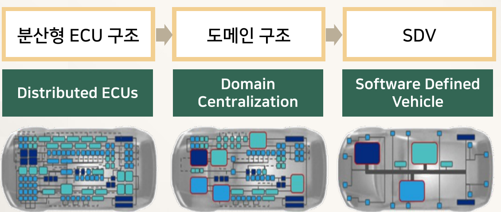

*Figure 3. Evolution from a distributed ECU architecture through a domain architecture to the SDV*

1. **Distributed ECUs:** One ECU is provided per function, so more than 100 small ECUs are scattered throughout the vehicle.
2. **Domain centralization:** A domain controller is provided for each functional area (domain), such as powertrain, chassis, body, infotainment, and ADAS, grouping the related ECUs.
3. **SDV:** A few high-performance central computers handle most functions in software, and functions are changed or added through OTA even after release.

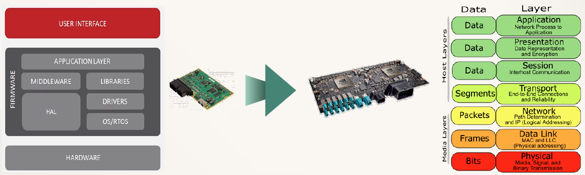

*Figure 4. The transition from low-speed MCU-based ECUs to high-performance AP-based computers and the software layers*

As in Figure 4, the transition to the SDV is a change from a system of about 100 low-cost, low-speed MCUs to a system of 3-5 high-performance APs. The software stack on the left stacks firmware (an operating system or RTOS, drivers, HAL, libraries, middleware, and the application layer) and a user interface on top of the hardware, and the right is the OSI reference model, which divides communication functions into seven layers. Because a high-performance AP handles many functions on one chip, the software on it must likewise be designed in layers to manage the complexity. The OSI model is covered in detail in Week 5.

> **Definition:** An **RTOS (real-time operating system)** guarantees that tasks finish within fixed time limits.

> **Definition:** A **HAL (hardware abstraction layer)** hides hardware differences so that the software above depends less on the hardware.

> **Definition:** **Middleware** is software between the operating system and applications that provides common functions such as communication and data management.

A change in E/E architecture is in fact a change in the supply structure.

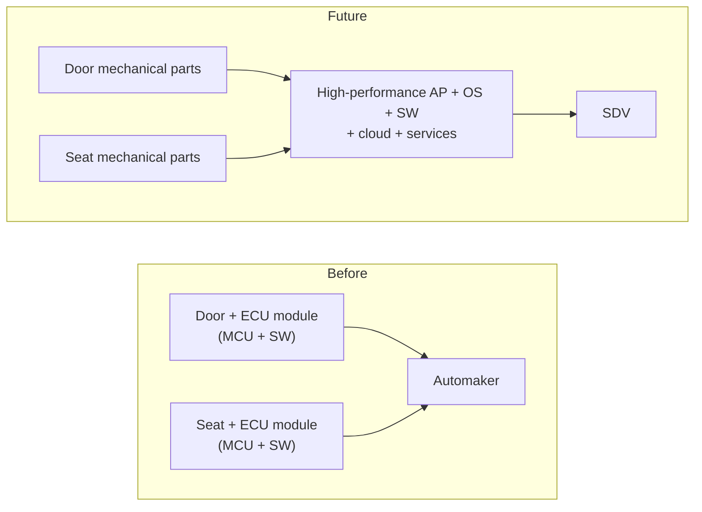

*Figure 5. Change in the supply structure caused by the change in E/E architecture*

- **Before:** Parts suppliers deliver door modules and seat modules that include ECUs with MCUs (chips from Renesas, NXP, Infineon, etc.) and software built into the parts.
- **Future:** Parts suppliers deliver only mechanical parts, and the automaker controls them with a central computer equipped with high-performance APs (chips from Qualcomm, NVIDIA, Intel and software from Google, Microsoft, etc.).

As a result, parts companies risk being pushed into low-margin businesses that exclude software, semiconductors, and service platforms. The low margins of parts suppliers seen in Section 1.8 become a bigger problem amid this structural change.

---

 

## 2. Autonomous Driving Architecture: A Case Study of Developing Automated Driving Parts and Systems for Large Buses

This section uses the project for developing automated driving parts and systems for large buses, led by the Korea Automotive Technology Institute (KATECH), as a case study of which parts and networks make up a real automated driving system.

### 2.1 Overview of the Project

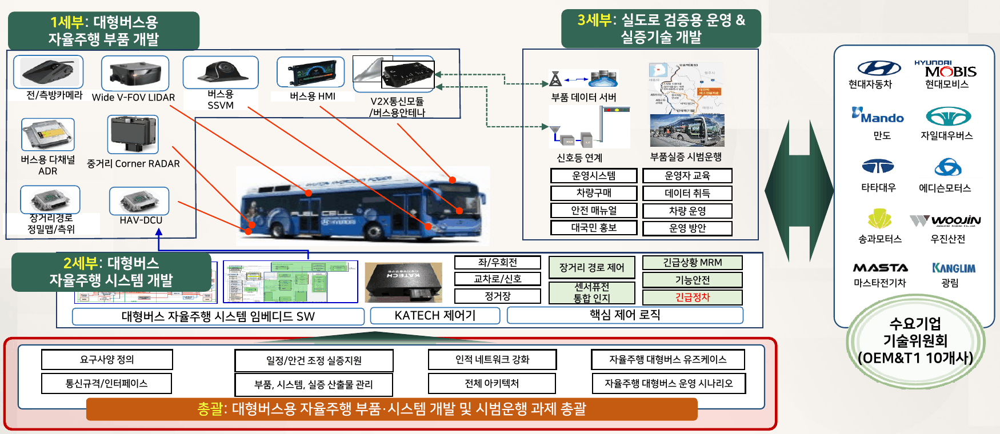

*Figure 6. Structure of the project for developing automated driving parts and systems for large buses*

The project develops automated driving components and systems for large buses and runs pilot operations of eco-friendly hydrogen automated buses, and it consists of three sub-projects and an overall coordination part.

| Component | Content |
|:-----|:-----|
| Sub-project 1: automated driving parts for large buses | Front and side cameras, a LiDAR with a wide vertical field of view (Wide V-FOV LIDAR), a bus SSVM, a bus HMI, a V2X communication module and bus antenna, a multichannel ADR for buses, a mid-range corner radar, HD maps and positioning for long routes, and the automated driving domain controller (HAV-DCU) |
| Sub-project 2: automated driving system for large buses | Embedded software of the large-bus automated driving system, the KATECH controller, core control logic (left and right turns, intersections and signals, stops, long-route control, sensor fusion and integrated perception, emergency MRM, functional safety, emergency stops) |
| Sub-project 3: operation and demonstration technology for real-road verification | Parts data server, traffic signal linkage, operating system, vehicle purchase, safety manual, public relations, operator training, data acquisition, vehicle operation, operation plan |
| Overall coordination | Requirements definition, communication specifications and interfaces, scheduling and agenda coordination, demonstration support, management of parts, system, and demonstration deliverables, strengthening the human network, overall architecture, use cases and operation scenarios of automated large buses |

*Table 8. Structure of the automated large-bus project*

> **Definition:** An **SSVM (smart surround view monitoring)** system combines images from several cameras around the vehicle into a top-down view.

> **Definition:** An **HMI (human-machine interface)** is the display and controls through which the driver and the system exchange information.

Whereas SSVM and HMI are devices that the driver sees, the following two devices record and process driving data inside the vehicle.

> **Definition:** An **ADR** is a device that records driving data including camera video.

> **Definition:** The **HAV-DCU** is the integrated controller (domain control unit) responsible for perception and decision-making in a highly automated vehicle.

A **demand-company technical committee** of ten automakers and tier-1 suppliers, Hyundai Motor, Hyundai Mobis, Mando, Zyle Daewoo Bus, Tata Daewoo, Edison Motors, Songgwa Motors, Woojin Industrial Systems, Master Electric Vehicle, and Kwanglim, took part in the project and reviewed the development results.

The developed parts and systems were verified in the following order.

```mermaid
flowchart LR
    A["Parts specification"] --> B["System specification"] --> C["Unit test<br/>of parts"] --> D["Function test of<br/>mounted parts"] --> E["System integration<br/>evaluation"]
    E --> F["Vehicle integration<br/>evaluation"] --> G["Commercial vehicle<br/>PG evaluation"] --> H["Real-road<br/>driving evaluation"] --> I["Real-route<br/>operation test"] --> J["Real-route<br/>pilot operation"]
```

*Figure 7. Verification stages of automated driving parts and systems for large buses*

Starting from testing each part on its own, the verification checks the functions of mounted parts, system integration, and vehicle integration in turn, and then widens the scope to the proving ground (PG), real roads, and real bus routes. The vehicle has an ADASIS 3.0 interface that delivers map data and an edge data logger that collects driving data, and the control server and parts data server receive the data for parts data analysis and verification of the system's functional safety.

### 2.2 Parts and Applications for Passenger Cars and Heavy Vehicles

| Item | Automated Driving Parts for Passenger Cars | Automated Driving Parts for Heavy Vehicles |
|:-----|:-----|:-----|
| Government program | Autonomous driving core technology development program (government 78 billion won, 2017-2021) | Automated driving parts and systems for large buses (government 21.7 billion won, 2019-2021) |
| Main parts | Front camera, V2X communication module, ADR, LiDAR, DCU, HMI | Front camera, V2X communication module, ADR, radar, DCU, SSVM |
| Vehicle platforms | Mass-produced vehicles of automakers, on-demand automated vehicles | Automated small trucks, minibuses, large trucks, large buses |
| Services | Automated taxis, car sharing, mobility for the disabled and elderly | Automated delivery, mobile restaurants, shuttle buses, on-demand shops, truck platooning, route buses, multimodal public transport |

*Table 9. Automated driving parts and applications for passenger cars and heavy vehicles*

> **Definition:** **Platooning** is a driving mode in which several trucks travel in a line at short gaps, coordinating acceleration and braking through V2V communication.

> **Definition:** **Multimodal public transport** is public transport that links several modes such as buses, rail, and shared vehicles.

### 2.3 Main Parts

- **A.I.Matics:** Developed a set of front, front-side, and rear cameras for heavy vehicles. A large bus is long and tall, so its blind spots are wider than those of a passenger car, and cameras facing several directions are needed.
- **Wise Automotive:** Developed an SSVM for heavy vehicles. It combines the camera images around the body into a top-down view of the whole bus.

### 2.4 Sensor Layout

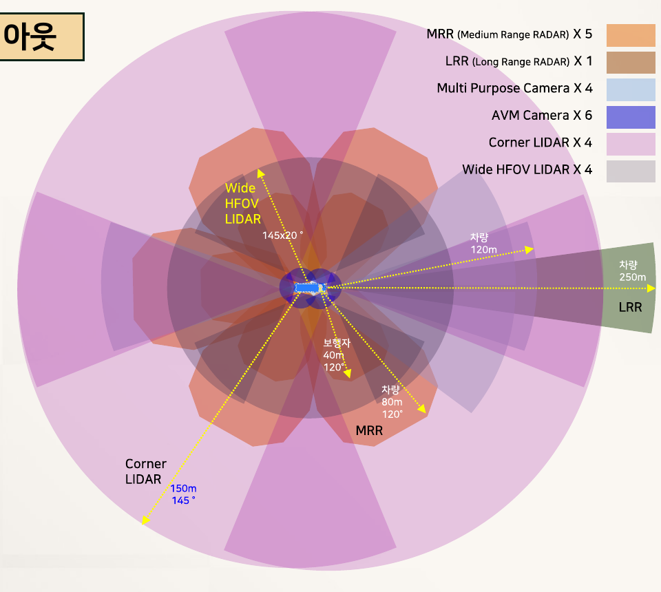

*Figure 8. Sensor placement and detection ranges of the large bus*

| Sensor | Quantity | Detection Range |
|:-----|-----:|:-----|
| Medium range radar (MRR) | 5 | Vehicles 80 m, pedestrians 40 m, field of view 120° |
| Long range radar (LRR) | 1 | Vehicles 250 m |
| Multi purpose camera | 4 | Vehicles 120 m |
| AVM camera | 6 | Immediate surroundings of the vehicle |
| Corner LIDAR | 4 | 150 m, field of view 145° |
| Wide HFOV LIDAR | 4 | Horizontal field of view 145°, vertical field of view 20° |

*Table 10. Sensor configuration of the large bus*

In Figure 8 the bus is the small rectangle in the middle, and the colored sectors and circles are the detection areas of the sensors. The long-range radar sees farthest ahead (250 m), the corner LiDARs see widely from the four corners of the body, and the AVM (around view monitoring) cameras cover the blind spots right around the body. Because sensors based on different principles cover the same areas, other sensors compensate when one sensor fails or its performance drops in bad weather. The sensor layout (Figure 8) draws the wide field-of-view LiDARs as four horizontal-FOV (HFOV) units, while the network topology (Figure 9) draws them as three vertical-FOV (VFOV) units (front, left, right).

### 2.5 The System Architecture Design Document

The automated driving system architecture design document was prepared in the following order.

1. **Selection of the parts needed for automated driving:** Ten parts to be developed for automated driving were selected (front and side cameras, bus SSVM, HAV-DCU, HD maps and positioning for long routes, multichannel ADR for buses, Wide V-FOV LiDAR, V2X communication module and bus antenna, bus HMI, mid-range corner radar, ESU), and eight parts to be redesigned for automated driving were determined.
2. **Definition of requirements for large-bus parts:** Functional requirements (15 for the 10 developed parts), quality requirements (3, including safety design goals), interface requirements (11, including power and power consumption), and constraints (software, hardware, and physical constraints) were defined.
3. **Definition of interfaces between parts:** The interfaces of the in-vehicle network and the infrastructure-linked network were defined.
4. **Collection of review comments from the demand-company technical committee:** Five of the seven comments (major items) were accepted.

The accepted review comments include the following.

- Establish and verify ASIL criteria to verify safety.
- Supplement the system verification method for synchronized communication data.
- Since remote stop is a critical switch, apply safety measures so that it never malfunctions.
- Since high temperatures in major electrical components and overvoltage in the battery, reversing system, or auxiliary systems can cause unintended acceleration or deceleration, reflect safety design and redundant design against them.

> **Definition:** **ASIL (Automotive Safety Integrity Level)** is the safety integrity level defined by the automotive functional safety standard ISO 26262, rated from A (lowest) to D (highest) according to the severity, exposure, and controllability of the hazard a failure can cause. The higher the level, the stricter the required design and verification.

### 2.6 Network and Power Architecture

Designing an automated driving system requires the following four design documents.

1. **Network architecture:** Determines which device is connected to which network (CAN, CAN FD, Ethernet, etc.). In this project, the message databases (DB) of CAN, CAN FD, and Ethernet were integrated, and sensor diagnostics and safety algorithms were designed together.
2. **SW component architecture:** Determines into which components the software is divided and how they exchange data.
3. **Physical architecture:** Determines where on the body the parts are mounted and how the wiring is routed.
4. **Power architecture:** Determines how power is supplied to and protected for each part. The power network of this project was designed so that when the power switch is turned on, it checks the automated driving system mode, supplies power to the automated driving parts in order of priority, then diagnoses the sensors, and if there is a fault, attempts recovery or cuts power and delivers an error message.

The detailed drawings of the network and power architectures are classified material.

### 2.7 Network Topology

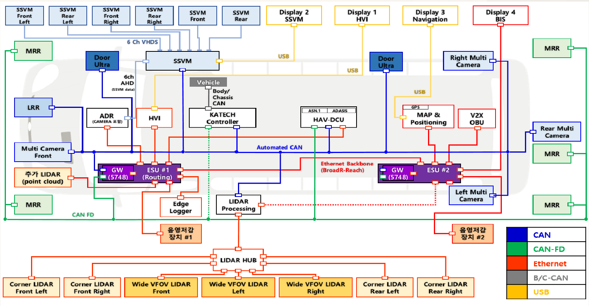

*Figure 9. Network topology of the large-bus automated driving system*

Figure 9 distinguishes the types of network by line color. Blue is CAN, green is CAN FD, red is Ethernet, gray is the vehicle's body and chassis CAN (B/C-CAN), and yellow is USB.

> **Definition:** **BroadR-Reach** is an automotive Ethernet technology that transmits 100 Mbit/s over a single twisted pair and was standardized as IEEE 802.3bw (100BASE-T1) [11].

| Area | Components and Connections |
|:-----|:-----|
| Center | Two gateways (GW) and routing units (ESU #1, ESU #2) are connected by an Ethernet backbone (BroadR-Reach) and gather and forward the data of each network. |
| CAN (Automated CAN) | Front, rear, left, and right multi-purpose cameras, long-range radar (LRR), left and right door ultrasonic sensors, SSVM, KATECH controller, HAV-DCU, LiDAR processing unit, both GWs |
| CAN FD | Five medium-range radars (MRR), HAV-DCU, both GWs |
| Ethernet | Four corner LiDARs (front left and right, rear left and right) and three Wide VFOV LiDARs (front, left, right) connected to the LiDAR hub, the LiDAR processing unit, an additional LiDAR (point cloud), ADR, HVI, HAV-DCU, the map and positioning unit (GPS), V2X OBU, Display 4 (BIS), the edge logger, two shadow reduction devices |
| Video and USB | Six SSVM cameras (front left and right, rear left and right, front, rear) are connected to the SSVM with six-channel video, and the SSVM is connected to the ADR with six-channel AHD video (SSVM data). Displays 1 (HVI), 2 (SSVM), and 3 (navigation) are connected by USB to the HVI, the SSVM, and the map and positioning unit, respectively. |
| Vehicle | The KATECH controller is connected to the vehicle's body and chassis CAN and controls the actual vehicle. |

*Table 11. Components of the large-bus network topology*

> **Definition:** **HVI (human-vehicle interface)** is used with the same meaning as HMI.

> **Definition:** An **OBU (on-board unit)** is the in-vehicle device responsible for V2X communication.

> **Definition:** A **BIS (bus information system)** shows bus operation information to passengers.

In Figure 9 the HAV-DCU has two processing blocks attached, ASN.1 and ADASIS. **ASN.1 (Abstract Syntax Notation One)** is a notation for defining and encoding the structure of V2X messages, and the V2X messages of SAE J2735 are encoded in this way [12]. **ADASIS (ADAS Interface Specification)** is a standard interface that delivers map data to ADAS controllers in the form of information about the road ahead of the vehicle (the electronic horizon) [13]. In other words, the HAV-DCU interprets messages received over V2X and map information and uses them for decisions. V2X messages are covered in Week 11.

It is worth noting that the networks are divided according to data volume. Large data such as the LiDAR point cloud is sent over Ethernet, medium-sized data such as radar object information over CAN FD, and small data such as control commands and status information over CAN. This reflects in the network design the differences in sensor data volume seen in Week 1.

### 2.8 The Automotive CAN Network

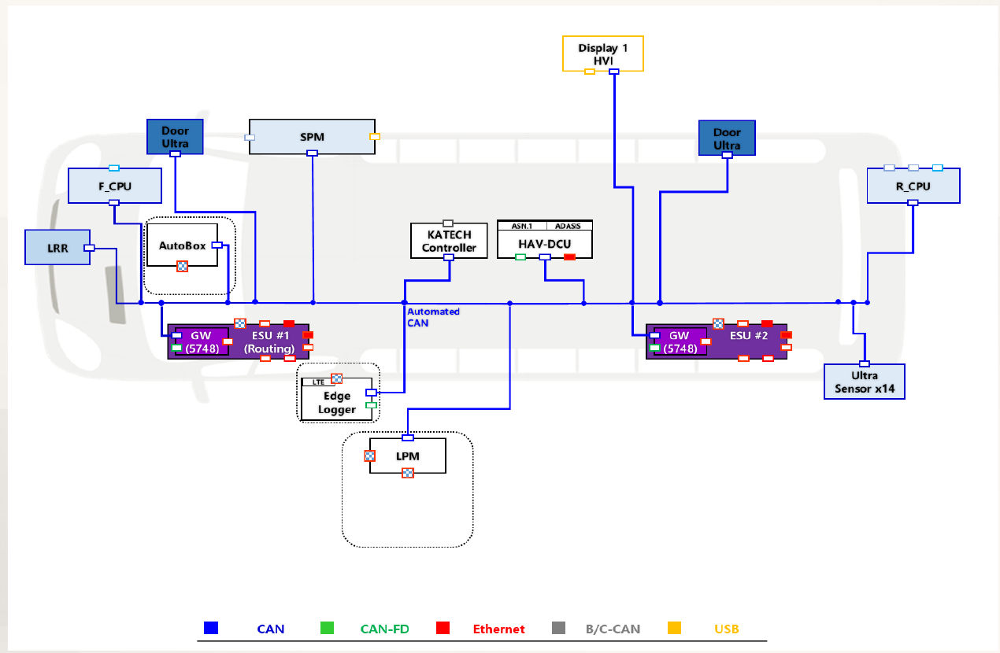

*Figure 10. Connections of the CAN for automated driving (Automated CAN)*

Figure 10 extracts from Figure 9 only the devices connected to the CAN for automated driving (Automated CAN, blue) and draws them on the body. A single CAN bus runs the length of the bus from front to back, and the front CPU (F_CPU) and rear CPU (R_CPU), the test vehicle control computer (AutoBox), the SPM, the ultrasonic sensors of the left and right doors, the long-range radar, the KATECH controller, the HAV-DCU, the two GWs and ESUs, the edge logger (including LTE communication), the LiDAR processing module (LPM), and fourteen ultrasonic sensors are all connected to this bus. Display 1 (HVI) is also connected to the bus. Connecting the devices of a long large bus with a single CAN bus is a real application of the bus topology and termination resistors covered in Week 3.

### 2.9 System Context Diagram

> **Definition:** A **system context diagram** places the system being designed in the center and shows the external elements that exchange information with it and the flows of data. It is used to define the boundary of the system.

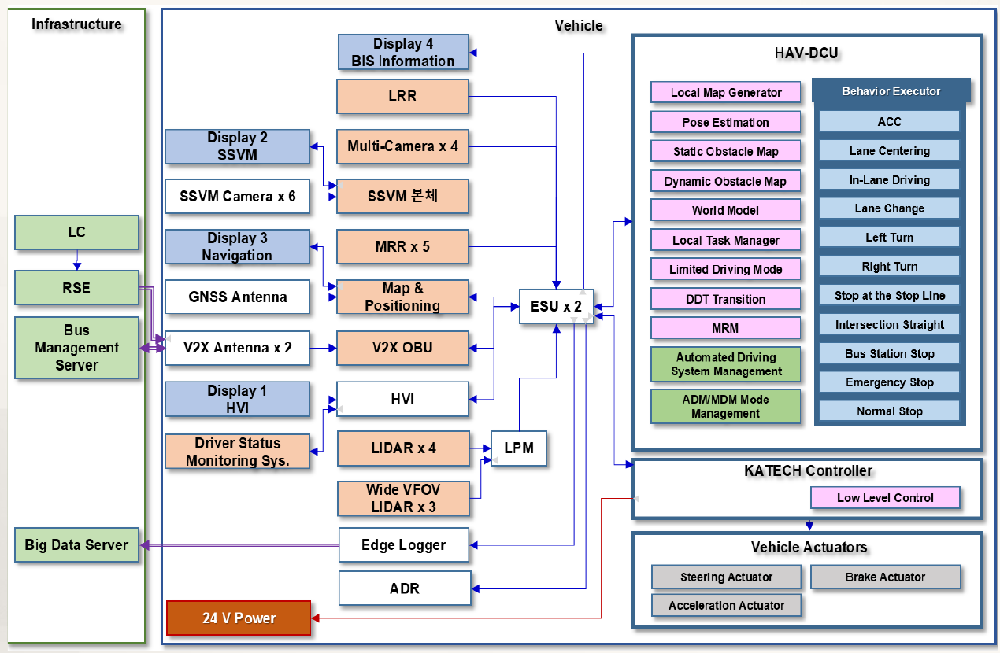

*Figure 11. Context diagram of the large-bus automated driving system*

The left of Figure 11 is the **infrastructure**: the signal controller (LC, local controller), roadside equipment (RSE), the bus management server, and the big data server. The right is the **vehicle**, in which the following elements are connected.

- **Input devices:** Display 2 (SSVM), six SSVM cameras, Display 3 (navigation), GNSS antenna, two V2X antennas, Display 1 (HVI), driver status monitoring system, long-range radar, four multi-purpose cameras, SSVM main unit, five medium-range radars, map and positioning unit, V2X OBU, HVI, four LiDARs and three Wide VFOV LiDARs (connected through the LiDAR processing module LPM), edge logger, ADR, 24 V power.
- **Two ESUs:** Gather the data of the input devices and forward it to the HAV-DCU.
- **HAV-DCU:** Has the functions of local map generation, pose estimation, static obstacle map, dynamic obstacle map, world model, local task management, limited driving mode, DDT transition, MRM, automated driving system management, and automated and manual driving mode (ADM/MDM) management, and a behavior executor that carries out the decisions.
- **Behaviors of the behavior executor:** Adaptive cruise control (ACC), lane centering, in-lane driving, lane change, left turn, right turn, stop at the stop line, intersection straight, bus station stop, emergency stop, normal stop.
- **KATECH controller:** Handles low-level control, converting the commands of the HAV-DCU into actual actuator commands.
- **Vehicle actuators:** Steering actuator, brake actuator, acceleration actuator.

Data from the edge logger is uploaded to the big data server in the infrastructure, and the V2X OBU communicates with the signal controller and roadside equipment of the infrastructure.

### 2.10 System Architecture

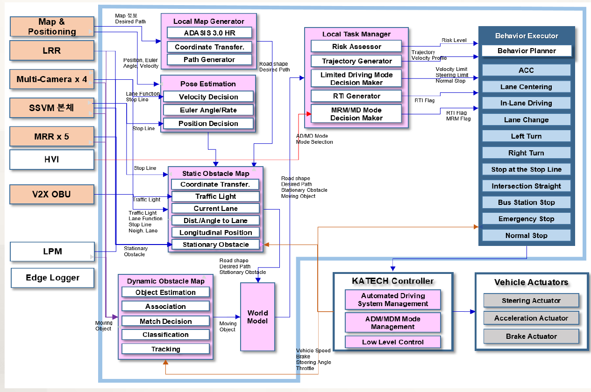

*Figure 12. Software architecture of the large-bus automated driving system*

Figure 12 shows in detail the software components inside the HAV-DCU and the data flows between them. Simplified, the flow is as in Figure 13.

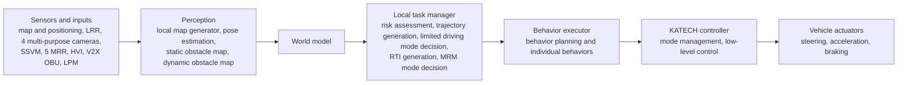

*Figure 13. Data flow of the large-bus automated driving software*

| Component | Sub-functions | Role |
|:-----|:-----|:-----|
| Local map generator | ADASIS 3.0 HR, coordinate transformation, path generator | Builds the road geometry around the vehicle and the target path from the HD map. |
| Pose estimation | Velocity decision, Euler angles and rates, position decision | Estimates the vehicle's position, velocity, and attitude (Euler angles). |
| Static obstacle map | Coordinate transformation, traffic light, current lane, distance and angle to lane, longitudinal position, stationary obstacles | Organizes the non-moving environment (lanes, signals, stationary objects). |
| Dynamic obstacle map | Object estimation, association, match decision, classification, tracking | Associates moving objects across sensors, classifies them, and tracks them. |
| World model | | Combines the above information into an integrated model of the world around the vehicle. |
| Local task manager | Risk assessor, trajectory generator, limited driving mode decision maker, RTI generator, MRM/MD mode decision maker | Assesses risk, generates trajectories, and decides whether a request to intervene or an MRM is needed. |
| Behavior executor | Behavior planner and ACC, lane keeping, lane change, turns, stops, etc. | Carries out the decided behavior as concrete driving actions. |
| KATECH controller | Automated driving system management, ADM/MDM mode management, low-level control | Produces vehicle speed, braking, steering angle, and throttle commands and sends them to the actuators. |

*Table 12. Components of the large-bus automated driving software*

> **Definition:** **RTI (request to intervene)** is the SAE J3016 request by which a Level 3 system tells the fallback-ready user to take over driving. It is different from the RTI (road traffic information) in the Volvo case of Section 3.8.

> **Definition:** **Euler angles** represent the attitude of an object by three angles, roll, pitch, and yaw.

This structure follows the typical flow of automated driving software from perception through decision-making to control. Each component can run on a different ECU or process, so the data flows between components become the requirements of the network design (Section 2.7).

---

 

## 3. Evolution of Vehicle Networks: IVN and X-by-wire

### 3.1 Electrical Functions of a Vehicle

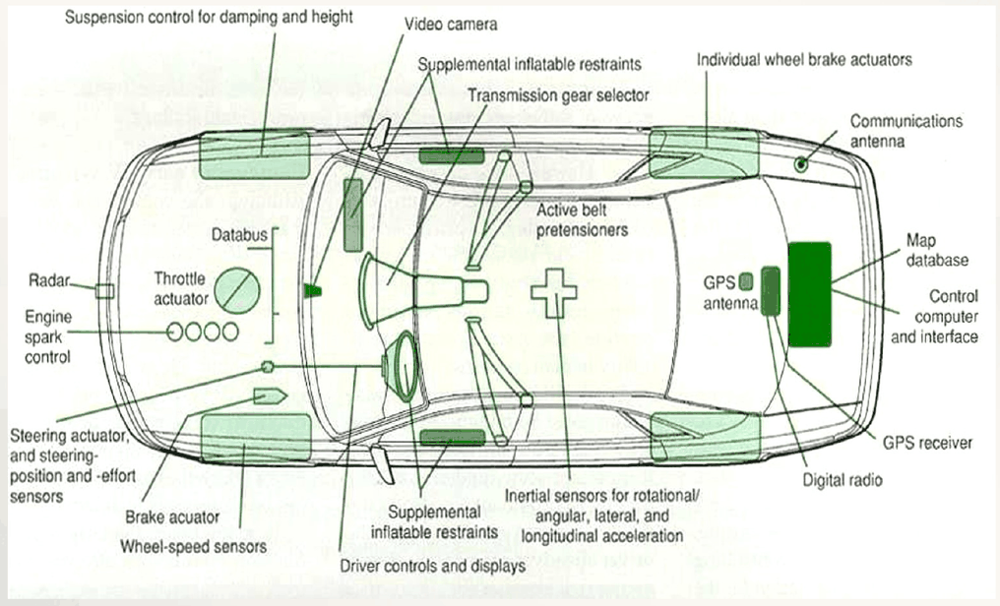

*Figure 14. Basic electrical functions of a vehicle*

Figure 14 shows the electrical functions placed throughout the vehicle: suspension control for damping and height, a video camera, supplemental inflatable restraints (airbags), the transmission gear selector, individual wheel brake actuators, a communications antenna, active belt pretensioners, a databus, the throttle actuator, radar, engine spark control, a GPS antenna and receiver, a map database, a control computer and interface, a steering actuator with steering position and effort sensors, a brake actuator, wheel-speed sensors, inertial sensors for rotational, lateral, and longitudinal acceleration, driver controls and displays, and a digital radio. These functions can in turn be grouped into safety functions and infotainment functions.

| Category | Electrical Functions |
|:-----|:-----|
| Safety functions | Infrared video camera for vision enhancement, lane detection video camera, remote keyless entry receiver, side vehicle detectors, communication antenna for intersection, crosswalk, and location-specific alerts and warnings, two-way digital radio, forward obstacle detector and adaptive cruise control, rear obstacle detector, safety event recorder, inertial sensors for crash severity, integrated cellular phone, throttle, steering, and brake actuators |
| Infotainment functions | Passenger video display, multimedia processor, ITS gateway, rear-seat displays, multichannel antenna and receiver, speech recognition and synthesis, onboard media playback device (CD, DVD), DSRC toll tag, reconfigurable conventional and head-up display |

*Table 13. Safety and infotainment functions of a vehicle*

Because these many functions must exchange information with each other, how to connect them becomes a central problem of vehicle design.

### 3.2 Point-to-Point Wiring and Its Problems

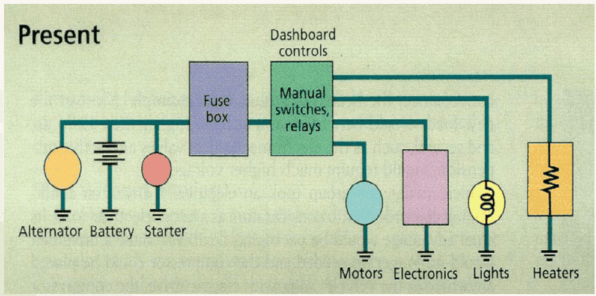

*Figure 15. Point-to-point wiring in the analog era*

Wiring in the analog era was **point-to-point**. As in Figure 15, power from the alternator, battery, and starter goes through the fuse box to the manual switches and relays of the dashboard, and from there a separate wire runs to each load such as motors, electronics, lights, and heaters. Turning on a switch lets current flow through that wire and operates the load, so each function needs its own wire.

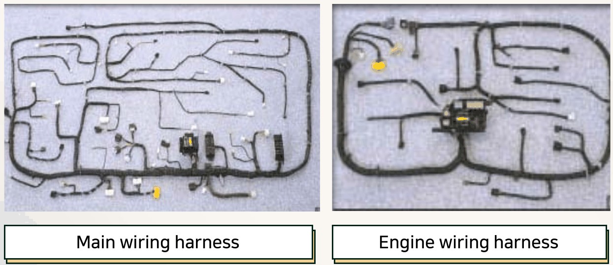

*Figure 16. The wiring harnesses of an Avante vehicle*

Figure 16 shows the main wiring harness and the engine wiring harness of a real vehicle (Avante). With point-to-point wiring, engine control, ABS, lighting, air conditioning, power locks, airbags, power windows, power seats, active suspension, transmission control, and the dashboard are connected by wires tangled like a spider's web in order to exchange information. The problems of analog wiring are as follows.

1. Production costs and defect rates increase.
2. Vehicle weight increases, and fuel economy worsens accordingly.
3. Lack of space makes design and installation difficult.
4. There is little flexibility for design changes.
5. Faults in the electrical system are hard to diagnose and locate.

### 3.3 The Concept of an IVN

An **IVN (in-vehicle network)** applies a communication network to the vehicle. Instead of a separate wire for each function, it has the following three characteristics.

- **A communication network is applied to the vehicle:** ECUs form a network through which they exchange messages.
- **Digital serial communication is used:** Information is converted into bits of 0 and 1 and sent one after another over a single line.
- **The communication medium is shared:** Several ECUs use the same wires together.

> **Definition:** **Serial communication** sends data one bit at a time over one line. Serial communication uses fewer wires and suits environments such as vehicles where wiring must be reduced.

> **Definition:** **Parallel communication** sends several bits simultaneously over several lines.

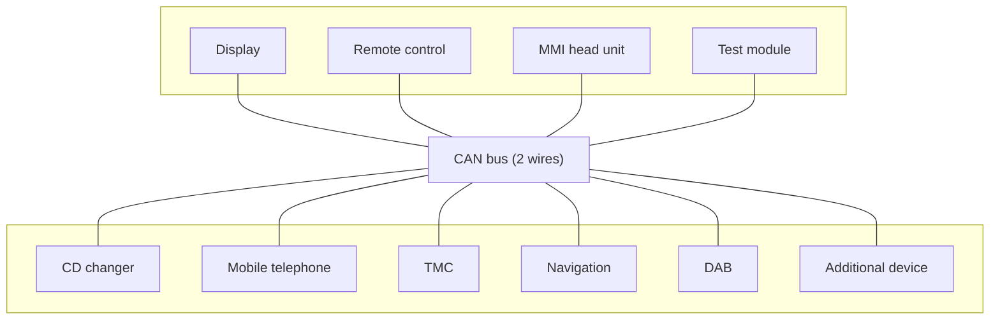

*Figure 17. Infotainment devices sharing a CAN bus*

In Figure 17, the display, remote control, MMI head unit, test module, CD changer, mobile telephone, traffic information receiver (TMC), navigation, and digital radio (DAB) are all connected to a single CAN bus with two wires. Adding a new device also requires only connecting two wires to the bus.

> **Definition:** **TMC (Traffic Message Channel)** is a service that carries traffic information on FM radio signals.

> **Definition:** **DAB (Digital Audio Broadcasting)** is digital radio broadcasting.

### 3.4 Evolution of Network Methods

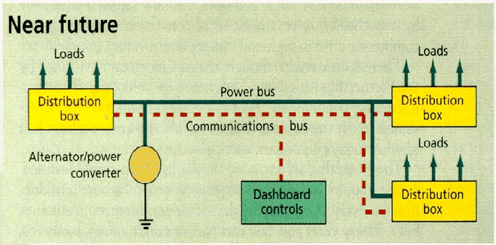

*Figure 18. The near-future connection method: power bus and communications bus*

Recent vehicles have evolved into the network method shown in Figure 18. Power from the alternator and power converter runs along the **power bus** to several distribution boxes, and each distribution box divides power among the loads around it. Switch signals from the dashboard travel along the **communications bus** shown as a dashed line to the distribution boxes, which turn the corresponding loads on and off according to those commands. Power lines and signal lines are separated, and the signals share a single communications bus.

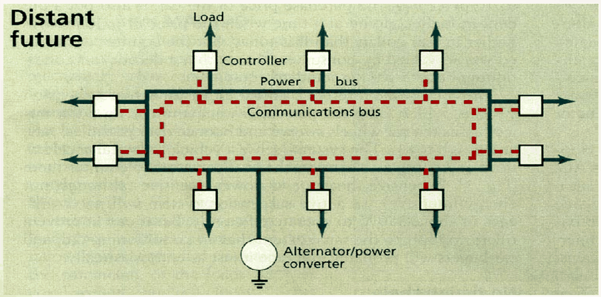

*Figure 19. The distant-future connection method: ring-shaped power bus and communications bus*

The future connection method, as in Figure 19, is a structure in which the power bus and communications bus encircle the body in a ring and a small controller is placed next to each load to receive power and commands directly from the buses. Distribution boxes disappear and each load gets its own controller, so loads are easy to add or move and the wiring is shortest.

### 3.5 Advantages of IVNs

In-vehicle networks have the following advantages.

1. Wiring in the vehicle is reduced.
2. Electrical systems can be installed easily.
3. The reliability of the overall system improves.
4. Electrical systems can be designed flexibly.
5. Maintenance and repair are easy.
6. Functions required by emission regulations (precise coordinated control and diagnosis of the engine, transmission, and exhaust system) can be satisfied.

### 3.6 IVN Application Case: Daimler

**Daimler-Chrysler (now the Mercedes-Benz Group)** was the first to apply CAN to engine management, and today it installs CAN in most of its passenger cars and trucks. CAN is a serial bus that Bosch introduced in 1986, and Mercedes-Benz has used CAN in its upper-class passenger cars since 1991 [14].

The 1995 **Vario Research Car** was a concept car that could be converted into a sedan, wagon, convertible, or pickup in 15 minutes by swapping only body parts. For the electrical functions to work even when body parts are swapped, the connections between parts must be standardized as a network.

Daimler also studied the concept of **drive-by-wire**, which removes the steering wheel and pedals. It transmits the driver's operations as electrical signals instead of through mechanical linkages, and its generalization is the X-by-wire of Section 3.7.

### 3.7 X-by-wire: FBW, SBW, BBW

> **Definition:** **X-by-wire** is technology that performs operations (X) such as steering, braking, and acceleration with electrical signals carried over wires and electronic control instead of mechanical or hydraulic linkages. Sensors read the driver's operations and convert them into signals, and actuators execute the commands computed by controllers.

**FBW (fly-by-wire).** By-wire systems began in aircraft. FBW replaced the cables and hydraulic lines connecting an aircraft's control stick and control surfaces (the movable surfaces of the wings) with wires and flight control computers. The F-16 fighter is a representative aircraft mass-produced with FBW applied throughout, and NASA's F-8 was an aircraft used to test digital FBW.

> **Note:** The first aircraft to fly with digital FBW alone, without mechanical backup, was NASA's F-8 DFBW (Digital Fly-By-Wire), which first flew in May 1972, and it was also used to test the sidestick controller used in the F-16 [15].

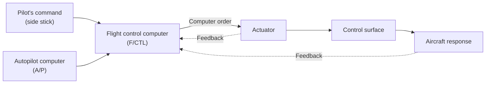

*Figure 20. Structure of a fly-by-wire system*

As in Figure 20, in FBW the commands the pilot gives with the side stick and the commands of the autopilot computer go into the flight control computer. The flight control computer computes the commands and moves the actuators, the actuators move the control surfaces, and the aircraft responds. The positions of the actuators and the response of the aircraft are fed back to the computer (feedback) to reduce the difference between the command and the actual motion.

**SBW (steer-by-wire).** By-wire applied to the steering of a car.

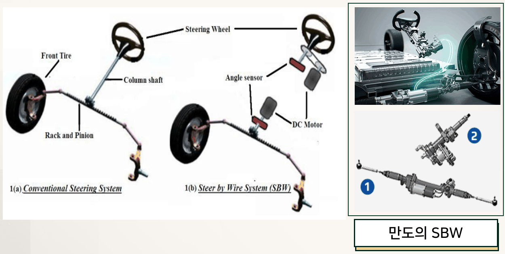

*Figure 21. Comparison of a conventional steering system and SBW*

In the conventional steering system on the left of Figure 21, the rotation of the steering wheel is transmitted through the column shaft to the rack and pinion, which turns the front wheels. The SBW in the middle has no column shaft. The angle sensor of the steering wheel reads the rotation angle and sends it as a signal, and a DC motor moves the rack according to the command computed by the controller, turning the wheels. A motor is also placed on the steering wheel side to convey the road reaction force to the driver. The right is the SBW developed by the Korean parts supplier Mando.

**BBW (brake-by-wire).** By-wire applied to braking. Instead of transmitting the force on the brake pedal directly through hydraulics, sensors read the pedal's movement and an electronic control unit determines the braking force at each wheel. Mando's BBW configuration includes an integrated dynamic brake (IDB), an electronic parking brake with a motor on the caliper (MoC), ABS and ESC, caliper brakes, and a premium caliper with an emphasis on design.

| System | Target | Mechanical Linkage Removed | Signal Flow |
|:-----|:-----|:-----|:-----|
| FBW | Aircraft control | Cables and hydraulic lines between the control stick and control surfaces | Side stick → flight control computer → actuator → control surface |
| SBW | Car steering | Column shaft between the steering wheel and the rack | Angle sensor → controller → steering motor → rack and wheels |
| BBW | Car braking | Direct hydraulic link between pedal and brakes | Pedal sensor → controller → electronic brake unit → wheels |

*Table 14. Comparison of FBW, SBW, and BBW*

Because X-by-wire has no mechanical linkage, layout is free and it is easy for an automated driving system to control steering and braking directly. On the other hand, if the electrical signals or controllers fail, the operation itself becomes impossible, so power, communication, and controllers must be made redundant and a network that guarantees fault tolerance and temporal determinism is needed. FlexRay, seen in Week 1, is a network designed for X-by-wire.

### 3.8 IVN Application Case: Volvo S80

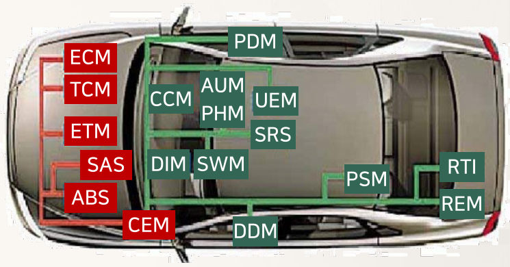

*Figure 22. The two CAN buses of the Volvo S80 and the connected modules*

The Volvo S80 uses two CAN buses with different speeds. In Figure 22, red is the 250 kbit/s high-speed bus (red bus), and green is the 125 kbit/s low-speed bus (green bus).

| Bus | Abbreviation | Name | Role |
|:-----|:-----|:-----|:-----|
| High speed (250 kbit/s) | ECM | Engine Control Module | Engine control |
| High speed (250 kbit/s) | ETM | Electronic Throttle Module | Electronic throttle control |
| High speed (250 kbit/s) | TCM | Transmission Control Module | Transmission control |
| High speed (250 kbit/s) | SAS | Steering Angle Sensor | Steering angle measurement |
| High speed (250 kbit/s) | ABS | Antilock Braking System | Anti-lock braking |
| Both buses | CEM | Central Electronic Module | Gateway connecting the two buses |
| Low speed (125 kbit/s) | AUM | Audio Module | Audio |
| Low speed (125 kbit/s) | CCM | Climate Control Module | Climate control |
| Low speed (125 kbit/s) | DDM, PDM | Driver, Passenger Door Module | Driver and passenger doors |
| Low speed (125 kbit/s) | PHM | Phone Module | Telephone |
| Low speed (125 kbit/s) | PSM | Power Seat Module | Power seats |
| Low speed (125 kbit/s) | REM | Rear Electronics Module | Rear electronics |
| Low speed (125 kbit/s) | RTI | Road Traffic Information | Road traffic information |
| Low speed (125 kbit/s) | SRS | Safety Restraint System | Airbags and other occupant protection |
| Low speed (125 kbit/s) | DIM | Driver Information Module | Instrument cluster |
| Low speed (125 kbit/s) | SWM | Steering Wheel Module | Steering wheel switches |
| Low speed (125 kbit/s) | UEM | Upper Electronic Module | Upper electronics (interior lights, sunroof, etc.) |

*Table 15. CAN module configuration of the Volvo S80*

> **Note:** In Volvo's service documentation, TCM is the Transmission Control Module and ETM is the Electronic Throttle Module [16], [17]. Some materials expand the two abbreviations the other way around, but Table 15 follows Volvo's terminology. In addition, in 2005 Volvo raised the speed of the high-speed bus to 500 kbit/s [16].

This configuration shows the principle of dividing buses according to the nature of the functions. Powertrain and chassis functions where real-time behavior matters, such as the engine, transmission, and brakes, are placed on the high-speed bus, and body and comfort functions that need no fast response, such as audio, climate control, and doors, are placed on the low-speed bus, while the CEM, as a gateway, forwards information between the two buses. For example, to display engine speed on the instrument cluster (DIM), the CEM must move the message that the ECM sent on the high-speed bus to the low-speed bus.

### 3.9 IVN Classification by Real-Time Capability and Data Rate

When vehicle networks were first introduced, SAE classified them into Class A, B, and C by data rate and real-time capability. Class D, above 1 Mbit/s, was added later [18].

| Class | Data Rate | Information Carried | Applications | Representative Protocols |
|:-----|:-----|:-----|:-----|:-----|
| Class A | Below 10 kbit/s | Very short information of non-intelligent nodes | Body control (seats, door locks, lighting, trunk, rain sensor) | LIN |
| Class B | 10-125 kbit/s | Distribution of higher-value information, such as sharing sensor information | Dashboard, diagnostics | Low-speed CAN, J1850 |
| Class C | 125 kbit/s-1 Mbit/s | Information for which real-time processing is critical | Engine management, gearbox, ABS | High-speed CAN |
| Class D | Above 1 Mbit/s | Multimedia data, information requiring predictability and fault tolerance | Multimedia, X-by-wire | MOST, FlexRay |

*Table 16. SAE classification of vehicle networks*

The higher the class, the higher both the data rate and the real-time capability. In the Volvo S80 of Section 3.8, the 125 kbit/s low-speed bus belongs to Class B and the 250 kbit/s high-speed bus to Class C. It is worth noting that the same CAN is used for both Class B and Class C at different speeds. This classification is used again when vehicle protocols are compared in Week 3.

---

 

## 4. Appendix: Korea Automotive Technology Institute (KATECH)

This appendix introduces the Korea Automotive Technology Institute (KATECH), a Korean institution that conducts research on autonomous driving and automotive communication. It is also the institution that led the large-bus automated driving project of Section 2. Automotive research institutes of other countries are covered in the appendices of Week 4 (JARI, Japan), Week 6 (HORIBA MIRA, United Kingdom), and Week 13 (UTAC, France).

### 4.1 Purpose and History

KATECH is a research institute established jointly by the government and industry to secure automotive technology and foster the industry, and it provides a variety of support including research and development, testing and certification, and education and information services.

| Period | Stage | Main Events |
|:-----|:-----|:-----|
| 1990-1995 | Founding and building foundations | Laid the groundwork for Korean automotive technology research. Establishment approved by the Ministry of Commerce and Industry in 1990, institute completed in 1995 |
| 1995-2000s | Improving reliability | Designation as an accredited testing body and equipment buildup. Fuel economy measurement from 1996, designation as a national accredited testing body such as KOLAS, establishment of the Reliability Assessment Center (RAC) |
| 2001-2010s | Development and leap forward | Improving parts quality and reliability, building various test equipment, establishing the Daegu-Gyeongbuk division |
| 2011- | Era of innovation | Developing core future vehicle technology, expanding regional divisions, renamed the Korea Automotive Technology Institute in November 2019 (becoming a driver of innovation in Korean automotive technology development) |

*Table 17. History of KATECH*

> **Definition:** **KOLAS (Korea Laboratory Accreditation Scheme)** is the Korean accreditation system in which the state evaluates and recognizes the competence of testing laboratories. Test reports from KOLAS-accredited laboratories are accepted internationally.

### 4.2 Headquarters and Regional Organizations

| Organization | Established | Main Functions |
|:-----|:-----|:-----|
| Cheonan headquarters | | Operates five research divisions and four support divisions, 1 km straight test track |
| Seoul office | | |
| Manufacturing Technology Research Center (Siheung) | January 2013 | Support for automotive production technology and root technologies, ODA support projects |
| Daegyeong division | March 2010 | Intelligent and green cars, tuning support center, test tracks for EV parts and more |
| Pangyo center | August 2019 | AI and big data research |
| Gwangju division | May 2011 | Research on eco-friendly vehicles and materials convergence, future electrical components |
| Jeonnam division | August 2019 | E-Mobility Research Center (Yeonggwang, January 2013), Premium Vehicle Research Center (Yeongam, January 2013) |
| Dongnam division | December 2019 | Hydrogen fuel cell vehicle research |

*Table 18. Headquarters and regional organizations of KATECH*

There are four regional divisions: Daegyeong, Gwangju, Jeonnam, and Dongnam. The Cheonan headquarters consists of 14 research buildings, 3 support and auxiliary buildings, and a test track 1 km long and 30 m wide, with a total area of about 250,000 m² (75,600 pyeong). The research buildings include an environmental research building, comprehensive research buildings, an autonomous driving test building, a complex vibration laboratory, a reliability laboratory, a collision avoidance system research building, a vibration test building, electromagnetic compatibility test buildings, and an exhaust gas and engine research building.

> **Definition:** **ODA (official development assistance)** is aid that governments of developed countries provide for the development of developing countries.

> **Definition:** **Root technologies** are process technologies underlying manufacturing, such as casting, molding, welding, and heat treatment.

### 4.3 Main Roles and Organization

| Role | Content |
|:-----|:-----|
| Research and development | Carries out national research and development (R&D) in future mobility. |
| Policy support | Proposes national policies and large-scale projects for the Korean automotive industry. |
| Analysis and evaluation | Performs analysis and reliability evaluation with specialized equipment. |
| Testing and certification | Supports testing and certification of domestic and foreign vehicles and parts. |
| Technology commercialization | Supports commercialization through technology transfer and technical consulting. |
| Education and information | Provides education and training and technical information. |

*Table 19. Main roles of KATECH*

Under the president, the organization has an ethics and audit office, an advanced mobility systems business division, and an autonomous shuttle technology research task force (TF), and it consists of five research institutes and three divisions.

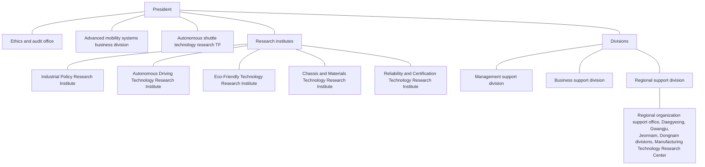

*Figure 23. Organization of KATECH*

The organization comprises 9 divisions, 4 regional divisions, 28 centers, 19 offices, 1 group, 2 TFs, and 1 department. The total staff is 527, with 472 researchers (118 PhDs, 201 master's degree holders) accounting for 90% and 55 administrative staff accounting for 10%.

### 4.4 Research Status and Research Fields

The number of companies conducting joint research and development with the institute has grown steadily, to 298 in 2015, 333 in 2016, 348 in 2017, 370 in 2018, and 403 in 2019, and as of 2020 it collaborates with 403 companies. In 2019, revenue came 78% from government R&D, 12% from private contracts, 7% from testing and evaluation, and 3% from other sources, so government R&D accounts for the largest share.

| Research Field | Detailed Research |
|:-----|:-----|
| Eco-friendly vehicle technology | Batteries for electric vehicles, parts for hydrogen fuel cell vehicles, electrical parts for xEVs |
| Autonomous driving technology | Autonomous driving parts, autonomous driving system control, convergence of ICT, AI, and big data |
| Convergence system technology | Driving safety control, smart chassis, high-efficiency energy control |
| Reliability improvement technology | Improving reliability and safety, improving durability, electromagnetic compatibility |
| Advanced materials technology | Ultra-lightweight materials, high-performance chemical materials, metal materials |

*Table 20. Research fields of KATECH*

### 4.5 Equipment

The institute has more than 1,500 kinds of modern equipment for technology development and evaluation.

| Field | Representative Equipment |
|:-----|:-----|
| Eco-friendly | EV battery charge and discharge performance tester (battery life measurement), xEV motor dynamometer (high-speed motor performance measurement, motor back-EMF measurement), exhaust gas analysis system (real-time exhaust gas analysis) |
| Smart | Autonomous driving test vehicle (real-vehicle tests of autonomous driving parts such as sensors), four-wheel independent chassis dynamometer (driving tests of intelligent safety systems), ADAS environment test chamber (development of autonomous driving sensor technology) |
| Lightweight and advanced materials | Complex environment wear tester (evaluation of friction characteristics), extruder (forming uniform polymer composites), thermal conductivity meter (measuring the thermal conductivity of materials) |
| Reliability improvement | Highly accelerated life tester, reliability evaluation equipment for HEV parts considering environmental factors (vibration-related reliability evaluation), radiated immunity test system (radiated immunity evaluation of automotive parts) |

*Table 21. Representative equipment of KATECH by field*

> **Definition:** A **dynamometer** is test equipment that rotates a motor or vehicle while measuring force, rotational speed, and power.

> **Definition:** **Radiated immunity** is the ability of electronic equipment to operate correctly even when exposed to electromagnetic waves arriving from outside.

### 4.6 Autonomous Driving Technology Research Institute

The Autonomous Driving Technology Research Institute pursues research in three fields toward **infinite convenience** (human sensibility such as e-cockpits, personalized HMI, augmented reality, and content), **highest safety** (autonomous driving such as advanced driver assistance systems, unmanned driving, and platooning), and **perfect connection** (connectivity through smart car-talk services, the Internet of Things, and the cloud).

| Field | Research Content |
|:-----|:-----|
| Connected | Connected parts and service technology, high-precision hybrid positioning and dynamic map (LDM) technology, embedded ECU design and software evaluation |
| Autonomous driving | Autonomous driving parts and system technology, intelligent sensor fusion system technology, in-vehicle HMI and UI/UX evaluation |
| Cooperative automation | NCAP system (AEB(S), etc.) technology, next-generation V2X parts and service technology, in-vehicle communication security platform and evaluation |

*Table 22. Research fields of the Autonomous Driving Technology Research Institute*

> **Definition:** An **LDM (local dynamic map)** is a map that manages dynamic information such as nearby vehicles, signals, and construction zones in real time on top of a static map.

> **Definition:** **UI/UX** stands for user interface and user experience.

The NCAP systems of the cooperative automation area are the safety functions tested in new car safety assessment, of which automatic emergency braking is a representative example.

> **Definition:** **NCAP (New Car Assessment Program)** is a program that tests the safety of new cars and publishes ratings.

> **Definition:** **AEB(S)** is an autonomous emergency braking system.

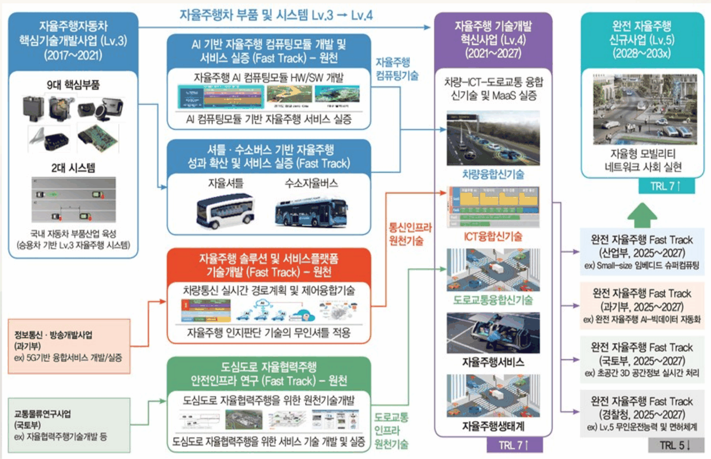

*Figure 24. Staged framework of government autonomous driving projects*

Figure 24 shows how government autonomous driving projects progress from Level 3 to Level 5.

1. **Autonomous vehicle core technology development program (Level 3, 2017-2021):** Develops nine core parts and two systems to foster the Korean automotive parts industry and builds a Level 3 automated driving system based on passenger cars.
2. **Fast Track projects (source technologies):** These include developing and demonstrating an AI-based autonomous driving computing module and services, spreading the results of shuttle- and hydrogen bus-based autonomous driving and demonstrating services (autonomous driving computing technology), developing autonomous driving solutions and service platform technology (communication infrastructure source technology), and research on safety infrastructure for cooperative automated driving on urban roads (road traffic infrastructure source technology). They are linked with the information, communication, and broadcasting development program of the Ministry of Science and ICT (development and demonstration of 5G-based convergence services) and the transport and logistics research program of the Ministry of Land, Infrastructure and Transport (cooperative automated driving technology development).
3. **Autonomous driving technology development innovation program (Level 4, 2021-2027):** Demonstrates new convergence technologies of vehicles, ICT, and road traffic, together with MaaS, divided into five fields: vehicle convergence technology, ICT convergence technology, road traffic convergence technology, autonomous driving services, and the autonomous driving ecosystem. The target technology readiness is TRL 7 or higher.
4. **New full autonomous driving program (Level 5, 2028-203x):** Realizes an autonomous mobility network society, with a target technology readiness of TRL 7 or higher. Before it, the Ministry of Trade, Industry and Energy, the Ministry of Science and ICT, the Ministry of Land, Infrastructure and Transport, and the National Police Agency carry out full autonomous driving Fast Track projects in 2025-2027 (small embedded supercomputing, automation of AI and big data, real-time processing of hyper-space 3D spatial information, Level 5 unmanned driving capability and licensing systems), at a technology readiness of TRL 5 or lower.

> **Definition:** **TRL (technology readiness level)** is a scale from 1 to 9 indicating the stage of a technology from basic research (1) to actual operation (9). TRL 7 is the stage of demonstrating a system prototype in a real environment.

### 4.7 Major Autonomous Driving Projects

| Item | Major Project 1 | Major Project 2 | Major Project 3 |
|:-----|:-----|:-----|:-----|
| Project title | Development and performance evaluation of automated driving systems for motorways and urban roads | Development of an AI-based autonomous driving computing module and service demonstration | Development of autonomous shuttle demonstration infrastructure technology for verifying the performance of autonomous driving parts |
| Period | May 2017 - December 2021 | April 2019 - December 2021 | September 2018 - December 2021 |
| Budget | 17.5 billion won in total | 28.0 billion won in total | 9.6 billion won in total |
| Content | Development of five Level 3 automated driving system technologies including lane keeping and inter-vehicle distance keeping, development of TDP/TRS and construction of a shared evaluation environment, development of a vehicle platform to support parts suppliers | Development of a prototype computing module capable of Level 4 autonomous driving AI computing performance, technology demonstration and standardization for performance verification | Development and pilot operation of an EV shuttle drive platform, automated driving system, and HMI-linked system to support improving the performance and reliability of Korean autonomous driving parts |
| Consortium | Lead KATECH; DNV-GL, Controlworks, Fusionsoft, Mando, Autonomous a2z, Seoul National University, Hanyang University, Kyungil University, Kookmin University, KOTI, KIAPI | Lead Hyundai Mobis; KATECH, Bayliss, Unitrontech, Revotech, Telecons, Triple S Consulting, Infobank, Spring Cloud, GeoC&I, Conpitech, AI Matics, SML, Seoul National University, Kookmin University, Inha University, Hanyang University, KSA, KEA, KAATA | Lead KATECH; Maru ENG, Spring Cloud, Newtech, Fusionsoft, Advanced Institute of Convergence Technology |
| Main results | Perception, decision, control, and MRM logic; vehicles (two G80s, one Ioniq); 37 domestic and 22 international papers; 17 patents filed and 5 registered; 5 technology transfers; international standards | A computing module of up to 240 TOPS, two passenger and multipurpose demonstration vehicles, an AI cooperation model of the Ministry of Trade, Industry and Energy and the Ministry of Science and ICT, an autonomous driving standardization forum (six subcommittees) | Four domestic sensors installed, automated driving software for low-speed automated driving (LSAD) shuttles, three KAMO autonomous shuttles, demonstrations in Daegu and Sejong (until December 2021), two exhibitions, two private projects |

*Table 23. Major autonomous driving projects of KATECH*

> **Definition:** **TOPS (tera operations per second)** is a unit of AI computing performance meaning one trillion operations per second. 240 TOPS is $2.4 \times 10^{14}$ operations per second.

> **Definition:** **LSAD (low-speed automated driving)** is an automated driving system that operates at low speed within a defined area.

The system of Major Project 1 was validated through driver usability evaluation, VILS (vehicle-in-the-loop simulation) evaluation, which combines a real vehicle with a virtual environment, and real-vehicle evaluation on a proving ground (PG). The computing module of Major Project 2 has several vehicle communication interfaces. Eight camera channels are connected through GMSL2 serialized links (MAX9295 and MAX9296 SERDES, link rate 6 Gbit/s), and the camera sensor and ISP pairs are AR0231 with AP0200 (30 fps) and AR0233 with GW5200 (60 fps). The module also has three automotive Ethernet 100BASE-T1 ports (100 Mbit/s), 1000BASE-T Ethernet connecting four 16-channel 360° mechanical LiDARs, wireless interfaces (GNSS on the GPS L1 and GLONASS bands, and LTE Cat 4 with 150 Mbit/s downlink and 75 Mbit/s uplink), and a display output.

> **Definition:** A **SERDES (serializer/deserializer)** is a circuit that converts parallel data into a high-speed serial signal for transmission and converts it back to parallel at the receiving end.

> **Definition:** **GMSL (gigabit multimedia serial link)** is an automotive serial link that transmits large data such as camera video over a single coaxial cable at several Gbit/s.

---

 

## Concept Applications

Connect each situation with the concept that serves as the basis for judgment.

| Situation | Concept to Connect and Reason |
|:-----|:-----|
| During a lane change, the driver must keep watching the road. | **Level 2.** Even with hands and feet off, the driver is responsible for OEDR (monitoring the surroundings), so it is Level 2. |
| During automated highway driving, the system fails and the vehicle stops on the shoulder by itself. | **DDT fallback and MRM.** Without relying on a human takeover, the system performed an MRM and reached an MRC, which is behavior of Level 4 or higher, where the system also handles fallback. At Level 3, too, the system may perform an MRM when the user fails to take over (Figure 2). |
| A parts supplier now delivers only door mechanical parts instead of a door ECU. | **SDV and the change in supply structure.** The automaker's central computer based on high-performance APs takes over control, so the supplier's added value falls. |
| The LiDAR point cloud is to be sent on the same CAN bus as radar information. | **Network separation by data volume.** Large data goes over Ethernet, medium-sized data over CAN FD, and small control data over CAN. |
| Engine speed must be displayed on the instrument cluster, but the cluster is on the low-speed bus. | **Gateway.** A gateway such as the CEM forwards messages from the high-speed bus to the low-speed bus. |
| In a vehicle without a column shaft, losing the steering wheel signal makes steering impossible. | **Redundancy in X-by-wire.** With no mechanical linkage, power, communication, and controllers must be redundant and a fault-tolerant network must be used. |

*Table 24. Concepts to connect to each situation and the reasons*

**True/False Check:**

| Statement | Judgment and Reason |
|:-----|:-----|
| A vehicle with automatic lane changing is Level 3. | **F.** Levels are divided not by the type of function but by the degree of driver involvement. If the driver must watch the road during a lane change, it is Level 2. |
| At Level 3, the system performs OEDR while the ADS is engaged. | **T.** From Level 3 the ADS performs the entire DDT including OEDR, and only fallback is left to the user. |
| An SAE Class C network is for body control below 10 kbit/s. | **F.** Body control below 10 kbit/s is Class A; Class C is for real-time control at 125 kbit/s-1 Mbit/s. |
| The CEM of the Volvo S80 is a gateway connected to both CAN buses. | **T.** The CEM connects the 250 kbit/s bus and the 125 kbit/s bus. |
| In SBW, the steering wheel and rack are mechanically connected by a column shaft. | **F.** SBW has no column shaft; the controller and motor move the rack based on the angle sensor signal. |

---

 

## Summary

| Concept | Key Summary |
|:--------|:------------|
| Levels of autonomous driving | SAE uses Levels 0-5 and NHTSA (2013) Levels 0-4, and the level is determined not by function but by the degree of driver involvement. |
| DDT and fallback | From Level 2 to 3, OEDR passes to the system, from 3 to 4 the DDT fallback does, and Level 5 has no ODD limit. |
| MRM and MRC | When fallback occurs, the system performs an MRM to reach an MRC, and the MRM standard was published as ISO 23793-1. |
| Sensor configuration | The average number of sensors grows from about 7 at Level 1 to about 30 at Level 5, with LiDAR and surround cameras added from Level 3. |
| Platform roadmap | The E/E platform changes from per-function ECUs and multiple protocols, through the consolidation of ECUs and protocols (CAN FD, Ethernet), to a structure centered on domain controllers. |
| Entry of big tech | Big tech companies such as Intel, NVIDIA, and Qualcomm take control of semiconductors, AI, and cloud, and their margins are far higher than automakers'. |
| E/E architecture and SDV | The architecture changes from distributed ECUs through domain structures to SDVs that handle functions with 3-5 high-performance APs, and parts suppliers risk being pushed into delivering mechanical parts. |
| Large-bus automated driving system | More than 24 sensors are connected over CAN, CAN FD, and Ethernet, with the HAV-DCU handling perception and decision-making and the KATECH controller handling low-level control. |
| System architecture | Data flows through perception (maps, pose, obstacles), the world model, task management, behavior execution, low-level control, and actuators. |
| Point-to-point wiring | Providing a wire for each function causes problems in cost, weight, space, design flexibility, and fault diagnosis. |
| IVN | It applies a communication network to the vehicle and shares the medium with digital serial communication, reducing wiring, improving reliability, enabling flexible design, and easing maintenance. |
| X-by-wire | FBW, SBW, and BBW replace mechanical linkages with electrical signals and controllers, so redundancy and fault-tolerant networks are required. |
| SAE network classes | Vehicle networks are divided into Class A (below 10 kbit/s, body), Class B (10-125 kbit/s, dashboard and diagnostics), and Class C (125 kbit/s-1 Mbit/s, real-time control). |
| KATECH | An automotive research institute established by the government and industry that performs R&D, testing and certification, and policy support and leads government autonomous driving projects for Levels 3-5. |

---

 

## Self-Check Questions

1. **Determining the level:** A vehicle drives on the highway and even changes lanes automatically. Give the level for each case: (a) the driver must keep watching the road, (b) the driver need not watch the road but must take over when requested, (c) the driver need do nothing until the lane change is completed.

   

   
Answer

   (a) is Level 2, (b) is Level 3, and (c) is Level 4. In (a) the driver is responsible for OEDR; in (b) the system is responsible for OEDR but the user handles fallback; in (c) the system handles fallback as well.

   

2. **DDT and fallback:** In Table 2, which column separates Levels 2 and 3, Levels 3 and 4, and Levels 4 and 5?

   

   
Answer

   Levels 2 and 3 differ in the OEDR column (from driver to system), Levels 3 and 4 in the DDT fallback column (from fallback-ready user to system), and Levels 4 and 5 in the ODD column (from limited to unlimited).

   

3. **MRM:** Explain the relationship among fallback, MRM, and MRC, and give the three cases in which fallback occurs.

   

   
Answer

   Fallback is the response when the system cannot continue normal driving, the MRM is the maneuver performed as that response, such as slowing down, changing lanes, and stopping, and the MRC is the safe stopped state reached as a result of the MRM (for example, stopped on the shoulder). Fallback occurs when something is wrong with the driver, when something is wrong with the automated driving system, or when the vehicle meets a situation outside its operating range (ODD).

   

4. **SDV and supply structure:** Explain how parts suppliers' delivery and profit structure change when a system of about 100 MCUs becomes a system of 3-5 high-performance APs.

   

   
Answer

   Previously, parts suppliers delivered door modules and seat modules that included ECUs with MCUs and software. In a high-performance AP system, the automaker's central computer takes over control, so suppliers deliver only mechanical parts. Big tech and automakers take the high value-added software, semiconductors, and service platforms, and parts suppliers risk being pushed into low-margin businesses.

   

5. **Network topology:** In the large-bus automated driving system, state which network carries the LiDARs, the medium-range radars, and the control commands, and explain why they are divided this way.

   

   
Answer

   The LiDARs use Ethernet (the LiDAR hub and Ethernet backbone), the medium-range radars use CAN FD, and control commands and status information use CAN. The LiDAR point cloud is large data on the order of tens to hundreds of Mbit per second (depending on how points are represented) and needs Ethernet; radar object information is medium-sized data needing a larger payload than CAN; and control commands are small but time-critical data, for which CAN is sufficient.

   

6. **Point-to-point wiring and IVN:** Give the five problems of analog point-to-point wiring and explain how the three characteristics of an IVN solve them.

   

   
Answer

   The problems are increased production costs and defect rates, increased vehicle weight and worse fuel economy, difficult design and installation due to lack of space, little flexibility for design changes, and difficult fault diagnosis. An IVN applies a communication network to the vehicle, uses digital serial communication, and shares the communication medium. Because several ECUs share one bus, the number and weight of wires decrease; a new device only needs to be connected to the bus, which makes design flexible; and a diagnostic device connected to the bus can read the state of every ECU, which makes fault diagnosis easy.

   

7. **Volvo S80:** Explain why the Volvo S80 uses two CAN buses, relating them to the SAE classification, and state the role of the CEM.

   

   
Answer

   Functions where real-time behavior matters, such as the engine, throttle, transmission, steering angle, and ABS, are placed on the 250 kbit/s high-speed bus (SAE Class C), and functions that need no fast response, such as audio, climate control, doors, and seats, on the 125 kbit/s low-speed bus (SAE Class B). Using the speed that matches each function's needs reduces cost and lowers the load on the high-speed bus. The CEM is a gateway connected to both buses that forwards messages from one bus to the other.

   

8. **X-by-wire:** Explain how SBW differs from a conventional steering system and why X-by-wire needs a fault-tolerant network.

   

   
Answer

   A conventional steering system transmits the rotation of the steering wheel mechanically to the wheels through the column shaft and the rack and pinion. SBW has no column shaft; a controller computes from the value read by the steering wheel's angle sensor and moves the rack with a motor. Because there is no mechanical backup, steering itself becomes impossible if the network carrying the signals or the controller fails. A network that guarantees redundancy, fault tolerance, and delivery within a fixed time (temporal determinism) is therefore needed.

   

---

 

## References

1. SAE International, *Taxonomy and Definitions for Terms Related to Driving Automation Systems for On-Road Motor Vehicles*, SAE J3016_202104, 2021.
2. NHTSA, *Preliminary Statement of Policy Concerning Automated Vehicles*, Washington, DC, USA, May 2013.
3. U.S. Department of Transportation and NHTSA, *Federal Automated Vehicles Policy: Accelerating the Next Revolution in Roadway Safety*, Washington, DC, USA, Sep. 2016.
4. ISO 23793-1:2024, *Intelligent transport systems - Minimal risk manoeuvre (MRM) for automated driving - Part 1: Framework, straight-stop and in-lane stop*, International Organization for Standardization, 2024.
5. Frost & Sullivan, *Global Autonomous Driving Industry Outlook, 2018*, 2018.
6. Frost & Sullivan, *Global Autonomous Driving Industry Outlook, 2019*, 2019.
7. Intel Corporation, *2020 Annual Report on Form 10-K*, Santa Clara, CA, USA, 2021.
8. Intel Corporation, "Intel CEO predicts chips will be more than 20% of premium vehicle BOM by 2030," press release, *Business Wire*, Sep. 7, 2021. https://www.businesswire.com/news/home/20210907005345/en
9. Macrotrends and Investing.com, company financial data (revenue and operating income for 2021, market capitalization as of Apr. 2022).
10. 전자신문, 한국자동차연구원, 금융감독원, 국내 자동차 부품사 경영 실적 자료(2019, 2020년).
11. IEEE Std 802.3bw-2015, *Physical Layer Specifications and Management Parameters for 100 Mb/s Operation over a Single Balanced Twisted Pair Cable (100BASE-T1)*, 2015.
12. SAE International, *V2X Communications Message Set Dictionary*, SAE J2735_202007, 2020.
13. ADASIS Forum (ERTICO), *ADASIS v3 Protocol Specification*.
14. CAN in Automation, "History of CAN technology." https://www.can-cia.org/can-knowledge/history-of-can-technology
15. NASA Dryden Flight Research Center, "F-8 Digital Fly-By-Wire," NASA Facts FS-2002-09-024 DFRC. https://www.nasa.gov/centers/dryden/pdf/120282main_FS-024-DFRC.pdf
16. Automotive Tech Info, "Understanding Volvo networks and wiring," Jan. 2021. https://automotivetechinfo.com/2021/01/understanding-volvo-networks-and-wiring/
17. Volvo Car Corporation, *B6324S Functional Description* (S80, XC90, model year 2007). https://www.manualslib.com/manual/1758947/Volvo-B6324s.html
18. N. Navet, Y. Song, F. Simonot-Lion, and C. Wilwert, "Trends in automotive communication systems," *Proceedings of the IEEE*, vol. 93, no. 6, pp. 1204-1223, 2005.
