# 3주차 이론 — CAN 버스 입문, 차량용 네트워크, 네트워크의 분류

[레포지토리 안내](../../README.ko.md) | [English](Concepts_Lecture.md) | [한국어](Concepts_Lecture.ko.md)

> **최종 수정일:** 2026-11-04

> **학습 목표:**
> 1. CAN의 차동 신호 방식과 우성, 열성 비트의 의미를 설명하고, 종단 저항이 필요한 이유를 설명할 수 있다
> 2. CAN 표준 프레임과 확장 프레임의 필드 구성을 쓰고, 비트 스터핑을 적용하고 제거할 수 있다
> 3. 식별자에 의한 비트 단위 중재 과정을 단계별로 추적하여 이기는 노드를 찾을 수 있다
> 4. CAN의 다섯 가지 오류 검출 방식과 오류 활성, 오류 수동, 버스 오프 상태를 설명할 수 있다
> 5. LIN, MOST, TTP, FlexRay, KWP2000 같은 차량용 네트워크를 응용 분야와 전송 속도로 분류할 수 있다
> 6. WAN, MAN, LAN과 버스형, 링형 토폴로지의 특징을 비교하고, 자율주행차의 센서 구성 사례를 설명할 수 있다

---

## 목차

- [1. CAN 버스 입문](#1-can-버스-입문)
  - [1.1 CAN의 개요](#11-can의-개요)
  - [1.2 CAN의 계층 구조와 표준](#12-can의-계층-구조와-표준)
  - [1.3 차동 버스와 신호 레벨](#13-차동-버스와-신호-레벨)
  - [1.4 종단 저항](#14-종단-저항)
  - [1.5 비트 스터핑](#15-비트-스터핑)
  - [1.6 CAN 메시지 프레임](#16-can-메시지-프레임)
  - [1.7 방송형 통신과 메시지 필터링](#17-방송형-통신과-메시지-필터링)
  - [1.8 다중 버스 접근과 비트 단위 중재](#18-다중-버스-접근과-비트-단위-중재)
  - [1.9 오류 검출과 오류 상태](#19-오류-검출과-오류-상태)
  - [1.10 CAN의 구현: 컨트롤러와 트랜시버](#110-can의-구현-컨트롤러와-트랜시버)
  - [1.11 사례: CAN 기반 바디 제어 시스템](#111-사례-can-기반-바디-제어-시스템)
- [2. 다양한 차량용 IVN](#2-다양한-차량용-ivn)
  - [2.1 차량 내부 네트워크의 분류](#21-차량-내부-네트워크의-분류)
  - [2.2 LIN](#22-lin)
  - [2.3 MOST](#23-most)
  - [2.4 TTP](#24-ttp)
  - [2.5 FlexRay](#25-flexray)
  - [2.6 진단 통신: KWP2000과 OBD](#26-진단-통신-kwp2000과-obd)
  - [2.7 차량용 멀티미디어 네트워크](#27-차량용-멀티미디어-네트워크)
- [3. 네트워크의 물리적 구성에 따른 분류](#3-네트워크의-물리적-구성에-따른-분류)
  - [3.1 WAN, MAN, LAN](#31-wan-man-lan)
  - [3.2 LAN](#32-lan)
  - [3.3 MAN과 DQDB](#33-man과-dqdb)
  - [3.4 WAN](#34-wan)
  - [3.5 기본 토폴로지: 버스형과 링형](#35-기본-토폴로지-버스형과-링형)
  - [3.6 네트워크 구성 사례와 차량의 네트워크](#36-네트워크-구성-사례와-차량의-네트워크)
- [4. 부록: 자율주행차의 물리적 구성](#4-부록-자율주행차의-물리적-구성)
  - [4.1 자율주행 기업의 기술 경쟁력](#41-자율주행-기업의-기술-경쟁력)
  - [4.2 Waymo](#42-waymo)
  - [4.3 Tesla](#43-tesla)
  - [4.4 GM Cruise](#44-gm-cruise)
  - [4.5 세 회사의 센서 구성 비교](#45-세-회사의-센서-구성-비교)
- [개념 적용](#개념-적용)
- [요약](#요약)
- [점검 문제](#점검-문제)
- [참고 문헌](#참고-문헌)

---

<br>

## 1. CAN 버스 입문

### 1.1 CAN의 개요

> **용어 정의:** **ECU(electronic control unit, 전자 제어 장치)** 는 엔진, 변속기, 브레이크, 도어처럼 차량의 한 기능을 맡아 센서 값을 읽고 액추에이터를 제어하는 마이크로컨트롤러 기반의 제어기이다. 한 차량에는 수십 개에서 백 개가 넘는 ECU가 들어간다.

ECU끼리 정보를 주고받아야 하는데, 모든 ECU 쌍을 전선으로 직접 잇는 점대점(point-to-point) 배선은 ECU가 늘어날수록 전선의 수와 무게, 커넥터, 고장 지점이 급격히 늘어난다. 이 문제를 풀기 위해 모든 ECU가 한 쌍의 전선(버스)을 공유하여 메시지를 주고받는 차량 내부 네트워크가 쓰이며, 그 대표가 CAN이다.

> **용어 정의:** **CAN(Controller Area Network)** 은 독일의 Robert Bosch GmbH가 차량 안의 제어기들을 연결하기 위해 만든 직렬 버스 통신 프로토콜이다. 국제 표준화 기구(ISO)와 미국 자동차 공학회(SAE)가 표준으로 채택했으며, 자동차뿐 아니라 산업용 분산 제어 시스템에도 널리 쓰인다.

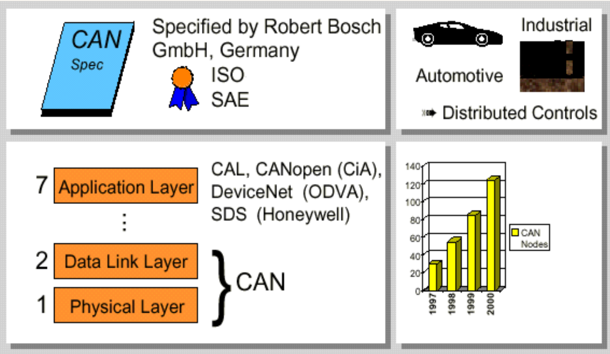

*그림 1. CAN 규격의 출처, 응용 분야, 계층 구성과 CAN 노드 수의 증가 추세*

그림 1은 CAN의 성격을 네 가지로 요약한다. 첫째, 규격은 Bosch가 정했고 ISO와 SAE가 표준화했다. 둘째, 응용 분야는 자동차와 산업 현장의 분산 제어(distributed controls)이다. 셋째, CAN 자체는 OSI 7계층 가운데 1계층(물리 계층)과 2계층(데이터 링크 계층)만 정의하고, 7계층(응용 계층)은 CAL, CANopen(CiA), DeviceNet(ODVA), SDS(Honeywell) 같은 별도의 상위 프로토콜이 맡는다. 넷째, 1997년부터 2000년까지 CAN 노드의 수가 해마다 크게 늘어났다.

> **참고:** CANopen, DeviceNet, SDS는 CAN의 프레임 위에서 각 식별자의 메시지가 담는 데이터와 장치를 설정하고 관리하는 방법을 정한 응용 계층 규약이다. 괄호 안은 규약을 관리하는 단체나 회사이며, CiA(CAN in Automation)는 CAN 관련 규격을 관리하는 국제 사용자 단체이다.

### 1.2 CAN의 계층 구조와 표준

CAN 규격(ISO 11898)은 OSI 참조 모델의 물리 계층과 데이터 링크 계층을 정의한다. 데이터 링크 계층은 다시 두 부계층으로 나뉜다.

| 계층 | 부계층 | 맡는 기능 |
|:-----|:-----|:-----|
| 2. 데이터 링크 계층 | LLC(logical link control) | 데이터 전송, 원격 데이터 요청, 메시지 필터링, 회복 관리와 과부하 통지 |
| 2. 데이터 링크 계층 | MAC(medium access control) | 프레이밍과 중재, 오류 검사와 오류 플래그, 결함 국한(fault confinement), 비트 타이밍 |
| 1. 물리 계층 | | 비트를 전기 신호로 바꾸어 버스에 싣고 읽는 일 |

*표 1. CAN이 정의하는 계층과 기능*

3계층부터 7계층까지는 CAN 규격이 정하지 않는다. 각 기능의 뜻은 다음과 같다. **프레이밍(framing)** 은 데이터를 정해진 형식의 프레임으로 감싸는 일이고, **중재(arbitration)** 는 여러 노드가 동시에 보내려 할 때 누가 버스를 쓸지 정하는 일이다(1.8절). **결함 국한(fault confinement)** 은 고장 난 노드가 버스 전체를 망가뜨리지 못하도록 그 노드의 참여를 제한하는 일이다(1.9절). **비트 타이밍(bit timing)** 은 한 비트의 길이와 비트를 읽는 시점을 정하고 노드 사이의 시계를 맞추는 일이다.

> **[컴퓨터네트워크]** OSI 참조 모델은 통신 기능을 물리, 데이터 링크, 네트워크, 전송, 세션, 표현, 응용의 7계층으로 나눈 모델이다. 차량 내부처럼 한 버스에 모든 노드가 붙어 있는 네트워크는 경로를 찾는 네트워크 계층이 필요 없으므로, CAN은 하위 두 계층만 정의하고 나머지는 응용 프로토콜에 맡긴다. OSI 모델은 5주차에서 자세히 다룬다.

CAN 네트워크의 구성 조건은 다음과 같다.

- **토폴로지:** 모든 노드가 한 버스에 연결되는 버스형 토폴로지를 쓴다(3.5절).
- **노드 수:** 한 버스에 최대 64개 정도의 스테이션(노드)을 연결한다. 이 상한은 프로토콜이 아니라 트랜시버가 감당할 수 있는 전기적 부하가 정한다.
- **전송 속도와 버스 길이:** 버스가 길수록 속도를 낮추어야 한다. 대표적인 조합은 10 km에서 5 kbps, 40 m에서 1 Mbps이다.

속도와 길이가 반비례하는 이유는 1.8절의 비트 단위 중재에 있다. 중재가 성립하려면 한 노드가 보낸 비트가 버스의 가장 먼 노드까지 갔다가 그 노드의 비트와 겹친 결과가 다시 돌아오는 시간이 한 비트 시간 안에 들어와야 한다. 1 Mbps에서 한 비트의 길이는 $1/10^6$ s, 즉 1 µs이다. 전선 속 신호는 빛의 속도의 약 2/3로 진행하여 1 m에 약 5 ns가 걸리므로, 40 m 버스의 편도 지연은 $40 \times 5 = 200$ ns, 왕복 지연은 400 ns이다. 여기에 트랜시버와 컨트롤러의 처리 지연이 더해지면 1 µs 안의 여유가 거의 남지 않는다. 버스가 더 길어지면 비트 시간을 늘려야, 즉 속도를 낮추어야 한다.

CAN 관련 ISO 표준은 다음과 같다.

| 표준 | 연도 | 내용 |
|:-----|:-----|:-----|
| ISO 11898-1 | 2015 | 데이터 링크 계층과 물리 신호(physical signalling) |
| ISO 11898-2 | 2016 | 고속 매체 접근 장치(high-speed medium access unit) |
| ISO 11898-3 | 2006 | 저속, 결함 허용(fault-tolerant), 매체 의존 인터페이스 |
| ISO 11898-4 | 2004 | 시간 기반(time-triggered) 통신 |
| ISO 11898-5 | 2007 | 저전력 모드를 갖춘 고속 매체 접근 장치 (폐지) |
| ISO 11898-6 | 2013 | 선택적 깨우기(selective wake-up) 기능을 갖춘 고속 매체 접근 장치 (폐지) |

*표 2. CAN 관련 ISO 11898 표준*

> **참고:** ISO 11898-5와 ISO 11898-6이 폐지된 것은 그 내용이 ISO 11898-2:2016에 통합되었기 때문이다 [1]. 또 ISO 11898-1:2015는 기존 CAN과 함께 데이터 구간의 속도를 높인 CAN FD도 정의한다 [2]. CAN FD는 9주차에서 다룬다.

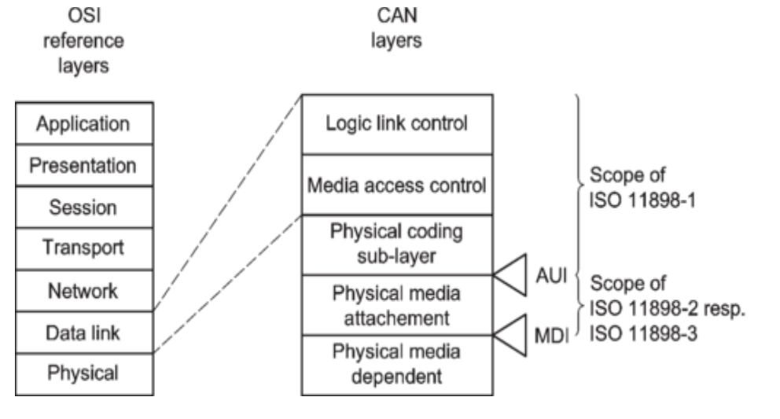

*그림 2. OSI 참조 계층과 CAN 계층, ISO 11898 각 부의 범위*

그림 2는 OSI의 데이터 링크 계층과 물리 계층이 CAN에서 어떻게 세분되는지 보여 준다. ISO 11898-1은 LLC, MAC, 물리 부호화 부계층(physical coding sub-layer)을 정의한다. ISO 11898-2(고속)와 ISO 11898-3(저속)은 트랜시버에 해당하는 물리 매체 접속(physical media attachment) 부계층과 전선 및 커넥터에 해당하는 물리 매체 의존(physical media dependent) 부계층을 정의한다. AUI(attachment unit interface)는 컨트롤러와 트랜시버 사이의 인터페이스이고, MDI(medium dependent interface)는 트랜시버와 버스 매체 사이의 인터페이스이다. 같은 프로토콜 컨트롤러에 고속용 트랜시버를 붙이면 고속 CAN이, 저속용 트랜시버를 붙이면 저속 CAN이 된다.

### 1.3 차동 버스와 신호 레벨

고속 CAN 버스는 **CAN_H**와 **CAN_L**이라는 두 전선을 꼬아 만든 꼬임쌍선(twisted pair)이다. 수신기는 한 전선의 전압이 아니라 두 전선의 전압 차이로 비트를 판단한다.

> **용어 정의:** **차동 신호 방식(differential signaling)** 은 두 전선에 서로 반대 방향으로 변하는 신호를 싣고, 수신기가 두 전압의 차 $V_{diff} = V_{CAN\_H} - V_{CAN\_L}$로 값을 판단하는 방식이다.

CAN 버스는 두 가지 상태만 가진다.

> **용어 정의:** **우성(dominant)** 상태는 트랜시버가 CAN_H를 끌어올리고 CAN_L을 끌어내려 두 전선 사이에 전압 차를 만든 상태이며, 논리값 0을 나타낸다. **열성(recessive)** 상태는 어떤 트랜시버도 버스를 구동하지 않아 두 전선이 같은 전압에 머무는 상태이며, 논리값 1을 나타낸다.

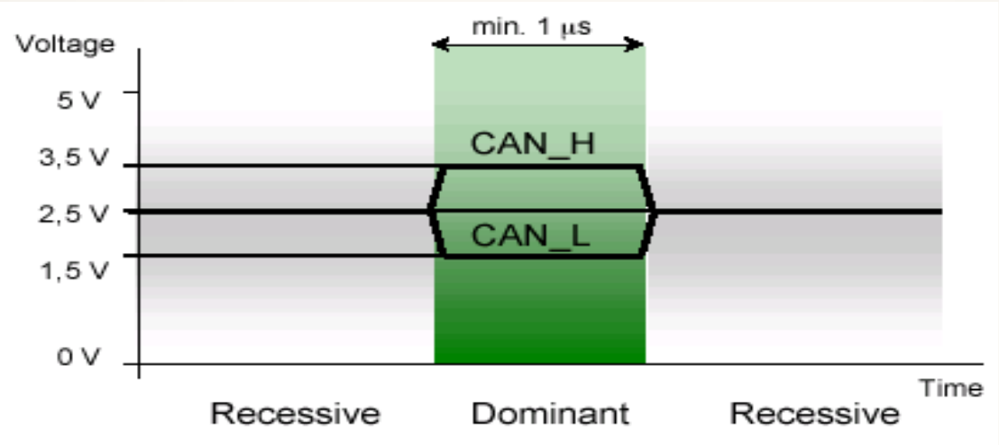

*그림 3. 열성과 우성 상태에서 CAN_H와 CAN_L의 전압*

그림 3의 공칭 전압은 다음과 같다.

| 상태 | CAN_H | CAN_L | $V_{diff}$ | 논리값 |
|:-----|:-----|:-----|:-----|:-----|
| 열성(recessive) | 약 2.5 V | 약 2.5 V | 약 0 V | 1 |
| 우성(dominant) | 약 3.5 V | 약 1.5 V | 약 2 V | 0 |

*표 3. 고속 CAN의 공칭 버스 전압*

수신기는 공칭값이 아니라 문턱값으로 상태를 판단한다. CAN_H의 전압이 CAN_L의 전압보다 0.5 V 넘게 높지 않으면($V_{diff} \le 0.5$ V) 열성으로, 0.9 V 이상 높으면($V_{diff} \ge 0.9$ V) 우성으로 판단한다. 두 문턱 사이(0.5 V와 0.9 V 사이)는 어느 쪽으로도 보장되지 않는 구간이며, 이 여유 덕분에 잡음이 조금 섞여도 판단이 흔들리지 않는다. 그림 3의 "min. 1 µs"는 1 Mbps에서 한 비트가 차지하는 최소 시간이다.

두 노드가 같은 순간에 서로 다른 값을 보내면 버스의 값은 다음과 같이 정해진다. 우성은 트랜시버가 능동적으로 만든 상태이고 열성은 아무도 구동하지 않은 상태이므로, 한 노드라도 우성을 보내면 버스는 우성이 된다.

| 노드 1이 보내는 값 | 노드 2가 보내는 값 | 버스의 값 |
|:-----|:-----|:-----|
| 0 (우성) | 0 (우성) | 0 (우성) |
| 0 (우성) | 1 (열성) | 0 (우성) |
| 1 (열성) | 0 (우성) | 0 (우성) |
| 1 (열성) | 1 (열성) | 1 (열성) |

*표 4. 두 노드가 동시에 보낼 때 버스에 나타나는 값*

> **[논리설계]** 표 4는 AND 게이트의 진리표와 같다. 여러 출력을 한 선에 묶어 AND를 얻는 이런 연결을 와이어드 AND(wired-AND)라 한다. 1.8절의 중재는 이 성질, 즉 0이 1을 이긴다는 성질 위에서 동작한다.

**잡음에 대한 강건성.** 차량에는 점화 장치, 모터, 인버터처럼 강한 전자기 간섭(EMI, electromagnetic interference)을 내는 장치가 많다.

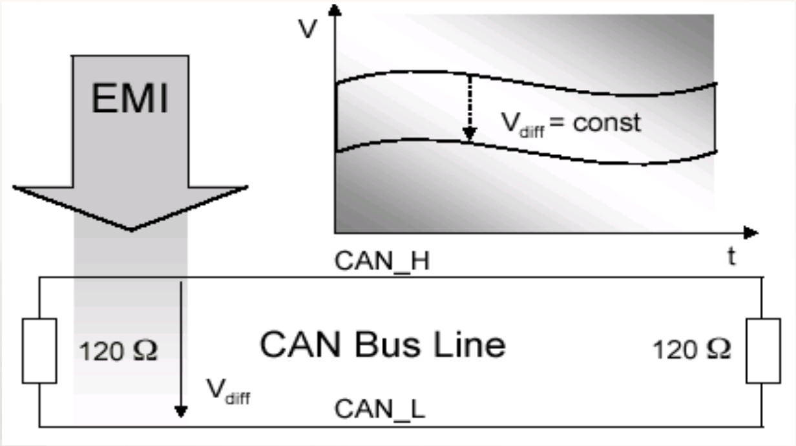

*그림 4. 전자기 간섭이 들어와도 차동 전압이 유지되는 CAN 버스*

두 전선은 서로 꼬여 같은 공간을 지나므로, 외부 간섭은 두 전선에 거의 같은 크기와 방향으로 유도된다. 간섭 전압을 $V_n$이라 하면 수신기가 보는 차는 다음과 같다.

$$
(V_{CAN\_H} + V_n) - (V_{CAN\_L} + V_n) = V_{CAN\_H} - V_{CAN\_L} = V_{diff}
$$

두 전선에 똑같이 더해진 성분(공통 모드 잡음, common-mode noise)이 뺄셈에서 사라지므로 $V_{diff}$는 일정하게 유지된다(그림 4의 $V_{diff} = const$). 그림 4의 양 끝에 있는 120 Ω 저항은 1.4절의 종단 저항이다.

### 1.4 종단 저항

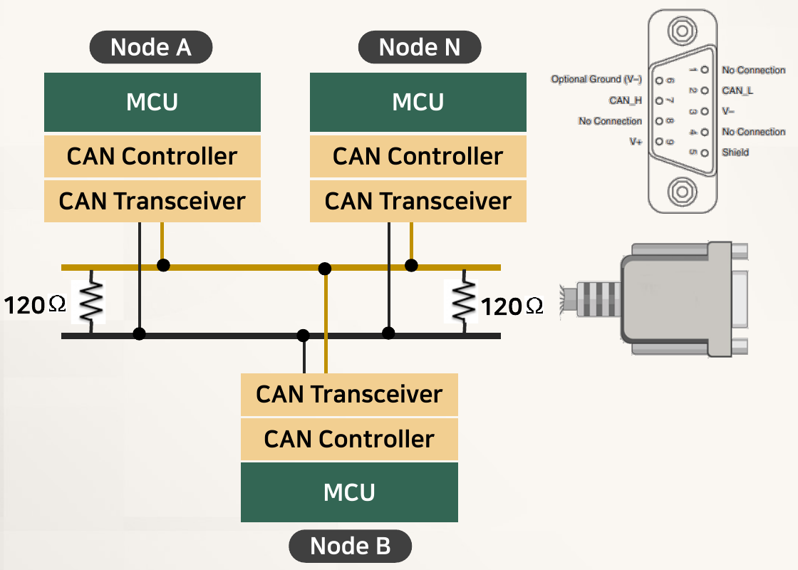

*그림 5. 종단 저항을 갖춘 CAN 네트워크와 D-sub 9핀 커넥터*

그림 5의 각 노드는 MCU(마이크로컨트롤러), CAN 컨트롤러, CAN 트랜시버로 이루어지며(1.10절), 트랜시버가 CAN_H와 CAN_L 두 선에 연결된다. 버스의 **물리적인 양 끝**에는 CAN_H와 CAN_L 사이에 120 Ω 저항이 하나씩 달려 있다.

```text
        ┌────────┐         ┌────────┐         ┌────────┐
        │ Node A │         │ Node B │         │ Node N │
        └─┬────┬─┘         └─┬────┬─┘         └─┬────┬─┘
          │    │             │    │             │    │
CAN_H ─┬──┴────┼─────────────┴────┼─────────────┴────┼───┬────
       │       │                  │                  │   │
     120Ω      │                  │                  │ 120Ω
       │       │                  │                  │   │
CAN_L ─┴───────┴──────────────────┴──────────────────┴───┴────
```

*그림 6. 양 끝에만 종단 저항을 두고 노드를 짧은 분기선으로 연결한 버스*

종단 저항이 필요한 이유는 세 가지이다.

1. **신호 반사 억제.** 빠르게 바뀌는 신호에서 전선은 단순한 도선이 아니라 고유한 **특성 임피던스(characteristic impedance)** 를 가진 전송선로로 동작한다. CAN 케이블의 특성 임피던스는 약 120 Ω이다. 선로 끝이 열려 있거나 임피던스가 다르면 신호의 일부가 끝에서 반사되어 되돌아오고, 반사파가 원래 신호와 겹쳐 비트 경계에서 전압이 흔들리는 링잉(ringing)을 일으킨다. 선로 끝을 특성 임피던스와 같은 120 Ω으로 끝내면 신호 에너지가 저항에서 흡수되어 반사가 생기지 않는다.
2. **열성 상태로의 복귀.** 우성은 트랜시버가 능동적으로 구동하지만 열성은 아무도 구동하지 않는다. 우성에서 열성으로 바뀔 때 두 전선을 같은 전압으로 되돌리는 경로가 종단 저항이다. 저항이 없으면 전선에 남은 전하가 천천히 빠져 열성으로의 전환이 늦어지고, 고속에서는 다음 비트를 잘못 읽는다.
3. **정해진 부하.** 트랜시버는 두 종단 저항의 병렬 합성 저항인 60 Ω을 구동하도록 설계된다.

**계산 예.** 두 120 Ω 저항은 CAN_H와 CAN_L 사이에서 병렬로 연결되므로 합성 저항은 다음과 같다.

$$
R_{bus} = \frac{120 \times 120}{120 + 120} = \frac{14400}{240} = 60\ \Omega
$$

우성 상태의 차동 전압이 약 2 V이면 버스에 흐르는 전류는 $I = 2\ \text{V} / 60\ \Omega \approx 33$ mA이다. 이 값은 고장 진단에도 쓰인다. 전원을 끈 상태에서 CAN_H와 CAN_L 사이의 저항을 재면 정상 버스는 약 60 Ω이다. 약 120 Ω이 나오면 종단 저항 하나가 빠진 것이고, 약 40 Ω($120/3$)이 나오면 종단 저항이 하나 더 달린 것이다.

> **주의:** 종단 저항은 버스의 양 끝 두 곳에만 둔다. 모든 노드에 120 Ω을 달면 합성 저항이 너무 작아져 트랜시버가 충분한 차동 전압을 만들지 못한다. 또 버스 본선에서 노드로 갈라지는 분기선(stub)은 짧게 유지해야 한다. 분기선 끝은 종단되지 않으므로, 길어지면 그곳에서 반사가 생긴다.

그림 5의 오른쪽은 산업용 CAN 장비와 계측 장비에서 흔히 쓰는 D-sub 9핀 커넥터와 핀 배치이다 [3].

| 핀 | 신호 | 핀 | 신호 |
|:-----|:-----|:-----|:-----|
| 1 | 연결 없음 | 6 | 선택적 접지(V-) |
| 2 | CAN_L | 7 | CAN_H |
| 3 | 접지(V-) | 8 | 연결 없음 |
| 4 | 연결 없음 | 9 | 선택적 전원(V+) |
| 5 | 차폐(shield) | | |

*표 5. CAN용 D-sub 9핀 커넥터의 핀 배치*

### 1.5 비트 스터핑

CAN은 비트를 **NRZ(non-return-to-zero)** 방식으로 싣는다. NRZ는 한 비트 시간 동안 전압 레벨을 그대로 유지하는 방식이며(4주차), 같은 값이 길게 이어지면 신호에 변화(에지)가 전혀 없다. CAN에는 별도의 클록 선이 없으므로 수신기는 신호의 에지를 보고 자기 시계를 송신기에 맞추는데(재동기화, resynchronization), 에지가 오래 없으면 두 시계가 조금씩 어긋나 비트를 잘못 세게 된다.

> **용어 정의:** **비트 스터핑(bit stuffing)** 은 송신기가 같은 값의 비트를 5개 연속으로 보내면 그 뒤에 반대 값의 비트(스터핑 비트) 하나를 자동으로 끼워 넣고, 수신기가 그 비트를 다시 제거하는 규칙이다.

비트 스터핑은 두 가지 역할을 한다. 첫째, 같은 값이 최대 5비트까지만 이어지므로 일정 간격마다 에지가 보장되어 재동기화가 가능하다. 둘째, 수신기가 같은 값을 6개 연속으로 보면 규칙이 깨진 것이므로 **스터핑 오류(stuff error)** 로 판정한다. 즉 비트 스터핑은 오류 검출 수단도 된다(1.9절). 스터핑은 SOF부터 CRC 시퀀스까지 적용되고, 고정된 형식을 가진 CRC 구분자, ACK 필드, EOF에는 적용되지 않는다 [4].

**예제.** 다음 16비트를 보낸다고 하자(r = 열성, d = 우성).

```text
to transmit : r d r r r r r r d r d d d d d r             (16 bits)
stuffed     : r d r r r r r Sd r d r d d d d d Sr r       (18 bits)
de-stuffed  : r d r r r r r r d r d d d d d r             (16 bits)
```

*그림 7. 비트 스터핑의 삽입과 제거*

송신기의 처리 과정은 다음과 같다.

1. 1번째 r, 2번째 d를 보낸다. d에서 같은 값의 개수는 1로 다시 센다.
2. 3번째부터 r이 이어진다. 3, 4, 5, 6, 7번째 비트가 r 다섯 개가 되는 순간 반대 값인 스터핑 비트 Sd(우성)를 끼워 넣는다.
3. 스터핑 비트도 비트열의 일부로 센다. Sd 다음의 8번째 r은 새로 1개째가 된다.
4. 9번째 d, 10번째 r, 11번째 d를 보낸 뒤, 11번째부터 15번째까지 d 다섯 개가 이어지는 순간 스터핑 비트 Sr(열성)을 끼워 넣는다.
5. 마지막 16번째 r을 보낸다. 결과는 원래보다 2비트 긴 18비트이다.

수신기는 같은 값 5개 다음에 오는 비트를 스터핑 비트로 보고 버린다. 그 결과 원래의 16비트가 복원된다. 스터핑 때문에 프레임의 실제 길이는 데이터 내용에 따라 달라진다. 최악의 경우 처음 5비트 뒤부터는 원래 비트 4개마다 스터핑 비트가 하나씩 들어간다(스터핑 비트가 다음 연속의 첫 비트로 세어지기 때문이다).

### 1.6 CAN 메시지 프레임

CAN에서 데이터를 나르는 단위를 **데이터 프레임(data frame)** 이라 한다. 식별자의 길이에 따라 두 형식이 있다.

- **표준 프레임(standard frame, CAN 2.0A):** 11비트 식별자를 쓴다.
- **확장 프레임(extended frame, CAN 2.0B):** 11비트 기본 식별자에 18비트를 더한 29비트 식별자를 쓴다.

> **용어 정의:** **식별자(identifier, ID)** 는 프레임이 담은 메시지의 종류(예: 엔진 회전수, 차속)를 나타내는 값이다. 받는 노드의 주소가 아니며, 1.8절의 중재에서 우선순위로도 쓰인다. 값이 작을수록 우선순위가 높다.

표준 프레임의 구성은 다음과 같다(숫자는 비트 수).

```text
      |<-- Arbitration --->|<--- Control ---->|          |< CRC field >|<-- ACK --->|
┌─────┬──────────────┬─────┬─────┬────┬───────┬──────────┬───────┬─────┬──────┬─────┬───────┬─────┐
│ SOF │  Identifier  │ RTR │ IDE │ r0 │  DLC  │   Data   │  CRC  │ Del │ Slot │ Del │  EOF  │ IFS │
├─────┼──────────────┼─────┼─────┼────┼───────┼──────────┼───────┼─────┼──────┼─────┼───────┼─────┤
│  1  │      11      │  1  │  1  │ 1  │   4   │   0-64   │  15   │  1  │  1   │  1  │   7   │  3  │
└─────┴──────────────┴─────┴─────┴────┴───────┴──────────┴───────┴─────┴──────┴─────┴───────┴─────┘
```

*그림 8. CAN 표준 데이터 프레임의 필드와 비트 수*

| 필드 | 비트 수 | 역할 |
|:-----|:-----|:-----|
| SOF(start of frame) | 1 | 우성 비트 하나로 프레임의 시작을 알린다. 버스가 유휴(열성) 상태였으므로 열성에서 우성으로 바뀌는 첫 에지에 모든 노드가 시계를 맞춘다. |
| 식별자(identifier) | 11 | 메시지의 종류와 우선순위를 나타낸다. 최상위 비트부터 보낸다. |
| RTR(remote transmission request) | 1 | 데이터 프레임이면 우성, 다른 노드에 데이터를 요청하는 원격 프레임이면 열성이다. |
| IDE(identifier extension) | 1 | 표준 프레임이면 우성, 확장 프레임이면 열성이다. |
| r0 | 1 | 예약 비트이다. |
| DLC(data length code) | 4 | 데이터 필드의 바이트 수(0\~8)를 나타낸다. |
| 데이터(data) | 0\~64 | 실제 데이터 0\~8바이트이다. |
| CRC 시퀀스 | 15 | SOF부터 데이터까지를 대상으로 계산한 15비트 CRC이다(1.9절). |
| CRC 구분자(delimiter) | 1 | 항상 열성이다. |
| ACK 슬롯(slot) | 1 | 송신기는 열성을 보내고, 프레임을 올바르게 받은 수신 노드가 이 비트를 우성으로 덮어써 수신을 확인한다. |
| ACK 구분자 | 1 | 항상 열성이다. |
| EOF(end of frame) | 7 | 열성 비트 7개로 프레임의 끝을 알린다. |
| IFS(interframe space) | 3 | 프레임 사이의 간격(intermission)으로, 열성 비트 3개이다. |

*표 6. CAN 표준 데이터 프레임의 필드*

**프레임 길이 계산.** 8바이트 데이터를 담은 표준 프레임의 길이를 스터핑 비트를 빼고 세면 다음과 같다.

$$
1 + 11 + 1 + 1 + 1 + 4 + 64 + 15 + 1 + 1 + 1 + 7 = 108\ \text{비트}
$$

여기에 IFS 3비트를 더하면 다음 프레임까지 111비트가 걸린다. 실제 데이터는 64비트이므로 프레임 안에서 데이터가 차지하는 비율은 $64 / 108 \approx 59\%$이다. 나머지는 식별자, 제어, 오류 검사, 확인을 위한 오버헤드이다.

확장 프레임은 중재 필드가 길어진다.

```text
      |<----------- Arbitration ----------->|<-- Control -->|        |< CRC field >|<-- ACK --->|
┌─────┬─────────┬─────┬─────┬─────────┬─────┬────┬────┬─────┬────────┬───────┬─────┬──────┬─────┬─────┬─────┐
│ SOF │ Base ID │ SRR │ IDE │ ID ext. │ RTR │ r1 │ r0 │ DLC │  Data  │  CRC  │ Del │ Slot │ Del │ EOF │ IFS │
├─────┼─────────┼─────┼─────┼─────────┼─────┼────┼────┼─────┼────────┼───────┼─────┼──────┼─────┼─────┼─────┤
│  1  │   11    │  1  │  1  │   18    │  1  │ 1  │ 1  │  4  │  0-64  │  15   │  1  │  1   │  1  │  7  │  3  │
└─────┴─────────┴─────┴─────┴─────────┴─────┴────┴────┴─────┴────────┴───────┴─────┴──────┴─────┴─────┴─────┘
```

*그림 9. CAN 확장 데이터 프레임의 필드와 비트 수*

확장 프레임에서는 표준 프레임의 RTR 자리에 **SRR(substitute remote request)** 이 오며 항상 열성이다. 그 뒤의 IDE가 열성이므로 수신기는 이 프레임이 확장 프레임임을 알고, 18비트 확장 식별자와 RTR을 이어서 읽는다. 8바이트 데이터를 담은 확장 프레임은 IFS를 빼고 $1 + 11 + 1 + 1 + 18 + 1 + 1 + 1 + 4 + 64 + 15 + 1 + 1 + 1 + 7 = 128$비트이다.

> **참고:** 초기 Bosch 규격(CAN 2.0A)의 그림은 표준 프레임의 제어 필드를 "r1, r0, DLC"로 그린다. 이때의 r1이 이후 IDE 비트가 되었다. 표준 프레임과 확장 프레임이 같은 버스에서 함께 쓰일 수 있는 것은 이 비트의 값(우성 또는 열성)으로 두 형식을 구별하기 때문이다.

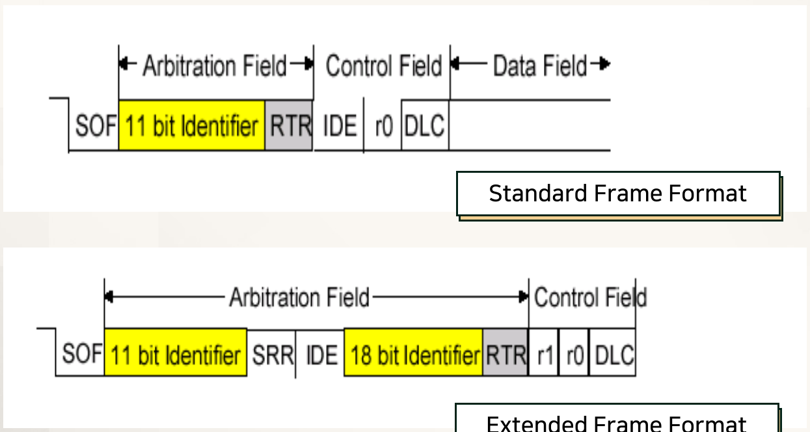

*그림 10. 표준 프레임과 확장 프레임의 중재 필드*

그림 10에서 노랗게 칠한 부분이 식별자이고, 회색 부분이 RTR이다. 표준 프레임의 중재 필드는 식별자 11비트와 RTR이고, 확장 프레임의 중재 필드는 기본 식별자 11비트, SRR, IDE, 확장 식별자 18비트, RTR이다. 원격 프레임, 오류 프레임, 과부하 프레임 같은 나머지 프레임 종류와 각 필드의 세부 동작은 9주차에서 다룬다.

### 1.7 방송형 통신과 메시지 필터링

CAN 프레임에는 받는 노드의 주소가 없다. 한 노드가 보낸 프레임은 버스의 모든 노드에 전달되고, 각 노드는 식별자를 보고 그 메시지가 자기에게 필요한지 스스로 판단한다.

> **용어 정의:** **방송형 통신(broadcast communication)** 은 한 노드가 보낸 메시지를 네트워크의 모든 노드가 받는 방식이다. CAN에서 메시지를 보내는 노드를 **생산자(producer)**, 받아서 쓰는 노드를 **소비자(consumer)** 라 한다.

> **용어 정의:** **수용 필터(acceptance filter)** 는 CAN 컨트롤러 안에서 수신한 프레임의 식별자를 미리 설정한 값과 비교하여, 필요한 메시지만 CPU에 넘기고 나머지는 버리는 하드웨어이다.

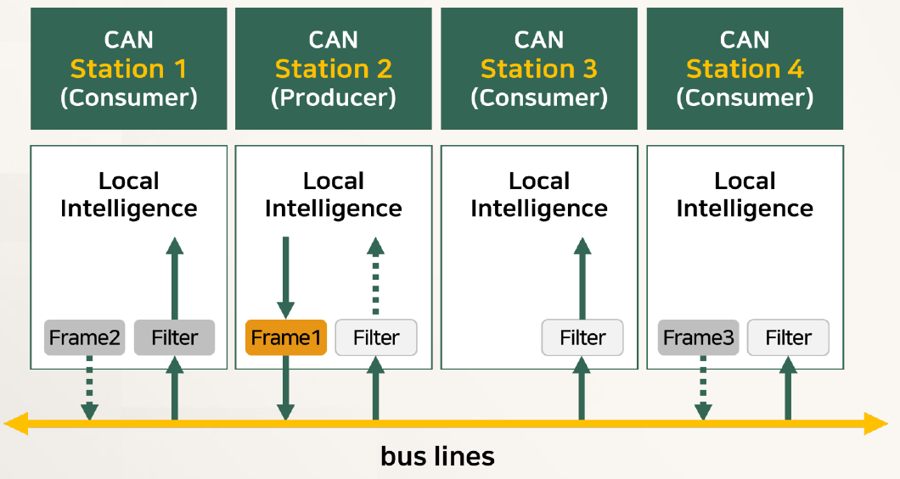

*그림 11. 생산자가 보낸 프레임을 모든 스테이션이 받고 각자 필터로 거르는 방송형 통신*

그림 11에서 스테이션 2가 생산자로서 Frame1을 버스에 보낸다. 스테이션 1, 3, 4는 모두 Frame1을 받고, 각자의 필터가 이 메시지를 통과시킬지 정한다. 필터를 통과한 메시지만 각 스테이션의 응용 처리부(local intelligence)로 올라간다. 스테이션 1의 Frame2와 스테이션 4의 Frame3은 보낼 차례를 기다리는 프레임이다(점선).

방송형 통신의 장점은 다음과 같다.

- **유연성:** 기존 메시지를 쓰는 새 노드를 추가해도 송신 노드나 다른 노드를 바꿀 필요가 없다. 새 노드의 필터만 설정하면 된다.
- **데이터 일관성:** 모든 노드가 같은 프레임을 같은 시각에 받으므로, 예를 들어 여러 ECU가 같은 차속 값을 기준으로 동시에 동작할 수 있다.

### 1.8 다중 버스 접근과 비트 단위 중재

여러 노드가 한 버스를 공유하므로 둘 이상이 동시에 보내려는 경우를 처리해야 한다. CAN은 이를 **CSMA/CD+AMP(carrier sense multiple access with collision detection and arbitration on message priority)** 로 처리한다.

- **CS(carrier sense):** 보내기 전에 버스를 듣고, 버스가 유휴 상태(EOF와 IFS 뒤에 열성이 이어지는 상태)일 때만 전송을 시작한다.
- **MA(multiple access):** 유휴 상태가 되면 보낼 것이 있는 노드는 모두 동시에 SOF를 보내며 전송을 시작할 수 있다.
- **CD(collision detection):** 각 송신 노드는 자기가 보낸 비트와 버스에서 읽은 비트를 비트마다 비교한다.
- **AMP(arbitration on message priority):** 비교가 어긋나면 식별자의 우선순위에 따라 한 노드만 남는다.

> **용어 정의:** **비트 단위 중재(bit-wise arbitration)** 는 동시에 전송을 시작한 노드들이 식별자를 최상위 비트부터 한 비트씩 보내면서, 열성(1)을 보냈는데 버스에서 우성(0)을 읽은 노드가 그 즉시 전송을 멈추고 수신자로 바뀌는 과정이다. 남은 노드의 프레임은 전혀 손상되지 않으므로 **비파괴적(non-destructive)** 중재라 한다.

표 4의 와이어드 AND 성질 때문에 0이 1을 이긴다. 따라서 식별자 비트가 처음으로 갈리는 자리에서 0을 가진 노드가 이기고, 결국 **식별자 값이 가장 작은 노드가 버스를 차지한다.**

**예제.** 세 노드가 동시에 SOF를 보냈다. 식별자는 노드 A가 0x15A, 노드 B가 0x159, 노드 C가 0x1C0이다. 먼저 각 식별자를 11비트 2진수로 바꾼다.

| 노드 | 16진수 | 11비트 2진수 (ID10 → ID0) |
|:-----|:-----|:-----|
| A | 0x15A | 001 0101 1010 |
| B | 0x159 | 001 0101 1001 |
| C | 0x1C0 | 001 1100 0000 |

*표 7. 중재 예제의 식별자*

```text
ID bit       10  9  8  7  6  5  4  3  2  1  0
Node A        0  0  1  0  1  0  1  1  0  1        -> lost at ID1, becomes receiver
Node B        0  0  1  0  1  0  1  1  0  0  1     -> wins, continues with RTR, DLC, ...
Node C        0  0  1  1                          -> lost at ID7, becomes receiver
Bus           0  0  1  0  1  0  1  1  0  0  1
```

*그림 12. 세 노드의 비트 단위 중재 과정*

비트마다 따라가면 다음과 같다.

1. **ID10, ID9:** 세 노드 모두 0(우성)을 보낸다. 버스는 0이고 모두 자기 비트와 같으므로 계속한다.
2. **ID8:** 세 노드 모두 1(열성)을 보낸다. 아무도 우성을 보내지 않으므로 버스는 1이고 모두 계속한다.
3. **ID7:** A와 B는 0, C는 1을 보낸다. 버스는 0이 된다. C는 1을 보냈는데 0을 읽었으므로 중재에서 졌음을 알고 전송을 멈춘 뒤 수신 모드로 바뀐다. A와 B는 자기 비트와 버스가 같으므로 계속한다.
4. **ID6부터 ID2:** A와 B의 비트가 모두 같다(1, 0, 1, 1, 0). 버스도 같은 값이 되고 둘 다 계속한다.
5. **ID1:** A는 1, B는 0을 보낸다. 버스는 0이다. A는 1을 보냈는데 0을 읽었으므로 진다.
6. **ID0 이후:** B만 남아 식별자의 마지막 비트와 RTR, 제어 필드, 데이터를 이어서 보낸다.

결과는 세 값 가운데 가장 작은 0x159를 가진 B가 이기는 것이다($0\text{x}159 < 0\text{x}15\text{A} < 0\text{x}1\text{C}0$). 이 과정에서 버스에 나타난 비트열은 처음부터 끝까지 B의 식별자와 같으므로, B의 프레임은 충돌로 손상되지 않았고 재전송도 필요 없다. 진 A와 C는 B의 프레임을 수신한 뒤 버스가 다시 유휴 상태가 되면 전송을 재시도한다.

> **주의:** 비트 단위 중재가 성립하려면 같은 버스에서 두 노드가 같은 식별자의 데이터 프레임을 보내지 않아야 한다. 식별자가 같으면 중재 필드가 끝날 때까지 승부가 나지 않고, 그 뒤의 데이터가 달라지는 지점에서 비트 오류가 발생한다. 그래서 CAN 네트워크를 설계할 때 메시지마다 고유한 식별자를 배정한다.

> **[컴퓨터네트워크]** 이더넷의 CSMA/CD에서는 충돌이 나면 충돌한 모든 프레임이 망가지고, 각 노드가 무작위 시간을 기다린 뒤 다시 보낸다. CAN에서는 충돌이 해결(resolution)되어 우선순위가 가장 높은 프레임이 그대로 전달되므로, CAN의 방식을 CSMA/CR(collision resolution)이라 부르기도 한다. 이더넷의 CSMA/CD는 7주차에서 다룬다.

CAN 노드 하나의 송수신 동작을 흐름도로 정리하면 다음과 같다.

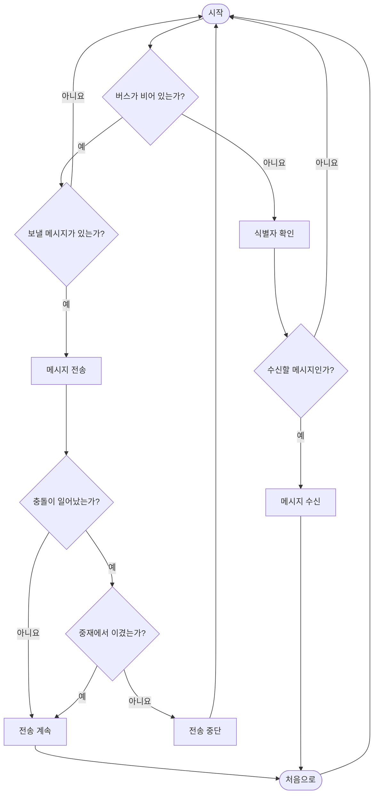

*그림 13. CAN 노드의 송수신 흐름*

중재에서 진 노드는 전송을 멈추고 처음으로 돌아간다. 이때 버스는 이긴 노드가 쓰고 있으므로 "버스가 비어 있는가?"의 답이 "아니요"가 되고, 진 노드는 이긴 노드의 프레임을 식별자로 확인하여 필요하면 수신한다.

### 1.9 오류 검출과 오류 상태

CAN은 다섯 가지 방식으로 오류를 검출한다. 세 가지는 메시지 수준, 두 가지는 비트 수준이다.

| 수준 | 방식 | 검출하는 오류 |
|:-----|:-----|:-----|
| 메시지 | CRC(cyclic redundancy check) | 수신기가 SOF부터 데이터까지로 CRC를 다시 계산하여 받은 CRC 시퀀스와 다르면 CRC 오류로 판정한다. |
| 메시지 | 프레임 검사(frame check) | CRC 구분자, ACK 구분자, EOF처럼 값이 고정된 비트가 규칙과 다르면 형식 오류(form error)로 판정한다. |
| 메시지 | ACK 오류 검사(acknowledgment error check) | 송신기가 ACK 슬롯에서 우성을 읽지 못하면, 즉 프레임을 올바르게 받은 노드가 하나도 없으면 ACK 오류로 판정한다. |
| 비트 | 비트 모니터링(bit monitoring) | 송신기가 보낸 비트와 버스에서 읽은 비트가 다르면 비트 오류로 판정한다. 중재 필드와 ACK 슬롯에서는 다를 수 있으므로 제외한다. |
| 비트 | 비트 스터핑(bit stuffing) | 같은 값이 6개 연속으로 나타나면 스터핑 오류로 판정한다(1.5절). |

*표 8. CAN의 다섯 가지 오류 검출 방식*

> **[컴퓨터네트워크]** CRC는 비트열을 생성 다항식으로 나눈 나머지를 덧붙여 전송 중의 비트 오류를 검출하는 방법이다. CAN의 CRC는 15비트이며, CRC의 계산 원리는 7주차에서 다룬다.

오류를 검출한 노드는 곧바로 오류 프레임(error frame)을 보내 모든 노드에 알리고, 그 프레임은 버려진 뒤 송신기가 다시 보낸다. 그런데 한 노드가 고장 나서 계속 오류를 일으키면 버스 전체가 마비될 수 있다. 이를 막기 위해 각 노드는 두 개의 오류 카운터를 가진다.

- **TEC(transmit error counter):** 송신 중에 오류가 생기면 늘고, 송신이 성공하면 준다.
- **REC(receive error counter):** 수신 중에 오류가 생기면 늘고, 수신이 성공하면 준다.

카운터의 값에 따라 노드는 세 상태 가운데 하나에 있다.

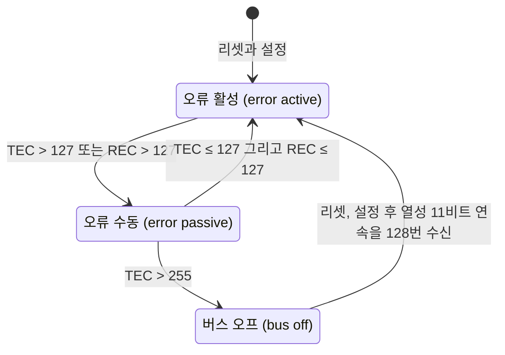

*그림 14. CAN 노드의 오류 상태 전이*

| 상태 | 조건 | 동작 |
|:-----|:-----|:-----|
| 오류 활성(error active) | TEC ≤ 127이고 REC ≤ 127 | 정상 상태이다. 오류를 검출하면 우성 비트로 된 능동 오류 플래그를 보내 다른 노드의 수신을 확실히 중단시킨다. |
| 오류 수동(error passive) | TEC > 127 또는 REC > 127 | 오류를 자주 겪는 노드이다. 오류를 검출해도 열성 비트로 된 수동 오류 플래그만 보내므로 다른 노드의 통신을 방해하지 못하고, 송신 뒤에는 추가로 기다려야 한다. |
| 버스 오프(bus off) | TEC > 255 | 버스에서 논리적으로 분리되어 송신하지도, 확인 응답을 하지도 않는다. |

*표 9. CAN 노드의 오류 상태*

버스 오프 상태의 노드는 리셋과 설정을 거친 뒤 열성 비트 11개가 연속으로 나타나는 것을 128번 관찰해야(버스가 충분히 오래 정상임을 확인해야) 오류 활성 상태로 돌아간다. 이렇게 고장 난 노드를 단계적으로 고립시키는 기능이 1.2절의 결함 국한이다.

> **참고:** 강의자료의 상태도는 버스 오프로 가는 조건을 "REC > 255"로, 오류 활성으로 돌아오는 조건을 "REC < 127 or TEC < 127"로 적고 있다. 규격에서는 버스 오프를 일으키는 것은 송신 오류 카운터뿐이므로 조건은 TEC > 255이며, 오류 활성으로 돌아오려면 두 카운터가 모두 127 이하가 되어야 한다 [4].

오류 프레임의 형식, 카운터의 증감 규칙, 비트 타이밍은 9주차에서 다룬다.

### 1.10 CAN의 구현: 컨트롤러와 트랜시버

CAN 노드는 세 구성 요소로 구현한다.

| 구성 요소 | 역할 |
|:-----|:-----|
| 마이크로컨트롤러(microcontroller) | 응용 프로그램을 실행하고, 보낼 데이터를 만들거나 받은 데이터를 처리한다. 상위 프로토콜도 여기서 처리한다. |
| 프로토콜 컨트롤러(protocol controller) | 프레임의 구성과 해석, 비트 스터핑, CRC 계산, 중재, 오류 검출과 신호, 확인 응답, 동기화처럼 CAN 데이터 링크 계층의 일을 하드웨어로 처리한다. |
| 트랜시버(transceiver) | 컨트롤러의 논리 신호(Tx, Rx)를 CAN_H와 CAN_L의 차동 전압으로 바꾸고, 그 반대로도 바꾼다. 버스 고장을 관리한다. |

*표 10. CAN 노드의 세 구성 요소*

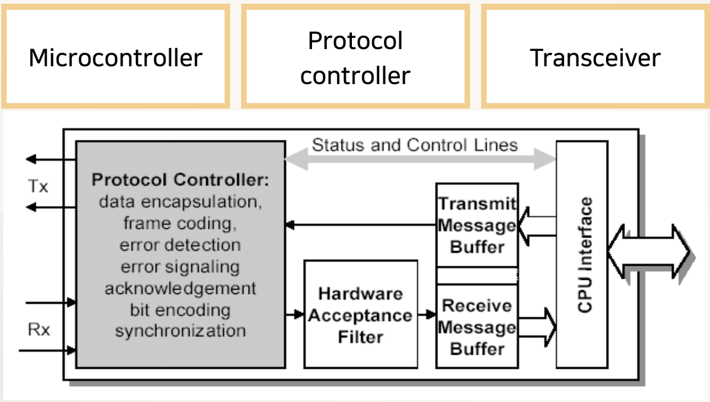

*그림 15. CAN 프로토콜 컨트롤러의 내부 구조*

그림 15의 프로토콜 컨트롤러는 Tx와 Rx 선으로 트랜시버와 연결된다. 내부의 프로토콜 처리부가 데이터 캡슐화, 프레임 부호화, 오류 검출과 신호, 확인 응답, 비트 부호화, 동기화를 맡는다. 수신한 프레임은 하드웨어 수용 필터(1.7절)를 거쳐 수신 메시지 버퍼에 저장되고, 보낼 프레임은 송신 메시지 버퍼에서 꺼내진다. CPU는 CPU 인터페이스를 통해 버퍼를 읽고 쓰며, 상태 및 제어 선으로 컨트롤러의 동작을 설정한다.

프로토콜 컨트롤러를 두는 방법은 두 가지이다.

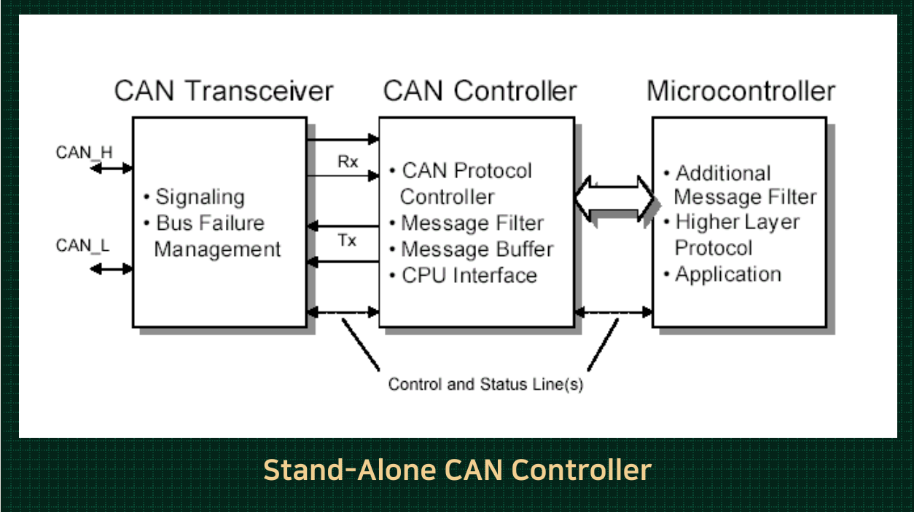

*그림 16. 독립형 CAN 컨트롤러를 쓰는 구성*

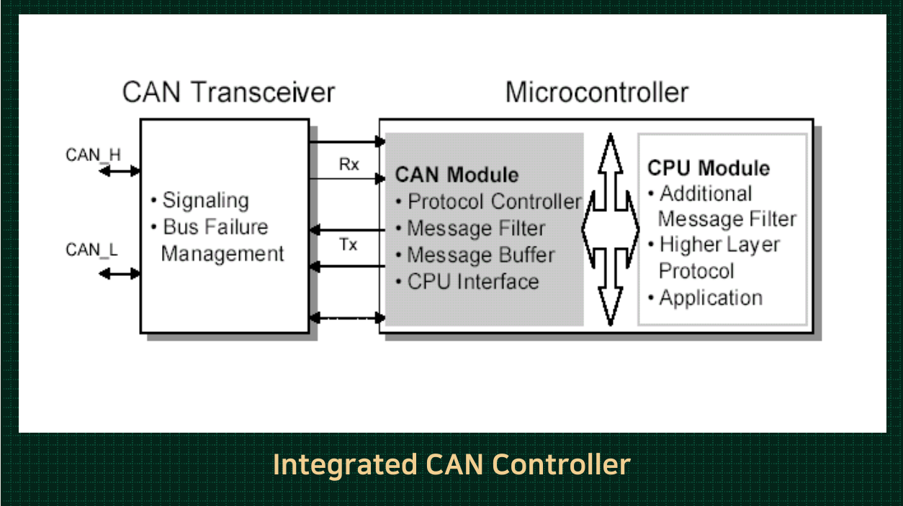

*그림 17. 통합형 CAN 컨트롤러를 쓰는 구성*

- **독립형(stand-alone) CAN 컨트롤러(그림 16):** CAN 컨트롤러가 마이크로컨트롤러와 별개의 칩이다. 트랜시버, CAN 컨트롤러, 마이크로컨트롤러 세 칩이 필요하며, 마이크로컨트롤러는 외부 버스로 컨트롤러에 접근한다. CAN 기능이 없는 마이크로컨트롤러에도 CAN을 붙일 수 있다.
- **통합형(integrated) CAN 컨트롤러(그림 17):** CAN 모듈이 마이크로컨트롤러 칩 안에 들어 있다. 칩 수가 줄어 비용이 낮고 회로 설계가 쉬우며, CPU가 칩 내부 버스로 CAN 모듈에 바로 접근하므로 CPU 부하도 줄어든다.

두 구성 모두 마이크로컨트롤러 쪽에 추가 메시지 필터와 상위 계층 프로토콜, 응용 프로그램이 있고, 트랜시버는 신호 변환과 버스 고장 관리를 맡는다.

### 1.11 사례: CAN 기반 바디 제어 시스템

CAN을 실제 차량에 적용한 개발 사례로, 도어, 미러, 창문 같은 차체(body) 전장품을 CAN으로 제어하는 바디 제어 시스템이 있다.

- **목표:** CAN 통신 기반의 바디 제어 모듈을 개발한다.
- **과제:** 차량 전기 시스템의 분석, 바디 제어 모듈의 하드웨어 개발, 메시지 정의와 소프트웨어 개발, 실차(on-board) 시험.

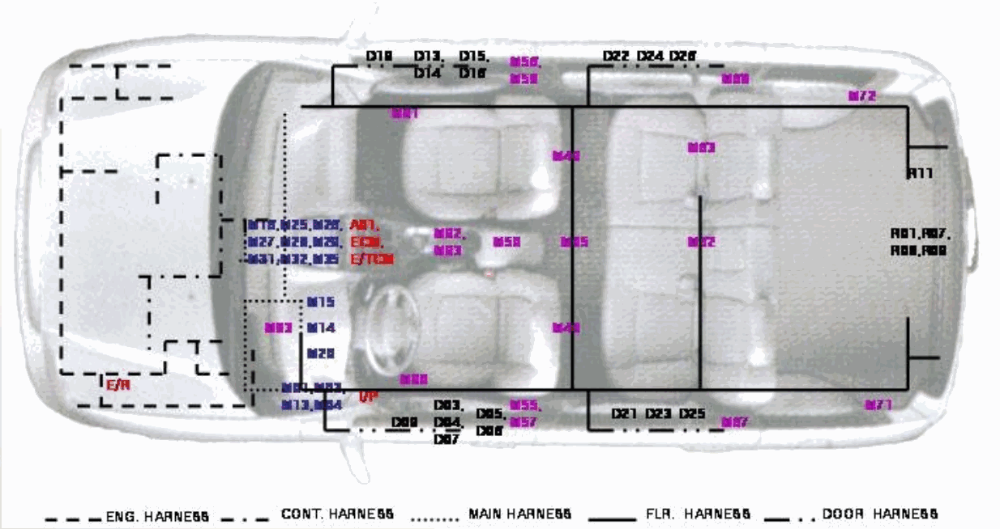

*그림 18. 차량 전기 시스템의 하네스 배치*

첫 단계인 전기 시스템 분석에서는 그림 18처럼 차량의 배선 묶음(하네스)이 어디를 지나는지 파악한다. 그림은 엔진(ENG), 제어(CONT), 메인(MAIN), 바닥(FLR), 도어(DOOR) 하네스와 각 커넥터의 위치를 표시한다. 기존 배선이 차체 곳곳으로 뻗어 있으므로, 어느 제어기를 어디에 두고 어떤 신호를 CAN 메시지로 바꿀지 정하는 근거가 된다.

| 약어 | 이름 | 역할 |
|:-----|:-----|:-----|
| CCU1, CCU2 | central controller unit 1, 2 | 중앙 제어기 |
| DDC | driver door controller | 운전석 도어 제어기 |
| ADC | assistant door controller | 조수석 도어 제어기 |
| PDLC | passenger door left controller | 왼쪽 뒷좌석 도어 제어기 |
| PDRC | passenger door right controller | 오른쪽 뒷좌석 도어 제어기 |
| IMC | inner module controller | 실내 모듈 제어기 |
| RDC | rear door controller | 뒷문(트렁크) 제어기 |

*표 11. 바디 제어 모듈의 종류*

중앙 제어기 두 개는 차량 앞쪽에 있고, 네 도어 제어기는 각 도어에, 실내 모듈 제어기는 실내 중앙에, 뒷문 제어기는 차량 뒤쪽에 있다. 모든 모듈은 CAN 버스 하나로 연결된다.

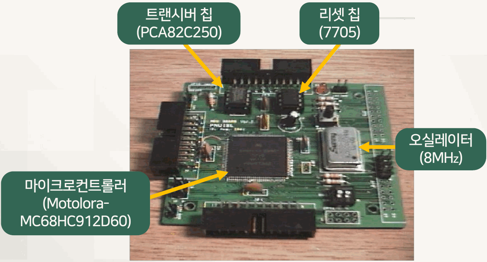

*그림 19. 바디 제어용 CAN 모듈 기판*

그림 19의 모듈은 마이크로컨트롤러(Motorola MC68HC912D60), CAN 트랜시버 칩(PCA82C250), 전원 전압이 낮아지면 마이크로컨트롤러를 리셋하는 리셋 칩(7705), 클록을 만드는 8 MHz 오실레이터로 이루어진다. MC68HC912D60은 CAN 모듈을 내장한 마이크로컨트롤러이므로 1.10절의 통합형 구성에 해당하며, 그래서 별도의 CAN 컨트롤러 칩이 없다.

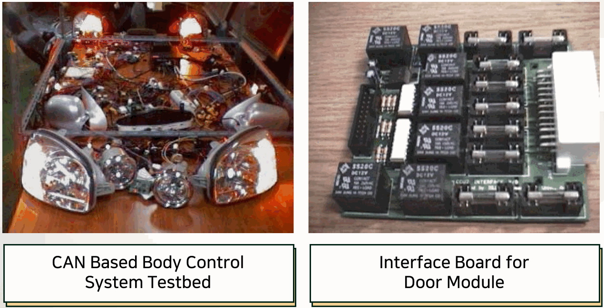

*그림 20. CAN 기반 바디 제어 시스템 시험 장치와 도어 모듈용 인터페이스 보드*

그림 20의 왼쪽은 차량의 램프와 모듈을 탁상에 배치하여 CAN 메시지로 동작을 시험하는 장치이고, 오른쪽은 도어 모듈이 릴레이로 모터와 램프 같은 부하를 구동하도록 만든 인터페이스 보드이다.

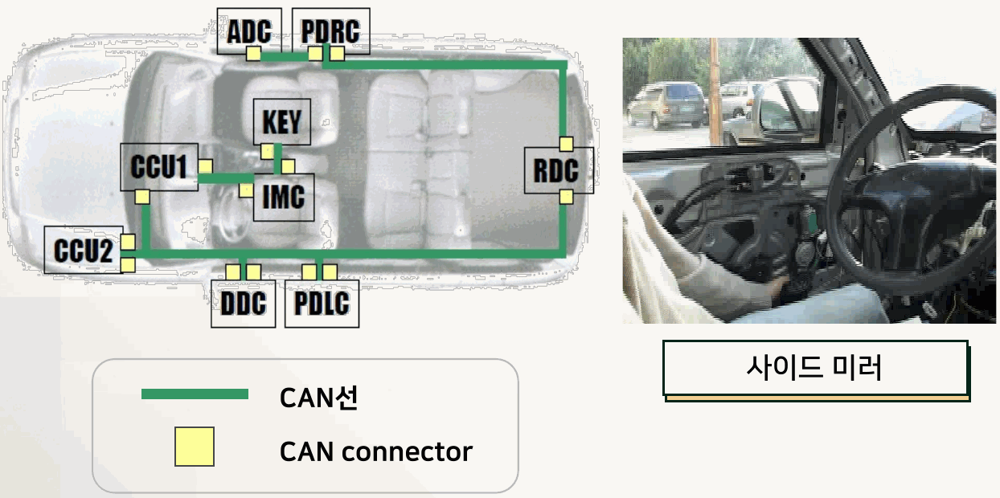

*그림 21. 실차에 구성한 CAN 배선과 커넥터, 사이드 미러 제어*

그림 21은 실차에서 CCU1, CCU2, IMC, KEY, DDC, PDLC, ADC, PDRC, RDC를 CAN 선(초록색)과 CAN 커넥터(노란 네모)로 연결한 모습이다. 오른쪽 사진은 이 네트워크로 사이드 미러를 제어하는 실차 시험 장면이다. 수많은 전선 다발로 각각 이어지던 부하들이 CAN 선 한 쌍을 공유하게 되므로 배선이 크게 단순해진다.

---

<br>

## 2. 다양한 차량용 IVN

> **용어 정의:** **IVN(in-vehicle network, 차량 내부 네트워크)** 은 차량 안의 ECU, 센서, 액추에이터, 멀티미디어 장치를 연결하는 네트워크이다. 요구되는 속도, 비용, 실시간성이 기능마다 크게 다르므로 여러 종류의 IVN이 함께 쓰인다.

### 2.1 차량 내부 네트워크의 분류

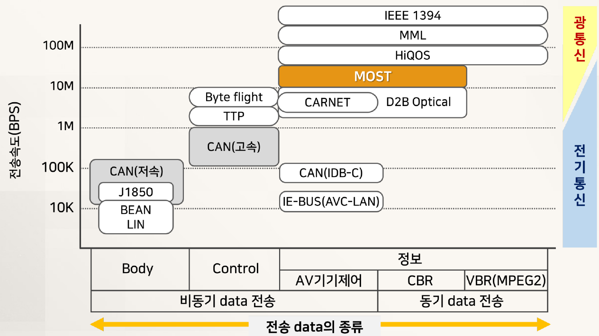

*그림 22. 전송 속도와 응용 분야에 따른 차량 내부 네트워크 프로토콜*

그림 22는 세로축에 전송 속도(bps, 로그 눈금), 가로축에 응용 분야를 두고 프로토콜을 배치한 것이다.

- **바디(body):** 10 kbps\~100 kbps 수준의 LIN, BEAN, J1850, 저속 CAN이 쓰인다.
- **제어(control):** 수백 kbps\~10 Mbps 수준의 고속 CAN, TTP, Byteflight가 쓰인다.
- **정보(information):** AV 기기 제어에는 IE-BUS(AVC-LAN)와 CAN(IDB-C)이, 일정한 비트율의 데이터(CBR, constant bit rate)에는 MOST, CARNET, D2B Optical이, MPEG2 영상처럼 비트율이 변하는 데이터(VBR, variable bit rate)에는 IEEE 1394, MML, HiQOS가 쓰인다.
- 바디와 제어는 필요할 때마다 짧은 메시지를 보내는 **비동기 데이터 전송**, 정보 분야는 음성과 영상처럼 끊김 없이 흐르는 **동기 데이터 전송**이다. 오른쪽 띠는 대략 10 Mbps 이상은 광통신, 그 아래는 전기 통신을 쓴다는 뜻이다.

응용 분야와 적용 시스템, 표준 기관의 분류를 함께 정리하면 다음과 같다.

| 응용 분야 | 적용 시스템 | ISO 분류 | SAE 분류 |
|:-----|:-----|:-----|:-----|
| 바디 제어(body control) | 램프, 파워 윈도, 도어 잠금, 파워 시트 | 저속(low speed) | Class A (≤ 125 kbps) |
| 진단(diagnostic) | 고장 진단 | 저속 | Class B (≤ 250 kbps) |
| 파워트레인과 섀시 제어 | 엔진, 변속기, 브레이크, 조향 제어 | 고속(high speed) | Class C (> 250 kbps) |
| 정보와 ITS | 내비게이션, CD, DVD, 전화 | 없음 | IDB (ITS 버스) |
| 안전(safety) | 에어백, 프리텐셔너 | 없음 | 없음 |

*표 12. 차량 내 응용 분야별 네트워크 분류*

> **참고:** SAE 분류의 속도 경계는 자료마다 다르다. SAE J2057을 바탕으로 한 흔한 분류는 Class A를 10 kbps 미만, Class B를 10 kbps\~125 kbps, Class C를 125 kbps\~1 Mbps로 두고, 그보다 빠른 멀티미디어용 네트워크를 Class D로 둔다 [5]. 어느 분류에서든 바디 제어가 가장 느리고 파워트레인과 섀시 제어가 가장 빠른 등급이라는 순서는 같다. 프리텐셔너(pretensioner)는 충돌 순간 안전띠를 당겨 탑승자를 좌석에 고정하는 장치이다.

| 속도 | 프로토콜 | 특성 |
|:-----|:-----|:-----|
| 저속 | LIN | 보통 20 kbps이다. 스마트 센서와 액추에이터처럼 단순한 켜고 끄는 기기의 통신에 쓴다. |
| 중저속 | CAN | 최대 1 Mbps(고속 CAN)로 ECU 사이의 통신과 제어 신호를 나른다. 제어기용 네트워크의 표준으로 자리 잡았다. |
| 고속 | MOST | 25 Mbps이며, 후속 규격 MOST150은 150 Mbps의 멀티미디어 버스이다. 유럽을 중심으로 양산되었다. |
| 고속 | IEEE 1394 | 100 Mbps 이상의 멀티미디어 버스이며, 미국을 중심으로 차량용 표준화가 진행되었다. |

*표 13. 전송 속도별 대표적인 차량용 프로토콜*

| 응용 분야 | 대표 프로토콜 |
|:-----|:-----|
| 바디 제어 | LIN, BEAN, LS-CAN(저속 CAN), SAE J1850, TTP/A |
| 실시간 제어 | HS-CAN(고속 CAN), TTP/C, FlexRay |
| 인포테인먼트와 텔레매틱스 | MOST, D2B, IDB, IEEE 1394 |
| 안전 | Safe-by-Wire, BST, DSI |

*표 14. 응용 분야별 대표 프로토콜*

인포테인먼트(infotainment)는 정보(information)와 오락(entertainment)을 합친 말로 내비게이션, 오디오, 영상 같은 기능을 뜻하고, 텔레매틱스(telematics)는 통신망으로 차량과 외부를 연결하는 서비스를 뜻한다. 안전 분야의 Safe-by-Wire, BST, DSI는 에어백 제어기와 충돌 센서, 점화 장치를 연결하는 전용 버스이다.

### 2.2 LIN

> **용어 정의:** **LIN(Local Interconnect Network)** 은 유럽 자동차 업계가 중심이 되어 만든 저가의 차량용 네트워크로, 차량 곳곳에 분산된 단순한 전자 장치들을 위한 저비용 단일 전선 직렬 통신 시스템이다.

LIN은 전선 한 가닥과 차체 접지로 통신하고, 마스터 노드 하나가 정해진 순서로 슬레이브 노드에 차례를 주는 방식이라 중재 회로가 필요 없다. 그래서 CAN보다 훨씬 싸게 구현된다. 대신 속도는 보통 20 kbps로, 차량에서 흔히 쓰는 250 kbps급 CAN의 약 1/12에 불과하고, 수십 Mbps급 MOST보다는 천 배 이상 느리다.

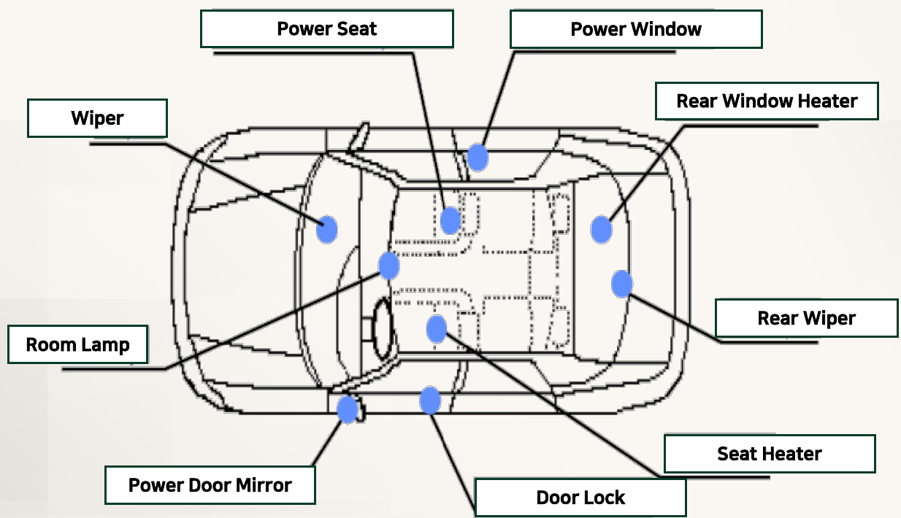

*그림 23. 차량에서 LIN이 쓰이는 곳*

그림 23처럼 LIN은 파워 시트, 파워 윈도, 뒷유리 열선, 와이퍼, 뒷유리 와이퍼, 실내등, 시트 열선, 전동 사이드 미러, 도어 잠금 같은 바디 전장품에 쓰인다. 이들은 빠른 응답이 필요 없고 데이터 양도 적으므로 LIN의 낮은 속도로 충분하다. 보통 도어나 시트 단위로 LIN 하위 네트워크를 만들고, 그 마스터가 CAN에도 연결되어 두 네트워크를 잇는 게이트웨이 역할을 한다. LIN의 프레임과 동작은 9주차에서 다룬다.

### 2.3 MOST

> **용어 정의:** **MOST(Media Oriented Systems Transport)** 는 오디오, 영상, 내비게이션 같은 멀티미디어 데이터를 위한 고성능 차량용 네트워크이다. 25 Mbps에서 시작하여 이후 150 Mbps까지 지원한다.

MOST 네트워크의 목표는 다음과 같다.

- 최대 25 Mbps의 데이터 전송 속도를 갖는 저비용 솔루션을 구현한다.
- 플라스틱 광섬유(POF, plastic optical fiber)를 써서 무게, 비용, 전자기 간섭 면에서 최적화한다.
- 높은 신뢰성과 편리한 사용성을 갖춘다.
- 다양한 응용 프로토콜을 올릴 수 있는 개방형 프로토콜 인터페이스를 제공한다.

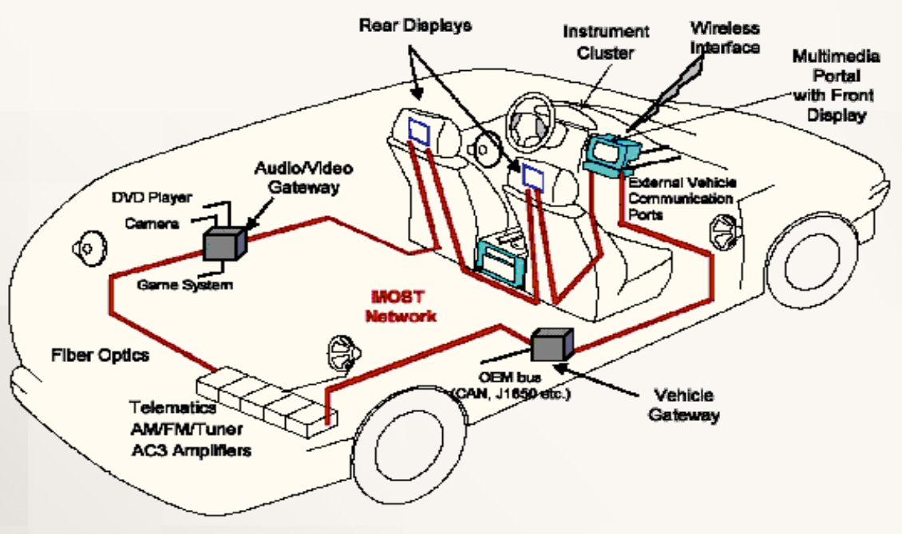

*그림 24. 차량의 MOST 네트워크 구성 예*

그림 24에서 빨간 선이 MOST 네트워크(광섬유)이다. DVD 플레이어, 카메라, 게임 장치를 묶는 오디오 비디오 게이트웨이, 뒷좌석 디스플레이, 계기판, 무선 인터페이스, 앞좌석 멀티미디어 디스플레이, 텔레매틱스와 AM/FM 튜너, 앰프가 MOST로 연결된다. 차량 게이트웨이는 MOST 네트워크를 CAN이나 J1850 같은 제어용 버스(OEM 버스)와 연결한다.

### 2.4 TTP

> **용어 정의:** **TTP(Time-Triggered Protocol)** 는 결함 허용(fault-tolerant) 시간 기반 통신 프로토콜이다. 시간 기반(time-triggered) 통신은 각 노드가 미리 정한 시간표의 자기 시간 구간에만 메시지를 보내는 방식이다.

CAN처럼 사건이 생길 때 보내는 사건 기반(event-triggered) 통신에서는 버스가 붐비면 우선순위가 낮은 메시지가 언제 전달될지 보장하기 어렵다. 브레이크나 조향을 전선과 전자 제어로만 수행하는 X-by-wire 시스템은 메시지가 정확한 시각에 반드시 도착해야 하므로, 결함을 허용하면서 시간을 보장하는 프로토콜이 필요하다. TTP는 이 요구를 위해 TTA(Time-Triggered Architecture) 그룹이 개발했으며, 이 그룹에는 Volkswagen, Audi, PSA Peugeot Citroen, Delphi, Honeywell, NEC, Oki가 참여했다. 항공과 자동차 분야에 쓰인다. 표 14의 TTP/A는 바디 제어용 저가 버전, TTP/C는 실시간 제어용 버전이다.

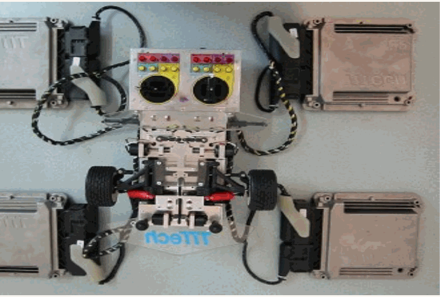

*그림 25. TTP로 연결한 X-by-wire 시험 장치*

그림 25는 TTTech가 만든 시험 장치로, 네 개의 제어 장치가 TTP로 연결되어 소형 차량의 조향과 구동을 제어한다.

### 2.5 FlexRay

> **용어 정의:** **FlexRay** 는 GM, DaimlerChrysler, BMW, Philips, Motorola 등이 모인 FlexRay 컨소시엄이 개발한 고속, 결정적(deterministic) 차량용 네트워크이다. 한 통신 주기를 정적 구간과 동적 구간으로 나눈다.

- **정적 구간(static part):** 시간 기반으로 동작한다. 각 노드에 고정된 시간 슬롯을 주어 전달 시각을 보장하므로, 브레이크와 조향 같은 안전 관련 실시간 제어에 쓴다.
- **동적 구간(dynamic part):** 사건 기반으로 동작한다. 필요할 때만 보내는 메시지를 처리한다.

FlexRay는 두 방식을 한 주기 안에 함께 제공하여, 시간 보장이 필요한 메시지와 그렇지 않은 메시지를 한 네트워크에서 다룬다. 2004년 말 Philips가 FlexRay 칩의 양산을 시작했다.

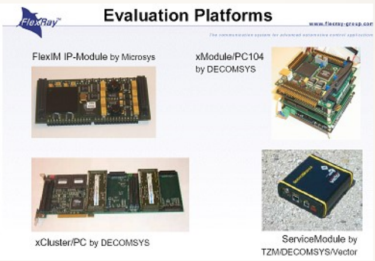

*그림 26. FlexRay 컨소시엄의 참여사와 평가용 플랫폼*

그림 26의 왼쪽은 FlexRay 컨소시엄에 참여한 GM, Audi, Bentley, Volkswagen, Bosch, Daimler 같은 회사이고, 오른쪽은 FlexRay 개발과 시험에 쓰는 평가용 모듈과 인터페이스 장비이다. FlexRay의 프레임과 매체 접근 방식은 9주차에서 다룬다.

### 2.6 진단 통신: KWP2000과 OBD

> **용어 정의:** **OBD(on-board diagnostics, 차량 자기 진단)** 는 차량의 상태를 확인하고 고장을 진단하기 위한 규격이다. 최근에는 차량 정보를 밖으로 내보내는 인터페이스 역할도 한다.

OBD의 발전 과정은 다음과 같다.

- 최초 규격은 OBD-I이고, 이를 이은 OBD-II가 기본 규격이 되었다. 그러나 유럽은 EOBD, 일본은 JOBD, 한국은 KOBD, 오스트레일리아는 ADR 79 규격을 쓴다.
- 이 규격들은 OBD-II를 기본으로 하지만 신호 체계가 같지 않아, 한 나라의 진단기로 다른 규격 차량의 일부 항목을 모니터링하지 못할 수 있다.
- 미국의 배기가스 규제 OBD-II는 배기가스에 영향을 줄 수 있는 모든 시스템의 제어기에 자기 진단 기능을 두도록 하고, 전용 진단 장비로 어느 부분이 언제 고장 났는지 알 수 있게 한다.
- 한국은 2005년부터 신차에, 2007년부터 모든 차량에 OBD-II 규격을 의무화했다.

OBD-II는 다음 다섯 프로토콜 가운데 하나를 쓴다: SAE J1850 PWM, SAE J1850 VPW, ISO 9141-2, ISO 14230-4(KWP2000), ISO 15765-4(SAE J2480, CAN 기반).

> **참고:** 미국에서는 2008년식 차량부터 OBD-II 통신에 CAN 기반 ISO 15765-4를 쓰도록 의무화되어, 현재 대부분의 차량은 진단 통신에도 CAN을 쓴다 [6].

> **용어 정의:** **KWP2000(Keyword Protocol 2000)** 은 차량 진단을 위해 개발된 직렬 통신 프로토콜로, 국제 규격 ISO 14230이다. OBD-II가 허용하는 프로토콜의 하나이다.

KWP2000의 메시지는 헤더, 데이터, 체크섬으로 이루어진다.

```text
┌───────────────────────────────┬──────────────────────────────┬──────────┐
│            Header             │          Data bytes          │ Checksum │
├───────┬───────┬───────┬───────┼───────┬──────────────────────┼──────────┤
│  Fmt  │  Tgt  │  Src  │  Len  │  SId  │         Data         │    CS    │
└───────┴───────┴───────┴───────┴───────┴──────────────────────┴──────────┘
        max. 4 bytes                    max. 255 bytes            1 byte
```

*그림 27. KWP2000 메시지의 구조*

- **헤더(header):** 메시지의 형식을 정한다. 형식 바이트(Fmt), 목적지 주소(Tgt, target), 출발지 주소(Src, source), 길이 바이트(Len)로 이루어지며 최대 4바이트이다.
- **데이터 바이트(data bytes):** 첫 바이트는 요청하는 진단 서비스의 종류를 나타내는 서비스 식별자(SId, service identifier)이고, 그 뒤가 서비스의 데이터이다. 최대 255바이트이다.
- **체크섬(checksum):** 1바이트(8비트)로, 앞선 모든 바이트를 더한 값으로 전송 오류를 검사한다.

진단 장비(tester)와 차량 사이의 통신 서비스에는 통신 시작(Start Communication), 통신 종료(Stop Communication), 타이밍 매개변수 접근(Access Timing Parameter), 데이터 전송(Send Data) 서비스가 있다. 통신 시작으로 연결을 열고, 타이밍 매개변수 접근으로 응답 대기 시간 같은 값을 조정하고, 데이터 전송으로 진단 요청과 응답을 주고받은 뒤, 통신 종료로 연결을 닫는다.

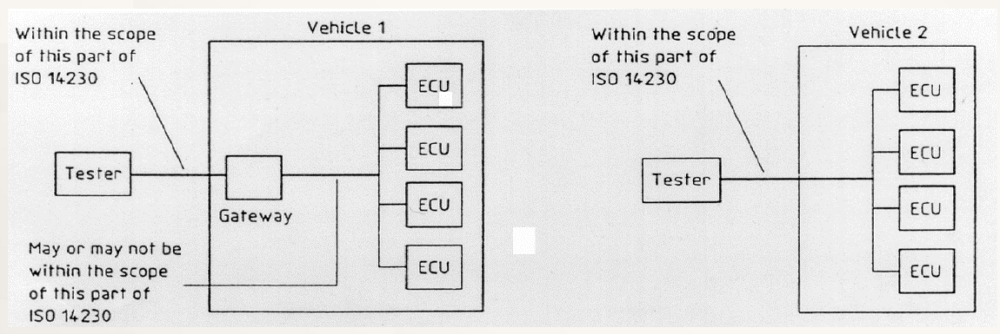

*그림 28. 진단 장비와 차량 ECU의 연결 구성과 ISO 14230의 범위*

그림 28의 차량 1에서는 진단 장비가 게이트웨이를 거쳐 여러 ECU와 통신하고, 차량 2에서는 진단 장비가 ECU들과 직접 연결된다. 진단 장비와 차량 사이의 연결은 ISO 14230의 범위이고, 게이트웨이 뒤쪽의 차량 내부 연결은 이 규격의 범위일 수도 있고 아닐 수도 있다.

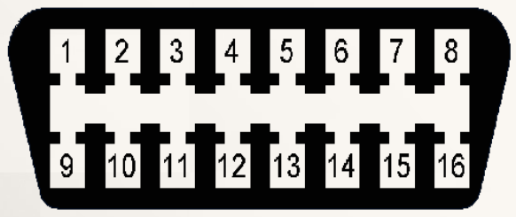

*그림 29. OBD-II 커넥터의 핀 번호*

| 핀 | 신호 |
|:-----|:-----|
| 2 | J1850 Bus+ |
| 4 | 섀시 접지(chassis ground) |
| 5 | 신호 접지(signal ground) |
| 6 | CAN High (J-2284) |
| 7 | ISO 9141-2 K 라인 |
| 10 | J1850 Bus- |
| 14 | CAN Low (J-2284) |
| 15 | ISO 9141-2 L 라인 |
| 16 | 배터리 전원 |

*표 15. OBD-II 커넥터의 표준 핀 배정*

표 15에 없는 핀은 제조사가 자유롭게 쓴다. 차량이 어느 프로토콜을 쓰는지는 어떤 핀에 신호가 있는지로 알 수 있다. 예를 들어 6번과 14번 핀이 쓰이면 CAN, 7번 핀이 쓰이면 ISO 9141-2나 KWP2000이다.

### 2.7 차량용 멀티미디어 네트워크

| 프로토콜 | 특징 |
|:-----|:-----|
| D2B(Domestic Digital Bus) | Optical Chip Consortium이 개발했다. 광섬유 매체를 쓰며, Mercedes S-Class에 쓰였다. |
| IDB-C(ITS Data Bus, CAN) | CAN 2.0B의 물리 계층과 데이터 링크 계층을 바탕으로 한 SAE 표준(SAE J2366)이다. CAN과 같은 꼬임쌍선을 쓴다 [7]. |
| MOST | Oasis Silicon Systems가 개발했다. 동기와 비동기 대역폭을 모두 제공하고, 가상 네트워크 관리 기능을 시스템에 내장한다. |

*표 16. 차량용 멀티미디어 네트워크 프로토콜*

> **참고:** 강의자료는 IDB-C가 광섬유 매체를 쓴다고 적지만, IDB-C의 물리 계층은 SAE J2284-2의 CAN 2.0B를 바탕으로 하므로 구리 꼬임쌍선을 쓴다 [7].

동기 대역폭은 음성과 영상처럼 일정한 속도로 끊김 없이 흘러야 하는 데이터를 위해 대역의 일부를 고정으로 예약해 둔 것이고, 비동기 대역폭은 파일이나 제어 메시지처럼 불규칙하게 생기는 데이터에 남는 대역을 나누어 주는 것이다.

---

<br>

## 3. 네트워크의 물리적 구성에 따른 분류

### 3.1 WAN, MAN, LAN

하드웨어 성능이 급격히 높아지고, 여러 곳에 놓인 CPU의 수가 늘고, 시스템 사이에 주고받는 데이터의 양과 필요성이 커지면서 네트워크가 발달했다. 네트워크는 물리적 구성의 크기, 즉 연결하는 지리적 범위에 따라 LAN, MAN, WAN으로 나뉜다. 이 분류는 단순한 크기 구분이 아니라 각 규모에서 쓰는 기술적 특성(전송 방식, 속도, 라우팅의 필요성)도 반영한다.

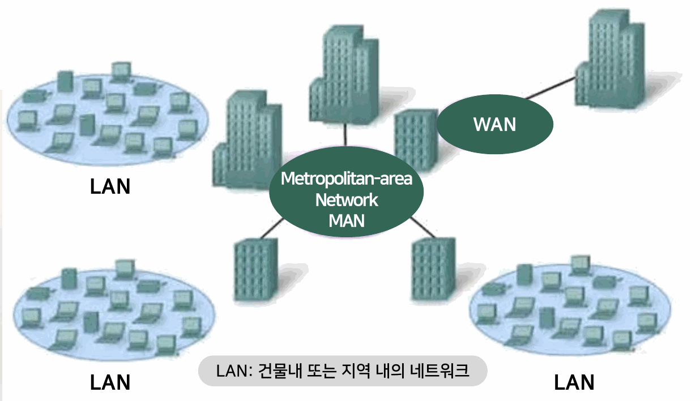

*그림 30. LAN, MAN, WAN의 관계*

그림 30에서 건물이나 지역 안의 LAN 여러 개가 도시 규모의 MAN으로 묶이고, MAN은 다시 국가 이상 규모의 WAN에 연결된다.

| 구분 | 범위 | 특징 |
|:-----|:-----|:-----|
| LAN(local area network) | 단일 건물, 학교 등 가까운 거리 | 단일 전송 케이블로 연결할 수 있고 거리가 가까워 브로드캐스팅 방식으로 전송한다. 보통 수십 Mbps\~수 Gbps이다. |
| MAN(metropolitan area network) | 도시 규모 | 하드웨어와 소프트웨어 구성은 LAN과 비슷하지만 연결 규모가 크다. 국제 표준안은 DQDB이며, 전송 방향이 다른 두 버스로 호스트를 연결한다. |
| WAN(wide area network) | 국가 이상의 넓은 지역 | 점대점(1:1) 연결로 장거리 전송을 지원해야 하므로 라우팅이 반드시 필요하다. |

*표 17. LAN, MAN, WAN의 비교*

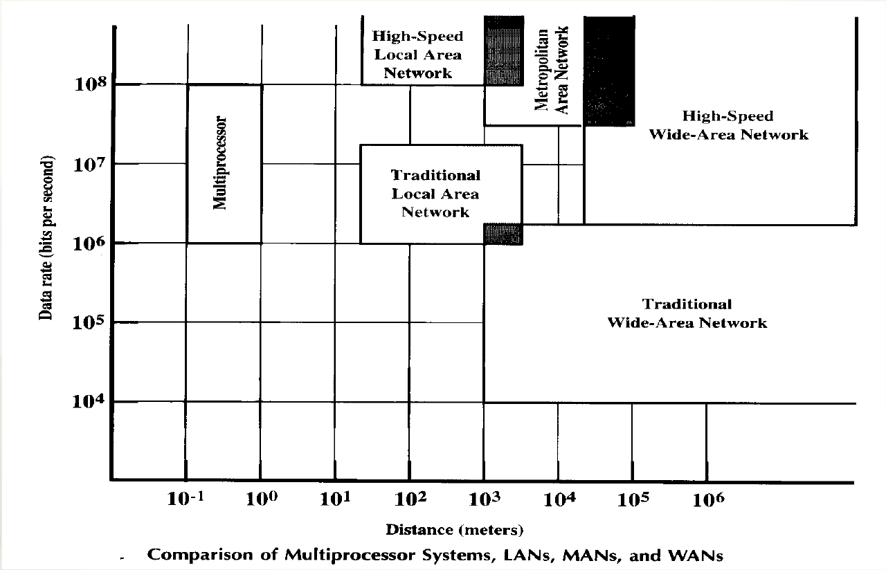

*그림 31. 거리와 데이터 전송 속도로 본 다중 프로세서 시스템, LAN, MAN, WAN*

그림 31은 가로축에 거리(m), 세로축에 데이터 전송 속도(bps)를 로그 눈금으로 두고 각 시스템이 차지하는 영역을 표시한다. 다중 프로세서 시스템은 1 m 안팎의 짧은 거리에서, 전통적인 LAN은 수십 m\~수 km에서 $10^6$\~$10^7$ bps 정도를, 고속 LAN은 $10^8$ bps 이상을 차지한다. MAN은 약 $10^3$ m 이상, 수십 km까지의 거리에서 고속 전송을 하고, WAN은 그보다 먼 거리를 담당한다. 전통적인 WAN은 속도가 낮았지만 고속 WAN은 LAN에 가까운 속도를 낸다. 전체적으로 거리가 멀수록 같은 속도를 내기가 어렵다는 경향이 보인다.

> **참고:** 차량 내부 네트워크는 거리로 보면 수 m 규모라 LAN보다도 작다. 그러나 여러 노드가 한 매체를 공유하고 브로드캐스팅 방식으로 전송한다는 LAN의 기술적 특성을 그대로 가지므로, CAN은 LAN의 기술을 차량에 적용한 것으로 볼 수 있다.

### 3.2 LAN

> **용어 정의:** **LAN(local area network)** 은 단일 건물, 학교처럼 가까운 거리에 있는 호스트로 이루어진 네트워크이다. **호스트(host)** 는 네트워크에 연결되어 데이터를 보내고 받는 컴퓨터나 장치이다.

LAN은 하나의 전송 케이블로 모든 호스트를 연결할 수 있고 거리가 가까워, 한 호스트가 보낸 데이터를 모든 호스트가 받는 브로드캐스팅 방식으로 전송한다. 속도는 보통 수십 Mbps\~수 Gbps이며, 주로 버스형과 링형 토폴로지를 쓴다(3.5절).

### 3.3 MAN과 DQDB

> **용어 정의:** **MAN(metropolitan area network)** 은 도시 규모의 지역을 연결하는 네트워크이다. 하드웨어와 소프트웨어 구성은 LAN과 비슷하지만 연결 규모가 크다.

MAN의 국제 표준안은 **DQDB(Distributed Queue Dual Bus)** 이며, 전송 방향이 서로 다른 두 버스로 호스트를 연결한다.

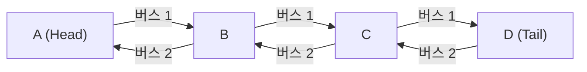

*그림 32. 방향이 반대인 두 버스로 호스트를 연결하는 DQDB*

그림 32에서 버스 1은 A(헤드)에서 D(테일) 방향으로, 버스 2는 D에서 A 방향으로 데이터를 나른다. 모든 호스트가 두 버스에 모두 연결되므로, 자기보다 오른쪽 호스트에는 버스 1로, 왼쪽 호스트에는 버스 2로 보낸다. 각 버스의 시작점이 일정한 크기의 빈 슬롯을 계속 만들어 버스에 흘려보내면, 호스트는 지나가는 빈 슬롯에 데이터를 채워 보낸다. 두 버스의 양 끝을 이어 고리 형태로 구성하기도 한다.

DQDB의 특징은 다음과 같다.

- **분산 데이터 큐:** 각 호스트가 자기보다 먼저 보내려고 기다리는 요청의 수를 세어 큐 정보를 각자 유지한다. 중앙 제어기 없이 큐가 여러 호스트에 분산되어 있다는 뜻이다.
- **FIFO 기반의 공유 슬롯 방식:** 데이터 전송 중 생길 수 있는 충돌을 피하기 위해, 요청한 순서대로(FIFO, first in first out) 빈 슬롯을 차지한다. 그래서 둘 이상이 같은 슬롯에 쓰는 충돌이 생기지 않는다.
- **ATM 호환:** ATM(asynchronous transfer mode)과 호환되는 53바이트 프레임(슬롯)을 지원한다. ATM은 4주차에서 다룬다.

### 3.4 WAN

> **용어 정의:** **WAN(wide area network)** 은 국가 이상의 넓은 지역을 지원하는 네트워크 구조이다.

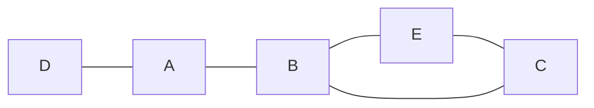

*그림 33. 점대점 링크로 연결된 WAN의 예*

WAN은 멀리 떨어진 호스트들을 점대점(1:1) 링크로 연결한다. 그림 33에서 D가 C로 보내려면 D와 C 사이에 직접 링크가 없으므로 D, A, B를 거쳐 B에서 C로 직접 가거나, B에서 E를 거쳐 C로 가야 한다. 이처럼 여러 경로 가운데 하나를 골라 데이터를 중계해야 하므로 **라우팅(routing)** 이 반드시 필요하다. 반면 LAN은 모든 호스트가 하나의 매체를 공유하여 보낸 데이터가 모두에게 도달하므로 라우팅이 필요 없다.

### 3.5 기본 토폴로지: 버스형과 링형

> **용어 정의:** **토폴로지(topology)** 는 네트워크에서 호스트와 전송 매체가 연결된 형태이다.

**버스형 토폴로지(bus topology).** 버스 하나에 여러 호스트가 직접 연결된다.

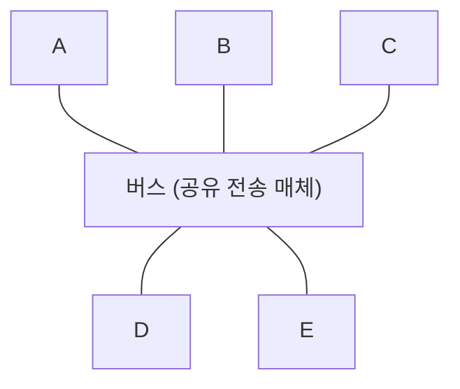

*그림 34. 버스형 토폴로지*

버스형 토폴로지는 전송 매체를 물리적으로 공유하므로, 한 호스트가 보낸 데이터가 모든 호스트에 전달되는 브로드캐스팅 방식으로 동작하며 라우팅이 필요 없다. 동작 방식은 다음과 같다.

1. 각 호스트는 고유한 주소를 가진다.
2. 전송 데이터의 헤더에는 송신 호스트와 수신 호스트의 주소, 오류 제어와 흐름 제어 정보가 들어간다.
3. 모든 호스트가 데이터를 받지만, 헤더의 수신 호스트 정보가 자기 주소와 같은 호스트만 데이터를 내부 버퍼에 보관하고 나머지 호스트는 버린다.
4. 둘 이상의 호스트가 동시에 보내면 데이터 충돌(collision)이 생기므로 이를 해결하는 방법이 필요하다.

CAN은 버스형 토폴로지의 대표적인 예이다. 다만 CAN은 3번의 수신 주소 대신 메시지 식별자와 수용 필터로 받을 메시지를 고르고(1.7절), 4번의 충돌을 비트 단위 중재로 해결한다(1.8절).

**링형 토폴로지(ring topology).** 호스트들이 고리 모양으로 연결된다.

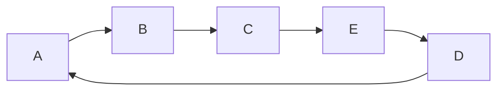

*그림 35. 링형 토폴로지*

- 데이터는 시계 방향이나 반시계 방향 가운데 한 방향으로만 전송된다.
- 한 호스트가 보낸 데이터는 링을 한 바퀴 돌아 반드시 송신 호스트로 되돌아온다. 그 과정에서 모든 호스트가 데이터를 받으므로 브로드캐스팅을 지원한다.
- 데이터를 보낸 호스트는 자신에게 되돌아온 데이터를 네트워크에서 회수할 책임이 있다. 회수하지 않으면 데이터가 링을 계속 돈다.

링형에서도 둘 이상의 호스트가 동시에 보내면 충돌이 생길 수 있다. 이를 막기 위해 **토큰(token)** 이라는 제어 프레임을 쓴다.

1. 데이터를 보내려는 호스트는 먼저 링을 도는 토큰을 확보해야 한다.
2. 네트워크에는 토큰이 하나뿐이므로, 어느 순간 데이터를 보내는 호스트는 하나뿐이다. 따라서 충돌이 생기지 않는다.
3. 토큰은 링 위의 모든 호스트를 차례로 순환하므로, 모든 호스트가 동등한 전송 기회를 가진다.

버스형, 링형을 포함한 여러 토폴로지의 장단점은 6주차에서 자세히 다룬다.

### 3.6 네트워크 구성 사례와 차량의 네트워크

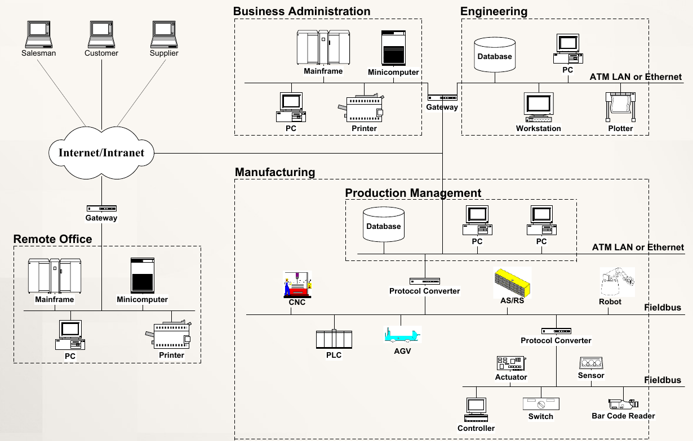

*그림 36. 경영, 엔지니어링, 생산 부문을 잇는 기업 네트워크의 구성 사례*

그림 36은 한 제조 기업의 네트워크이다. 경영(business administration) 부문과 엔지니어링(engineering) 부문은 각각 ATM LAN이나 이더넷으로 메인프레임, 미니컴퓨터, PC, 프린터, 워크스테이션, 플로터, 데이터베이스를 연결하고, 두 LAN은 게이트웨이로 이어진다. 생산(manufacturing) 부문의 생산 관리 LAN 아래에는 CNC 공작 기계, PLC, AGV(무인 운반차), 자동 창고(AS/RS), 로봇이 필드버스(fieldbus)로 연결되고, 그 아래 다시 센서, 액추에이터, 스위치, 바코드 판독기, 컨트롤러가 다른 필드버스로 연결된다. 서로 다른 프로토콜의 네트워크 사이에는 프로토콜 변환기(protocol converter)가 있다. 원격 사무소와 영업 담당자, 고객, 공급자는 인터넷이나 인트라넷과 게이트웨이를 거쳐 연결된다. 이처럼 실제 네트워크는 규모와 목적이 다른 여러 네트워크를 게이트웨이와 변환기로 엮은 계층 구조이다.

> **용어 정의:** **필드버스(fieldbus)** 는 공장 현장의 센서, 액추에이터, 제어기를 연결하는 산업용 실시간 네트워크이다. CAN 기반의 CANopen과 DeviceNet도 필드버스의 하나이다.

차량도 같은 구조를 가진다.

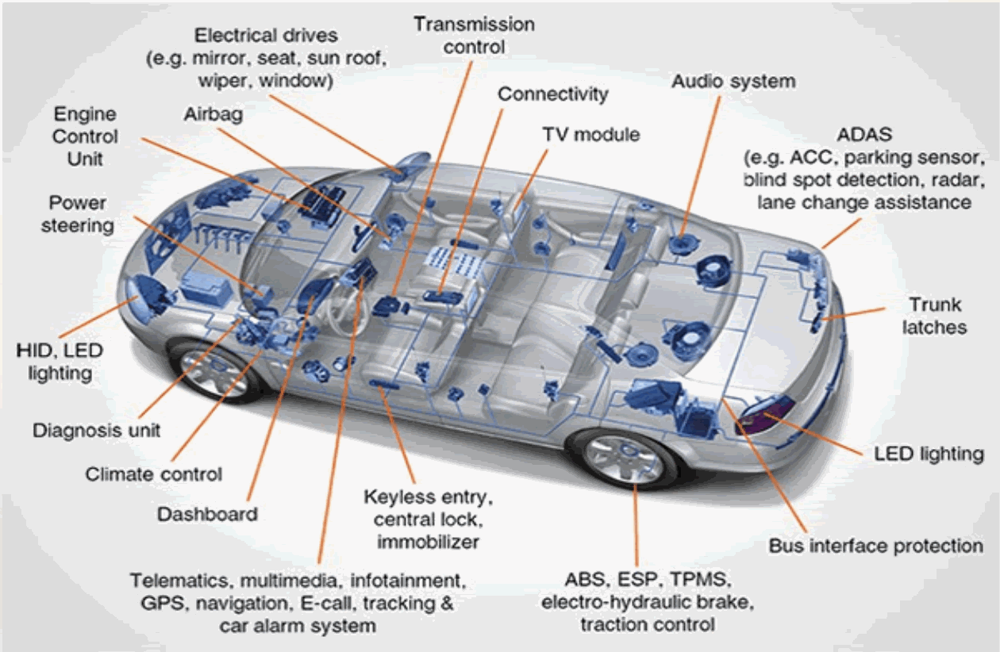

*그림 37. 차량의 대표적인 ECU*

그림 37처럼 차량에는 엔진 제어 장치, 변속기 제어, 파워 스티어링, 에어백, 전동 장치(미러, 시트, 선루프, 와이퍼, 창문), 공조, 계기판, 진단 장치, 텔레매틱스와 인포테인먼트, 오디오, TV 모듈, 커넥티비티, ADAS(적응형 순항 제어, 주차 센서, 사각지대 감지, 레이더, 차선 변경 보조), 키리스 엔트리와 이모빌라이저, ABS, ESP, TPMS, 전자 유압 브레이크, 트렁크 잠금, 조명 같은 수많은 ECU가 있다.

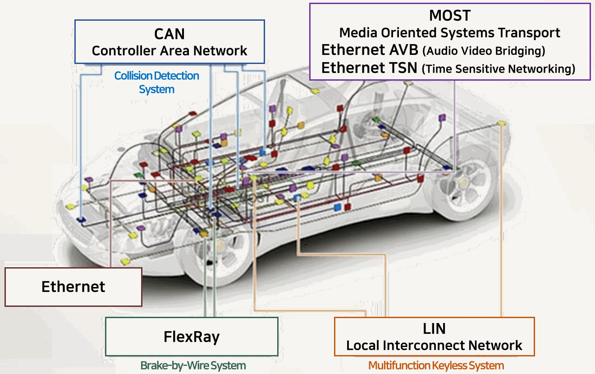

*그림 38. 차량에 쓰이는 네트워크와 대표 응용*

그림 38은 이 ECU들을 잇는 네트워크와 대표 응용을 보여 준다. CAN은 충돌 감지 시스템 같은 제어에, MOST와 이더넷 AVB(Audio Video Bridging), 이더넷 TSN(Time Sensitive Networking)은 멀티미디어와 시간 민감 데이터에, FlexRay는 브레이크 바이 와이어 시스템에, LIN은 다기능 키리스 시스템에 쓰이며, 이더넷은 이들을 잇는 고속 백본 역할을 한다. 기업 네트워크에서 LAN과 필드버스를 게이트웨이로 엮듯이, 차량에서도 성격이 다른 네트워크를 게이트웨이로 엮는다. 차량용 이더넷은 9주차에서 다룬다.

---

<br>

## 4. 부록: 자율주행차의 물리적 구성

자율주행차는 카메라, 라이다, 레이더 같은 센서로 주변을 인식하고, 고성능 컴퓨팅 모듈로 판단하며, 지도로 자기 위치와 경로를 정한다. 회사마다 이 구성 요소를 조합하는 방식이 다르다.

> **용어 정의:** **라이다(LIDAR, light detection and ranging)** 는 레이저를 쏘아 돌아오는 시간으로 주변 물체까지의 거리를 3차원 점들로 측정하는 센서이다. **레이더(RADAR, radio detection and ranging)** 는 전파를 써서 물체의 거리와 상대 속도를 측정하며, 비와 안개에 강하다. **HD 맵(high-definition map)** 은 차선, 표지판, 도로 경계를 센티미터 수준의 정밀도로 담은 자율주행용 지도이다.

### 4.1 자율주행 기업의 기술 경쟁력

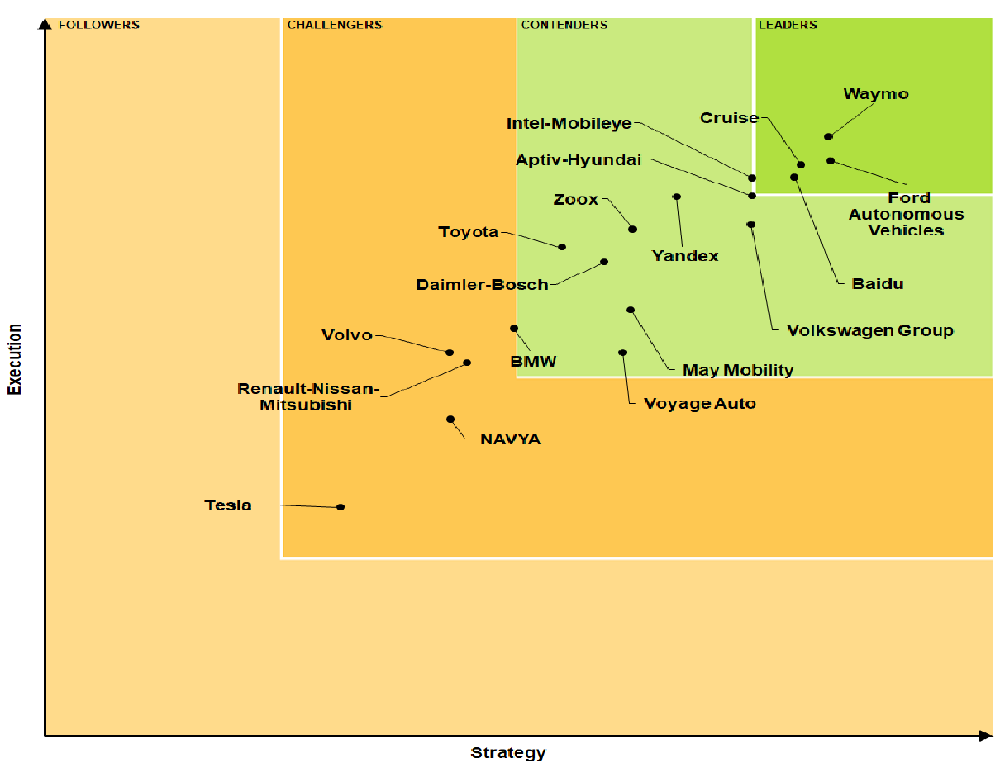

*그림 39. 자율주행 기업의 기술 경쟁력 순위*

그림 39는 Navigant Research가 2020년에 발표한 자율주행 기업의 순위이다. 가로축은 전략(strategy), 세로축은 실행력(execution)이며, 두 축의 점수에 따라 기업을 선도(leaders), 경쟁(contenders), 도전(challengers), 추종(followers)의 네 집단으로 나눈다.

- **선도 집단:** Waymo, Ford Autonomous Vehicles, Cruise, Baidu.
- **경쟁 집단:** Intel-Mobileye, Aptiv-Hyundai, Zoox, Yandex, Volkswagen Group, Daimler-Bosch, Toyota, May Mobility, Voyage Auto. Intel-Mobileye와 Aptiv-Hyundai는 선도 집단과의 경계에, BMW는 도전 집단과의 경계에 있다.
- **도전 집단:** Volvo, Renault-Nissan-Mitsubishi, NAVYA, Tesla. Tesla가 가장 낮은 위치에 있다.

이 순위는 로보택시처럼 운전자 없는 완전 자율주행을 상용화하는 전략과 실행력을 기준으로 평가한 것이므로, 운전자 보조 기능을 많이 판매한 회사라도 낮게 평가될 수 있다.

### 4.2 Waymo

Google의 자율주행 회사 Waymo의 차량은 카메라 29개를 포함한 약 40개의 센서로 구성되며, Google 지도를 쓴다.

| 구성 요소 | 내용 |
|:-----|:-----|
| 카메라 | 2016년에는 전방 3개, 서라운드 4개, 미러 대체용 3개, 운전자 모니터링 2개로 총 12개였으나, 2020년의 5세대 시스템에서는 총 29개로 늘었다. |
| 라이다 | 장거리 1개와 코너 4개로 총 5개이다. Google이 직접 생산한다. |
| 레이더 | 중단거리 코너용 레이더이며, 자료는 그 수를 6개로 추정한다. |
| 컴퓨팅 모듈 | 자료는 Intel 제품을 쓴다고 적는다. |
| 지도 | Google의 HD 맵을 쓴다. |

*표 18. Waymo 자율주행차의 구성*

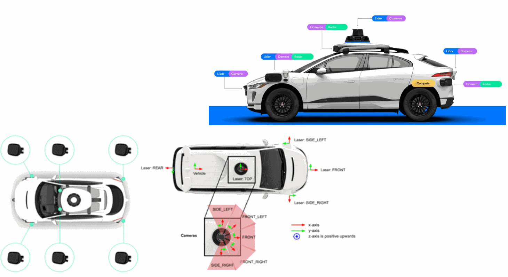

*그림 40. Waymo 차량의 센서 배치와 센서 좌표 구성*

그림 40의 위쪽은 Waymo 차량의 지붕 위 라이다와 차체 곳곳의 카메라, 레이더를 표시한다. 아래쪽은 위에서 본 차량의 라이다 배치(위쪽 TOP, 앞쪽 FRONT, 옆쪽 SIDE_LEFT와 SIDE_RIGHT, 뒤쪽 REAR)와 카메라의 시야(FRONT, FRONT_LEFT, FRONT_RIGHT, SIDE_LEFT, SIDE_RIGHT), 차량 좌표축(x축은 앞, y축은 왼쪽, z축은 위)을 보여 준다. 여러 센서의 데이터를 하나로 합치려면 모든 센서의 위치와 방향을 차량 좌표계로 정확히 표현해야 한다.

### 4.3 Tesla

Tesla는 라이다를 쓰지 않으며, 2020년 무렵까지 카메라 8대와 전방 레이더 1대, 초음파 센서로 주변을 인식했다.

| 구성 요소 | 내용 |
|:-----|:-----|
| 카메라 | 전방 3개(triple front camera), 전측방 2개(forward looking side camera), 후측방 2개(rearward looking side camera), 후방 1개(rear view camera)로 총 8개이다. ON Semiconductor와 협력하여 자체 개발했다. 2016년 첫 자율주행 사망 사고 뒤 Mobileye와 결별했다. |
| 레이더 | Continental의 장단거리 혼합 레이더를 써 왔다. |
| 컴퓨팅 모듈 | 2016\~2019년의 HW2와 HW2.5에는 NVIDIA DRIVE PX 2 기반 컴퓨터를 썼고, 2019년의 HW3부터는 Tesla가 자체 설계한 FSD 칩을 쓴다 [8]. 자율주행 소프트웨어는 자체 개발한다. |
| 지도 | 내비게이션 지도를 Wi-Fi로 내려받아 쓰며, HD 맵을 쓰지 않는다. |

*표 19. Tesla 자율주행차의 구성*

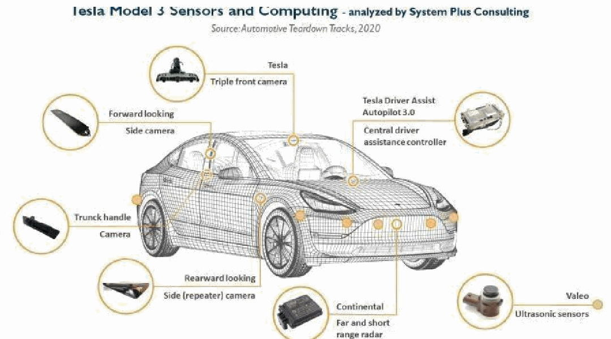

*그림 41. Tesla Model 3의 센서와 컴퓨팅 장치*

그림 41은 Tesla Model 3를 분해 분석한 결과로, 앞유리 위의 3개짜리 전방 카메라, 앞 펜더의 전측방 카메라, B필러 부근의 후측방(리피터) 카메라, 트렁크 손잡이의 후방 카메라, 운전 보조 제어기(Autopilot 3.0), Continental의 장단거리 레이더, Valeo의 초음파 센서 위치를 표시한다.

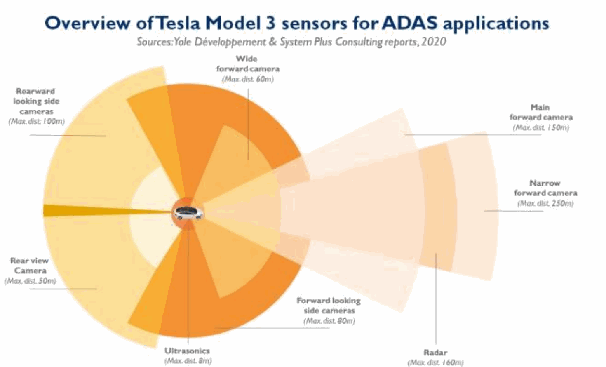

*그림 42. Tesla Model 3 센서의 감지 범위*

| 센서 | 최대 감지 거리 |
|:-----|:-----|
| 좁은 전방 카메라(narrow forward camera) | 250 m |
| 레이더 | 160 m |
| 주 전방 카메라(main forward camera) | 150 m |
| 후측방 카메라(rearward looking side camera) | 100 m |
| 전측방 카메라(forward looking side camera) | 80 m |
| 넓은 전방 카메라(wide forward camera) | 60 m |
| 후방 카메라(rear view camera) | 50 m |
| 초음파 센서(ultrasonics) | 8 m |

*표 20. Tesla Model 3 센서의 최대 감지 거리*

그림 42와 표 20에서 전방은 시야각이 다른 세 카메라와 레이더가 겹쳐 덮고, 측면과 후방은 카메라가, 차량 바로 주변은 초음파 센서가 덮는다. 시야각이 좁은 카메라일수록 멀리 보고, 넓은 카메라일수록 가까운 곳을 넓게 본다.

### 4.4 GM Cruise

GM의 자율주행 회사 Cruise의 차량은 카메라 16개를 포함한 42개의 센서를 탑재하며, GM은 자본력을 바탕으로 주요 센서 기업을 인수했다.

| 구성 요소 | 내용 |
|:-----|:-----|
| 센서 | 라이다 5개, 카메라 16개, 레이더 21개이다. 2017년 라이다 스타트업 Strobe를, 2020년 레이더 제조사 Astyx를 인수했다. |
| 컴퓨팅 모듈 | 자료는 Intel과 NVIDIA의 솔루션을 쓴다고 적는다. |
| 지도 | GM의 운전 보조 시스템 Super Cruise는 디트로이트의 Ushr가 만든 HD 맵을 쓴다. Ushr는 2019년 2월 일본의 DMP(Dynamic Map Platform)가 인수했다. |

*표 21. GM Cruise 자율주행차의 구성*

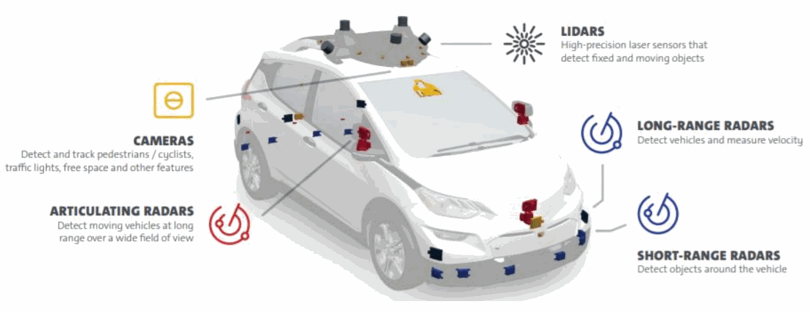

*그림 43. Cruise 자율주행차의 센서 구성*

그림 43에서 라이다는 고정되거나 움직이는 물체를 정밀하게 감지하고, 카메라는 보행자와 자전거를 감지하고 추적하며 신호등, 빈 공간 같은 특징을 인식한다. 장거리 레이더는 움직이는 차량을 감지하고 속도를 측정하며, 회전형(articulating) 레이더는 넓은 시야에서 먼 거리의 움직이는 차량을 감지하고, 단거리 레이더는 차량 주변의 물체를 감지한다.

### 4.5 세 회사의 센서 구성 비교

| 항목 | Waymo | Tesla | GM Cruise |
|:-----|:-----|:-----|:-----|
| 센서 수 | 약 40개 | 카메라 8개 중심 | 42개 |
| 카메라 | 29개 | 8개 | 16개 |
| 라이다 | 5개 (자체 생산) | 쓰지 않음 | 5개 (Strobe 인수) |
| 레이더 | 6개 (자료의 추정) | Continental 레이더 | 21개 (Astyx 인수) |
| 지도 | Google HD 맵 | 내비게이션 지도 (HD 맵 없음) | Ushr HD 맵 (Super Cruise) |

*표 22. Waymo, Tesla, GM Cruise의 센서 구성 비교*

Waymo와 Cruise는 라이다, 레이더, 카메라를 모두 많이 달고 HD 맵을 함께 쓰는 접근을 택했다. 서로 다른 원리의 센서가 서로의 약점을 보완하므로 안정성이 높지만 비용이 크다. Tesla는 카메라 중심으로 센서 수와 비용을 줄이고, 대량의 주행 데이터로 학습한 소프트웨어로 인식 성능을 높이는 접근을 택했다. 센서가 많아질수록 차량 내부에서 오가는 데이터의 양도 커지므로, 자율주행차에는 CAN보다 훨씬 빠른 차량용 이더넷 같은 고속 네트워크가 필요하다.

> **참고:** 표 18\~21의 구성은 2020년 무렵의 보도와 분석 자료를 기준으로 한 것이다. 각 회사의 센서 구성은 하드웨어 세대가 바뀔 때마다 달라진다.

---

<br>

## 개념 적용

| 상황 | 적용할 개념 |
|:-----|:-----|
| 전원을 끈 차량의 OBD-II 커넥터 6번과 14번 핀 사이 저항을 재니 약 120 Ω이 나왔다. | 정상 버스는 두 종단 저항의 병렬 합성인 60 Ω이어야 하므로, 종단 저항 하나가 빠졌거나 그 저항이 있는 쪽 배선이 끊겼다고 판단한다(1.4절). |
| 브레이크 제어 메시지와 실내등 상태 메시지가 동시에 전송을 시작한다. | 우선순위가 높은 브레이크 메시지에 더 작은 식별자를 배정해야 비트 단위 중재에서 이긴다(1.8절). |
| 한 ECU가 고장으로 오류 프레임을 계속 보내 버스가 마비될 위험이 있다. | 송신 오류가 쌓여 TEC가 127을 넘으면 오류 수동, 255를 넘으면 버스 오프가 되어 버스에서 분리된다. 수신 오류만 쌓이는 노드는 버스 오프가 되지 않지만, REC가 127을 넘어 오류 수동이 되면 수동 오류 플래그만 보내므로 버스를 방해하지 못한다(1.9절). |
| 차량에 새 계기판 ECU를 추가하여 기존 차속 메시지를 표시하려 한다. | CAN은 방송형 통신이므로 송신 ECU를 바꿀 필요 없이 새 ECU의 수용 필터만 차속 식별자로 설정한다(1.7절). |
| 파워 윈도와 시트 열선을 값싸게 네트워크로 묶으려 한다. | 빠른 응답이 필요 없는 바디 전장품이므로 단일 전선 저속 네트워크인 LIN이 알맞다(2.2절). |

*표 23. 개념 적용 사례*

**T/F 점검:**

| 문장 | 판단과 근거 |
|:-----|:-----|
| CAN 버스에서 한 노드가 열성을 보내고 다른 노드가 우성을 보내면 버스는 열성이 된다. | **F.** 우성은 능동적으로 구동한 상태이므로 하나라도 우성을 보내면 버스는 우성이 된다. |
| CAN 프레임에는 수신 노드의 주소가 들어 있다. | **F.** 식별자는 메시지의 종류와 우선순위를 나타낼 뿐이며, 모든 노드가 받아 필터로 거른다. |
| 비트 단위 중재에서 진 노드의 프레임은 버스에서 망가지므로, 이긴 노드도 다시 보내야 한다. | **F.** 버스에 나타난 비트열은 이긴 노드의 것과 같으므로 이긴 프레임은 손상 없이 전달된다. |
| 종단 저항은 각 노드마다 하나씩 단다. | **F.** 버스의 물리적인 양 끝 두 곳에만 120 Ω을 단다. |
| 같은 값이 6개 연속으로 나타나면 수신기는 스터핑 오류로 판단한다. | **T.** 송신기는 5개마다 반대 비트를 넣으므로 6개 연속은 규칙 위반이다. |
| WAN은 브로드캐스팅으로 전송하므로 라우팅이 필요 없다. | **F.** WAN은 점대점 링크를 이어 장거리 전송을 하므로 라우팅이 반드시 필요하다. |

---

<br>

## 요약

| 개념 | 핵심 요약 |
|:-----|:-----|
| CAN | Bosch가 만든 차량용 직렬 버스 프로토콜로, ISO 11898이 물리 계층과 데이터 링크 계층을 정의한다. |
| 차동 신호 | CAN_H와 CAN_L의 전압 차로 비트를 판단하므로 두 선에 똑같이 들어온 잡음이 상쇄된다. |
| 우성과 열성 | 우성(0)은 차동 전압 약 2 V를 능동적으로 만든 상태, 열성(1)은 구동하지 않아 차동 전압이 약 0 V인 상태이며, 우성이 열성을 이긴다. |
| 종단 저항 | 버스 양 끝의 120 Ω 저항은 반사를 막고 버스를 열성으로 되돌리며, 합성 저항은 60 Ω이다. |
| 비트 스터핑 | 같은 값 5개 뒤에 반대 비트를 넣어 재동기화용 에지를 보장하고, 6개 연속을 오류로 검출한다. |
| 프레임 | 표준 프레임은 SOF, 11비트 식별자, RTR, IDE, r0, DLC, 0\~8바이트 데이터, CRC, ACK, EOF로 이루어지고, 확장 프레임은 29비트 식별자를 쓴다. |
| 방송형 통신 | 모든 노드가 모든 프레임을 받고 수용 필터로 필요한 메시지만 고른다. |
| 비트 단위 중재 | 식별자를 한 비트씩 보내며 열성을 보내고 우성을 읽은 노드가 물러나므로, 식별자가 가장 작은 메시지가 손상 없이 전달된다. |
| 오류 검출 | CRC, 프레임 검사, ACK 검사, 비트 모니터링, 비트 스터핑의 다섯 방식으로 오류를 검출한다. |
| 오류 상태 | TEC와 REC에 따라 오류 활성, 오류 수동, 버스 오프로 바뀌며, 고장 난 노드를 단계적으로 고립시킨다. |
| CAN 노드의 구성 | 마이크로컨트롤러, 프로토콜 컨트롤러, 트랜시버로 이루어지며, 컨트롤러는 독립형이거나 마이크로컨트롤러에 통합된다. |
| IVN의 분류 | 바디에는 LIN, 실시간 제어에는 CAN과 FlexRay, 멀티미디어에는 MOST를 쓰는 식으로 응용 분야와 속도에 따라 나뉜다. |
| 진단 통신 | OBD-II는 KWP2000, ISO 9141-2, J1850, CAN 기반 ISO 15765-4 가운데 하나를 쓰며, 16핀 커넥터로 진단 장비와 연결한다. |
| LAN, MAN, WAN | LAN은 건물 규모의 브로드캐스팅 네트워크, MAN은 DQDB를 표준안으로 하는 도시 규모 네트워크, WAN은 라우팅이 필요한 국가 규모 네트워크이다. |
| 버스형과 링형 | 버스형은 매체를 공유하여 충돌 해결이 필요하고, 링형은 한 방향으로 돌며 토큰으로 충돌을 막는다. |
| 자율주행차의 구성 | Waymo와 Cruise는 라이다, 레이더, 카메라와 HD 맵을 함께 쓰고, Tesla는 카메라 중심의 구성을 택했다. |

---

<br>

## 점검 문제

1. **차동 신호:** CAN_H가 3.5 V, CAN_L이 1.5 V인 우성 상태에서 외부 간섭으로 두 선에 각각 0.8 V가 더해졌다. 수신기가 보는 차동 전압과 판단 결과를 쓰고, 단일 전선 방식이었다면 어떤 문제가 생기는지 설명하라.

   <details>
   <summary>정답</summary>

   간섭 뒤의 전압은 CAN_H가 4.3 V, CAN_L이 2.3 V이므로 차동 전압은 $4.3 - 2.3 = 2.0$ V로 간섭 전과 같다. 0.9 V 이상이므로 우성으로 바르게 판단한다. 단일 전선 방식에서는 접지에 대한 한 선의 전압으로 판단하므로, 열성 레벨 근처의 신호에 0.8 V가 더해지면 문턱을 넘어 값이 뒤바뀔 수 있다. 차동 방식은 두 선에 똑같이 들어온 공통 모드 잡음이 뺄셈에서 사라지므로 이 문제가 없다.

   </details>

2. **종단 저항:** 종단 저항이 필요한 이유를 두 가지 쓰고, 정상 버스에서 CAN_H와 CAN_L 사이의 저항을 재면 얼마가 나오는지 계산하라.

   <details>
   <summary>정답</summary>

   첫째, 케이블의 특성 임피던스(약 120 Ω)와 같은 저항으로 선로 끝을 종단하여 신호가 끝에서 반사되어 비트를 왜곡하는 것을 막는다. 둘째, 열성 상태는 아무도 구동하지 않으므로, 우성에서 열성으로 바뀔 때 두 선을 같은 전압으로 빠르게 되돌리는 경로가 필요하다. 두 120 Ω 저항은 병렬이므로 $120 \times 120 / (120 + 120) = 60$ Ω이 나온다.

   </details>

3. **비트 스터핑:** 비트열 d d d d d d r r r r r (d = 우성, r = 열성)에 비트 스터핑을 적용한 결과를 쓰라.

   <details>
   <summary>정답</summary>

   처음 d 다섯 개 뒤에 Sr을 넣는다. 스터핑 비트도 비트열의 일부로 세므로 Sr은 r 1개째가 되지만, 바로 다음의 6번째 d에서 연속이 끊겨 d 1개째로 다시 센다. 이어서 r 다섯 개가 연속으로 오므로 다섯 번째 r 뒤에 Sd를 넣는다. 결과는 d d d d d Sr d r r r r r Sd이며, 원래 11비트가 13비트가 된다.

   </details>

4. **중재 추적:** 식별자가 0x0F3, 0x0F1, 0x0E7인 세 노드가 동시에 전송을 시작했다. 각 노드가 지는 비트 위치와 이기는 노드를 쓰라.

   <details>
   <summary>정답</summary>

   11비트 2진수로 쓰면 0x0F3은 000 1111 0011, 0x0F1은 000 1111 0001, 0x0E7은 000 1110 0111이다. ID10\~ID5(000 111)까지는 셋이 같다. ID4에서 0x0E7은 0, 나머지 둘은 1을 보내므로 버스는 0이 되고, 1을 보낸 0x0F3과 0x0F1이 모두 진다. 0x0E7이 이긴다. 식별자가 가장 작은 노드가 이긴다는 결과와 일치한다.

   </details>

5. **프레임:** 데이터가 2바이트인 표준 데이터 프레임의 길이를 스터핑 비트와 IFS를 빼고 계산하라.

   <details>
   <summary>정답</summary>

   SOF 1, 식별자 11, RTR 1, IDE 1, r0 1, DLC 4, 데이터 16, CRC 15, CRC 구분자 1, ACK 슬롯 1, ACK 구분자 1, EOF 7을 더하면 $1 + 11 + 1 + 1 + 1 + 4 + 16 + 15 + 1 + 1 + 1 + 7 = 60$비트이다.

   </details>

6. **오류 상태:** 노드의 TEC가 130이고 REC가 20이다. 이 노드의 상태와, 이 상태에서 오류를 검출했을 때의 동작을 설명하라.

   <details>
   <summary>정답</summary>

   TEC가 127을 넘으므로 오류 수동 상태이다. 이 상태의 노드는 오류를 검출해도 열성 비트로 된 수동 오류 플래그만 보내므로 다른 노드의 통신을 방해하지 못하고, 송신 뒤에는 추가로 기다려야 한다. 송신 오류가 더 쌓여 TEC가 255를 넘으면 버스 오프가 되고, TEC와 REC가 모두 127 이하로 내려가면 오류 활성으로 돌아간다.

   </details>

7. **CAN과 이더넷의 충돌 처리:** CAN의 비트 단위 중재가 이더넷의 CSMA/CD보다 실시간 제어에 유리한 이유를 설명하라.

   <details>
   <summary>정답</summary>

   이더넷의 CSMA/CD에서는 충돌한 모든 프레임이 망가지고 각 노드가 무작위 시간을 기다린 뒤 다시 보내므로, 버스가 붐비면 어떤 메시지가 언제 전달될지 예측하기 어렵다. CAN에서는 충돌이 생겨도 식별자가 가장 작은 프레임이 손상 없이 그대로 전달되어 시간 낭비가 없고, 우선순위가 높은 메시지는 버스가 비는 즉시 전달된다. 따라서 브레이크 같은 중요한 메시지의 지연을 작고 예측 가능하게 만들 수 있다.

   </details>

8. **IVN 선택:** 와이퍼, 엔진 제어, 뒷좌석 영상 재생, 브레이크 바이 와이어에 알맞은 네트워크를 하나씩 고르고 이유를 쓰라.

   <details>
   <summary>정답</summary>

   와이퍼는 단순한 켜고 끄는 제어이므로 값싼 저속 LIN, 엔진 제어는 ECU 사이에 수백 kbps의 실시간 제어 메시지가 오가므로 고속 CAN, 뒷좌석 영상 재생은 끊김 없는 대용량 동기 데이터이므로 MOST(또는 차량용 이더넷), 브레이크 바이 와이어는 메시지가 정해진 시각에 반드시 도착해야 하므로 시간 기반 정적 구간을 가진 FlexRay가 알맞다.

   </details>

9. **WAN과 LAN:** LAN에는 라우팅이 필요 없고 WAN에는 필요한 이유를 매체의 연결 방식으로 설명하라.

   <details>
   <summary>정답</summary>

   LAN은 모든 호스트가 하나의 매체를 공유하여, 한 호스트가 보낸 데이터가 브로드캐스팅으로 모든 호스트에 도달하고 수신 호스트만 데이터를 보관한다. 따라서 경로를 고를 필요가 없다. WAN은 멀리 떨어진 호스트들을 점대점 링크로 이어 구성하므로, 직접 연결되지 않은 호스트에 보내려면 여러 경로 가운데 하나를 골라 중간 노드를 거쳐 중계해야 한다. 이 경로 선택이 라우팅이다.

   </details>

10. **토큰 링:** 링형 토폴로지에서 토큰이 충돌을 막고 공정성을 보장하는 원리를 설명하라.

    <details>
    <summary>정답</summary>

    데이터를 보내려는 호스트는 먼저 토큰을 확보해야 하는데, 네트워크에 토큰이 하나뿐이므로 어느 순간 데이터를 보내는 호스트는 하나뿐이고 충돌이 생기지 않는다. 또 토큰이 링 위의 모든 호스트를 차례로 순환하므로 모든 호스트가 돌아가며 동등한 전송 기회를 얻는다.

    </details>

11. **자율주행 센서:** Waymo와 Tesla의 센서 구성 전략의 차이를 쓰고, 센서가 많아질 때 차량 내부 네트워크에 생기는 요구를 설명하라.

    <details>
    <summary>정답</summary>

    Waymo는 카메라 29개, 라이다 5개, 레이더 6개와 HD 맵을 함께 쓰는 다중 센서 전략으로, 원리가 다른 센서가 서로 보완하여 안정성이 높지만 비용이 크다. Tesla는 라이다와 HD 맵 없이 카메라 8개를 중심으로 하고 레이더를 보조로 쓰는 전략으로, 비용을 줄이고 소프트웨어로 인식 성능을 높인다. 카메라와 라이다는 초당 수십\~수백 Mbps 이상의 데이터를 만들므로, 최대 1 Mbps인 CAN으로는 감당할 수 없고 차량용 이더넷 같은 고속 네트워크가 필요하다.

    </details>

---

<br>

## 참고 문헌

1. ISO 11898-2:2016, *Road vehicles - Controller area network (CAN) - Part 2: High-speed medium access unit*, International Organization for Standardization, 2016.
2. ISO 11898-1:2015, *Road vehicles - Controller area network (CAN) - Part 1: Data link layer and physical signalling*, International Organization for Standardization, 2015.
3. CAN in Automation, *CiA 303-1: Cabling and connector pin assignment*, version 1.9.0, Nuremberg, Germany, 2017.
4. Robert Bosch GmbH, *CAN Specification, Version 2.0*, Stuttgart, Germany, 1991.
5. N. Navet, Y. Song, F. Simonot-Lion, and C. Wilwert, "Trends in automotive communication systems," *Proceedings of the IEEE*, vol. 93, no. 6, pp. 1204-1223, 2005.
6. CSS Electronics, "OBD2 Explained - A Simple Intro," *CSS Electronics*. https://www.csselectronics.com/pages/obd2-explained-simple-intro
7. SAE International, *ITS Data Bus - IDB-C Physical Layer*, SAE J2366/1, Nov. 2001.
8. Tesla, Inc., "Tesla Autonomy Day," investor presentation, Palo Alto, CA, USA, Apr. 22, 2019.
