# Week 3 Lecture — Introduction to the CAN Bus, In-Vehicle Networks, and Network Classification

[Repository Guide](../../README.md) | [English](Concepts_Lecture.md) | [한국어](Concepts_Lecture.ko.md)

> **Last Updated:** 2026-11-17

> **Learning Objectives:**
> 1. Explain CAN differential signaling and the meaning of dominant and recessive bits, and explain why termination resistors are needed
> 2. Write the field layout of CAN standard and extended frames, and apply and remove bit stuffing
> 3. Trace bit-wise arbitration by identifier step by step and find the winning node
> 4. Explain the five error detection mechanisms of CAN and the error active, error passive, and bus off states
> 5. Classify in-vehicle networks such as LIN, MOST, TTP, FlexRay, and KWP2000 by application domain and transmission speed
> 6. Compare WAN, MAN, and LAN and the bus and ring topologies, and describe the sensor configurations of autonomous vehicles

---

## Table of Contents

- [1. Introduction to the CAN Bus](#1-introduction-to-the-can-bus)
  - [1.1 Overview of CAN](#11-overview-of-can)
  - [1.2 CAN Layers and Standards](#12-can-layers-and-standards)
  - [1.3 The Differential Bus and Signal Levels](#13-the-differential-bus-and-signal-levels)
  - [1.4 Termination Resistors](#14-termination-resistors)
  - [1.5 Bit Stuffing](#15-bit-stuffing)
  - [1.6 The CAN Message Frame](#16-the-can-message-frame)
  - [1.7 Broadcast Communication and Message Filtering](#17-broadcast-communication-and-message-filtering)
  - [1.8 Multiple Bus Access and Bit-Wise Arbitration](#18-multiple-bus-access-and-bit-wise-arbitration)
  - [1.9 Error Detection and Error States](#19-error-detection-and-error-states)
  - [1.10 Implementing CAN: Controllers and Transceivers](#110-implementing-can-controllers-and-transceivers)
  - [1.11 Case Study: A CAN-Based Body Control System](#111-case-study-a-can-based-body-control-system)
- [2. In-Vehicle Networks](#2-in-vehicle-networks)
  - [2.1 Classification of In-Vehicle Networks](#21-classification-of-in-vehicle-networks)
  - [2.2 LIN](#22-lin)
  - [2.3 MOST](#23-most)
  - [2.4 TTP](#24-ttp)
  - [2.5 FlexRay](#25-flexray)
  - [2.6 Diagnostic Communication: KWP2000 and OBD](#26-diagnostic-communication-kwp2000-and-obd)
  - [2.7 In-Vehicle Multimedia Networks](#27-in-vehicle-multimedia-networks)
- [3. Classification of Networks by Physical Scale](#3-classification-of-networks-by-physical-scale)
  - [3.1 WAN, MAN, and LAN](#31-wan-man-and-lan)
  - [3.2 LAN](#32-lan)
  - [3.3 MAN and DQDB](#33-man-and-dqdb)
  - [3.4 WAN](#34-wan)
  - [3.5 Basic Topologies: Bus and Ring](#35-basic-topologies-bus-and-ring)
  - [3.6 An Example Network Configuration and the Networks in a Vehicle](#36-an-example-network-configuration-and-the-networks-in-a-vehicle)
- [4. Appendix: Physical Composition of Autonomous Vehicles](#4-appendix-physical-composition-of-autonomous-vehicles)
  - [4.1 Technology Competitiveness of Autonomous Driving Companies](#41-technology-competitiveness-of-autonomous-driving-companies)
  - [4.2 Waymo](#42-waymo)
  - [4.3 Tesla](#43-tesla)
  - [4.4 GM Cruise](#44-gm-cruise)
  - [4.5 Comparison of the Three Sensor Configurations](#45-comparison-of-the-three-sensor-configurations)
- [Concept Applications](#concept-applications)
- [Summary](#summary)
- [Self-Check Questions](#self-check-questions)
- [References](#references)

---

<br>

## 1. Introduction to the CAN Bus

### 1.1 Overview of CAN

> **Definition:** An **ECU (electronic control unit)** is a microcontroller-based controller that takes charge of one vehicle function, such as the engine, transmission, brakes, or doors, by reading sensor values and controlling actuators. A single vehicle contains from several dozen to more than a hundred ECUs.

ECUs must exchange information, and point-to-point wiring that connects every pair of ECUs directly makes the number of wires, their weight, the connectors, and the points of failure grow rapidly as ECUs are added. To solve this problem, vehicles use in-vehicle networks in which all ECUs share one pair of wires (a bus) to exchange messages, and the representative one is CAN.

> **Definition:** **CAN (Controller Area Network)** is a serial bus communication protocol developed by Robert Bosch GmbH of Germany to connect the controllers inside a vehicle. The International Organization for Standardization (ISO) and SAE International (the Society of Automotive Engineers) have adopted it as a standard, and it is widely used not only in vehicles but also in industrial distributed control systems.

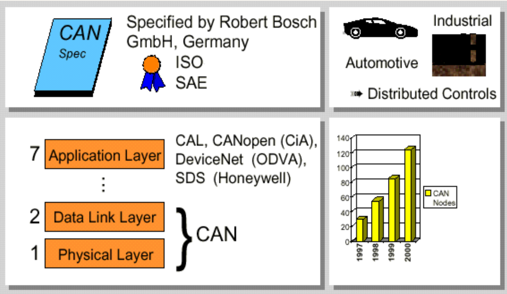

*Figure 1. Origin, applications, layer structure of the CAN specification, and the growth in the number of CAN nodes*

Figure 1 summarizes the nature of CAN in four points. First, Bosch specified it, and ISO and SAE standardized it. Second, its applications are distributed controls in vehicles and industry. Third, CAN itself defines only layer 1 (the physical layer) and layer 2 (the data link layer) of the seven OSI layers, and layer 7 (the application layer) is handled by separate higher-layer protocols such as CAL, CANopen (CiA), DeviceNet (ODVA), and SDS (Honeywell). Fourth, the number of CAN nodes grew substantially every year from 1997 to 2000.

> **Note:** CANopen, DeviceNet, and SDS are application-layer conventions that define, on top of CAN frames, the data carried by the message of each identifier and the way devices are configured and managed. The names in parentheses are the organizations or companies that maintain each convention, and CiA (CAN in Automation) is the international user organization that maintains CAN-related specifications.

### 1.2 CAN Layers and Standards

The CAN specification (ISO 11898) defines the physical layer and the data link layer of the OSI reference model. The data link layer is further divided into two sublayers.

| Layer | Sublayer | Functions |
|:-----|:-----|:-----|
| 2. Data link layer | LLC (logical link control) | Data transfer, remote data request, message filtering, recovery management and overload notification |
| 2. Data link layer | MAC (medium access control) | Framing and arbitration, error checking and error flags, fault confinement, bit timing |
| 1. Physical layer | | Converting bits to electrical signals, putting them on the bus, and reading them |

*Table 1. Layers and functions defined by CAN*

The CAN specification does not define layers 3 through 7. The functions mean the following. **Framing** wraps data into a frame of a fixed format, and **arbitration** decides which node uses the bus when several nodes try to transmit at once (Section 1.8). **Fault confinement** limits the participation of a faulty node so that it cannot disable the whole bus (Section 1.9). **Bit timing** sets the length of one bit and the instant at which a bit is read, and keeps the clocks of the nodes aligned.

> **[Computer Networks]** The OSI reference model divides communication functions into seven layers: physical, data link, network, transport, session, presentation, and application. A network in which all nodes hang on one bus, as inside a vehicle, needs no network layer to find routes, so CAN defines only the lower two layers and leaves the rest to application protocols. The OSI model is covered in detail in Week 5.

The configuration conditions of a CAN network are as follows.

- **Topology:** CAN uses a bus topology in which all nodes are connected to one bus (Section 3.5).
- **Number of nodes:** Up to about 64 stations (nodes) are connected to one bus. This limit is set not by the protocol but by the electrical load that the transceivers can drive.
- **Transmission speed and bus length:** The longer the bus, the lower the speed must be. Typical combinations are 5 kbps for 10 km and 1 Mbps for 40 m.

The reason speed and length are inversely related lies in the bit-wise arbitration of Section 1.8. For arbitration to work, a bit sent by one node must travel to the farthest node on the bus, and the result of its overlap with that node's bit must come back, all within one bit time. At 1 Mbps, one bit lasts $1/10^6$ s, that is, 1 µs. A signal in a cable travels at about 2/3 of the speed of light, taking about 5 ns per meter, so a 40 m bus has a one-way delay of $40 \times 5 = 200$ ns and a round-trip delay of 400 ns. Adding the processing delays of the transceivers and controllers leaves almost no margin within 1 µs. A longer bus requires a longer bit time, that is, a lower speed.

The ISO standards related to CAN are as follows.

| Standard | Year | Content |
|:-----|:-----|:-----|
| ISO 11898-1 | 2015 | Data link layer and physical signalling |
| ISO 11898-2 | 2016 | High-speed medium access unit |
| ISO 11898-3 | 2006 | Low-speed, fault-tolerant, medium-dependent interface |
| ISO 11898-4 | 2004 | Time-triggered communication |
| ISO 11898-5 | 2007 | High-speed medium access unit with low-power mode (withdrawn) |
| ISO 11898-6 | 2013 | High-speed medium access unit with selective wake-up functionality (withdrawn) |

*Table 2. ISO 11898 standards related to CAN*

> **Note:** ISO 11898-5 and ISO 11898-6 were withdrawn because their content was merged into ISO 11898-2:2016 [1]. In addition, ISO 11898-1:2015 defines, alongside classical CAN, CAN FD, which raises the speed of the data phase [2]. CAN FD is covered in Week 9. Both parts were later revised, and ISO 11898-1:2024 and ISO 11898-2:2024 were published in 2024; ISO 11898-1:2024 also defines the CAN XL frame format, which extends the data field to up to 2,048 bytes [3], [4].

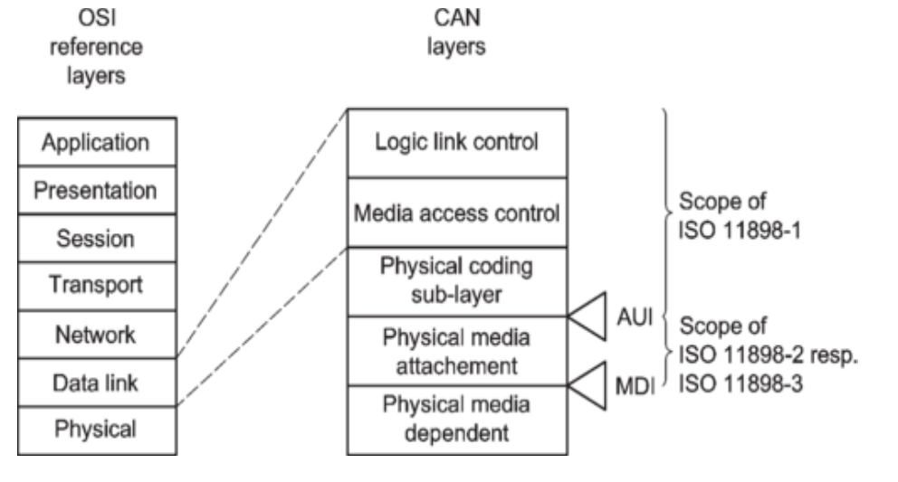

*Figure 2. OSI reference layers, CAN layers, and the scope of each part of ISO 11898*

Figure 2 shows how the OSI data link and physical layers are subdivided in CAN. ISO 11898-1 defines the LLC, the MAC, and the physical coding sub-layer. ISO 11898-2 (high speed) and ISO 11898-3 (low speed) define the physical media attachment sublayer, which corresponds to the transceiver, and the physical media dependent sublayer, which corresponds to the wires and connectors. The AUI (attachment unit interface) is the interface between the controller and the transceiver, and the MDI (medium dependent interface) is the interface between the transceiver and the bus medium. Attaching a high-speed transceiver to the same protocol controller gives high-speed CAN, and attaching a low-speed transceiver gives low-speed CAN.

### 1.3 The Differential Bus and Signal Levels

A high-speed CAN bus is a twisted pair made of two wires, **CAN_H** and **CAN_L**. The receiver decides each bit not from the voltage of one wire but from the voltage difference between the two wires.

> **Definition:** **Differential signaling** puts signals that change in opposite directions on two wires, and the receiver determines the value from the difference of the two voltages, $`V_{diff} = V_{CAN\_H} - V_{CAN\_L}`$.

A CAN bus has only two states.

> **Definition:** The **dominant** state is the state in which a transceiver pulls CAN_H up and CAN_L down to create a voltage difference between the two wires, and it represents logic 0.

> **Definition:** The **recessive** state is the state in which no transceiver drives the bus, so the two wires stay at the same voltage, and it represents logic 1.

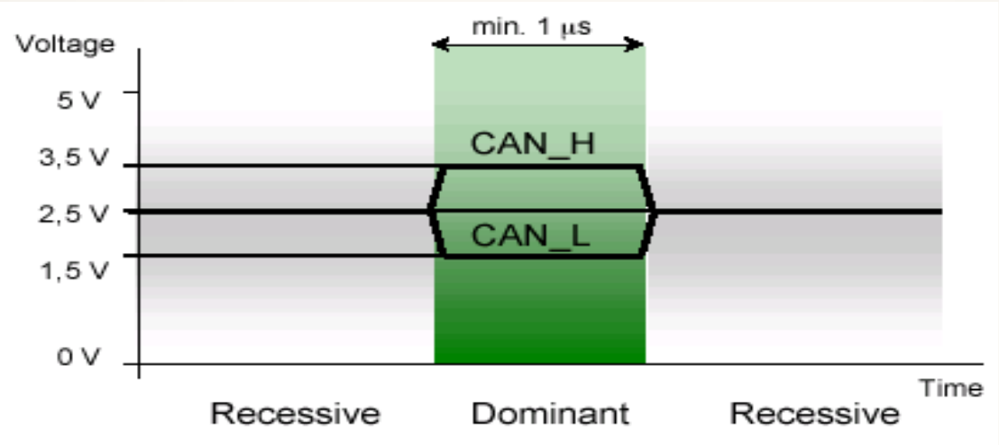

*Figure 3. Voltages of CAN_H and CAN_L in the recessive and dominant states*

The nominal voltages in Figure 3 are as follows.

| State | CAN_H | CAN_L | $V_{diff}$ | Logic value |
|:-----|:-----|:-----|:-----|:-----|
| Recessive | About 2.5 V | About 2.5 V | About 0 V | 1 |
| Dominant | About 3.5 V | About 1.5 V | About 2 V | 0 |

*Table 3. Nominal bus voltages of high-speed CAN*

The receiver decides the state with thresholds, not with the nominal values. If CAN_H is not more than 0.5 V higher than CAN_L ($V_{diff} \le 0.5$ V), the bus is recessive, and if CAN_H is at least 0.9 V higher ($V_{diff} \ge 0.9$ V), the bus is dominant. The range between the two thresholds (between 0.5 V and 0.9 V) is not guaranteed to be either state, and this margin keeps the decision stable even when a little noise is added. The "min. 1 µs" in Figure 3 is the minimum time one bit occupies at 1 Mbps.

When two nodes send different values at the same instant, the bus value is determined as follows. Because dominant is a state that a transceiver actively creates and recessive is a state that nobody drives, the bus becomes dominant if even one node sends dominant.

| Value sent by node 1 | Value sent by node 2 | Bus value |
|:-----|:-----|:-----|
| 0 (dominant) | 0 (dominant) | 0 (dominant) |
| 0 (dominant) | 1 (recessive) | 0 (dominant) |
| 1 (recessive) | 0 (dominant) | 0 (dominant) |
| 1 (recessive) | 1 (recessive) | 1 (recessive) |

*Table 4. Bus value when two nodes transmit simultaneously*

> **[Digital Logic Design]** Table 4 is the same as the truth table of an AND gate. A connection like this, which obtains an AND by tying several outputs to one line, is called a wired-AND. The arbitration of Section 1.8 works on this property, namely that 0 wins over 1.

**Robustness against noise.** A vehicle contains many devices that emit strong electromagnetic interference (EMI), such as the ignition system, motors, and inverters.

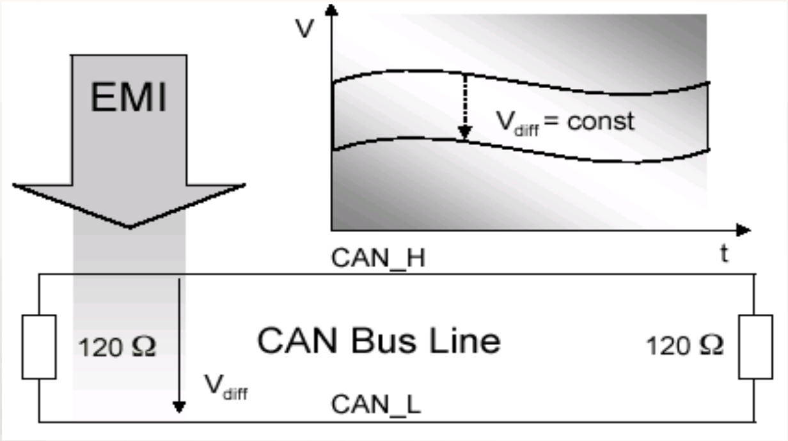

*Figure 4. CAN bus whose differential voltage is preserved under electromagnetic interference*

Because the two wires are twisted together and pass through the same space, external interference is induced in both wires with almost the same magnitude and direction. If the interference voltage is $V_n$, the difference seen by the receiver is as follows.

```math
(V_{CAN\_H} + V_n) - (V_{CAN\_L} + V_n) = V_{CAN\_H} - V_{CAN\_L} = V_{diff}
```

The component added equally to both wires (common-mode noise) cancels in the subtraction, so $V_{diff}$ stays constant ($V_{diff} = const$ in Figure 4). The 120 Ω resistors at both ends in Figure 4 are the termination resistors of Section 1.4.

### 1.4 Termination Resistors

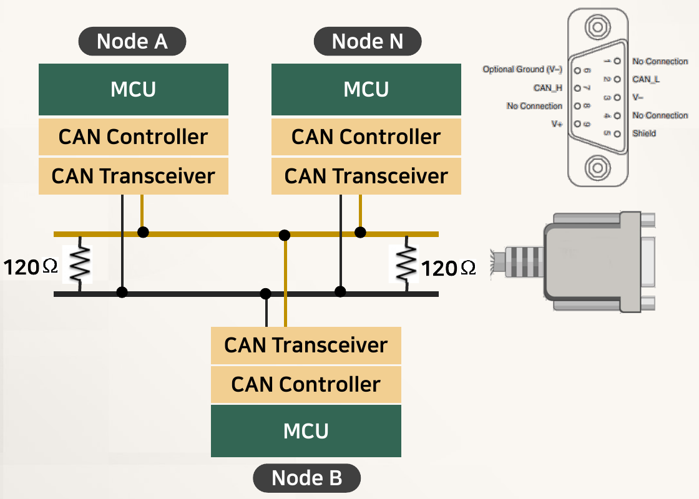

*Figure 5. CAN network with termination resistors and a D-sub 9-pin connector*

Each node in Figure 5 consists of an MCU (microcontroller), a CAN controller, and a CAN transceiver (Section 1.10), and the transceiver is connected to the two lines CAN_H and CAN_L. At the **two physical ends** of the bus, one 120 Ω resistor is placed between CAN_H and CAN_L.

```text
        ┌────────┐         ┌────────┐         ┌────────┐
        │ Node A │         │ Node B │         │ Node N │
        └─┬────┬─┘         └─┬────┬─┘         └─┬────┬─┘
          │    │             │    │             │    │
CAN_H ─┬──┴────┼─────────────┴────┼─────────────┴────┼───┬────
       │       │                  │                  │   │
     120Ω      │                  │                  │ 120Ω
       │       │                  │                  │   │
CAN_L ─┴───────┴──────────────────┴──────────────────┴───┴────
```

*Figure 6. A bus with termination resistors only at the two ends and nodes attached by short stubs*

There are three reasons why termination resistors are needed.

1. **Suppressing signal reflection.** For fast-changing signals, a wire behaves not as a simple conductor but as a transmission line with its own **characteristic impedance**. The characteristic impedance of CAN cable is about 120 Ω. If the end of the line is open or has a different impedance, part of the signal is reflected at the end and travels back, and the reflected wave overlaps the original signal and causes ringing, a fluctuation of voltage around bit boundaries. Terminating the end of the line with 120 Ω, equal to the characteristic impedance, absorbs the signal energy in the resistor so that no reflection occurs.
2. **Returning to the recessive state.** A transceiver actively drives dominant, but nobody drives recessive. The termination resistors are the path that brings the two wires back to the same voltage when the bus changes from dominant to recessive. Without them, the charge left on the wires drains slowly, the transition to recessive is delayed, and at high speed the next bit is read incorrectly.
3. **A defined load.** Transceivers are designed to drive 60 Ω, the parallel combination of the two termination resistors.

**Worked example.** The two 120 Ω resistors are connected in parallel between CAN_H and CAN_L, so the combined resistance is as follows.

```math
R_{bus} = \frac{120 \times 120}{120 + 120} = \frac{14400}{240} = 60\ \Omega
```

If the differential voltage in the dominant state is about 2 V, the current flowing in the bus is $`I = 2\ \text{V} / 60\ \Omega \approx 33`$ mA. This value is also used in fault diagnosis. Measuring the resistance between CAN_H and CAN_L with the power off gives about 60 Ω on a healthy bus. A reading of about 120 Ω means that one termination resistor is missing, and about 40 Ω ($`120/3`$) means that one extra termination resistor is attached.

> **Caution:** Termination resistors go only at the two ends of the bus. Putting 120 Ω at every node makes the combined resistance too small for the transceivers to produce a sufficient differential voltage. In addition, the stubs that branch from the main bus line to the nodes must be kept short. The end of a stub is not terminated, so a long stub causes reflections there.

The right side of Figure 5 shows the D-sub 9-pin connector and its pin assignment, which is common in industrial CAN equipment and measurement tools [5].

| Pin | Signal | Pin | Signal |
|:-----|:-----|:-----|:-----|
| 1 | No connection | 6 | Optional ground (V-) |
| 2 | CAN_L | 7 | CAN_H |
| 3 | Ground (V-) | 8 | No connection |
| 4 | No connection | 9 | Optional power (V+) |
| 5 | Shield | | |

*Table 5. Pin assignment of the D-sub 9-pin connector for CAN*

### 1.5 Bit Stuffing

CAN puts bits on the bus with **NRZ (non-return-to-zero)** coding. NRZ keeps the voltage level unchanged for one bit time (Week 4), so a long run of the same value produces no change (edge) in the signal at all. CAN has no separate clock line, so the receiver aligns its own clock with the transmitter by watching the signal edges (resynchronization), and if there is no edge for a long time, the two clocks drift apart little by little and the receiver miscounts bits.

> **Definition:** **Bit stuffing** is the rule by which, when a transmitter has sent five consecutive bits of the same value, it automatically inserts one bit of the opposite value (a stuff bit), and the receiver removes that bit again.

Bit stuffing has two roles. First, the same value continues for at most five bits, so edges are guaranteed at regular intervals and resynchronization is possible. Second, if a receiver sees six consecutive bits of the same value, the rule has been broken, so it declares a **stuff error**. That is, bit stuffing also serves as an error detection mechanism (Section 1.9). Stuffing applies from the SOF to the CRC sequence, and it does not apply to the CRC delimiter, the ACK field, and the EOF, which have fixed formats [6].

**Example.** Suppose the following 16 bits are to be sent (r = recessive, d = dominant).

```text
to transmit : r d r r r r r r d r d d d d d r             (16 bits)
stuffed     : r d r r r r r Sd r d r d d d d d Sr r       (18 bits)
de-stuffed  : r d r r r r r r d r d d d d d r             (16 bits)
```

*Figure 7. Insertion and removal of stuff bits*

The transmitter proceeds as follows.

1. It sends the 1st bit r and the 2nd bit d. At d, the count of equal values restarts at 1.
2. From the 3rd bit, r continues. The moment the 3rd, 4th, 5th, 6th, and 7th bits make five r's, it inserts the stuff bit Sd (dominant) of the opposite value.
3. The stuff bit also counts as part of the bit stream. The 8th bit r after Sd becomes the new first r.
4. After sending the 9th bit d, the 10th bit r, and the 11th bit d, it inserts the stuff bit Sr (recessive) the moment the 11th through 15th bits make five d's in a row.
5. It sends the last bit, the 16th r. The result is 18 bits, two bits longer than the original.

The receiver treats the bit that follows five equal values as a stuff bit and discards it. As a result, the original 16 bits are restored. Because of stuffing, the actual length of a frame depends on its data content. In the worst case, after the first five bits, one stuff bit is inserted for every four original bits (because a stuff bit counts as the first bit of the next run).

### 1.6 The CAN Message Frame

The unit that carries data in CAN is called a **data frame**. There are two formats, depending on the length of the identifier.

- **Standard frame (CAN 2.0A):** uses an 11-bit identifier.
- **Extended frame (CAN 2.0B):** uses a 29-bit identifier, adding 18 bits to the 11-bit base identifier.

> **Definition:** An **identifier (ID)** is a value that indicates the kind of message a frame carries (for example, engine speed or vehicle speed). It is not the address of a receiving node, and it is also used as the priority in the arbitration of Section 1.8. The smaller the value, the higher the priority.

The structure of a standard frame is as follows (the numbers are bit counts).

```text
      |<-- Arbitration --->|<--- Control ---->|          |< CRC field >|<-- ACK --->|
┌─────┬──────────────┬─────┬─────┬────┬───────┬──────────┬───────┬─────┬──────┬─────┬───────┬─────┐
│ SOF │  Identifier  │ RTR │ IDE │ r0 │  DLC  │   Data   │  CRC  │ Del │ Slot │ Del │  EOF  │ IFS │
├─────┼──────────────┼─────┼─────┼────┼───────┼──────────┼───────┼─────┼──────┼─────┼───────┼─────┤
│  1  │      11      │  1  │  1  │ 1  │   4   │   0-64   │  15   │  1  │  1   │  1  │   7   │  3  │
└─────┴──────────────┴─────┴─────┴────┴───────┴──────────┴───────┴─────┴──────┴─────┴───────┴─────┘
```

*Figure 8. Fields and bit counts of the CAN standard data frame*

| Field | Bits | Role |
|:-----|:-----|:-----|
| SOF (start of frame) | 1 | One dominant bit marks the start of the frame. Because the bus was idle (recessive), all nodes align their clocks to this first recessive-to-dominant edge. |
| Identifier | 11 | Indicates the kind and priority of the message. It is sent most significant bit first. |
| RTR (remote transmission request) | 1 | Dominant for a data frame, and recessive for a remote frame, which requests data from another node. |
| IDE (identifier extension) | 1 | Dominant for a standard frame, and recessive for an extended frame. |
| r0 | 1 | A reserved bit. |
| DLC (data length code) | 4 | Indicates the number of bytes (0-8) in the data field. |
| Data | 0-64 | The actual data of 0-8 bytes. |
| CRC sequence | 15 | A 15-bit CRC computed over the SOF through the data (Section 1.9). |
| CRC delimiter | 1 | Always recessive. |
| ACK slot | 1 | The transmitter sends recessive, and every receiving node that received the frame correctly overwrites this bit with dominant to acknowledge reception. |
| ACK delimiter | 1 | Always recessive. |
| EOF (end of frame) | 7 | Seven recessive bits mark the end of the frame. |
| IFS (interframe space) | 3 | The gap between frames (intermission), three recessive bits. |

*Table 6. Fields of the CAN standard data frame*

**Computing the frame length.** Counting the length of a standard frame with 8 bytes of data, excluding stuff bits, gives the following.

```math
1 + 11 + 1 + 1 + 1 + 4 + 64 + 15 + 1 + 1 + 1 + 7 = 108\ \text{bits}
```

Adding the 3-bit IFS, the next frame can start after 111 bits. The actual data is 64 bits, so the share of data within the frame is $`64 / 108 \approx 59\%`$. The rest is overhead for the identifier, control, error checking, and acknowledgment.

In an extended frame, the arbitration field becomes longer.

```text
      |<----------- Arbitration ----------->|<-- Control -->|        |< CRC field >|<-- ACK --->|
┌─────┬─────────┬─────┬─────┬─────────┬─────┬────┬────┬─────┬────────┬───────┬─────┬──────┬─────┬─────┬─────┐
│ SOF │ Base ID │ SRR │ IDE │ ID ext. │ RTR │ r1 │ r0 │ DLC │  Data  │  CRC  │ Del │ Slot │ Del │ EOF │ IFS │
├─────┼─────────┼─────┼─────┼─────────┼─────┼────┼────┼─────┼────────┼───────┼─────┼──────┼─────┼─────┼─────┤
│  1  │   11    │  1  │  1  │   18    │  1  │ 1  │ 1  │  4  │  0-64  │  15   │  1  │  1   │  1  │  7  │  3  │
└─────┴─────────┴─────┴─────┴─────────┴─────┴────┴────┴─────┴────────┴───────┴─────┴──────┴─────┴─────┴─────┘
```

*Figure 9. Fields and bit counts of the CAN extended data frame*

In an extended frame, the **SRR (substitute remote request)** bit takes the place of the RTR of a standard frame and is always recessive. Because the following IDE is recessive, the receiver knows that the frame is an extended frame and goes on to read the 18-bit identifier extension and the RTR. An extended frame with 8 bytes of data is $1 + 11 + 1 + 1 + 18 + 1 + 1 + 1 + 4 + 64 + 15 + 1 + 1 + 1 + 7 = 128$ bits, excluding the IFS.

> **Note:** The figures of the early Bosch specification (CAN 2.0A) draw the control field of a standard frame as "r1, r0, DLC". This r1 later became the IDE bit. Standard and extended frames can coexist on the same bus because the value of this bit (dominant or recessive) distinguishes the two formats.

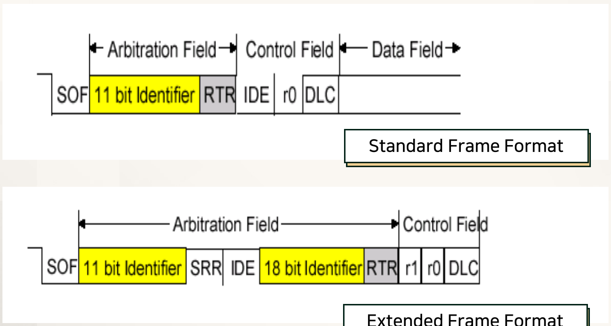

*Figure 10. Arbitration fields of the standard and extended frames*

In Figure 10, the yellow parts are the identifier and the gray parts are the RTR. The arbitration field of a standard frame is the 11-bit identifier and the RTR, and that of an extended frame is the 11-bit base identifier, the SRR, the IDE, the 18-bit identifier extension, and the RTR. The remaining frame types, such as the remote frame, error frame, and overload frame, and the detailed behavior of each field are covered in Week 9.

### 1.7 Broadcast Communication and Message Filtering

A CAN frame contains no address of a receiving node. A frame sent by one node reaches every node on the bus, and each node decides by itself, from the identifier, whether it needs the message.

> **Definition:** **Broadcast communication** is a method in which every node in the network receives the message sent by one node.

> **Definition:** In CAN, the node that sends a message is called the **producer**.

> **Definition:** In CAN, the nodes that receive and use a message are called **consumers**.

> **Definition:** An **acceptance filter** is hardware inside a CAN controller that compares the identifier of each received frame with preset values, passes only the needed messages to the CPU, and discards the rest.

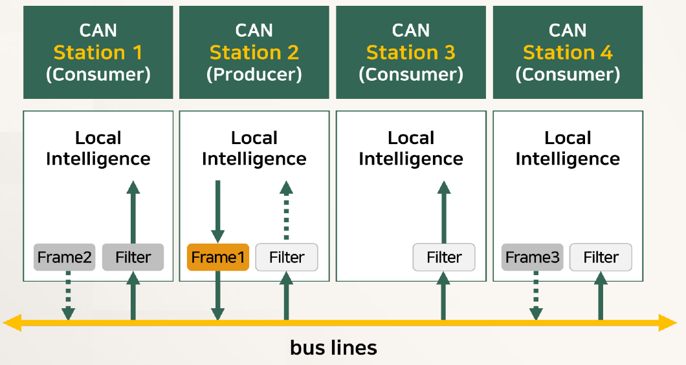

*Figure 11. Broadcast communication in which every station receives the producer's frame and filters it*

In Figure 11, station 2, as the producer, sends Frame1 to the bus. Stations 1, 3, and 4 all receive Frame1, and each station's filter decides whether to pass the message. Only messages that pass the filter go up to each station's application processing (local intelligence). Frame2 of station 1 and Frame3 of station 4 are frames waiting for their turn to be sent (dashed lines).

The advantages of broadcast communication are as follows.

- **Flexibility:** Adding a new node that uses existing messages requires no change to the transmitting node or other nodes. Only the filter of the new node needs to be configured.
- **Data consistency:** All nodes receive the same frame at the same time, so, for example, several ECUs can act simultaneously on the same vehicle speed value.

### 1.8 Multiple Bus Access and Bit-Wise Arbitration

Because many nodes share one bus, the case in which two or more nodes try to transmit at once must be handled. CAN handles it with **CSMA/CD+AMP (carrier sense multiple access with collision detection and arbitration on message priority)**.

- **CS (carrier sense):** A node listens to the bus before sending and starts transmitting only when the bus is idle (recessive continuing after the EOF and IFS).
- **MA (multiple access):** When the bus becomes idle, every node with something to send may start transmitting at the same time by sending SOF.
- **CD (collision detection):** Each transmitting node compares, bit by bit, the bit it sent with the bit it reads from the bus.
- **AMP (arbitration on message priority):** When the comparison disagrees, only one node remains, according to the priority of the identifier.

> **Definition:** **Bit-wise arbitration** is the process in which nodes that started transmitting at the same time send their identifiers one bit at a time from the most significant bit, and a node that sent recessive (1) but reads dominant (0) on the bus stops transmitting at once and becomes a receiver.

> **Definition:** The frame of the remaining node is not damaged at all, so this arbitration is called **non-destructive arbitration**.

Because of the wired-AND property of Table 4, 0 wins over 1. Therefore, at the first position where the identifier bits differ, the node with 0 wins, and in the end **the node with the smallest identifier value takes the bus.**

**Example.** Three nodes sent SOF at the same time. The identifiers are 0x15A for node A, 0x159 for node B, and 0x1C0 for node C. First, convert each identifier to an 11-bit binary number.

| Node | Hexadecimal | 11-bit binary (ID10 → ID0) |
|:-----|:-----|:-----|
| A | 0x15A | 001 0101 1010 |
| B | 0x159 | 001 0101 1001 |
| C | 0x1C0 | 001 1100 0000 |

*Table 7. Identifiers in the arbitration example*

```text
ID bit       10  9  8  7  6  5  4  3  2  1  0
Node A        0  0  1  0  1  0  1  1  0  1        -> lost at ID1, becomes receiver
Node B        0  0  1  0  1  0  1  1  0  0  1     -> wins, continues with RTR, DLC, ...
Node C        0  0  1  1                          -> lost at ID7, becomes receiver
Bus           0  0  1  0  1  0  1  1  0  0  1
```

*Figure 12. Bit-wise arbitration among three nodes*

Following the bits one at a time gives the following.

1. **ID10, ID9:** All three nodes send 0 (dominant). The bus is 0, which equals each node's own bit, so all continue.
2. **ID8:** All three nodes send 1 (recessive). Nobody sends dominant, so the bus is 1 and all continue.
3. **ID7:** A and B send 0, and C sends 1. The bus becomes 0. C sent 1 but read 0, so it knows that it has lost arbitration, stops transmitting, and switches to receive mode. For A and B, their own bits equal the bus, so they continue.
4. **ID6 through ID2:** The bits of A and B are all equal (1, 0, 1, 1, 0). The bus takes the same values, and both continue.
5. **ID1:** A sends 1, and B sends 0. The bus is 0. A sent 1 but read 0, so it loses.
6. **ID0 and after:** Only B remains and goes on to send the last identifier bit, the RTR, the control field, and the data.

The result is that B, which has the smallest of the three values, 0x159, wins ($`0\text{x}159 < 0\text{x}15\text{A} < 0\text{x}1\text{C}0`$). The bit stream that appeared on the bus during this process equals B's identifier from start to end, so B's frame was not damaged by the collision and needs no retransmission. The losers A and C receive B's frame and retry their transmissions when the bus becomes idle again.

> **Caution:** For bit-wise arbitration to work, two nodes on the same bus must not send data frames with the same identifier. With equal identifiers, the contest is not decided by the end of the arbitration field, and a bit error occurs at the point where the following data differ. For this reason, a unique identifier is assigned to each message when a CAN network is designed.

> **[Computer Networks]** In Ethernet CSMA/CD, a collision destroys all colliding frames, and each node waits a random time before resending. In CAN, the collision is resolved and the frame with the highest priority goes through intact, so the CAN scheme is sometimes called CSMA/CR (collision resolution). Ethernet CSMA/CD is covered in Week 7.

The transmit and receive operation of a single CAN node can be summarized in the following flowchart.

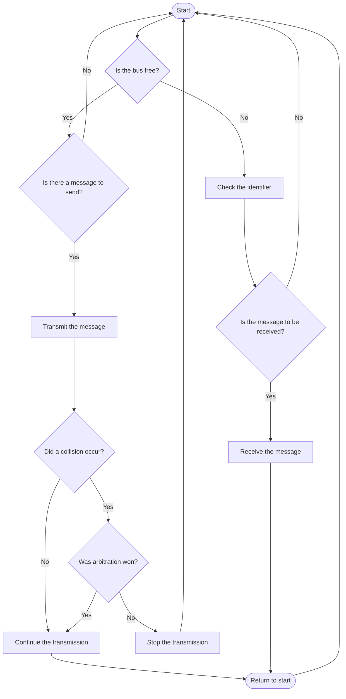

*Figure 13. Transmit and receive flow of a CAN node*

A node that loses arbitration stops transmitting and returns to the start. At that moment the winning node is using the bus, so the answer to "Is the bus free?" is "No", and the losing node checks the winner's frame by its identifier and receives it if needed.

### 1.9 Error Detection and Error States

CAN detects errors with five mechanisms. Three work at the message level and two at the bit level.

| Level | Mechanism | Error detected |
|:-----|:-----|:-----|
| Message | CRC (cyclic redundancy check) | The receiver recomputes the CRC over the SOF through the data, and if it differs from the received CRC sequence, declares a CRC error. |
| Message | Frame check | If a bit with a fixed value, such as the CRC delimiter, the ACK delimiter, or the EOF, violates the rule, the node declares a form error. |
| Message | Acknowledgment error check | If the transmitter does not read dominant in the ACK slot, that is, if no node received the frame correctly, it declares an ACK error. |
| Bit | Bit monitoring | If the bit a transmitter sent differs from the bit it reads on the bus, it declares a bit error. The arbitration field and the ACK slot are excluded, because the bits may legitimately differ there. |
| Bit | Bit stuffing | If six consecutive bits of the same value appear, the node declares a stuff error (Section 1.5). |

*Table 8. The five error detection mechanisms of CAN*

> **[Computer Networks]** A CRC detects bit errors during transmission by appending the remainder of dividing the bit stream by a generator polynomial. The CRC of CAN is 15 bits, and the computation principle of CRC is covered in Week 7.

A node that detects an error immediately sends an error frame to notify all nodes, the frame is discarded, and the transmitter sends it again. However, if a node breaks down and keeps causing errors, the whole bus can be paralyzed. To prevent this, each node has two error counters.

- **TEC (transmit error counter):** Increases when an error occurs while transmitting, and decreases when a transmission succeeds.
- **REC (receive error counter):** Increases when an error occurs while receiving, and decreases when a reception succeeds.

Depending on the counter values, a node is in one of three states.

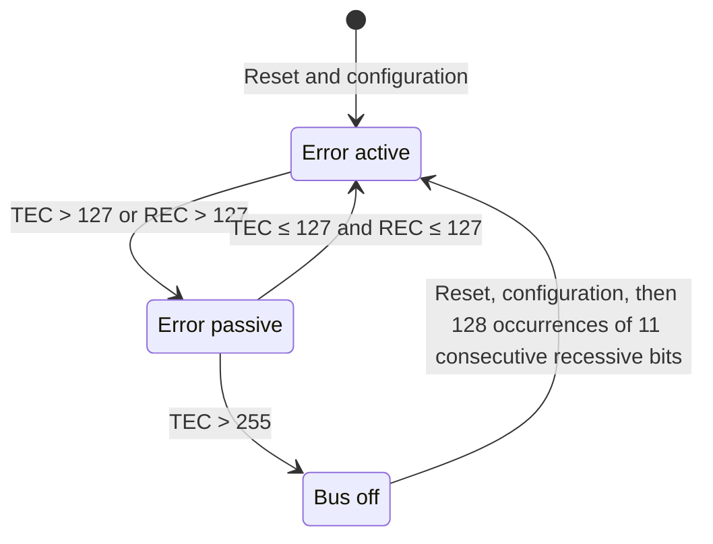

*Figure 14. Error state transitions of a CAN node*

| State | Condition | Behavior |
|:-----|:-----|:-----|
| Error active | TEC ≤ 127 and REC ≤ 127 | The normal state. When the node detects an error, it sends an active error flag made of dominant bits, which reliably aborts the reception at other nodes. |
| Error passive | TEC > 127 or REC > 127 | A node that experiences errors frequently. Even when it detects an error, it sends only a passive error flag made of recessive bits, so it cannot disturb the communication of other nodes, and it must wait additionally after transmitting. |
| Bus off | TEC > 255 | The node is logically disconnected from the bus and neither transmits nor acknowledges. |

*Table 9. Error states of a CAN node*

A node in the bus off state returns to the error active state only after reset and configuration and after observing 128 occurrences of 11 consecutive recessive bits (that is, after confirming that the bus has been healthy long enough). This function of isolating a faulty node step by step is the fault confinement of Section 1.2.

> **Note:** The state diagram in the lecture material gives the condition for entering bus off as "REC > 255" and the condition for returning to error active as "REC < 127 or TEC < 127". In the specification, only the transmit error counter causes bus off, so the condition is TEC > 255, and returning to error active requires both counters to be 127 or below [6].

The format of the error frame, the rules for incrementing and decrementing the counters, and bit timing are covered in Week 9.

### 1.10 Implementing CAN: Controllers and Transceivers

A CAN node is implemented with three components.

| Component | Role |
|:-----|:-----|
| Microcontroller | Runs the application program and creates the data to send or processes the received data. Higher-layer protocols are also handled here. |
| Protocol controller | Handles the work of the CAN data link layer in hardware, such as building and parsing frames, bit stuffing, CRC computation, arbitration, error detection and signaling, acknowledgment, and synchronization. |
| Transceiver | Converts the controller's logic signals (Tx, Rx) into the differential voltage of CAN_H and CAN_L and back. It also handles bus failure management. |

*Table 10. The three components of a CAN node*

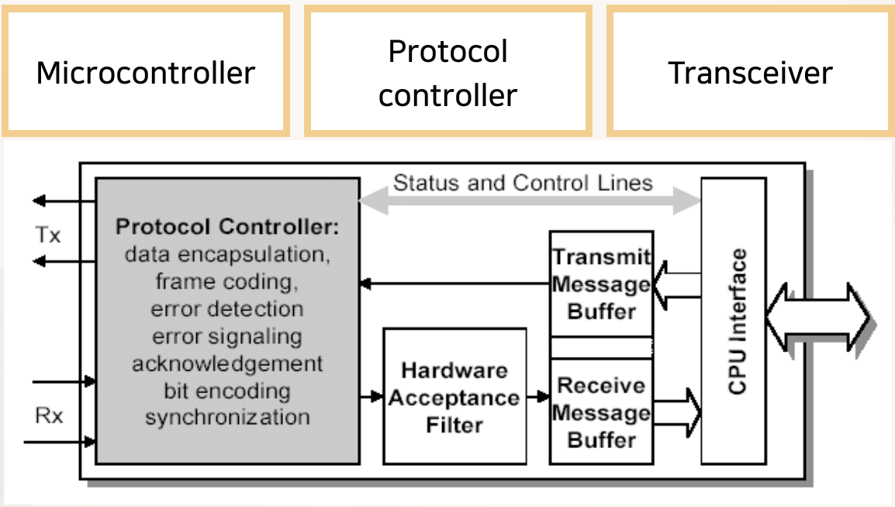

*Figure 15. Internal structure of a CAN protocol controller*

The protocol controller in Figure 15 is connected to the transceiver through the Tx and Rx lines. Its internal protocol engine handles data encapsulation, frame coding, error detection and signaling, acknowledgment, bit encoding, and synchronization. A received frame passes through the hardware acceptance filter (Section 1.7) and is stored in the receive message buffer, and a frame to be sent is taken from the transmit message buffer. The CPU reads and writes the buffers through the CPU interface and configures the controller through the status and control lines.

There are two ways to place the protocol controller.

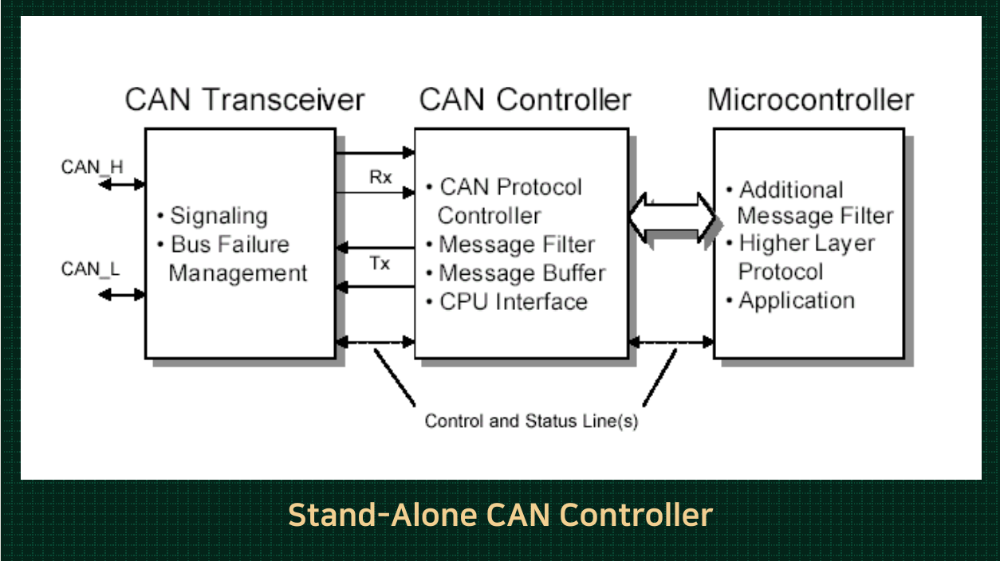

*Figure 16. Configuration with a stand-alone CAN controller*

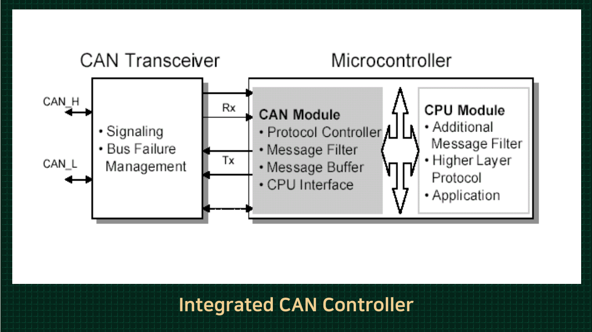

*Figure 17. Configuration with an integrated CAN controller*

- **Stand-alone CAN controller (Figure 16):** The CAN controller is a chip separate from the microcontroller. Three chips are needed, a transceiver, a CAN controller, and a microcontroller, and the microcontroller accesses the controller through an external bus. CAN can be added even to a microcontroller without a CAN function.
- **Integrated CAN controller (Figure 17):** The CAN module is inside the microcontroller chip. Fewer chips mean lower cost and easier circuit design, and because the CPU accesses the CAN module directly over the on-chip bus, the CPU load is also reduced.

In both configurations, the microcontroller side has additional message filtering, higher-layer protocols, and the application, and the transceiver handles signal conversion and bus failure management.

### 1.11 Case Study: A CAN-Based Body Control System

A development case that applied CAN to a real vehicle is a body control system that controls body electronics, such as the doors, mirrors, and windows, over CAN.

- **Objective:** Develop body control modules based on CAN communication.
- **Tasks:** Analysis of the vehicle electrical system, hardware development of the body control modules, message definition and software development, and on-board testing.

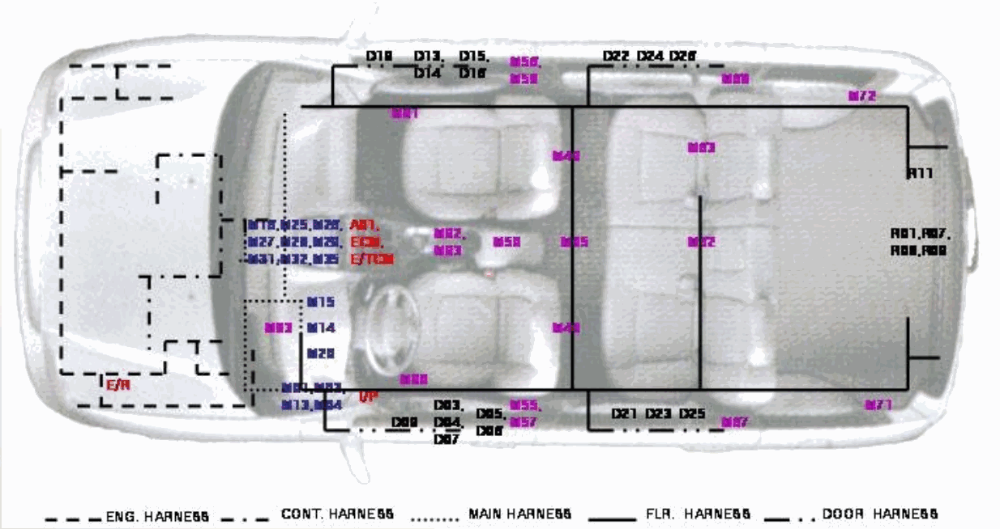

*Figure 18. Harness layout of a vehicle electrical system*

The first step, the analysis of the electrical system, identifies where the vehicle's wiring bundles (harnesses) run, as in Figure 18. The figure marks the engine (ENG), control (CONT), main (MAIN), floor (FLR), and door (DOOR) harnesses and the location of each connector. Because the existing wiring spreads all over the body, this analysis is the basis for deciding where to place each controller and which signals to convert into CAN messages.

| Abbreviation | Name | Role |
|:-----|:-----|:-----|
| CCU1, CCU2 | Central controller unit 1, 2 | Central controllers |
| DDC | Driver door controller | Driver's door controller |
| ADC | Assistant door controller | Front passenger's door controller |
| PDLC | Passenger door left controller | Rear left door controller |
| PDRC | Passenger door right controller | Rear right door controller |
| IMC | Inner module controller | Interior module controller |
| RDC | Rear door controller | Tailgate (trunk) controller |

*Table 11. Types of body control modules*

The two central controllers are at the front of the vehicle, the four door controllers are in their doors, the interior module controller is at the center of the cabin, and the rear door controller is at the rear of the vehicle. All modules are connected by one CAN bus.

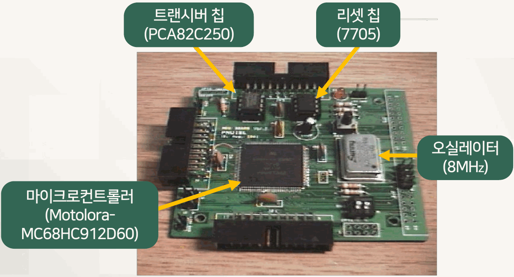

*Figure 19. CAN module board for body control*

The module in Figure 19 consists of a microcontroller (Motorola MC68HC912D60), a CAN transceiver chip (PCA82C250), a reset chip (7705) that resets the microcontroller when the supply voltage drops, and an 8 MHz oscillator that generates the clock. The MC68HC912D60 is a microcontroller with a built-in CAN module, so it corresponds to the integrated configuration of Section 1.10, which is why there is no separate CAN controller chip.

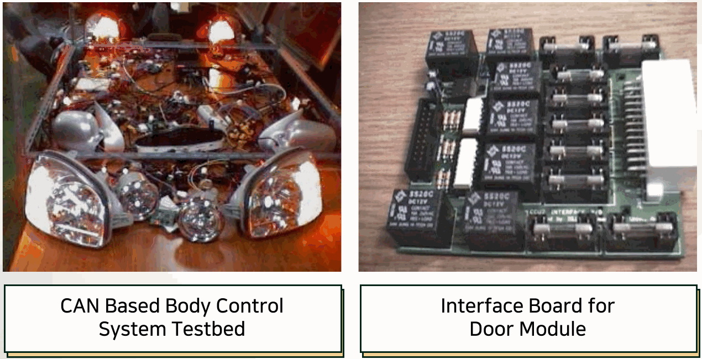

*Figure 20. Test bed of the CAN-based body control system and interface board for the door module*

The left side of Figure 20 is a test bed that lays the vehicle's lamps and modules out on a table and tests their operation with CAN messages, and the right side is an interface board with which the door module drives loads such as motors and lamps through relays.

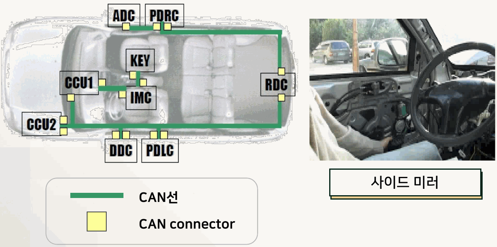

*Figure 21. CAN wiring and connectors in a real vehicle, and side-mirror control*

Figure 21 shows CCU1, CCU2, IMC, KEY, DDC, PDLC, ADC, PDRC, and RDC connected in a real vehicle by the CAN line (green) and CAN connectors (yellow squares). The photo on the right is an on-board test in which this network controls a side mirror. Loads that used to be connected by many separate wire bundles now share one pair of CAN wires, which simplifies the wiring greatly.

---

<br>

## 2. In-Vehicle Networks

> **Definition:** An **IVN (in-vehicle network)** is a network that connects the ECUs, sensors, actuators, and multimedia devices inside a vehicle. Because the required speed, cost, and real-time behavior differ greatly between functions, several kinds of IVN are used together.

### 2.1 Classification of In-Vehicle Networks

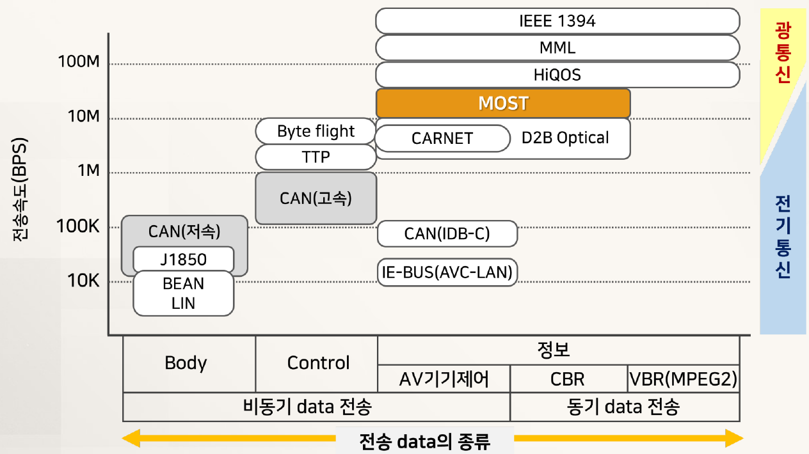

*Figure 22. In-vehicle network protocols by transmission speed and application domain*

Figure 22 places the protocols with the transmission speed (bps, logarithmic scale) on the vertical axis and the application domain on the horizontal axis.

- **Body:** LIN, BEAN, J1850, and low-speed CAN at about 10 kbps-100 kbps are used.
- **Control:** High-speed CAN, TTP, and Byteflight at about several hundred kbps-10 Mbps are used.
- **Information:** IE-BUS (AVC-LAN) and CAN (IDB-C) are used for AV device control, MOST, CARNET, and D2B Optical for constant-bit-rate data (CBR), and IEEE 1394, MML, and HiQOS for variable-bit-rate data (VBR) such as MPEG2 video.
- Body and control use **asynchronous data transfer**, which sends short messages whenever needed, and the information domain uses **synchronous data transfer**, in which voice and video flow without interruption. The band on the right means that roughly 10 Mbps and above uses optical communication and below that uses electrical communication.

The application domains, the systems they cover, and the classifications of the standards bodies are summarized together as follows.

| Application domain | Systems | ISO classification | SAE classification |
|:-----|:-----|:-----|:-----|
| Body control | Lamps, power windows, door locks, power seats | Low speed | Class A (≤ 125 kbps) |
| Diagnostic | Failure diagnosis | Low speed | Class B (≤ 250 kbps) |
| Powertrain and chassis control | Engine, transmission, brake, and steering control | High speed | Class C (> 250 kbps) |
| Information and ITS | Navigation, CD, DVD, phone | None | IDB (ITS bus) |
| Safety | Airbags, pretensioners | None | None |

*Table 12. Network classification by application domain in a vehicle*

> **Note:** The speed boundaries of the SAE classes vary between sources. A common classification based on SAE J2057 puts Class A below 10 kbps, Class B at 10 kbps-125 kbps, and Class C at 125 kbps-1 Mbps, and puts faster multimedia networks in Class D [7]. In every classification, the order is the same: body control is the slowest class, and powertrain and chassis control is the fastest. A pretensioner is a device that pulls the seat belt tight at the moment of a crash to hold the occupant in the seat.

| Speed | Protocol | Characteristics |
|:-----|:-----|:-----|
| Low | LIN | Usually 20 kbps. Used for communication of simple on-off devices such as smart sensors and actuators. |
| Medium-low | CAN | Up to 1 Mbps (high-speed CAN), carrying communication and control signals between ECUs. It has become the standard network for controllers. |
| High | MOST | 25 Mbps, and its successor MOST150 is a 150 Mbps multimedia bus. It went into mass production mainly in Europe. |
| High | IEEE 1394 | A multimedia bus of 100 Mbps or more, whose automotive standardization progressed mainly in the United States. |

*Table 13. Representative vehicle protocols by transmission speed*

| Application domain | Representative protocols |
|:-----|:-----|
| Body control | LIN, BEAN, LS-CAN (low-speed CAN), SAE J1850, TTP/A |
| Real-time control | HS-CAN (high-speed CAN), TTP/C, FlexRay |
| Infotainment and telematics | MOST, D2B, IDB, IEEE 1394 |
| Safety | Safe-by-Wire, BST, DSI |

*Table 14. Representative protocols by application domain*

Infotainment is a blend of information and entertainment and refers to functions such as navigation, audio, and video, and telematics refers to services that connect the vehicle with the outside world over communication networks. Safe-by-Wire, BST, and DSI in the safety domain are dedicated buses that connect the airbag controller with crash sensors and igniters.

### 2.2 LIN

> **Definition:** **LIN (Local Interconnect Network)** is a low-cost in-vehicle network created mainly by the European automotive industry, a low-cost single-wire serial communication system for the simple electronic devices distributed around the vehicle.

LIN communicates over one wire and the chassis ground, and because a single master node gives the slave nodes their turns in a fixed order, it needs no arbitration circuitry. As a result, it is much cheaper to implement than CAN. Its speed, however, is usually 20 kbps, only about 1/12 of the 250 kbps CAN commonly used in vehicles, and more than a thousand times slower than MOST in the tens of Mbps.

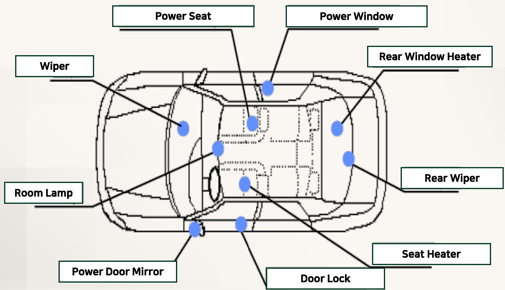

*Figure 23. Where LIN is used in a vehicle*

As Figure 23 shows, LIN is used for body electronics such as power seats, power windows, the rear window heater, the wipers, the rear wiper, the room lamp, the seat heaters, the power door mirrors, and the door locks. These devices need no fast response and exchange little data, so the low speed of LIN is enough. Usually a LIN sub-network is built per door or seat, and its master is also connected to CAN and acts as a gateway between the two networks. The LIN frame and operation are covered in Week 9.

### 2.3 MOST

> **Definition:** **MOST (Media Oriented Systems Transport)** is a high-performance in-vehicle network for multimedia data such as audio, video, and navigation. It started at 25 Mbps and later supports up to 150 Mbps.

The goals of the MOST network are as follows.

- Implement a low-cost solution with a data rate of up to 25 Mbps.
- Optimize weight, cost, and electromagnetic interference by using plastic optical fiber (POF).
- Provide high reliability and ease of use.
- Provide an open protocol interface on which various application protocols can run.

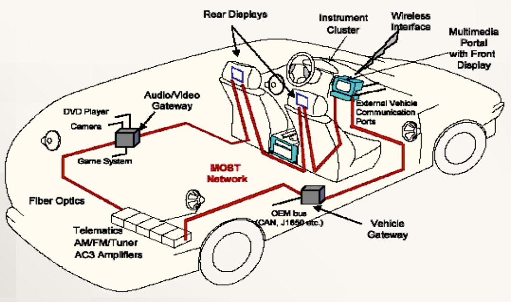

*Figure 24. Example configuration of a MOST network in a vehicle*

In Figure 24, the red line is the MOST network (optical fiber). The audio/video gateway that groups the DVD player, camera, and game system, the rear displays, the instrument cluster, the wireless interface, the front multimedia display, the communication ports for external devices, the telematics unit and AM/FM tuner, and the amplifier are connected by MOST. The vehicle gateway connects the MOST network with control buses (OEM buses) such as CAN and J1850.

### 2.4 TTP

> **Definition:** **TTP (Time-Triggered Protocol)** is a fault-tolerant, time-triggered communication protocol. In time-triggered communication, each node sends messages only in its own time window of a predefined schedule.

In event-triggered communication such as CAN, which sends when an event occurs, it is hard to guarantee when a low-priority message will be delivered if the bus is busy. X-by-wire systems, which perform braking or steering only through wires and electronic control, require messages to arrive exactly on time, so they need a protocol that guarantees timing while tolerating faults. TTP was developed for this requirement by the TTA (Time-Triggered Architecture) group, in which Volkswagen, Audi, PSA Peugeot Citroen, Delphi, Honeywell, NEC, and Oki took part. It is used in the aerospace and automotive fields. TTP/A in Table 14 is the low-cost version for body control, and TTP/C is the version for real-time control.

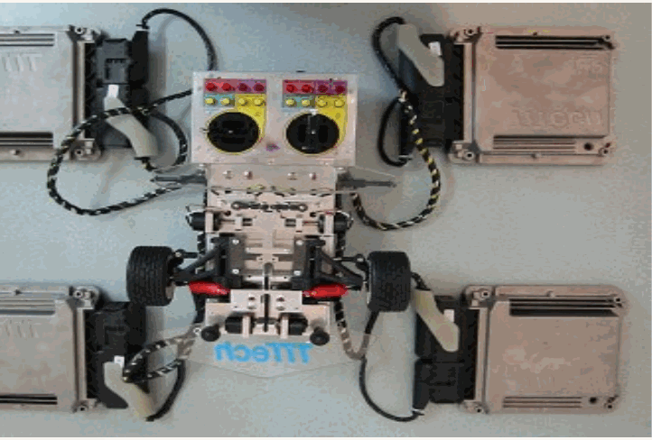

*Figure 25. X-by-wire test rig connected with TTP*

Figure 25 is a test rig made by TTTech in which four control units connected with TTP control a small vehicle model in X-by-wire fashion.

### 2.5 FlexRay

> **Definition:** **FlexRay** is a high-speed, deterministic in-vehicle network developed by the FlexRay consortium of GM, DaimlerChrysler, BMW, Philips, Motorola, and others. It divides one communication cycle into a static part and a dynamic part.

- **Static part:** Time-triggered. It guarantees the delivery time by giving each node a fixed time slot, so it is used for safety-related real-time control such as braking and steering.
- **Dynamic part:** Event-driven. It handles messages that are sent only when needed.

By providing both methods within one cycle, FlexRay handles messages that need guaranteed timing and messages that do not in a single network. Philips began mass production of FlexRay chips at the end of 2004.

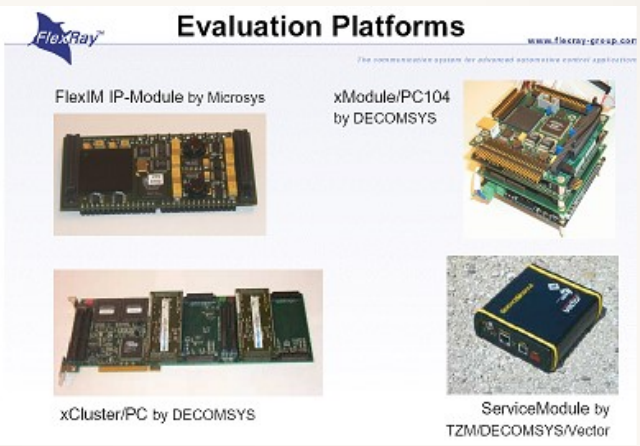

*Figure 26. FlexRay evaluation platforms*

Companies such as GM, Audi, Bentley, Volkswagen, Bosch, and Daimler also took part in the FlexRay consortium. Figure 26 shows evaluation modules and interface equipment used for FlexRay development and testing: the FlexIM IP-Module by Microsys, the xModule/PC104 and xCluster/PC by DECOMSYS, and the ServiceModule by TZM, DECOMSYS, and Vector. The FlexRay frame and medium access method are covered in Week 9.

### 2.6 Diagnostic Communication: KWP2000 and OBD

> **Definition:** **OBD (on-board diagnostics)** is a specification for checking the state of a vehicle and diagnosing faults. Recently it also serves as an interface for exporting vehicle information.

The development of OBD is as follows.

- The first specification was OBD-I, and OBD-II, which followed it, became the base specification. However, Europe uses EOBD, Japan JOBD, Korea KOBD, and Australia ADR 79.
- These specifications are based on OBD-II, but their signaling schemes are not identical, so a scan tool from one country may be unable to monitor some items of a vehicle built to another specification.
- The US emission regulation OBD-II requires a self-diagnosis function in the controller of every system that can affect exhaust emissions, and makes it possible to find out with dedicated diagnostic equipment which part failed and when.
- Korea made the OBD-II specification mandatory for new vehicles from 2005 and for all vehicles from 2007.

OBD-II uses one of the following five protocols: SAE J1850 PWM, SAE J1850 VPW, ISO 9141-2, ISO 14230-4 (KWP2000), and ISO 15765-4 (SAE J2480, CAN-based).

> **Note:** In the United States, CAN-based ISO 15765-4 has been mandatory for OBD-II communication since model year 2008, so most vehicles today also use CAN for diagnostic communication [8].

> **Definition:** **KWP2000 (Keyword Protocol 2000)** is a serial communication protocol developed for vehicle diagnosis, the international standard ISO 14230. It is one of the protocols that OBD-II permits, and the requirements for OBD-II diagnostic equipment (scan tools) are set by SAE J1978.

A KWP2000 message consists of a header, data, and a checksum.

```text
┌───────────────────────────────┬──────────────────────────────┬──────────┐
│            Header             │          Data bytes          │ Checksum │
├───────┬───────┬───────┬───────┼───────┬──────────────────────┼──────────┤
│  Fmt  │  Tgt  │  Src  │  Len  │  SId  │         Data         │    CS    │
└───────┴───────┴───────┴───────┴───────┴──────────────────────┴──────────┘
        max. 4 bytes                    max. 255 bytes            1 byte
```

*Figure 27. Structure of a KWP2000 message*

- **Header:** Determines the format of the message. It consists of the format byte (Fmt), the target address (Tgt), the source address (Src), and the length byte (Len), up to 4 bytes.
- **Data bytes:** The first byte is the service identifier (SId), which indicates the kind of diagnostic service requested, and the service data follow. Up to 255 bytes.
- **Checksum:** One byte (8 bits) that checks for transmission errors with the low 8 bits of the sum of all preceding bytes.

The communication services between the diagnostic equipment (tester) and the vehicle are the Start Communication, Stop Communication, Access Timing Parameter, and Send Data services. Start Communication opens the connection, Access Timing Parameter adjusts values such as the response wait times, Send Data exchanges diagnostic requests and responses, and Stop Communication closes the connection.

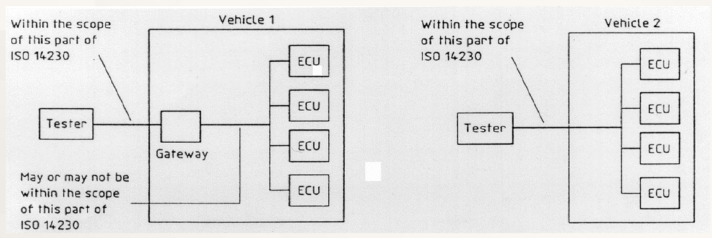

*Figure 28. Connection of diagnostic equipment to vehicle ECUs and the scope of ISO 14230*

In vehicle 1 of Figure 28, the tester communicates with several ECUs through a gateway, and in vehicle 2, the tester is connected directly to the ECUs. The connection between the tester and the vehicle is within the scope of ISO 14230, and the in-vehicle connections behind the gateway may or may not be within the scope of this standard.

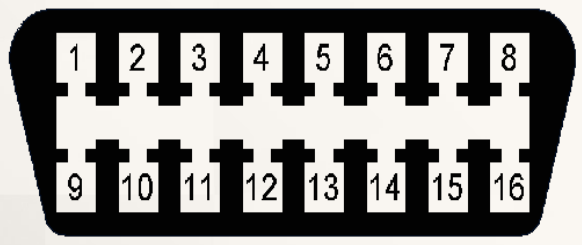

*Figure 29. Pin numbers of the OBD-II connector*

| Pin | Signal |
|:-----|:-----|
| 2 | J1850 Bus+ |
| 4 | Chassis ground |
| 5 | Signal ground |
| 6 | CAN High (J-2284) |
| 7 | ISO 9141-2 K line |
| 10 | J1850 Bus- |
| 14 | CAN Low (J-2284) |
| 15 | ISO 9141-2 L line |
| 16 | Battery power |

*Table 15. Standard pin assignment of the OBD-II connector*

Pins not listed in Table 15 are free for manufacturers to use. Which protocol a vehicle uses can be told from which pins carry signals. For example, if pins 6 and 14 are used, it is CAN, and if pin 7 is used, it is ISO 9141-2 or KWP2000.

### 2.7 In-Vehicle Multimedia Networks

| Protocol | Characteristics |
|:-----|:-----|
| D2B (Domestic Digital Bus) | Developed by the Optical Chip Consortium. It uses fiber-optic media and was used in the Mercedes S-Class. |
| IDB-C (ITS Data Bus, CAN) | An SAE standard (SAE J2366) based on the physical and data link layers of CAN 2.0B. It uses the same twisted pair as CAN [9]. |
| MOST | Developed by Oasis Silicon Systems. It provides both synchronous and asynchronous bandwidth and embeds virtual network management in the system. |

*Table 16. In-vehicle multimedia network protocols*

> **Note:** The lecture material states that IDB-C uses optical fiber media, but the physical layer of IDB-C is based on CAN 2.0B as defined in SAE J2284-2 and therefore uses copper twisted pair [9].

Synchronous bandwidth is a part of the capacity reserved permanently for data that must flow at a constant rate without interruption, such as voice and video, and asynchronous bandwidth distributes the remaining capacity to data that arise irregularly, such as files and control messages.

---

<br>

## 3. Classification of Networks by Physical Scale

### 3.1 WAN, MAN, and LAN

Networks developed as hardware performance rose sharply, the number of CPUs placed in many locations grew, and the amount of data exchanged between systems and the need for it increased. Networks are divided into LAN, MAN, and WAN according to the size of their physical configuration, that is, the geographic range they connect. This classification is not merely a distinction of size but also reflects the technical characteristics used at each scale (transmission method, speed, and the need for routing).

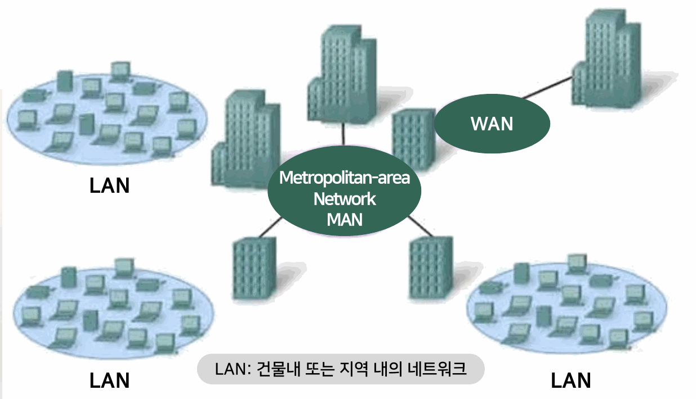

*Figure 30. Relationship among LAN, MAN, and WAN*

In Figure 30, several LANs within buildings or areas are tied together by a city-scale MAN, and the MAN is in turn connected to a WAN of national scale or larger.

| Type | Range | Characteristics |
|:-----|:-----|:-----|
| LAN (local area network) | Short distances such as a single building or campus | Can be connected with a single transmission cable, and because the distance is short, it transmits by broadcasting. Usually tens of Mbps to a few Gbps. |
| MAN (metropolitan area network) | City scale | Its hardware and software configuration is similar to a LAN, but its scale of connection is larger. The international standard is DQDB, which connects hosts with two buses running in opposite directions. |
| WAN (wide area network) | Wide areas of national scale or larger | Must support long-distance transmission over point-to-point (1:1) connections, so routing is essential. |

*Table 17. Comparison of LAN, MAN, and WAN*

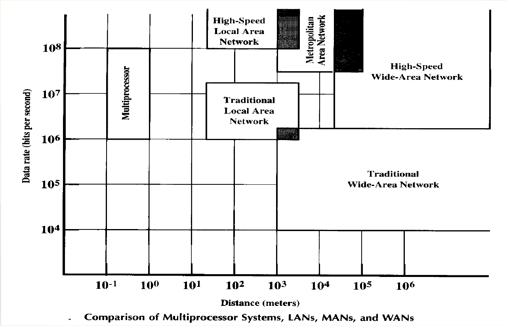

*Figure 31. Multiprocessor systems, LANs, MANs, and WANs by distance and data rate*

Figure 31 plots distance (m) on the horizontal axis and data rate (bps) on the vertical axis, both on logarithmic scales, and marks the region each system occupies. Multiprocessor systems occupy short distances around 1 m, traditional LANs occupy about $10^6$-$`10^7`$ bps over tens of meters to a few kilometers, and high-speed LANs occupy $10^8$ bps and above. MANs transmit at high speed over distances from about $10^3$ m up to tens of kilometers, and WANs cover longer distances. Traditional WANs were slow, but high-speed WANs reach speeds close to those of LANs. Overall, the figure shows the tendency that the same speed is harder to achieve over longer distances.

> **Note:** By distance, an in-vehicle network is only a few meters across, smaller even than a LAN. However, it has the technical characteristics of a LAN, in which several nodes share one medium and transmit by broadcasting, so CAN can be seen as LAN technology applied to the vehicle.

### 3.2 LAN

> **Definition:** A **LAN (local area network)** is a network of hosts located at short distances, such as in a single building or on a campus.

> **Definition:** A **host** is a computer or device that is connected to a network and sends and receives data.

A LAN can connect all hosts with a single transmission cable, and because the distance is short, it transmits by broadcasting, in which all hosts receive the data sent by one host. Its speed is usually tens of Mbps to a few Gbps, and it mainly uses bus and ring topologies (Section 3.5).

### 3.3 MAN and DQDB

> **Definition:** A **MAN (metropolitan area network)** is a network that connects a city-scale area. Its hardware and software configuration is similar to a LAN, but its scale of connection is larger.

The international standard for MANs is **DQDB (Distributed Queue Dual Bus)**, which connects hosts with two buses that run in opposite directions.

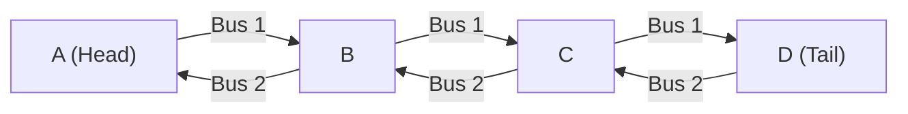

*Figure 32. DQDB connecting hosts with two buses in opposite directions*

In Figure 32, bus 1 carries data from A (head) toward D (tail), and bus 2 carries data from D toward A. Every host is connected to both buses, so it sends to hosts on its right over bus 1 and to hosts on its left over bus 2. The starting point of each bus continuously generates empty slots of a fixed size and sends them down the bus, and a host fills a passing empty slot with its data. The two ends of the buses are sometimes joined to form a loop.

The characteristics of DQDB are as follows.

- **Distributed data queue:** Each host maintains its own queue information by counting the requests from other hosts waiting to send before it. This means that the queue is distributed over the hosts without a central controller.
- **FIFO-based shared slots:** To avoid collisions that can occur during data transmission, hosts take empty slots in the order of their requests (FIFO, first in first out). Therefore, no collision occurs in which two or more hosts write the same slot.
- **ATM compatibility:** DQDB supports 53-byte frames (slots) compatible with ATM (asynchronous transfer mode). ATM is covered in Week 4.

### 3.4 WAN

> **Definition:** A **WAN (wide area network)** is a network structure that supports a wide area of national scale or larger.

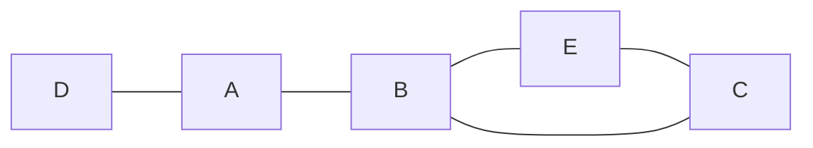

*Figure 33. Example WAN connected by point-to-point links*

A WAN connects distant hosts with point-to-point (1:1) links. In Figure 33, for D to send to C, there is no direct link between D and C, so the data must go through D, A, and B and then from B directly to C, or from B through E to C. Because the data must be relayed along one of several possible paths, **routing** is essential. In a LAN, by contrast, all hosts share one medium and the data sent reaches everyone, so no routing is needed.

### 3.5 Basic Topologies: Bus and Ring

> **Definition:** A **topology** is the form in which hosts and transmission media are connected in a network.

**Bus topology.** Several hosts are connected directly to one bus.

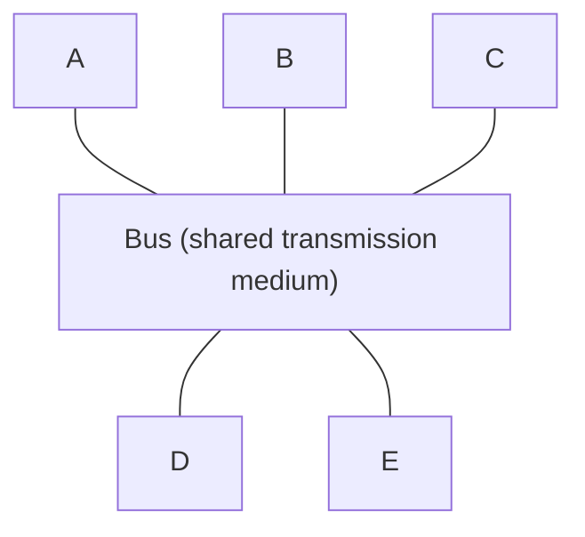

*Figure 34. Bus topology*

Because a bus topology physically shares the transmission medium, it operates by broadcasting, in which the data sent by one host reaches every host, and it needs no routing. It operates as follows.

1. Each host has a unique address.
2. The header of the transmitted data contains the addresses of the sending and receiving hosts and information for error control and flow control.
3. Every host receives the data, but only the host whose own address matches the receiving host information in the header keeps the data in its internal buffer, and the other hosts discard it.
4. If two or more hosts transmit at the same time, a data collision occurs, so a method to resolve it is needed.

CAN is a representative example of a bus topology. However, instead of the receiving address of step 3, CAN selects the messages to receive with message identifiers and acceptance filters (Section 1.7), and it resolves the collisions of step 4 with bit-wise arbitration (Section 1.8).

**Ring topology.** Hosts are connected in the shape of a ring.

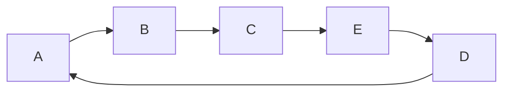

*Figure 35. Ring topology*

- Data is transmitted in only one direction, clockwise or counterclockwise.
- Data sent by a host travels once around the ring and always returns to the sending host. Along the way every host receives the data, so the ring supports broadcasting.
- The host that sent the data is responsible for removing the returned data from the network. If it does not, the data keeps circling the ring.

In a ring, too, collisions can occur if two or more hosts transmit at the same time. To prevent them, a control frame called a **token** is used.

1. A host that wants to send data must first obtain the token circulating on the ring.
2. Because there is only one token in the network, only one host sends data at any moment. Therefore, no collision occurs.
3. The token circulates through every host on the ring in turn, so all hosts have equal opportunities to transmit.

The advantages and disadvantages of various topologies, including bus and ring, are covered in detail in Week 6.

### 3.6 An Example Network Configuration and the Networks in a Vehicle

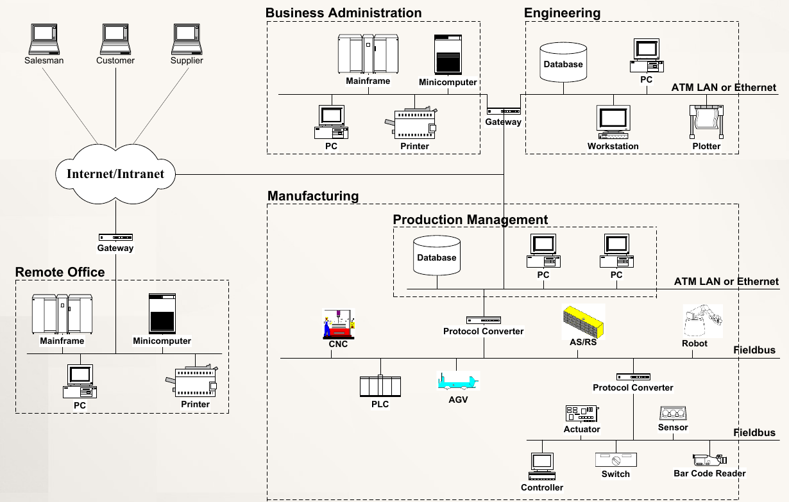

*Figure 36. Example of an enterprise network connecting business administration, engineering, and manufacturing*

Figure 36 is the network of a manufacturing company. The business administration and engineering departments each connect mainframes, minicomputers, PCs, printers, workstations, plotters, and databases with an ATM LAN or Ethernet, and the two LANs are joined by a gateway. Under the production management LAN of the manufacturing department, CNC machine tools, PLCs, AGVs (automated guided vehicles), an automated storage and retrieval system (AS/RS), and robots are connected by a fieldbus, and below that, sensors, actuators, switches, bar code readers, and controllers are connected by another fieldbus. Protocol converters sit between networks of different protocols. The remote office and the salespeople, customers, and suppliers are connected through the Internet or an intranet and gateways. In this way, a real network is a hierarchy that ties together networks of different scales and purposes with gateways and converters.

> **Definition:** A **fieldbus** is an industrial real-time network that connects the sensors, actuators, and controllers on a factory floor. CANopen and DeviceNet, which are based on CAN, are also fieldbuses.

Vehicles have the same structure.

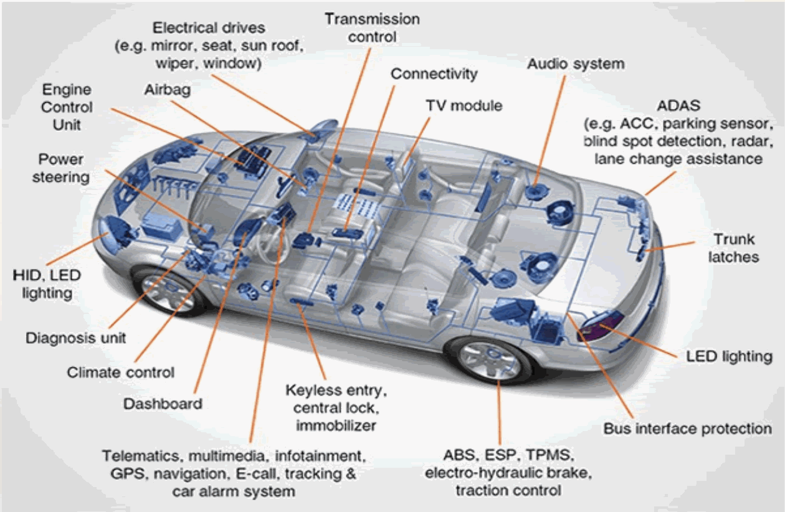

*Figure 37. Representative ECUs in a vehicle*

As Figure 37 shows, a vehicle has many ECUs: the engine control unit, transmission control, power steering, airbags, electrical drives (mirrors, seats, sunroof, wipers, windows), climate control, the dashboard, the diagnosis unit, telematics and infotainment, the audio system, the TV module, connectivity, ADAS (adaptive cruise control, parking sensors, blind spot detection, radar, lane change assistance), keyless entry and the immobilizer, ABS, ESP, TPMS, the electro-hydraulic brake, the trunk latches, and lighting.

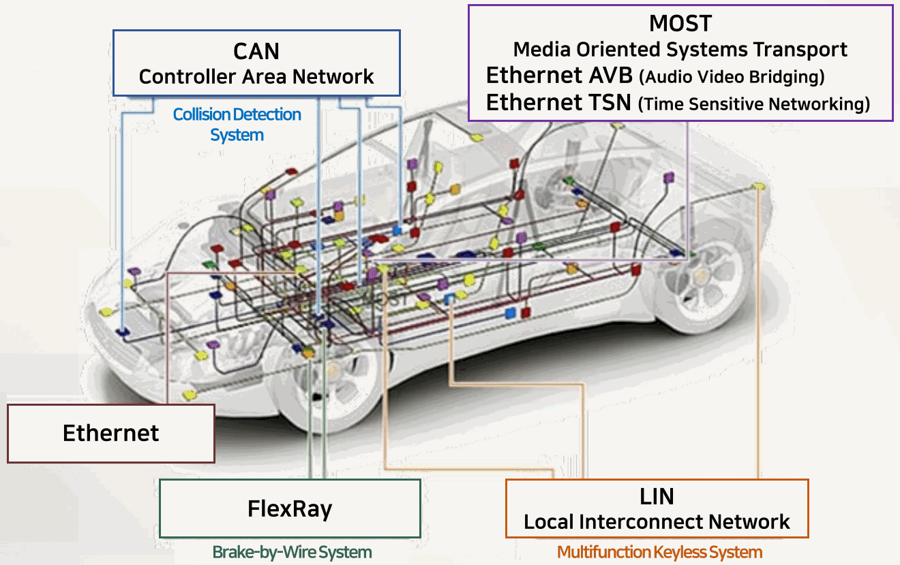

*Figure 38. Networks used in a vehicle and their representative applications*

Figure 38 shows the networks that connect these ECUs and their representative applications. CAN is used for control such as the collision detection system, MOST, Ethernet AVB (Audio Video Bridging), and Ethernet TSN (Time Sensitive Networking) for multimedia and time-sensitive data, FlexRay for the brake-by-wire system, and LIN for the multifunction keyless system, and Ethernet serves as the high-speed backbone that connects them. Just as an enterprise network ties LANs and fieldbuses together with gateways, a vehicle ties networks of different natures together with gateways. Automotive Ethernet is covered in Week 9.

---

<br>

## 4. Appendix: Physical Composition of Autonomous Vehicles

An autonomous vehicle perceives its surroundings with sensors such as cameras, LIDAR, and RADAR, makes decisions with a high-performance computing module, and determines its position and route with maps. Each company combines these components differently.

> **Definition:** **LIDAR (light detection and ranging)** is a sensor that fires laser pulses and measures the distance to surrounding objects as three-dimensional points from the return time.

> **Definition:** **RADAR (radio detection and ranging)** measures the distance and relative speed of objects with radio waves and is robust to rain and fog.

> **Definition:** An **HD map (high-definition map)** is a map for autonomous driving that contains lanes, signs, and road boundaries with centimeter-level precision.

### 4.1 Technology Competitiveness of Autonomous Driving Companies

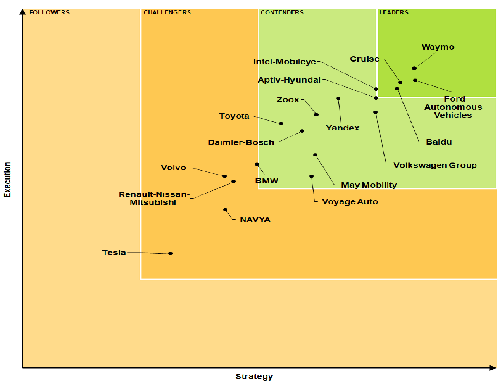

*Figure 39. Ranking of the technology competitiveness of autonomous driving companies*

Figure 39 is the ranking of autonomous driving companies published by Navigant Research in 2020. The horizontal axis is strategy and the vertical axis is execution, and according to their scores on the two axes, the companies are divided into four groups: leaders, contenders, challengers, and followers.

- **Leaders:** Waymo, Ford Autonomous Vehicles, Cruise, Baidu.
- **Contenders:** Intel-Mobileye, Aptiv-Hyundai, Zoox, Yandex, Volkswagen Group, Daimler-Bosch, Toyota, May Mobility, Voyage Auto. Intel-Mobileye and Aptiv-Hyundai lie on the boundary with the leaders, and BMW lies on the boundary with the challengers.
- **Challengers:** Volvo, Renault-Nissan-Mitsubishi, NAVYA, Tesla. Tesla is in the lowest position.

This ranking evaluates the strategy and execution for commercializing fully autonomous driving without a driver, such as robotaxis, so a company that has sold many driver assistance functions can still be rated low.

### 4.2 Waymo

The vehicles of Waymo, Google's autonomous driving company, are equipped with about 40 sensors including 29 cameras, and use Google maps.

| Component | Details |
|:-----|:-----|
| Cameras | In 2016 there were 12 in total: 3 front, 4 surround, 3 for mirror replacement, and 2 for driver monitoring. The fifth-generation system of 2020 increased this to 29. |
| LIDAR | 5 in total: 1 long-range and 4 corner units. Google produces them in-house. |
| RADAR | Short- and mid-range corner radars, whose number the source material estimates at six. |
| Computing module | The source material states that it uses Intel products. |
| Map | Uses Google's HD map. |

*Table 18. Configuration of Waymo autonomous vehicles*

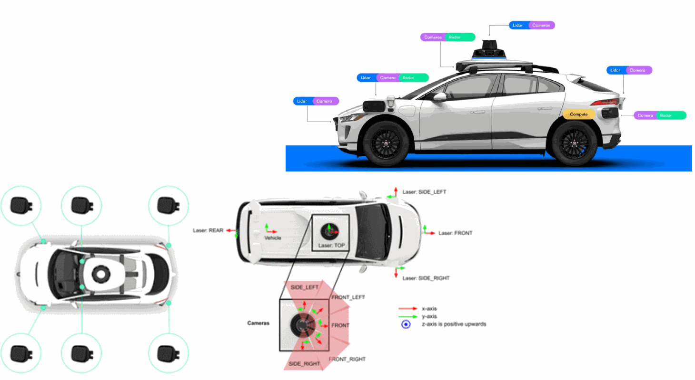

*Figure 40. Sensor placement and sensor coordinate configuration of a Waymo vehicle*

The upper part of Figure 40 marks the LIDAR on the roof of a Waymo vehicle and the cameras and radars around the body. The lower part shows, from above, the LIDAR placement (TOP, FRONT, SIDE_LEFT and SIDE_RIGHT, and REAR), the camera fields of view (FRONT, FRONT_LEFT, FRONT_RIGHT, SIDE_LEFT, SIDE_RIGHT), and the vehicle coordinate axes (x forward, y to the left, z up). To merge the data of many sensors, the position and orientation of every sensor must be expressed precisely in the vehicle coordinate system.

### 4.3 Tesla

Tesla does not use LIDAR, and until around 2020 it perceived its surroundings with eight cameras, one front radar, and ultrasonic sensors. The source material states that Tesla pursued automated driving with eight cameras alone and then adopted radar again.

| Component | Details |
|:-----|:-----|
| Cameras | 8 in total: a triple front camera (3), forward looking side cameras (2), rearward looking side cameras (2), and a rear view camera (1). Developed in-house in cooperation with ON Semiconductor. Tesla parted ways with Mobileye after the first fatal crash with Autopilot engaged in 2016. |
| RADAR | Has used Continental's combined long- and short-range radar. |
| Computing module | HW2 and HW2.5 (2016-2019) used computers based on NVIDIA DRIVE PX 2, and from HW3 (2019) Tesla uses its own FSD chip [10]. The autonomous driving software is developed in-house. |
| Map | Downloads navigation maps over Wi-Fi and does not use HD maps. |

*Table 19. Configuration of Tesla autonomous vehicles*

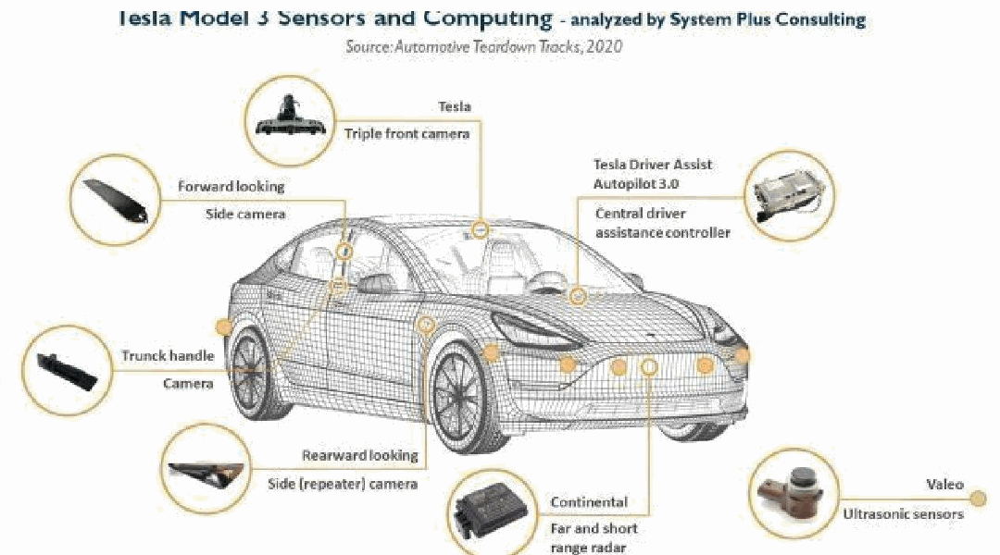

*Figure 41. Sensors and computing devices of the Tesla Model 3*

Figure 41 is the result of a teardown analysis of the Tesla Model 3 and marks the locations of the triple front camera above the windshield, the forward looking side cameras in the front fenders, the rearward looking side (repeater) cameras near the B-pillars, the rear camera in the trunk handle, the driver assistance controller (Autopilot 3.0), Continental's long- and short-range radar, and Valeo's ultrasonic sensors.

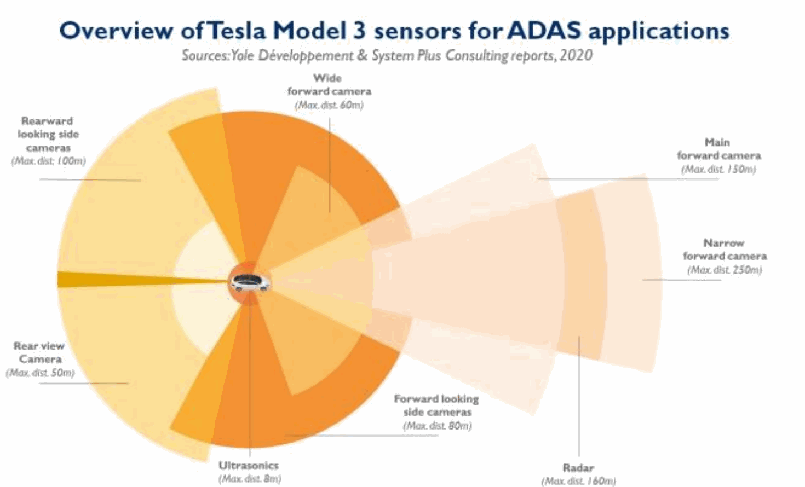

*Figure 42. Sensing ranges of the Tesla Model 3 sensors*

| Sensor | Maximum sensing distance |
|:-----|:-----|
| Narrow forward camera | 250 m |
| Radar | 160 m |
| Main forward camera | 150 m |
| Rearward looking side cameras | 100 m |
| Forward looking side cameras | 80 m |
| Wide forward camera | 60 m |
| Rear view camera | 50 m |
| Ultrasonics | 8 m |

*Table 20. Maximum sensing distances of the Tesla Model 3 sensors*

In Figure 42 and Table 20, the front is covered by three cameras with different fields of view overlapping with the radar, the sides and rear by cameras, and the immediate surroundings of the vehicle by ultrasonic sensors. The narrower a camera's field of view, the farther it sees, and the wider the field of view, the wider the nearby area it sees.

### 4.4 GM Cruise

The vehicles of Cruise, GM's autonomous driving company, carry 42 sensors including 16 cameras, and GM has acquired major sensor companies with its financial resources.

| Component | Details |
|:-----|:-----|
| Sensors | 5 LIDARs, 16 cameras, and 21 radars. GM acquired the LIDAR startup Strobe in 2017 and the radar manufacturer Astyx in 2020. |
| Computing module | The source material states that it uses solutions from Intel and NVIDIA. |
| Map | GM's driver assistance system Super Cruise uses HD maps made by Ushr of Detroit. Ushr was acquired by DMP (Dynamic Map Platform) of Japan in February 2019. |

*Table 21. Configuration of GM Cruise autonomous vehicles*

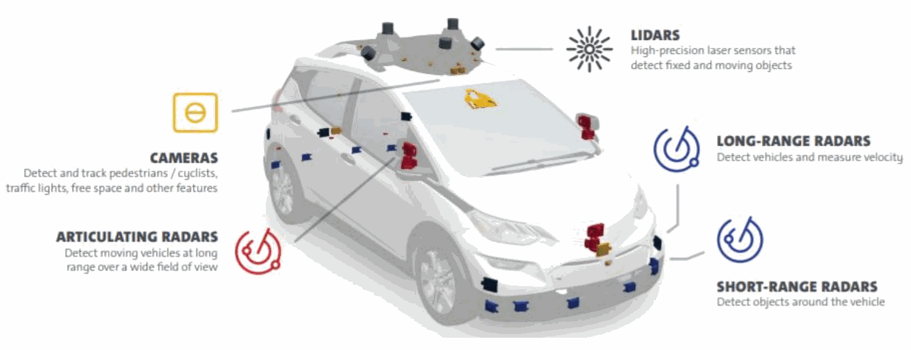

*Figure 43. Sensor configuration of a Cruise autonomous vehicle*

In Figure 43, the LIDARs precisely detect fixed and moving objects, and the cameras detect and track pedestrians and cyclists and recognize features such as traffic lights and free space. The long-range radars detect moving vehicles and measure their velocity, the articulating radars detect moving vehicles at long range over a wide field of view, and the short-range radars detect objects around the vehicle.

### 4.5 Comparison of the Three Sensor Configurations

| Item | Waymo | Tesla | GM Cruise |
|:-----|:-----|:-----|:-----|
| Number of sensors | About 40 | Centered on 8 cameras | 42 |
| Cameras | 29 | 8 | 16 |
| LIDAR | 5 (produced in-house) | Not used | 5 (Strobe acquired) |
| RADAR | 6 (source estimate) | Continental radar | 21 (Astyx acquired) |
| Map | Google HD map | Navigation map (no HD map) | Ushr HD map (Super Cruise) |

*Table 22. Comparison of the sensor configurations of Waymo, Tesla, and GM Cruise*

Waymo and Cruise chose an approach that mounts many LIDARs, radars, and cameras and uses HD maps together. Sensors based on different principles compensate for each other's weaknesses, so robustness is high but the cost is large. Tesla chose an approach that reduces the number of sensors and the cost by centering on cameras and improves perception with software trained on large amounts of driving data. As the number of sensors grows, so does the amount of data exchanged inside the vehicle, so autonomous vehicles need high-speed networks much faster than CAN, such as automotive Ethernet.

> **Note:** The configurations in Tables 18-21 are based on reports and analyses from around 2020. Each company's sensor configuration changes with every hardware generation.

---

<br>

## Concept Applications

| Situation | Concept to apply |
|:-----|:-----|
| With the vehicle powered off, the resistance between pins 6 and 14 of the OBD-II connector measures about 120 Ω. | A healthy bus should measure 60 Ω, the parallel combination of the two termination resistors, so one termination resistor is missing or the wiring to it is broken (Section 1.4). |
| A brake control message and a room lamp status message start transmitting at the same time. | The high-priority brake message must be assigned the smaller identifier so that it wins bit-wise arbitration (Section 1.8). |
| A faulty ECU keeps sending error frames, threatening to paralyze the bus. | As transmit errors accumulate, the node becomes error passive when the TEC exceeds 127 and bus off when it exceeds 255, and is then disconnected from the bus. A node that accumulates only receive errors never goes bus off, but once its REC exceeds 127 and it becomes error passive, it sends only passive error flags and can no longer disturb the bus (Section 1.9). |
| A new instrument cluster ECU is added to a vehicle to display the existing vehicle speed message. | Because CAN uses broadcast communication, there is no need to change the transmitting ECU; only the acceptance filter of the new ECU is set to the vehicle speed identifier (Section 1.7). |
| Power windows and seat heaters are to be networked cheaply. | They are body electronics that need no fast response, so LIN, a single-wire low-speed network, is suitable (Section 2.2). |

*Table 23. Concept application cases*

**True/False Check:**

| Statement | Judgment and Reason |
|:-----|:-----|
| On a CAN bus, if one node sends recessive and another sends dominant, the bus becomes recessive. | **F.** Dominant is an actively driven state, so if even one node sends dominant, the bus becomes dominant. |
| A CAN frame contains the address of the receiving node. | **F.** The identifier only indicates the kind and priority of the message, and every node receives the frame and filters it. |
| In bit-wise arbitration, the losing node's frame is destroyed on the bus, so the winning node must also resend. | **F.** The bit stream on the bus equals that of the winning node, so the winning frame is delivered intact. |
| A termination resistor is attached at every node. | **F.** 120 Ω resistors are attached only at the two physical ends of the bus. |
| If six consecutive bits of the same value appear, the receiver declares a stuff error. | **T.** The transmitter inserts an opposite bit after every five, so six in a row violate the rule. |
| A WAN transmits by broadcasting, so it needs no routing. | **F.** A WAN performs long-distance transmission over chained point-to-point links, so routing is essential. |

---

<br>

## Summary

| Concept | Key Summary |
|:-----|:-----|
| CAN | A serial bus protocol for vehicles developed by Bosch, whose physical and data link layers are defined by ISO 11898. |
| Differential signaling | Bits are decided from the voltage difference between CAN_H and CAN_L, so noise induced equally in both wires cancels. |
| Dominant and recessive | Dominant (0) is the state with an actively driven differential voltage of about 2 V, recessive (1) is the undriven state with a differential voltage of about 0 V, and dominant wins over recessive. |
| Termination resistors | The 120 Ω resistors at both ends of the bus prevent reflections and return the bus to recessive, with a combined resistance of 60 Ω. |
| Bit stuffing | Inserting an opposite bit after five equal values guarantees edges for resynchronization, and six in a row are detected as an error. |
| Frame | A standard frame consists of SOF, an 11-bit identifier, RTR, IDE, r0, DLC, 0-8 bytes of data, CRC, ACK, and EOF, and an extended frame uses a 29-bit identifier. |
| Broadcast communication | Every node receives every frame and selects only the needed messages with its acceptance filter. |
| Bit-wise arbitration | Identifiers are sent one bit at a time, and a node that sends recessive but reads dominant withdraws, so the message with the smallest identifier is delivered intact. |
| Error detection | Errors are detected by five mechanisms: CRC, frame check, ACK check, bit monitoring, and bit stuffing. |
| Error states | A node moves among error active, error passive, and bus off according to the TEC and REC, so a faulty node is isolated step by step. |
| Structure of a CAN node | A node consists of a microcontroller, a protocol controller, and a transceiver, and the controller is either stand-alone or integrated into the microcontroller. |
| Classification of IVNs | IVNs are divided by application domain and speed, such as LIN for body, CAN and FlexRay for real-time control, and MOST for multimedia. |
| Diagnostic communication | OBD-II uses one of KWP2000, ISO 9141-2, J1850, and CAN-based ISO 15765-4, and connects to diagnostic equipment through a 16-pin connector. |
| LAN, MAN, WAN | A LAN is a building-scale broadcast network, a MAN is a city-scale network whose standard is DQDB, and a WAN is a national-scale network that needs routing. |
| Bus and ring | A bus shares the medium and needs collision resolution, and a ring circulates in one direction and prevents collisions with a token. |
| Composition of autonomous vehicles | Waymo and Cruise use LIDAR, radar, cameras, and HD maps together, and Tesla chose a camera-centered configuration. |

---

<br>

## Self-Check Questions

1. **Differential signaling:** In the dominant state with CAN_H at 3.5 V and CAN_L at 1.5 V, external interference adds 0.8 V to each wire. Give the differential voltage seen by the receiver and the decision, and explain what problem would occur with a single-wire scheme.

   <details>
   <summary>Answer</summary>

   After the interference, CAN_H is 4.3 V and CAN_L is 2.3 V, so the differential voltage is $4.3 - 2.3 = 2.0$ V, the same as before the interference. It is 0.9 V or more, so the receiver correctly decides dominant. A single-wire scheme decides from the voltage of one wire relative to ground, so adding 0.8 V to a signal near the recessive level could cross the threshold and flip the value. The differential scheme has no such problem, because common-mode noise induced equally in both wires cancels in the subtraction.

   </details>

2. **Termination resistors:** Give two reasons why termination resistors are needed, and compute the resistance measured between CAN_H and CAN_L on a healthy bus.

   <details>
   <summary>Answer</summary>

   First, terminating the line ends with a resistance equal to the characteristic impedance of the cable (about 120 Ω) prevents the signal from reflecting at the ends and distorting the bits. Second, because nobody drives the recessive state, a path is needed that quickly returns the two wires to the same voltage when the bus changes from dominant to recessive. The two 120 Ω resistors are in parallel, so the measurement is $120 \times 120 / (120 + 120) = 60$ Ω.

   </details>

3. **Bit stuffing:** Write the result of applying bit stuffing to the bit stream d d d d d d r r r r r (d = dominant, r = recessive).

   <details>
   <summary>Answer</summary>

   After the first five d's, Sr is inserted. Because a stuff bit also counts as part of the stream, Sr is the first r of a run, but the run breaks at the following 6th d, which is counted again as the first d. Then five r's follow in a row, so Sd is inserted after the fifth r. The result is d d d d d Sr d r r r r r Sd, and the original 11 bits become 13 bits.

   </details>

4. **Tracing arbitration:** Three nodes with identifiers 0x0F3, 0x0F1, and 0x0E7 start transmitting at the same time. Give the bit position at which each losing node loses and the winning node.

   <details>
   <summary>Answer</summary>

   In 11-bit binary, 0x0F3 is 000 1111 0011, 0x0F1 is 000 1111 0001, and 0x0E7 is 000 1110 0111. The three are equal through ID10-ID5 (000 111). At ID4, 0x0E7 sends 0 and the other two send 1, so the bus becomes 0, and 0x0F3 and 0x0F1, which sent 1, both lose. 0x0E7 wins. This agrees with the result that the node with the smallest identifier wins.

   </details>

5. **Frame:** Compute the length of a standard data frame with 2 bytes of data, excluding stuff bits and the IFS.

   <details>
   <summary>Answer</summary>

   Adding SOF 1, identifier 11, RTR 1, IDE 1, r0 1, DLC 4, data 16, CRC 15, CRC delimiter 1, ACK slot 1, ACK delimiter 1, and EOF 7 gives $1 + 11 + 1 + 1 + 1 + 4 + 16 + 15 + 1 + 1 + 1 + 7 = 60$ bits.

   </details>

6. **Error states:** A node has a TEC of 130 and a REC of 20. Give the node's state and describe its behavior when it detects an error in this state.

   <details>
   <summary>Answer</summary>

   The TEC exceeds 127, so the node is error passive. A node in this state sends only a passive error flag made of recessive bits even when it detects an error, so it cannot disturb the communication of other nodes, and it must wait additionally after transmitting. If more transmit errors accumulate and the TEC exceeds 255, it goes bus off, and if both the TEC and REC fall to 127 or below, it returns to error active.

   </details>

7. **Collision handling in CAN and Ethernet:** Explain why the bit-wise arbitration of CAN is better suited to real-time control than Ethernet CSMA/CD.

   <details>
   <summary>Answer</summary>

   In Ethernet CSMA/CD, all colliding frames are destroyed and each node resends after a random wait, so when the bus is busy it is hard to predict when a given message will be delivered. In CAN, even when a collision occurs, the frame with the smallest identifier goes through intact, so no time is wasted, and a high-priority message is delivered as soon as the bus becomes free. Therefore, the delay of important messages such as brake commands can be kept small and predictable.

   </details>

8. **Choosing an IVN:** Choose a suitable network for the wipers, engine control, rear-seat video playback, and brake-by-wire, and give the reasons.

   <details>
   <summary>Answer</summary>

   The wipers need only simple on-off control, so cheap low-speed LIN suits them. Engine control exchanges real-time control messages of several hundred kbps between ECUs, so high-speed CAN suits it. Rear-seat video playback is large, uninterrupted synchronous data, so MOST (or automotive Ethernet) suits it. Brake-by-wire requires messages to arrive at fixed times without fail, so FlexRay, with its time-triggered static part, suits it.

   </details>

9. **WAN and LAN:** Explain, in terms of how the medium is connected, why a LAN needs no routing but a WAN does.

   <details>
   <summary>Answer</summary>

   In a LAN, all hosts share one medium, so the data sent by one host reaches every host by broadcasting and only the receiving host keeps it. Therefore, there is no need to choose a path. A WAN is built by linking distant hosts with point-to-point links, so sending to a host that is not directly connected requires choosing one of several paths and relaying through intermediate nodes. This path selection is routing.

   </details>

10. **Token ring:** Explain how the token prevents collisions and guarantees fairness in a ring topology.

    <details>
    <summary>Answer</summary>

    A host that wants to send data must first obtain the token, and because there is only one token in the network, only one host sends data at any moment and no collision occurs. In addition, the token circulates through every host on the ring in turn, so all hosts get equal opportunities to transmit in rotation.

    </details>

11. **Autonomous driving sensors:** Describe the difference between the sensor strategies of Waymo and Tesla, and explain the demand that more sensors place on the in-vehicle network.

    <details>
    <summary>Answer</summary>

    Waymo uses a multi-sensor strategy with 29 cameras, 5 LIDARs, 6 radars, and HD maps, in which sensors based on different principles complement each other, giving high robustness at a high cost. Tesla uses a strategy centered on 8 cameras with radar as a supplement and without LIDAR or HD maps, reducing cost and improving perception with software. Cameras and LIDARs produce tens to hundreds of Mbps of data or more, which CAN, at up to 1 Mbps, cannot carry, so high-speed networks such as automotive Ethernet are needed.

    </details>

---

<br>

## References

1. ISO 11898-2:2016, *Road vehicles - Controller area network (CAN) - Part 2: High-speed medium access unit*, International Organization for Standardization, 2016.
2. ISO 11898-1:2015, *Road vehicles - Controller area network (CAN) - Part 1: Data link layer and physical signalling*, International Organization for Standardization, 2015.
3. ISO 11898-1:2024, *Road vehicles - Controller area network (CAN) - Part 1: Data link layer and physical coding sublayer*, International Organization for Standardization, 2024.
4. ISO 11898-2:2024, *Road vehicles - Controller area network (CAN) - Part 2: High-speed physical medium attachment (PMA) sublayer*, International Organization for Standardization, 2024.
5. CAN in Automation, *CiA 303-1: Cabling and connector pin assignment*, version 1.9.0, Nuremberg, Germany, 2017.
6. Robert Bosch GmbH, *CAN Specification, Version 2.0*, Stuttgart, Germany, 1991.
7. N. Navet, Y. Song, F. Simonot-Lion, and C. Wilwert, "Trends in automotive communication systems," *Proceedings of the IEEE*, vol. 93, no. 6, pp. 1204-1223, 2005.
8. CSS Electronics, "OBD2 Explained - A Simple Intro," *CSS Electronics*. https://www.csselectronics.com/pages/obd2-explained-simple-intro
9. SAE International, *ITS Data Bus - IDB-C Physical Layer*, SAE J2366/1, Nov. 2001.
10. Tesla, Inc., "Tesla Autonomy Day," investor presentation, Palo Alto, CA, USA, Apr. 22, 2019.
