# 4주차 이론 — 데이터 통신의 용어와 인코딩, 전송 매체, 교환 방식

[레포지토리 안내](../../README.ko.md) | [English](Concepts_Lecture.md) | [한국어](Concepts_Lecture.ko.md)

> **최종 수정일:** 2026-11-27

> **학습 목표:**
> 1. 정보, 데이터, 신호, 신호 방식, 전송을 구분하고, 데이터를 신호로 인코딩하는 네 가지 조합을 설명할 수 있다
> 2. ASK, FSK, PSK의 원리를 설명하고, 비트율과 보 속도의 관계를 계산할 수 있다
> 3. 주어진 비트열을 NRZ-L, NRZI, RZ, Manchester, 차동 Manchester 부호의 파형으로 그릴 수 있다
> 4. 샘플링 정리와 PCM으로 음성의 전송 속도를 계산하고, FDM과 TDM을 비교할 수 있다
> 5. 꼬임쌍선, 동축 케이블, 광섬유, 무선 매체의 구조와 특성을 비교할 수 있다
> 6. 회선 교환, 패킷 교환(데이터그램과 가상 회선), 다중화 회선 교환, 프레임 릴레이, 셀 릴레이를 비교하고, JARI의 시설과 연구 분야를 설명할 수 있다

---

## 목차

- [1. 데이터 통신의 주요 용어와 인코딩](#1-데이터-통신의-주요-용어와-인코딩)
  - [1.1 데이터 통신의 주요 용어](#11-데이터-통신의-주요-용어)
  - [1.2 아날로그와 디지털](#12-아날로그와-디지털)
  - [1.3 데이터를 신호로 인코딩하기](#13-데이터를-신호로-인코딩하기)
  - [1.4 아날로그 전송과 디지털 전송](#14-아날로그-전송과-디지털-전송)
  - [1.5 데이터 인코딩 기술의 고려 사항](#15-데이터-인코딩-기술의-고려-사항)
  - [1.6 디지털 데이터의 아날로그 인코딩: 변조](#16-디지털-데이터의-아날로그-인코딩-변조)
  - [1.7 디지털 데이터의 디지털 인코딩: 선로 부호](#17-디지털-데이터의-디지털-인코딩-선로-부호)
  - [1.8 아날로그 정보의 디지털 인코딩: 샘플링과 PCM](#18-아날로그-정보의-디지털-인코딩-샘플링과-pcm)
  - [1.9 다중화: FDM과 TDM](#19-다중화-fdm과-tdm)
- [2. 전송 매체](#2-전송-매체)
  - [2.1 전송 매체의 분류와 성능 요인](#21-전송-매체의-분류와-성능-요인)
  - [2.2 꼬임쌍선](#22-꼬임쌍선)
  - [2.3 비차폐 꼬임쌍선과 차폐 꼬임쌍선](#23-비차폐-꼬임쌍선과-차폐-꼬임쌍선)
  - [2.4 동축 케이블](#24-동축-케이블)
  - [2.5 광섬유](#25-광섬유)
  - [2.6 비유도 매체: 마이크로파와 적외선](#26-비유도-매체-마이크로파와-적외선)
- [3. 데이터 통신 교환 방식](#3-데이터-통신-교환-방식)
  - [3.1 통신 네트워크](#31-통신-네트워크)
  - [3.2 회선 교환](#32-회선-교환)
  - [3.3 패킷 교환](#33-패킷-교환)
  - [3.4 데이터그램과 가상 회선](#34-데이터그램과-가상-회선)
  - [3.5 다중화 회선 교환과 ISDN](#35-다중화-회선-교환과-isdn)
  - [3.6 프레임 릴레이](#36-프레임-릴레이)
  - [3.7 셀 릴레이와 교환 방식의 스펙트럼](#37-셀-릴레이와-교환-방식의-스펙트럼)
- [4. 부록: 일본자동차연구소 JARI](#4-부록-일본자동차연구소-jari)
  - [4.1 JARI의 위치](#41-jari의-위치)
  - [4.2 츠쿠바 연구소](#42-츠쿠바-연구소)
  - [4.3 시로사토 시험장](#43-시로사토-시험장)
  - [4.4 조직](#44-조직)
  - [4.5 주요 시설: 수소 연료전지 시험 시설](#45-주요-시설-수소-연료전지-시험-시설)
  - [4.6 주요 시설: 트럭 군집 주행](#46-주요-시설-트럭-군집-주행)
- [개념 적용](#개념-적용)
- [요약](#요약)
- [점검 문제](#점검-문제)
- [참고 문헌](#참고-문헌)

---

<br>

## 1. 데이터 통신의 주요 용어와 인코딩

### 1.1 데이터 통신의 주요 용어

데이터 통신은 한 장치의 데이터를 전송 매체를 거쳐 다른 장치로 옮기는 일이다. 이 과정에 쓰이는 용어는 다음과 같다.

| 용어 | 뜻 |
|:-----|:-----|
| 정보(information) | 전달하려는 의미 그 자체이다. 예를 들어 차량 속도가 60 km/h라는 사실이다. |
| 데이터(data) | 정보를 숫자, 문자, 음성 같은 형태로 표현한 것이다. 같은 정보를 숫자 60으로도, 음성으로도 표현할 수 있다. |
| 인코딩(encoding) | 데이터를 전송에 알맞은 신호의 형태로 바꾸는 규칙과 과정이다. |
| 신호(signal) | 데이터를 전기적 또는 전자기적으로 표현한 것이다. 전압, 전류, 빛, 전파의 변화로 나타난다. |
| 신호 방식(signaling) | 인코딩한 신호를 전송 매체에 싣는 행위이다. |
| 전송(transmission) | 신호를 매체로 전파하고 처리하여 데이터를 전달하는 것이다. |

*표 1. 데이터 통신의 주요 용어*

전송에는 두 방식이 있다. **아날로그 전송(analog transmission)** 은 신호가 약해지면 앰프(amplifier)로 증폭하여 보내고, **디지털 전송(digital transmission)** 은 리피터(repeater)로 신호를 재생하여 보낸다. 두 방식의 차이는 1.4절에서 다룬다.

> **용어 정의:** **리피터(repeater)** 는 전송 구간마다 약해진 신호를 받아 0과 1을 판별한 뒤 새 신호로 재생하여 보내는 장치이다.

### 1.2 아날로그와 디지털

> **용어 정의:** **아날로그(analog)** 는 값이 연속적으로(continuous) 변하는 것이다.

> **용어 정의:** **디지털(digital)** 은 값이 몇 개의 분리된(discrete) 값만 가지는 것이다.

아날로그와 디지털의 구분은 데이터와 신호 모두에 적용된다.

- **아날로그 데이터:** 연속된 값을 가진다. 음성, 영상, 온도처럼 어느 두 값 사이에도 무수히 많은 값이 있을 수 있다.
- **디지털 데이터:** 분리된 값을 가진다. 문자, 정수처럼 정해진 값 가운데 하나만 가진다.
- **아날로그 신호:** 전선, 광섬유, 대기를 통해 전송되며 연속적으로 변하는 전자기파이다.
- **디지털 신호:** 전선을 통해 전달되는 전압 펄스의 열이다. 아날로그 신호보다 잡음에 덜 민감하고 저렴하게 구현할 수 있지만, 신호 감쇠의 영향을 받는다.

> **용어 정의:** **감쇠(attenuation)** 는 신호가 매체를 지나는 동안 에너지를 잃어 세기가 줄어드는 현상이며, 높은 주파수 성분일수록 더 많이 감쇠한다.

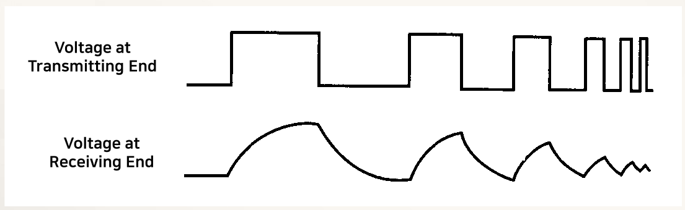

*그림 1. 송신단과 수신단에서 본 디지털 신호의 감쇠*

그림 1의 위쪽은 송신단에서 보낸 반듯한 사각 펄스이고, 아래쪽은 수신단에 도착한 같은 신호이다. 수신단의 펄스는 모서리가 둥글어지고 크기가 작아졌다. 사각 펄스는 여러 주파수 성분의 합으로 이루어지는데, 매체는 높은 주파수 성분을 더 많이 감쇠시키므로 날카로운 모서리가 무디어진다. 오른쪽처럼 펄스의 폭이 좁아질수록(전송 속도가 빠를수록) 높은 주파수 성분의 비중이 커지므로 왜곡이 심해져, 마지막에는 펄스를 거의 구별할 수 없게 된다. 그래서 디지털 전송에서는 속도가 높을수록 신호를 재생해 주어야 하는 거리가 짧아진다.

### 1.3 데이터를 신호로 인코딩하기

데이터와 신호가 각각 아날로그이거나 디지털이므로 인코딩에는 네 가지 조합이 있다.

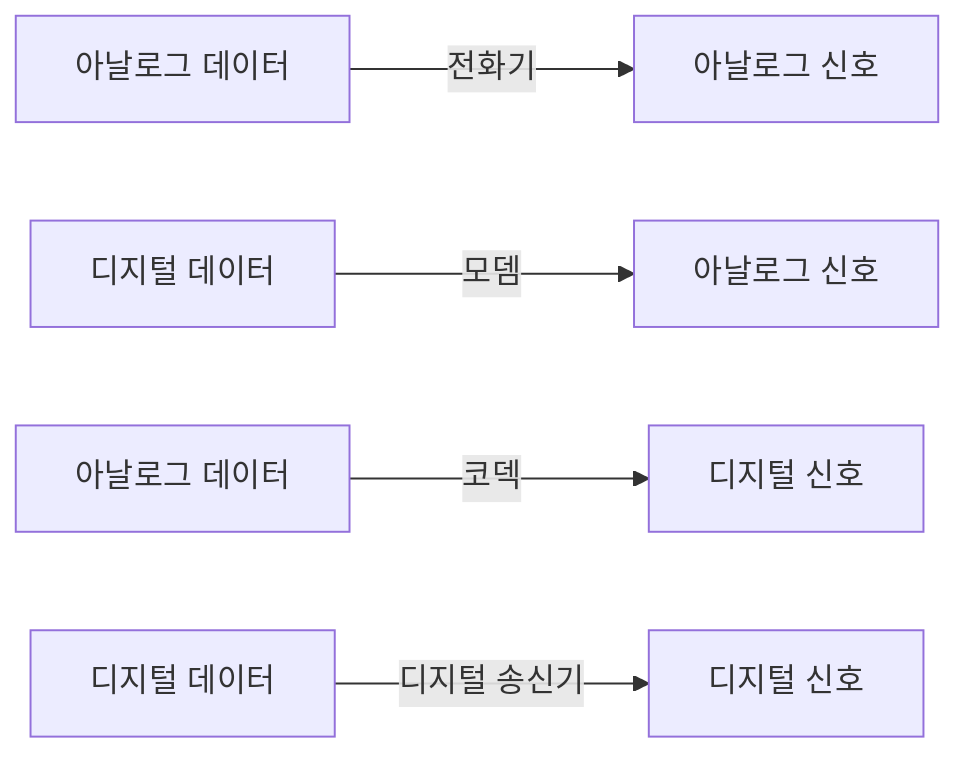

*그림 2. 데이터를 신호로 인코딩하는 네 가지 조합과 장치*

> **용어 정의:** **모뎀(modem, modulator-demodulator)** 은 디지털 데이터를 아날로그 신호로 바꾸고(변조) 그 반대로 바꾸는(복조) 장치이다.

> **용어 정의:** **코덱(codec, coder-decoder)** 은 아날로그 데이터를 디지털 비트열로 바꾸고 그 반대로 바꾸는 장치이다.

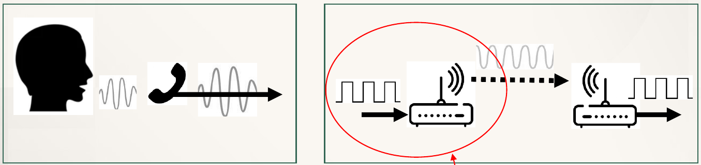

*그림 3. 아날로그 데이터를 아날로그 신호로, 디지털 데이터를 아날로그 신호로 보내는 예*

그림 3의 왼쪽은 사람의 목소리(음파)를 전화기가 같은 모양의 전기 신호로 바꾸어 보내는 경우이다. 오른쪽은 컴퓨터의 디지털 펄스를 모뎀이 반송파 위의 아날로그 신호로 바꾸어 전송로로 보내고, 받는 쪽의 모뎀이 다시 디지털 펄스로 되돌리는 경우이다. 디지털 신호의 경우, 아날로그 데이터는 코덱을 거쳐 디지털 신호가 되고, 디지털 데이터는 그대로 표현하거나 특정 규칙으로 부호화하여 디지털 신호가 된다.

> **용어 정의:** **반송파(carrier)** 는 데이터를 실어 나르기 위해 쓰는 일정한 주파수의 사인파로, 송신기는 데이터에 따라 이 사인파의 진폭, 주파수, 위상을 바꾸어 보낸다(1.6절).

| 데이터 \ 신호 | 아날로그 신호 | 디지털 신호 |
|:-----|:-----|:-----|
| 아날로그 데이터 | 두 경우가 있다. (1) 신호가 데이터와 같은 스펙트럼을 차지한다(전화선의 음성). (2) 다른 스펙트럼을 차지하도록 아날로그 데이터를 인코딩한다(AM, FM 라디오). | 코덱으로 디지털 비트열로 인코딩한다. |
| 디지털 데이터 | 모뎀으로 인코딩한다. | 두 경우가 있다. (1) 두 이진값을 서로 다른 두 전압으로 나타낸다. (2) 원하는 특성을 가진 디지털 신호를 만들기 위해 인코딩한다(1.7절의 선로 부호). |

*표 2. 아날로그 데이터와 디지털 데이터의 신호 변환 비교*

> **용어 정의:** **스펙트럼(spectrum)** 은 신호가 포함하는 주파수 성분의 범위이다. 예를 들어 음성은 대략 수백 Hz에서 수 kHz에 걸쳐 있다.

### 1.4 아날로그 전송과 디지털 전송

신호는 매체를 지나는 동안 약해지므로 중간에서 처리해 주어야 한다. 처리 방식에 따라 아날로그 전송과 디지털 전송으로 나뉜다.

| 신호 \ 전송 | 아날로그 전송 | 디지털 전송 |
|:-----|:-----|:-----|
| 아날로그 신호 | 앰프로 증폭하여 전송한다. 신호가 아날로그 데이터를 나타내든 디지털 데이터를 나타내든 똑같이 처리한다. | 아날로그 신호가 디지털 데이터를 나타낸다고 전제한다. 리피터로 전송하며, 각 리피터는 입력 신호에서 디지털 데이터를 복원해 새로운 출력 신호를 만든다. |
| 디지털 신호 | 쓰이지 않는다. | 디지털 신호가 1과 0으로 디지털 데이터나 인코딩된 아날로그 데이터를 나타낸다. 각 리피터는 입력 신호를 바탕으로 새로운 출력 신호를 만든다. |

*표 3. 아날로그 신호와 디지털 신호의 전송*

두 방식의 핵심 차이는 잡음의 처리이다. 앰프는 신호와 함께 섞인 잡음도 똑같이 증폭하므로, 앰프를 여러 번 거칠수록 잡음이 쌓인다. 리피터는 입력에서 0과 1만 판별한 뒤 깨끗한 새 신호를 만들어 보내므로, 판별이 틀리지 않는 한 잡음이 다음 구간으로 넘어가지 않는다.

**아날로그 신호와 디지털 신호의 비교.** 디지털 신호 방식은 리피터로 신호를 재생할 수 있어 장거리 전송에 유리하고, 디지털 전송은 잡음이 쌓이지 않아 품질 면에서 아날로그보다 우수하다. 지역 네트워크에서는 아날로그와 디지털의 신호 방식과 전송 기술이 모두 쓰인다.

### 1.5 데이터 인코딩 기술의 고려 사항

> **용어 정의:** **신호 요소(signal element)** 는 신호에서 한 단위로 구별되는 부분으로, 예를 들어 한 비트 시간 동안의 전압 레벨이다.

> **용어 정의:** **인코딩 방식(encoding scheme)** 은 데이터를 신호 요소로 바꾸는 규칙이다.

인코딩 조합마다 고려할 점이 다르다.

1. **디지털 데이터를 디지털 또는 아날로그 신호로 인코딩할 때:** 2진수 1과 0을 서로 다른 신호 요소로 표기해야 한다. 수신기가 비트의 시작과 끝을 알 수 있도록 **동기화(synchronization)** 가 필요하고, 각 비트를 정확한 순간에 읽는 일(비트 샘플링)이 필요하다. 또 신호 감쇠와 높은 데이터 처리율을 함께 고려해야 한다.
2. **아날로그 데이터를 디지털 신호로 인코딩할 때:** 원래 신호를 얼마나 충실히 되살릴 수 있는지, 즉 품질과 신호 충실도(quality, fidelity)가 중요하다.
3. **아날로그 데이터를 아날로그 신호로 변환하는 방식:** 지역 네트워크에서는 쓰이지 않는다.

### 1.6 디지털 데이터의 아날로그 인코딩: 변조

전화선이나 무선처럼 아날로그 신호만 통과시키는 매체로 디지털 데이터를 보내려면, 일정한 주파수의 사인파를 데이터에 따라 바꾸어 보내야 한다. 데이터를 실어 나르기 위해 쓰는 이 사인파가 1.3절의 반송파이다.

> **용어 정의:** **반송 주파수(carrier frequency)** 는 반송파의 주파수이다.

> **용어 정의:** **변조(modulation)** 는 데이터에 따라 반송파의 진폭, 주파수, 위상 가운데 하나 이상을 바꾸는 것이다.

사인파는 진폭(amplitude), 주파수(frequency), 위상(phase)의 세 특성으로 정해지므로, 이 셋 가운데 하나 또는 여럿을 함께 바꾸어 디지털 데이터를 아날로그 신호로 인코딩한다. 진폭과 위상을 함께 바꾸는 방식(직교 진폭 변조, QAM)이 그 예이다.

**(1) 진폭 편이 변조(amplitude-shift keying, ASK).** 전송 데이터의 비트열에 따라 반송파의 진폭을 바꾸어 보낸다.

- 반송 주파수의 서로 다른 두 진폭으로 0과 1을 나타낸다.
- 흔히 반송파가 일정한 진폭으로 있으면 1, 진폭이 없으면 0으로 나타낸다(on-off keying).
- 잡음은 주로 신호의 세기를 바꾸므로 진폭에 정보를 싣는 ASK는 오류에 민감하다.
- 음성급 전화선에서는 1,200 bps 이하의 속도로 쓰인다.

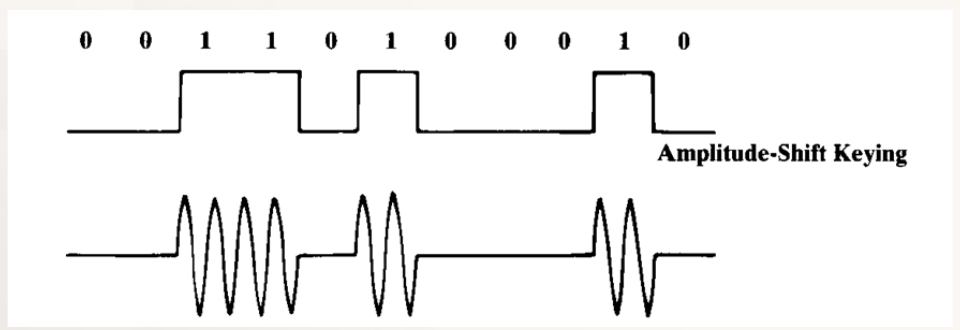

*그림 4. 비트열 00110100010의 ASK 파형*

그림 4에서 비트가 1인 구간에만 반송파가 나타나고, 0인 구간에는 신호가 없다.

**(2) 주파수 편이 변조(frequency-shift keying, FSK).** 진폭은 일정하게 두고, 반송 주파수 근처의 서로 다른 이산적인 주파수로 0과 1을 나타낸다. 기저대역의 원래 신호에 따라 반송파의 순간 주파수가 이산적으로 바뀐다.

- 잡음이 진폭을 흔들어도 주파수는 잘 바뀌지 않으므로 ASK보다 오류에 덜 민감하다.
- 음성급 전화선에서 1,200 bps 이하의 속도로 쓰인다(벨 시스템 108 시리즈 모뎀).
- 3\~30 MHz의 고주파(HF) 무선 전송, 높은 주파수대의 동축 케이블을 쓰는 지역 네트워크에 쓰인다.
- 기상 관측 기기, VLF(초장파)와 ELF(극저주파) 대역의 저주파 무선 전송에도 주로 쓰인다.

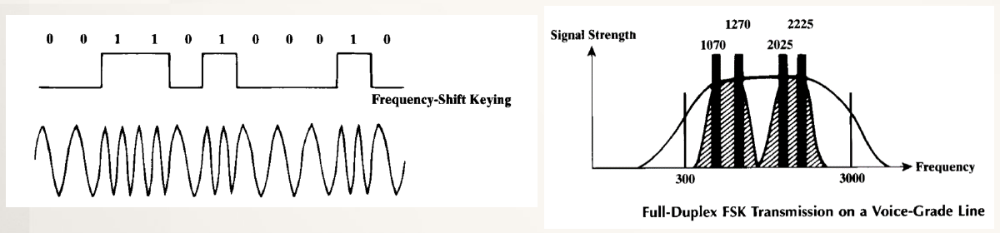

*그림 5. FSK 파형과 음성급 회선의 전이중 FSK 주파수 배치*

그림 5의 왼쪽에서 비트가 1인 구간은 파형이 촘촘하고(높은 주파수), 0인 구간은 성기다(낮은 주파수). 오른쪽은 300\~3,000 Hz의 음성 대역 하나로 양방향 통신을 동시에 하는 전이중(full-duplex) FSK이다. 한 방향은 1,070 Hz와 1,270 Hz로, 반대 방향은 2,025 Hz와 2,225 Hz로 0과 1을 나타내므로, 두 방향의 신호가 서로 다른 주파수 영역을 차지하여 겹치지 않는다.

**(3) 위상 편이 변조(phase-shift keying, PSK).** 기준 신호(반송파)의 위상을 바꾸어 데이터를 전송하는 디지털 변조 방식이다.

- 위상의 변화를 정확히 검출해야 하므로 ASK, FSK보다 복잡한 기술이다.
- PSK를 이해하려면 대역폭(Hz), 데이터 전송 속도(bps), 신호 전송 속도(baud)를 구분해야 한다.

> **용어 정의:** **신호의 대역폭(bandwidth of the signal)** 은 신호가 포함하는 주파수 성분이 차지하는 범위의 폭으로, 변조된 신호에서는 반송 주파수를 중심으로 한 주파수 범위이며 단위는 Hz이다.

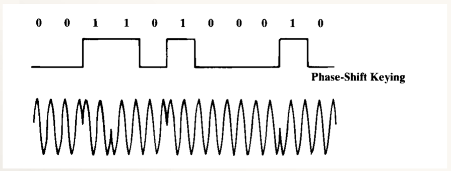

*그림 6. 비트열 00110100010의 PSK 파형*

그림 6에서는 진폭과 주파수가 일정하고, 파형이 갑자기 끊겨 보이는 지점에서 위상이 180° 바뀐다. 가장 단순한 2진 PSK(BPSK)는 0과 1에 서로 다른 위상(예: 0°와 180°)을 주므로 비트 값이 바뀔 때마다 위상이 뒤집힌다. 차동 PSK(DPSK)는 1일 때 직전 신호에 대해 위상을 뒤집고 0일 때 그대로 둔다. 그림 6에서 위상이 끊기는 곳은 1인 비트(3, 4, 6, 10번째)가 시작하는 지점뿐이므로, 그림 6의 파형은 차동 PSK이다.

> **용어 정의:** **심볼(symbol)** 은 데이터 정보를 나르는 신호의 단위, 즉 한 번에 구별되는 신호 요소이다.

> **용어 정의:** **보 속도(baud rate, 신호 전송 속도)** 는 초당 전송하는 심볼의 수이며 단위는 baud이다.

> **용어 정의:** **데이터 전송 속도(data rate)** 는 초당 전송하는 비트의 수이며 단위는 bps이다.

한 심볼이 $M$가지 상태 가운데 하나를 가지면 한 심볼에 $\log_2 M$ 비트를 실을 수 있으므로, 보 속도와 데이터 전송 속도의 관계는 다음과 같다 [1].

```math
\text{데이터 전송 속도 (bps)} = \text{보 속도 (baud)} \times \log_2 M
```

**계산 예.** 보 속도가 2,400 baud인 회선이 있다.

- BPSK는 위상 2가지($`M = 2`$)이므로 심볼당 $\log_2 2 = 1$비트를 실어 $2400 \times 1 = 2400$ bps이다.
- QPSK는 위상 4가지(0°, 90°, 180°, 270°, $`M = 4`$)이므로 심볼당 $\log_2 4 = 2$비트를 실어 $2400 \times 2 = 4800$ bps이다. 예를 들어 00은 0°, 01은 90°, 10은 180°, 11은 270°로 보낸다.
- 8-PSK는 $M = 8$이므로 심볼당 3비트를 실어 $2400 \times 3 = 7200$ bps이다.

같은 보 속도에서 심볼당 비트 수를 늘리면 데이터 전송 속도가 높아진다. 대신 위상 사이의 간격이 좁아져 잡음에 더 민감해진다. 이처럼 대역폭(보 속도를 정한다), 데이터 전송 속도, 잡음에 대한 강건성은 서로 맞바꾸는 관계에 있다.

### 1.7 디지털 데이터의 디지털 인코딩: 선로 부호

디지털 데이터를 디지털 신호로 보내는 방식은 지역 네트워크에서 많이 쓰인다. 비트를 전압 파형으로 바꾸는 규칙을 **선로 부호(line code)** 라 한다.

**NRZ 부호(nonreturn-to-zero codes).** 두 개의 서로 다른 전압 레벨로 0과 1을 구별하며, 한 비트 시간 동안 레벨을 그대로 유지한다.

- **NRZ-L(NRZ-level):** 비트 값을 전압 레벨로 직접 나타낸다. 아래 그림의 규칙에서는 0을 높은 레벨, 1을 낮은 레벨로 표기한다 [1].
- **NRZI(NRZ with inversion on ones):** 1이면 비트 시간의 시작에서 레벨을 바꾸고(전이), 0이면 바꾸지 않는다. 값을 레벨이 아니라 신호의 변화로 나타내므로 **차동 부호(differential code)** 라 한다. 수신기는 레벨의 절댓값이 아니라 전이의 유무만 보면 되므로 잡음에 유리하고, 두 전선의 극성이 뒤바뀌어 연결되어도 올바르게 해독된다.

**RZ와 NRZ.** RZ(return-to-zero)는 펄스 사이에 반드시 일정 시간 동안 0을 유지하고 다음 신호를 보낸다. 즉 1을 보낼 때도 비트 시간의 앞 절반만 높은 레벨이고 뒤 절반은 0으로 돌아온다. NRZ는 1로 끝나도 다음 펄스까지 1을 유지한다.

**바이페이즈 부호(biphase code).** 각 비트 시간의 가운데에서 전압의 전이(transition)가 일어나는 방식이다.

- 매 비트마다 1번 이상의 전이가 있으므로, 수신기는 이 전이로 비트의 경계를 알고 시계를 맞출 수 있다(자기 동기, self-clocking).
- **Manchester 부호(Manchester code):** 비트 가운데의 전이 방향으로 값을 나타낸다. IEEE 802.3의 규칙에서는 높은 레벨에서 낮은 레벨로 가는 전이가 0, 낮은 레벨에서 높은 레벨로 가는 전이가 1이다. 10 Mbps 이더넷에 쓰인다 [1]. 이 규칙의 Manchester 신호는 데이터와 클록(비트 시간의 앞 절반이 높은 레벨, 뒤 절반이 낮은 레벨인 구형파)의 배타적 논리합(XOR)과 같다. 예를 들어 데이터 1은 앞 절반에서 1 XOR 1 = 0(낮음), 뒤 절반에서 1 XOR 0 = 1(높음)이 되어 낮은 레벨에서 높은 레벨로 가는 전이가 되고, 데이터 0은 반대로 높은 레벨에서 낮은 레벨로 가는 전이가 된다.
- **차동 Manchester 부호(differential Manchester code):** 가운데의 전이는 항상 있고 동기화에만 쓰인다. 값은 비트 시작에서의 전이 유무로 나타내며, 0이면 시작에서 전이가 있고 1이면 없다 [1].

아래 그림은 같은 비트열 01001100011을 네 가지 부호로 그린 것이다. 위쪽 선이 높은 레벨, 아래쪽 선이 낮은 레벨이며, ┊는 비트 시간의 경계이다. NRZI는 직전 레벨을 낮은 레벨로, 차동 Manchester는 직전 레벨을 높은 레벨로 가정했다.

```text
bit           0     1     0     0     1     1     0     0     0     1     1
            ┊     ┊     ┊     ┊     ┊     ┊     ┊     ┊     ┊     ┊     ┊     ┊

NRZ-L       ──────┐     ┌───────────┐           ┌─────────────────┐
                  └─────┘           └───────────┘                 └───────────

NRZI              ┌─────────────────┐     ┌───────────────────────┐     ┌─────
            ──────┘                 └─────┘                       └─────┘

Manchester  ───┐     ┌─────┐  ┌──┐     ┌──┐  ┌─────┐  ┌──┐  ┌──┐     ┌──┐  ┌──
               └─────┘     └──┘  └─────┘  └──┘     └──┘  └──┘  └─────┘  └──┘

Diff. Man.  ┐  ┌─────┐  ┌──┐  ┌──┐     ┌─────┐  ┌──┐  ┌──┐  ┌──┐     ┌─────┐
            └──┘     └──┘  └──┘  └─────┘     └──┘  └──┘  └──┘  └─────┘     └──
```

*그림 7. 비트열 01001100011의 NRZ-L, NRZI, Manchester, 차동 Manchester 파형*

그림 7을 비트별로 읽는 방법은 다음과 같다.

1. **NRZ-L:** 0인 비트는 위, 1인 비트는 아래에 있다. 0이 세 개 이어지는 구간(7\~9번째 비트)에는 전이가 전혀 없다.
2. **NRZI:** 1인 비트(2, 5, 6, 10, 11번째)의 시작에서만 레벨이 바뀐다. 0인 비트에서는 직전 레벨이 그대로 이어진다.
3. **Manchester:** 모든 비트의 가운데에 전이가 있다. 첫 비트 0은 가운데에서 위에서 아래로, 둘째 비트 1은 아래에서 위로 바뀐다. 같은 값이 이어지면(3, 4번째의 0, 0) 두 비트 사이의 경계에서도 전이가 한 번 더 일어나 다음 비트의 출발 레벨을 맞춘다.
4. **차동 Manchester:** 모든 비트의 가운데에 전이가 있고, 0인 비트의 시작에는 전이가 있으며 1인 비트의 시작에는 전이가 없다. 예를 들어 둘째 비트 1의 시작(첫째 비트의 끝 레벨인 위)에는 전이가 없고, 셋째 비트 0의 시작에서는 아래에서 위로 전이가 일어난다.

```text
bit           0     1     0     1     1
            ┊     ┊     ┊     ┊     ┊     ┊

NRZ               ┌─────┐     ┌───────────
            ──────┘     └─────┘

RZ                ┌──┐        ┌──┐  ┌──┐
            ──────┘  └────────┘  └──┘  └──
```

*그림 8. 비트열 01011의 NRZ와 RZ 파형*

그림 8에서 NRZ는 4, 5번째 비트의 1이 이어지는 동안 높은 레벨을 계속 유지하지만, RZ는 각 1의 뒤 절반에서 0으로 돌아오므로 1이 이어져도 비트마다 펄스가 구별된다.

| 부호 | 비트당 전이 | 장점 | 단점 |
|:-----|:-----|:-----|:-----|
| NRZ-L | 0 또는 1회 | 가장 단순하고 필요한 대역폭이 작다. | 같은 값이 이어지면 전이가 없어 동기를 잃는다. |
| NRZI | 0 또는 1회 | 차동 부호라 잡음과 극성 반전에 강하다. | 0이 이어지면 전이가 없다. |
| RZ | 1이면 2회 | 1이 이어져도 펄스가 구별된다. | 0이 이어지면 전이가 없고, 대역폭이 커진다. |
| Manchester, 차동 Manchester | 1\~2회 | 매 비트 전이가 있어 자기 동기가 가능하다. | 신호 변화가 NRZ의 최대 2배라 더 넓은 대역폭이 필요하다. |

*표 4. 선로 부호의 비교*

> **참고:** 3주차의 CAN은 대역폭을 아끼기 위해 NRZ를 쓰고, 같은 값이 5개 이어지면 반대 비트를 넣는 비트 스터핑으로 NRZ의 동기 문제를 해결한다. 선로 부호의 선택은 대역폭과 동기화 사이의 절충이다.

### 1.8 아날로그 정보의 디지털 인코딩: 샘플링과 PCM

음성 같은 아날로그 정보를 디지털로 보내려면 연속 신호를 일정한 간격으로 측정하여 숫자로 바꾸어야 한다.

> **용어 정의:** **샘플링(sampling)** 은 연속 신호의 값을 일정한 시간 간격으로 측정하는 것이다.

> **용어 정의:** **샘플링 속도(sampling rate)** 는 샘플링에서 초당 측정하는 횟수이다.

> **핵심:** **샘플링 정리(sampling theorem).** 신호에 들어 있는 가장 높은 주파수의 2배보다 큰 속도로 샘플링하면, 샘플만으로 원래 신호를 완전히 복원할 수 있다. 실제로는 신호를 필터로 걸러 모든 주파수 성분이 어떤 상한 $B$ Hz보다 낮게 만든 뒤, 초당 $2B$개의 샘플로 샘플링한다. 신호의 최고 주파수가 $B$보다 낮으므로 이 속도는 최고 주파수의 2배보다 크다.

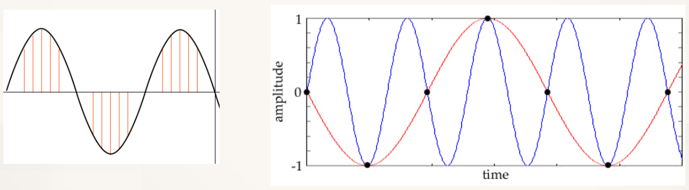

*그림 9. 충분한 샘플링과 언더샘플링*

그림 9의 왼쪽은 한 주기 안에서 촘촘하게 샘플링한 경우로, 샘플(세로선)을 이으면 원래 사인파가 그대로 드러난다. 오른쪽은 파란색의 높은 주파수 신호를 너무 드물게 샘플링한 경우이다. 검은 점의 샘플은 빨간색의 낮은 주파수 신호와도 정확히 일치하므로, 수신기는 원래 신호가 무엇이었는지 구별할 수 없다. 이처럼 샘플링 속도가 부족하여 높은 주파수가 낮은 주파수로 잘못 보이는 현상을 **에일리어싱(aliasing)** 이라 한다.

> **용어 정의:** **PCM(pulse code modulation, 펄스 부호 변조)** 은 아날로그 신호를 샘플링하고, 각 샘플을 정해진 레벨 가운데 가장 가까운 값으로 반올림(양자화)한 뒤, 그 레벨을 2진 부호로 바꾸어 보내는 방식이다.

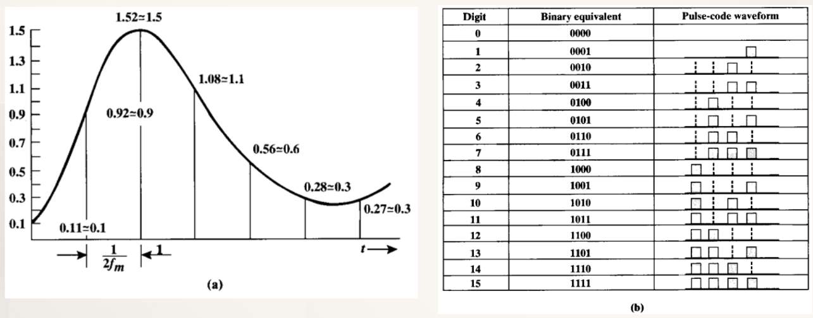

*그림 10. PCM의 샘플링과 4비트 부호화*

그림 10으로 PCM의 세 단계를 따라가면 다음과 같다.

1. **샘플링:** 그림 (a)처럼 주파수 성분이 모두 $f_m$보다 낮은 신호를 $1/(2f_m)$ 간격으로 측정한다. 이 간격은 샘플링 속도 $2f_m$에 해당하며, $f_m$이 신호 주파수의 상한이므로 샘플링 정리를 만족한다.
2. **양자화(quantization):** 측정값을 가장 가까운 레벨로 반올림한다. 그림에서 1.52는 1.5로, 0.92는 0.9로, 0.11은 0.1로 바뀐다. 이때 생기는 차이(예: $`1.52 - 1.5 = 0.02`$)를 **양자화 오차(quantization error)** 라 하며, 레벨을 촘촘하게 할수록(비트 수를 늘릴수록) 작아진다.
3. **부호화(encoding):** 각 레벨을 2진 부호로 바꾼다. 그림 (b)는 0\~15의 16개 레벨을 4비트 부호(0000\~1111)와 그 펄스 파형으로 나타낸다. 예를 들어 레벨 9는 1001이므로 펄스, 빈칸, 빈칸, 펄스로 보낸다.

**음성 PCM의 계산.** 전화 음성의 에너지는 대부분 4,000 Hz 아래에 분포하므로, 전화망은 음성을 필터로 4,000 Hz 아래(실제 통화 대역은 약 300\~3,400 Hz)로 제한한 뒤 부호화한다.

1. 샘플링 속도는 주파수 상한 4,000 Hz의 2배인 $2 \times 4000 = 8000$ Hz, 즉 초당 8,000개의 샘플이다.
2. 각 샘플을 8비트로 양자화하면 $2^8 = 256$개의 레벨로 구별할 수 있다(AD 변환).
3. 음성 데이터의 전송 속도는 $8000 \times 8 = 64{,}000$ bps, 즉 64 kbps이다.

이 64 kbps가 디지털 전화망에서 음성 한 채널의 기본 단위이다.

### 1.9 다중화: FDM과 TDM

> **용어 정의:** **다중화(multiplexing)** 는 둘 이상의 저속 채널을 하나의 고속 채널로 통합하여 한 전송로를 여럿이 나누어 쓰게 하는 과정이다.

> **용어 정의:** **역다중화(demultiplexing, demuxing)** 는 받는 쪽에서 다중화된 채널들을 원래 채널로 다시 분리하는 과정이다.

**(1) 주파수 분할 다중화(frequency-division multiplexing, FDM).** 전송로의 전체 주파수 대역폭을 여러 개의 작은 대역으로 나누어, 여러 사용자가 동시에 쓰게 한다. 주로 아날로그 신호의 전송에 쓰인다.

- 각 신호의 대역폭이 매체의 대역폭보다 훨씬 작아야 한다.
- 각 채널은 서로 다른 반송 주파수 주변의 주파수 범위를 할당받는다.

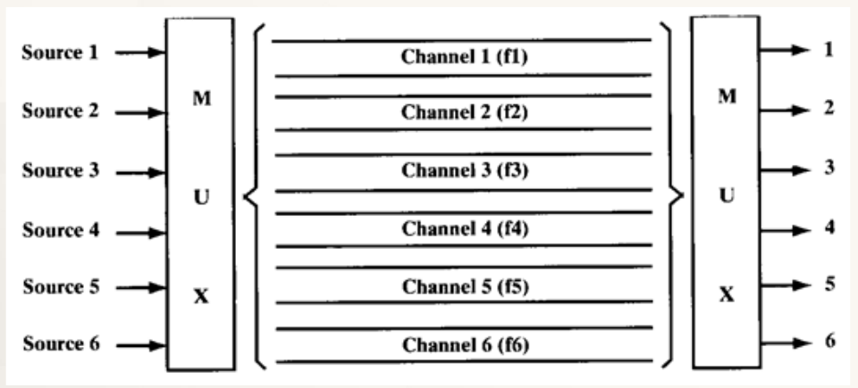

*그림 11. 여섯 개의 소스를 서로 다른 주파수 채널로 묶는 FDM*

그림 11에서 다중화기(MUX)는 소스 1\~6을 각각 주파수 f1\~f6의 채널에 실어 한 전송로로 동시에 보내고, 받는 쪽의 역다중화기가 주파수별로 다시 나누어 출력 1\~6으로 보낸다. 라디오 방송국들이 서로 다른 주파수로 같은 공간에서 동시에 방송하는 것이 FDM의 예이다.

**(2) 시분할 다중화(time-division multiplexing, TDM).** 전송로를 점유하는 시간을 잘게 나누어, 한 전송로에 여러 개의 가상 경로를 구성한다.

- 각 신호의 비트율이 매체의 데이터 전송 속도보다 훨씬 작아야 한다.
- **채널:** 특정 소스에 할당된 시간 슬롯(time slot)이다.
- **프레임:** 모든 소스의 시간 슬롯이 한 번씩 돌아가는 하나의 완전한 주기이다.

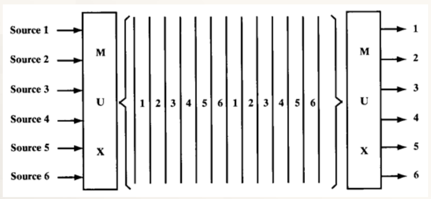

*그림 12. 여섯 개의 소스를 시간 슬롯으로 번갈아 보내는 TDM*

그림 12에서 다중화기는 소스 1, 2, 3, 4, 5, 6의 데이터를 차례로 한 슬롯씩 보내고 다시 1부터 반복한다. 받는 쪽은 슬롯의 순서로 각 데이터가 어느 소스의 것인지 안다. TDM에는 두 종류가 있다.

| 종류 | 슬롯 할당 | 특징 |
|:-----|:-----|:-----|
| 동기식 TDM(synchronous TDM) | 하나의 전송로 대역폭을 시간 슬롯으로 나누어 각 채널에 고정 할당한다. | 통상 쓰는 시분할 방식이다. 슬롯이 고정되어 있어 보낼 데이터가 없는 단말에도 슬롯이 할당되므로 전송 용량이 낭비된다. |
| 비동기식 TDM(asynchronous TDM) | 데이터를 보내려는 채널에만 통신 기회를 동적으로 부여한다. | 동기식의 단점을 보완한다. 통계적 TDM(statistical TDM)이라고도 하며, 슬롯의 위치로 소스를 알 수 없으므로 각 슬롯에 주소 정보를 붙여야 한다. |

*표 5. 동기식 TDM과 비동기식 TDM*

> **용어 정의:** **단말(station)** 은 네트워크 가장자리에서 데이터를 보내고 받는 컴퓨터, 터미널, 전화기 같은 장치이다.

**계산 예.** 각각 9.6 kbps로 보내는 단말 6대를 동기식 TDM으로 묶으려면 전송로는 적어도 $6 \times 9.6 = 57.6$ kbps가 필요하다. 그런데 어느 순간 2대만 데이터를 보내고 있다면, 6개의 슬롯 가운데 4개는 빈 채로 전송되어 용량의 $`4/6 \approx 67\%`$가 낭비된다. 비동기식 TDM은 보낼 데이터가 있는 단말에만 슬롯을 주므로, 같은 상황에서 더 느린 전송로로도 충분하거나 같은 전송로에 더 많은 단말을 연결할 수 있다.

---

<br>

## 2. 전송 매체

### 2.1 전송 매체의 분류와 성능 요인

> **용어 정의:** **전송 매체(transmission medium)** 는 송신기(transmitter)와 수신기(receiver) 사이의 물리적 경로이다.

> **용어 정의:** **유도 매체(guided media)** 는 구리선이나 유리 섬유처럼 신호를 정해진 경로를 따라 이끄는 전송 매체이다(2.2절부터 2.5절).

> **용어 정의:** **비유도 매체(unguided media)** 는 대기나 우주 공간처럼 신호가 안테나에서 퍼져 나가는 전송 매체로, 마이크로파와 적외선 통신이 이를 이용한다.

전송 매체의 특성은 매체의 종류와 전송 주파수에 따라 정해진다. 데이터 전송 속도와 전송 거리에 영향을 주는 요소는 다음과 같다.

| 요소 | 영향 |
|:-----|:-----|
| 대역폭(bandwidth) | 다른 조건이 같으면 대역폭이 넓을수록 높은 데이터 전송 속도를 낼 수 있다. |
| 전송 손상(transmission impairment) | 감쇠와 왜곡 같은 손상은 전송 거리를 제한한다. 꼬임쌍선은 광섬유보다 손상이 커서 짧은 거리에만 쓴다. |
| 간섭(interference) | 겹치는 주파수의 다른 신호가 원래 신호를 왜곡하거나 지운다. 유도 매체에서는 차폐로 줄일 수 있다. |
| 리시버의 수(number of receivers) | 공유 매체에 연결된 수신기 하나하나가 감쇠와 왜곡을 더하므로, 수신기가 많을수록 거리나 속도가 제한된다. |

*표 6. 데이터 전송 속도와 전송 거리에 영향을 주는 요소*

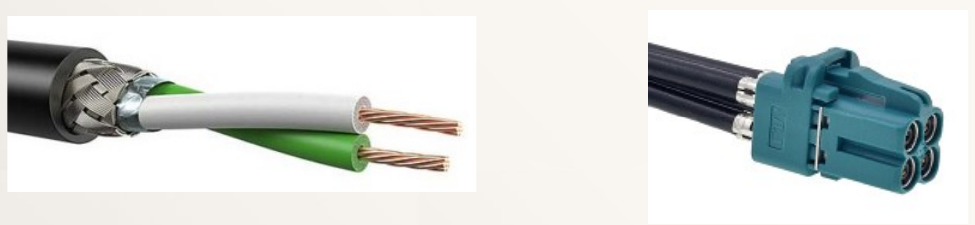

*그림 13. 통신 케이블과 커넥터의 예*

그림 13의 왼쪽은 금속 차폐층 안에 두 가닥의 절연 전선을 꼬아 넣은 케이블이고, 오른쪽은 이런 케이블을 기기에 연결하는 커넥터이다.

### 2.2 꼬임쌍선

> **용어 정의:** **꼬임쌍선(twisted pair)** 은 절연된 두 가닥의 구리 전선을 나선형으로 꼬아 만든 전송 매체이다. 아날로그와 디지털 데이터 전송에 가장 일반적으로 쓰인다.

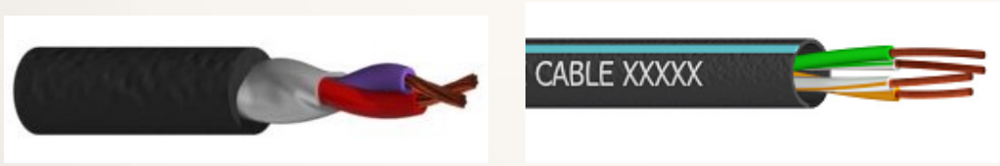

*그림 14. 꼬임쌍선 케이블*

꼬임쌍선의 특성은 다음과 같다.

- 비교적 저가이고 작업이 간편하다.
- 전송 거리, 대역폭, 전송 속도에 제한이 있다.
- 잡음과 간섭을 받기 쉽다.
- 각 전선은 따로 절연되어 있고, 여러 쌍을 묶어 하나의 케이블로 만드는 경우가 많으며, 보통 건물을 지을 때 미리 설치한다.

두 전선을 꼬는 이유는 간섭을 줄이기 위해서이다. 외부 자기장이 두 전선이 이루는 고리에 유도하는 전압은, 꼬임마다 고리의 방향이 뒤바뀌므로 이웃한 꼬임끼리 서로 상쇄된다. 또 두 전선이 같은 위치를 번갈아 지나므로 외부 잡음이 두 전선에 거의 똑같이 들어가고, 수신기가 두 전선의 차를 읽으면 잡음이 사라진다. 3주차의 CAN 버스가 꼬임쌍선과 차동 신호를 함께 쓰는 이유가 이것이다. 한 케이블 안의 이웃한 쌍은 서로 다른 꼬임 간격을 써서 쌍 사이의 누화를 줄인다 [1].

### 2.3 비차폐 꼬임쌍선과 차폐 꼬임쌍선

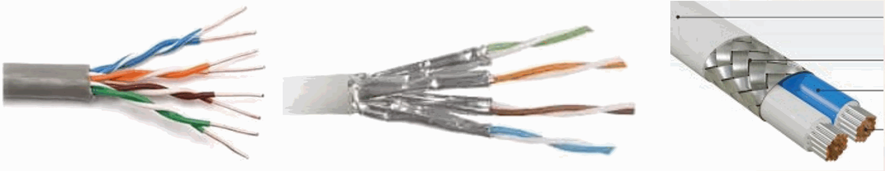

*그림 15. 비차폐 꼬임쌍선, 차폐 꼬임쌍선, 전투기용 차폐 꼬임쌍선*

- **비차폐 꼬임쌍선(unshielded twisted pair, UTP):** 차폐층 없이 꼬임쌍선을 피복으로만 감싼다(그림 15의 왼쪽). 전화선과 일반적인 건물의 옥내 배선에 쓰인다.
- **차폐 꼬임쌍선(shielded twisted pair, STP):** 전선을 금속 편조나 금속박으로 감싸 외부 잡음을 차폐한다(그림 15의 가운데). UTP보다 잡음에 강하지만, 더 비싸고 다루기 어려워 작업량이 많다. 그림 15의 오른쪽은 전자기 환경이 가혹한 전투기에 쓰는 차폐 꼬임쌍선이다.

두 케이블의 성능을 수치로 비교하면 다음과 같다.

| 주파수 (MHz) | 감쇠: Cat 3 UTP | 감쇠: Cat 5 UTP | 감쇠: 150 Ω STP | NEXT: Cat 3 UTP | NEXT: Cat 5 UTP | NEXT: 150 Ω STP |
|:-----|:-----|:-----|:-----|:-----|:-----|:-----|
| 1 | 2.6 | 2.0 | 1.1 | 41 | 62 | 58 |
| 4 | 5.6 | 4.1 | 2.2 | 32 | 53 | 58 |
| 16 | 13.1 | 8.2 | 4.4 | 23 | 44 | 50.4 |
| 25 | - | 10.4 | 6.2 | - | 41 | 47.5 |
| 100 | - | 22.0 | 12.3 | - | 32 | 38.5 |
| 300 | - | - | 21.4 | - | - | 31.3 |

*표 7. UTP와 STP의 감쇠(dB/100 m)와 근단 누화(dB)*

> **용어 정의:** **데시벨(dB)** 은 두 전력의 비를 로그로 나타낸 단위로, $10 \log_{10}(P_1 / P_2)$이다.

> **용어 정의:** **근단 누화(near-end crosstalk, NEXT)** 는 한 쌍으로 보낸 신호가 같은 쪽 끝에서 이웃한 쌍으로 새어 나가는 현상이며, 혼선이라고도 한다. NEXT는 보낸 신호와 새어 나간 신호의 비이므로 값이 클수록 누화가 적어 좋다.

**표 7 읽기.** Cat 5 UTP의 100 MHz 감쇠는 100 m당 22.0 dB이다. 수신 전력과 송신 전력의 비는 $10^{-22.0/10} = 10^{-2.2} \approx 0.0063$이므로, 100 m를 지나면 송신 전력의 약 0.63%만 남는다. 같은 주파수에서 150 Ω STP는 12.3 dB이므로 $10^{-1.23} \approx 0.059$, 즉 약 5.9%가 남는다. 표에서 다음 경향을 읽을 수 있다.

1. 모든 케이블에서 주파수가 높을수록 감쇠가 커지고 NEXT가 작아진다(누화가 심해진다).
2. 같은 주파수에서 STP가 UTP보다 감쇠가 작고 NEXT가 커서 성능이 좋다.
3. Cat 5 UTP는 Cat 3 UTP보다 꼬임이 촘촘하여 감쇠와 누화 모두 우수하다.
4. "-"는 그 케이블이 그 주파수에서 쓰이도록 규정되지 않았다는 뜻이다. 예를 들어 Cat 3은 16 MHz까지만 규정된다.

### 2.4 동축 케이블

> **용어 정의:** **동축 케이블(coaxial cable)** 은 중앙의 절연된 구리선을 또 다른 원통형 도체가 둘러싼 전송 매체이다. 두 도체가 같은 축을 공유하므로 동축이라 한다.

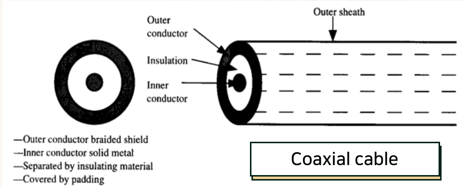

*그림 16. 동축 케이블의 구조*

그림 16처럼 동축 케이블은 안쪽부터 단단한 금속의 내부 도체(inner conductor), 절연체(insulation), 금속 편조로 된 외부 도체(outer conductor), 외피(outer sheath)로 이루어진다. 실제 제품 가운데에는 금속 편조 아래에 금속박(foil)을 한 겹 더 감아 차폐를 강화한 케이블도 있다.

- 지름은 1\~2.5 cm 정도이다.
- 외부 도체가 내부 도체를 완전히 감싸 차폐하므로 꼬임쌍선보다 잡음에 강하다.
- 꼬임쌍선보다 먼 거리까지 보낼 수 있고 더 많은 스테이션을 연결할 수 있다.

그러나 동축 케이블의 활용은 줄어드는 추세이다. 저가의 꼬임쌍선이 성능을 높이며 널리 퍼졌고, 고성능이 필요한 곳에는 광케이블을 쓰기 때문이다.

### 2.5 광섬유

> **용어 정의:** **광섬유(optical fiber)** 는 빛을 이용해 신호를 전달하는 가늘고 유연한 유리나 플라스틱 선이다.

**물리적 형태.** 광섬유는 매우 얇고 유연하며(2\~125 µm), 여러 종류의 유리와 플라스틱으로 만든다. 세 가지 주요 구성 요소는 다음과 같다.

| 구성 요소 | 역할 |
|:-----|:-----|
| 중심 유리(glass core, 코어) | 빛을 전달하는 매개체이다. |
| 클래딩(cladding) | 코어를 감싸는 유리나 플라스틱 층으로, 코어보다 굴절률이 낮아 빛을 코어 안에 가둔다. 빛이 다른 광섬유로 새어 나가 생기는 혼신도 막는다. |
| 피복(jacket) | 습기, 마모, 충격으로부터 광섬유를 보호하는 플라스틱 피막이다. |

*표 8. 광섬유의 구성 요소*

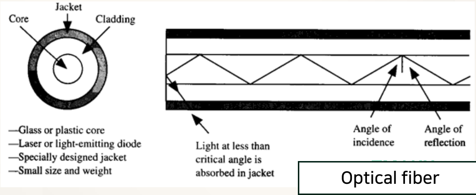

*그림 17. 광섬유의 단면과 빛이 진행하는 원리*

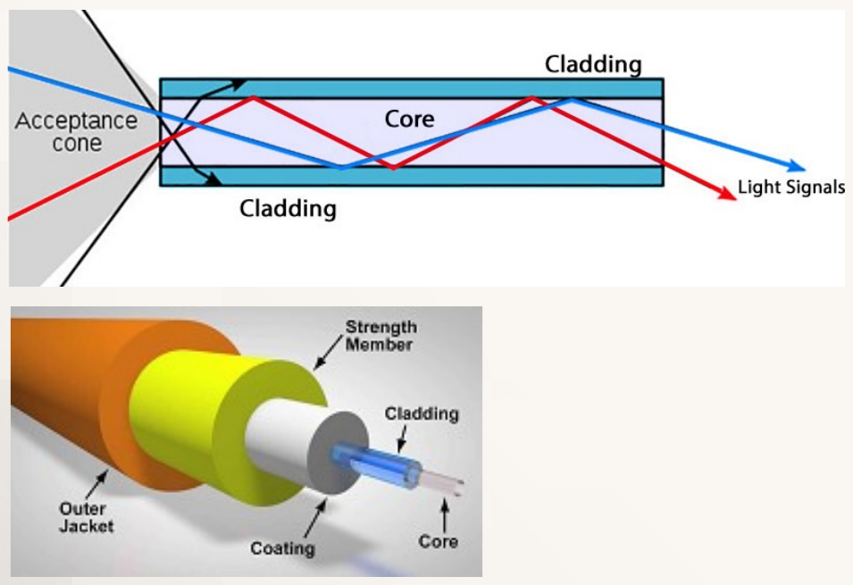

*그림 18. 광섬유 안의 전반사와 광케이블의 구조*

**빛이 갇히는 원리.** 빛이 굴절률이 높은 매질(코어)에서 낮은 매질(클래딩)로 향할 때, 경계면에 대한 입사각이 임계각보다 크면 빛은 빠져나가지 못하고 모두 반사된다. 이를 **전반사(total internal reflection)** 라 한다. 그림 17과 18처럼 코어로 들어간 빛은 클래딩과의 경계에서 전반사를 반복하며 지그재그로 나아간다. 전반사가 일어나도록 광섬유에 빛을 넣을 수 있는 입사 각도의 범위를 **수광 원뿔(acceptance cone)** 이라 하며, 이 범위를 벗어난 빛은 경계면에서 전반사되지 않고 클래딩을 지나 피복에 흡수된다. 그림 18의 아래쪽은 실제 광케이블의 구조로, 코어, 클래딩, 코팅, 인장 강도를 주는 보강재(strength member), 외피(outer jacket)로 이루어진다. 빛은 레이저나 발광 다이오드(LED)로 만든다.

**광섬유의 장점.** 광섬유는 매우 혁신적인 기술적 진보를 이루었으며, 장점은 다음과 같다.

- **월등한 전송 용량:** 구리 매체보다 훨씬 넓은 대역폭으로 매우 높은 속도를 낸다.
- **작은 크기와 가벼운 무게:** 같은 용량의 구리 케이블보다 훨씬 가늘고 가볍다.
- **적은 신호 감쇠:** 리피터 사이의 간격을 크게 늘릴 수 있다.
- **전자기적 차단:** 빛을 쓰므로 외부 전자기 간섭을 받지 않고, 밖으로 전자기파를 내보내지 않아 도청도 어렵다.

**전송 모드.** 빛이 광섬유를 따라 지나가는 경로를 모드(mode)라 한다.

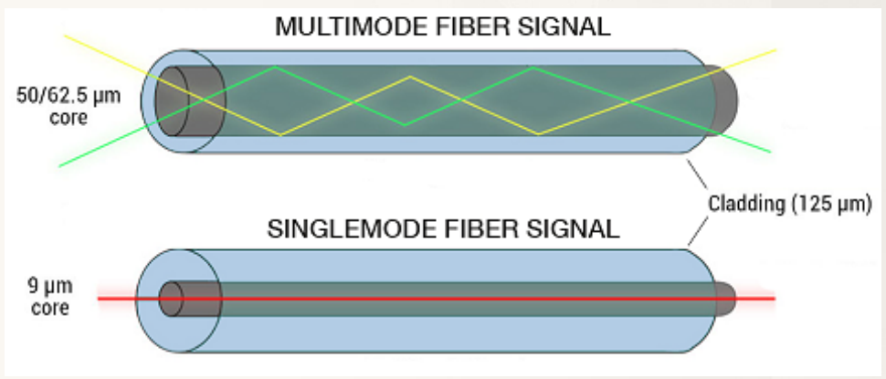

*그림 19. 멀티 모드 광섬유와 단일 모드 광섬유의 신호*

- **단일 모드(single-mode) 전파:** 코어 지름을 약 9 µm로 매우 가늘게 만들어 1개의 모드(경로)만 전파한다. 모든 빛이 같은 경로로 가므로 도착 시간이 퍼지지 않아 장거리, 고속 전송에 쓴다.
- **멀티 모드(multimode) 전파:** 코어 지름이 50 µm나 62.5 µm로 굵어 다수 모드의 빛이 서로 다른 각도로 반사하며 전파한다. 경로마다 길이가 달라 같은 펄스의 빛이 서로 다른 시각에 도착하므로 펄스가 퍼진다(모드 분산, modal dispersion). 그래서 단일 모드보다 짧은 거리에 쓴다 [1].

클래딩의 지름은 두 종류 모두 보통 125 µm이다(그림 19).

멀티 모드 광섬유는 다시 둘로 나뉜다. **계단형(step-index)** 은 코어의 굴절률이 균일하여 경계에서 굴절률이 계단처럼 갑자기 바뀌고, **언덕형(graded-index)** 은 코어의 굴절률이 중심에서 바깥으로 갈수록 서서히 낮아진다. 언덕형에서는 바깥쪽으로 돌아가는 긴 경로의 빛이 굴절률이 낮은 곳을 지나며 더 빨리 진행하므로, 경로 사이의 도착 시간 차이가 줄어든다 [1].

| 광섬유 종류 | 코어 지름 (µm) | 클래딩 지름 (µm) | 감쇠 850 nm (dB/km) | 감쇠 1300 nm (dB/km) | 감쇠 1500 nm (dB/km) | 대역폭 (MHz·km) |
|:-----|:-----|:-----|:-----|:-----|:-----|:-----|
| 단일 모드 | 5.0 | 85 또는 125 | 2.3 | | | 5000 @ 850 nm |
| 단일 모드 | 8.1 | 125 | | 0.5 | 0.25 | |
| 언덕형 | 50 | 125 | 2.4 | 0.6 | 0.5 | 600 @ 850 nm, 1500 @ 1300 nm |
| 언덕형 | 62.5 | 125 | 3.0 | 0.7 | 0.3 | 200 @ 850 nm, 1000 @ 1300 nm |
| 언덕형 | 100 | 140 | 3.5 | 1.5 | 0.9 | 300 @ 850 nm, 500 @ 1300 nm |
| 계단형 | 200 또는 300 | 380 또는 440 | 6.0 | | | 6 |

*표 9. 대표적인 광섬유의 특성*

표 9의 감쇠는 최댓값이며, 계단형의 감쇠와 대역폭이 가장 나쁘고 단일 모드가 가장 좋다. 같은 광섬유에서도 빛의 파장이 길수록(850 nm보다 1300 nm, 1500 nm) 감쇠가 작다. 대역폭의 단위 MHz·km는 거리와 대역폭의 곱이 대략 일정하다는 뜻이다. 예를 들어 50 µm 언덕형 광섬유는 1300 nm에서 1500 MHz·km이므로, 1차 근사로 1 km에서는 약 1500 MHz, 3 km에서는 약 $1500 / 3 = 500$ MHz의 대역폭을 낼 수 있다.

### 2.6 비유도 매체: 마이크로파와 적외선

비유도 전송 매체는 대기를 통해 전달되는 전자기파이다. 송신 안테나가 전자기파를 공간으로 내보내고, 수신 안테나가 그것을 받는다.

**마이크로파(microwave).** 극초단파(UHF, 0.3\~3 GHz), 센티미터파(SHF, 3\~30 GHz), 밀리미터파(EHF, 30\~300 GHz)에 해당하는 300 MHz\~300 GHz의 무선 주파수 대역을 통틀어 이르며, 통신에는 대부분 1\~40 GHz 범위가 쓰인다.

| 대역 | 이름 | 주파수 범위 |
|:-----|:-----|:-----|
| UHF(ultra high frequency) | 극초단파 | 0.3 GHz\~3 GHz |
| SHF(super high frequency) | 센티미터파 | 3 GHz\~30 GHz |
| EHF(extremely high frequency) | 밀리미터파 | 30 GHz\~300 GHz |

*표 10. 마이크로파에 해당하는 주파수 대역*

마이크로파를 쓸 때 고려할 점은 다음과 같다.

- **주파수 구역 배당(frequency allocation)과 간섭(interference):** 전파는 모두가 같은 공간을 공유하므로, 국가가 용도별로 주파수를 배당하여 서로 간섭하지 않게 한다.
- **보안(security):** 전파는 범위 안의 누구나 받을 수 있으므로 암호화 같은 보호가 필요하다.

**적외선(infrared).** 가시광선보다 파장이 긴 빛으로 통신하는 방식이다.

- 적외선 통신 링크(infrared link)를 구성한다.
- 송신기와 수신기를 쌍으로 운영한다. 텔레비전 리모컨이 대표적인 예이다.
- 가시선(line of sight), 즉 송신기와 수신기가 서로 보이는 범위 안에서 운영하거나 반사판을 쓴다. 적외선은 벽을 통과하지 못하므로 방 밖으로 새어 나가지 않는다.

---

<br>

## 3. 데이터 통신 교환 방식

### 3.1 통신 네트워크

> **용어 정의:** **통신 네트워크(communications network)** 는 노드(node)의 집합으로, 데이터를 노드에서 노드로 전달하여 목적지까지 보낸다. 데이터를 보내고 받는 단말(1.9절)은 네트워크의 가장자리에 연결된다.

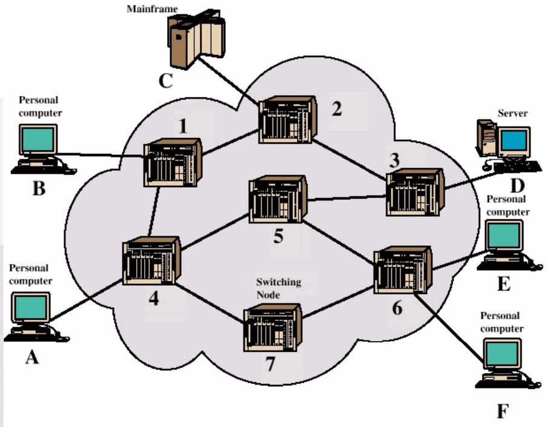

*그림 20. 단말 A\~F와 교환 노드 1\~7로 이루어진 통신 네트워크*

통신 네트워크의 특징은 다음과 같다.

- 모든 노드가 서로 직접 연결되지는 않는다. 그림 20의 노드 1\~7 사이에는 일부 링크만 있다.
- 노드는 데이터의 내용을 고려하지 않고 전달만 한다.
- 노드는 스위칭(교환) 기능으로 데이터를 노드에서 노드로 넘겨 목적지까지 보낸다.
- 하나의 노드에 하나의 단말이 연결되며, 단말끼리는 중간 노드를 거쳐 통신한다.

> **용어 정의:** **교환(switching)** 은 노드가 한 링크로 들어온 데이터를 목적지 방향의 다른 링크로 내보내는 기능이다. 교환 방식은 데이터를 보내기 전에 경로를 독점으로 확보하는지(회선 교환), 데이터를 작은 덩어리로 나누어 그때그때 보내는지(패킷 교환)에 따라 나뉜다.

### 3.2 회선 교환

> **용어 정의:** **회선 교환(circuit switching)** 은 두 단말 사이에 독립적이고 폐쇄적인 통신 경로를 만들어 통신이 끝날 때까지 독점으로 쓰는 방식이다. 이 1대1 연결을 회선(circuit) 또는 채널(channel)이라 한다.

회선 교환은 세 단계로 이루어진다.

1. **회선 설립(circuit establishment):** 데이터를 보내기 전에 단말 사이에 회선을 만든다. 각 노드는 경로 정보, 가용성, 비용을 고려하여 목적지로 가는 경로의 다음 링크를 고르고, 노드 내부에서 스위칭하여 그 링크의 가용 채널(FDM이나 TDM의 채널)을 할당한다. 목적지에 도달할 때까지 같은 절차를 반복하고, 마지막으로 목적지 단말이 연결을 받을 준비가 되었는지 확인한다.
2. **데이터 전달(data transfer):** 만들어진 회선으로 디지털 또는 아날로그 데이터를 디지털 또는 아날로그 신호로 보낸다. 일반적으로 양방향으로 동시에 보내는 전이중(full duplex) 방식이다.
3. **회선 단절(circuit disconnect):** 두 단말 가운데 하나가 회선을 끝내면, 경로의 노드들에 신호를 보내 쓰던 자원(resources)의 할당을 해제한다.

**사례: A에서 E로 전달.** 그림 20에서 A가 E와 통신하는 회선을 노드 4, 5, 6을 거쳐 만들면 다음과 같다.

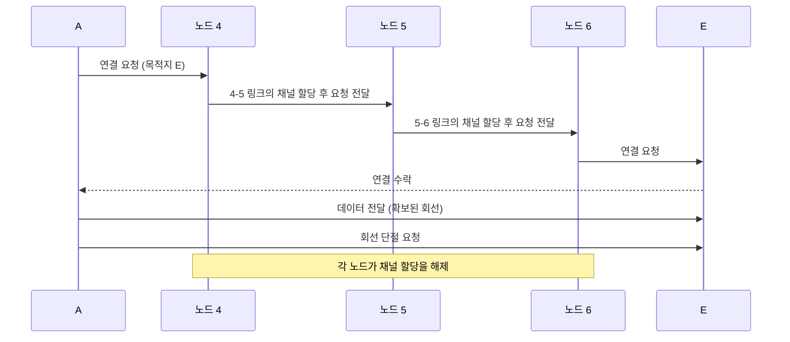

*그림 21. 노드 4, 5, 6을 거치는 회선 교환의 세 단계*

회선이 만들어지면 데이터는 각 노드에서 경로를 다시 찾지 않고 확보된 채널로 곧바로 지나가므로, 전송 속도와 지연이 일정하다. 반면 회선 설립에 시간이 걸리고, 데이터가 없는 동안에도 회선이 독점되어 자원이 낭비된다. 전화망이 회선 교환의 대표적인 예이다.

### 3.3 패킷 교환

> **용어 정의:** **패킷 교환(packet switching)** 은 데이터를 패킷(packet)이라는 작은 블록으로 나누어 보내는 방식이다. 데이터를 전송하는 동안만 네트워크 자원을 쓴다. 패킷을 다루는 두 방식은 3.4절에서 다룬다.

패킷 교환은 짧고 간헐적인 데이터 트래픽에 알맞으며, 현재 가장 많이 쓰는 방식이다. 회선 교환과 비교하면 다음 차이가 있다.

- 회선 교환은 통신 기간 동안 두 노드 사이의 연결을 독점하지만, 패킷 교환은 링크를 여러 통신이 나누어 쓴다.
- 회선 교환은 송신과 수신이 같은 일정한 데이터 전송 속도로 동작해야 하므로, 속도가 서로 다른 호스트 컴퓨터와 터미널을 상호 접속하기 어렵다. 패킷 교환은 노드가 패킷을 저장했다가 보내므로 이런 제한이 없다.

**패킷의 구성.** 패킷은 다음과 같은 성질을 가진다.

- 데이터 전송의 단위이며, 일반적으로 1,000바이트(옥텟) 이하이다.
- 긴 메시지는 여러 패킷으로 나누어 보낸다.
- 사용자 데이터의 일부와 제어 정보로 이루어진다. 제어 정보(패킷 헤더)에는 적어도 목적지와 경로 선택에 필요한 정보가 들어간다.
- 각 노드는 패킷을 받아 잠시 저장한 뒤 다음 노드로 전달한다(저장 후 전달, store-and-forward).

```text
                           User data
            ┌───────────────────────────────────────┐
            └───────────────────────────────────────┘
                 │              │              │
                 ▼              ▼              ▼
            ┌──┬─────────┐  ┌──┬─────────┐  ┌──┬─────────┐
            │H │ data 1  │  │H │ data 2  │  │H │ data 3  │
            └──┴─────────┘  └──┴─────────┘  └──┴─────────┘
            H = control information (packet header)
```

*그림 22. 사용자 데이터를 헤더가 붙은 패킷으로 나누는 과정*

**패킷 교환의 장점.**

| 장점 | 설명 |
|:-----|:-----|
| 높은 전송 효율 | 한 링크를 여러 패킷이 동적으로 나누어 쓰므로, 데이터가 없는 동안 링크가 놀지 않는다. |
| 전송 속도 변환 | 서로 다른 속도의 두 단말도 노드가 버퍼링하며 중계하므로 통신할 수 있다. |
| 트래픽이 많아도 막히지 않음 | 회선 교환은 회선이 모자라면 연결 자체를 거부하지만, 패킷 교환은 패킷을 받아 두고 지연만 늘어난다. |
| 우선순위 | 노드에 대기 중인 패킷 가운데 우선순위가 높은 패킷을 먼저 보낼 수 있다. |

*표 11. 패킷 교환의 장점*

### 3.4 데이터그램과 가상 회선

패킷 교환 네트워크가 패킷을 다루는 방식에는 두 가지가 있다.

> **용어 정의:** **데이터그램(datagram)** 방식은 각 패킷을 서로 독립적으로 다루는 방식이다. 같은 메시지의 패킷이라도 각자 다른 경로로 갈 수 있다.

> **용어 정의:** **가상 회선(virtual circuit)** 방식은 패킷을 보내기 전에 미리 계획된 경로를 설립하고, 모든 패킷이 그 경로를 따라가는 방식이다.

데이터그램의 성질은 다음과 같다.

- 인터넷의 IP가 쓰는 전송 단위이다.
- 최대 크기는 65,535바이트이다.
- 헤더와 데이터 부분으로 이루어진 가변 길이의 패킷이다.
- 한 메시지의 패킷들은 서로 독립적으로 다루어진다.

> **참고:** 강의자료는 데이터그램의 최대 크기를 65,536바이트로 적지만, IPv4 헤더의 전체 길이(total length) 필드가 16비트이고 헤더를 포함한 길이를 나타내므로 최댓값은 $2^{16} - 1 = 65{,}535$바이트이다 [2].

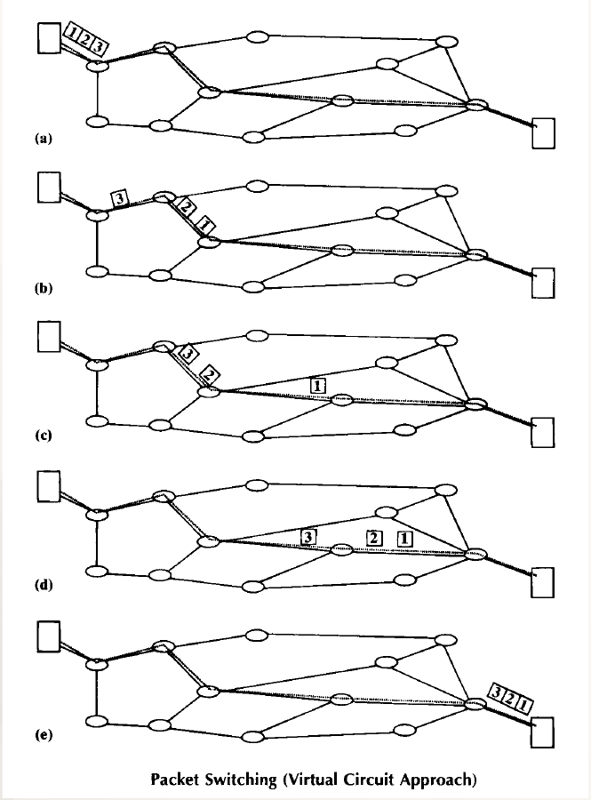

*그림 23. 가상 회선 방식의 패킷 교환*

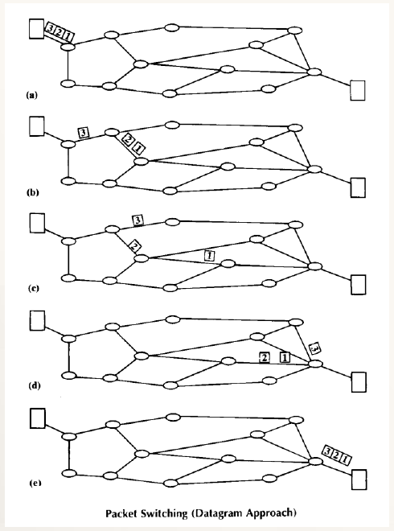

*그림 24. 데이터그램 방식의 패킷 교환*

그림 23과 24는 왼쪽 단말이 패킷 1, 2, 3을 오른쪽 단말로 보내는 과정을 (a)부터 (e)까지 시간 순서로 보여 준다. 그림 23의 가상 회선 방식에서는 미리 정해진 굵은 경로를 따라 세 패킷이 같은 경로로 차례로 이동하여 순서대로 도착한다. 그림 24의 데이터그램 방식에서는 (b)에서 패킷 3이 패킷 1, 2와 다른 위쪽 링크로 갈라져 (c)에서 위쪽 경로를 따라가고, (d)에서 목적지 바로 앞의 노드에서 패킷 1, 2와 다시 만난다. 각 노드가 패킷마다 그 순간 가장 좋은 링크를 고르기 때문이다. 그림 24에서는 세 패킷이 (e)에서 순서대로 도착했지만, 경로마다 지연이 다르므로 데이터그램의 패킷은 보낸 순서와 다르게 도착할 수도 있다.

| 비교 항목 | 가상 회선 | 데이터그램 |
|:-----|:-----|:-----|
| 경로 설정 | 첫 패킷을 보내기 전에 경로를 설립한다. | 경로 설립 없이 패킷마다 경로를 정한다. |
| 패킷의 경로 | 모든 패킷이 같은 경로를 따른다. | 패킷마다 다른 경로로 갈 수 있다. |
| 도착 순서 | 보낸 순서대로 도착한다. | 순서가 바뀔 수 있다. |
| 장점 | 연장된 시간 동안 데이터를 교환하는 데 적합하고, 순서 보장과 오류 제어 같은 서비스를 제공하기에 유리하다. | 필요할 때까지 연결을 맺지 않으므로 설립 지연이 없고, 적은 수의 패킷을 보낼 때 적합하며, 혼잡하거나 고장 난 노드를 피해 경로를 유연하게 바꿀 수 있다. |

*표 12. 가상 회선과 데이터그램의 비교*

가상 회선도 회선 교환처럼 경로를 먼저 정하지만, 그 경로의 링크를 독점하지는 않는다. 경로만 정해 두고 링크는 다른 가상 회선의 패킷과 나누어 쓰므로 가상(virtual) 회선이라 한다.

### 3.5 다중화 회선 교환과 ISDN

회선 교환 방식은 특정한 데이터 전송 속도로만 동작한다. 예를 들어 64 kbps 음성 회선에 그보다 느리거나 빠른 데이터를 보내면 용량이 남거나 모자란다.

> **용어 정의:** **다중화 회선 교환(multirate circuit switching, MRCS)** 은 데이터 전송 속도의 유연성을 확보하기 위해 회선 교환 방식과 다중화 방식을 융합한 방식이다. 여러 개의 고정된 데이터 전송 속도 채널을 두고, 필요한 속도에 맞추어 채널을 하나 또는 여럿 골라 쓴다.

> **용어 정의:** **ISDN(integrated services digital network, 통합 서비스 디지털 네트워크)** 은 비디오, 팩스, 음성, 데이터 트래픽의 디지털 전송을 하나의 네트워크로 지원하는 기술이다.

ISDN은 다중화 회선 교환의 대표적인 예이다. 기본 접속(BRI, basic rate interface)은 64 kbps의 B 채널 2개와 16 kbps의 D 채널 1개로 이루어져, 전체 $2 \times 64 + 16 = 144$ kbps를 제공한다 [3]. 사용자는 B 채널 하나(64 kbps)로 전화를 걸거나, 두 B 채널을 묶어 128 kbps로 데이터를 보낼 수 있다. 이처럼 데이터 전송 속도를 선택할 수는 있지만, 고를 수 있는 값은 여전히 주어진 고정된 속도들이다. ISDN은 1990년대에 확산되었으나, 이후 현대의 장거리 네트워킹 기술로 대체되었다.

### 3.6 프레임 릴레이

**X.25**는 초기의 패킷 교환 표준으로, 전송로의 오류율이 높던 시절에 맞추어 모든 노드가 패킷을 받을 때마다 오류를 검사하고 재전송을 처리했다. 그만큼 노드마다 처리 오버헤드가 컸다.

> **용어 정의:** **프레임 릴레이(frame relay)** 는 X.25의 패킷 전송 기술을 고속 데이터 통신에 알맞게 개선한 패킷 교환 프로토콜로, 오류 처리를 중간 노드가 아니라 양 끝 단말에 맡긴다.

프레임 릴레이의 특성은 다음과 같다.

- 가변 길이 단위인 프레임(frame)에 데이터를 넣는다.
- 재전송 같은 오류 정정 기능은 중간 노드가 아니라 양 끝의 단말에 맡긴다. 이 방식으로 전체 데이터 전송 속도를 높인다.
- 현대의 전송로는 오류율이 낮고 종단 시스템에는 오류를 처리할 지능형 논리가 있다는 것을 전제한다.
- 따라서 노드마다 오류 제어를 위한 오버헤드가 필요 없고, 오버헤드 비트를 없애 데이터 전송 속도를 높일 수 있다.

### 3.7 셀 릴레이와 교환 방식의 스펙트럼

> **용어 정의:** **셀 릴레이(cell relay)** 는 데이터를 셀(cell)이라는 작고 고정된 길이의 패킷에 담아 통계적으로 다중화하여 전송하는 방식이다. ATM(asynchronous transfer mode, 비동기 전송 모드)이라고도 한다.

- 프레임 릴레이에서 발전한 형태이다. 프레임 릴레이처럼 노드의 오류 제어를 줄였고, 여기에 길이를 고정했다.
- 다중화 회선 교환(MRCS)보다 진보한 형태로, 고정된 몇 가지 속도가 아니라 셀의 수를 조절하여 어떤 속도든 낼 수 있다.
- ATM의 셀은 5바이트 헤더와 48바이트 페이로드로 이루어진 53바이트이다 [4]. 길이가 고정되어 있으므로 노드가 하드웨어로 빠르게 교환할 수 있고, 지연을 예측하기 쉽다. 3주차의 DQDB가 53바이트 슬롯을 쓰는 것도 ATM과 호환하기 위해서이다.

지금까지의 교환 방식을 한 줄에 놓으면 다음과 같다.

```text
 Fixed bit rate                                                    Variable bit rate
 Simplicity    <------------------------------------------------>     Complexity
      │                  │                  │                │               │
   Circuit           Multirate          Cell relay         Frame          Packet
  switching           circuit             (ATM)            relay         switching
                     switching
```

*그림 25. 교환 방식의 스펙트럼*

그림 25의 왼쪽 끝인 회선 교환은 고정된 비트율로 동작하는 단순한 방식이고, 오른쪽 끝인 패킷 교환은 가변 비트율을 다루는 대신 복잡하다. 다중화 회선 교환은 회선 교환에 여러 고정 속도를 더했고, 프레임 릴레이는 패킷 교환에서 노드의 오류 제어를 덜어 냈으며, 셀 릴레이는 그 사이에서 고정 길이 셀로 단순함과 유연성을 함께 얻는다.

---

<br>

## 4. 부록: 일본자동차연구소 JARI

> **용어 정의:** **JARI(Japan Automobile Research Institute, 일본자동차연구소)** 는 자동차의 안전, 환경, 에너지, 지능형 교통 시스템(ITS)을 연구하고 시험하는 일본의 연구 기관이다.

### 4.1 JARI의 위치

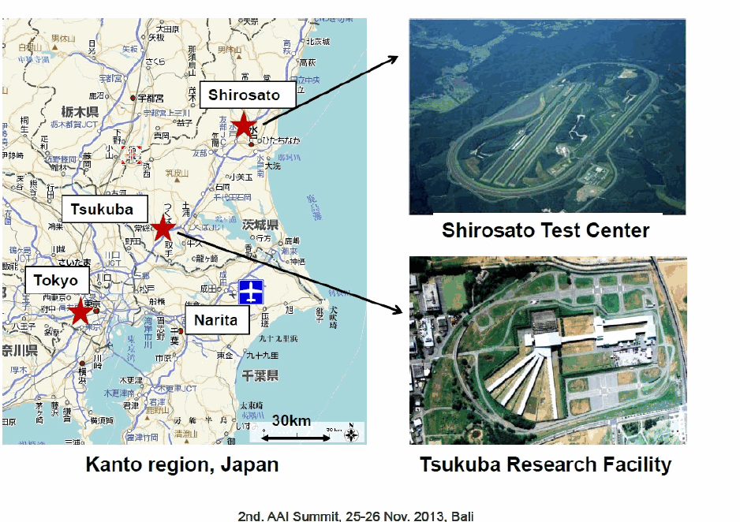

*그림 26. 간토 지역의 JARI 거점과 츠쿠바 연구소, 시로사토 시험장*

JARI의 거점은 츠쿠바(Tsukuba) 본부, 시로사토(Shirosato) 시험장, 도쿄(Tokyo) 지부의 세 곳이다. 그림 26의 지도에서 세 곳은 모두 도쿄 북동쪽의 간토 지역에 있으며, 츠쿠바는 도쿄와 나리타 공항 사이의 북쪽에, 시로사토는 그보다 더 북쪽에 있다. 오른쪽 사진은 위가 시로사토 시험장, 아래가 츠쿠바 연구소이다.

### 4.2 츠쿠바 연구소

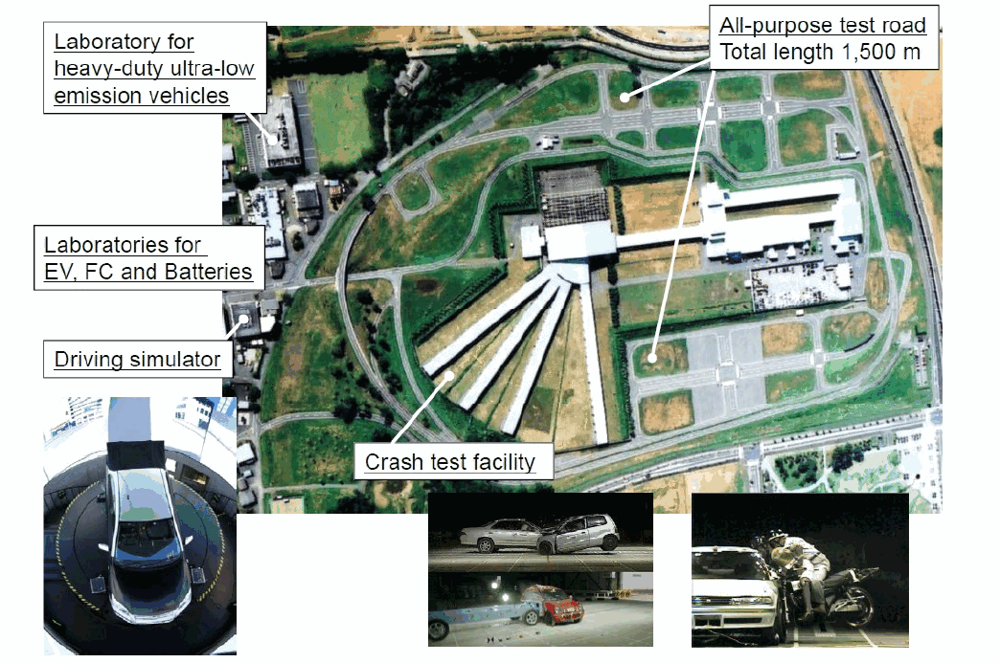

*그림 27. 츠쿠바 연구소의 시설*

츠쿠바 연구소에는 다음 시설이 있다.

| 시설 | 내용 |
|:-----|:-----|
| 대형 초저공해 차량 연구실(laboratory for heavy-duty ultra-low emission vehicles) | 트럭, 버스 같은 대형 차량의 배출 가스를 줄이는 기술을 연구한다. |
| EV, FC, 배터리 연구실(laboratories for EV, FC and batteries) | 전기차(EV), 연료전지(FC), 배터리를 연구한다. |
| 주행 시뮬레이터(driving simulator) | 둥근 스크린 공간 안에 실제 차량을 두고 가상의 도로 환경에서 운전자의 반응을 연구한다. |
| 다목적 시험로(all-purpose test road) | 총 길이 1,500 m이다. |
| 충돌 시험 시설(crash test facility) | 부채꼴로 뻗은 여러 주행로에서 차량끼리, 차량과 이륜차를 충돌시켜 안전성을 평가한다. |

*표 13. 츠쿠바 연구소의 시설*

### 4.3 시로사토 시험장

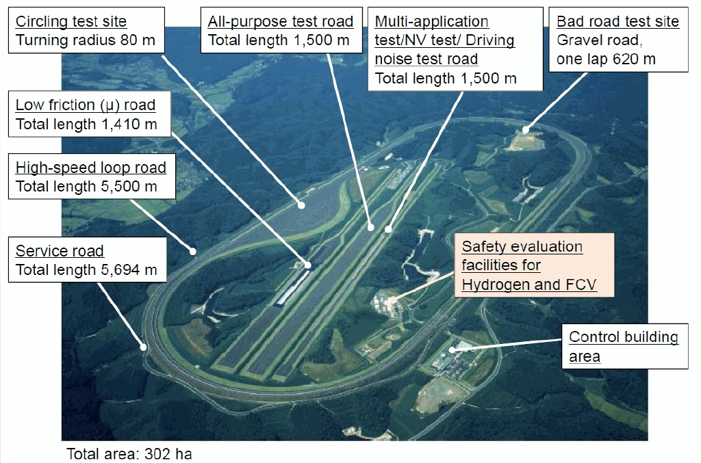

*그림 28. 시로사토 시험장의 시험로*

시로사토 시험장의 면적은 302 ha(91만 평)이다. 1 ha는 10,000 m²이고 1평은 약 3.3058 m²이므로, $3{,}020{,}000 / 3.3058 \approx 913{,}000$평이 되어 두 값이 서로 맞는다.

| 시설 | 규모 |
|:-----|:-----|
| 선회 시험장(circling test site) | 선회 반경 80 m |
| 다목적 시험로(all-purpose test road) | 총 길이 1,500 m |
| 다용도 시험로(multi-application test, NV test, driving noise test road) | 총 길이 1,500 m. 진동과 소음(NV, noise and vibration), 주행 소음을 시험한다. |
| 악로 시험장(bad road test site) | 자갈길, 한 바퀴 620 m |
| 저마찰 노면(low friction road) | 총 길이 1,410 m. 마찰 계수(µ)가 낮은 미끄러운 노면이다. |
| 고속 주회로(high-speed loop road) | 총 길이 5,500 m |
| 서비스 도로(service road) | 총 길이 5,694 m |
| 수소와 연료전지 차량의 안전성 평가 시설 | 4.5절의 시설이다. |
| 관제 건물 구역(control building area) | 시험장 전체를 관리한다. |

*표 14. 시로사토 시험장의 시설*

### 4.4 조직

2013년 4월 기준 JARI의 조직은 대표(president)와 임원진(managing director, senior executive director, executive director), 감사(auditor) 아래에 다음 부서를 둔다.

| 구분 | 부서 |
|:-----|:-----|
| 연구 부문 | 에너지 환경 연구 부문(energy and environment research division), FC-EV 연구 부문(FC-EV research division), ITS 연구 부문(ITS research division), 안전 연구 부문(safety research division) |
| 연구 지원과 기획 | 첨단 연구부(advanced research department), 국제 협력(global networking), 전략 기획 관리부(strategic planning and management department), 로봇 프로젝트 추진부(robot project promotion department), 연구 기획 관리 부문(research planning and administration division) |
| 운영과 인증 | 총무 부문(general administration division), JNX 센터(JNX center), 인증 기관(registration body), STC 관리부(STC administration department) |

*표 15. JARI의 조직 (2013년 4월 기준)*

연구의 중심은 에너지와 환경, 연료전지와 전기차, ITS, 안전의 네 연구 부문이며, 이는 자동차 산업의 핵심 과제인 친환경과 안전, 지능화에 대응한다.

### 4.5 주요 시설: 수소 연료전지 시험 시설

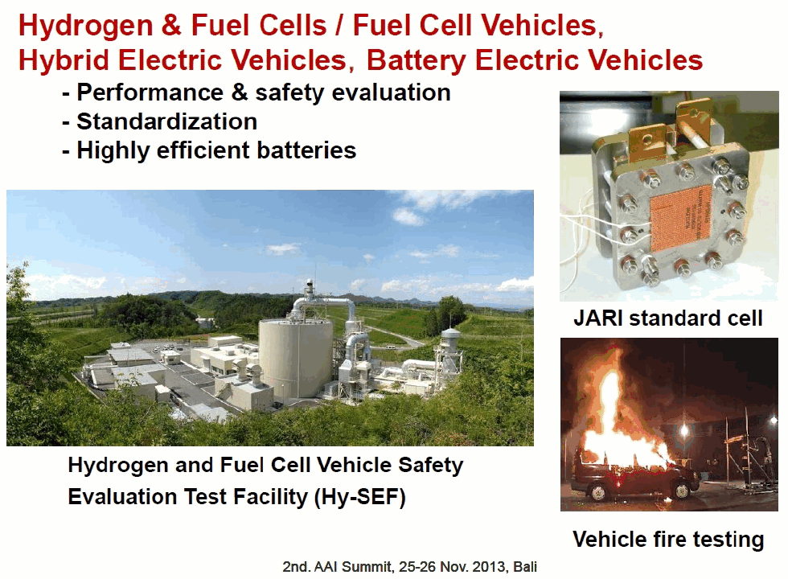

*그림 29. 수소와 연료전지 차량의 안전성 평가 시설과 배터리 셀, 차량 화재 시험*

JARI는 수소와 연료전지, 연료전지 차량(FCV), 하이브리드 전기차(HEV), 배터리 전기차(BEV)를 대상으로 다음을 연구한다.

- **성능과 안전성 평가:** 그림 29의 왼쪽은 수소와 연료전지 차량의 안전성 평가 시험 시설(Hy-SEF, Hydrogen and Fuel Cell Vehicle Safety Evaluation Test Facility)이고, 오른쪽 아래는 차량 화재 시험 장면이다. 고압 수소 탱크를 단 차량이 불에 휩싸였을 때의 안전성 같은 것을 평가한다.
- **표준화:** 평가 방법을 표준으로 만들어 국제 규격 제정에 활용한다.
- **고효율 배터리:** 그림 29의 오른쪽 위는 성능 평가의 기준으로 쓰는 JARI 표준 셀이다.

### 4.6 주요 시설: 트럭 군집 주행

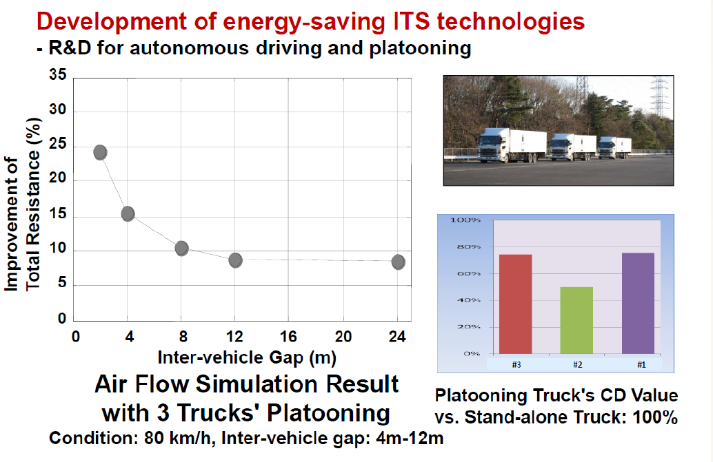

*그림 30. 세 대의 트럭 군집 주행에 대한 공기 흐름 시뮬레이션 결과와 공기 저항 계수*

> **용어 정의:** **군집 주행(platooning)** 은 여러 대의 차량이 통신으로 연결되어 짧은 차간 거리를 유지하며 한 줄로 함께 달리는 주행 방식이다. 앞차가 공기를 가르므로 뒤차가 받는 공기 저항이 줄어 연료가 절약된다.

JARI는 에너지 절약형 ITS 기술 개발의 하나로 자율주행과 군집 주행을 연구한다. 그림 30의 결과는 다음과 같다.

- **공기 흐름 시뮬레이션(왼쪽 그래프):** 세 대가 군집 주행할 때 전체 주행 저항이 줄어드는 비율을 차간 거리별로 나타낸다. 차간 거리 2 m에서 약 24%, 4 m에서 약 15%, 8 m에서 약 10%, 12 m에서 약 9% 개선되고, 24 m에서도 약 8.5%의 개선이 남는다. 차간 거리가 짧을수록 효과가 크다. 그림에 표기된 조건은 시속 80 km, 차간 거리 4\~12 m이다.
- **공기 저항 계수(오른쪽 아래 그래프):** 단독 주행 트럭의 공기 저항 계수(CD)를 100%로 할 때, 대열의 세 트럭 #3, #2, #1은 각각 약 75%, 50%, 76%이다. 앞뒤가 모두 다른 트럭으로 가려진 가운데 트럭의 저항이 가장 작다.

군집 주행은 차량 사이의 통신으로 가속과 제동을 동시에 맞추어야 짧은 차간 거리를 안전하게 유지할 수 있으므로, 11주차에서 다루는 V2V 통신의 중요한 응용이다.

---

<br>

## 개념 적용

| 상황 | 적용할 개념 |
|:-----|:-----|
| 오래된 전화 모뎀으로 컴퓨터 데이터를 보낸다. | 전화선은 음성 대역의 아날로그 신호만 통과시키므로, 모뎀이 FSK나 PSK로 디지털 데이터를 아날로그 신호로 변조한다(1.6절). |
| 10 Mbps 이더넷은 별도의 클록 선 없이 수신기의 시계를 맞춘다. | Manchester 부호는 매 비트 가운데에 전이가 있어 수신기가 그 전이로 동기를 맞춘다(1.7절). |
| 음악을 CD 품질로 디지털화하려 한다. 사람이 듣는 최고 주파수는 약 20 kHz이다. | 샘플링 정리에 따라 40 kHz보다 높은 속도로 샘플링해야 하며, CD는 44.1 kHz를 쓴다(1.8절). |
| 공장의 전동기 옆을 지나는 배선에서 통신 오류가 잦다. | 잡음이 강한 곳이므로 UTP 대신 STP나 광섬유로 바꾸어 간섭을 줄인다(2.3절, 2.5절). |
| 몇 초에 한 번씩 짧은 센서 값을 보내는 장치를 네트워크에 연결한다. | 짧고 간헐적인 트래픽이므로 회선을 독점하는 회선 교환보다 패킷 교환, 특히 설립 지연이 없는 데이터그램이 알맞다(3.3절, 3.4절). |

*표 16. 개념 적용 사례*

**T/F 점검:**

| 문장 | 판단과 근거 |
|:-----|:-----|
| 앰프는 신호를 증폭할 때 잡음은 제거한다. | **F.** 앰프는 잡음도 함께 증폭하므로 잡음이 쌓이고, 잡음을 걸러 내는 것은 디지털 신호를 재생하는 리피터이다. |
| 보 속도가 1,200 baud이고 심볼당 4비트를 실으면 데이터 전송 속도는 4,800 bps이다. | **T.** $1200 \times 4 = 4800$이다. |
| NRZI에서는 0을 보낼 때 레벨이 바뀐다. | **F.** NRZI는 1일 때 비트 시작에서 레벨을 바꾸고 0일 때는 바꾸지 않는다. |
| 동기식 TDM은 데이터가 없는 단말에도 슬롯을 할당한다. | **T.** 슬롯이 고정되어 있어 용량이 낭비되며, 비동기식 TDM이 이를 보완한다. |
| 멀티 모드 광섬유는 단일 모드보다 코어가 가늘다. | **F.** 멀티 모드의 코어는 50 µm 이상으로 단일 모드(약 9 µm)보다 굵다. |
| 데이터그램 방식에서는 같은 메시지의 패킷이 항상 같은 경로로 간다. | **F.** 패킷마다 독립적으로 경로가 정해지므로 다른 경로로 갈 수 있고 순서가 바뀔 수 있다. |

---

<br>

## 요약

| 개념 | 핵심 요약 |
|:-----|:-----|
| 용어 | 정보는 의미, 데이터는 정보의 표현, 신호는 데이터의 전기적 표현, 신호 방식은 신호를 매체에 싣는 행위, 전송은 신호를 전파하여 데이터를 전달하는 것이다. |
| 아날로그와 디지털 | 아날로그는 연속적인 값, 디지털은 분리된 값이며, 디지털 신호는 잡음에 강하지만 감쇠를 받는다. |
| 네 가지 인코딩 | 아날로그와 디지털 데이터를 아날로그와 디지털 신호로 바꾸는 네 조합이 있으며, 모뎀과 코덱이 대표 장치이다. |
| 앰프와 리피터 | 앰프는 잡음까지 증폭하고, 리피터는 디지털 신호를 재생하여 잡음이 쌓이지 않는다. |
| 변조 | ASK는 진폭, FSK는 주파수, PSK는 위상으로 비트를 나타내며, 오류에 대한 강건성은 ASK가 가장 약하다. |
| 보 속도 | 데이터 전송 속도는 보 속도에 심볼당 비트 수 $\log_2 M$을 곱한 값이다. |
| 선로 부호 | NRZ-L은 레벨로, NRZI는 1에서의 전이로, Manchester는 비트 가운데 전이의 방향으로, 차동 Manchester는 비트 시작의 전이 유무로 값을 나타낸다. |
| 샘플링과 PCM | 최고 주파수의 2배보다 큰 속도로 샘플링하고 양자화와 부호화를 거치며, 음성은 8000 × 8 = 64 kbps이다. |
| 다중화 | FDM은 주파수 대역을, TDM은 시간 슬롯을 나누어 한 전송로를 공유하며, 비동기식 TDM은 슬롯을 동적으로 배정한다. |
| 꼬임쌍선 | 두 전선을 꼬아 간섭을 상쇄하는 저가 매체이며, STP는 차폐로 UTP보다 잡음에 강하다. |
| 동축 케이블 | 내부 도체를 외부 도체가 감싸 꼬임쌍선보다 잡음에 강하고 멀리 보내지만, 사용이 줄어드는 추세이다. |
| 광섬유 | 코어와 클래딩의 굴절률 차로 빛을 전반사시켜 보내며, 단일 모드가 멀티 모드보다 장거리와 고속에 유리하다. |
| 비유도 매체 | 마이크로파는 주로 1\~40 GHz를 쓰며 주파수 배당과 보안을 고려해야 하고, 적외선은 가시선 안에서 쓴다. |
| 회선 교환 | 설립, 전달, 단절의 세 단계로 경로를 독점하며, 속도와 지연이 일정하지만 자원이 낭비될 수 있다. |
| 패킷 교환 | 데이터를 헤더가 붙은 패킷으로 나누어 저장 후 전달하며, 효율이 높고 속도 변환과 우선순위가 가능하다. |
| 데이터그램과 가상 회선 | 데이터그램은 패킷을 독립적으로 보내고, 가상 회선은 미리 설립한 경로로 순서대로 보낸다. |
| MRCS, 프레임 릴레이, ATM | MRCS는 여러 고정 속도 채널을, 프레임 릴레이는 끝단의 오류 처리를, ATM은 53바이트 고정 셀을 쓴다. |
| JARI | 츠쿠바 연구소와 시로사토 시험장을 거점으로 에너지와 환경, FC-EV, ITS, 안전을 연구하며, 수소 안전 평가와 트럭 군집 주행 연구를 한다. |

---

<br>

## 점검 문제

1. **아날로그와 디지털 전송:** 장거리 전송에서 디지털 전송이 아날로그 전송보다 품질이 좋은 이유를 앰프와 리피터의 차이로 설명하라.

   <details>
   <summary>정답</summary>

   앰프는 입력을 그대로 키우므로 신호에 섞인 잡음도 함께 증폭하고, 여러 앰프를 거칠수록 잡음이 쌓여 신호 대 잡음비가 나빠진다. 리피터는 입력 신호에서 0과 1을 판별한 뒤 깨끗한 새 신호를 만들어 보내므로, 판별이 틀리지 않는 한 잡음이 다음 구간으로 전달되지 않는다. 따라서 거리가 길어져도 품질이 유지된다.

   </details>

2. **변조 방식:** ASK, FSK, PSK가 각각 반송파의 어떤 특성을 바꾸는지 쓰고, 셋 가운데 잡음에 가장 약한 방식과 그 이유를 설명하라.

   <details>
   <summary>정답</summary>

   ASK는 진폭, FSK는 주파수, PSK는 위상을 바꾼다. 잡음과 감쇠는 주로 신호의 세기, 즉 진폭을 바꾸므로 진폭에 정보를 싣는 ASK가 가장 약하다. FSK와 PSK는 진폭이 일정하므로 세기의 변화에 덜 민감하다.

   </details>

3. **보 속도:** 보 속도가 3,000 baud인 회선에서 16가지 상태의 심볼을 쓰면 데이터 전송 속도는 얼마인가?

   <details>
   <summary>정답</summary>

   $M = 16$이므로 심볼당 $\log_2 16 = 4$비트를 싣는다. 데이터 전송 속도는 $3000 \times 4 = 12{,}000$ bps, 즉 12 kbps이다.

   </details>

4. **선로 부호:** 비트열 1100을 NRZI와 Manchester(IEEE 802.3 규칙)로 나타낼 때 각 비트에서 일어나는 전이를 쓰라. NRZI의 직전 레벨은 낮은 레벨로 가정한다.

   <details>
   <summary>정답</summary>

   NRZI: 첫째 비트 1의 시작에서 낮은 레벨에서 높은 레벨로 바뀌고, 둘째 비트 1의 시작에서 다시 낮은 레벨로 바뀐다. 셋째와 넷째 비트 0에서는 전이가 없어 낮은 레벨이 이어진다. Manchester: 1은 비트 가운데에서 낮은 레벨에서 높은 레벨로, 0은 높은 레벨에서 낮은 레벨로 바뀐다. 1, 1이 이어지므로 둘째 비트의 시작에서 높은 레벨에서 낮은 레벨로 한 번 더 전이하고, 1 다음의 0은 높은 레벨에서 시작하므로 셋째 비트 시작에는 전이가 없다. 0, 0이 이어지므로 넷째 비트의 시작에서 낮은 레벨에서 높은 레벨로 전이한다.

   </details>

5. **PCM:** 필터로 20 kHz보다 낮은 주파수 성분만 남긴 음악을 샘플당 16비트로 PCM 부호화할 때, 한 채널에 필요한 최소 전송 속도를 계산하라.

   <details>
   <summary>정답</summary>

   모든 성분이 20 kHz보다 낮으므로, 샘플링 정리에 따라 샘플링 속도는 $2 \times 20 = 40$ kHz, 즉 초당 40,000개면 충분하다. 샘플당 16비트이므로 전송 속도는 $40{,}000 \times 16 = 640{,}000$ bps, 즉 640 kbps이다.

   </details>

6. **에일리어싱:** 샘플링 속도가 부족할 때 생기는 문제를 설명하라.

   <details>
   <summary>정답</summary>

   샘플링 속도가 신호의 최고 주파수의 2배보다 낮으면, 높은 주파수 신호의 샘플이 낮은 주파수 신호의 샘플과 똑같아져 수신기가 두 신호를 구별할 수 없다. 그 결과 복원한 신호에 원래 없던 낮은 주파수가 나타나는데, 이를 에일리어싱이라 한다.

   </details>

7. **TDM:** 동기식 TDM과 비동기식 TDM의 차이를 슬롯 할당 방식과 효율로 설명하라.

   <details>
   <summary>정답</summary>

   동기식 TDM은 각 채널에 시간 슬롯을 고정으로 할당하므로, 보낼 데이터가 없는 단말의 슬롯도 비어 있는 채로 전송되어 용량이 낭비된다. 비동기식 TDM은 데이터를 보내려는 채널에만 슬롯을 동적으로 주므로 효율이 높지만, 슬롯의 위치로 소스를 알 수 없어 각 슬롯에 주소 정보를 붙여야 한다.

   </details>

8. **감쇠:** 어떤 케이블의 감쇠가 100 m당 10 dB이다. 200 m를 지난 뒤 남는 전력은 송신 전력의 몇 %인가?

   <details>
   <summary>정답</summary>

   200 m의 감쇠는 $2 \times 10 = 20$ dB이다. 전력비는 $10^{-20/10} = 10^{-2} = 0.01$이므로 송신 전력의 1%가 남는다.

   </details>

9. **광섬유:** 단일 모드 광섬유가 멀티 모드보다 장거리 고속 전송에 유리한 이유를 설명하라.

   <details>
   <summary>정답</summary>

   멀티 모드 광섬유는 코어가 굵어 빛이 여러 경로(모드)로 반사하며 진행하므로, 경로 길이의 차이 때문에 같은 펄스의 빛이 서로 다른 시각에 도착하여 펄스가 퍼진다(모드 분산). 펄스가 퍼지면 이웃한 펄스와 겹치므로 거리와 속도가 제한된다. 단일 모드는 코어가 약 9 µm로 가늘어 하나의 경로만 전파하므로 모드 분산이 없고, 감쇠도 작아 장거리 고속 전송에 유리하다.

   </details>

10. **교환 방식:** 회선 교환과 패킷 교환을 자원 사용, 지연의 일정성, 알맞은 트래픽으로 비교하라.

    <details>
    <summary>정답</summary>

    회선 교환은 통신 기간 내내 경로를 독점하므로 데이터가 없는 동안에도 자원을 차지하지만, 회선이 설립되면 전송 속도와 지연이 일정하여 음성 통화처럼 끊김 없이 이어지는 트래픽에 알맞다. 패킷 교환은 데이터를 보내는 동안만 링크를 나누어 쓰므로 효율이 높지만, 노드의 대기열 때문에 지연이 변할 수 있고, 짧고 간헐적인 데이터 트래픽에 알맞다.

    </details>

11. **가상 회선:** 가상 회선이 회선 교환과 같은 점과 다른 점을 쓰라.

    <details>
    <summary>정답</summary>

    같은 점은 데이터를 보내기 전에 경로를 먼저 설립하고, 모든 데이터가 그 경로를 따라 순서대로 도착한다는 것이다. 다른 점은 회선 교환은 경로의 링크 용량을 독점하지만, 가상 회선은 경로만 정해 두고 링크를 다른 통신의 패킷과 나누어 쓴다는 것이다.

    </details>

12. **군집 주행:** JARI의 시뮬레이션에서 세 트럭 가운데 공기 저항 계수가 가장 작은 트럭은 어느 트럭이며, 그 이유는 무엇인가? 또 차간 거리와 저항 감소의 관계를 쓰라.

    <details>
    <summary>정답</summary>

    가운데 트럭(#2)의 공기 저항 계수가 단독 주행의 약 50%로 가장 작다. 앞차가 공기를 갈라 주고 뒤차가 뒤쪽의 소용돌이를 줄여 주므로, 앞뒤가 모두 가려진 가운데 트럭의 저항이 가장 많이 줄어든다. 차간 거리가 짧을수록 저항 감소 효과가 커서, 2 m에서는 전체 저항이 약 24% 개선되지만 12 m 이상에서는 약 9% 수준으로 줄어든다.

    </details>

---

<br>

## 참고 문헌

1. W. Stallings, *Data and Computer Communications*, 10th ed. Boston, MA, USA: Pearson, 2014.
2. J. Postel, "Internet Protocol," RFC 791, Sep. 1981. https://www.rfc-editor.org/rfc/rfc791
3. ITU-T, *Recommendation I.430: Basic user-network interface - Layer 1 specification*, International Telecommunication Union, 1995.
4. ITU-T, *Recommendation I.361: B-ISDN ATM layer specification*, International Telecommunication Union, 1999.
