# Week 4 Lecture — Data Communication Terms and Encoding, Transmission Media, and Switching

[Repository Guide](../../README.md) | [English](Concepts_Lecture.md) | [한국어](Concepts_Lecture.ko.md)

> **Last Updated:** 2026-11-17

> **Learning Objectives:**
> 1. Distinguish information, data, signal, signaling, and transmission, and explain the four combinations of encoding data into signals
> 2. Explain the principles of ASK, FSK, and PSK, and compute the relationship between bit rate and baud rate
> 3. Draw the waveforms of a given bit stream in NRZ-L, NRZI, RZ, Manchester, and differential Manchester codes
> 4. Compute the transmission rate of voice with the sampling theorem and PCM, and compare FDM and TDM
> 5. Compare the structure and characteristics of twisted pair, coaxial cable, optical fiber, and wireless media
> 6. Compare circuit switching, packet switching (datagram and virtual circuit), multirate circuit switching, frame relay, and cell relay, and describe the facilities and research areas of JARI

---

## Table of Contents

- [1. Key Terms and Encoding in Data Communication](#1-key-terms-and-encoding-in-data-communication)
  - [1.1 Key Terms of Data Communication](#11-key-terms-of-data-communication)
  - [1.2 Analog and Digital](#12-analog-and-digital)
  - [1.3 Encoding Data into Signals](#13-encoding-data-into-signals)
  - [1.4 Analog Transmission and Digital Transmission](#14-analog-transmission-and-digital-transmission)
  - [1.5 Considerations in Data Encoding Techniques](#15-considerations-in-data-encoding-techniques)
  - [1.6 Analog Encoding of Digital Data: Modulation](#16-analog-encoding-of-digital-data-modulation)
  - [1.7 Digital Encoding of Digital Data: Line Codes](#17-digital-encoding-of-digital-data-line-codes)
  - [1.8 Digital Encoding of Analog Information: Sampling and PCM](#18-digital-encoding-of-analog-information-sampling-and-pcm)
  - [1.9 Multiplexing: FDM and TDM](#19-multiplexing-fdm-and-tdm)
- [2. Transmission Media](#2-transmission-media)
  - [2.1 Classification and Performance Factors of Transmission Media](#21-classification-and-performance-factors-of-transmission-media)
  - [2.2 Twisted Pair](#22-twisted-pair)
  - [2.3 Unshielded and Shielded Twisted Pair](#23-unshielded-and-shielded-twisted-pair)
  - [2.4 Coaxial Cable](#24-coaxial-cable)
  - [2.5 Optical Fiber](#25-optical-fiber)
  - [2.6 Unguided Media: Microwave and Infrared](#26-unguided-media-microwave-and-infrared)
- [3. Switching Techniques in Data Communication](#3-switching-techniques-in-data-communication)
  - [3.1 Communications Networks](#31-communications-networks)
  - [3.2 Circuit Switching](#32-circuit-switching)
  - [3.3 Packet Switching](#33-packet-switching)
  - [3.4 Datagrams and Virtual Circuits](#34-datagrams-and-virtual-circuits)
  - [3.5 Multirate Circuit Switching and ISDN](#35-multirate-circuit-switching-and-isdn)
  - [3.6 Frame Relay](#36-frame-relay)
  - [3.7 Cell Relay and the Spectrum of Switching Techniques](#37-cell-relay-and-the-spectrum-of-switching-techniques)
- [4. Appendix: Japan Automobile Research Institute (JARI)](#4-appendix-japan-automobile-research-institute-jari)
  - [4.1 Locations of JARI](#41-locations-of-jari)
  - [4.2 Tsukuba Research Facility](#42-tsukuba-research-facility)
  - [4.3 Shirosato Test Center](#43-shirosato-test-center)
  - [4.4 Organization](#44-organization)
  - [4.5 Major Facility: Hydrogen and Fuel Cell Test Facility](#45-major-facility-hydrogen-and-fuel-cell-test-facility)
  - [4.6 Major Facility: Truck Platooning](#46-major-facility-truck-platooning)
- [Concept Applications](#concept-applications)
- [Summary](#summary)
- [Self-Check Questions](#self-check-questions)
- [References](#references)

---

<br>

## 1. Key Terms and Encoding in Data Communication

### 1.1 Key Terms of Data Communication

Data communication is the transfer of data from one device to another through a transmission medium. The terms used in this process are as follows.

| Term | Meaning |
|:-----|:-----|
| Information | The meaning to be conveyed itself, for example, the fact that the vehicle speed is 60 km/h. |
| Data | A representation of information in a form such as numbers, characters, or voice. The same information can be represented by the number 60 or by voice. |
| Encoding | The rules and process for converting data into a form of signal suitable for transmission. |
| Signal | An electrical or electromagnetic representation of data, appearing as changes in voltage, current, light, or radio waves. |
| Signaling | The act of putting an encoded signal onto a transmission medium. |
| Transmission | The delivery of data by propagating and processing signals through a medium. |

*Table 1. Key terms of data communication*

There are two kinds of transmission. **Analog transmission** amplifies a weakened signal with an amplifier, and **digital transmission** regenerates the signal with a repeater. The difference between the two is covered in Section 1.4.

### 1.2 Analog and Digital

> **Definition:** **Analog** means that a value varies continuously.

> **Definition:** **Digital** means that a value takes only a few discrete values.

This distinction applies to both data and signals.

- **Analog data:** Has continuous values. Like voice, video, or temperature, there can be infinitely many values between any two values.
- **Digital data:** Has discrete values. Like characters or integers, it takes one of a set of defined values.
- **Analog signal:** A continuously varying electromagnetic wave transmitted through wire, optical fiber, or the atmosphere.
- **Digital signal:** A sequence of voltage pulses carried over a wire. It is less sensitive to noise than an analog signal and cheaper to implement, but it is affected by signal attenuation.

> **Definition:** **Attenuation** is the phenomenon in which a signal loses energy and weakens while passing through a medium.

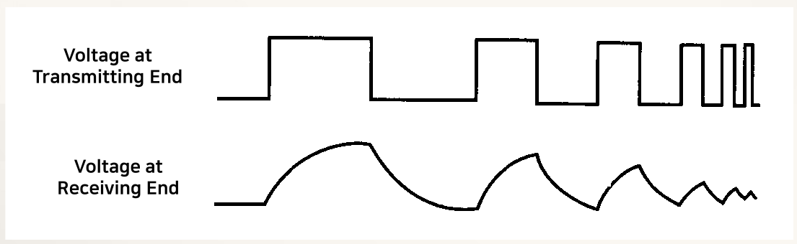

*Figure 1. Attenuation of a digital signal seen at the transmitting and receiving ends*

The upper part of Figure 1 is the clean square pulses sent at the transmitting end, and the lower part is the same signal arriving at the receiving end. The pulses at the receiving end have rounded corners and smaller amplitude. A square pulse is a sum of many frequency components, and the medium attenuates the high-frequency components more, so the sharp corners become blunt. As the pulses become narrower toward the right (as the transmission rate increases), high-frequency components carry more weight, so the distortion becomes more severe, until at the end the pulses can hardly be distinguished. For this reason, in digital transmission, the higher the rate, the shorter the distance after which the signal must be regenerated.

### 1.3 Encoding Data into Signals

Because data and signals can each be analog or digital, encoding has four combinations.

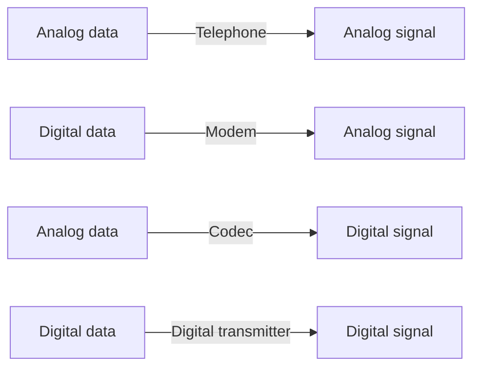

*Figure 2. The four combinations of encoding data into signals and their devices*

> **Definition:** A **modem (modulator-demodulator)** is a device that converts digital data into an analog signal (modulation) and back (demodulation).

> **Definition:** A **codec (coder-decoder)** is a device that converts analog data into a digital bit stream and back.

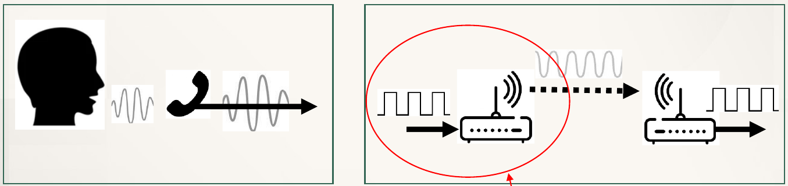

*Figure 3. Examples of sending analog data and digital data as analog signals*

The left side of Figure 3 is the case in which a telephone converts a human voice (sound waves) into an electrical signal of the same shape and sends it. The right side is the case in which a modem converts a computer's digital pulses into an analog signal on a carrier and sends it over the line, and the modem at the receiving side converts it back into digital pulses. For digital signals, analog data becomes a digital signal through a codec, and digital data becomes a digital signal either as a direct representation or after coding with specific rules.

| Data \ Signal | Analog signal | Digital signal |
|:-----|:-----|:-----|
| Analog data | Two cases. (1) The signal occupies the same spectrum as the data (voice on a telephone line). (2) The analog data is encoded to occupy a different spectrum (AM and FM radio). | Encoded into a digital bit stream by a codec. |
| Digital data | Encoded by a modem. | Two cases. (1) Two different voltages represent the two binary values. (2) The data is encoded to produce a digital signal with desired properties (the line codes of Section 1.7). |

*Table 2. Comparison of signal conversion for analog and digital data*

> **Definition:** The **spectrum** is the range of frequency components a signal contains. Voice spans roughly a few hundred Hz to a few kHz.

### 1.4 Analog Transmission and Digital Transmission

A signal weakens while it passes through a medium, so it must be processed along the way. Depending on the processing, transmission is analog or digital.

| Signal \ Transmission | Analog transmission | Digital transmission |
|:-----|:-----|:-----|
| Analog signal | Transmitted through amplifiers. The signal is treated the same whether it represents analog or digital data. | Assumes that the analog signal represents digital data. Transmitted through repeaters, and each repeater recovers the digital data from the incoming signal and generates a new outgoing signal. |
| Digital signal | Not used. | The digital signal represents digital data or encoded analog data with 1s and 0s. Each repeater generates a new outgoing signal based on the incoming signal. |

*Table 3. Transmission of analog and digital signals*

The key difference between the two is how noise is handled. An amplifier amplifies the noise mixed with the signal just as much as the signal, so noise accumulates with every amplifier the signal passes. A repeater decides only 0s and 1s from its input and sends a clean new signal, so as long as the decisions are correct, noise does not pass on to the next segment.

**Comparison of analog and digital signals.** Digital signaling is advantageous for long-distance transmission because repeaters can regenerate the signal, and digital transmission is superior in quality to analog because noise does not accumulate. Local networks use both analog and digital signaling and transmission techniques.

### 1.5 Considerations in Data Encoding Techniques

> **Definition:** An **encoding scheme** is the rule that converts data into signal elements. A signal element is a part of the signal distinguished as one unit, for example, the voltage level during one bit time.

The considerations differ for each encoding combination.

1. **Encoding digital data into a digital or analog signal:** 1s and 0s must be represented by different signal elements. **Synchronization** is needed so that the receiver knows where bits begin and end, and **sampling** is needed to read each bit at the correct instant. Attenuation and a high data rate must also be considered together.
2. **Encoding analog data into a digital signal:** How faithfully the original signal can be restored, that is, quality and fidelity, is what matters.
3. **Converting analog data into an analog signal:** Not used in local networks.

### 1.6 Analog Encoding of Digital Data: Modulation

To send digital data over a medium that passes only analog signals, such as a telephone line or radio, a sine wave of fixed frequency must be varied according to the data.

> **Definition:** A **carrier** is a sine wave of fixed frequency used to carry data.

> **Definition:** The frequency of the carrier is called the **carrier frequency**.

> **Definition:** **Modulation** is the changing of one or more of the amplitude, frequency, and phase of the carrier according to the data.

A sine wave is determined by three characteristics, amplitude, frequency, and phase, so digital data is encoded into an analog signal by changing one or a combination of these. A scheme that changes amplitude and phase together (quadrature amplitude modulation, QAM) is an example.

> **Definition:** The **bandwidth of the signal** is the range of frequencies the signal contains around the carrier frequency. Its unit is Hz.

**(1) Amplitude-shift keying (ASK).** The amplitude of the carrier is changed according to the bit stream of the transmitted data.

- Two different amplitudes of the carrier frequency represent 0 and 1.
- Commonly, the presence of the carrier at constant amplitude represents 1 and the absence of amplitude represents 0 (on-off keying).
- Noise mainly changes the strength of a signal, so ASK, which carries information in the amplitude, is sensitive to errors.
- On voice-grade telephone lines it is used at rates up to 1,200 bps.

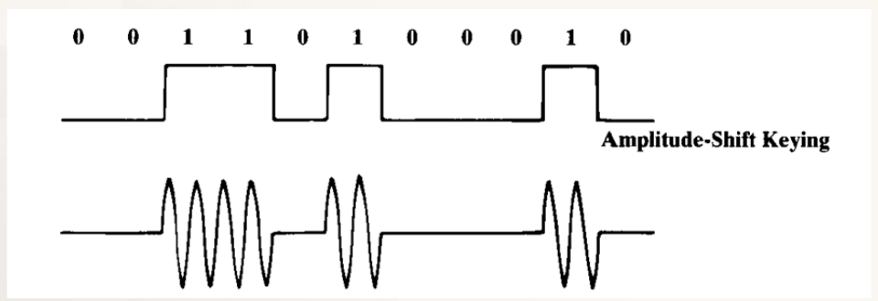

*Figure 4. ASK waveform of the bit stream 00110100010*

In Figure 4, the carrier appears only during intervals where the bit is 1, and there is no signal where the bit is 0.

**(2) Frequency-shift keying (FSK).** The amplitude is kept constant, and different discrete frequencies near the carrier frequency represent 0 and 1. The instantaneous frequency of the carrier changes discretely according to the original baseband signal.

- Noise that disturbs the amplitude hardly changes the frequency, so FSK is less susceptible to errors than ASK.
- On voice-grade telephone lines it is used at rates up to 1,200 bps (Bell System 108 series modems).
- It is used for high-frequency (HF) radio transmission at 3-30 MHz and in local networks that use coaxial cable at high frequencies.
- It is also mainly used for weather instruments and for low-frequency radio transmission in the VLF (very low frequency) and ELF (extremely low frequency) bands.

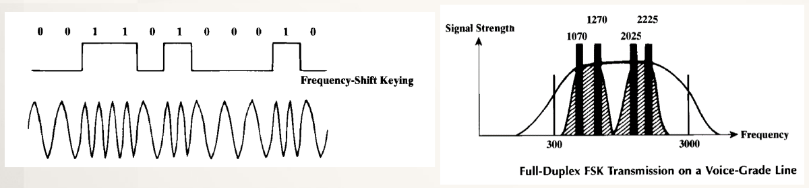

*Figure 5. FSK waveform and the frequency layout of full-duplex FSK on a voice-grade line*

On the left of Figure 5, the waveform is dense (high frequency) where the bit is 1 and sparse (low frequency) where the bit is 0. The right side is full-duplex FSK, which carries communication in both directions simultaneously over one voice band of 300-3,000 Hz. One direction represents 0 and 1 with 1,070 Hz and 1,270 Hz, and the other direction with 2,025 Hz and 2,225 Hz, so the signals of the two directions occupy different frequency regions and do not overlap.

**(3) Phase-shift keying (PSK).** A digital modulation scheme that transmits data by changing the phase of the reference signal (the carrier).

- Because phase changes must be detected precisely, it is a more complex technique than ASK and FSK.
- To understand PSK, bandwidth (Hz), data rate (bps), and signaling rate (baud) must be distinguished.

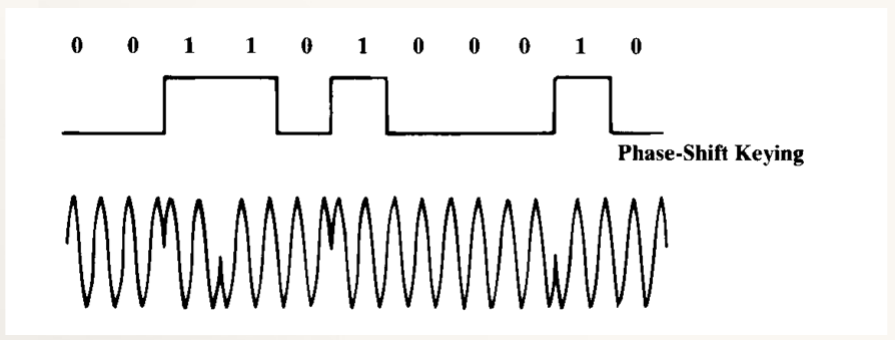

*Figure 6. PSK waveform of the bit stream 00110100010*

In Figure 6, the amplitude and frequency are constant, and the phase shifts by 180° at the points where the waveform appears to break abruptly. The simplest binary PSK (BPSK) gives 0 and 1 different phases (for example, 0° and 180°), so the phase is inverted whenever the bit value changes. Differential PSK (DPSK) inverts the phase relative to the previous signal for a 1 and keeps it for a 0. In Figure 6, the phase breaks only where a bit of 1 (the 3rd, 4th, 6th, and 10th) begins, so the waveform of Figure 6 is differential PSK.

> **Definition:** A **symbol** is the unit of signal that carries data information, that is, a signal element distinguished at one time.

> **Definition:** The **baud rate (signaling rate)** is the number of symbols transmitted per second, in baud.

> **Definition:** The **data rate** is the number of bits transmitted per second, in bps.

If a symbol takes one of $M$ states, it can carry $\log_2 M$ bits, so the two rates are related as follows [1].

```math
\text{Data rate (bps)} = \text{Baud rate (baud)} \times \log_2 M
```

**Worked example.** Consider a line with a baud rate of 2,400 baud.

- BPSK has 2 phases ($`M = 2`$), so each symbol carries $\log_2 2 = 1$ bit, giving $2400 \times 1 = 2400$ bps.
- QPSK has 4 phases (0°, 90°, 180°, 270°, $`M = 4`$), so each symbol carries $\log_2 4 = 2$ bits, giving $2400 \times 2 = 4800$ bps. For example, 00 is sent as 0°, 01 as 90°, 10 as 180°, and 11 as 270°.
- 8-PSK has $M = 8$, so each symbol carries 3 bits, giving $2400 \times 3 = 7200$ bps.

At the same baud rate, increasing the bits per symbol raises the data rate. In exchange, the spacing between phases narrows, making the signal more sensitive to noise. In this way, bandwidth (which sets the baud rate), data rate, and robustness against noise trade off against one another.

### 1.7 Digital Encoding of Digital Data: Line Codes

Sending digital data as a digital signal is widely used in local networks. The rule that converts bits into a voltage waveform is called a **line code**.

**Nonreturn-to-zero (NRZ) codes.** Two different voltage levels distinguish 0 and 1, and the level is held for one bit time.

- **NRZ-L (NRZ-level):** Represents the bit value directly as a voltage level. In the convention of the figure below, 0 is the high level and 1 is the low level [1].
- **NRZI (NRZ with inversion on ones):** For a 1, the level changes (a transition) at the start of the bit time, and for a 0, it does not change. Because the value is represented not by the level but by a change in the signal, it is called a **differential code**. The receiver needs only to detect whether a transition occurred, not the absolute level, so it is robust against noise and decodes correctly even if the polarity of the two wires is reversed.

**RZ and NRZ.** RZ (return-to-zero) always holds 0 for a certain time between pulses before sending the next signal. That is, even when sending a 1, only the first half of the bit time is high and the second half returns to 0. NRZ keeps 1 until the next pulse even when a bit ends in 1.

**Biphase codes.** A voltage transition occurs in the middle of each bit time.

- There is at least one transition in every bit, so the receiver can find the bit boundaries from these transitions and align its clock (self-clocking).
- **Manchester code:** The direction of the mid-bit transition represents the value. In the IEEE 802.3 convention, a high-to-low transition is 0 and a low-to-high transition is 1. It is used in 10 Mbps Ethernet [1]. A Manchester signal under this convention equals the exclusive OR (XOR) of the data and the clock (a square wave that is high in the first half of the bit time and low in the second half). For example, a data bit of 1 gives 1 XOR 1 = 0 (low) in the first half and 1 XOR 0 = 1 (high) in the second half, which is a low-to-high transition, and a data bit of 0 gives the opposite, a high-to-low transition.
- **Differential Manchester code:** The mid-bit transition is always present and is used only for synchronization. The value is represented by the presence or absence of a transition at the start of the bit: a transition at the start for 0, none for 1 [1].

The figure below draws the same bit stream 01001100011 in four codes. The upper line is the high level, the lower line is the low level, and ┊ marks the bit-time boundaries. The previous level is assumed to be low for NRZI and high for differential Manchester.

```text
bit           0     1     0     0     1     1     0     0     0     1     1
            ┊     ┊     ┊     ┊     ┊     ┊     ┊     ┊     ┊     ┊     ┊     ┊

NRZ-L       ──────┐     ┌───────────┐           ┌─────────────────┐
                  └─────┘           └───────────┘                 └───────────

NRZI              ┌─────────────────┐     ┌───────────────────────┐     ┌─────
            ──────┘                 └─────┘                       └─────┘

Manchester  ───┐     ┌─────┐  ┌──┐     ┌──┐  ┌─────┐  ┌──┐  ┌──┐     ┌──┐  ┌──
               └─────┘     └──┘  └─────┘  └──┘     └──┘  └──┘  └─────┘  └──┘

Diff. Man.  ┐  ┌─────┐  ┌──┐  ┌──┐     ┌─────┐  ┌──┐  ┌──┐  ┌──┐     ┌─────┐
            └──┘     └──┘  └──┘  └─────┘     └──┘  └──┘  └──┘  └─────┘     └──
```

*Figure 7. NRZ-L, NRZI, Manchester, and differential Manchester waveforms of the bit stream 01001100011*

Figure 7 is read bit by bit as follows.

1. **NRZ-L:** Bits of 0 are high and bits of 1 are low. In the stretch of three 0s (the 7th-9th bits), there is no transition at all.
2. **NRZI:** The level changes only at the start of the bits that are 1 (the 2nd, 5th, 6th, 10th, and 11th). For bits of 0, the previous level continues.
3. **Manchester:** Every bit has a transition in the middle. The first bit, 0, goes from high to low in the middle, and the second bit, 1, goes from low to high. When equal values follow each other (the 0, 0 of the 3rd and 4th bits), an extra transition also occurs at the boundary between the two bits to set the starting level of the next bit.
4. **Differential Manchester:** Every bit has a transition in the middle, bits of 0 have a transition at the start, and bits of 1 have none at the start. For example, there is no transition at the start of the second bit, 1 (at the high level where the first bit ended), and at the start of the third bit, 0, a low-to-high transition occurs.

```text
bit           0     1     0     1     1
            ┊     ┊     ┊     ┊     ┊     ┊

NRZ               ┌─────┐     ┌───────────
            ──────┘     └─────┘

RZ                ┌──┐        ┌──┐  ┌──┐
            ──────┘  └────────┘  └──┘  └──
```

*Figure 8. NRZ and RZ waveforms of the bit stream 01011*

In Figure 8, NRZ stays high throughout the consecutive 1s of the 4th and 5th bits, but RZ returns to 0 in the second half of each 1, so each pulse remains distinguishable even when 1s follow each other.

| Code | Transitions per bit | Advantage | Disadvantage |
|:-----|:-----|:-----|:-----|
| NRZ-L | 0 or 1 | Simplest, and requires the least bandwidth. | A run of equal values has no transitions, so synchronization is lost. |
| NRZI | 0 or 1 | As a differential code, it is robust against noise and polarity reversal. | A run of 0s has no transitions. |
| RZ | 2 for a 1 | Pulses stay distinguishable even in a run of 1s. | A run of 0s has no transitions, and the bandwidth increases. |
| Manchester, differential Manchester | 1-2 | Every bit has a transition, so self-clocking is possible. | The signal changes up to twice as often as NRZ, so a wider bandwidth is needed. |

*Table 4. Comparison of line codes*

> **Note:** CAN in Week 3 uses NRZ to save bandwidth and solves the synchronization problem of NRZ with bit stuffing, which inserts an opposite bit after five equal values. The choice of line code is a trade-off between bandwidth and synchronization.

### 1.8 Digital Encoding of Analog Information: Sampling and PCM

To send analog information such as voice digitally, the continuous signal must be measured at regular intervals and converted into numbers.

> **Definition:** **Sampling** is measuring the value of a continuous signal at regular time intervals.

> **Definition:** In sampling, the number of measurements per second is called the **sampling rate**.

> **Key Point:** **Sampling theorem.** If a signal is sampled at a rate higher than twice its highest frequency, the original signal can be completely reconstructed from the samples alone. In practice, the signal is filtered so that all of its frequency components lie below some upper bound of $B$ Hz, and it is then sampled at $2B$ samples per second. Because the highest frequency of the signal is below $B$, this rate is higher than twice the highest frequency.

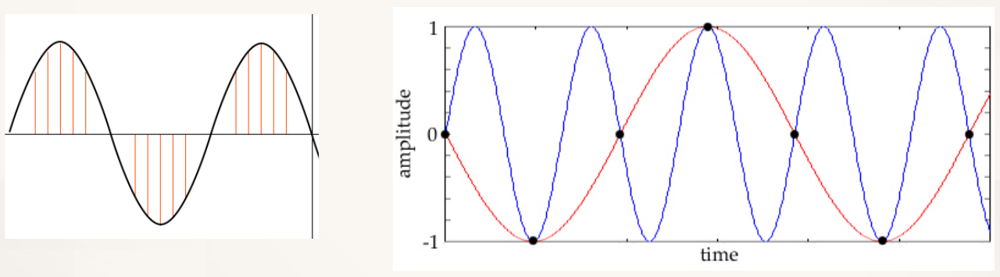

*Figure 9. Adequate sampling and undersampling*

The left side of Figure 9 is dense sampling within one period, and connecting the samples (vertical lines) reveals the original sine wave as it is. The right side is a blue high-frequency signal sampled too sparsely. The samples at the black dots also match a red low-frequency signal exactly, so the receiver cannot tell which signal was the original. This phenomenon, in which an insufficient sampling rate makes a high frequency appear as a low frequency, is called **aliasing**.

> **Definition:** **PCM (pulse code modulation)** samples an analog signal, rounds each sample to the nearest of a set of defined levels (quantization), and sends the level as a binary code.

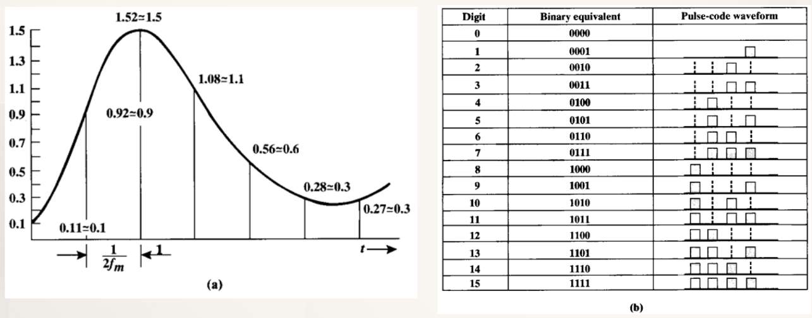

*Figure 10. Sampling and 4-bit coding in PCM*

Following the three steps of PCM with Figure 10 gives the following.

1. **Sampling:** As in part (a), a signal whose frequency components all lie below $f_m$ is measured at intervals of $1/(2f_m)$. This interval corresponds to a sampling rate of $2f_m$, and because $f_m$ is an upper bound on the signal frequencies, it satisfies the sampling theorem.
2. **Quantization:** Each measured value is rounded to the nearest level. In the figure, 1.52 becomes 1.5, 0.92 becomes 0.9, and 0.11 becomes 0.1. The difference produced here (for example, $`1.52 - 1.5 = 0.02`$) is called the **quantization error**, and it becomes smaller as the levels become finer (as the number of bits increases).
3. **Encoding:** Each level is converted into a binary code. Part (b) represents the 16 levels 0-15 by 4-bit codes (0000-1111) and their pulse waveforms. For example, level 9 is 1001, so it is sent as pulse, blank, blank, pulse.

**Computing voice PCM.** Most of the energy of telephone voice lies below 4,000 Hz, so the telephone network filters voice to below 4,000 Hz (the actual call band is about 300-3,400 Hz) before encoding it.

1. The sampling rate is twice the upper frequency bound of 4,000 Hz, $2 \times 4000 = 8000$ Hz, that is, 8,000 samples per second.
2. Quantizing each sample with 8 bits distinguishes $2^8 = 256$ levels (A/D conversion).
3. The transmission rate of voice data is $8000 \times 8 = 64{,}000$ bps, that is, 64 kbps.

This 64 kbps is the basic unit of one voice channel in the digital telephone network.

### 1.9 Multiplexing: FDM and TDM

> **Definition:** **Multiplexing** is the process of combining two or more low-rate channels into one high-rate channel so that several users share one transmission line.

> **Definition:** The process of separating the original channels again at the receiving side is called **demultiplexing (demuxing)**.

**(1) Frequency-division multiplexing (FDM).** The total frequency bandwidth of a transmission line is divided into several smaller bands so that several users can use it simultaneously. It is used mainly for transmitting analog signals.

- The bandwidth of each signal must be much smaller than the bandwidth of the medium.
- Each channel is assigned a range of frequencies around a different carrier frequency.

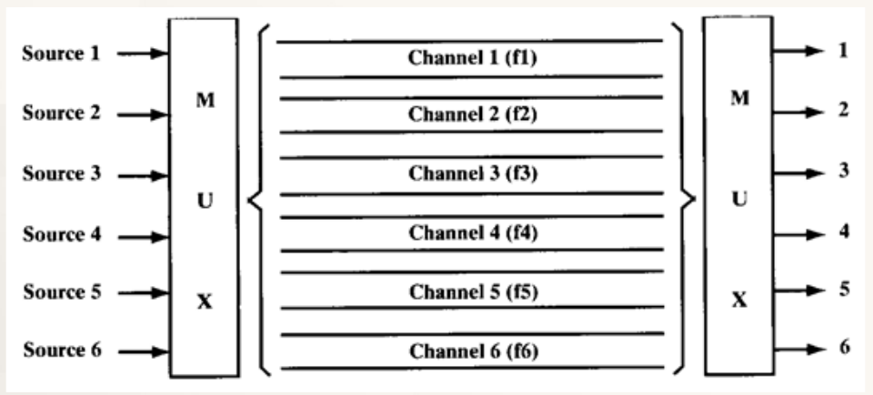

*Figure 11. FDM combining six sources into different frequency channels*

In Figure 11, the multiplexer (MUX) puts sources 1-6 on channels at frequencies f1-f6 and sends them simultaneously over one line, and the demultiplexer at the receiving side separates them by frequency into outputs 1-6. Radio stations broadcasting simultaneously in the same space on different frequencies are an example of FDM.

**(2) Time-division multiplexing (TDM).** The time during which the transmission line is occupied is divided finely to form several virtual paths on one line.

- The bit rate of each signal must be much smaller than the data rate of the medium.
- **Channel:** A time slot assigned to a particular source.
- **Frame:** One complete cycle in which the time slots of all sources each come around once.

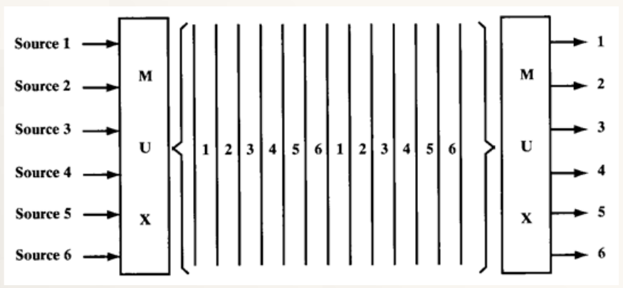

*Figure 12. TDM sending six sources in alternating time slots*

In Figure 12, the multiplexer sends the data of sources 1, 2, 3, 4, 5, and 6 one slot at a time in turn and then repeats from 1. The receiving side knows from the order of the slots which source each piece of data belongs to. There are two kinds of TDM.

| Kind | Slot assignment | Characteristics |
|:-----|:-----|:-----|
| Synchronous TDM | The bandwidth of one transmission line is divided into time slots that are assigned to each channel permanently. | The commonly used time-division scheme. Because slots are fixed, slots are also assigned to terminals that have no data to send, wasting transmission capacity. |
| Asynchronous TDM | Transmission opportunities are given dynamically only to the channels that want to send data. | Compensates for the drawback of synchronous TDM. Also called statistical TDM; because the source cannot be known from the slot position, address information must be attached to each slot. |

*Table 5. Synchronous and asynchronous TDM*

**Worked example.** To combine six terminals that each send at 9.6 kbps with synchronous TDM, the line needs at least $6 \times 9.6 = 57.6$ kbps. If only two terminals are sending at some moment, four of the six slots are transmitted empty, wasting $`4/6 \approx 67\%`$ of the capacity. Asynchronous TDM gives slots only to the terminals that have data to send, so in the same situation a slower line is enough, or more terminals can be connected to the same line.

---

<br>

## 2. Transmission Media

### 2.1 Classification and Performance Factors of Transmission Media

> **Definition:** A **transmission medium** is the physical path between a transmitter and a receiver. Transmission media are divided into guided media and unguided media.

> **Definition:** **Guided media** are transmission media, such as wires and optical fibers, that lead the signal along a defined path.

> **Definition:** **Unguided media** are transmission media, such as the atmosphere or outer space, through which the signal spreads out.

The characteristics of a transmission medium are determined by the type of medium and the transmission frequency. The factors that affect the data rate and transmission distance are as follows.

| Factor | Effect |
|:-----|:-----|
| Bandwidth | Other conditions being equal, the wider the bandwidth, the higher the achievable data rate. |
| Transmission impairment | Impairments such as attenuation and distortion limit the transmission distance. Twisted pair suffers more impairment than optical fiber, so it is used only over short distances. |
| Interference | Other signals in overlapping frequencies distort or wipe out the original signal. In guided media, shielding can reduce it. |
| Number of receivers | Each receiver attached to a shared medium adds attenuation and distortion, so the more receivers, the more limited the distance or rate. |

*Table 6. Factors that affect data rate and transmission distance*

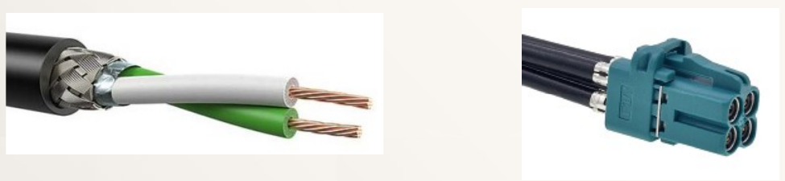

*Figure 13. Examples of communication cables and connectors*

The left side of Figure 13 is a cable with two insulated wires twisted together inside a metal shield, and the right side is a connector that attaches such cables to devices.

### 2.2 Twisted Pair

> **Definition:** A **twisted pair** is a transmission medium made of two insulated copper wires twisted together in a spiral. It is the most common medium for both analog and digital data transmission.

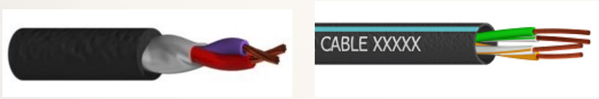

*Figure 14. Twisted pair cables*

The characteristics of twisted pair are as follows.

- It is relatively inexpensive and easy to work with.
- It is limited in transmission distance, bandwidth, and data rate.
- It is susceptible to noise and interference.
- Each wire is insulated separately, several pairs are often bundled into one cable, and it is usually installed when a building is built.

The wires are twisted to reduce interference. The voltages that an external magnetic field induces in the loop formed by the two wires cancel between adjacent twists, because the orientation of the loop reverses with every twist. In addition, the two wires alternately pass through the same positions, so external noise enters both wires almost equally, and the noise disappears when the receiver reads the difference of the two wires. This is why the CAN bus in Week 3 uses twisted pair together with differential signaling. Adjacent pairs in one cable use different twist lengths to reduce crosstalk between pairs [1].

### 2.3 Unshielded and Shielded Twisted Pair

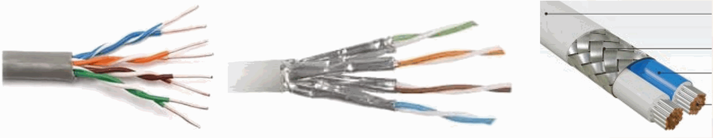

*Figure 15. Unshielded twisted pair, shielded twisted pair, and shielded twisted pair for fighter aircraft*

- **Unshielded twisted pair (UTP):** The twisted pairs are wrapped only in an outer jacket, with no shield (left of Figure 15). It is used for telephone lines and ordinary in-building wiring.
- **Shielded twisted pair (STP):** The wires are wrapped in a metal braid or foil that shields against external noise (middle of Figure 15). It is more resistant to noise than UTP, but more expensive and harder to work with, requiring more labor. The right side of Figure 15 is shielded twisted pair used in fighter aircraft, whose electromagnetic environment is harsh.

The performance of the two cables is compared numerically as follows.

| Frequency (MHz) | Attenuation: Cat 3 UTP | Attenuation: Cat 5 UTP | Attenuation: 150 Ω STP | NEXT: Cat 3 UTP | NEXT: Cat 5 UTP | NEXT: 150 Ω STP |
|:-----|:-----|:-----|:-----|:-----|:-----|:-----|
| 1 | 2.6 | 2.0 | 1.1 | 41 | 62 | 58 |
| 4 | 5.6 | 4.1 | 2.2 | 32 | 53 | 58 |
| 16 | 13.1 | 8.2 | 4.4 | 23 | 44 | 50.4 |
| 25 | - | 10.4 | 6.2 | - | 41 | 47.5 |
| 100 | - | 22.0 | 12.3 | - | 32 | 38.5 |
| 300 | - | - | 21.4 | - | - | 31.3 |

*Table 7. Attenuation (dB/100 m) and near-end crosstalk (dB) of UTP and STP*

> **Definition:** The **decibel (dB)** is a unit that expresses the ratio of two powers logarithmically, $10 \log_{10}(P_1 / P_2)$.

> **Definition:** **Near-end crosstalk (NEXT)** is the leakage of a signal sent on one pair into an adjacent pair at the same end, also called cross-talk interference. NEXT is the ratio of the sent signal to the leaked signal, so a larger value means less crosstalk, which is better.

**Reading Table 7.** The attenuation of Cat 5 UTP at 100 MHz is 22.0 dB per 100 m. The ratio of received to transmitted power is $10^{-22.0/10} = 10^{-2.2} \approx 0.0063$, so after 100 m only about 0.63% of the transmitted power remains. At the same frequency, 150 Ω STP has 12.3 dB, so $10^{-1.23} \approx 0.059$, that is, about 5.9% remains. The following tendencies can be read from the table.

1. For every cable, the higher the frequency, the larger the attenuation and the smaller the NEXT (the worse the crosstalk).
2. At the same frequency, STP has less attenuation and higher NEXT than UTP, so it performs better.
3. Cat 5 UTP has tighter twists than Cat 3 UTP and is better in both attenuation and crosstalk.
4. "-" means that the cable is not specified for use at that frequency. For example, Cat 3 is specified only up to 16 MHz.

### 2.4 Coaxial Cable

> **Definition:** A **coaxial cable** is a transmission medium in which a central insulated copper wire is surrounded by another cylindrical conductor. It is called coaxial because the two conductors share the same axis.

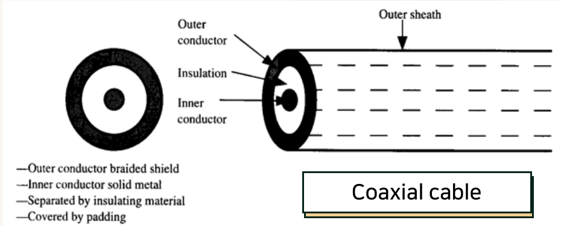

*Figure 16. Structure of a coaxial cable*

As Figure 16 shows, a coaxial cable consists, from the inside out, of a solid metal inner conductor, insulation, an outer conductor of braided metal, and an outer sheath. Some actual products add a layer of metal foil under the metal braid to strengthen the shielding.

- Its diameter is about 1-2.5 cm.
- The outer conductor completely surrounds and shields the inner conductor, so it is more resistant to noise than twisted pair.
- It can transmit farther than twisted pair and connect more stations.

However, the use of coaxial cable is declining. Inexpensive twisted pair has spread widely as its performance improved, and optical cable is used where high performance is needed.

### 2.5 Optical Fiber

> **Definition:** An **optical fiber** is a thin, flexible strand of glass or plastic that carries signals using light.

**Physical form.** An optical fiber is very thin and flexible (2-125 µm) and is made of various kinds of glass and plastic. Its three main components are as follows.

| Component | Role |
|:-----|:-----|
| Glass core | The medium that carries the light. |
| Cladding | A glass or plastic layer surrounding the core whose refractive index is lower than the core's, which traps light inside the core. It also prevents crosstalk caused by light leaking into other fibers. |
| Jacket | A plastic coating that protects the fiber from moisture, abrasion, and impact. |

*Table 8. Components of an optical fiber*

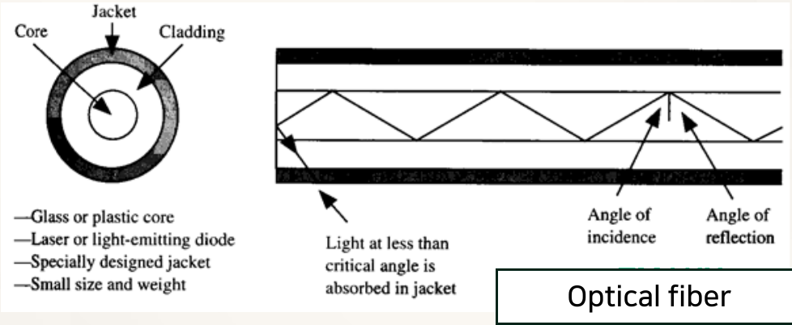

*Figure 17. Cross section of an optical fiber and the principle of light propagation*

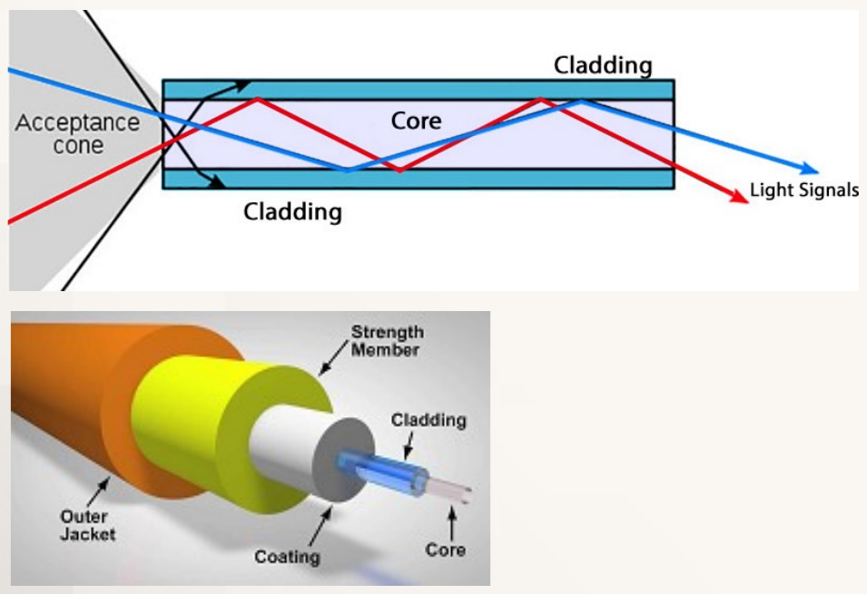

*Figure 18. Total internal reflection in an optical fiber and the structure of a fiber-optic cable*

**How light is trapped.** When light travels from a medium with a higher refractive index (the core) toward one with a lower index (the cladding) and its angle of incidence at the boundary exceeds the critical angle, the light cannot escape and is entirely reflected. This is called **total internal reflection**. As Figures 17 and 18 show, light that enters the core travels in a zigzag, repeating total internal reflection at the boundary with the cladding. The range of entry angles at which light can be launched into the fiber so that total internal reflection occurs is called the **acceptance cone**, and light outside this range is not totally reflected at the boundary but passes through the cladding and is absorbed in the jacket. The lower part of Figure 18 is the structure of an actual fiber-optic cable, made of the core, cladding, coating, a strength member that provides tensile strength, and the outer jacket. The light is produced by a laser or a light-emitting diode (LED).

**Advantages of optical fiber.** Optical fiber has achieved a remarkably innovative technical advance, and its advantages are as follows.

- **Greater capacity:** It achieves very high speeds with a far wider bandwidth than copper media.
- **Smaller size and lighter weight:** It is much thinner and lighter than copper cable of the same capacity.
- **Lower attenuation:** The spacing between repeaters can be greatly increased.
- **Electromagnetic isolation:** Because it uses light, it is not affected by external electromagnetic interference and emits no electromagnetic waves, which also makes tapping difficult.

**Transmission modes.** A path along which light travels through the fiber is called a mode.

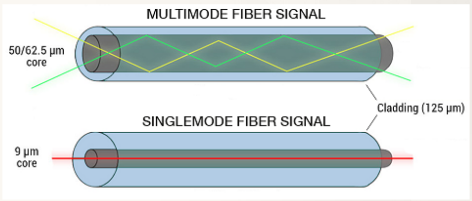

*Figure 19. Signals in multimode and single-mode fibers*

- **Single-mode propagation:** The core is made very thin, about 9 µm in diameter, so only one mode (path) propagates. All light follows the same path, so the arrival times do not spread, and it is used for long-distance, high-speed transmission.
- **Multimode propagation:** The core is thick, 50 µm or 62.5 µm in diameter, so light in many modes propagates, reflecting at different angles. Because the path lengths differ, the light of one pulse arrives at different times and the pulse spreads (modal dispersion). For this reason, it is used over shorter distances than single mode [1].

The cladding diameter of both kinds is usually 125 µm (Figure 19).

Multimode fiber is further divided into two types. In **step-index** fiber, the refractive index of the core is uniform, so the index changes abruptly like a step at the boundary, and in **graded-index** fiber, the refractive index of the core decreases gradually from the center outward. In graded-index fiber, light on longer paths that swing outward travels faster through the regions of lower refractive index, so the difference in arrival times between paths is reduced [1].

| Fiber type | Core diameter (µm) | Cladding diameter (µm) | Attenuation 850 nm (dB/km) | Attenuation 1300 nm (dB/km) | Attenuation 1500 nm (dB/km) | Bandwidth (MHz·km) |
|:-----|:-----|:-----|:-----|:-----|:-----|:-----|
| Single mode | 5.0 | 85 or 125 | 2.3 | | | 5000 @ 850 nm |
| Single mode | 8.1 | 125 | | 0.5 | 0.25 | |
| Graded-index | 50 | 125 | 2.4 | 0.6 | 0.5 | 600 @ 850 nm, 1500 @ 1300 nm |
| Graded-index | 62.5 | 125 | 3.0 | 0.7 | 0.3 | 200 @ 850 nm, 1000 @ 1300 nm |
| Graded-index | 100 | 140 | 3.5 | 1.5 | 0.9 | 300 @ 850 nm, 500 @ 1300 nm |
| Step-index | 200 or 300 | 380 or 440 | 6.0 | | | 6 |

*Table 9. Characteristics of typical optical fibers*

The attenuation values in Table 9 are maximums, and step-index fiber has the worst attenuation and bandwidth while single mode has the best. Even in the same fiber, the longer the wavelength of the light (1300 nm or 1500 nm rather than 850 nm), the smaller the attenuation. The bandwidth unit MHz·km means that the product of distance and bandwidth is approximately constant. For example, 50 µm graded-index fiber has 1500 MHz·km at 1300 nm, so to a first approximation it provides a bandwidth of about 1500 MHz over 1 km and about $1500 / 3 = 500$ MHz over 3 km.

### 2.6 Unguided Media: Microwave and Infrared

Unguided transmission media are electromagnetic waves carried through the atmosphere. A transmitting antenna radiates electromagnetic waves into space, and a receiving antenna picks them up.

**Microwave.** The term covers the radio frequency band of 300 MHz-300 GHz, corresponding to UHF (0.3-3 GHz), SHF (3-30 GHz), and EHF (30-300 GHz), and most communication uses the range of 1-40 GHz.

| Band | Name | Frequency range |
|:-----|:-----|:-----|
| UHF (ultra high frequency) | Decimeter waves | 0.3 GHz-3 GHz |
| SHF (super high frequency) | Centimeter waves | 3 GHz-30 GHz |
| EHF (extremely high frequency) | Millimeter waves | 30 GHz-300 GHz |

*Table 10. Frequency bands that make up microwaves*

The considerations in using microwaves are as follows.

- **Frequency allocation and interference:** All radio waves share the same space, so governments allocate frequencies by use so that services do not interfere with one another.
- **Security:** Anyone within range can receive radio waves, so protection such as encryption is needed.

**Infrared.** Communication using light whose wavelength is longer than visible light.

- It forms an infrared communication link.
- Transmitters and receivers are operated in pairs. A television remote control is a typical example.
- It operates within line of sight, that is, where the transmitter and receiver can see each other, or uses a reflector. Infrared cannot pass through walls, so it does not leak out of the room.

---

<br>

## 3. Switching Techniques in Data Communication

### 3.1 Communications Networks

> **Definition:** A **communications network** is a collection of nodes that passes data from node to node to the destination.

> **Definition:** Devices at the edge of the network that send and receive data, such as computers, terminals, and telephones, are called **stations**.

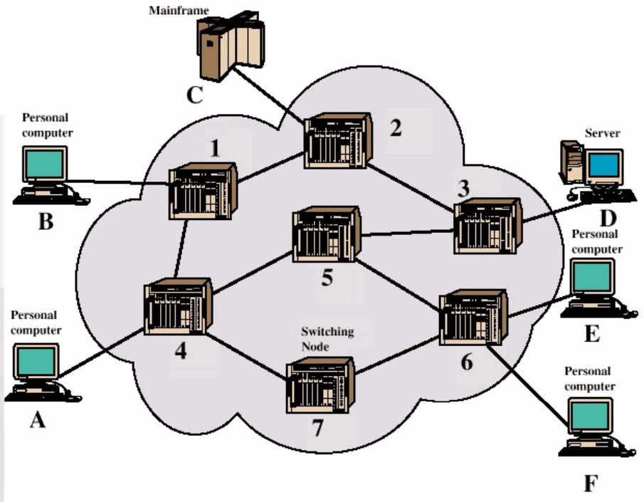

*Figure 20. A communications network of stations A-F and switching nodes 1-7*

The characteristics of a communications network are as follows.

- Not all nodes are directly connected. There are links between only some of nodes 1-7 in Figure 20.
- Nodes only forward data without regard to its content.
- Nodes use a switching function to pass data from node to node to the destination.
- One station is connected to one node, and stations communicate through intermediate nodes.

> **Definition:** **Switching** is the function by which a node sends data that arrived on one link out on another link toward the destination. Switching techniques are divided by whether a path is reserved exclusively before data is sent (circuit switching) or data is split into small pieces and sent as they come (packet switching).

### 3.2 Circuit Switching

> **Definition:** **Circuit switching** is a method that creates an independent, closed communication path between two stations and uses it exclusively until the communication ends. This one-to-one connection is called a circuit or channel.

Circuit switching consists of three phases.

1. **Circuit establishment:** A circuit is set up between the stations before data is sent. Each node chooses the next link on the path toward the destination, considering routing information, availability, and cost, switches internally, and allocates an available channel (an FDM or TDM channel) on that link. The same procedure is repeated until the destination is reached, and finally the node checks whether the destination station is ready to accept the connection.
2. **Data transfer:** Digital or analog data is sent as digital or analog signals over the established circuit. It is generally full duplex, sending in both directions at the same time.
3. **Circuit disconnect:** When either of the two stations ends the circuit, signals are sent to the nodes on the path to release the allocation of the resources that were in use.

**Example: transfer from A to E.** Setting up a circuit through nodes 4, 5, and 6 for A to communicate with E in Figure 20 goes as follows.

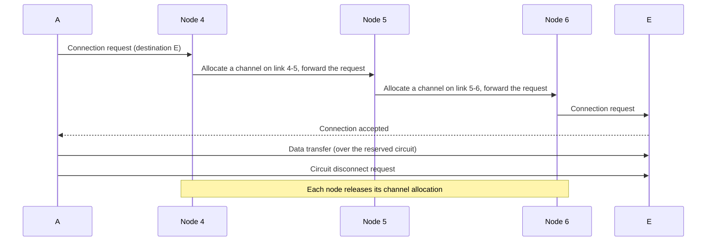

*Figure 21. The three phases of circuit switching through nodes 4, 5, and 6*

Once the circuit is established, data passes straight through the reserved channels without the nodes looking up the route again, so the transmission rate and delay are constant. On the other hand, establishing the circuit takes time, and the circuit is held exclusively even while there is no data, wasting resources. The telephone network is a typical example of circuit switching.

### 3.3 Packet Switching

> **Definition:** **Packet switching** is a method that divides data into small blocks called packets and sends them. Network resources are used only while data is being transmitted, and the route of each packet, the unit of information transfer, is decided individually at each node along the path connecting the nodes.

Packet switching suits short, intermittent data traffic and is the most widely used method today. Compared with circuit switching, it differs as follows.

- Circuit switching monopolizes the connection between two nodes for the duration of the communication, whereas packet switching shares links among many communications.
- Circuit switching requires the sender and receiver to operate at the same constant data rate, which makes it hard to interconnect host computers and terminals of different speeds. Packet switching has no such restriction, because nodes store packets and then forward them.

**Structure of a packet.** A packet has the following properties.

- It is the unit of data transmission, generally 1,000 bytes (octets) or less.
- A long message is divided into several packets and sent.
- It consists of part of the user data and control information. The control information (packet header) contains at least the information needed for the destination and route selection.
- Each node receives a packet, stores it briefly, and forwards it to the next node (store-and-forward).

```text
                           User data
            ┌───────────────────────────────────────┐
            └───────────────────────────────────────┘
                 │              │              │
                 ▼              ▼              ▼
            ┌──┬─────────┐  ┌──┬─────────┐  ┌──┬─────────┐
            │H │ data 1  │  │H │ data 2  │  │H │ data 3  │
            └──┴─────────┘  └──┴─────────┘  └──┴─────────┘
            H = control information (packet header)
```

*Figure 22. Dividing user data into packets with headers*

**Advantages of packet switching.**

| Advantage | Explanation |
|:-----|:-----|
| High line efficiency | Many packets share one link dynamically, so the link does not sit idle while one source has no data. |
| Data rate conversion | Two stations of different speeds can communicate, because nodes buffer and relay the packets. |
| No blocking under heavy traffic | Circuit switching refuses the connection itself when circuits run out, but packet switching accepts the packets and only the delay increases. |
| Priorities | Among the packets waiting at a node, packets with higher priority can be sent first. |

*Table 11. Advantages of packet switching*

### 3.4 Datagrams and Virtual Circuits

There are two ways in which a packet-switching network handles packets.

> **Definition:** In the **datagram** approach, each packet is handled independently of the others. Even packets of the same message may take different routes.

> **Definition:** In the **virtual circuit** approach, a preplanned route is established before any packets are sent, and all packets follow that route.

The properties of datagrams are as follows.

- It is the transmission unit used by IP on the Internet.
- Its maximum size is 65,535 bytes.
- It is a variable-length packet consisting of a header and a data part.
- The packets of one message are handled independently of one another.

> **Note:** The lecture material gives the maximum datagram size as 65,536 bytes, but because the total length field of the IPv4 header is 16 bits and expresses the length including the header, the maximum is $2^{16} - 1 = 65{,}535$ bytes [2].

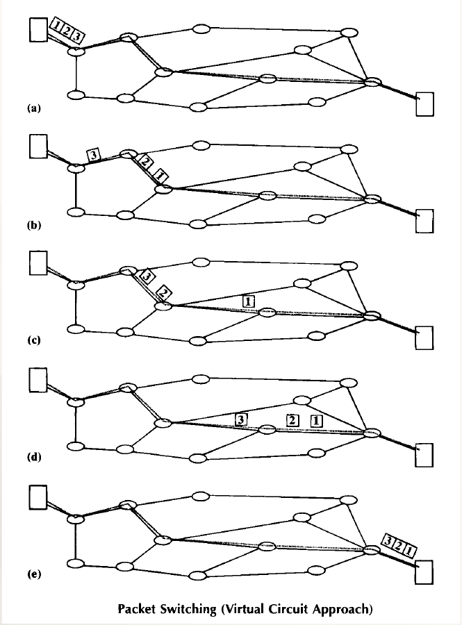

*Figure 23. Packet switching with the virtual circuit approach*

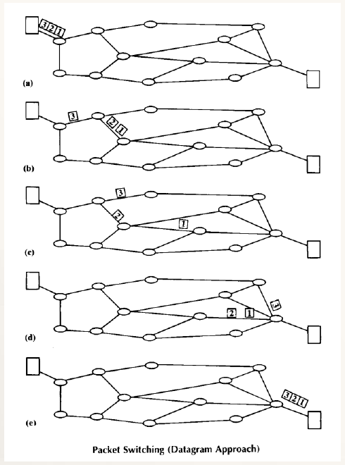

*Figure 24. Packet switching with the datagram approach*

Figures 23 and 24 show, in time order from (a) to (e), the left station sending packets 1, 2, and 3 to the right station. In the virtual circuit approach of Figure 23, the three packets move one after another along the same predetermined thick path and arrive in order. In the datagram approach of Figure 24, packet 3 branches onto an upper link different from that of packets 1 and 2 in (b), follows the upper path in (c), and rejoins packets 1 and 2 at the node just before the destination in (d). This happens because each node chooses the best link at that moment for each packet. In Figure 24 the three packets arrive in order in (e), but because the delay differs from path to path, datagram packets may arrive in a different order from the order in which they were sent.

| Item | Virtual circuit | Datagram |
|:-----|:-----|:-----|
| Route setup | A route is established before the first packet is sent. | No route is established; the route is decided per packet. |
| Path of packets | All packets follow the same path. | Each packet may take a different path. |
| Arrival order | Packets arrive in the order sent. | The order may change. |
| Advantages | Suitable for exchanging data over an extended period, and advantageous for providing services such as sequencing and error control. | There is no setup delay, because no connection is made until needed; it is suitable for sending a small number of packets; and routes can be changed flexibly to avoid congested or failed nodes. |

*Table 12. Comparison of virtual circuits and datagrams*

> **Note:** A virtual circuit decides the route first, like circuit switching, but does not monopolize the links on that route. Only the route is fixed, and the links are shared with packets of other virtual circuits, which is why it is called a virtual circuit.

### 3.5 Multirate Circuit Switching and ISDN

Circuit switching operates only at a specific data rate. For example, sending data slower or faster than 64 kbps over a 64 kbps voice circuit leaves capacity unused or falls short.

> **Definition:** **Multirate circuit switching (MRCS)** combines circuit switching with multiplexing to gain flexibility in data rate. It provides several channels of fixed data rates, and one or more channels are chosen to match the required rate.

> **Definition:** **ISDN (integrated services digital network)** is a technology that supports the digital transmission of video, fax, voice, and data traffic in one network.

ISDN is a typical example of multirate circuit switching. The basic rate interface (BRI) consists of two 64 kbps B channels and one 16 kbps D channel, providing $2 \times 64 + 16 = 144$ kbps in total [3]. A user can make a telephone call over one B channel (64 kbps) or bond the two B channels to send data at 128 kbps. In this way the data rate can be selected, but the choices are still the given fixed rates. ISDN spread in the 1990s but was later replaced by modern long-distance networking technologies.

### 3.6 Frame Relay

> **Definition:** **Frame relay** is a network for multi-access that connects two or more devices to the network at the same time, like a LAN, and is a protocol that improved the packet transmission technology of X.25 to suit high-speed data communication.

**X.25** is an early packet-switching standard designed for an era of high line error rates, in which every node checked each packet for errors and handled retransmission whenever it received one. The processing overhead at each node was correspondingly large. The characteristics of frame relay are as follows.

- Data is placed in variable-length units called frames.
- Error correction functions such as retransmission are left not to the intermediate nodes but to the end stations at both ends. In this way, the overall data rate is increased.
- It assumes that modern transmission lines have low error rates and that end systems have intelligent logic to handle errors.
- Therefore, no overhead for error control is needed at each node, and removing the overhead bits can increase the data rate.

### 3.7 Cell Relay and the Spectrum of Switching Techniques

> **Definition:** **Cell relay** is a method that puts data into small fixed-length packets called cells and transmits them with statistical multiplexing. It is also called ATM (asynchronous transfer mode).

- It evolved from frame relay. Like frame relay, it reduces error control at the nodes, and in addition it fixes the length.
- It is more advanced than multirate circuit switching (MRCS), because it can provide any rate by adjusting the number of cells rather than a few fixed rates.
- An ATM cell is 53 bytes, consisting of a 5-byte header and a 48-byte payload [4]. Because the length is fixed, nodes can switch cells quickly in hardware, and the delay is easy to predict. The DQDB of Week 3 uses 53-byte slots for compatibility with ATM.

Placing the switching techniques covered so far on one line gives the following.

```text
 Fixed bit rate                                                    Variable bit rate
 Simplicity    <------------------------------------------------>     Complexity
      │                  │                  │                │               │
   Circuit           Multirate          Cell relay         Frame          Packet
  switching           circuit             (ATM)            relay         switching
                     switching
```

*Figure 25. The spectrum of switching techniques*

Circuit switching at the left end of Figure 25 is a simple method that operates at a fixed bit rate, and packet switching at the right end handles variable bit rates at the cost of complexity. Multirate circuit switching adds several fixed rates to circuit switching, frame relay removes node error control from packet switching, and cell relay, in between, gains both simplicity and flexibility with fixed-length cells.

---

<br>

## 4. Appendix: Japan Automobile Research Institute (JARI)

> **Definition:** **JARI (Japan Automobile Research Institute)** is a Japanese research institute that researches and tests automotive safety, environment, energy, and intelligent transport systems (ITS).

### 4.1 Locations of JARI

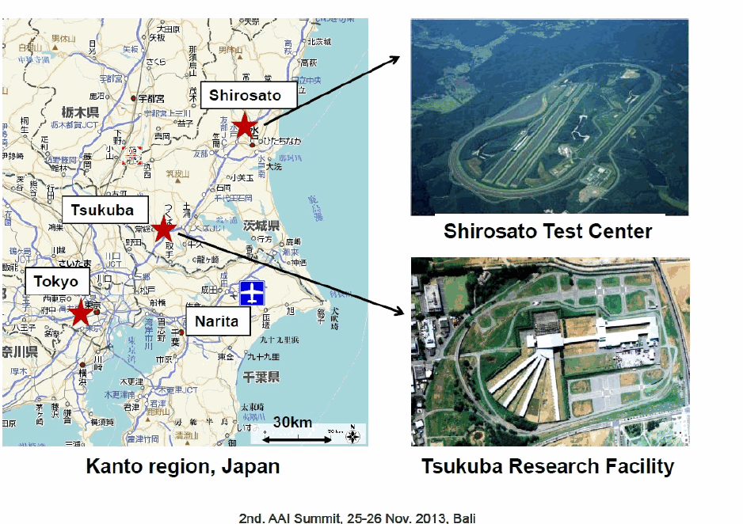

*Figure 26. JARI sites in the Kanto region, the Tsukuba Research Facility, and the Shirosato Test Center*

JARI has three sites: the Tsukuba headquarters, the Shirosato Test Center, and the Tokyo branch. On the map in Figure 26, all three are in the Kanto region northeast of Tokyo, with Tsukuba to the north between Tokyo and Narita Airport and Shirosato farther north. Of the photos on the right, the upper one is the Shirosato Test Center and the lower one is the Tsukuba Research Facility.

### 4.2 Tsukuba Research Facility

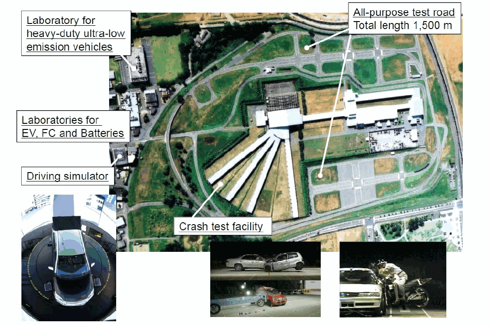

*Figure 27. Facilities of the Tsukuba Research Facility*

The Tsukuba Research Facility has the following facilities.

| Facility | Content |
|:-----|:-----|
| Laboratory for heavy-duty ultra-low emission vehicles | Researches technologies that reduce the emissions of heavy vehicles such as trucks and buses. |
| Laboratories for EV, FC and batteries | Research electric vehicles (EV), fuel cells (FC), and batteries. |
| Driving simulator | Places a real vehicle inside a round screen enclosure and studies driver responses in a virtual road environment. |
| All-purpose test road | Total length of 1,500 m. |
| Crash test facility | Evaluates safety by crashing vehicles into each other or into motorcycles on several runways that fan out. |

*Table 13. Facilities of the Tsukuba Research Facility*

### 4.3 Shirosato Test Center

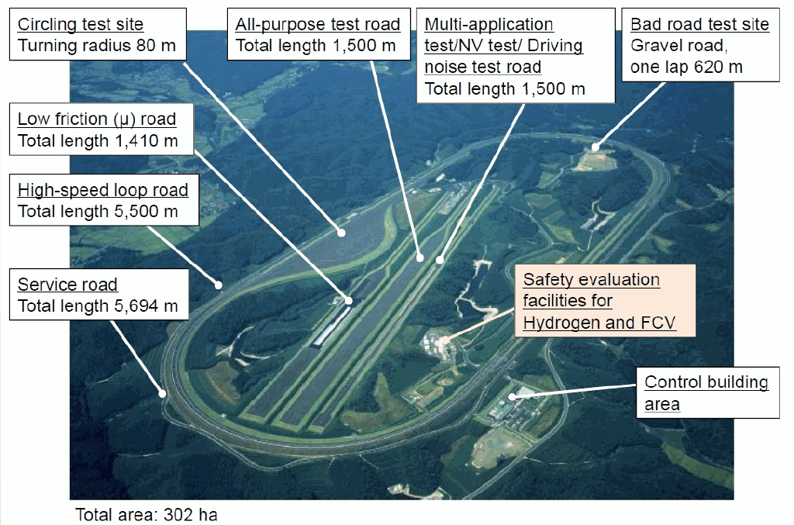

*Figure 28. Test roads of the Shirosato Test Center*

The Shirosato Test Center has an area of 302 ha (910,000 pyeong). One hectare is 10,000 m² and one pyeong (a Korean unit of area) is about 3.3058 m², so $3{,}020{,}000 / 3.3058 \approx 913{,}000$ pyeong, and the two values agree.

| Facility | Scale |
|:-----|:-----|
| Circling test site | Turning radius of 80 m |
| All-purpose test road | Total length of 1,500 m |
| Multi-application test, NV test, and driving noise test road | Total length of 1,500 m. Tests noise and vibration (NV) and driving noise. |
| Bad road test site | Gravel road, 620 m per lap |
| Low friction road | Total length of 1,410 m. A slippery surface with a low friction coefficient (µ). |
| High-speed loop road | Total length of 5,500 m |
| Service road | Total length of 5,694 m |
| Safety evaluation facilities for hydrogen and FCV | The facility of Section 4.5. |
| Control building area | Manages the whole test center. |

*Table 14. Facilities of the Shirosato Test Center*

### 4.4 Organization

As of April 2013, JARI's organization places the following departments under the president, the executive board (managing director, senior executive director, and executive director), and the auditor.

| Category | Departments |
|:-----|:-----|
| Research divisions | Energy and Environment Research Division, FC-EV Research Division, ITS Research Division, Safety Research Division |
| Research support and planning | Advanced Research Department, Global Networking, Strategic Planning and Management Department, Robot Project Promotion Department, Research Planning and Administration Division |
| Operations and certification | General Administration Division, JNX Center, Registration Body, STC Administration Department |

*Table 15. Organization of JARI (as of April 2013)*

The core of the research lies in the four research divisions of energy and environment, fuel cells and electric vehicles, ITS, and safety, which respond to the key challenges of the automotive industry: environmental friendliness, safety, and intelligence.

### 4.5 Major Facility: Hydrogen and Fuel Cell Test Facility

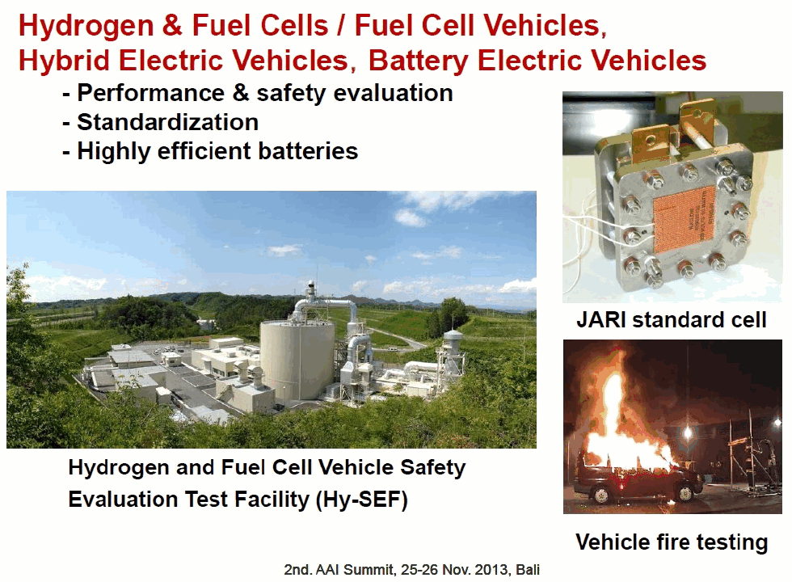

*Figure 29. Safety evaluation facility for hydrogen and fuel cell vehicles, a battery cell, and vehicle fire testing*

JARI conducts the following research on hydrogen and fuel cells, fuel cell vehicles (FCV), hybrid electric vehicles (HEV), and battery electric vehicles (BEV).

- **Performance and safety evaluation:** The left side of Figure 29 is the Hydrogen and Fuel Cell Vehicle Safety Evaluation Test Facility (Hy-SEF), and the lower right is a vehicle fire test. It evaluates, for example, the safety of a vehicle with a high-pressure hydrogen tank when engulfed in fire.
- **Standardization:** Evaluation methods are turned into standards and used in establishing international regulations.
- **Highly efficient batteries:** The upper right of Figure 29 is the JARI standard cell, used as a reference for performance evaluation.

### 4.6 Major Facility: Truck Platooning

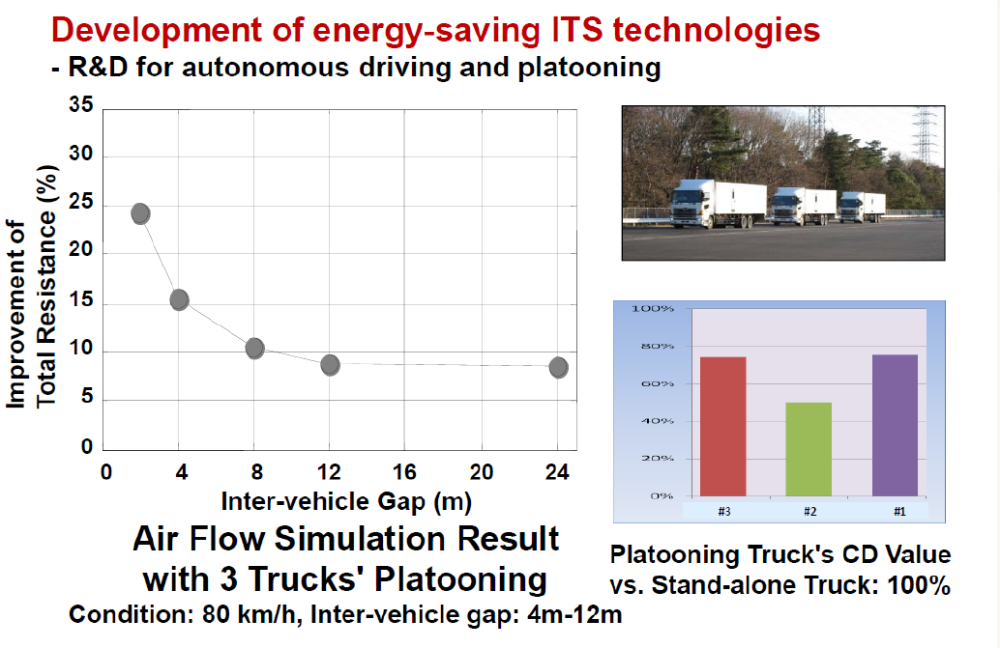

*Figure 30. Air flow simulation results and drag coefficients for platooning of three trucks*

> **Definition:** **Platooning** is a driving method in which several vehicles, connected by communication, travel together in a line while keeping short gaps between them. The leading vehicle cuts through the air, reducing the air resistance on the following vehicles and saving fuel.

JARI researches autonomous driving and platooning as part of developing energy-saving ITS technologies. The results in Figure 30 are as follows.

- **Air flow simulation (left graph):** Shows, for each inter-vehicle gap, the rate at which the total running resistance decreases when three trucks platoon. The improvement is about 24% at a gap of 2 m, about 15% at 4 m, about 10% at 8 m, and about 9% at 12 m, and an improvement of about 8.5% remains even at 24 m. The shorter the gap, the larger the effect. The condition noted in the figure is 80 km/h with a gap of 4-12 m.
- **Drag coefficient (lower right graph):** With the drag coefficient (CD) of a stand-alone truck taken as 100%, the three trucks in the platoon, #3, #2, and #1, have about 75%, 50%, and 76%, respectively. The middle truck, shielded by trucks both in front and behind, has the lowest drag.

Platooning can keep short gaps safely only if acceleration and braking are synchronized through communication between the vehicles, so it is an important application of the V2V communication covered in Week 11.

---

<br>

## Concept Applications

| Situation | Concept to apply |
|:-----|:-----|
| Computer data is sent with an old telephone modem. | A telephone line passes only analog signals in the voice band, so the modem modulates the digital data into an analog signal with FSK or PSK (Section 1.6). |
| 10 Mbps Ethernet aligns the receiver's clock without a separate clock line. | Manchester code has a transition in the middle of every bit, and the receiver synchronizes with these transitions (Section 1.7). |
| Music is to be digitized at CD quality. The highest frequency humans hear is about 20 kHz. | By the sampling theorem, it must be sampled at a rate higher than 40 kHz, and CDs use 44.1 kHz (Section 1.8). |
| Communication errors are frequent in wiring that runs past a motor in a factory. | The location is noisy, so replacing UTP with STP or optical fiber reduces interference (Sections 2.3 and 2.5). |
| A device that sends a short sensor value every few seconds is connected to a network. | The traffic is short and intermittent, so packet switching, especially datagrams with no setup delay, suits it better than circuit switching, which monopolizes a circuit (Sections 3.3 and 3.4). |

*Table 16. Concept application cases*

**True/False Check:**

| Statement | Judgment and Reason |
|:-----|:-----|
| An amplifier removes noise when it amplifies a signal. | **F.** An amplifier amplifies the noise as well, so noise accumulates; it is the repeater, which regenerates digital signals, that filters out noise. |
| If the baud rate is 1,200 baud and each symbol carries 4 bits, the data rate is 4,800 bps. | **T.** $1200 \times 4 = 4800$. |
| In NRZI, the level changes when a 0 is sent. | **F.** NRZI changes the level at the start of the bit for a 1 and does not change it for a 0. |
| Synchronous TDM assigns slots even to terminals that have no data. | **T.** The slots are fixed, so capacity is wasted, and asynchronous TDM compensates for this. |
| Multimode fiber has a thinner core than single-mode fiber. | **F.** The core of multimode fiber, 50 µm or more, is thicker than that of single-mode fiber (about 9 µm). |
| In the datagram approach, packets of the same message always take the same path. | **F.** The route of each packet is decided independently, so packets may take different paths and their order may change. |

---

<br>

## Summary

| Concept | Key Summary |
|:-----|:-----|
| Terms | Information is meaning, data is a representation of information, a signal is an electrical representation of data, signaling is putting a signal onto a medium, and transmission is delivering data by propagating signals. |
| Analog and digital | Analog means continuous values and digital means discrete values, and digital signals are robust against noise but subject to attenuation. |
| Four encodings | There are four combinations for converting analog and digital data into analog and digital signals, and the modem and codec are representative devices. |
| Amplifiers and repeaters | Amplifiers amplify noise as well, while repeaters regenerate digital signals so that noise does not accumulate. |
| Modulation | ASK represents bits with amplitude, FSK with frequency, and PSK with phase, and ASK is the least robust against errors. |
| Baud rate | The data rate is the baud rate multiplied by the bits per symbol, $\log_2 M$. |
| Line codes | NRZ-L represents values by level, NRZI by a transition for a 1, Manchester by the direction of the mid-bit transition, and differential Manchester by the presence of a transition at the start of the bit. |
| Sampling and PCM | A signal is sampled at a rate higher than twice its highest frequency, then quantized and encoded, and voice requires 8000 × 8 = 64 kbps. |
| Multiplexing | FDM divides frequency bands and TDM divides time slots to share one line, and asynchronous TDM assigns slots dynamically. |
| Twisted pair | An inexpensive medium that cancels interference by twisting two wires, and STP is more resistant to noise than UTP thanks to its shield. |
| Coaxial cable | The outer conductor surrounding the inner conductor makes it more noise-resistant and longer-reaching than twisted pair, but its use is declining. |
| Optical fiber | It carries light by total internal reflection due to the difference in refractive index between core and cladding, and single mode is better than multimode for long distances and high speeds. |
| Unguided media | Microwaves mainly use 1-40 GHz and require attention to frequency allocation and security, and infrared is used within line of sight. |
| Circuit switching | Monopolizes a path through three phases of establishment, transfer, and disconnect, with constant rate and delay but possible waste of resources. |
| Packet switching | Divides data into packets with headers and stores and forwards them, giving high efficiency, rate conversion, and priorities. |
| Datagrams and virtual circuits | Datagrams send packets independently, and virtual circuits send them in order along a route established in advance. |
| MRCS, frame relay, ATM | MRCS uses several fixed-rate channels, frame relay leaves error handling to the ends, and ATM uses fixed 53-byte cells. |
| JARI | Based at the Tsukuba Research Facility and the Shirosato Test Center, it researches energy and environment, FC-EV, ITS, and safety, including hydrogen safety evaluation and truck platooning. |

---

<br>

## Self-Check Questions

1. **Analog and digital transmission:** Explain, using the difference between amplifiers and repeaters, why digital transmission has better quality than analog transmission over long distances.

   <details>
   <summary>Answer</summary>

   An amplifier enlarges its input as it is, so it also amplifies the noise mixed into the signal, and the more amplifiers the signal passes, the more the noise accumulates and the worse the signal-to-noise ratio becomes. A repeater decides 0s and 1s from the incoming signal and sends a clean new signal, so as long as the decisions are correct, noise is not passed on to the next segment. Therefore, quality is maintained even as the distance grows.

   </details>

2. **Modulation schemes:** State which characteristic of the carrier each of ASK, FSK, and PSK changes, and explain which of the three is the most vulnerable to noise and why.

   <details>
   <summary>Answer</summary>

   ASK changes the amplitude, FSK the frequency, and PSK the phase. Noise and attenuation mainly change the strength of a signal, that is, its amplitude, so ASK, which carries information in the amplitude, is the most vulnerable. FSK and PSK keep the amplitude constant, so they are less sensitive to changes in strength.

   </details>

3. **Baud rate:** On a line with a baud rate of 3,000 baud, what is the data rate if symbols with 16 states are used?

   <details>
   <summary>Answer</summary>

   Since $M = 16$, each symbol carries $\log_2 16 = 4$ bits. The data rate is $3000 \times 4 = 12{,}000$ bps, that is, 12 kbps.

   </details>

4. **Line codes:** Describe the transitions that occur in each bit when the bit stream 1100 is represented in NRZI and in Manchester (IEEE 802.3 convention). Assume that the previous level for NRZI is low.

   <details>
   <summary>Answer</summary>

   NRZI: At the start of the first bit, 1, the level changes from low to high, and at the start of the second bit, 1, it changes back to low. The third and fourth bits are 0, so there is no transition and the low level continues. Manchester: a 1 changes from low to high in the middle of the bit, and a 0 from high to low. Because 1 and 1 follow each other, an extra high-to-low transition occurs at the start of the second bit, and the 0 that follows a 1 starts at the high level, so there is no transition at the start of the third bit. Because 0 and 0 follow each other, a low-to-high transition occurs at the start of the fourth bit.

   </details>

5. **PCM:** Compute the minimum transmission rate needed for one channel when music filtered so that only frequency components below 20 kHz remain is PCM-encoded with 16 bits per sample.

   <details>
   <summary>Answer</summary>

   Because all components are below 20 kHz, by the sampling theorem a sampling rate of $2 \times 20 = 40$ kHz, that is, 40,000 samples per second, is sufficient. With 16 bits per sample, the transmission rate is $40{,}000 \times 16 = 640{,}000$ bps, that is, 640 kbps.

   </details>

6. **Aliasing:** Explain the problem that arises when the sampling rate is insufficient.

   <details>
   <summary>Answer</summary>

   If the sampling rate is lower than twice the highest frequency of the signal, the samples of a high-frequency signal become identical to those of a low-frequency signal, and the receiver cannot distinguish the two signals. As a result, a low frequency that was not in the original appears in the reconstructed signal, which is called aliasing.

   </details>

7. **TDM:** Explain the difference between synchronous and asynchronous TDM in terms of slot assignment and efficiency.

   <details>
   <summary>Answer</summary>

   Synchronous TDM assigns time slots to each channel permanently, so the slots of terminals with no data to send are also transmitted empty, wasting capacity. Asynchronous TDM gives slots dynamically only to the channels that want to send data, so it is more efficient, but because the source cannot be known from the slot position, address information must be attached to each slot.

   </details>

8. **Attenuation:** A cable has an attenuation of 10 dB per 100 m. What percentage of the transmitted power remains after 200 m?

   <details>
   <summary>Answer</summary>

   The attenuation over 200 m is $2 \times 10 = 20$ dB. The power ratio is $10^{-20/10} = 10^{-2} = 0.01$, so 1% of the transmitted power remains.

   </details>

9. **Optical fiber:** Explain why single-mode fiber is better suited than multimode fiber to long-distance, high-speed transmission.

   <details>
   <summary>Answer</summary>

   Multimode fiber has a thick core, so light travels along many paths (modes), reflecting as it goes, and because the path lengths differ, the light of one pulse arrives at different times and the pulse spreads (modal dispersion). A spread pulse overlaps neighboring pulses, which limits distance and speed. Single-mode fiber has a thin core of about 9 µm, so only one path propagates, there is no modal dispersion, and attenuation is also low, which makes it better for long-distance, high-speed transmission.

   </details>

10. **Switching techniques:** Compare circuit switching and packet switching in terms of resource use, constancy of delay, and suitable traffic.

    <details>
    <summary>Answer</summary>

    Circuit switching monopolizes the path throughout the communication, occupying resources even while there is no data, but once the circuit is established, the rate and delay are constant, which suits continuous traffic such as voice calls. Packet switching shares links only while data is being sent, so it is efficient, but the delay can vary because of queues at the nodes, and it suits short, intermittent data traffic.

    </details>

11. **Virtual circuits:** State how a virtual circuit is similar to and different from circuit switching.

    <details>
    <summary>Answer</summary>

    They are similar in that a route is established before data is sent, and all data follows that route and arrives in order. They differ in that circuit switching monopolizes the link capacity of the route, whereas a virtual circuit fixes only the route and shares the links with packets of other communications.

    </details>

12. **Platooning:** In JARI's simulation, which of the three trucks has the lowest drag coefficient, and why? Also state the relationship between the inter-vehicle gap and the reduction in resistance.

    <details>
    <summary>Answer</summary>

    The middle truck (#2) has the lowest drag coefficient, about 50% of stand-alone driving. The vehicle in front cuts through the air and the vehicle behind reduces the wake vortex at the rear, so the middle truck, shielded both in front and behind, has its resistance reduced the most. The shorter the gap, the larger the reduction in resistance: at 2 m the total resistance improves by about 24%, but at 12 m or more the improvement falls to about 9%.

    </details>

---

<br>

## References

1. W. Stallings, *Data and Computer Communications*, 10th ed. Boston, MA, USA: Pearson, 2014.
2. J. Postel, "Internet Protocol," RFC 791, Sep. 1981. https://www.rfc-editor.org/rfc/rfc791
3. ITU-T, *Recommendation I.430: Basic user-network interface - Layer 1 specification*, International Telecommunication Union, 1995.
4. ITU-T, *Recommendation I.361: B-ISDN ATM layer specification*, International Telecommunication Union, 1999.
