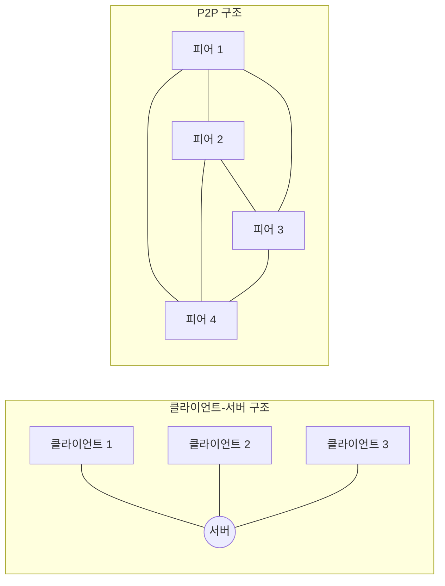
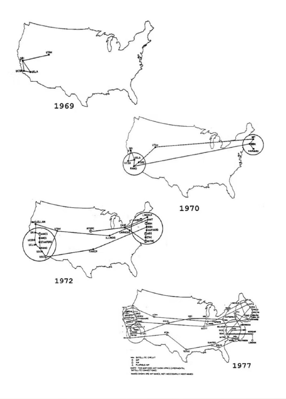
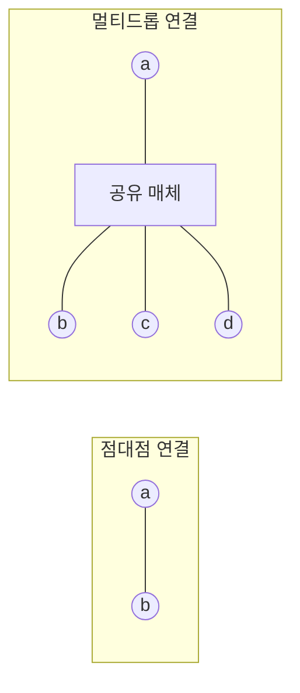
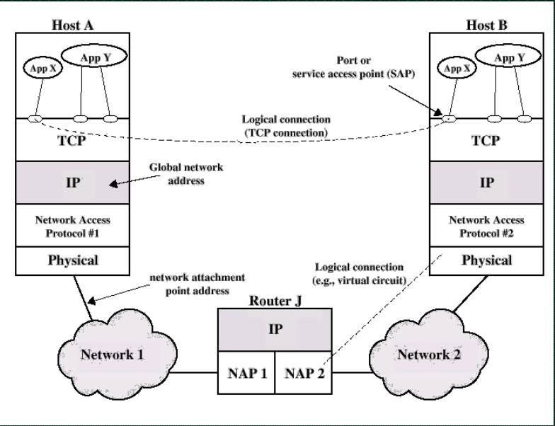
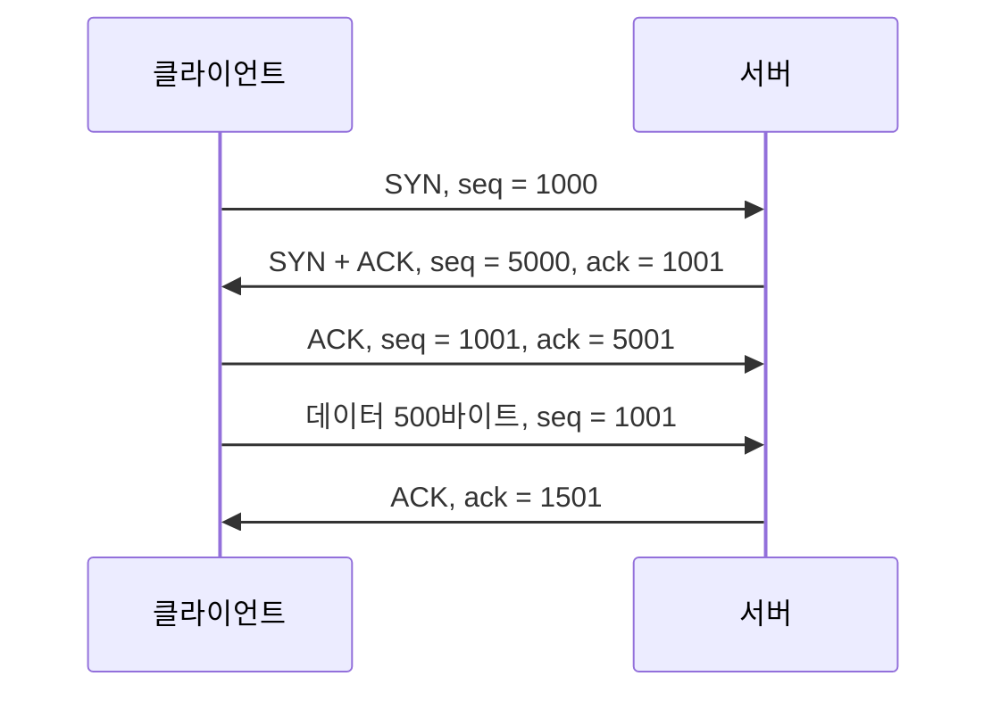
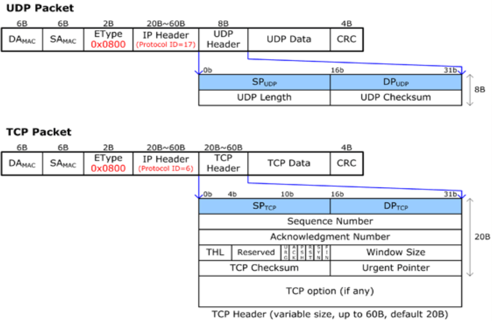
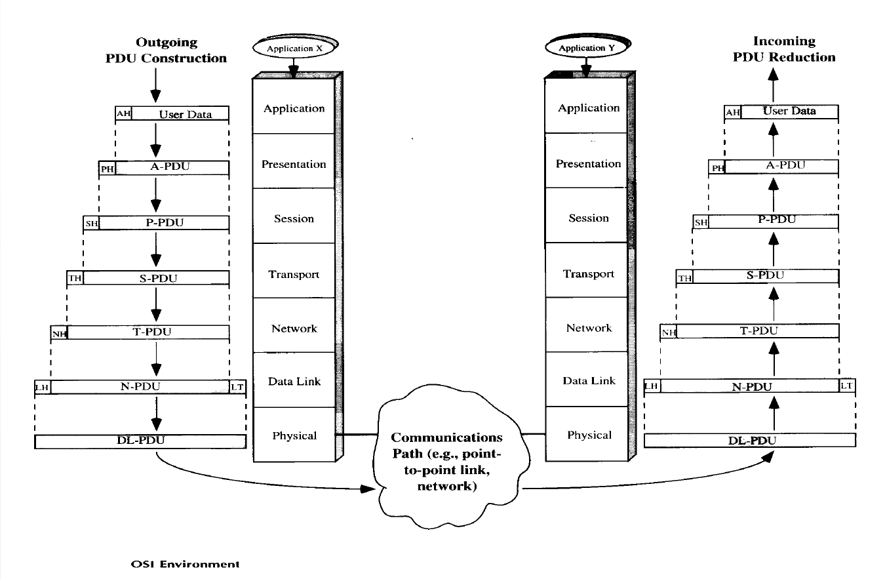
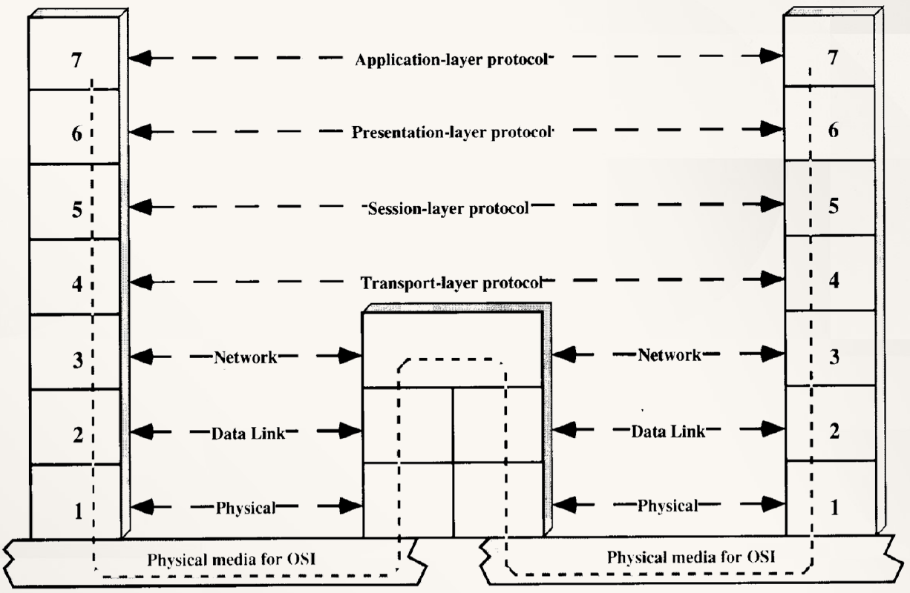
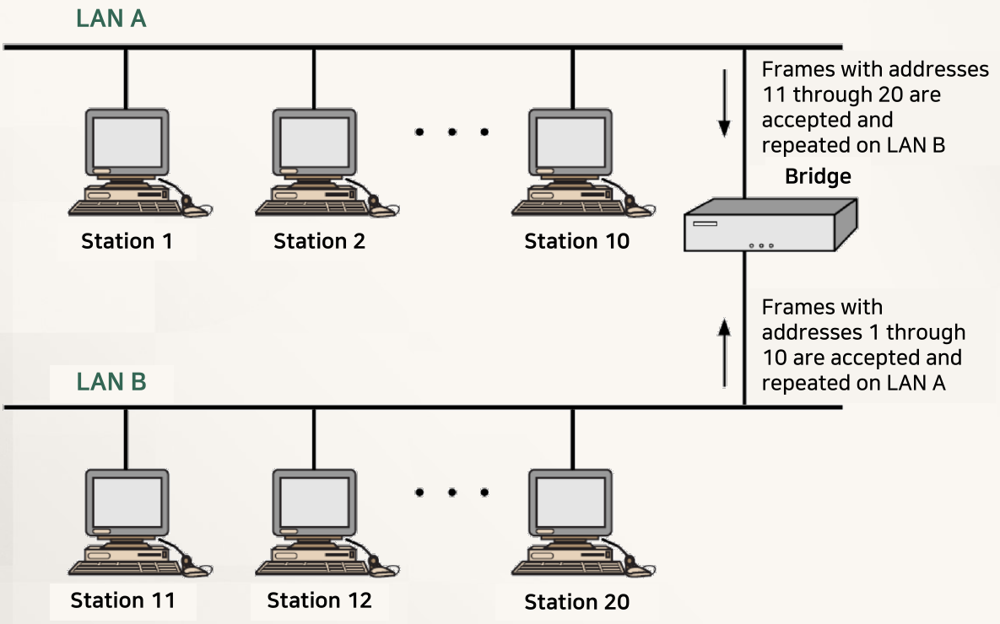
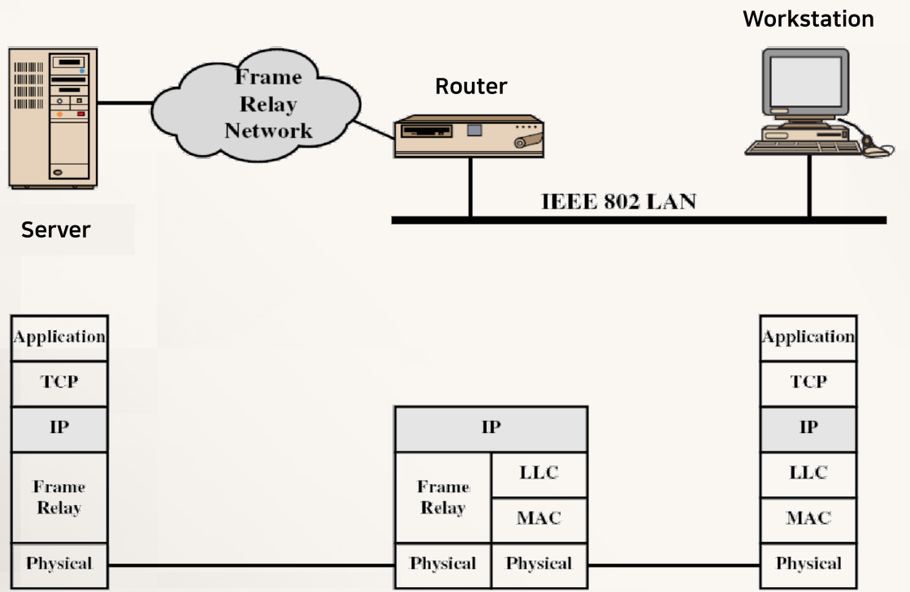

# 5주차 이론 — 프로토콜과 계층 구조

[레포지토리 안내](../../README.ko.md) | [English](Concepts_Lecture.md) | [한국어](Concepts_Lecture.ko.md)

> **최종 수정일:** 2026-11-04

> **학습 목표:**
> 1. 프로토콜의 정의와 세 요소(구문, 의미, 타이밍)를 설명하고, 통신 기능을 계층으로 나누는 이유를 설명할 수 있다
> 2. TCP/IP 5계층 각각의 역할, 주소, 데이터 단위를 설명하고, 포트 번호와 IP 주소로 데이터가 목적지 프로세스까지 전달되는 과정을 추적할 수 있다
> 3. TCP 헤더와 IPv4 헤더의 필드를 설명하고, 순서 번호, 확인 응답 번호, 헤더 길이 같은 값을 계산할 수 있다
> 4. OSI 7계층의 기능, PDU, 대표 장비와 프로토콜을 설명하고, OSI 계층과 TCP/IP 계층을 대응시킬 수 있다
> 5. 송신 호스트, 라우터, 수신 호스트에서 계층마다 헤더가 붙고 떼어지는 캡슐화와 역캡슐화 과정을 단계별로 설명할 수 있다

---

## 목차

- [1. 프로토콜](#1-프로토콜)
  - [1.1 표준이 필요한 이유](#11-표준이-필요한-이유)
  - [1.2 계층별 통신과 프로토콜 아키텍처](#12-계층별-통신과-프로토콜-아키텍처)
  - [1.3 피어와 P2P](#13-피어와-p2p)
  - [1.4 프로토콜의 정의와 세 요소](#14-프로토콜의-정의와-세-요소)
  - [1.5 ARPANET과 인터넷의 발전](#15-arpanet과-인터넷의-발전)
  - [1.6 OSI 7계층과 TCP/IP 5계층](#16-osi-7계층과-tcpip-5계층)
- [2. TCP/IP 프로토콜과 계층 구조](#2-tcpip-프로토콜과-계층-구조)
  - [2.1 통신의 세 주체와 TCP/IP의 5계층](#21-통신의-세-주체와-tcpip의-5계층)
  - [2.2 물리 계층](#22-물리-계층)
  - [2.3 네트워크 접근 계층](#23-네트워크-접근-계층)
  - [2.4 점대점 연결과 멀티드롭 연결](#24-점대점-연결과-멀티드롭-연결)
  - [2.5 인터넷 계층](#25-인터넷-계층)
  - [2.6 전송 계층](#26-전송-계층)
  - [2.7 응용 계층](#27-응용-계층)
  - [2.8 TCP와 IP를 이용한 데이터 전송](#28-tcp와-ip를-이용한-데이터-전송)
  - [2.9 TCP 세그먼트와 TCP 헤더](#29-tcp-세그먼트와-tcp-헤더)
  - [2.10 IP 데이터그램과 IP 헤더](#210-ip-데이터그램과-ip-헤더)
  - [2.11 프레임과 프레임 헤더](#211-프레임과-프레임-헤더)
  - [2.12 라우터의 역할과 프로토콜 데이터 단위](#212-라우터의-역할과-프로토콜-데이터-단위)
  - [2.13 TCP/IP의 응용 프로토콜](#213-tcpip의-응용-프로토콜)
- [3. OSI 모델과 계층 구조](#3-osi-모델과-계층-구조)
  - [3.1 OSI 참조 모델의 성립](#31-osi-참조-모델의-성립)
  - [3.2 계층 구조의 원칙](#32-계층-구조의-원칙)
  - [3.3 OSI 7계층의 구성](#33-osi-7계층의-구성)
  - [3.4 OSI 모델의 데이터 전송과 PDU](#34-osi-모델의-데이터-전송과-pdu)
  - [3.5 물리 계층](#35-물리-계층)
  - [3.6 데이터 링크 계층](#36-데이터-링크-계층)
  - [3.7 네트워크 계층](#37-네트워크-계층)
  - [3.8 중계 노드와 종단 간 프로토콜](#38-중계-노드와-종단-간-프로토콜)
  - [3.9 전송 계층](#39-전송-계층)
  - [3.10 세션 계층](#310-세션-계층)
  - [3.11 표현 계층](#311-표현-계층)
  - [3.12 응용 계층](#312-응용-계층)
  - [3.13 계층별 PDU, 장비, 프로토콜](#313-계층별-pdu-장비-프로토콜)
  - [3.14 브리지로 연결한 두 LAN](#314-브리지로-연결한-두-lan)
  - [3.15 계층 구조가 다른 네트워크 사이의 데이터 교환](#315-계층-구조가-다른-네트워크-사이의-데이터-교환)
  - [3.16 송신 호스트의 처리](#316-송신-호스트의-처리)
  - [3.17 라우터의 처리](#317-라우터의-처리)
  - [3.18 수신 호스트의 처리](#318-수신-호스트의-처리)
- [개념 적용](#개념-적용)
- [요약](#요약)
- [점검 문제](#점검-문제)
- [참고 문헌](#참고-문헌)

---

<br>

## 1. 프로토콜

### 1.1 표준이 필요한 이유

컴퓨터끼리 데이터를 주고받으려면 양쪽이 같은 규칙을 따라야 한다. 이 규칙이 제각각이면 두 가지 문제가 생긴다.

- **플랫폼:** 컴퓨터 제조사나 운영 체제마다 데이터 교환 방식이 따로 있으면, 서로 다른 플랫폼을 연결할 때마다 별도의 변환 장치나 소프트웨어를 만들어야 하므로 비용이 크다.
- **애플리케이션:** 파일 교환, 전자우편처럼 애플리케이션마다 통신 절차가 다르면, 개발자가 애플리케이션마다 통신 기능을 처음부터 구현해야 하므로 구현이 어렵다.

비용의 차이를 수로 보면 다음과 같다. 서로 다른 방식을 쓰는 시스템이 $N$개 있을 때 모든 쌍을 직접 변환하려면 변환기가 $N(N-1)/2$개 필요하다. $N = 10$이면 $10 \times 9 / 2 = 45$개이다. 반면 모두가 하나의 표준을 따르면 각 시스템이 표준 하나만 구현하면 되므로 구현은 10개로 충분하다. 시스템이 늘어날수록 이 차이는 $N^2$과 $N$의 차이만큼 벌어진다.

### 1.2 계층별 통신과 프로토콜 아키텍처

통신에 필요한 기능은 매우 많으므로, 하나의 거대한 프로그램으로 만들지 않고 여러 **계층(layer)** 으로 나누어 구성한다. 계층별 통신의 원칙은 다음과 같다.

- 통신 기능을 담당하는 모듈들을 수직으로 쌓은 스택(stack)으로 구성한다.
- 상위 계층은 하위 계층이 기능을 어떻게 구현하는지 세부 형식을 고려하지 않고, 하위 계층이 제공하는 서비스에 기반하여 자신의 기능을 수행한다.
- 한 계층 안의 구현을 바꾸어도 다른 계층과 영향을 주고받지 않는다.

> **용어 정의:** **프로토콜 아키텍처(protocol architecture)** 는 통신 기능을 계층으로 나누고 각 계층 모듈이 수행할 작업(task)을 정의한 구조이다. 계층 구조 전체를 **프로토콜 스택(protocol stack)** 이라고도 한다.

```text
       System A                                     System B
  ┌─────────────────┐    Layer N+1 protocol    ┌─────────────────┐
  │    Layer N+1    │<- - - - - - - - - - - - >│    Layer N+1    │
  ├─────────────────┤                          ├─────────────────┤
  │     Layer N     │<- - - - - - - - - - - - >│     Layer N     │
  ├─────────────────┤     Layer N protocol     ├─────────────────┤
  │    Layer N-1    │                          │    Layer N-1    │
  └────────┬────────┘                          └────────┬────────┘
           └────────────── Physical link ───────────────┘
```

*그림 1. 계층별 통신에서 같은 계층끼리 맺는 논리적 관계와 실제 데이터 경로*

그림 1에서 한 시스템 안의 계층은 위아래로 쌓여 바로 위아래 계층과 서비스를 주고받고, 두 시스템 사이의 가로 점선은 같은 계층이 프로토콜(Layer N protocol)로 맺는 논리적 관계이다. 실제 데이터는 시스템 A의 위 계층에서 아래 계층으로 내려가 맨 아래의 물리적 링크(physical link)를 건넌 뒤, 시스템 B에서 다시 위로 올라간다. 그러나 각 계층은 마치 상대 시스템의 같은 계층과 직접 대화하는 것처럼 동작한다. 우편에 비유하면, 편지를 쓰는 사람은 우체국이 편지를 어떤 트럭과 비행기로 옮기는지 몰라도 되고, 우체국이 운송 수단을 바꾸어도 편지를 쓰는 방식은 바뀌지 않는다.

### 1.3 피어와 P2P

> **용어 정의:** **피어(peer)** 는 동료라는 뜻으로, 네트워크에 연결된 컴퓨터들이 서로 대등한 동료의 입장에서 데이터나 주변 장치를 공유할 수 있다는 의미이다. 프로토콜 아키텍처에서는 서로 다른 시스템에서 같은 계층에 있는 두 개체를 **대등 계층 개체(peer entity)** 라 하며, 그림 1의 가로 점선이 대등 계층 개체 사이의 관계이다.

> **용어 정의:** **P2P(peer to peer, 피투피)** 는 인터넷에 연결된 여러 개별 사용자가 중앙 서버를 거치지 않고 직접 데이터를 주고받는 방식이다.



*그림 2. 클라이언트-서버 구조와 P2P 구조*

클라이언트-서버 구조에서는 모든 클라이언트가 서버에 요청하고 서버가 응답하므로, 서버가 멈추면 서비스 전체가 멈춘다. P2P 구조에서는 각 피어가 클라이언트이면서 동시에 서버 역할을 하므로, 일부 피어가 빠져도 나머지 피어끼리 계속 데이터를 주고받을 수 있다. 파일을 여러 조각으로 나누어 여러 피어에게서 동시에 받는 파일 공유 프로그램이 대표적인 예이다.

### 1.4 프로토콜의 정의와 세 요소

> **용어 정의:** **프로토콜(protocol)** 은 컴퓨터들 사이의 원활한 통신을 위해 지키기로 약속한 규약이다. 신호 처리 방법, 오류 처리, 암호, 인증, 주소 지정 등을 포함한다.

프로토콜은 다음 세 요소로 이루어진다.

| 요소 | 규정하는 내용 | 예 |
|:-----|:-----|:-----|
| 구문(syntax) | 데이터의 구성 형식, 코딩 방법, 신호 레벨 등 형식을 규정한다. | IPv4 헤더의 첫 4비트는 버전, 다음 4비트는 헤더 길이이다(2.10절). |
| 의미(semantics) | 각 비트와 필드를 어떻게 해석하고 처리할지, 오류가 생기면 어떻게 대처할지를 규정한다. | TCP 헤더의 SYN 비트가 1이면 연결 시작을 요청하는 것으로 해석한다(2.9절). |
| 타이밍(timing) | 데이터 교환 속도의 조절, 여러 데이터를 동시에 교환할 때의 순서 등을 규정한다. | 송신자는 확인 응답이 일정 시간 안에 오지 않으면 데이터를 다시 보낸다. |

*표 1. 프로토콜의 세 요소*

사람의 대화에 비유하면, 구문은 문법(어떤 언어와 어순으로 말하는가), 의미는 단어의 뜻(그 말이 무엇을 요구하는가), 타이밍은 말하는 순서와 속도(상대가 말을 마친 뒤에 말한다, 상대가 알아듣는 속도로 말한다)에 해당한다.

### 1.5 ARPANET과 인터넷의 발전

인터넷의 출발점은 ARPANET이다.

- **ARPANET:** 1969년 미국 국방부의 고등연구계획국(ARPA, Advanced Research Projects Agency)이 개발한 컴퓨터 네트워크이다. ARPA는 1972년에 DARPA(Defense Advanced Research Projects Agency)로 이름을 바꾸었다. ARPANET이라는 이름은 ARPA와 그물을 뜻하는 net을 합친 것이다.
- **프로토콜:** 초기 ARPANET은 NCP(Network Control Protocol)를 쓰는 **패킷 교환(packet switching)** 네트워크였다. 패킷 교환은 4주차에서 다룬 것처럼 데이터를 작은 패킷으로 나누어 각 패킷이 네트워크의 자원을 나누어 쓰며 전달되는 방식이다.
- **표준화 기구:** 인터넷 표준은 IAB(Internet Activities Board, 1992년에 Internet Architecture Board로 개칭)를 중심으로 만들어졌다.

| 연도 | 발전 |
|:-----|:-----|
| 1969년 | ARPA 프로젝트로 ARPANET이 만들어지고, 이후 전자우편(E-mail), Telnet, FTP, Usenet 등이 개발되었다. |
| 1973년 | 빈트 서프(Vint Cerf)와 밥 칸(Bob Kahn)이 TCP/IP의 설계를 시작하고, 여러 네트워크를 서로 잇는 네트워크를 인터넷(Internet)이라 불렀다. 설계는 1974년 논문으로 발표되었다 [1]. |
| 1982년 | TCP/IP가 표준 프로토콜로 채택되었다. ARPANET은 1983년 1월 1일에 NCP에서 TCP/IP로 전환했다 [2]. |
| 1983년 | ARPANET이 군용 MILNET과 민간용 ARPANET으로 분리되었다. |
| 1984년 | 도메인 이름을 IP 주소로 바꾸어 주는 DNS(domain name system)가 적용되었다. |
| 1986년 | 미국 국립과학재단(NSF) 주도로 대학들을 연결한 NSFNET이 구성되었다. |
| 1992년 | 그래픽 웹 브라우저 MOSAIC이 개발되었다. |
| 1993년 | America Online 같은 통신 업체와 Netscape 같은 브라우저가 등장하면서 인터넷이 폭발적으로 성장했다. |
| 1982년 | 한국에서는 서울대학교와 한국전자기술연구소(현 ETRI) 사이에 최초의 TCP/IP 네트워크가 구축되었다. |

*표 2. 인터넷의 발전*

> **참고:** 강의자료는 1986년의 NSFNET이 ARPANET에 통합되었다고 적지만, 실제로는 NSFNET이 ARPANET보다 빠른 백본으로 성장하여 ARPANET의 역할을 넘겨받았고, ARPANET은 1990년에 운영을 마쳤다 [2]. 또 MOSAIC의 첫 정식 버전은 1993년에, Netscape Navigator는 1994년에 공개되었으므로, 표 2의 1992\~1993년은 개발과 대중화가 시작된 무렵으로 읽는다.



*그림 3. 1969년, 1970년, 1972년, 1977년의 ARPANET 연결도*

그림 3은 미국 지도 위에 ARPANET의 노드와 연결을 연도별로 그린 것이다. 1969년에는 서부의 UCLA, UCSB, SRI와 유타 대학교(Utah)의 네 노드뿐이었으나, 1970년에는 동부의 MIT, Harvard 등이 연결되어 대륙을 가로지르는 링크가 생겼다. 1972년에는 서부와 동부에 노드가 몰려 원으로 표시한 두 지역이 생겼고, 1977년에는 위성 회선까지 포함하여 수십 개의 노드가 미국 전역을 잇는 그물망이 되었다.

### 1.6 OSI 7계층과 TCP/IP 5계층

계층으로 나눈 프로토콜 아키텍처의 대표가 OSI 모델과 TCP/IP이다.

| OSI 계층 | TCP/IP 계층 |
|:-----|:-----|
| 7. 응용(Application) | 응용(Application) |
| 6. 표현(Presentation) | 응용(Application) |
| 5. 세션(Session) | 응용(Application) |
| 4. 전송(Transport) | 전송(Transport, host-to-host) |
| 3. 네트워크(Network) | 인터넷(Internet) |
| 2. 데이터 링크(Data Link) | 네트워크 접근(Network Access) |
| 1. 물리(Physical) | 물리(Physical) |

*표 3. OSI 7계층과 TCP/IP 5계층의 대응*

| 구분 | OSI 모델 | TCP/IP |
|:-----|:-----|:-----|
| 성격 | ISO 국제 표준에 기반한 프레임워크(참조 모델)이다. | 인터넷에서 실제로 쓰이며 사실상의 표준(de facto standard)이 되었다. |
| 정의 방식 | 각 계층의 기능을 정의하고, 각 계층의 프로토콜은 동시에 독립적인 표준으로 개발되었다. | 구현된 프로토콜이 먼저 있었고, 계층 구조는 그 프로토콜들을 설명하는 틀이다. |
| 보급 | OSI 프로토콜은 복잡하여 널리 보급되지 못했다. | 초기에는 OSI 프로토콜이 개발 중이었으므로 TCP/IP가 사실상 유일한 방식이었고, OSI 프로토콜의 복잡성에 대응하는 단순한 대안으로 확산되었다. |

*표 4. OSI 모델과 TCP/IP의 성격 비교*

> **핵심:** OSI 모델은 통신 기능을 정교하게 나누어 설명하는 기준이고, TCP/IP는 인터넷을 실제로 움직이는 프로토콜 집합이다. 두 모델은 전송 계층과 네트워크(인터넷) 계층에서 정확히 대응하며, OSI의 세션, 표현, 응용 계층은 TCP/IP에서 하나의 응용 계층으로 합쳐진다.

---

<br>

## 2. TCP/IP 프로토콜과 계층 구조

### 2.1 통신의 세 주체와 TCP/IP의 5계층

통신에는 세 주체(agent)가 관여한다.

1. **애플리케이션(applications):** 전자우편, 파일 전송처럼 실제로 데이터를 주고받으려는 개별 프로그램이다.
2. **컴퓨터(computers):** 애플리케이션이 실행되는 장치이며, 한 컴퓨터는 여러 애플리케이션을 동시에 지원한다.
3. **네트워크(networks):** 컴퓨터들을 연결하여 데이터를 실어 나르는 통신망이다.

데이터는 한 컴퓨터의 애플리케이션에서 다른 컴퓨터의 애플리케이션으로 전달되어야 하므로, 애플리케이션을 구분하는 방법(포트 번호)과 컴퓨터를 구분하는 방법(IP 주소)이 모두 필요하다. TCP/IP는 이 통신을 다섯 계층으로 구성한다.

| 계층 | 영어 이름 | 하는 일 | 데이터 단위 | 주소 |
|:-----|:-----|:-----|:-----|:-----|
| 5. 응용 계층 | application layer | 사용자 애플리케이션을 지원한다. | 메시지 | - |
| 4. 전송 계층 | host-to-host (transport) layer | 종단 호스트 사이에서 신뢰성 있는 데이터 교환을 제공한다. | 세그먼트 | 포트 번호 |
| 3. 인터넷 계층 | internet layer | 여러 네트워크를 거쳐 데이터를 목적지 호스트까지 라우팅한다. | 데이터그램(패킷) | IP 주소 |
| 2. 네트워크 접근 계층 | network access layer | 같은 네트워크 안에서 컴퓨터와 네트워크 사이의 데이터 교환을 맡는다. | 프레임 | MAC 주소 |
| 1. 물리 계층 | physical layer | 비트를 전송 매체의 신호로 바꾸어 보낸다. | 비트 | - |

*표 5. TCP/IP 5계층의 개요*

> **참고:** 흔히 물리 계층과 네트워크 접근 계층을 합쳐 네트워크 접근 계층이라 부르고, TCP/IP를 4계층으로 설명하기도 한다. 계층의 수가 다를 뿐 다루는 기능은 같다.

### 2.2 물리 계층

**물리 계층(physical layer)** 은 컴퓨터와 네트워크 사이의 물리적 인터페이스를 다룬다. 다루는 내용은 다음과 같다.

- **전송 매체:** 꼬임쌍선, 동축 케이블, 광섬유, 무선처럼 신호가 지나가는 물리적 경로이다(4주차).
- **신호의 특성:** 0과 1을 어떤 전압, 주파수, 빛의 세기로 나타낼지 정한다(4주차의 인코딩).
- **데이터 전송 속도:** 초당 몇 비트를 보낼지 정한다.

예를 들어 커넥터의 핀 배치, 케이블의 최대 길이, 1 비트를 나타내는 전압 파형은 모두 물리 계층의 규정이다.

### 2.3 네트워크 접근 계층

**네트워크 접근 계층(network access layer)** 은 연결된 컴퓨터, 즉 종단 시스템(end system)과 그 컴퓨터가 붙어 있는 네트워크 사이의 데이터 교환을 맡는다. OSI 7계층 기준으로는 데이터 링크 계층에 해당한다.

- 위 계층에서 받은 TCP/IP 패킷을 네트워크로 주고받으며, 패킷을 네트워크가 다룰 수 있는 **프레임(frame)** 으로 변환하여 전송한다.
- 논리적 주소인 IP 주소가 아니라 네트워크 인터페이스에 붙은 물리적 주소인 **MAC 주소**를 사용한다.
- 같은 네트워크 안에서 출발지에서 목적지로 데이터를 전송한다.
- 네트워크가 데이터를 목적지로 보내려면 목적지의 주소가 필요하고, 우선순위(priority) 같은 서비스를 요청할 수도 있다.
- 사용하는 네트워크의 종류에 따라 소프트웨어가 달라진다. 회선 교환, 패킷 교환, LAN 등 네트워크 종류마다 별도의 표준이 있다(4주차).
- 네트워크 종류에 따른 차이를 이 계층이 감추므로, 위 계층은 네트워크의 종류와 관계없이 통신할 수 있다.
- 장비로는 LAN 관련 장비(네트워크 인터페이스 카드, 스위치 등)가 있고, 프로토콜에는 이더넷(Ethernet), 토큰 링(Token Ring), PPP(Point-to-Point Protocol) 등이 있다.

### 2.4 점대점 연결과 멀티드롭 연결

데이터 링크 계층이 연결하는 방식은 두 가지이다.



*그림 4. 점대점 연결과 멀티드롭 연결*

- **점대점(point to point) 연결:** 링크 하나가 두 장치만 연결한다. a가 보낸 데이터는 받을 수 있는 장치가 b뿐이므로, 라우팅이나 주소 없이 바로 전달된다.
- **멀티드롭(multi drop) 연결:** 하나의 매체를 여러 호스트가 공유한다. a가 보낸 데이터가 b, c, d 모두에 도달하므로, 누구에게 보내는 데이터인지 가리키는 **주소(address)** 의 개념이 필요하다. 3주차의 CAN 버스와 이더넷 버스가 멀티드롭 연결이다.

### 2.5 인터넷 계층

**인터넷 계층(internet layer)** 은 OSI 7계층 기준으로 네트워크 계층에 해당하며, 서로 연결된 여러 네트워크를 거쳐 데이터를 전송한다.

- 서로 다른 두 네트워크, 또는 서로 다른 네트워크에 있는 두 종단 시스템을 연결하려면 **라우터(router)** 가 필요하다. 라우터는 여러 네트워크에 동시에 연결되어 한 네트워크에서 받은 데이터를 다른 네트워크로 넘겨주는 장치이다.
- MAC 주소의 형식은 네트워크 종류에 따라 다르므로, 하위 네트워크(sub network)의 종류와 상관없이 쓸 수 있는 통일된 주소인 **IP 주소(Internet Protocol address)** 가 필요하다.
- 위의 전송 계층에서 받은 데이터에 IP 헤더를 추가하여 IP 패킷(IP 데이터그램)을 만들어 전송한다.
- 통신 노드 사이에서 IP 패킷을 전송하는 기능과, 여러 네트워크를 거치는 경로를 정하는 **라우팅(routing)** 기능을 수행한다.
- 프로토콜에는 IP, ARP(Address Resolution Protocol, IP 주소로 MAC 주소를 알아내는 프로토콜), RARP(Reverse ARP, MAC 주소로 IP 주소를 알아내는 프로토콜) 등이 있다.

### 2.6 전송 계층

**전송 계층(host-to-host layer 또는 transport layer)** 은 OSI 7계층 기준으로도 전송 계층에 해당한다.

- **네트워크 종류로부터 독립적이다.** 아래에 어떤 네트워크가 있든 같은 방식으로 동작한다.
- **애플리케이션 종류로부터 독립적이다.** 전자우편이든 파일 전송이든 같은 서비스를 제공한다.
- 안정적인 데이터 교환에 필요한 공통 기능을 모은 계층이다. 즉 데이터가 빠짐없이 전달되는지(전달), 내용이 손상되지 않았는지(정확성), 보낸 순서대로 도착하는지(올바른 순서)를 책임진다.
- 통신 노드 사이의 연결을 제어하고 신뢰성 있는 전송 기능을 제공한다.
- 프로토콜에는 TCP(Transmission Control Protocol), UDP(User Datagram Protocol) 등이 있다. TCP는 연결을 맺고 신뢰성을 보장하며, UDP는 연결 없이 빠르게 보내는 대신 신뢰성을 보장하지 않는다.

### 2.7 응용 계층

**응용 계층(application layer)** 은 OSI 7계층 기준으로 세션 계층, 표현 계층, 응용 계층에 해당한다.

- 다양한 사용자 애플리케이션을 지원하며, 애플리케이션의 종류마다 분리된 모듈이 필요하다(웹에는 HTTP, 전자우편에는 SMTP).
- 응용 프로그램이 데이터를 받고, 다른 계층의 서비스에 접근할 수 있게 하는 기능을 제공한다.
- 프로토콜에는 HTTP(HyperText Transfer Protocol), SSH(Secure Shell) 등이 있다.

### 2.8 TCP와 IP를 이용한 데이터 전송

여러 하위 네트워크(sub network)로 이루어진 네트워크에서 세 프로토콜은 다음과 같이 역할을 나눈다.

| 프로토콜 | 역할 |
|:-----|:-----|
| 네트워크 접근 프로토콜(network access protocol) | 하위 네트워크 안에서, 또는 하위 네트워크에 붙은 라우터까지 데이터를 전송한다. |
| IP | 라우터를 통해 목적지 호스트까지 데이터를 전송한다. |
| TCP | 목적지 호스트의 애플리케이션까지 신뢰할 수 있게 데이터를 전송한다. |

*표 6. 하위 네트워크로 구성된 네트워크에서 프로토콜의 역할 분담*



*그림 5. TCP/IP 계층으로 본 호스트 A에서 호스트 B로의 데이터 전송*

그림 5에서 호스트 A와 호스트 B는 각각 TCP, IP, 네트워크 접근 프로토콜, 물리 계층을 가진다. 호스트 A는 네트워크 1에, 호스트 B는 네트워크 2에 붙어 있고, 라우터 J가 두 네트워크를 잇는다. 라우터 J는 IP 계층과 두 네트워크 각각의 접속점(NAP 1, NAP 2, network access protocol)만 가진다. 그림에 표시된 세 종류의 주소는 다음과 같다.

- **포트(port) 또는 서비스 접근점(SAP, service access point):** 한 호스트 안에서 애플리케이션(App X, App Y)을 구분하는 주소이다.
- **전역 네트워크 주소(global network address):** 인터넷 전체에서 호스트를 구분하는 주소, 즉 IP 주소이다.
- **네트워크 접속점 주소(network attachment point address):** 한 네트워크 안에서 호스트가 네트워크에 붙은 지점을 구분하는 주소, 즉 MAC 주소 같은 하위 네트워크의 주소이다.

호스트 A의 포트 1에 있는 애플리케이션이 호스트 B의 포트 3에 있는 애플리케이션으로 데이터를 보내는 과정은 다음과 같다.

1. 호스트 A의 애플리케이션은 데이터를 목적지(호스트 B의 포트 3)로 보내 달라고 TCP에 넘긴다.
2. TCP는 메시지에 목적지 포트 번호를 담은 TCP 헤더를 붙이고, 네트워크상의 목적지(호스트 B)를 지정하여 IP에 넘긴다. IP는 호스트까지만 데이터를 책임지므로 목적지 포트를 알 필요가 없다.
3. IP는 목적지 호스트 B가 다른 네트워크에 있으므로, 호스트 B로 가는 첫 번째 라우터인 라우터 J로 전송하도록 네트워크 접근 계층에 요청하면서 데이터를 넘긴다.
4. 네트워크 1은 데이터를 라우터 J까지 전달한다. 라우터 J는 IP 헤더의 목적지 주소를 보고 네트워크 2를 거쳐 호스트 B로 데이터를 보낸다.
5. 호스트 B의 IP는 데이터를 TCP에 넘기고, TCP는 헤더의 목적지 포트 번호 3을 보고 포트 3의 애플리케이션에 데이터를 전달한다.

그림의 점선 두 개는 논리적 연결이다. 위의 점선은 두 TCP 개체 사이의 **TCP 연결**이고, 아래의 점선은 네트워크 2 안에서 맺는 가상 회선(virtual circuit) 같은 하위 네트워크의 논리적 연결이다. 가상 회선은 4주차에서 다루었다.

### 2.9 TCP 세그먼트와 TCP 헤더

TCP는 애플리케이션에서 받은 데이터 스트림을 일정한 크기로 나눈 뒤, 나눈 조각마다 TCP 헤더를 붙여 **TCP 세그먼트(TCP segment)** 를 만든다.

$$\text{TCP 세그먼트} = \text{TCP 헤더(세그먼트 헤더)} + \text{분할된 사용자 데이터}$$

TCP 헤더의 구조는 다음과 같다. 한 줄은 32비트(4바이트)이다.

```text
0       4           10          16                            31
┌───────────────────────────────┬───────────────────────────────┐
│          Source port          │        Destination port       │
├───────────────────────────────┴───────────────────────────────┤
│                        Sequence number                        │
├───────────────────────────────────────────────────────────────┤
│                     Acknowledgment number                     │
├───────┬───────────┬─┬─┬─┬─┬─┬─┬───────────────────────────────┤
│ Offset│  Reserved │U│A│P│R│S│F│             Window            │
│       │           │R│C│S│S│Y│I│                               │
│       │           │G│K│H│T│N│N│                               │
├───────┴───────────┴─┴─┴─┴─┴─┴─┼───────────────────────────────┤
│            Checksum           │         Urgent pointer        │
├───────────────────────────────┴───────────────────────────────┤
│                      Options (0-40 bytes)                     │
├───────────────────────────────────────────────────────────────┤
│                              Data                             │
└───────────────────────────────────────────────────────────────┘
```

*그림 6. TCP 헤더의 구조*

| 필드 | 크기 | 역할 |
|:-----|:-----|:-----|
| Source port (출발지 포트) | 16비트 | 데이터를 보내는 애플리케이션의 포트 번호이다. |
| Destination port (목적지 포트) | 16비트 | 데이터를 받을 애플리케이션의 포트 번호이다. |
| Sequence number (순서 번호) | 32비트 | 이 세그먼트에 담긴 첫 바이트의 번호이다. TCP는 바이트 단위로 번호를 매기며, 이 번호로 신뢰성(3방향 핸드셰이크와 재전송)과 흐름 제어(슬라이딩 윈도) 기능을 제공한다. |
| Acknowledgment number (확인 응답 번호) | 32비트 | 다음에 받기를 기대하는 바이트의 번호이다. 마지막으로 수신에 성공한 바이트의 번호에 1을 더한 값이다. |
| Offset (헤더 길이) | 4비트 | TCP 헤더의 길이를 4바이트 단위로 나타낸다. IPv4의 HLEN과 같이 헤더의 바이트 수를 4로 나눈 값을 2진수로 쓴다. |
| Reserved (예약) | 6비트 | 나중을 위해 예약된 필드로, 현재는 사용하지 않고 0으로 둔다. |
| 제어 플래그 | 6비트 | URG, ACK, PSH, RST, SYN, FIN의 여섯 비트이다(표 8). |
| Window (윈도 크기) | 16비트 | 자신의 수신 버퍼에 남은 용량을 상대에게 알려, 상대가 한 번에 얼마만큼의 데이터를 보낼 수 있는지 정하게 하는 흐름 제어 필드이다. |
| Checksum (검사합) | 16비트 | 헤더와 데이터에 전송 오류가 있는지 검사하는 값이다. |
| Urgent pointer (긴급 포인터) | 16비트 | URG 플래그가 1일 때만 의미가 있으며, 순서 번호를 기준으로 긴급 데이터가 어디까지인지 위치를 알려 준다. |
| Options (옵션) | 0\~40바이트 | 최대 세그먼트 크기(MSS) 같은 선택 기능이다. |

*표 7. TCP 헤더의 필드*

| 플래그 | 이름 | 의미 |
|:-----|:-----|:-----|
| U (URG) | 긴급 비트 | 지금 보내는 데이터 중에 우선순위가 높은 긴급 데이터가 있음을 알린다. Urgent pointer와 함께 쓴다. |
| A (ACK) | 승인 비트 | 확인 응답 번호 필드가 유효함을 나타낸다. 받은 데이터에 응답할 때 사용하며, 연결이 맺어진 뒤의 거의 모든 세그먼트에서 1이다. |
| P (PSH) | 밀어 넣기 비트 | 수신 측이 TCP 버퍼가 찰 때까지 기다리지 말고 받은 데이터를 곧바로 애플리케이션에 넘기도록 요청한다. |
| R (RST) | 초기화 비트 | 연결된 상태에서 문제가 생겼을 때 연결을 강제로 초기화(리셋)한다. |
| S (SYN) | 동기화 비트 | 상대와 연결을 시작할 때 반드시 사용하며, 순서 번호의 시작값을 맞춘다(동기화한다). |
| F (FIN) | 종료 비트 | 더 보낼 데이터가 없음을 알리고 연결 종료를 요청한다. |

*표 8. TCP 제어 플래그*

> **참고:** 현재의 TCP 표준(RFC 9293)은 예약 필드를 4비트로 줄이고, 혼잡 알림에 쓰는 CWR과 ECE 플래그를 더해 플래그를 8비트로 정의한다 [3], [4]. 헤더 전체의 크기와 다른 필드의 위치는 같다.

**헤더 길이 계산.** 옵션이 없는 TCP 헤더는 20바이트이므로 Offset은 $20 / 4 = 5$, 2진수로 `0101`이다. 옵션이 12바이트 있으면 헤더는 $20 + 12 = 32$바이트이고 Offset은 $32 / 4 = 8$, 즉 `1000`이다. Offset은 4비트이므로 최댓값은 15이고, 헤더의 최대 길이는 $15 \times 4 = 60$바이트이다. 옵션이 최대 40바이트인 이유가 이것이다($60 - 20 = 40$).

**3방향 핸드셰이크.** TCP는 데이터를 보내기 전에 세그먼트 세 개를 주고받아 연결을 맺는다. 이를 **3방향 핸드셰이크(three-way handshake)** 라 한다. 클라이언트의 시작 순서 번호를 1000, 서버의 시작 순서 번호를 5000이라 하자.



*그림 7. 3방향 핸드셰이크와 첫 데이터 전송의 순서 번호*

1. 클라이언트는 SYN 플래그를 1로 하고 시작 순서 번호 1000을 담아 보낸다.
2. 서버는 SYN과 ACK를 모두 1로 하여 응답한다. 자신의 시작 순서 번호는 5000이고, SYN은 순서 번호 하나를 차지하므로 클라이언트에게 다음에 받기를 기대하는 번호로 $1000 + 1 = 1001$을 확인 응답 번호에 담는다.
3. 클라이언트는 ACK를 1로 하고 확인 응답 번호 $5000 + 1 = 5001$을 보낸다. 이로써 연결이 맺어진다.
4. 클라이언트가 500바이트를 보내면 이 세그먼트의 순서 번호는 1001이고, 데이터는 1001번부터 1500번 바이트까지이다.
5. 서버는 1500번 바이트까지 모두 받았으므로 다음에 받을 번호 $1500 + 1 = 1501$을 확인 응답 번호로 보낸다.

**슬라이딩 윈도.** 송신자가 세그먼트 하나를 보낼 때마다 확인 응답을 기다리면 전송이 매우 느려진다. 그래서 TCP는 확인 응답을 받지 않고도 연속해서 보낼 수 있는 바이트의 범위(윈도)를 두고, 확인 응답이 올 때마다 이 범위를 앞으로 미끄러뜨린다. 이를 **슬라이딩 윈도(sliding window)** 라 한다. 수신자가 Window 필드에 4000을 적어 보내면, 송신자는 확인 응답을 받지 않은 데이터가 4000바이트를 넘지 않도록 보낸다. 수신 버퍼가 가득 차면 수신자는 Window를 0으로 알려 송신을 멈추게 할 수 있다. 이것이 TCP의 **흐름 제어(flow control)** 이다.

### 2.10 IP 데이터그램과 IP 헤더

> **용어 정의:** **IP 데이터그램(IP datagram)** 은 IP 프로토콜에서 데이터가 전달되는 기본 단위로, IP 패킷이라고도 한다. IP 헤더는 출발지와 목적지 호스트의 주소 정보를 포함한다.

$$\text{IP 데이터그램} = \text{IP 헤더} + \text{TCP 세그먼트}$$

IP 데이터그램 전체의 길이는 20\~65,535바이트이고, 그중 헤더는 20\~60바이트이다. IPv4 헤더의 구조는 다음과 같다.

```text
0       4       8               16    19                      31
┌───────┬───────┬───────────────┬───────────────────────────────┐
│  VER  │  HLEN │       DS      │          Total length         │
├───────┴───────┴───────────────┼─────┬─────────────────────────┤
│         Identification        │Flags│   Fragmentation offset  │
├───────────────┬───────────────┼─────┴─────────────────────────┤
│  Time to live │    Protocol   │        Header checksum        │
├───────────────┴───────────────┴───────────────────────────────┤
│                       Source IP address                       │
├───────────────────────────────────────────────────────────────┤
│                     Destination IP address                    │
├───────────────────────────────────────────────────────────────┤
│                      Options (0-40 bytes)                     │
└───────────────────────────────────────────────────────────────┘
```

*그림 8. IPv4 헤더의 구조*

| 필드 | 크기 | 역할 |
|:-----|:-----|:-----|
| VER (버전) | 4비트 | IP 프로토콜의 버전을 정의한다. IPv4는 4이다. |
| HLEN (헤더 길이) | 4비트 | 데이터그램의 헤더는 옵션에 따라 길이가 바뀌므로, 수신자는 헤더가 어디서 끝나고 데이터가 어디서 시작하는지 알아야 한다. HLEN은 헤더 길이를 4바이트 단위로 나타내며, 수신자는 이 값에 4를 곱해 헤더의 바이트 수를 구한다. |
| DS (서비스 유형) | 8비트 | 데이터그램을 어떻게 처리할지, 예를 들어 어떤 우선순위로 처리할지를 정의한다. |
| Total length (전체 길이) | 16비트 | 헤더와 데이터를 합친 IP 데이터그램 전체의 바이트 수이다. 16비트이므로 최대 $2^{16} - 1 = 65535$바이트이다. |
| Identification (식별자) | 16비트 | 출발지가 보내는 데이터그램마다 붙이는 번호이다. 한 데이터그램에서 나온 단편들은 같은 값을 가지므로, 목적지는 이 값으로 어느 단편끼리 다시 합칠지 안다. |
| Flags (플래그) | 3비트 | 단편화 관련 정보를 표시한다. 첫째 비트는 사용하지 않는다. 둘째 비트(DF)가 1이면 단편화를 금지한다. 셋째 비트(MF)가 1이면 뒤에 다른 단편이 더 있고, 0이면 마지막 단편이거나 단편화되지 않은 유일한 단편이다. |
| Fragmentation offset (단편화 오프셋) | 13비트 | 이 단편의 데이터가 원래 데이터그램 전체에서 차지하는 상대적인 위치를 8바이트 단위로 나타낸다. |
| Time to live (생존 시간, TTL) | 8비트 | 데이터그램이 거칠 수 있는 최대 라우터 수이다. 라우터를 지날 때마다 1씩 줄고, 0이 되면 데이터그램을 버려 경로 오류로 데이터그램이 끝없이 도는 것을 막는다. |
| Protocol (프로토콜) | 8비트 | 출발지의 IP가 상위 계층의 페이로드를 캡슐화할 때, 그 페이로드의 프로토콜 번호를 적는다. ICMP는 1, TCP는 6, UDP는 17이다 [5]. |
| Header checksum (헤더 검사합) | 16비트 | 헤더만 검사하는 검사합이다. TTL이 라우터마다 바뀌므로 라우터마다 다시 계산한다. |
| Source IP address (출발지 IP 주소) | 32비트 | 데이터그램을 보낸 호스트의 IP 주소이다. |
| Destination IP address (목적지 IP 주소) | 32비트 | 데이터그램을 받을 호스트의 IP 주소이다. |
| Options (옵션) | 0\~40바이트 | 경로 기록 같은 선택 기능이다. 데이터그램 헤더는 최대 40바이트의 옵션을 가질 수 있다. |

*표 9. IPv4 헤더의 필드 [6]*

> **참고:** Identification을 데이터그램을 보낸 출발지 호스트를 구분하는 값으로 설명하는 경우가 있으나, 출발지 호스트는 Source IP address가 구분한다. Identification은 같은 출발지가 보낸 여러 데이터그램을 서로 구분하여, 단편들이 섞이지 않고 원래 데이터그램별로 재조립되게 하는 값이다.

**헤더 길이와 데이터 길이 계산.** 어떤 데이터그램의 HLEN이 5이고 Total length가 1500이면, 헤더는 $5 \times 4 = 20$바이트이고 데이터(TCP 세그먼트)는 $1500 - 20 = 1480$바이트이다. HLEN이 15이면 헤더는 최대 길이인 $15 \times 4 = 60$바이트이며, 그중 옵션이 $60 - 20 = 40$바이트이다. HLEN의 최솟값은 5이다. 옵션이 없어도 고정 부분 20바이트가 있기 때문이다.

### 2.11 프레임과 프레임 헤더

IP 데이터그램은 실제 네트워크(예: 이더넷)를 지나기 위해 다시 네트워크 접근 계층의 헤더와 트레일러로 감싸진다. 이 단위는 네트워크 전송의 용량 단위로서 넓은 뜻으로 **패킷(packet)** 이라 부르기도 하지만, 네트워크 접근 계층(데이터 링크 계층)의 단위이므로 정확한 이름은 **프레임(frame)** 이다.

$$\text{프레임} = \text{프레임 헤더} + \text{IP 데이터그램} + \text{트레일러}$$

> **참고:** 강의자료는 packet을 package와 bucket의 합성어로 설명하지만, packet은 꾸러미(pack)에 작다는 뜻의 접미사가 붙은 낱말로 작은 꾸러미를 뜻한다. 통신 용어로서는 1960년대 중반 영국 NPL의 도널드 데이비스(Donald Davies)가 데이터를 작은 꾸러미로 나누어 보내는 방식을 가리키려고 처음 사용했다 [7].

이더넷 프레임 헤더에는 다음 필드가 있다.

| 필드 | 크기 | 의미 |
|:-----|:-----|:-----|
| DA<sub>MAC</sub> | 6바이트 | 목적지 MAC 주소(destination MAC address)이다. |
| SA<sub>MAC</sub> | 6바이트 | 출발지 MAC 주소(source MAC address)이다. |
| EType | 2바이트 | 이더넷 타입(Ethernet type)으로, 프레임에 실린 데이터가 어떤 프로토콜인지 나타낸다. IPv4는 `0x0800`이다 [8]. |
| CRC (FCS) | 4바이트 | 프레임의 끝에 붙는 트레일러로, 프레임 전체의 전송 오류를 검출하는 순환 중복 검사 값이다. |

*표 10. 이더넷 프레임의 헤더와 트레일러 필드*



*그림 9. 이더넷 프레임에 담긴 UDP 패킷과 TCP 패킷*

그림 9는 이더넷 프레임 하나에 무엇이 어떤 순서로 담기는지 보여 준다. 위쪽의 UDP 패킷은 DA<sub>MAC</sub>(6바이트), SA<sub>MAC</sub>(6바이트), EType `0x0800`(2바이트), IP 헤더(20\~60바이트, Protocol 필드 17), UDP 헤더(8바이트), UDP 데이터, CRC(4바이트)의 순서이다. UDP 헤더는 출발지 포트(SP<sub>UDP</sub>), 목적지 포트(DP<sub>UDP</sub>), UDP 길이, UDP 검사합의 네 필드(각 16비트)로 이루어진 8바이트이다. 아래쪽의 TCP 패킷은 IP 헤더의 Protocol 필드가 6이고, UDP 헤더 대신 20\~60바이트의 TCP 헤더가 들어간다. TCP 헤더의 THL(TCP header length)은 표 7의 Offset과 같은 필드이다. UDP 헤더가 TCP 헤더보다 훨씬 짧은 것은 UDP가 순서 번호, 확인 응답, 흐름 제어를 하지 않기 때문이다.

**프레임 크기 계산.** 이더넷 프레임의 데이터 부분(IP 데이터그램)은 최대 1500바이트이다. 옵션이 없는 IP 헤더(20바이트)와 TCP 헤더(20바이트)를 쓰면, TCP가 한 프레임에 실을 수 있는 사용자 데이터는 $1500 - 20 - 20 = 1460$바이트이다. 이때 프레임 전체는 $6 + 6 + 2 + 20 + 20 + 1460 + 4 = 1518$바이트이고, 그중 사용자 데이터의 비율은 $1460 / 1518 \approx 96.2\%$이다. 나머지 3.8%는 각 계층의 헤더와 트레일러, 즉 계층 구조를 쓰는 대가로 드는 오버헤드이다.

### 2.12 라우터의 역할과 프로토콜 데이터 단위

각 계층이 다루는 데이터 묶음을 **프로토콜 데이터 단위(PDU, protocol data unit)** 라 한다. TCP/IP 구조에서 계층을 내려갈 때마다 헤더가 하나씩 붙는다.

```text
                      ┌───────────────────────┐
                      │       User data       │  Application byte stream
                      └───────────────────────┘
               ┌──────┬───────────────────────┐
               │ TCP  │                       │  TCP segment
               │header│                       │
               └──────┴───────────────────────┘
        ┌──────┬──────────────────────────────┐
        │  IP  │                              │  IP datagram
        │header│                              │
        └──────┴──────────────────────────────┘
 ┌──────┬─────────────────────────────────────┐
 │ Net. │                                     │  Network-level packet
 │header│                                     │
 └──────┴─────────────────────────────────────┘
```

*그림 10. TCP/IP 구조의 프로토콜 데이터 단위*

그림 10에서 애플리케이션의 바이트 스트림(user data)에 TCP 헤더가 붙어 TCP 세그먼트가, 거기에 IP 헤더가 붙어 IP 데이터그램이, 다시 네트워크 헤더가 붙어 네트워크 수준의 패킷(프레임)이 된다. 이처럼 위 계층의 PDU 전체를 아래 계층의 데이터로 넣고 헤더를 붙이는 과정을 **캡슐화(encapsulation)** 라 하고, 수신 측에서 헤더를 하나씩 떼어 내며 위로 올리는 과정을 **역캡슐화(decapsulation)** 라 한다.

그림 5의 라우터 J는 데이터그램을 받으면 다음 작업을 한다.

1. 네트워크 1에서 받은 프레임의 네트워크 헤더(네트워크 1의 헤더)를 제거한다.
2. IP 헤더의 목적지 호스트 주소를 확인하여 어느 네트워크로 보낼지 정한다.
3. 하위 네트워크 2의 네트워크 헤더를 새로 붙여, 별도의 프레임으로 내용을 전송한다.

라우터는 IP 데이터그램의 내용(TCP 세그먼트와 데이터)은 건드리지 않고, 바깥의 네트워크 헤더만 바꾸어 단다. 편지 봉투에 비유하면, 우체국 중계소가 지역 운송용 바깥 봉투만 갈아 끼우고 속 봉투의 주소(IP 주소)는 그대로 두는 것과 같다. 그래서 IP 주소는 출발지에서 목적지까지 바뀌지 않지만, MAC 주소 같은 네트워크 주소는 네트워크를 지날 때마다 바뀐다.

### 2.13 TCP/IP의 응용 프로토콜

TCP/IP 위에서 동작하는 대표적인 응용 프로토콜은 다음과 같다.

| 프로토콜 | 용도 | 특징 |
|:-----|:-----|:-----|
| SMTP(Simple Mail Transfer Protocol, 간이 우편 전송 프로토콜) | 인터넷에서 전자우편을 전송하는 표준이다. | 1982년 RFC 821로 표준화되었고, 현재는 확장 SMTP(ESMTP, Extended SMTP)를 포함하여 2008년의 RFC 5321로 갱신되었다 [9]. |
| FTP(File Transfer Protocol, 파일 전송 프로토콜) | TCP/IP 네트워크에서 컴퓨터들이 파일을 교환하기 위한 통신 규약이다. | 1971년에 처음 공개되었고, 네트워크에 연결된 컴퓨터끼리 데이터를 원활하게 교환하기 위해 개발되었다. 파생형으로 FTP에 TLS 암호화를 적용한 FTPS가 있다 [10]. |
| TELNET | 원격지의 호스트 컴퓨터에 접속하여 터미널처럼 쓰기 위한 인터넷 프로토콜이다. | 데이터를 암호화하지 않으므로 오늘날에는 SSH로 대부분 대체되었다 [11]. |

*표 11. TCP/IP의 대표적인 응용 프로토콜*

초기 SMTP는 보안과 호환성에 한계가 있어 여러 확장이 쓰인다. **SMTP-AUTH**는 SASL(Simple Authentication and Security Layer)을 이용해 송신자를 인증하는 확장이고, **STARTTLS**는 메일 서버 사이의 연결을 암호화하는 확장이다. **MIME(Multipurpose Internet Mail Extensions)** 은 원래 7비트 ASCII 텍스트만 보낼 수 있던 전자우편에 한글 같은 비ASCII 문자, 이미지, 첨부 파일을 담기 위한 데이터 형식이다.

---

<br>

## 3. OSI 모델과 계층 구조

### 3.1 OSI 참조 모델의 성립

**OSI(Open Systems Interconnection, 개방형 시스템 상호 연결)** 모델은 1977년경부터 개발되어, 1983년에 개방형 시스템 상호 연결을 위한 기초 참조 모델로 정해졌다.

- 표준의 이름은 "The Basic Reference Model for Open Systems Interconnection"이며, 보통 **OSI 참조 모델(Open Systems Interconnection Reference Model)** 이라 부른다.
- 1984년에 ISO가 표준 ISO 7498로, CCITT(현재의 ITU-T)가 표준 X.200으로 출판했다. 현재의 판은 ISO/IEC 7498-1:1994이다 [12].

**개방형 시스템(open system)** 이란 공개된 표준을 따르기만 하면 제조사가 달라도 서로 통신할 수 있는 시스템이라는 뜻이다.

### 3.2 계층 구조의 원칙

OSI 모델의 전체 아키텍처는 다음 원칙을 따른다.

**계층 구조**

- 통신의 기능을 수직적인 계층 구조로 분리한다.
- 각 계층은 정의된 기능을 수행한다.
- 각 계층은 바로 아래 계층의 서비스를 이용하여 바로 위 계층에 서비스를 제공한다.
- 한 계층의 변경이 다른 계층의 변경을 필요로 하지 않아야 한다.

**계층화의 이슈**

- 기능을 논리적으로 묶어야 한다. 비슷한 기능은 같은 계층에 둔다.
- 각 계층이 맡은 기능을 감당할 수 있을 만큼 작게 나누어야 한다.
- 그러나 계층이 지나치게 많으면 계층마다 헤더를 붙이고 처리하는 오버헤드가 커지므로 계층의 수를 너무 늘릴 수 없다.

계층을 나누는 일은 이처럼 두 요구 사이의 절충이다. 계층이 적으면 한 계층이 너무 많은 일을 맡아 복잡해지고, 계층이 많으면 처리 오버헤드가 커진다. OSI는 그 결과로 일곱 계층을 택했다.

### 3.3 OSI 7계층의 구성

| 계층 | 이름 | 하는 일 | 정의 |
|:-----|:-----|:-----|:-----|
| 7계층 | 응용 계층(Application Layer) | 이메일과 파일 전송, 웹사이트 조회 등 애플리케이션에 서비스를 제공한다. | 사용자가 OSI 환경에 접근할 수 있게 하고, 분산 정보 서비스를 제공한다. |
| 6계층 | 표현 계층(Presentation Layer) | 문자 코드, 압축, 암호화 등 데이터를 변환한다. | 데이터 표현(구문)의 차이로부터 애플리케이션 프로세스를 독립시킨다. |
| 5계층 | 세션 계층(Session Layer) | 세션 체결, 통신 방식 등을 결정한다. | 애플리케이션 사이의 통신을 위한 제어 구조를 제공하며, 협력하는 애플리케이션 사이의 연결(세션)을 설정, 관리, 종료한다. |
| 4계층 | 전송 계층(Transport Layer) | 신뢰할 수 있는 통신을 구현한다. | 종단점 사이에서 신뢰성 있고 투명한 데이터 전송을 제공하며, 종단 간 오류 복구와 흐름 제어를 제공한다. |
| 3계층 | 네트워크 계층(Network Layer) | 다른 네트워크와 통신하기 위한 경로를 설정하고 논리 주소를 결정한다. | 시스템을 연결하는 데 쓰이는 전송 기술과 교환 기술로부터 상위 계층을 독립시키며, 연결의 설정, 유지, 종료를 책임진다. |
| 2계층 | 데이터 링크 계층(Data Link Layer) | 네트워크 기기 사이의 데이터 전송과 물리 주소를 결정한다. | 물리적 링크를 가로질러 정보를 신뢰성 있게 전송하며, 동기화, 오류 제어, 흐름 제어를 갖춘 블록(프레임)을 보낸다. |
| 1계층 | 물리 계층(Physical Layer) | 시스템 사이의 물리적인 연결과 전기 신호를 변환하고 제어한다. | 물리 매체 위로 구조 없는 비트 스트림을 전송하며, 물리 매체에 접근하기 위한 기계적, 전기적, 기능적, 절차적 특성을 다룬다. |

*표 12. OSI 7계층의 구성과 기능 [13]*

7계층부터 1계층까지의 이름을 외울 때는 위에서부터 응용, 표현, 세션, 전송, 네트워크, 데이터 링크, 물리의 순서로 기억하고, 아래 세 계층(1\~3)은 네트워크 자체를, 위 네 계층(4\~7)은 종단 시스템 사이의 통신을 다룬다고 묶어 두면 편리하다(3.8절).

### 3.4 OSI 모델의 데이터 전송과 PDU



*그림 11. OSI 환경에서 송신 측의 PDU 구성과 수신 측의 PDU 해체*

그림 11은 애플리케이션 X가 애플리케이션 Y에게 데이터를 보내는 과정이다.

1. 애플리케이션 X 프로그램이 구동되어 응용 계층의 서비스를 이용한다.
2. 왼쪽 시스템의 일곱 계층은 각각 오른쪽 시스템의 같은 계층과 논리적으로 연결된다.
3. 응용 계층은 6계층(표현 계층)의 서비스가 필요하고, 각 계층은 이처럼 바로 아래 계층의 서비스가 필요하다.
4. 응용 계층은 사용자 데이터(User Data)에 응용 헤더(AH, application header)를 붙여 **A-PDU(application protocol data unit)** 를 만든다.
5. 각 계층은 위 계층에서 내려온 PDU에 자신의 헤더를 추가한다. 표현 계층은 A-PDU에 PH를 붙여 P-PDU를, 세션 계층은 SH를 붙여 S-PDU를, 전송 계층은 TH를 붙여 T-PDU를, 네트워크 계층은 NH를 붙여 N-PDU를 만든다.
6. 데이터 링크 계층은 헤더(LH)와 트레일러(LT)를 모두 붙여 프레임, 즉 **DL-PDU**를 형성한다. 트레일러에는 보통 오류 검출 값이 들어간다.
7. 물리 계층은 DL-PDU를 비트로 바꾸어 통신 경로(점대점 링크나 네트워크)로 보낸다.
8. 상대방 컴퓨터에서는 이 과정을 반대 순서로 진행한다. 각 계층은 자기 계층의 헤더를 읽고 처리한 뒤 떼어 내어 위 계층에 넘기고, 마지막에 애플리케이션 Y가 사용자 데이터를 받는다.

| 계층 | 붙이는 헤더 | 만들어지는 PDU |
|:-----|:-----|:-----|
| 7. 응용 | AH | A-PDU |
| 6. 표현 | PH | P-PDU |
| 5. 세션 | SH | S-PDU |
| 4. 전송 | TH | T-PDU |
| 3. 네트워크 | NH | N-PDU |
| 2. 데이터 링크 | LH와 LT | DL-PDU |
| 1. 물리 | 없음 | 비트 |

*표 13. OSI 계층별 헤더와 PDU의 이름*

> **핵심:** 각 계층은 위 계층의 PDU 전체를 내용물로 보고 그 안을 해석하지 않는다. 그래서 한 계층의 형식을 바꾸어도 다른 계층은 영향을 받지 않는다.

### 3.5 물리 계층

> **용어 정의:** **물리 계층(physical layer)** 은 실제 장치들을 연결하기 위해 필요한 전기적, 물리적 세부 사항들을 정의한 계층이다.

물리 계층의 기능은 다음과 같다.

- 물리적인 정보 전달 매체에 대한 연결을 성립하고 종료한다.
- 여러 사용자가 통신 자원을 효과적으로 나누어 쓰는 과정에 관여한다. 예를 들어 매체를 동시에 쓰려는 장치들 사이의 경합 해결(contention resolution)과 흐름 제어가 있다.
- 사용자 장치의 디지털 데이터를 통신 채널로 전송할 수 있는 신호로 변환하고 변조한다. 이 신호는 구리선, 광섬유, 무선 통신을 통해 전달된다.
- 네트워크에서 데이터 비트를 전송하는 계층으로, 데이터 링크 개체 사이의 비트 전송을 위한 물리적 연결을 설정, 유지, 해제하는 수단을 제공한다.

물리 계층의 특징은 다음과 같다.

- **가장 낮은 계층이다.** 더 낮은 계층으로부터 서비스를 받지 않고, OSI 모델에 포함되지 않는 전송 매체에 직접 연결된다.
- **헤더나 트레일러를 붙이지 않는다(no header and no trailer).** 데이터 링크 계층의 PDU를 그대로 비트로 전송한다.
- **단위:** 비트(bit)이다.
- **대표 장치:** 동축 케이블, 안테나, 허브(hub), 리피터(repeater)이다. 리피터와 허브는 받은 신호를 재생하여 다시 내보낼 뿐 내용을 해석하지 않는 장치이다(6주차).
- **프로토콜:** 이더넷, USB 같은 유선 규격과 블루투스, Wi-Fi, LTE, 5G 같은 무선 규격이 물리 계층을 정의한다. 이 규격들은 데이터 링크 계층까지 함께 정의하는 경우가 많다.

> **참고:** 혼잡 제어(congestion control)는 네트워크 안의 트래픽이 많아 생기는 지연과 손실을 줄이는 기능으로, 일반적으로 전송 계층과 네트워크 계층이 맡는다. 물리 계층이 관여하는 것은 매체를 차지하려는 장치들 사이의 경합 해결과 같은 낮은 수준의 자원 공유이다.

### 3.6 데이터 링크 계층

> **용어 정의:** **데이터 링크 계층(data link layer)** 은 신뢰성 있는 전송을 보장하기 위한 계층으로, 순환 중복 검사(CRC) 기반의 오류 제어와 흐름 제어를 포함한다.

데이터 링크 계층의 기능은 다음과 같다.

- 네트워크상의 개체들 사이에 데이터를 전달하고, 물리 계층에서 생길 수 있는 오류를 찾아내고 수정하는 데 필요한 기능적, 절차적 수단을 제공한다.
- 주소는 물리적으로 할당된다. 네트워크 카드가 만들어질 때부터 MAC 주소(MAC address)가 정해져 있다는 뜻이다. 주소 체계는 계층이 없는 단일(flat) 구조여서, 주소만 보고 그 장치가 어느 지역이나 어느 네트워크에 있는지 알 수 없다.
- 링크의 활성화, 유지, 비활성화를 위한 수단을 제공한다.

데이터 링크 계층의 특징은 다음과 같다.

- **단위:** 프레임(frame)이다.
- **대표 장치:** L2 스위치, 모뎀, 기지국, 인터넷 공유기, Wi-Fi 공유기이다.
- **프로토콜과 기능:** 이더넷, CSMA/CD, CSMA/CA, 슬롯 ALOHA(slotted ALOHA), DAC/ADC, 다중화기(multiplexer)와 역다중화기(demultiplexer), MAC 주소 관리 등이다. CSMA/CD, ALOHA, CRC는 7주차에서 다룬다.

> **참고:** 실제 장비와 기능은 한 계층에만 딱 맞지 않는 경우가 많다. DAC/ADC(디지털-아날로그 변환과 그 반대)와 신호 변조를 하는 모뎀은 신호를 다루므로 물리 계층에 더 가깝다. 가정용 인터넷 공유기는 IP 주소로 패킷을 전달하는 라우터(3계층)에 L2 스위치와 무선 접속점을 합친 장비이다. 장비를 계층에 대응시킬 때는 그 장비가 데이터의 어느 헤더까지 읽고 판단하는지를 기준으로 삼는다.

### 3.7 네트워크 계층

> **용어 정의:** **네트워크 계층(network layer)** 은 여러 노드를 거칠 때마다 경로를 찾아 주는 역할을 하는 계층이다.

네트워크 계층의 기능은 다음과 같다.

- 다양한 길이의 데이터를 여러 네트워크를 통해 전달하며, 그 과정에서 전송 계층이 요구하는 서비스 품질(QoS, quality of service)을 제공하기 위한 기능적, 절차적 수단을 제공한다.
- 라우팅, 패킷 포워딩(forwarding), 세그멘테이션(segmentation)과 디세그멘테이션(desegmentation), 인터네트워킹(internetworking) 등을 수행한다. **라우팅**은 목적지까지의 경로를 정하는 일이고, **포워딩**은 정해진 경로에 따라 받은 패킷을 알맞은 출력 링크로 내보내는 일이다. 세그멘테이션은 데이터를 네트워크가 받아들이는 크기로 나누는 일이며, IP의 단편화(2.10절)가 그 예이다.
- 데이터를 연결된 다른 네트워크로 전달하여 인터넷을 가능하게 한다. 네트워크 관리자가 직접 주소를 할당하는 논리적인 주소 구조(IP 주소)를 가진다. IP 주소는 네트워크 부분과 호스트 부분으로 나뉘는 계층적 주소이므로, 라우터는 주소의 네트워크 부분만 보고 경로를 정할 수 있다.
- 목적지 주소를 특정하고, 네트워크 우선순위 등을 요구할 수 있다.
- 라우터가 이 계층에서 동작하며, 이 계층에서 동작하는 스위치(L3 스위치)도 있다.

스테이션 사이가 직접적인 점대점 링크로 연결된 경우에는 네트워크 계층이 필요 없고, 데이터 링크 계층이 모든 것을 담당한다. 링크가 하나뿐이면 고를 경로가 없기 때문이다.

### 3.8 중계 노드와 종단 간 프로토콜

다음은 회선 교환 네트워크나 패킷 교환 네트워크 같은 단일 네트워크로 연결된 두 시스템의 통신이다.



*그림 12. 하나의 네트워크 노드를 거쳐 통신하는 두 OSI 시스템*

- 패킷은 하나 또는 그 이상의 네트워크 노드를 거친다.
- 네트워크 노드는 1\~3계층만 가진 중계기(relay)처럼 기능한다. 그림 12의 가운데 상자가 네트워크 노드이며, 점선은 데이터가 왼쪽 시스템의 7계층에서 내려와 노드의 3계층까지 올라갔다가 다시 내려가 오른쪽 시스템의 7계층까지 올라가는 경로이다.
- 위의 네 계층(4\~7)은 네트워크 노드와 무관하게 두 종단 시스템 사이에서만 동작한다. 이를 **종단 간 프로토콜(end-to-end protocols)** 이라 한다.
- 1계층과 2계층의 프로토콜은 스테이션과 노드 사이, 즉 인접한 장치 사이의 정보 교환을 지원한다.
- 3계층은 스위칭과 라우팅을 담당한다.

> **핵심:** 1\~3계층은 홉(hop) 단위로, 4\~7계층은 종단 간(end-to-end)으로 동작한다. 전송 계층을 종단 간 통신을 다루는 최하위 계층이라 하는 이유가 이것이다.

### 3.9 전송 계층

> **용어 정의:** **전송 계층(transport layer)** 은 양 끝단(end to end)의 사용자들이 신뢰성 있는 데이터를 주고받을 수 있도록 하여, 상위 계층들이 데이터 전달의 유효성이나 효율성을 생각하지 않도록 하는 계층이다.

전송 계층의 기능은 다음과 같다.

- 오류 없는, 데이터 손실 없는, 데이터 중복 없는 통신을 구현한다.
- 전송 지연 같은 서비스 품질을 위한 최적화에도 관련된다.
- 연속된 여러 링크를 거치는 정보 전달의 신뢰성을 위해, 중간 노드에서 생긴 오류 등을 종단 사이에서 다시 검사하므로 2계층의 오류 제어와 중복되는 기능도 있다. 2계층은 링크 하나의 오류만 책임지므로, 중간 라우터 안에서 생긴 손실은 종단 간에 다시 확인해야 한다.
- 전송 계층의 크기와 복잡성은 3계층이 제공하는 서비스의 종류에 따라 달라진다.
- 순서 번호(sequence number) 기반의 오류 제어 방식을 사용한다. 전송 계층이 패킷들의 전송이 유효한지 확인하고, 전송에 실패한 패킷들을 다시 전송한다.
- 종단 간(end-to-end) 통신을 다루는 최하위 계층이다. 종단 사이에 신뢰성 있고 효율적인 데이터 전송을 하며, 오류 검출과 복구, 흐름 제어, 중복 검사 등의 기능을 수행한다.
- **단위:** 세그먼트(segment)이다.
- **대표 장치:** L4 스위치이다. TCP와 UDP의 포트 번호까지 보고 트래픽을 여러 서버에 나누어 보낸다(6주차).
- **프로토콜:** TCP, UDP이다.

> **참고:** 전송 계층의 복잡성이 3계층의 서비스에 따라 달라진다는 것은 다음 뜻이다. 네트워크 계층이 가상 회선(virtual circuit)처럼 순서와 도착을 보장하는 신뢰성 있는 서비스를 제공하면, 그 위의 전송 계층은 최소한의(minimal) 기능만으로 충분하다. 반대로 IP처럼 데이터그램을 보장 없이 전달하는 서비스 위에서는 손실, 순서 뒤바뀜, 중복을 모두 전송 계층이 처리해야 하므로 TCP처럼 복잡한 프로토콜이 필요하다 [13]. 강의자료는 이 내용을 "3계층의 virtual circuit 기능을 위해서는 최소 4계층이 필요"로 적지만, 원래 뜻은 3계층이 신뢰성 있는 가상 회선 서비스를 제공하면 4계층은 최소한의 기능으로 충분하다는 것이다.

### 3.10 세션 계층

> **용어 정의:** **세션 계층(session layer)** 은 양 끝단의 응용 프로세스가 통신을 관리하기 위한 방법을 제공하는 계층이다.

세션 계층의 기능은 다음과 같다.

- 한쪽 방향으로만 보내는 **단방향(simplex)**, 양쪽이 번갈아 보내는 **반이중(half-duplex)**, 양쪽이 동시에 주고받는 **전이중(full-duplex)** 통신 방식을 정하고, 체크포인팅(checkpointing), 유휴, 종료, 다시 시작 과정 등을 수행한다.
- 통신 세션을 만들고 없애며, 통신하는 사용자들을 동기화하고 오류 복구 명령을 다룬다.
- 두 종단 시스템(end system) 사이의 대화(dialogue)를 제어한다.
  - **대화 규칙:** 누가 언제 보낼 차례인지 정한다.
  - **그룹화:** 데이터를 의미 있는 단위로 묶는다. 예를 들어 여러 건의 거래 데이터를 하나로 묶어, 묶음 전체가 도착해야 처리하게 한다.
  - **체크포인트에 기반한 오류 복구:** 긴 전송 중간중간에 체크포인트를 두어, 장애가 나면 처음부터가 아니라 마지막 체크포인트부터 다시 보낸다.
- 많은 경우에 세션 계층은 필요 없다. 이런 기능이 필요한 애플리케이션만 이 계층을 쓴다.

**체크포인트의 효과.** 100 MB 파일을 보내다가 90 MB 지점에서 연결이 끊긴 경우, 체크포인트가 없으면 100 MB를 처음부터 다시 보내야 하지만, 10 MB마다 체크포인트를 두었다면 90 MB 지점의 체크포인트부터 남은 10 MB만 다시 보내면 된다.

> **참고:** 세션 계층의 대표 장치로 L4 스위치를, 프로토콜로 TCP와 UDP를 드는 경우가 있다. 그러나 TCP와 UDP는 전송 계층의 프로토콜이다. TCP/IP에는 세션 계층이 따로 없어서, TCP의 연결 설정과 종료가 세션의 시작과 끝 역할을 일부 대신하고 나머지 세션 기능은 애플리케이션이 직접 처리한다. OSI 프로토콜 체계의 세션 계층 프로토콜은 ISO 8327(ITU-T X.225)이다.

### 3.11 표현 계층

> **용어 정의:** **표현 계층(presentation layer)** 은 코드 사이의 번역을 담당하여, 사용자 시스템마다 다른 데이터 형식의 차이를 처리하는 계층이다.

표현 계층의 기능은 다음과 같다.

- 송신자 장치에서 온 데이터를 수신자 장치의 애플리케이션이 해석할 수 있도록 응용 계층 데이터를 부호화하고 변환한다.
- 수신자가 압축을 풀 수 있는 방식으로 데이터를 압축한다.
- 전송을 위해 데이터를 암호화하고, 받은 데이터를 복호화한다.
- MIME 인코딩이나 암호화 같은 동작이 이 계층에서 이루어진다. 예를 들어 EBCDIC으로 인코딩된 문서 파일을 ASCII로 인코딩된 파일로 변환하거나, 음성과 동영상 같은 멀티미디어 데이터를 변환한다.
- **프로토콜과 형식:** ASCII, 유니코드, MIME, EBCDIC, UTF-8, MBCS, EUC-KR, JPG, MP3, MPEG 등이다. 이들은 엄밀히는 통신 절차라기보다 데이터의 표현 형식이다.

**문자 코드 변환의 예.** 대문자 A는 ASCII에서 `0x41`, IBM 메인프레임에서 쓰던 EBCDIC에서 `0xC1`이다. 두 시스템이 바이트를 그대로 주고받으면 같은 바이트가 다른 문자로 해석되므로, 표현 계층이 공통 형식으로 바꾸어 주어야 한다. 한글 "가"도 EUC-KR에서는 `0xB0A1`의 2바이트, UTF-8에서는 `0xEAB080`의 3바이트로 서로 다르게 표현된다.

### 3.12 응용 계층

> **용어 정의:** **응용 계층(application layer)** 은 응용 프로세스와 직접 관계하여 일반적인 응용 서비스를 수행하는 계층이다.

- 일반적인 응용 서비스는 관련된 응용 프로세스들 사이의 전환을 제공한다. 예를 들어 WWW를 위한 HTTP는 7계층(L7)에서 동작하는 프로토콜이다.
- 응용 프로그램이 OSI 환경에 접근할 수 있는 수단을 제공한다. 관리 기능과 여러 애플리케이션을 지원하며, 일반적인 목적의 애플리케이션으로 파일 전송, 이메일, 원격 터미널 등이 있다.
- **단위:** 메시지(message) 또는 데이터(data)이다.
- **대표 장치:** L7 스위치, 방화벽이다. 이 장치들은 HTTP 요청의 URL처럼 응용 계층의 내용까지 들여다보고 판단한다.
- **프로토콜:** FTP, HTTP, HTTPS, XML, Telnet, SSH, SMTP, POP3, IMAP 등이다. POP3와 IMAP은 메일 서버에서 메일을 가져오는 프로토콜이며, XML은 프로토콜이라기보다 HTTP 등에 실려 다니는 데이터 형식이다.
- 포트 번호를 통해 아래 계층(L4\~L5)과 통신한다. 예를 들어 HTTP는 80번, HTTPS는 443번, SMTP는 25번 포트를 쓴다.

### 3.13 계층별 PDU, 장비, 프로토콜

3.5\~3.12절의 내용을 TCP/IP 계층과 함께 정리하면 다음과 같다.

| OSI 계층 | TCP/IP 계층 | PDU | 대표 장비 | 대표 프로토콜과 형식 |
|:-----|:-----|:-----|:-----|:-----|
| 7. 응용 | 응용 | 메시지(데이터) | L7 스위치, 방화벽 | HTTP, HTTPS, FTP, SMTP, POP3, IMAP, Telnet, SSH |
| 6. 표현 | 응용 | 메시지(데이터) | - | ASCII, 유니코드, UTF-8, EUC-KR, MIME, JPG, MPEG |
| 5. 세션 | 응용 | 메시지(데이터) | - | ISO 8327 (TCP/IP에서는 애플리케이션이 담당) |
| 4. 전송 | 전송 | 세그먼트 | L4 스위치 | TCP, UDP |
| 3. 네트워크 | 인터넷 | 패킷(데이터그램) | 라우터, L3 스위치 | IP, ARP, ICMP |
| 2. 데이터 링크 | 네트워크 접근 | 프레임 | L2 스위치, 브리지 | 이더넷, PPP, 토큰 링, CSMA/CD |
| 1. 물리 | 물리 | 비트 | 리피터, 허브, 케이블, 안테나 | 이더넷의 물리 규격, USB, 블루투스 |

*표 14. 계층별 PDU, 대표 장비, 대표 프로토콜*

### 3.14 브리지로 연결한 두 LAN



*그림 13. 브리지로 연결한 LAN A와 LAN B*

그림 13에서 LAN A에는 주소 1\~10의 스테이션이, LAN B에는 주소 11\~20의 스테이션이 있고, **브리지(bridge)** 가 두 LAN을 잇는다. 브리지는 데이터 링크 계층에서 동작하며 다음과 같이 프레임을 거른다.

- LAN A에서 목적지 주소가 11\~20인 프레임을 받으면, 받아들여 LAN B에 다시 내보낸다.
- LAN B에서 목적지 주소가 1\~10인 프레임을 받으면, 받아들여 LAN A에 다시 내보낸다.
- 스테이션 2가 스테이션 10에 보낸 프레임처럼 같은 LAN 안에서 오가는 프레임은 다른 LAN으로 넘기지 않는다.

이렇게 하면 두 LAN은 하나의 큰 LAN처럼 서로 통신하면서도, 각 LAN 안의 트래픽은 다른 LAN의 대역폭을 차지하지 않는다. 브리지가 프레임을 넘길 때는 데이터 링크 계층의 주소만 보며, IP 헤더는 보지 않는다. 브리지가 어느 주소가 어느 쪽에 있는지 배우는 방법은 6주차에서, 브리지와 라우터의 비교는 7주차에서 다룬다.

### 3.15 계층 구조가 다른 네트워크 사이의 데이터 교환



*그림 14. 프레임 릴레이 네트워크와 IEEE 802 LAN을 거치는 서버와 워크스테이션의 프로토콜 스택*

그림 14의 서버는 프레임 릴레이(frame relay) 네트워크에, 워크스테이션은 IEEE 802 LAN에 연결되어 있고, 라우터가 두 네트워크를 잇는다. 세 장치의 프로토콜 스택은 다음과 같다.

- **서버:** 응용, TCP, IP, 프레임 릴레이, 물리 계층이다.
- **라우터:** 한쪽에는 프레임 릴레이와 물리 계층, 다른 쪽에는 LLC, MAC, 물리 계층이 있고, 그 위에 두 쪽이 공유하는 IP 계층이 있다. TCP와 응용 계층은 없다.
- **워크스테이션:** 응용, TCP, IP, LLC, MAC, 물리 계층이다. IEEE 802 LAN에서는 데이터 링크 계층이 LLC(logical link control)와 MAC(medium access control)의 두 부계층으로 나뉜다(7주차).

두 종단 시스템의 하위 계층 구조는 서로 다르지만, 둘 다 IP와 TCP를 쓰므로 데이터를 교환할 수 있다. 라우터가 IP 계층에서 한 네트워크의 프레임을 풀고 다른 네트워크의 프레임으로 다시 싸 주기 때문이다. 이 과정을 20단계로 나누어 보면 다음과 같다(3.16\~3.18절). 각 단계에는 같은 계층끼리 맺는 **대등 계층 대화(peer-to-peer dialogue)** 가 함께 일어난다.

### 3.16 송신 호스트의 처리

| 단계 | 이름 | 하는 일 | 대등 계층 대화 |
|:-----|:-----|:-----|:-----|
| 1 | 데이터 준비 | 애플리케이션이 전송할 데이터 블록을 준비한다. 데이터는 전자우편(SMTP), 파일(FTP), 사용자 입력 정보(Telnet) 등이다. | 데이터를 보내기 전에 송신 애플리케이션과 수신 애플리케이션은 데이터의 형식(format)과 인코딩, 데이터 교환에 합의한다. |
| 2 | 공통 구문(syntax) 적용 | 필요하면 데이터를 목적지에 맞는 형식으로 변환한다. 문자 형식 변환, 암호화, 압축 등이 이에 해당한다. | |
| 3 | 데이터 분할(segmenting the data) | TCP가 필요하면 데이터를 여러 세그먼트로 나눈다. 각 TCP 세그먼트는 순서 번호를 담은 헤더와 오류 검사를 위한 검사합 등을 포함한다. | 두 TCP 개체는 연결을 여는 데 합의한다(open connection). |
| 4 | 세그먼트 복사 | 데이터가 분실되거나 손상되면 다시 보낼 수 있도록 각 TCP 세그먼트를 복사해 둔다. 상대 TCP 개체로부터 ACK 신호를 받으면 복사해 둔 세그먼트를 삭제한다. | |
| 5 | 세그먼트 분할(fragmenting the segment) | 필요하면 IP는 지나갈 네트워크의 사양에 맞게 TCP 세그먼트를 여러 IP 데이터그램으로 나눈다. 각 데이터그램에는 목적지 주소, 검사합 등의 제어 정보를 담은 헤더가 붙는다. | IP는 네트워크와 라우터를 통해 각 IP 데이터그램을 목적지 시스템 방향으로 밀어낸다. |
| 6 | 프레임 생성(framing) | IP 데이터그램에 프레임 릴레이 헤더와 트레일러를 붙인다. 헤더는 프레임 릴레이의 연결 식별자(connection ID)를, 트레일러는 FCS(frame check sequence)를 담는다. | 각 프레임은 프레임 릴레이 네트워크를 통해 전달된다. |
| 7 | 송신(transmission) | 프레임을 전송 매체를 통해 연속된 비트 형식으로 내보낸다. | |

*표 15. 송신 호스트(서버)의 처리 단계*

### 3.17 라우터의 처리

| 단계 | 이름 | 하는 일 | 대등 계층 대화 |
|:-----|:-----|:-----|:-----|
| 8 | 라우터에 도착 | 전송 매체를 통해 받은 신호를 비트로 이루어진 프레임으로 해석한다. | |
| 9 | 프레임 처리 | 프레임 릴레이 계층이 헤더와 트레일러를 제거하고 처리한다. FCS는 오류 검출에 쓰이고, 연결 번호(connection ID)로 출발지(송신자)를 판별한다. | |
| 10 | 패킷 라우팅(routing the packet) | IP는 IP 헤더 정보를 바탕으로 라우팅 경로를 결정한다. 어느 링크로 내보낼지 정한 뒤 그 링크의 링크 계층으로 데이터그램을 넘긴다. | 라우터는 데이터그램을 다른 라우터나 목적지 시스템으로 전달한다. |
| 11 | LLC PDU 생성(forming LLC PDU) | IP 데이터그램에 LLC 헤더를 붙여 LLC PDU를 만든다. 헤더는 순서 번호와 주소 정보를 담는다. | |
| 12 | 프레임 생성(framing) | LLC PDU에 MAC 헤더와 트레일러를 붙여 MAC 프레임을 만든다. 헤더는 주소 정보를, 트레일러는 FCS를 담는다. | |
| 13 | 송신(transmission) | MAC 프레임을 전송 매체를 통해 연속된 비트 형식으로 내보낸다. | |

*표 16. 라우터의 처리 단계*

라우터는 9단계에서 프레임 릴레이의 봉투를 벗기고, 11\~12단계에서 LAN의 봉투를 새로 씌운다. 편지 봉투를 바꾸는 것과 유사한 상황이며, 그 사이의 IP 데이터그램은 거의 그대로이다(TTL과 헤더 검사합만 바뀐다). 두 링크에서 프레임의 모양은 다음과 같다.

```text
Frame relay link (server - router)
┌───┬───┬───┬────────────────┬───┐
│ F │ I │ T │      Data      │ F │
└───┴───┴───┴────────────────┴───┘
IEEE 802 LAN link (router - workstation)
┌───┬───┬───┬───┬────────────────┬───┐
│ M │ L │ I │ T │      Data      │ M │
└───┴───┴───┴───┴────────────────┴───┘
F: frame relay header/trailer   I: IP header   T: TCP header
L: LLC header   M: MAC header/trailer
```

*그림 15. 링크마다 달라지는 프레임의 헤더 구성*

### 3.18 수신 호스트의 처리

| 단계 | 이름 | 하는 일 |
|:-----|:-----|:-----|
| 14 | 목적지에 도착 | 전송 매체를 통해 받은 신호를 비트 단위의 프레임으로 해석한다. |
| 15 | 프레임 처리 | MAC 계층이 헤더와 트레일러를 제거하고 처리한다. FCS는 오류 검출에 쓰인다. |
| 16 | LLC PDU 처리 | LLC 계층이 헤더를 제거하고 처리한다. 순서 번호는 흐름 제어와 오류 검출에 쓰인다. |
| 17 | IP 데이터그램 처리 | IP가 헤더를 제거하고, 검사합과 기타 제어 정보를 처리한다. |
| 18 | TCP 세그먼트 처리 | TCP가 헤더를 제거한다. 검사합을 확인하여 맞으면 ACK를 보내고, 맞지 않으면 세그먼트를 버린다. 흐름 제어도 이 단계에서 이루어진다. |
| 19 | 사용자 데이터 재결합 | TCP가 사용자 데이터를 여러 세그먼트로 나누어 보냈다면, 세그먼트들을 원래의 블록으로 재결합한 뒤 애플리케이션으로 넘긴다. |
| 20 | 데이터 전달 | 애플리케이션이 복호화, 압축 풀기 등 필요한 일을 수행하고, 데이터를 알맞은 파일이나 목적지로 보낸다. |

*표 17. 수신 호스트(워크스테이션)의 처리 단계*

수신 측의 14\~20단계는 송신 측 1\~7단계의 정확한 역순이다. 송신 측이 2단계에서 압축하고 암호화했으면 수신 측은 20단계에서 복호화하고 압축을 풀며, 3단계에서 나누었으면 19단계에서 합친다. 18단계에서 TCP가 보낸 ACK가 송신 측에 도착하면, 송신 측은 4단계에서 복사해 둔 세그먼트를 지운다. ACK가 오지 않으면 송신 측은 복사본으로 세그먼트를 다시 보낸다.

---

<br>

## 개념 적용

| 상황 | 적용할 개념 |
|:-----|:-----|
| 웹 브라우저가 같은 서버에 HTTP(80번)와 HTTPS(443번) 연결을 동시에 열었다. | 두 연결은 IP 주소가 같아도 목적지 포트 번호가 달라 전송 계층에서 구분된다(2.6절, 2.8절). |
| 패킷이 서울에서 부산까지 라우터 10개를 거쳐 갔다. | IP 주소는 출발지에서 목적지까지 그대로이지만, 프레임의 MAC 주소는 라우터를 지날 때마다 새로 정해진다(2.12절). |
| 수신 측 애플리케이션이 데이터를 늦게 읽어 수신 버퍼가 가득 찼다. | TCP 수신자는 Window 필드를 0으로 알려 송신자를 멈추게 하는 흐름 제어를 한다(2.9절). |
| 1500바이트 MTU의 네트워크로 4000바이트의 IP 데이터그램을 보내야 한다. | IP가 데이터그램을 단편화하고, 단편들은 같은 Identification과 서로 다른 Fragmentation offset을 가진다(2.10절). |
| 메인프레임의 EBCDIC 텍스트를 PC의 ASCII 환경으로 보냈더니 글자가 깨졌다. | 표현 계층이 맡는 문자 코드 변환이 빠졌기 때문이다(3.11절). |
| 두 PC가 크로스 케이블 하나로 직접 연결되어 있다. | 점대점 링크이므로 경로 선택이 필요 없어 데이터 링크 계층만으로 통신할 수 있다(3.7절). |

*표 18. 개념 적용 사례*

**T/F 점검:**

| 문장 | 판단과 근거 |
|:-----|:-----|
| 라우터는 TCP 헤더의 포트 번호를 보고 다음 경로를 정한다. | **F.** 라우터는 3계층 장비로, IP 헤더의 목적지 IP 주소를 보고 경로를 정한다. |
| 물리 계층은 PDU에 헤더와 트레일러를 붙이지 않는다. | **T.** 데이터 링크 계층의 PDU를 비트로 그대로 전송한다. |
| TCP의 확인 응답 번호는 마지막으로 받은 바이트의 번호이다. | **F.** 마지막으로 받은 바이트의 번호에 1을 더한, 다음에 받기를 기대하는 번호이다. |
| IPv4 헤더의 HLEN이 5이면 헤더는 5바이트이다. | **F.** HLEN은 4바이트 단위이므로 $5 \times 4 = 20$바이트이다. |
| OSI의 세션, 표현, 응용 계층은 TCP/IP의 응용 계층에 대응한다. | **T.** TCP/IP는 세 계층의 기능을 응용 계층 하나로 묶는다. |
| 네트워크 노드(라우터)는 OSI 7계층을 모두 처리한다. | **F.** 네트워크 노드는 1\~3계층만 가진 중계기로 동작하고, 4\~7계층은 종단 시스템 사이에서만 동작한다. |

---

<br>

## 요약

| 개념 | 핵심 요약 |
|:-----|:-----|
| 표준과 계층 | 표준이 없으면 플랫폼과 애플리케이션마다 별도의 구현이 필요하므로, 통신 기능을 계층으로 나누고 계층마다 표준 프로토콜을 정한다. |
| 프로토콜 | 컴퓨터 사이의 통신 규약으로, 구문(형식), 의미(해석과 처리), 타이밍(속도와 순서)의 세 요소로 이루어진다. |
| 인터넷의 발전 | 1969년 ARPANET에서 시작하여 1983년 TCP/IP로 전환했고, NSFNET과 웹 브라우저를 거쳐 오늘날의 인터넷이 되었다. |
| TCP/IP 5계층 | 물리, 네트워크 접근(프레임, MAC 주소), 인터넷(데이터그램, IP 주소), 전송(세그먼트, 포트 번호), 응용 계층으로 이루어진다. |
| 세 종류의 주소 | 포트 번호는 애플리케이션을, IP 주소는 인터넷 전체의 호스트를, MAC 주소는 한 네트워크 안의 접속점을 구분한다. |
| TCP 헤더 | 출발지와 목적지 포트, 순서 번호, 확인 응답 번호, 헤더 길이, 제어 플래그, 윈도, 검사합, 긴급 포인터, 옵션으로 이루어진 20\~60바이트의 헤더이다. |
| 3방향 핸드셰이크 | SYN, SYN+ACK, ACK의 세 세그먼트로 양쪽의 시작 순서 번호를 맞추고 연결을 맺는다. |
| IP 헤더 | 버전, 헤더 길이, 서비스 유형, 전체 길이, 단편화 정보, TTL, 프로토콜 번호, 헤더 검사합, 출발지와 목적지 IP 주소로 이루어진다. |
| 캡슐화 | 송신 측은 계층을 내려가며 헤더(데이터 링크는 트레일러까지)를 붙이고, 수신 측은 거꾸로 떼어 낸다. |
| 라우터 | 네트워크 헤더를 제거하고 목적지 IP 주소로 경로를 정한 뒤 다음 네트워크의 헤더를 붙여 보내므로, IP 주소는 유지되고 MAC 주소는 바뀐다. |
| OSI 7계층 | 물리, 데이터 링크, 네트워크, 전송, 세션, 표현, 응용 계층이며, 1\~3계층은 홉 단위로, 4\~7계층은 종단 간으로 동작한다. |
| PDU | 계층마다 비트, 프레임, 패킷(데이터그램), 세그먼트, 메시지의 단위로 데이터를 다룬다. |
| 20단계 데이터 전송 | 송신 호스트는 준비, 변환, 분할, 복사, 단편화, 프레임 생성, 송신을 하고, 라우터는 프레임을 풀어 라우팅한 뒤 새 프레임으로 싸며, 수신 호스트는 이를 역순으로 처리한다. |

---

<br>

## 점검 문제

1. **표준의 효과:** 서로 다른 통신 방식을 쓰는 시스템 12개가 서로 통신해야 한다. 모든 쌍에 변환기를 두는 경우와 공통 표준을 쓰는 경우에 필요한 구현의 수를 각각 구하라.

   <details>
   <summary>정답</summary>

   모든 쌍에 변환기를 두면 $12 \times 11 / 2 = 66$개가 필요하다. 공통 표준을 쓰면 각 시스템이 표준 하나만 구현하면 되므로 12개로 충분하다.

   </details>

2. **프로토콜의 세 요소:** "TCP 헤더의 14번째 바이트의 아래 6비트는 플래그이다", "SYN 비트가 1이면 연결 요청이다", "확인 응답이 일정 시간 안에 오지 않으면 다시 보낸다"는 각각 프로토콜의 어느 요소에 해당하는가?

   <details>
   <summary>정답</summary>

   첫째는 데이터의 형식을 정하므로 구문, 둘째는 비트의 뜻과 처리를 정하므로 의미, 셋째는 언제 다시 보낼지를 정하므로 타이밍에 해당한다.

   </details>

3. **주소의 역할:** 호스트 A의 포트 1에서 다른 네트워크에 있는 호스트 B의 포트 3으로 데이터를 보낼 때, 포트 번호, IP 주소, MAC 주소가 각각 어느 계층에서 어떤 구간의 전달에 쓰이는지 설명하라.

   <details>
   <summary>정답</summary>

   포트 번호(1과 3)는 전송 계층의 TCP 헤더에 담겨, 목적지 호스트 안에서 데이터를 받을 애플리케이션을 정하는 데 쓰인다. IP 주소는 인터넷 계층의 IP 헤더에 담겨, 출발지 호스트에서 목적지 호스트까지 여러 네트워크를 거치는 전 구간의 경로를 정하는 데 쓰이며 도중에 바뀌지 않는다. MAC 주소는 네트워크 접근 계층의 프레임 헤더에 담겨, 한 네트워크 안의 구간(호스트 A에서 라우터, 라우터에서 호스트 B)의 전달에 쓰이며 네트워크를 지날 때마다 바뀐다.

   </details>

4. **순서 번호와 확인 응답:** 클라이언트의 시작 순서 번호가 3000, 서버의 시작 순서 번호가 8000이다. 3방향 핸드셰이크의 세 세그먼트의 seq와 ack를 쓰고, 이어서 클라이언트가 200바이트를 보낼 때의 seq와 서버가 돌려보낼 ack를 구하라.

   <details>
   <summary>정답</summary>

   첫째 SYN은 seq = 3000이다. 둘째 SYN+ACK는 seq = 8000, ack = 3001이다. 셋째 ACK는 seq = 3001, ack = 8001이다. 클라이언트의 200바이트는 seq = 3001이며 3001\~3200번 바이트를 담으므로, 서버는 ack = $3200 + 1 = 3201$을 보낸다.

   </details>

5. **헤더 길이:** TCP 헤더의 Offset 필드가 `0111`이다. 헤더 길이와 옵션의 길이를 구하라. 또 IPv4 헤더의 HLEN이 6이고 Total length가 576일 때 데이터의 길이를 구하라.

   <details>
   <summary>정답</summary>

   `0111`은 7이므로 TCP 헤더는 $7 \times 4 = 28$바이트이고, 옵션은 $28 - 20 = 8$바이트이다. IPv4 헤더는 $6 \times 4 = 24$바이트이므로 데이터는 $576 - 24 = 552$바이트이다.

   </details>

6. **프레임 크기:** 이더넷 위에서 UDP로 데이터를 보낸다. IP 헤더에 옵션이 없을 때, 한 프레임에 실을 수 있는 UDP 데이터의 최대 길이와 그때의 프레임 전체 길이(DA, SA, EType, CRC 포함)를 구하라.

   <details>
   <summary>정답</summary>

   이더넷 프레임의 데이터 부분은 최대 1500바이트이고, 그중 IP 헤더 20바이트와 UDP 헤더 8바이트를 빼면 UDP 데이터는 $1500 - 20 - 8 = 1472$바이트이다. 프레임 전체는 $6 + 6 + 2 + 1500 + 4 = 1518$바이트이다.

   </details>

7. **라우터의 동작:** 라우터가 데이터그램을 다음 네트워크로 보낼 때 바꾸는 것과 바꾸지 않는 것을 구분하여 설명하라.

   <details>
   <summary>정답</summary>

   라우터는 받은 프레임의 네트워크 헤더와 트레일러를 제거하고, 다음 네트워크의 헤더와 트레일러(새 MAC 주소, 새 FCS)를 붙인다. IP 헤더에서는 TTL을 1 줄이고 그에 따라 헤더 검사합을 다시 계산한다. 출발지와 목적지 IP 주소, TCP 세그먼트와 사용자 데이터는 바꾸지 않는다.

   </details>

8. **OSI 계층 판별:** 다음 기능이 OSI의 몇 계층에 속하는지 쓰라. (가) 동영상을 MPEG로 압축한다, (나) 여러 경로 가운데 목적지로 가는 경로를 정한다, (다) 전송 중 끊긴 파일 전송을 마지막 체크포인트부터 다시 시작한다, (라) 프레임의 CRC로 링크의 오류를 검출한다, (마) 손실된 세그먼트를 종단 간에 재전송한다.

   <details>
   <summary>정답</summary>

   (가)는 데이터 형식의 변환과 압축이므로 6계층(표현), (나)는 라우팅이므로 3계층(네트워크), (다)는 체크포인트에 기반한 대화 복구이므로 5계층(세션), (라)는 링크 단위의 오류 검출이므로 2계층(데이터 링크), (마)는 종단 간 신뢰성이므로 4계층(전송)이다.

   </details>

9. **종단 간과 홉 단위:** 데이터 링크 계층이 이미 링크마다 오류를 검사하는데도 전송 계층이 종단 간에 다시 오류를 검사하는 이유를 설명하라.

   <details>
   <summary>정답</summary>

   데이터 링크 계층은 링크 하나에서 생긴 비트 오류만 책임진다. 데이터가 라우터 안에서 버퍼가 넘쳐 버려지거나, 라우터의 메모리에서 손상되거나, 서로 다른 경로로 가서 순서가 뒤바뀌는 문제는 각 링크의 검사로는 발견할 수 없다. 따라서 종단 시스템 사이에서 순서 번호, 검사합, 확인 응답과 재전송으로 전체 경로의 신뢰성을 다시 확인해야 한다.

   </details>

10. **20단계 추적:** 그림 14의 구성에서 서버가 보낸 TCP 세그먼트가 손상되어 워크스테이션의 검사합 확인에 실패했다. 어느 단계에서 무엇이 일어나고, 송신 측은 어떻게 복구하는지 단계 번호를 들어 설명하라.

   <details>
   <summary>정답</summary>

   18단계에서 워크스테이션의 TCP가 검사합을 확인하고 맞지 않으므로 세그먼트를 버리며 ACK를 보내지 않는다. 서버의 TCP는 4단계에서 세그먼트의 복사본을 보관하고 있으므로, 정해진 시간 안에 ACK가 오지 않으면 복사본으로 세그먼트를 다시 보낸다. 재전송된 세그먼트는 다시 5\~13단계를 거쳐 워크스테이션에 도착하고, 이번에 검사합이 맞으면 ACK가 돌아와 서버는 복사본을 삭제한다.

   </details>

---

<br>

## 참고 문헌

1. V. Cerf and R. Kahn, "A protocol for packet network intercommunication," *IEEE Transactions on Communications*, vol. 22, no. 5, pp. 637-648, 1974.
2. B. M. Leiner, V. G. Cerf, D. D. Clark, R. E. Kahn, L. Kleinrock, D. C. Lynch, J. Postel, L. G. Roberts, and S. Wolff, "A brief history of the Internet," *ACM SIGCOMM Computer Communication Review*, vol. 39, no. 5, pp. 22-31, 2009.
3. W. Eddy, Ed., "Transmission Control Protocol (TCP)," RFC 9293, Aug. 2022. https://www.rfc-editor.org/rfc/rfc9293
4. K. Ramakrishnan, S. Floyd, and D. Black, "The Addition of Explicit Congestion Notification (ECN) to IP," RFC 3168, Sep. 2001.
5. IANA, "Protocol Numbers," Internet Assigned Numbers Authority. https://www.iana.org/assignments/protocol-numbers
6. J. Postel, "Internet Protocol," RFC 791, Sep. 1981. https://www.rfc-editor.org/rfc/rfc791
7. J. Abbate, *Inventing the Internet*. Cambridge, MA, USA: MIT Press, 1999.
8. C. Hornig, "A Standard for the Transmission of IP Datagrams over Ethernet Networks," RFC 894, Apr. 1984.
9. J. Klensin, "Simple Mail Transfer Protocol," RFC 5321, Oct. 2008. https://www.rfc-editor.org/rfc/rfc5321
10. P. Ford-Hutchinson, "Securing FTP with TLS," RFC 4217, Oct. 2005.
11. J. Postel and J. Reynolds, "Telnet Protocol Specification," RFC 854, May 1983.
12. ISO/IEC 7498-1:1994, *Information technology - Open Systems Interconnection - Basic Reference Model: The Basic Model*, International Organization for Standardization, 1994.
13. W. Stallings, *Data and Computer Communications*, 10th ed. Upper Saddle River, NJ, USA: Pearson, 2014.
