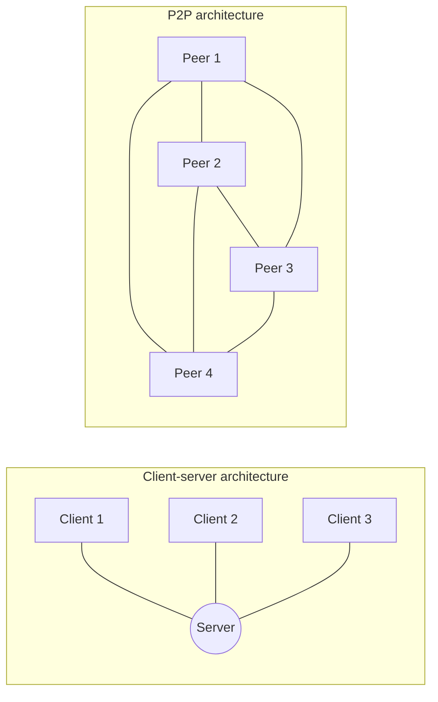
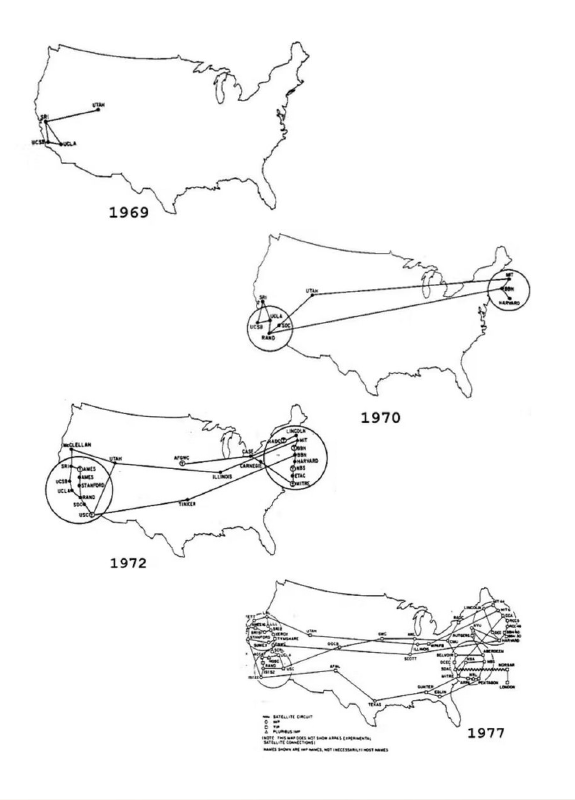
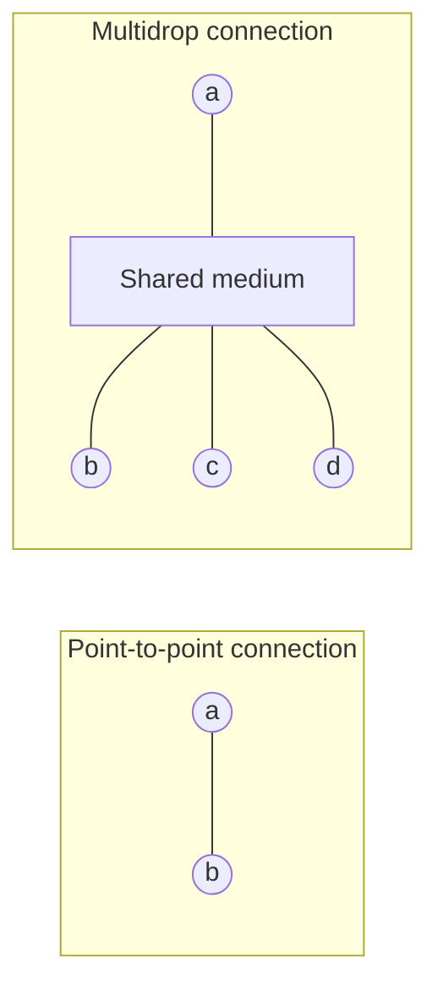
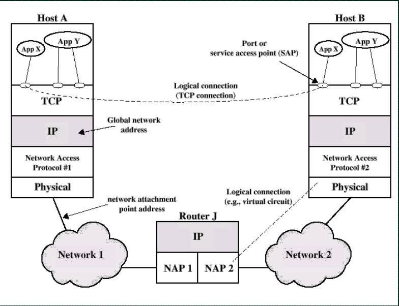
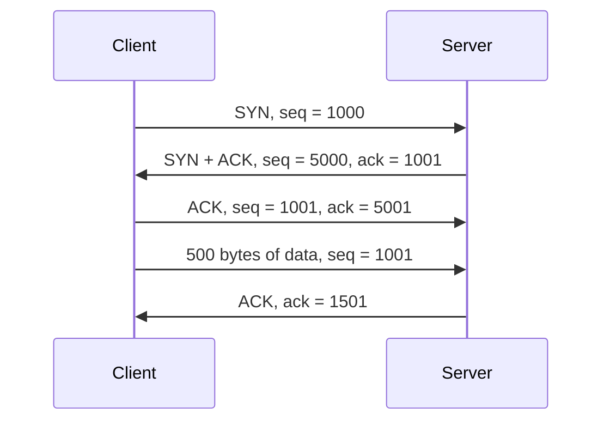
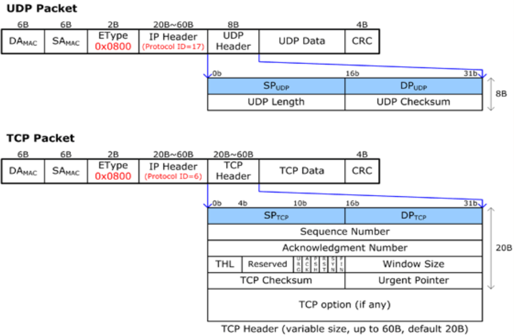
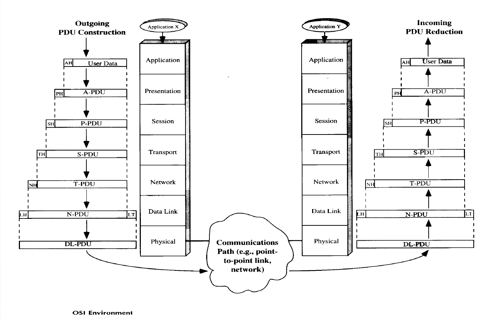
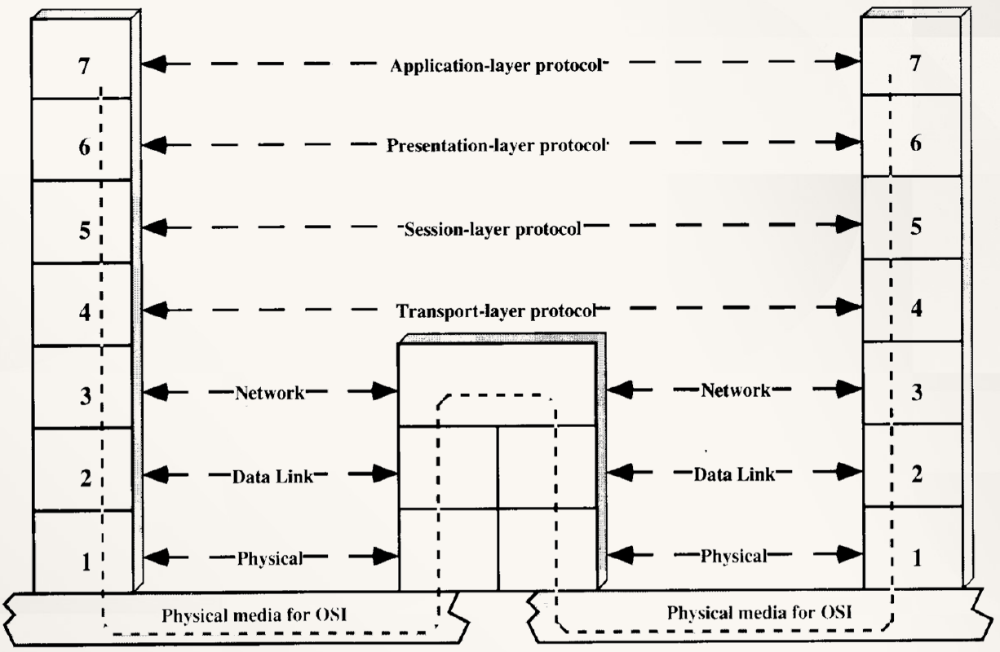
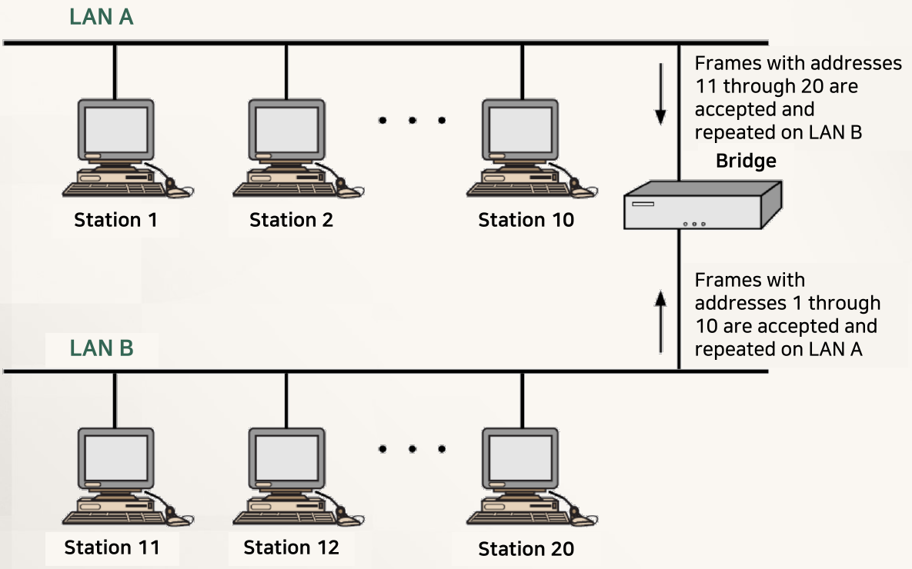
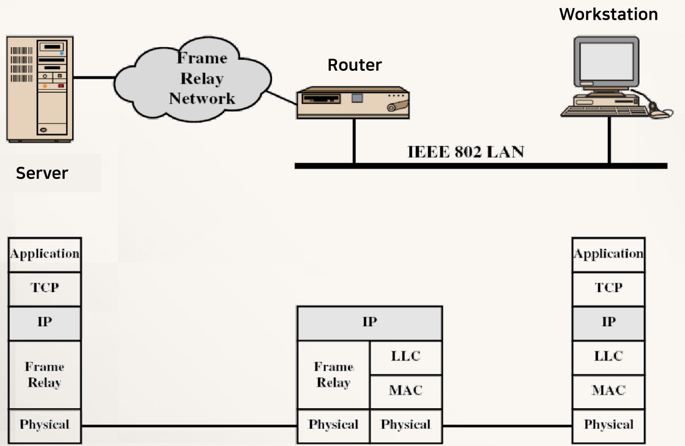

# Week 5 Lecture — Protocols and Layered Architecture

[Repository Guide](../../README.md) | [English](Concepts_Lecture.md) | [한국어](Concepts_Lecture.ko.md)

> **Last Updated:** 2026-11-17

> **Learning Objectives:**
> 1. Define a protocol and its three elements (syntax, semantics, timing), and explain why communication functions are divided into layers
> 2. Describe the role, address, and data unit of each of the five TCP/IP layers, and trace how port numbers and IP addresses deliver data to the destination process
> 3. Explain the fields of the TCP header and the IPv4 header, and compute values such as sequence numbers, acknowledgment numbers, and header lengths
> 4. Describe the function, PDU, typical devices, and protocols of each OSI layer, and map OSI layers to TCP/IP layers
> 5. Explain step by step how headers are added and removed layer by layer (encapsulation and decapsulation) at the sending host, the router, and the receiving host

---

## Table of Contents

- [1. Protocols](#1-protocols)
  - [1.1 Why Standards Are Needed](#11-why-standards-are-needed)
  - [1.2 Layered Communication and Protocol Architecture](#12-layered-communication-and-protocol-architecture)
  - [1.3 Peers and P2P](#13-peers-and-p2p)
  - [1.4 Definition and Three Elements of a Protocol](#14-definition-and-three-elements-of-a-protocol)
  - [1.5 ARPANET and the Evolution of the Internet](#15-arpanet-and-the-evolution-of-the-internet)
  - [1.6 The Seven OSI Layers and the Five TCP/IP Layers](#16-the-seven-osi-layers-and-the-five-tcpip-layers)
- [2. TCP/IP Protocols and Layered Architecture](#2-tcpip-protocols-and-layered-architecture)
  - [2.1 The Three Agents of Communication and the Five TCP/IP Layers](#21-the-three-agents-of-communication-and-the-five-tcpip-layers)
  - [2.2 Physical Layer](#22-physical-layer)
  - [2.3 Network Access Layer](#23-network-access-layer)
  - [2.4 Point-to-Point and Multidrop Connections](#24-point-to-point-and-multidrop-connections)
  - [2.5 Internet Layer](#25-internet-layer)
  - [2.6 Transport Layer](#26-transport-layer)
  - [2.7 Application Layer](#27-application-layer)
  - [2.8 Data Transfer Using TCP and IP](#28-data-transfer-using-tcp-and-ip)
  - [2.9 TCP Segments and the TCP Header](#29-tcp-segments-and-the-tcp-header)
  - [2.10 IP Datagrams and the IP Header](#210-ip-datagrams-and-the-ip-header)
  - [2.11 Frames and the Frame Header](#211-frames-and-the-frame-header)
  - [2.12 The Role of the Router and Protocol Data Units](#212-the-role-of-the-router-and-protocol-data-units)
  - [2.13 TCP/IP Application Protocols](#213-tcpip-application-protocols)
- [3. The OSI Model and Layered Architecture](#3-the-osi-model-and-layered-architecture)
  - [3.1 Origin of the OSI Reference Model](#31-origin-of-the-osi-reference-model)
  - [3.2 Principles of Layering](#32-principles-of-layering)
  - [3.3 The Seven OSI Layers](#33-the-seven-osi-layers)
  - [3.4 Data Transfer and PDUs in the OSI Model](#34-data-transfer-and-pdus-in-the-osi-model)
  - [3.5 Physical Layer](#35-physical-layer)
  - [3.6 Data Link Layer](#36-data-link-layer)
  - [3.7 Network Layer](#37-network-layer)
  - [3.8 Relay Nodes and End-to-End Protocols](#38-relay-nodes-and-end-to-end-protocols)
  - [3.9 Transport Layer](#39-transport-layer)
  - [3.10 Session Layer](#310-session-layer)
  - [3.11 Presentation Layer](#311-presentation-layer)
  - [3.12 Application Layer](#312-application-layer)
  - [3.13 PDUs, Devices, and Protocols by Layer](#313-pdus-devices-and-protocols-by-layer)
  - [3.14 Two LANs Connected by a Bridge](#314-two-lans-connected-by-a-bridge)
  - [3.15 Data Exchange Between Networks with Different Layer Structures](#315-data-exchange-between-networks-with-different-layer-structures)
  - [3.16 Processing at the Sending Host](#316-processing-at-the-sending-host)
  - [3.17 Processing at the Router](#317-processing-at-the-router)
  - [3.18 Processing at the Receiving Host](#318-processing-at-the-receiving-host)
- [Concept Applications](#concept-applications)
- [Summary](#summary)
- [Self-Check Questions](#self-check-questions)
- [References](#references)

---

<br>

## 1. Protocols

### 1.1 Why Standards Are Needed

For computers to exchange data, both sides must follow the same rules. If every party uses its own rules, two problems arise.

- **Platforms:** If every computer manufacturer or operating system has its own way of exchanging data, a separate converter or piece of software must be built every time two different platforms are connected, which is costly.
- **Applications:** If every application, such as file exchange or e-mail, uses a different communication procedure, developers must implement communication functions from scratch for each application, which makes implementation difficult.

The difference in cost can be quantified. With $N$ systems that use different methods, converting directly between every pair requires $N(N-1)/2$ converters. For $N = 10$ this is $10 \times 9 / 2 = 45$. If everyone follows one standard instead, each system only needs to implement that standard, so 10 implementations suffice. As the number of systems grows, the gap widens as the difference between $N^2$ and $N$.

### 1.2 Layered Communication and Protocol Architecture

Communication requires a great many functions, so instead of building them as one huge program, they are organized into several **layers**. The principles of layered communication are as follows.

- The modules responsible for communication functions are organized as a vertical stack.
- An upper layer performs its functions based on the services provided by the lower layer, without considering the details of how the lower layer implements them.
- Changing the implementation inside one layer does not affect, and is not affected by, the other layers.

> **Definition:** A **protocol architecture** is a structure that divides communication functions into layers and defines the tasks each layer module performs. The whole layered structure is also called a protocol stack.

```text
       System A                                     System B
  ┌─────────────────┐    Layer N+1 protocol    ┌─────────────────┐
  │    Layer N+1    │<- - - - - - - - - - - - >│    Layer N+1    │
  ├─────────────────┤                          ├─────────────────┤
  │     Layer N     │<- - - - - - - - - - - - >│     Layer N     │
  ├─────────────────┤     Layer N protocol     ├─────────────────┤
  │    Layer N-1    │                          │    Layer N-1    │
  └────────┬────────┘                          └────────┬────────┘
           └────────────── Physical link ───────────────┘
```

*Figure 1. Logical relationships between peer layers and the actual data path in layered communication*

In Figure 1, the layers of one system are stacked so that each exchanges services with the layers directly above and below it, while the horizontal dashed lines between the two systems are the logical relationships that the same layer forms through a protocol (Layer N protocol). The actual data travel down from the upper layers of system A, cross the physical link at the bottom, and travel back up in system B. Yet each layer behaves as if it were talking directly to the same layer of the other system. In a postal analogy, the letter writer does not need to know which trucks or airplanes the post office uses to carry the letter, and the way letters are written does not change when the post office changes its means of transport.

### 1.3 Peers and P2P

> **Definition:** A **peer** means a colleague: computers connected to a network can share data or peripherals with one another as equals.

> **Definition:** In a protocol architecture, two entities at the same layer in different systems are called **peer entities**, and the horizontal dashed lines in Figure 1 are the relationships between peer entities.

> **Definition:** **P2P (peer to peer)** is a method in which multiple individual users connected to the Internet exchange data directly without going through a central server.



*Figure 2. Client-server architecture and P2P architecture*

In the client-server architecture, every client sends requests to the server and the server responds, so if the server stops, the whole service stops. In the P2P architecture, each peer acts as both a client and a server, so even if some peers leave, the remaining peers can keep exchanging data. A typical example is a file-sharing program that splits a file into pieces and receives them from several peers at once.

### 1.4 Definition and Three Elements of a Protocol

> **Definition:** A **protocol** is a set of conventions that computers agree to follow so that they can communicate smoothly. It covers signal handling, error handling, encryption, authentication, addressing, and so on.

A protocol consists of the following three elements.

| Element | What it specifies | Example |
|:-----|:-----|:-----|
| Syntax | The format: how data are structured, the coding method, signal levels, and so on. | The first 4 bits of the IPv4 header are the version and the next 4 bits are the header length (Section 2.10). |
| Semantics | How each bit and field is interpreted and processed, and what to do when an error occurs. | If the SYN bit of the TCP header is 1, the segment is interpreted as a request to start a connection (Section 2.9). |
| Timing | Speed matching of the data exchange, the order of exchanges when several data items are exchanged at once, and so on. | If an acknowledgment does not arrive within a certain time, the sender retransmits the data. |

*Table 1. The three elements of a protocol*

In terms of a human conversation, syntax corresponds to grammar (which language and word order are used), semantics to the meaning of words (what the utterance asks for), and timing to the order and speed of speaking (speak after the other person finishes, speak at a pace the listener can follow).

### 1.5 ARPANET and the Evolution of the Internet

The starting point of the Internet is ARPANET.

- **ARPANET:** A computer network developed in 1969 by the Advanced Research Projects Agency (ARPA) of the U.S. Department of Defense. ARPA was renamed DARPA (Defense Advanced Research Projects Agency) in 1972. The name ARPANET combines ARPA and net, as in a mesh.
- **Protocol:** The early ARPANET was a **packet switching** network that used NCP (Network Control Protocol). As covered in Week 4, packet switching splits data into small packets that are delivered while sharing the network's resources.
- **Standards body:** Internet standards were developed under the IAB (Internet Activities Board, renamed the Internet Architecture Board in 1992).

| Year | Development |
|:-----|:-----|
| 1969 | ARPANET was built as an ARPA project, and E-mail, Telnet, FTP, Usenet, and others were later developed on it. |
| 1973 | Vint Cerf and Bob Kahn began designing TCP/IP and called a network that interconnects networks an Internet. The design was published in a 1974 paper [1]. |
| 1982 | TCP/IP was adopted as the standard protocol. ARPANET switched from NCP to TCP/IP on January 1, 1983 [2]. |
| 1983 | ARPANET was split into the military MILNET and the civilian ARPANET. |
| 1984 | DNS (domain name system), which translates domain names into IP addresses, was introduced. |
| 1986 | NSFNET, connecting universities, was formed under the leadership of the U.S. National Science Foundation (NSF). |
| 1992 | The graphical web browser MOSAIC was developed. |
| 1993 | With the arrival of service providers such as America Online and browsers such as Netscape, the Internet grew explosively. |
| 1982 | In Korea, the first TCP/IP network was built between Seoul National University and the Korea Institute of Electronics Technology (now ETRI). |

*Table 2. The evolution of the Internet*

> **Note:** The lecture material says that NSFNET (1986) was merged into ARPANET, but in fact NSFNET grew into a faster backbone than ARPANET and took over its role, and ARPANET ceased operation in 1990 [2]. Also, the first official release of MOSAIC came in 1993 and Netscape Navigator in 1994, so the years 1992-1993 in Table 2 should be read as the period when development and popularization began.



*Figure 3. ARPANET connection maps of 1969, 1970, 1972, and 1977*

Figure 3 draws the nodes and links of ARPANET by year on a map of the United States. In 1969 there were only four nodes in the west: UCLA, UCSB, SRI, and the University of Utah. By 1970, MIT, BBN, and Harvard in the east were connected, creating links across the continent, and the two regions where nodes clustered, in the west and east, are marked with circles. In 1972, the nodes in both regions had increased greatly and nodes had also appeared inland (Illinois, Tinker, and others), and by 1977 dozens of nodes, including satellite circuits, formed a mesh spanning the entire United States.

### 1.6 The Seven OSI Layers and the Five TCP/IP Layers

The two representative layered protocol architectures are the OSI model and TCP/IP.

| OSI layer | TCP/IP layer |
|:-----|:-----|
| 7. Application | Application |
| 6. Presentation | Application |
| 5. Session | Application |
| 4. Transport | Transport (host-to-host) |
| 3. Network | Internet |
| 2. Data Link | Network Access |
| 1. Physical | Physical |

*Table 3. Correspondence between the seven OSI layers and the five TCP/IP layers*

| Aspect | OSI model | TCP/IP |
|:-----|:-----|:-----|
| Nature | A framework (reference model) based on ISO international standards. | Actually used on the Internet; it became the de facto standard. |
| How it is defined | It defines the function of each layer, and the protocols of each layer were developed simultaneously as independent standards. | The implemented protocols came first, and the layered structure is a framework that describes them. |
| Adoption | The OSI protocols were complex and never became widespread. | Early on, while the OSI protocols were still being developed, TCP/IP was effectively the only option, and it spread as a simple alternative to the complexity of the OSI protocols. |

*Table 4. Comparison of the nature of the OSI model and TCP/IP*

> **Key Point:** The OSI model is a reference that describes communication functions in a finely divided way, while TCP/IP is the set of protocols that actually runs the Internet. Although the layer boundaries of the two models do not match exactly, their transport layers and network (internet) layers broadly correspond, and the OSI session, presentation, and application layers are merged into a single application layer in TCP/IP.

---

<br>

## 2. TCP/IP Protocols and Layered Architecture

### 2.1 The Three Agents of Communication and the Five TCP/IP Layers

Communication involves three agents.

1. **Applications:** Individual programs, such as e-mail or file transfer, that actually want to exchange data.
2. **Computers:** The devices on which applications run; one computer supports several applications at the same time.
3. **Networks:** The communication networks that connect computers and carry data.

Because data must be delivered from an application on one computer to an application on another computer, both a way to identify applications (port numbers) and a way to identify computers (IP addresses) are needed. TCP/IP organizes this communication into five layers.

| Layer | Name | What it does | Data unit | Address |
|:-----|:-----|:-----|:-----|:-----|
| 5. Application layer | application layer | Supports user applications. | Message | - |
| 4. Transport layer | host-to-host (transport) layer | Provides reliable data exchange between end hosts. | Segment | Port number |
| 3. Internet layer | internet layer | Routes data across multiple networks to the destination host. | Datagram (packet) | IP address |
| 2. Network access layer | network access layer | Handles data exchange between a computer and the network within the same network. | Frame | MAC address |
| 1. Physical layer | physical layer | Converts bits into signals on the transmission medium and sends them. | Bit | - |

*Table 5. Overview of the five TCP/IP layers*

> **Note:** TCP/IP is also commonly described as a four-layer model in which the physical layer and the network access layer are combined and called the network access layer. Only the number of layers differs; the functions covered are the same.

### 2.2 Physical Layer

The **physical layer** deals with the physical interface between a computer and the network. It covers the following.

- **Transmission medium:** The physical path that signals travel through, such as twisted pair, coaxial cable, optical fiber, or wireless (Week 4).
- **Signal characteristics:** Which voltage, frequency, or light intensity represents 0 and 1 (encoding in Week 4).
- **Data rate:** How many bits are sent per second.

For example, the pin layout of a connector, the maximum length of a cable, and the voltage waveform representing one bit are all physical layer specifications.

### 2.3 Network Access Layer

The **network access layer** handles data exchange between a connected computer, that is, an end system, and the network it is attached to. In terms of the seven OSI layers, it corresponds to the data link layer.

- It sends and receives the TCP/IP packets from the layer above to and from the network, converting each packet into a **frame** that the network can handle.
- It uses the **MAC address**, a physical address attached to the network interface, rather than the IP address, which is a logical address.
- It transfers data from the source to the destination within the same network.
- For the network to deliver data, the destination address is required, and services such as priority may also be requested.
- The software depends on the type of network in use. Each network type, such as circuit switching, packet switching, or LAN, has its own standards (Week 4).
- Because this layer hides the differences between network types, the layers above can communicate regardless of the network type.
- Devices include LAN equipment (network interface cards, switches, and so on), and protocols include Ethernet, Token Ring, and PPP (Point-to-Point Protocol).

### 2.4 Point-to-Point and Multidrop Connections

The data link layer connects devices in one of two ways.



*Figure 4. Point-to-point and multidrop connections*

- **Point-to-point connection:** One link connects only two devices. Data sent by a can be received only by b, so they are delivered directly without routing or addresses.
- **Multidrop connection:** Several hosts share one medium. Data sent by a reach b, c, and d alike, so the concept of an **address** that indicates the intended recipient is needed. The CAN bus of Week 3 and the Ethernet bus are multidrop connections.

### 2.5 Internet Layer

The **internet layer** corresponds to the network layer in the seven OSI layers and transfers data across multiple interconnected networks.

- To connect two different networks, or two end systems on different networks, a **router** is needed. A router is a device connected to several networks at once that passes data received from one network on to another.
- Because the format of MAC addresses differs by network type, a uniform address that can be used regardless of the type of sub network, the **IP address (Internet Protocol address)**, is needed.
- It adds an IP header to the data received from the transport layer above, creating an IP packet (IP datagram), and transmits it.
- It performs the function of transmitting IP packets between communication nodes and the **routing** function of determining a path across multiple networks.
- Protocols include IP, ARP (Address Resolution Protocol, which finds a MAC address from an IP address), and RARP (Reverse ARP, which finds an IP address from a MAC address).

### 2.6 Transport Layer

The **transport layer (host-to-host layer)** also corresponds to the transport layer in the seven OSI layers.

- **It is independent of the network type.** It works in the same way whatever network lies below.
- **It is independent of the application type.** It provides the same service whether the application is e-mail or file transfer.
- It is the layer that gathers the common functions needed for reliable data exchange. That is, it is responsible for whether data are delivered without loss (delivery), whether the content is undamaged (accuracy), and whether data arrive in the order sent (correct order).
- It controls connections between communicating nodes and provides reliable transmission.
- Protocols include TCP (Transmission Control Protocol) and UDP (User Datagram Protocol). TCP establishes a connection and guarantees reliability, whereas UDP sends quickly without a connection but does not guarantee reliability.

### 2.7 Application Layer

The **application layer** corresponds to the session, presentation, and application layers in the seven OSI layers.

- It supports a variety of user applications, and a separate module is needed for each type of application (HTTP for the web, SMTP for e-mail).
- It provides the functions that let application programs receive data and access the services of the other layers.
- Protocols include HTTP (HyperText Transfer Protocol) and SSH (Secure Shell).

### 2.8 Data Transfer Using TCP and IP

In a network made up of several sub networks, the three protocols divide their roles as follows.

| Protocol | Role |
|:-----|:-----|
| Network access protocol | Transfers data within a sub network, or up to the router attached to the sub network. |
| IP | Transfers data through routers to the destination host. |
| TCP | Transfers data reliably to the application on the destination host. |

*Table 6. Division of roles among protocols in a network made up of sub networks*



*Figure 5. Data transfer from host A to host B viewed through the TCP/IP layers*

In Figure 5, host A and host B each have TCP, IP, a network access protocol, and a physical layer. Host A is attached to network 1, host B to network 2, and router J connects the two networks. Router J has only an IP layer and a network access protocol for each of the two networks (NAP 1 and NAP 2, network access protocol). The three kinds of addresses shown in the figure are as follows.

- **Port or service access point (SAP):** An address that identifies an application (App X, App Y) within a host.
- **Global network address:** An address that identifies a host across the entire Internet, that is, the IP address.
- **Network attachment point address:** An address that identifies the point where a host is attached to a network within that network, that is, a sub network address such as a MAC address.

The steps by which an application at port 1 of host A sends data to the application at port 3 of host B are as follows.

1. The application on host A hands the data to TCP, asking it to send the data to the destination (port 3 of host B).
2. TCP attaches a TCP header containing the destination port number to the message, specifies the destination on the network (host B), and passes it to IP. IP is responsible for the data only up to the host, so it does not need to know the destination port.
3. Since destination host B is on another network, IP passes the data to the network access layer with a request to send it to router J, the first router on the way to host B.
4. Network 1 delivers the data to router J. Router J looks at the destination address in the IP header and sends the data through network 2 to host B.
5. IP on host B passes the data to TCP, and TCP looks at destination port number 3 in the header and delivers the data to the application at port 3.

The two dashed lines in the figure are logical connections. The upper dashed line is the **TCP connection** between the two TCP entities, and the lower dashed line is a logical connection of the sub network, such as a virtual circuit within network 2. Virtual circuits were covered in Week 4.

### 2.9 TCP Segments and the TCP Header

TCP splits the data stream received from the application into pieces of a certain size and attaches a TCP header to each piece, creating a **TCP segment**.

```math
\text{TCP segment} = \text{TCP header (segment header)} + \text{segmented user data}
```

The structure of the TCP header is as follows. Each row is 32 bits (4 bytes).

```text
0       4           10          16                            31
┌───────────────────────────────┬───────────────────────────────┐
│          Source port          │        Destination port       │
├───────────────────────────────┴───────────────────────────────┤
│                        Sequence number                        │
├───────────────────────────────────────────────────────────────┤
│                     Acknowledgment number                     │
├───────┬───────────┬─┬─┬─┬─┬─┬─┬───────────────────────────────┤
│ Offset│  Reserved │U│A│P│R│S│F│             Window            │
│       │           │R│C│S│S│Y│I│                               │
│       │           │G│K│H│T│N│N│                               │
├───────┴───────────┴─┴─┴─┴─┴─┴─┼───────────────────────────────┤
│            Checksum           │         Urgent pointer        │
├───────────────────────────────┴───────────────────────────────┤
│                      Options (0-40 bytes)                     │
├───────────────────────────────────────────────────────────────┤
│                              Data                             │
└───────────────────────────────────────────────────────────────┘
```

*Figure 6. Structure of the TCP header*

| Field | Size | Role |
|:-----|:-----|:-----|
| Source port | 16 bits | Port number of the sending application. |
| Destination port | 16 bits | Port number of the receiving application. |
| Sequence number | 32 bits | Number of the first byte carried in this segment. TCP numbers data byte by byte, and this number provides reliability (three-way handshake and retransmission) and flow control (sliding window). |
| Acknowledgment number | 32 bits | Number of the next byte the receiver expects to receive. It equals the number of the last successfully received byte plus 1. |
| Offset (header length) | 4 bits | Length of the TCP header in units of 4 bytes. As with HLEN in IPv4, the number of header bytes divided by 4 is written in binary. |
| Reserved | 6 bits | Reserved for future use; currently unused and set to 0. |
| Control flags | 6 bits | The six bits URG, ACK, PSH, RST, SYN, and FIN (Table 8). |
| Window | 16 bits | A flow-control field that tells the other side the remaining capacity of one's receive buffer, so that the other side decides how much data it may send at once. |
| Checksum | 16 bits | A value used to check the header and data for transmission errors. |
| Urgent pointer | 16 bits | Meaningful only when the URG flag is 1; it indicates, relative to the sequence number, how far the urgent data extend. |
| Options | 0-40 bytes | Optional features such as the maximum segment size (MSS). |

*Table 7. Fields of the TCP header*

| Flag | Name | Meaning |
|:-----|:-----|:-----|
| U (URG) | Urgent bit | Indicates that the data being sent include high-priority urgent data. Used together with the Urgent pointer. |
| A (ACK) | Acknowledgment bit | Indicates that the acknowledgment number field is valid. Used when responding to received data, and set to 1 in almost every segment after the connection is established. |
| P (PSH) | Push bit | Asks the receiver to pass received data to the application immediately instead of waiting until the TCP buffer fills. |
| R (RST) | Reset bit | Forcibly resets the connection when a problem occurs while connected. |
| S (SYN) | Synchronize bit | Always used when starting a connection with the other side; it aligns (synchronizes) the initial sequence numbers. |
| F (FIN) | Finish bit | Announces that there are no more data to send and requests the end of the connection. |

*Table 8. TCP control flags*

> **Note:** The current TCP standard (RFC 9293) shortens the reserved field to 4 bits and adds the CWR and ECE flags used for congestion notification, defining the flags as 8 bits [3], [4]. The overall header size and the positions of the other fields are unchanged.

**Computing the header length.** A TCP header without options is 20 bytes, so Offset is $20 / 4 = 5$, or `0101` in binary. With 12 bytes of options, the header is $20 + 12 = 32$ bytes and Offset is $32 / 4 = 8$, that is, `1000`. Since Offset is 4 bits, its maximum value is 15, and the maximum header length is $15 \times 4 = 60$ bytes. This is why options are at most 40 bytes ($`60 - 20 = 40`$).

**Three-way handshake.** Before sending data, TCP establishes a connection by exchanging three segments. This is called the **three-way handshake**. Let the client's initial sequence number be 1000 and the server's initial sequence number be 5000.



*Figure 7. Sequence numbers in the three-way handshake and the first data transfer*

1. The client sends a segment with the SYN flag set to 1 and initial sequence number 1000.
2. The server responds with both SYN and ACK set to 1. Its own initial sequence number is 5000, and since a SYN occupies one sequence number, it puts $1000 + 1 = 1001$ in the acknowledgment number as the next number it expects from the client.
3. The client sets ACK to 1 and sends acknowledgment number $5000 + 1 = 5001$. The connection is now established.
4. When the client sends 500 bytes, the sequence number of that segment is 1001, and the data are bytes 1001 through 1500.
5. Having received everything up to byte 1500, the server sends $1500 + 1 = 1501$ as the acknowledgment number, the next number it expects.

**Sliding window.** If the sender waited for an acknowledgment after every segment, transmission would be very slow. TCP therefore keeps a range of bytes (the window) that can be sent continuously without receiving acknowledgments, and slides this range forward each time an acknowledgment arrives. This is called the **sliding window**. If the receiver writes 4000 in the Window field, the sender sends data so that unacknowledged data never exceed 4000 bytes. When its receive buffer is full, the receiver can advertise a Window of 0 to stop the sender. This is TCP **flow control**.

### 2.10 IP Datagrams and the IP Header

> **Definition:** An **IP datagram** is the basic unit in which data are delivered by the IP protocol; it is also called an IP packet. The IP header contains the address information of the source and destination hosts.

```math
\text{IP datagram} = \text{IP header} + \text{TCP segment}
```

The total length of an IP datagram is 20-65,535 bytes, of which the header is 20-60 bytes. The structure of the IPv4 header is as follows.

```text
0       4       8               16    19                      31
┌───────┬───────┬───────────────┬───────────────────────────────┐
│  VER  │  HLEN │       DS      │          Total length         │
├───────┴───────┴───────────────┼─────┬─────────────────────────┤
│         Identification        │Flags│   Fragmentation offset  │
├───────────────┬───────────────┼─────┴─────────────────────────┤
│  Time to live │    Protocol   │        Header checksum        │
├───────────────┴───────────────┴───────────────────────────────┤
│                       Source IP address                       │
├───────────────────────────────────────────────────────────────┤
│                     Destination IP address                    │
├───────────────────────────────────────────────────────────────┤
│                      Options (0-40 bytes)                     │
└───────────────────────────────────────────────────────────────┘
```

*Figure 8. Structure of the IPv4 header*

| Field | Size | Role |
|:-----|:-----|:-----|
| VER (version) | 4 bits | Defines the version of the IP protocol. IPv4 is 4. |
| HLEN (header length) | 4 bits | The datagram header varies in length with its options, so the receiver must know where the header ends and the data begin. HLEN gives the header length in units of 4 bytes, and the receiver multiplies it by 4 to obtain the number of header bytes. |
| DS (type of service) | 8 bits | Defines how the datagram should be handled, for example with what priority. |
| Total length | 16 bits | Number of bytes of the whole IP datagram, header and data together. Being 16 bits, it is at most $2^{16} - 1 = 65535$ bytes. |
| Identification | 16 bits | A number the source assigns to each datagram it sends. All fragments of one datagram carry the same value, so the destination uses it to know which fragments to reassemble together. |
| Flags | 3 bits | Indicate fragmentation information. The first bit is unused. If the second bit (DF) is 1, fragmentation is prohibited. If the third bit (MF) is 1, more fragments follow; if 0, this is the last fragment or the only, unfragmented one. |
| Fragmentation offset | 13 bits | The relative position of this fragment's data within the whole original datagram, in units of 8 bytes. |
| Time to live (TTL) | 8 bits | The maximum number of routers the datagram may pass through. It decreases by 1 at each router, and when it reaches 0 the datagram is discarded, preventing it from circulating forever because of routing errors. |
| Protocol | 8 bits | When IP at the source encapsulates the payload of an upper layer, it writes the protocol number of that payload. ICMP is 1, TCP is 6, and UDP is 17 [5]. |
| Header checksum | 16 bits | A checksum over the header only. Because TTL changes at every router, it is recomputed at every router. |
| Source IP address | 32 bits | IP address of the host that sent the datagram. |
| Destination IP address | 32 bits | IP address of the host that is to receive the datagram. |
| Options | 0-40 bytes | Optional features such as route recording. A datagram header can have up to 40 bytes of options. |

*Table 9. Fields of the IPv4 header [6]*

> **Note:** Identification is sometimes described as a value that identifies the source host that sent the datagram, but the source host is identified by the Source IP address. Identification distinguishes the many datagrams sent by the same source so that fragments do not get mixed up and are reassembled into their original datagrams.

**Computing the header and data lengths.** If a datagram has HLEN 5 and Total length 1500, the header is $5 \times 4 = 20$ bytes and the data (TCP segment) are $1500 - 20 = 1480$ bytes. If HLEN is 15, the header has the maximum length of $15 \times 4 = 60$ bytes, of which $60 - 20 = 40$ bytes are options. The minimum value of HLEN is 5, because the fixed part of 20 bytes is present even without options.

### 2.11 Frames and the Frame Header

To cross an actual network (for example, Ethernet), the IP datagram is wrapped again in the header and trailer of the network access layer. As the unit of capacity of network transmission, this unit is sometimes broadly called a **packet**, but since it is the unit of the network access layer (data link layer), its precise name is **frame**.

```math
\text{frame} = \text{frame header} + \text{IP datagram} + \text{trailer}
```

> **Note:** The lecture material explains packet as a blend of package and bucket, but packet is the word pack with a diminutive suffix and means a small package. As a communication term, it was first used in the mid-1960s by Donald Davies of the National Physical Laboratory (NPL) in the United Kingdom to describe sending data divided into small parcels [7].

The Ethernet frame header has the following fields.

| Field | Size | Meaning |
|:-----|:-----|:-----|
| DA<sub>MAC</sub> | 6 bytes | Destination MAC address. |
| SA<sub>MAC</sub> | 6 bytes | Source MAC address. |
| EType | 2 bytes | Ethernet type, indicating which protocol the data carried in the frame belong to. IPv4 is `0x0800` [8]. |
| CRC (FCS) | 4 bytes | A trailer at the end of the frame: a cyclic redundancy check value that detects transmission errors in the whole frame. |

*Table 10. Header and trailer fields of an Ethernet frame*



*Figure 9. A UDP packet and a TCP packet carried in Ethernet frames*

Figure 9 shows what an Ethernet frame carries and in what order. The UDP packet at the top consists, in order, of DA<sub>MAC</sub> (6 bytes), SA<sub>MAC</sub> (6 bytes), EType `0x0800` (2 bytes), the IP header (20-60 bytes, Protocol field 17), the UDP header (8 bytes), UDP data, and CRC (4 bytes). The UDP header is 8 bytes, made of four 16-bit fields: source port (SP<sub>UDP</sub>), destination port (DP<sub>UDP</sub>), UDP length, and UDP checksum. In the TCP packet at the bottom, the Protocol field of the IP header is 6, and a TCP header of 20-60 bytes takes the place of the UDP header. THL (TCP header length) in the TCP header is the same field as Offset in Table 7. The UDP header is much shorter than the TCP header because UDP does not perform sequence numbering, acknowledgment, or flow control.

**Computing the frame size.** The data part (IP datagram) of an Ethernet frame is at most 1500 bytes. With an IP header (20 bytes) and a TCP header (20 bytes) without options, the user data TCP can carry in one frame are $1500 - 20 - 20 = 1460$ bytes. The whole frame is then $6 + 6 + 2 + 20 + 20 + 1460 + 4 = 1518$ bytes, and the share of user data is $`1460 / 1518 \approx 96.2\%`$. The remaining 3.8% is the headers and trailers of each layer, that is, the overhead paid for using a layered structure.

### 2.12 The Role of the Router and Protocol Data Units

The bundle of data handled by each layer is called a **protocol data unit (PDU)**. In the TCP/IP architecture, one header is added each time the data go down a layer.

```text
                      ┌───────────────────────┐
                      │       User data       │  Application byte stream
                      └───────────────────────┘
               ┌──────┬───────────────────────┐
               │ TCP  │                       │  TCP segment
               │header│                       │
               └──────┴───────────────────────┘
        ┌──────┬──────────────────────────────┐
        │  IP  │                              │  IP datagram
        │header│                              │
        └──────┴──────────────────────────────┘
 ┌──────┬─────────────────────────────────────┐
 │ Net. │                                     │  Network-level packet
 │header│                                     │
 └──────┴─────────────────────────────────────┘
```

*Figure 10. Protocol data units in the TCP/IP architecture*

In Figure 10, a TCP header is added to the application's byte stream (user data) to form a TCP segment, an IP header is added to that to form an IP datagram, and a network header is added again to form a network-level packet (frame). This process of placing the entire PDU of the layer above into the data of the layer below and adding a header is called **encapsulation**, and the reverse process at the receiver, removing headers one by one while passing data upward, is called **decapsulation**.

When router J in Figure 5 receives a datagram, it does the following.

1. It removes the network header (the header of network 1) of the frame received from network 1.
2. It checks the destination host address in the IP header to decide which network to send the datagram to.
3. It attaches a new network header for sub network 2 and transmits the content as a separate frame.

The router does not touch the content of the IP datagram (the TCP segment and data); it only swaps the outer network header. In terms of envelopes, it is like a postal relay station replacing only the outer envelope used for local transport while leaving the address on the inner envelope (the IP address) unchanged. This is why the IP address does not change from source to destination, while network addresses such as MAC addresses change every time a network is crossed.

### 2.13 TCP/IP Application Protocols

Representative application protocols running over TCP/IP are as follows.

| Protocol | Purpose | Characteristics |
|:-----|:-----|:-----|
| SMTP (Simple Mail Transfer Protocol) | The standard for transferring e-mail on the Internet. | Standardized in 1982 as RFC 821, and updated in 2008 as RFC 5321, which includes Extended SMTP (ESMTP) [9]. |
| FTP (File Transfer Protocol) | A communication protocol for computers to exchange files over TCP/IP networks. | First published in 1971 and developed so that computers connected to a network could exchange data smoothly. A derivative, FTPS, applies TLS encryption to FTP [10]. |
| TELNET | An Internet protocol for connecting to a remote host computer and using it like a terminal [11]. | Because it does not encrypt data, it has today been largely replaced by SSH. |

*Table 11. Representative TCP/IP application protocols*

The original SMTP had limitations in security and compatibility, so several extensions are used. **SMTP-AUTH** is an extension that authenticates the sender using SASL (Simple Authentication and Security Layer), and **STARTTLS** is an extension that encrypts the connection between mail servers. **MIME (Multipurpose Internet Mail Extensions)** is a data format that lets e-mail, which originally could carry only 7-bit ASCII text, carry non-ASCII characters such as Korean, images, and attachments.

---

<br>

## 3. The OSI Model and Layered Architecture

### 3.1 Origin of the OSI Reference Model

The **OSI (Open Systems Interconnection)** model was developed from around 1977 and was adopted in 1983 as the basic reference model for open systems interconnection.

- The standard is titled "The Basic Reference Model for Open Systems Interconnection" and is usually called the **OSI reference model (Open Systems Interconnection Reference Model)**.
- In 1984 ISO published it as standard ISO 7498, and CCITT (now ITU-T) as standard X.200. The current edition is ISO/IEC 7498-1:1994 [12].

An **open system** means a system that can communicate with others, even from different manufacturers, as long as it follows the published standards.

### 3.2 Principles of Layering

The overall architecture of the OSI model follows these principles.

**Layered structure**

- The communication functions are separated into a vertical layered structure.
- Each layer performs defined functions.
- Each layer uses the services of the layer directly below it to provide services to the layer directly above it.
- A change in one layer should not require changes in other layers.

**Issues in layering**

- Functions should be grouped logically. Similar functions are placed in the same layer.
- The functions should be divided finely enough that each layer can handle its share.
- However, too many layers increase the overhead of adding and processing a header at every layer, so the number of layers cannot be increased too far.

Dividing layers is thus a trade-off between two requirements. With too few layers, one layer takes on too much and becomes complex; with too many, the processing overhead grows. OSI chose seven layers as a result.

### 3.3 The Seven OSI Layers

| Layer | Name | What it does | Definition |
|:-----|:-----|:-----|:-----|
| Layer 7 | Application Layer | Provides services to applications such as e-mail, file transfer, and web browsing. | Provides access to the OSI environment for users and also provides distributed information services. |
| Layer 6 | Presentation Layer | Converts data: character codes, compression, encryption, and so on. | Provides independence to the application processes from differences in data representation (syntax). |
| Layer 5 | Session Layer | Decides session establishment, communication mode, and so on. | Provides the control structure for communication between applications; establishes, manages, and terminates connections (sessions) between cooperating applications. |
| Layer 4 | Transport Layer | Implements reliable communication. | Provides reliable, transparent transfer of data between end points; provides end-to-end error recovery and flow control. |
| Layer 3 | Network Layer | Sets up paths for communication with other networks and determines logical addresses. | Provides upper layers with independence from the data transmission and switching technologies used to connect systems; responsible for establishing, maintaining, and terminating connections. |
| Layer 2 | Data Link Layer | Transfers data between network devices and determines physical addresses. | Provides for the reliable transfer of information across the physical link; sends blocks (frames) with the necessary synchronization, error control, and flow control. |
| Layer 1 | Physical Layer | Converts and controls the physical connection and electrical signals between systems. | Concerned with transmission of an unstructured bit stream over the physical medium; deals with the mechanical, electrical, functional, and procedural characteristics to access the physical medium. |

*Table 12. Composition and functions of the seven OSI layers [13]*

To memorize the names from layer 7 to layer 1, remember them from the top in the order application, presentation, session, transport, network, data link, physical, and group them so that the lower three layers (1-3) deal with the network itself and the upper four layers (4-7) deal with communication between end systems (Section 3.8).

### 3.4 Data Transfer and PDUs in the OSI Model



*Figure 11. PDU construction at the sender and PDU reduction at the receiver in the OSI environment*

Figure 11 shows application X sending data to application Y.

1. The application X program runs and uses the services of the application layer.
2. Each of the seven layers of the left system is logically connected to the same layer of the right system.
3. The application layer needs the services of layer 6 (the presentation layer), and in the same way every layer needs the services of the layer directly below.
4. The application layer attaches an application header (AH) to the user data to create an **A-PDU (application protocol data unit)**.
5. Each layer adds its own header to the PDU coming down from the layer above. The presentation layer adds PH to the A-PDU to form a P-PDU, the session layer adds SH to form an S-PDU, the transport layer adds TH to form a T-PDU, and the network layer adds NH to form an N-PDU.
6. The data link layer adds both a header (LH) and a trailer (LT) to form a frame, the **DL-PDU**. The trailer usually contains an error-detection value.
7. The physical layer converts the DL-PDU into bits and sends them over the communication path (a point-to-point link or a network).
8. At the other computer, this process runs in reverse order. Each layer reads and processes its own header, removes it, and passes the rest to the layer above, and finally application Y receives the user data.

| Layer | Header added | PDU created |
|:-----|:-----|:-----|
| 7. Application | AH | A-PDU |
| 6. Presentation | PH | P-PDU |
| 5. Session | SH | S-PDU |
| 4. Transport | TH | T-PDU |
| 3. Network | NH | N-PDU |
| 2. Data link | LH and LT | DL-PDU |
| 1. Physical | None | Bits |

*Table 13. Headers and PDU names by OSI layer*

> **Key Point:** Each layer treats the entire PDU of the layer above as its payload and does not interpret what is inside. This is why changing the format of one layer does not affect the other layers.

### 3.5 Physical Layer

> **Definition:** The **physical layer** is the layer that defines the electrical and physical details needed to connect actual devices.

The functions of the physical layer are as follows.

- It establishes and terminates a connection to the physical medium that carries information.
- It takes part in the process by which multiple users share communication resources effectively. Examples are contention resolution among devices trying to use the medium at the same time, and flow control.
- It converts and modulates the digital data of user devices into signals that can be transmitted over the communication channel. These signals travel over copper wire, optical fiber, or wireless links.
- As the layer that transmits data bits across the network, it provides the means to establish, maintain, and release the physical connection for bit transmission between data link entities.

The characteristics of the physical layer are as follows.

- **It is the lowest layer.** It does not receive services from any lower layer and is directly connected to the transmission medium, which is not part of the OSI model.
- **It adds no header or trailer (no header and no trailer).** It transmits the PDU of the data link layer as bits, unchanged.
- **Unit:** The bit.
- **Typical devices:** Coaxial cable, antennas, hubs, and repeaters. Repeaters and hubs only regenerate and resend the received signal without interpreting its content (Week 6).
- **Protocols:** Wired specifications such as Ethernet and USB and wireless specifications such as Bluetooth, Wi-Fi, LTE, and 5G define the physical layer. These specifications often define the data link layer as well.

> **Note:** Congestion control is the function of reducing the delay and loss caused by heavy traffic inside the network, and it is generally handled by the transport and network layers. What the physical layer takes part in is low-level resource sharing such as contention resolution among devices trying to seize the medium.

### 3.6 Data Link Layer

> **Definition:** The **data link layer** is the layer that ensures reliable transmission, including error control based on the cyclic redundancy check (CRC) and flow control.

The functions of the data link layer are as follows.

- It transfers data between entities on the network and provides the functional and procedural means to detect, and possibly correct, errors that may occur in the physical layer.
- Addresses are assigned physically. This means the MAC address is fixed from the time the network card is manufactured. The address structure is flat, with no hierarchy, so the address alone does not tell which region or network the device is in.
- It provides the means to activate, maintain, and deactivate the link.

The characteristics of the data link layer are as follows.

- **Unit:** The frame.
- **Typical devices:** L2 switches, modems, base stations, home Internet routers, and Wi-Fi routers.
- **Protocols and functions:** Ethernet, CSMA/CD, CSMA/CA, slotted ALOHA, DAC/ADC, multiplexers and demultiplexers, MAC address management, and so on. CSMA/CD, ALOHA, and CRC are covered in Week 7.

> **Note:** Actual devices and functions often do not fit neatly into a single layer. DAC/ADC (digital-to-analog conversion and its reverse) and modems, which modulate signals, deal with signals and are closer to the physical layer. A home Internet router is a router (layer 3) that forwards packets by IP address, combined with an L2 switch and a wireless access point. When mapping a device to a layer, use as the criterion which header of the data the device reads up to and bases its decisions on.

### 3.7 Network Layer

> **Definition:** The **network layer** is the layer that finds the path each time data pass through multiple nodes.

The functions of the network layer are as follows.

- It delivers data of various lengths across multiple networks and, in doing so, provides the functional and procedural means to deliver the quality of service (QoS) requested by the transport layer.
- It performs routing, packet forwarding, segmentation and desegmentation, internetworking, and so on. **Routing** is deciding the path to the destination, and **forwarding** is sending a received packet out on the appropriate output link according to the chosen path. Segmentation is splitting data into sizes the network accepts; IP fragmentation (Section 2.10) is an example.
- It makes the Internet possible by delivering data to other connected networks. It has a logical address structure (IP addresses) in which network administrators assign addresses directly. An IP address is hierarchical, divided into a network part and a host part, so a router can decide the path by looking only at the network part of the address.
- It specifies the destination address and can request network priority and the like.
- Routers operate at this layer, and there are also switches that operate at this layer (L3 switches).

When stations are connected by a direct point-to-point link, no network layer is needed and the data link layer handles everything, because with only one link there is no path to choose.

### 3.8 Relay Nodes and End-to-End Protocols

The following is the communication of two systems connected through a single network, such as a circuit-switching or packet-switching network.



*Figure 12. Two OSI systems communicating through one network node*

- A packet passes through one or more network nodes.
- A network node functions as a relay that has only layers 1-3. The box in the middle of Figure 12 is the network node, and the dashed line is the path of the data: down from layer 7 of the left system, up to layer 3 of the node, back down, and up to layer 7 of the right system.
- The upper four layers (4-7) operate only between the two end systems, independently of the network nodes. These are called **end-to-end protocols**.
- The layer 1 and layer 2 protocols support information exchange between a station and a node, that is, between adjacent devices.
- Layer 3 handles switching and routing.

> **Key Point:** Layers 1-3 operate hop by hop, and layers 4-7 operate end to end. This is why the transport layer is called the lowest layer that deals with end-to-end communication.

### 3.9 Transport Layer

> **Definition:** The **transport layer** is the layer that lets users at both ends exchange data reliably, so that the upper layers need not concern themselves with the validity or efficiency of data delivery.

The functions of the transport layer are as follows.

- It implements communication without errors, without data loss, and without data duplication.
- It is also involved in optimizations for quality of service, such as transmission delay.
- For reliable delivery across a series of links, it checks again between the ends for errors such as those occurring at intermediate nodes, so some of its functions duplicate layer 2 error control. Layer 2 is responsible only for errors on a single link, so losses that occur inside intermediate routers must be checked again end to end.
- The size and complexity of the transport layer depend on the type of service provided by layer 3.
- It uses error control based on sequence numbers. The transport layer checks whether packets were delivered correctly and retransmits the packets that failed.
- It is the lowest layer that deals with end-to-end communication. It provides reliable and efficient data transfer between the ends and performs error detection and recovery, flow control, duplicate checking, and so on.
- **Unit:** The segment.
- **Typical device:** The L4 switch, which looks as far as TCP and UDP port numbers to distribute traffic across several servers (Week 6).
- **Protocols:** TCP and UDP.

> **Note:** The statement that the complexity of the transport layer depends on the layer 3 service means the following. If the network layer provides a reliable service that guarantees order and delivery, such as a virtual circuit, a minimal transport layer on top of it is sufficient. Conversely, on top of a service such as IP that delivers datagrams without guarantees, the transport layer must handle loss, reordering, and duplication, so a complex protocol such as TCP is required [13]. The lecture material states this as "at least layer 4 is required for the virtual circuit function of layer 3," but the original meaning is that a minimal layer 4 suffices when layer 3 provides a reliable virtual circuit service.

### 3.10 Session Layer

> **Definition:** The **session layer** is the layer that provides the means for the application processes at both ends to manage their communication.

The functions of the session layer are as follows.

- It decides the communication mode, **simplex** (sending in one direction only), **half-duplex** (both sides sending in turn), or **full-duplex** (both sides sending and receiving at the same time), and performs checkpointing, idling, termination, and restart procedures.
- It creates and tears down communication sessions, synchronizes the communicating users, and handles error-recovery commands.
- It controls the dialogue between two end systems.
  - **Dialogue rules:** Decide whose turn it is to send and when.
  - **Grouping:** Bundle data into meaningful units. For example, several transaction records are grouped so that they are processed only when the whole group has arrived.
  - **Checkpoint-based error recovery:** Checkpoints are placed throughout a long transfer so that, after a failure, sending resumes from the last checkpoint rather than from the beginning.
- In many cases the session layer is not needed. Only applications that need these functions use this layer.

**Effect of checkpoints.** If the connection is lost at the 90 MB point while sending a 100 MB file, then without checkpoints all 100 MB must be resent from the start, but with a checkpoint every 10 MB, only the remaining 10 MB need to be resent from the checkpoint at 90 MB.

> **Note:** The L4 switch is sometimes listed as the typical device of the session layer, and TCP and UDP as its protocols. However, TCP and UDP are transport layer protocols. TCP/IP has no separate session layer, so TCP connection establishment and release partly take over the role of starting and ending a session, and applications handle the remaining session functions themselves. The session layer protocol of the OSI protocol suite is ISO 8327 (ITU-T X.225).

### 3.11 Presentation Layer

> **Definition:** The **presentation layer** is the layer responsible for translation between codes, handling the differences in data formats among user systems.

The functions of the presentation layer are as follows.

- It encodes and converts application layer data so that data coming from the sender's device can be interpreted by the application on the receiver's device.
- It compresses data in a way that the receiver can decompress.
- It encrypts data for transmission and decrypts received data.
- Operations such as MIME encoding and encryption take place at this layer. Examples include converting a document file encoded in EBCDIC into a file encoded in ASCII, and converting multimedia data such as voice and video.
- **Protocols and formats:** ASCII, Unicode, MIME, EBCDIC, UTF-8, MBCS, EUC-KR, JPG, MP3, MPEG, and so on. Strictly speaking, these are data representation formats rather than communication procedures.

**Example of character code conversion.** Capital A is `0x41` in ASCII and `0xC1` in EBCDIC, which was used on IBM mainframes. If two such systems exchanged bytes as they are, the same byte would be interpreted as different characters, so the presentation layer must convert them into a common format. The Korean character "가" is likewise represented differently: as the 2 bytes `0xB0A1` in EUC-KR and as the 3 bytes `0xEAB080` in UTF-8.

### 3.12 Application Layer

> **Definition:** The **application layer** is the layer that interacts directly with application processes and performs common application services.

- Common application services provide the exchange between related application processes. For example, HTTP for the WWW is a protocol that operates at layer 7 (L7).
- It provides the means for application programs to access the OSI environment. It supports management functions and many applications; general-purpose applications include file transfer, e-mail, and remote terminals.
- **Unit:** The message, or data.
- **Typical devices:** L7 switches and firewalls. These devices inspect application layer content, such as the URL of an HTTP request, to make decisions.
- **Protocols:** FTP, HTTP, HTTPS, XML, Telnet, SSH, SMTP, POP3, IMAP, and so on. POP3 and IMAP are protocols for retrieving mail from a mail server, and XML is a data format carried by HTTP and others rather than a protocol.
- It communicates with the layers below (L4-L5) through port numbers. For example, HTTP uses port 80, HTTPS port 443, and SMTP port 25.

### 3.13 PDUs, Devices, and Protocols by Layer

Summarizing Sections 3.5-3.12 together with the TCP/IP layers gives the following.

| OSI layer | TCP/IP layer | PDU | Typical devices | Typical protocols and formats |
|:-----|:-----|:-----|:-----|:-----|
| 7. Application | Application | Message (data) | L7 switch, firewall | HTTP, HTTPS, FTP, SMTP, POP3, IMAP, Telnet, SSH |
| 6. Presentation | Application | Message (data) | - | ASCII, Unicode, UTF-8, EUC-KR, MIME, JPG, MPEG |
| 5. Session | Application | Message (data) | - | ISO 8327 (handled by applications in TCP/IP) |
| 4. Transport | Transport | Segment | L4 switch | TCP, UDP |
| 3. Network | Internet | Packet (datagram) | Router, L3 switch | IP, ARP, ICMP |
| 2. Data link | Network access | Frame | L2 switch, bridge | Ethernet, PPP, Token Ring, CSMA/CD |
| 1. Physical | Physical | Bit | Repeater, hub, cable, antenna | Ethernet physical specifications, USB, Bluetooth |

*Table 14. PDUs, typical devices, and typical protocols by layer*

### 3.14 Two LANs Connected by a Bridge



*Figure 13. LAN A and LAN B connected by a bridge*

In Figure 13, LAN A has stations with addresses 1-10, LAN B has stations with addresses 11-20, and a **bridge** connects the two LANs. The bridge operates at the data link layer and filters frames as follows.

- When it receives a frame on LAN A whose destination address is 11-20, it accepts the frame and repeats it on LAN B.
- When it receives a frame on LAN B whose destination address is 1-10, it accepts the frame and repeats it on LAN A.
- A frame that stays within one LAN, such as a frame from station 2 to station 10, is not passed to the other LAN.

In this way the two LANs communicate as if they were one large LAN, while the traffic inside each LAN does not consume the bandwidth of the other. When the bridge forwards a frame, it looks only at data link layer addresses and not at the IP header. How a bridge learns which address is on which side is covered in Week 6, and the comparison of bridges and routers in Week 7.

### 3.15 Data Exchange Between Networks with Different Layer Structures



*Figure 14. Protocol stacks of a server and a workstation communicating across a frame relay network and an IEEE 802 LAN*

In Figure 14, the server is connected to a frame relay network, the workstation to an IEEE 802 LAN, and a router connects the two networks. The protocol stacks of the three devices are as follows.

- **Server:** Application, TCP, IP, frame relay, and physical layers.
- **Router:** Frame relay and physical layers on one side, LLC, MAC, and physical layers on the other, and above them an IP layer shared by both sides. It has no TCP or application layer.
- **Workstation:** Application, TCP, IP, LLC, MAC, and physical layers. In an IEEE 802 LAN, the data link layer is divided into two sublayers, LLC (logical link control) and MAC (medium access control) (Week 7).

The lower-layer structures of the two end systems differ, but both use IP and TCP, so they can exchange data. This is because the router unwraps the frame of one network at the IP layer and rewraps the datagram in a frame of the other network. Divided into 20 steps, this process is as follows (Sections 3.16-3.18). Each step is accompanied by a **peer-to-peer dialogue** between the same layers.

### 3.16 Processing at the Sending Host

| Step | Name | What happens | Peer-to-peer dialogue |
|:-----|:-----|:-----|:-----|
| 1 | Preparing the data | The application prepares the block of data to transmit. The data may be e-mail (SMTP), a file (FTP), user input (Telnet), and so on. | Before sending data, the sending and receiving applications agree on the format and encoding of the data and on the data exchange. |
| 2 | Using a common syntax | If necessary, the data are converted into a form suited to the destination. This includes character format conversion, encryption, compression, and so on. | |
| 3 | Segmenting the data | If necessary, TCP divides the data into several segments. Each TCP segment includes a header carrying a sequence number and a checksum for error checking. | The two TCP entities agree to open a connection. |
| 4 | Duplicating segments | A copy of each TCP segment is kept so that it can be resent if data are lost or damaged. When an ACK arrives from the peer TCP entity, the copied segment is deleted. | |
| 5 | Fragmenting the segment | If necessary, IP divides the TCP segment into several IP datagrams to fit the specifications of the networks to be crossed. Each datagram gets a header with control information such as the destination address and a checksum. | IP pushes each IP datagram toward the destination system through networks and routers. |
| 6 | Framing | A frame relay header and trailer are added to the IP datagram. The header carries the frame relay connection identifier (connection ID), and the trailer carries the FCS (frame check sequence). | Each frame is forwarded through the frame relay network. |
| 7 | Transmission | The frame is sent over the transmission medium as a sequence of bits. | |

*Table 15. Processing steps at the sending host (server)*

### 3.17 Processing at the Router

| Step | Name | What happens | Peer-to-peer dialogue |
|:-----|:-----|:-----|:-----|
| 8 | Arriving at the router | The signal received over the transmission medium is interpreted as a frame of bits. | |
| 9 | Processing the frame | The frame relay layer removes and processes the header and trailer. The FCS is used for error detection, and the connection number (connection ID) identifies the source (sender). | |
| 10 | Routing the packet | IP decides the route based on the IP header information. After deciding which link to send it on, it passes the datagram to the link layer of that link. | The router forwards the datagram to another router or to the destination system. |
| 11 | Forming the LLC PDU | An LLC header is added to the IP datagram to form an LLC PDU. The header carries a sequence number and address information. | |
| 12 | Framing | A MAC header and trailer are added to the LLC PDU to form a MAC frame. The header carries address information and the trailer the FCS. | |
| 13 | Transmission | The MAC frame is sent over the transmission medium as a sequence of bits. | |

*Table 16. Processing steps at the router*

At step 9 the router strips the frame relay envelope, and at steps 11-12 it puts on a new LAN envelope. This is similar to changing envelopes, and the IP datagram in between stays almost as it is (only the TTL and the header checksum change). The frames on the two links look as follows.

```text
Frame relay link (server - router)
┌───┬───┬───┬────────────────┬───┐
│ F │ I │ T │      Data      │ F │
└───┴───┴───┴────────────────┴───┘
IEEE 802 LAN link (router - workstation)
┌───┬───┬───┬───┬────────────────┬───┐
│ M │ L │ I │ T │      Data      │ M │
└───┴───┴───┴───┴────────────────┴───┘
F: frame relay header/trailer   I: IP header   T: TCP header
L: LLC header   M: MAC header/trailer
```

*Figure 15. Header composition of the frame on each link*

### 3.18 Processing at the Receiving Host

| Step | Name | What happens |
|:-----|:-----|:-----|
| 14 | Arriving at the destination | The signal received over the transmission medium is interpreted as a frame of bits. |
| 15 | Processing the frame | The MAC layer removes and processes the header and trailer. The FCS is used for error detection. |
| 16 | Processing the LLC PDU | The LLC layer removes and processes its header. The sequence number is used for flow control and error detection. |
| 17 | Processing the IP datagram | IP removes its header and processes the checksum and other control information. |
| 18 | Processing the TCP segment | TCP removes its header. It checks the checksum and sends an ACK if it matches, or discards the segment if it does not. Flow control also takes place at this step. |
| 19 | Reassembling user data | If TCP split the user data into several segments, they are reassembled into the original block and passed to the application. |
| 20 | Delivering the data | The application performs any needed work, such as decryption and decompression, and directs the data to the appropriate file or other destination. |

*Table 17. Processing steps at the receiving host (workstation)*

Steps 14-20 at the receiver are the exact reverse of steps 1-7 at the sender. If the sender compressed and encrypted at step 2, the receiver decrypts and decompresses at step 20, and if the sender split the data at step 3, the receiver joins them at step 19. When the ACK sent by TCP at step 18 reaches the sender, the sender deletes the segment copy it kept at step 4. If no ACK arrives, the sender resends the segment from the copy.

---

<br>

## Concept Applications

| Situation | Concept to apply |
|:-----|:-----|
| A web browser opens an HTTP (port 80) and an HTTPS (port 443) connection to the same server at the same time. | Even with the same IP address, the two connections have different destination port numbers and are distinguished at the transport layer (Sections 2.6 and 2.8). |
| A packet traveled from Seoul to Busan through 10 routers. | The IP address stays the same from source to destination, but the MAC addresses of the frame are set anew at every router (Section 2.12). |
| The receiving application reads data slowly and its receive buffer fills up. | The TCP receiver performs flow control by advertising a Window field of 0 to stop the sender (Section 2.9). |
| A 4000-byte IP datagram must be sent over a network with a 1500-byte MTU. | IP fragments the datagram, and the fragments carry the same Identification and different Fragmentation offsets (Section 2.10). |
| EBCDIC text from a mainframe was sent to an ASCII environment on a PC, and the characters came out garbled. | The character code conversion that the presentation layer handles was missing (Section 3.11). |
| Two PCs are connected directly by a single crossover cable. | It is a point-to-point link, so no path selection is needed and they can communicate with the data link layer alone (Section 3.7). |

*Table 18. Concept application cases*

**True/False Check:**

| Statement | Judgment and Reason |
|:-----|:-----|
| A router decides the next path by looking at the port number in the TCP header. | **F.** A router is a layer 3 device that decides the path by the destination IP address in the IP header. |
| The physical layer adds no header or trailer to the PDU. | **T.** It transmits the PDU of the data link layer as bits, unchanged. |
| The TCP acknowledgment number is the number of the last byte received. | **F.** It is the next number the receiver expects, that is, the number of the last byte received plus 1. |
| If HLEN of an IPv4 header is 5, the header is 5 bytes. | **F.** HLEN is in units of 4 bytes, so the header is $5 \times 4 = 20$ bytes. |
| The OSI session, presentation, and application layers correspond to the TCP/IP application layer. | **T.** TCP/IP combines the functions of the three layers into one application layer. |
| A network node (router) processes all seven OSI layers. | **F.** A network node acts as a relay with only layers 1-3, and layers 4-7 operate only between end systems. |

---

<br>

## Summary

| Concept | Key Summary |
|:-----|:-----|
| Standards and layers | Without standards, each platform and application needs its own implementation, so communication functions are divided into layers and a standard protocol is defined for each layer. |
| Protocol | A set of communication conventions between computers, made of three elements: syntax (format), semantics (interpretation and processing), and timing (speed and order). |
| Evolution of the Internet | It began with ARPANET in 1969, switched to TCP/IP in 1983, and became today's Internet by way of NSFNET and web browsers. |
| Five TCP/IP layers | They are the physical, network access (frame, MAC address), internet (datagram, IP address), transport (segment, port number), and application layers. |
| Three kinds of addresses | Port numbers identify applications, IP addresses identify hosts across the whole Internet, and MAC addresses identify attachment points within one network. |
| TCP header | A 20-60 byte header made of source and destination ports, sequence number, acknowledgment number, header length, control flags, window, checksum, urgent pointer, and options. |
| Three-way handshake | Three segments, SYN, SYN+ACK, and ACK, align both sides' initial sequence numbers and establish the connection. |
| IP header | It consists of the version, header length, type of service, total length, fragmentation information, TTL, protocol number, header checksum, and source and destination IP addresses. |
| Encapsulation | The sender adds headers (and, at the data link layer, a trailer) going down the layers, and the receiver removes them in reverse. |
| Router | It removes the network header, decides the path by the destination IP address, and adds the header of the next network, so the IP address is kept while the MAC address changes. |
| Seven OSI layers | They are the physical, data link, network, transport, session, presentation, and application layers; layers 1-3 operate hop by hop and layers 4-7 end to end. |
| PDU | Each layer handles data in units of bits, frames, packets (datagrams), segments, and messages. |
| 20-step data transfer | The sending host prepares, converts, segments, duplicates, fragments, frames, and transmits; the router unwraps the frame, routes, and wraps it in a new frame; and the receiving host processes everything in reverse. |

---

<br>

## Self-Check Questions

1. **Effect of standards:** Twelve systems that use different communication methods must communicate with one another. Find the number of implementations needed when a converter is placed for every pair and when a common standard is used.

   <details>
   <summary>Answer</summary>

   A converter for every pair requires $12 \times 11 / 2 = 66$ converters. With a common standard, each system only needs to implement the one standard, so 12 implementations suffice.

   </details>

2. **Three elements of a protocol:** To which element of a protocol does each of the following belong: "the lower 6 bits of the 14th byte of the TCP header are flags," "a SYN bit of 1 means a connection request," and "resend if an acknowledgment does not arrive within a certain time"?

   <details>
   <summary>Answer</summary>

   The first specifies the format of the data, so it is syntax; the second specifies the meaning and processing of a bit, so it is semantics; and the third specifies when to resend, so it is timing.

   </details>

3. **Roles of addresses:** When data are sent from port 1 of host A to port 3 of host B on another network, explain at which layer and for which part of the delivery the port number, the IP address, and the MAC address are each used.

   <details>
   <summary>Answer</summary>

   The port numbers (1 and 3) are carried in the TCP header of the transport layer and are used to determine which application inside the destination host receives the data. The IP address is carried in the IP header of the internet layer and is used to determine the path over the whole journey from the source host to the destination host across several networks; it does not change along the way. The MAC address is carried in the frame header of the network access layer and is used for delivery over a segment within one network (host A to the router, the router to host B); it changes every time a network is crossed.

   </details>

4. **Sequence and acknowledgment numbers:** The client's initial sequence number is 3000 and the server's is 8000. Write the seq and ack of the three segments of the three-way handshake, then find the seq when the client sends 200 bytes and the ack the server returns.

   <details>
   <summary>Answer</summary>

   The first segment, SYN, has seq = 3000. The second, SYN+ACK, has seq = 8000 and ack = 3001. The third, ACK, has seq = 3001 and ack = 8001. The client's 200 bytes have seq = 3001 and carry bytes 3001-3200, so the server sends ack = $3200 + 1 = 3201$.

   </details>

5. **Header length:** The Offset field of a TCP header is `0111`. Find the header length and the length of the options. Also find the data length when the HLEN of an IPv4 header is 6 and Total length is 576.

   <details>
   <summary>Answer</summary>

   `0111` is 7, so the TCP header is $7 \times 4 = 28$ bytes and the options are $28 - 20 = 8$ bytes. The IPv4 header is $6 \times 4 = 24$ bytes, so the data are $576 - 24 = 552$ bytes.

   </details>

6. **Frame size:** Data are sent with UDP over Ethernet. With no IP header options, find the maximum length of UDP data that fits in one frame and the total length of the frame at that time (including DA, SA, EType, and CRC).

   <details>
   <summary>Answer</summary>

   The data part of an Ethernet frame is at most 1500 bytes; subtracting the 20-byte IP header and the 8-byte UDP header leaves $1500 - 20 - 8 = 1472$ bytes of UDP data. The whole frame is $6 + 6 + 2 + 1500 + 4 = 1518$ bytes.

   </details>

7. **Router operation:** Explain what a router changes and what it does not change when it sends a datagram on to the next network.

   <details>
   <summary>Answer</summary>

   The router removes the network header and trailer of the received frame and attaches the header and trailer of the next network (a new MAC address and a new FCS). In the IP header, it decreases TTL by 1 and recomputes the header checksum accordingly. It does not change the source and destination IP addresses, the TCP segment, or the user data.

   </details>

8. **Identifying OSI layers:** State the OSI layer of each function: (a) compressing a video into MPEG, (b) choosing the path to the destination among several paths, (c) restarting an interrupted file transfer from the last checkpoint, (d) detecting link errors with the CRC of a frame, (e) retransmitting a lost segment end to end.

   <details>
   <summary>Answer</summary>

   (a) is conversion and compression of the data format, so layer 6 (presentation); (b) is routing, so layer 3 (network); (c) is checkpoint-based dialogue recovery, so layer 5 (session); (d) is error detection per link, so layer 2 (data link); and (e) is end-to-end reliability, so layer 4 (transport).

   </details>

9. **End to end versus hop by hop:** Explain why the transport layer checks for errors again end to end even though the data link layer already checks every link.

   <details>
   <summary>Answer</summary>

   The data link layer is responsible only for bit errors on a single link. Problems such as data being discarded when a router's buffer overflows, data being corrupted in a router's memory, or data arriving out of order because they took different paths cannot be detected by checks on each link. Therefore the reliability of the whole path must be checked again between the end systems with sequence numbers, checksums, acknowledgments, and retransmission.

   </details>

10. **Tracing the 20 steps:** In the configuration of Figure 14, a TCP segment sent by the server was damaged and failed the checksum check at the workstation. Explain, citing step numbers, what happens at which step and how the sender recovers.

    <details>
    <summary>Answer</summary>

    At step 18, TCP at the workstation checks the checksum, finds that it does not match, discards the segment, and sends no ACK. TCP at the server has kept a copy of the segment since step 4, so if no ACK arrives within the set time, it resends the segment from the copy. The retransmitted segment again goes through steps 5-13 to reach the workstation, and if the checksum matches this time, an ACK comes back and the server deletes the copy.

    </details>

---

<br>

## References

1. V. Cerf and R. Kahn, "A protocol for packet network intercommunication," *IEEE Transactions on Communications*, vol. 22, no. 5, pp. 637-648, 1974.
2. B. M. Leiner, V. G. Cerf, D. D. Clark, R. E. Kahn, L. Kleinrock, D. C. Lynch, J. Postel, L. G. Roberts, and S. Wolff, "A brief history of the Internet," *ACM SIGCOMM Computer Communication Review*, vol. 39, no. 5, pp. 22-31, 2009.
3. W. Eddy, Ed., "Transmission Control Protocol (TCP)," RFC 9293, Aug. 2022. https://www.rfc-editor.org/rfc/rfc9293
4. K. Ramakrishnan, S. Floyd, and D. Black, "The Addition of Explicit Congestion Notification (ECN) to IP," RFC 3168, Sep. 2001.
5. IANA, "Protocol Numbers," Internet Assigned Numbers Authority. https://www.iana.org/assignments/protocol-numbers
6. J. Postel, "Internet Protocol," RFC 791, Sep. 1981. https://www.rfc-editor.org/rfc/rfc791
7. J. Abbate, *Inventing the Internet*. Cambridge, MA, USA: MIT Press, 1999.
8. C. Hornig, "A Standard for the Transmission of IP Datagrams over Ethernet Networks," RFC 894, Apr. 1984.
9. J. Klensin, "Simple Mail Transfer Protocol," RFC 5321, Oct. 2008. https://www.rfc-editor.org/rfc/rfc5321
10. P. Ford-Hutchinson, "Securing FTP with TLS," RFC 4217, Oct. 2005.
11. J. Postel and J. Reynolds, "Telnet Protocol Specification," RFC 854, May 1983.
12. ISO/IEC 7498-1:1994, *Information technology - Open Systems Interconnection - Basic Reference Model: The Basic Model*, International Organization for Standardization, 1994.
13. W. Stallings, *Data and Computer Communications*, 10th ed. Boston, MA, USA: Pearson, 2014.
