# 6주차 이론 — 네트워크 토폴로지

[레포지토리 안내](../../README.ko.md) | [English](Concepts_Lecture.md) | [한국어](Concepts_Lecture.ko.md)

> **최종 수정일:** 2026-11-27

> **학습 목표:**
> 1. 리피터, 허브, 브리지, 스위치, 라우터, 게이트웨이를 동작 계층과 기능으로 구분하고, 브리지의 다섯 동작을 예에 적용할 수 있다
> 2. 버스, 트리, 링, 스타 토폴로지의 구조, 동작, 장단점을 비교하고, 요구 조건에 맞는 토폴로지와 전송 매체를 고를 수 있다
> 3. 기저대역과 광대역 동축 케이블 전송, 듀얼 케이블과 스플릿 구성, 광섬유 버스의 탭 방식을 설명할 수 있다
> 4. 링 리피터의 세 상태, 링의 데이터 삭제 방식, 타이밍 지터, 스타-링 구조의 장점을 설명할 수 있다
> 5. 허브와 LAN 스위치를 비교하고, 광 손실 예산으로 수동적 스타 커플러 LAN의 운용 범위를 계산할 수 있다
> 6. 구조화된 케이블 시스템의 구성과 영국 HORIBA MIRA의 시험 시설을 설명할 수 있다

---

## 목차

- [1. 네트워크 연결 장비와 토폴로지의 종류](#1-네트워크-연결-장비와-토폴로지의-종류)
  - [1.1 게이트웨이의 개념과 종류](#11-게이트웨이의-개념과-종류)
  - [1.2 리피터와 허브](#12-리피터와-허브)
  - [1.3 브리지](#13-브리지)
  - [1.4 스위치](#14-스위치)
  - [1.5 라우터](#15-라우터)
  - [1.6 토폴로지의 정의](#16-토폴로지의-정의)
  - [1.7 버스 토폴로지와 트리 토폴로지](#17-버스-토폴로지와-트리-토폴로지)
  - [1.8 링 토폴로지](#18-링-토폴로지)
  - [1.9 스타 토폴로지](#19-스타-토폴로지)
  - [1.10 토폴로지의 선택](#110-토폴로지의-선택)
  - [1.11 전송 매체의 선택과 토폴로지의 상관성](#111-전송-매체의-선택과-토폴로지의-상관성)
- [2. 버스/트리 토폴로지와 링 토폴로지](#2-버스트리-토폴로지와-링-토폴로지)
  - [2.1 멀티포인트 구성의 문제](#21-멀티포인트-구성의-문제)
  - [2.2 기저대역 동축 케이블](#22-기저대역-동축-케이블)
  - [2.3 광대역 동축 케이블](#23-광대역-동축-케이블)
  - [2.4 광대역 구성 요소와 캐리어 대역](#24-광대역-구성-요소와-캐리어-대역)
  - [2.5 광섬유 버스](#25-광섬유-버스)
  - [2.6 링 토폴로지의 동작](#26-링-토폴로지의-동작)
  - [2.7 링 리피터의 상태](#27-링-리피터의-상태)
  - [2.8 링 토폴로지의 장점과 문제점](#28-링-토폴로지의-장점과-문제점)
  - [2.9 타이밍 지터](#29-타이밍-지터)
  - [2.10 스타-링 아키텍처](#210-스타-링-아키텍처)
- [3. 스타 토폴로지와 구조화된 케이블 시스템](#3-스타-토폴로지와-구조화된-케이블-시스템)
  - [3.1 꼬임쌍선 스타 LAN](#31-꼬임쌍선-스타-lan)
  - [3.2 StarLAN과 계층형 허브](#32-starlan과-계층형-허브)
  - [3.3 버스, 허브, 스위칭 허브](#33-버스-허브-스위칭-허브)
  - [3.4 LAN 스위치의 전달 방식](#34-lan-스위치의-전달-방식)
  - [3.5 수동적 스타 커플러](#35-수동적-스타-커플러)
  - [3.6 광 손실과 운용 범위](#36-광-손실과-운용-범위)
  - [3.7 구조화된 케이블 시스템](#37-구조화된-케이블-시스템)
- [4. 부록: 영국의 HORIBA MIRA](#4-부록-영국의-horiba-mira)
  - [4.1 개요와 연혁](#41-개요와-연혁)
  - [4.2 사업 분야와 규모](#42-사업-분야와-규모)
  - [4.3 메인 프루빙 그라운드](#43-메인-프루빙-그라운드)
  - [4.4 직선 젖은 노면 제동 시험로](#44-직선-젖은-노면-제동-시험로)
  - [4.5 CAV 시험장](#45-cav-시험장)
- [개념 적용](#개념-적용)
- [요약](#요약)
- [점검 문제](#점검-문제)
- [참고 문헌](#참고-문헌)

---

<br>

## 1. 네트워크 연결 장비와 토폴로지의 종류

### 1.1 게이트웨이의 개념과 종류

> **용어 정의:** **게이트웨이(gateway)** 는 서로 다른 프로토콜을 쓰는 네트워크끼리도 통신할 수 있도록 연결해 주는 장치이다. 좁은 뜻으로는 OSI 7계층 가운데 전송 계층 이상까지 해석하여 프로토콜을 변환하는 장치를 말한다.

넓은 뜻으로는 네트워크와 네트워크, 세그먼트와 세그먼트를 물리적으로 연결하고 신호를 중계하거나 증폭하여 다시 내보내는 장비를 모두 게이트웨이로 묶어 부르기도 한다. 이 절은 이 넓은 뜻에 따라 네트워크 연결 장비 다섯 가지를 정리한다. 장비는 OSI 계층 가운데 어디까지 해석하는지에 따라 구분된다.

| 장비 | 동작 계층 | 특징 |
|:-----|:-----|:-----|
| 리피터(repeater) | 물리 계층(1계층) | 약해진 신호를 재생하여 다시 내보내는 장치이다. |
| 허브(hub) | 물리 계층(1계층) | 리피터 역할을 하지만 여러 장비를 연결할 수 있다. |
| 브리지(bridge) | 데이터 링크 계층(2계층) | 네트워크 세그먼트를 서로 연결해 주는 장치이다. |
| 스위치(switch) | 데이터 링크 계층(2계층) | 브리지와 같은 일을 하되, 스위치는 하드웨어로, 브리지는 소프트웨어로 처리한다. |
| 라우터(router) | 네트워크 계층(3계층) | 최적 경로(route)를 설정하고 데이터를 전송한다. |

*표 1. 네트워크 연결 장비의 종류*

높은 계층에서 동작하는 장비일수록 데이터의 더 많은 헤더를 읽고 더 정교하게 판단하지만, 그만큼 처리가 복잡하고 값이 비싸다. 자동차에서도 CAN, LIN, FlexRay, 이더넷처럼 프로토콜이 서로 다른 차량 내부 네트워크 사이에서 메시지를 변환하여 전달하는 중앙 게이트웨이(central gateway) ECU가 좁은 뜻의 게이트웨이에 해당한다(2주차, 9주차).

### 1.2 리피터와 허브

**리피터(repeater)** 의 특징은 다음과 같다.

- 물리 계층(1계층) 장비이다.
- 세그먼트를 단순히 연결하여 통신 거리를 늘리는 재생 장치이다. 전선 속을 지나는 신호는 거리에 따라 약해지고(감쇠) 모양이 일그러지므로, 리피터가 신호를 받아 원래의 세기와 모양으로 재생하여 다시 보낸다.
- LAN의 한 세그먼트에서 다른 세그먼트로 전송 신호를 재생하여 송신한다.
- 최근의 네트워크 장비들에는 리피터 기능이 기본으로 들어 있어 리피터를 따로 쓰는 일은 드물다.

> **참고:** 리피터를 신호의 세기를 키우는 단순 증폭 장치(앰프)로 설명하는 경우가 있으나, 디지털 LAN의 리피터는 받은 신호에서 0과 1을 판별한 뒤 깨끗한 신호를 새로 만들어 내보내는 재생 장치이다. 앰프는 잡음까지 함께 키우지만, 리피터는 판별이 틀리지 않는 한 잡음을 다음 세그먼트로 넘기지 않는다(4주차의 앰프와 리피터).

> **용어 정의:** **세그먼트(segment)** 는 리피터나 브리지 같은 장비 사이에 놓인 한 구간의 전송 매체와 거기에 연결된 스테이션들이다. 이 절의 세그먼트는 5주차 TCP 세그먼트와는 다른 뜻이다.

**허브(hub)** 의 특징은 다음과 같다.

- 물리 계층(1계층) 장비로, 리피터 역할을 하지만 여러 장비를 연결할 수 있는 다중 포트 리피터이다.
- 허브에 연결된 장비들은 하나의 매체를 공유하므로 CSMA/CD 방식으로 매체에 접근하며, 여러 장비가 동시에 데이터를 전송하지 못한다. A가 데이터를 전송하는 중에 B가 데이터를 전송하면 충돌이 생기므로, 연결된 장비가 많을수록 충돌이 잦아진다. CSMA/CD는 7주차에서 다룬다.
- 물리적으로는 성형(스타) 구조이지만, 논리적으로는 버스형 구조이다. 케이블이 허브 한곳으로 모이므로 리피터로 세그먼트를 잇는 것보다 배선에 유리하다.
- 들어온 프레임을 복제하여 모든 포트로 똑같이 전달하며, MAC 주소는 이용하지 않는다. 즉 받은 신호를 비트 단위로 재생하여 내보낼 뿐, 그 프레임이 누구에게 가는지는 해석하지 않는다.
- 모든 포트가 같은 속도를 갖는다(예: 10 Mbps 허브의 모든 포트는 10 Mbps).

**허브의 대역폭 계산.** 10 Mbps 허브에 PC 8대가 연결되어 모두 계속 데이터를 보내려 하면, 매체 하나를 나누어 쓰므로 PC 한 대가 평균적으로 쓸 수 있는 대역폭은 많아야 $10 / 8 = 1.25$ Mbps이다. 실제로는 충돌과 재전송 때문에 이보다 낮다.

### 1.3 브리지

**브리지(bridge)** 의 특징은 다음과 같다.

- 데이터 링크 계층(2계층) 장비이다.
- 네트워크 세그먼트를 서로 연결해 주는 장치이다. 모든 수신 프레임을 일단 버퍼에 저장한 뒤, 그 주소에 따라 목적지 포트(서로 다른 링크 계층 네트워크)로 프레임을 전달한다.
- 리피터, 허브와 달리 LAN의 각 세그먼트 안의 트래픽을 다른 세그먼트로 퍼뜨리지 않고 고립시킬 수 있다.
- 각 포트가 서로 다른 속도를 가질 수 있다. 프레임을 버퍼에 저장한 뒤 내보내므로, 10 Mbps 세그먼트에서 받은 프레임을 100 Mbps 세그먼트로 보낼 수 있다.

브리지는 다음 다섯 가지 동작으로 프레임을 처리한다. **MAC 주소 테이블**은 어느 MAC 주소가 어느 포트 쪽에 있는지를 브리지가 기록해 두는 표이다.

| 동작 | 내용 |
|:-----|:-----|
| 학습(learning) | 데이터를 보낸 호스트의 MAC 주소와 그 프레임이 들어온 포트를 MAC 주소 테이블에 저장하고, 이를 바탕으로 전송 여부를 결정한다. |
| 플러딩(flooding) | 목적지 MAC 주소가 테이블에 없으면, 프레임이 들어온 포트를 뺀 모든 포트로 같은 데이터를 보낸다. |
| 포워딩(forwarding) | 목적지 MAC 주소가 테이블에 있으면, 그 목적지가 있는 포트로만 데이터를 보낸다. |
| 필터링(filtering) | 목적지의 MAC 주소를 파악하여 출발지와 목적지가 같은 세그먼트에 있으면, 다른 세그먼트로 가는 길을 차단한다. 이 기능으로 충돌 도메인을 나눌 수 있다. |
| 에이징(aging) | 300초 안에 해당 MAC 주소에서 프레임이 오지 않으면 그 주소를 MAC 주소 테이블에서 자동으로 삭제한다. |

*표 2. 브리지의 다섯 가지 동작*

> **용어 정의:** **충돌 도메인(collision domain)** 은 두 장치가 동시에 전송하면 충돌이 생기는 네트워크의 범위이다. 허브로 연결된 장치들은 모두 같은 충돌 도메인에 있고, 브리지나 스위치의 포트는 충돌 도메인을 나눈다.

에이징 시간 300초는 IEEE 802.1D 표준이 권장하는 기본값이다 [1]. 장치를 다른 포트로 옮기거나 네트워크에서 빼면 테이블의 정보가 낡게 되므로, 일정 시간 소식이 없는 항목을 지워 테이블을 최신 상태로 유지한다.

**브리지 동작의 예.** 브리지의 포트 1에는 호스트 A와 B가 있는 세그먼트 1이, 포트 2에는 호스트 C와 D가 있는 세그먼트 2가 연결되어 있고, MAC 주소 테이블은 처음에 비어 있다.

| 순서 | 프레임 | 학습 결과 (MAC 주소 테이블) | 브리지의 동작 |
|:-----|:-----|:-----|:-----|
| 1 | A → C | A는 포트 1 | C가 테이블에 없으므로 포트 2로 플러딩한다. |
| 2 | C → A | A는 포트 1, C는 포트 2 | A가 포트 1에 있으므로 포트 1로만 포워딩한다. |
| 3 | B → A | A와 B는 포트 1, C는 포트 2 | A가 B와 같은 포트 1 쪽에 있으므로 필터링하여 포트 2로 보내지 않는다. |
| 4 | 300초 동안 A가 보낸 프레임 없음 | B는 포트 1, C는 포트 2 | 에이징으로 A의 항목을 삭제한다. 이후 A로 가는 프레임은 다시 플러딩된다. |

*표 3. 두 세그먼트를 잇는 브리지의 학습, 플러딩, 포워딩, 필터링, 에이징*

3번 프레임은 세그먼트 1 안에서만 오가므로, 세그먼트 2의 C와 D는 그동안 자유롭게 서로 통신할 수 있다. 브리지가 세그먼트 안의 트래픽을 고립시킨다는 말의 뜻이 이것이다.

### 1.4 스위치

**스위치(switch)** 의 특징은 다음과 같다.

- 데이터 링크 계층(2계층) 장비이다.
- 브리지와의 차이점은 처리 방식이다. 스위치는 프레임 전달을 전용 하드웨어(ASIC 같은 회로)로 처리하고, 브리지는 소프트웨어로 처리한다.
- 그래서 스위치의 속도가 훨씬 빠르며, 제공하는 포트 수가 많고, 포트별로 속도를 지정할 수 있다.
- 스위치는 브리지의 상위 호환 장비이므로, 최근에는 브리지를 따로 쓰지 않는다.

스위치는 어느 계층의 정보까지 보고 전달하는지에 따라 다음과 같이 나뉜다.

| 종류 | 판단 기준 | 특징 |
|:-----|:-----|:-----|
| L2 스위치 | MAC 주소 | 가장 기본적인 스위치로 데이터 링크 계층에서 동작한다. MAC 주소를 기반으로 패킷을 전달하며 다른 스위치에 비해 값이 싸다. |
| L3 스위치 | IP 주소 | L2 스위치에 라우팅 기능을 추가한 장비이다. IP 정보를 보고 스위칭하며, 하드웨어로 처리하므로 라우터보다 빠르다. |
| L4 스위치 | IP 주소와 포트 번호 | 4계층 프로토콜인 TCP와 UDP의 정보를 이용하여, IP 주소와 포트 번호를 기반으로 스위칭한다. 부하 분산(load balancing) 기능을 제공한다. |
| L7 스위치 | 페이로드(응용 데이터) | L4 스위치와 기능과 역할이 같지만, 패킷의 페이로드까지 분석하여 처리한다. 보안에 유리하지만 값이 비싸다. |

*표 4. 스위치의 종류*

**부하 분산의 예.** 웹 서버 세 대(S1, S2, S3)가 하나의 대표 IP 주소로 서비스할 때, L4 스위치는 이 IP 주소의 80번 포트로 들어오는 새 연결을 S1, S2, S3에 차례로 나누어 보낸다. 세 서버가 요청을 고르게 나누어 처리하므로 한 서버에 몰리지 않고, 한 서버가 고장 나면 나머지 두 서버로만 보낸다. L7 스위치는 여기서 더 나아가 HTTP 요청의 URL을 보고, 예를 들어 이미지 요청은 이미지 서버로, 결제 요청은 결제 서버로 나누어 보낼 수 있다.

### 1.5 라우터

**라우터(router)** 의 특징은 다음과 같다.

- 네트워크 계층(3계층) 장비이다.
- 데이터 전송에 필요한 네트워크 사이의 최적 경로(route)를 설정하고 데이터를 전송한다. IP 주소를 보고 서로 다른 네트워크를 연결한다(5주차).
- 비교적 값이 비싸고 초기 설정이 복잡하다. 경로를 정하는 규칙(라우팅 테이블, 라우팅 프로토콜)과 각 포트의 네트워크 주소를 설정해야 하기 때문이다.

라우터는 놓이는 위치와 용도에 따라 여러 이름으로 불린다. 이름은 역할에 따른 구분이며 장비의 기능은 서로 겹친다.

| 종류 | 위치와 용도 |
|:-----|:-----|
| 코어 라우터(core router) | 인터넷 서비스 제공자(ISP)의 LAN이나 여러 ISP의 네트워크를 서로 연결하는 백본의 고성능 라우터이다. |
| 센터 라우터(center router) | 본사나 데이터 센터 같은 중심 지점에 두어 여러 원격 지점의 연결을 모으는 라우터이다. |
| 엣지 라우터(edge router) | 기관의 내부 네트워크와 외부 네트워크(ISP)의 경계에 놓이는 라우터이다. |
| 원격 라우터(remote router) | 지점이나 원격 사무실에 두어 중심 지점의 네트워크와 연결하는 라우터이다. |
| 브로드밴드 라우터(broadband router) | 가정과 소규모 사무실의 네트워크를 광대역 인터넷 회선에 연결하는 라우터이다. 가정용 인터넷 공유기가 이에 해당한다. |
| 핫스팟 라우터(hotspot router) | 공공장소에서 무선 인터넷 접속을 제공하는 라우터이다. |
| ISP 라우터 | ISP가 운영하며 가입자의 회선을 ISP의 네트워크에 연결하는 라우터이다. |

*표 5. 위치와 용도에 따른 라우터의 종류*

### 1.6 토폴로지의 정의

LAN과 MAN의 기술은 세 요소로 결정된다.

1. **토폴로지:** 장치들이 어떤 모양으로 연결되는가
2. **전송 매체:** 무엇으로 연결되는가
3. **매체 접근 제어(medium access control) 기술:** 전송 매체를 통한 통신을 어떻게 제어하는가

> **용어 정의:** **토폴로지(topology)** 는 엔드 포인트, 즉 스테이션이 서로 연결된 통신 환경을 구성하는 방식이다. 토폴로지는 (1) 통신 링크와 스위칭 요소들의 배치(layout)이며, (2) 데이터가 지나가는 경로를 정한다.

> **용어 정의:** **스테이션(station)** 은 네트워크에 연결되어 데이터를 보내고 받는 장치(컴퓨터, 제어기 등)이다. 노드(node)와 같은 뜻으로 쓰기도 한다.

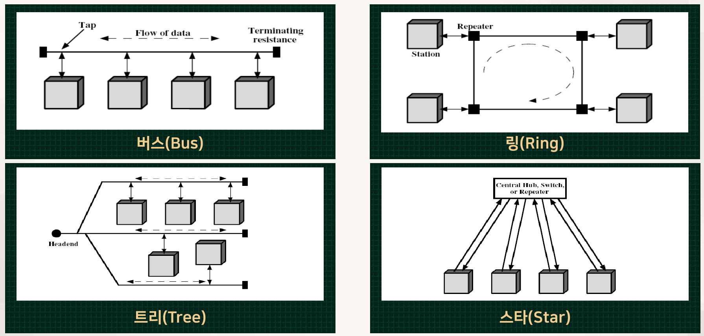

*그림 1. 버스, 링, 트리, 스타 토폴로지*

그림 1의 네 토폴로지는 다음과 같다. 버스(bus)는 양 끝에 종단 저항(termination resistor)이 달린 한 줄의 케이블에 스테이션들이 탭(tap)으로 매달린 모양이며, 데이터는 양방향으로 흐른다. 링(ring)은 리피터(repeater)들이 고리로 이어지고 각 리피터에 스테이션이 붙은 모양이며, 데이터는 한 방향으로 돈다. 트리(tree)는 헤드엔드(headend)에서 시작한 케이블이 가지를 치며 갈라지는 모양이다. 스타(star)는 모든 스테이션이 중앙의 허브, 스위치, 또는 리피터에 각각 연결된 모양이다. 버스와 링의 기본 동작은 3주차에서 다루었다.

### 1.7 버스 토폴로지와 트리 토폴로지

**버스 토폴로지(bus topology)** 의 특징은 다음과 같다.

- 전송 매체를 선형으로 배치한 가장 단순한 형태이며, 소규모 네트워크에 흔하다.
- 스위치나 리피터가 없다.
- 스테이션들은 **탭(tap)** 을 통해 버스에 직접 연결된다. 탭은 케이블에 장치를 연결하는 접속 부품이다.
- 한 스테이션이 전송하는 데이터는 전송 매체 전체를 통해 퍼져 나가며, 연결된 모든 스테이션이 받는다.
- 양 끝에는 모든 신호를 흡수하는 **터미네이터(terminator)**, 즉 종단 저항이 있다. 터미네이터가 없으면 신호가 케이블 끝에서 반사되어 되돌아오며 다음 신호와 겹친다.

버스 토폴로지에는 다음 문제가 있다.

- 모든 스테이션이 받으므로 누가 수신자인지 지정해야 한다.
- 주어진 시점에 하나의 스테이션만 전송할 수 있다. 둘이 동시에 보내면 신호가 겹쳐 망가진다.
- 모든 스테이션이 모든 신호를 받으므로, 스테이션이 늘수록 전체 네트워크의 성능이 떨어진다.

이 문제는 **프레임(frame)** 으로 해결한다. 프레임은 목적지 주소에 데이터를 더한 것이다. 주소가 가리키지 않는 스테이션은 프레임을 무시하고, 목적지 스테이션은 자기 앞을 지나가는 프레임을 복사한다. 또 프레임에 제어 정보(control information)를 추가하면, 누가 언제 보낼 수 있는지 정하는 접근 통제가 가능하다.

**트리 토폴로지(tree topology)** 의 특징은 다음과 같다.

- 버스를 일반화한 형태이다.
- 폐루프(closed loop)가 없이, **헤드엔드(headend)** 로부터 전송 매체가 가지처럼 갈라져 연결된 형태이다. 헤드엔드는 트리의 뿌리에 놓여 신호를 내보내거나 모으는 지점이다.
- 전송 데이터는 버스처럼 전송 매체 전체를 통해 전달된다.

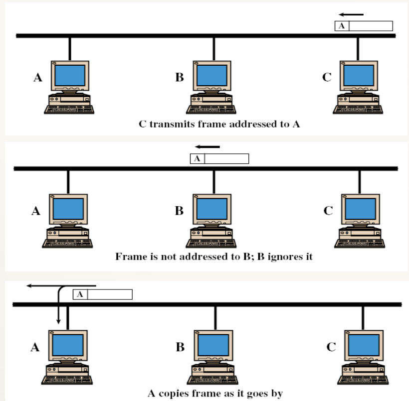

*그림 2. 버스 토폴로지에서 C가 A에게 보낸 프레임의 전달*

그림 2는 버스에서 프레임이 전달되는 과정이다. 맨 위에서 C가 목적지 주소 A가 적힌 프레임을 보내면 프레임은 버스를 따라 왼쪽으로 퍼진다. 가운데에서 프레임이 B 앞을 지나지만, 주소가 B가 아니므로 B는 무시한다. 맨 아래에서 A는 자기 앞을 지나가는 프레임을 복사한다. 프레임은 계속 진행하여 버스 끝의 터미네이터에서 흡수된다. 트리 토폴로지도 같은 방식으로 동작하며, 프레임이 갈라지는 지점마다 모든 가지로 퍼진다.

### 1.8 링 토폴로지

**링 토폴로지(ring topology)** 의 특징은 다음과 같다.

- 폐루프 안에서 리피터들이 점대점 링크(point-to-point links)로 연결된 형태이다.
- 하나의 노드는 다른 두 노드와 연결된다.
- 데이터가 목적지에 도착했는지 판단하는 별도의 플래그가 필요 없다. 목적지에 도착하지 않았더라도 데이터는 회로를 한 바퀴 돌아 보낸 노드 자신에게 돌아오기 때문이다.
- **리피터(repeater):** 데이터를 한쪽 링크에서 받아 다른 쪽 링크로 보낸다. 각 리피터에 스테이션이 연결된다.
- **링크(link):** 방향성이 있으며, 모든 링크는 같은 방향을 향한다.
- 여러 스테이션이 동시에 보내려 할 수 있으므로 접근 제어가 필요하다(7주차).

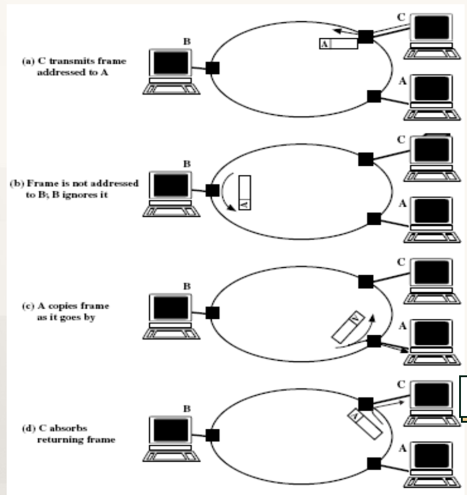

*그림 3. 링 토폴로지에서 C가 A에게 보낸 프레임의 전달*

그림 3은 링에서 프레임이 전달되는 네 단계이다. (a) C가 목적지 주소 A가 적힌 프레임을 링에 보낸다. (b) 프레임이 B의 리피터를 지나지만, 주소가 B가 아니므로 B는 무시한다. (c) A는 프레임이 지나갈 때 복사한다. 프레임은 A에서 멈추지 않고 계속 돈다. (d) 링을 한 바퀴 돌아 돌아온 프레임을 C가 흡수하여 링에서 제거한다.

링 토폴로지의 장점은 다음과 같다.

- 데이터가 정해진 방향과 순서로 돌므로 네트워크 운용이 매우 조직적이다.
- 네트워크의 제어가 간단하다.
- 네트워크의 모든 노드가 같은 권한을 가지며, 네트워크 자원의 사용에 우열이 없다.
- 노드 수가 같으면 다른 구조보다 네트워크에 걸리는 부하가 적다.
- 네트워크를 구성하는 데 서버가 없어도 된다.

링 토폴로지의 단점은 다음과 같다.

- 노드 하나가 고장 나면 전체 네트워크가 마비된다. 고장 난 노드의 다른 쪽에도 연결이 있지만, 링크에 방향성이 있어 그쪽으로 돌아갈 수 없기 때문이다.
- 속도가 느리며, 여러 노드를 지나오는 데이터는 많이 느려진다.
- 새 노드를 추가하면 그만큼 더 느려진다.
- 노드를 추가하거나 고장을 찾을 때 링 전체를 다루어야 하므로 네트워크의 유지 비용이 높다.

### 1.9 스타 토폴로지

**스타 토폴로지(star topology)** 의 특징은 다음과 같다.

- 중앙 스위치(또는 허브)에 모든 스테이션이 연결된 형태이다. 중앙의 장치를 **스타 커플러(star coupler)** 라 부르기도 한다.
- 각 스테이션은 송신용과 수신용의 두 링크로 중앙에 연결된다.
- 중앙 시스템을 뺀 모든 노드는 서로 직접 접촉하지 않는다.
- 어떤 두 노드가 통신하더라도 최소 2번, 최대 4번의 전달로 통신이 완료된다. 송신 노드에서 중앙으로, 중앙에서 수신 노드로의 두 번이면 데이터가 전달되고, 수신 노드의 응답이 중앙을 거쳐 돌아오는 것까지 포함해도 네 번이다.
- 통신과 관계없는 노드는 그 데이터가 오갔는지 알 수 없다(중앙이 스위칭 노드일 때).
- 중앙 집중형의 기본 형태이므로, 중앙에 기능을 추가하고자 하는 어떤 네트워크 구조와도 잘 어울린다.
- 스테이션이나 중앙 노드를 추가하는 등 변형된 구성을 만들기가 매우 간단하다.

중앙 노드가 동작하는 방식은 두 가지이다.

- **브로드캐스트 노드 방식:** 중앙 노드가 한 스테이션에서 받은 프레임을 모든 스테이션에 보낸다. 물리적으로는 스타이지만 논리적으로는 버스와 같은 구조이다. 허브가 이 방식이다.
- **스위칭 노드 방식:** 중앙 노드가 프레임을 목적지 스테이션에만 보낸다. 스위치가 이 방식이다.

인터넷 공유기에 꽂힌 홈 네트워크가 스타 토폴로지의 예이다. PC, 노트북, 프린터, 서버의 모든 회선이 중앙(공유기)으로 모이며, 공유기가 다운되면 네트워크 전체를 쓸 수 없다.

스타 토폴로지의 장점은 다음과 같다.

- 통신하는 노드끼리만 최소 2단계, 최대 4단계의 이동으로 통신이 완료되므로 매우 효율적이다.
- 노드끼리 접점이 없으므로, 일부 노드의 고장이 전체 네트워크의 작동에 영향을 주지 않는다.
- 새로운 노드의 추가가 매우 간단하며, 추가해도 전체 네트워크의 성능이 떨어지지 않는다(스위칭 노드 방식일 때).
- 네트워크를 구축하는 작업이 매우 간단하고, 유지보수에 드는 노력이 적다.

스타 토폴로지의 단점은 다음과 같다.

- 중앙 시스템이 고장 나면 전체 네트워크가 불능 상태가 된다.
- 중앙 시스템과 노드의 거리가 매우 멀면 연결하기 어려워진다. 모든 노드가 중앙까지 각자 케이블을 끌어와야 하기 때문이다.
- 모든 데이터가 중앙 시스템을 거치므로 중앙 시스템의 보안 수준이 매우 높아야 한다.
- 중앙 시스템이 대량의 데이터를 처리하지 못하면 통제 불능 상태(서스펜드, 서버 불능 등)가 된다.

### 1.10 토폴로지의 선택

토폴로지를 고를 때는 **신뢰성(reliability)**, **확장성(expandability)**, **성능(performance)** 의 세 요소를 따진다. 신뢰성은 장애가 생겨도 통신이 유지되는 정도, 확장성은 스테이션을 추가하거나 범위를 넓히기 쉬운 정도, 성능은 전송 속도와 지연이다.

| 토폴로지 | 강점 | 내용 |
|:-----|:-----|:-----|
| 버스/트리 | 가장 유연하다 | 연결하는 장치의 수, 데이터 전송 속도, 데이터 종류를 폭넓게 수용할 수 있다. |
| 링 | 가장 빠르다 | 광섬유를 쓰면 가장 높은 속도를 낼 수 있지만, 링크가 하나라도 끊기면 취약하다. |
| 스타 | 레이아웃 구성이 쉽다 | 가까운 거리에 유리하며, 적은 수의 장치 사이의 고속 통신에 적합하다. |

*표 6. 토폴로지별 선택 기준*

### 1.11 전송 매체의 선택과 토폴로지의 상관성

전송 매체를 고를 때는 다음 다섯 요소를 결정한다.

| 결정 요소 | 의미 |
|:-----|:-----|
| 토폴로지 | 매체마다 쓸 수 있는 토폴로지가 다르므로 정해진 토폴로지에 맞는 매체를 고른다. |
| 전송 용량 | 필요한 데이터 전송 속도와 대역폭을 감당할 수 있어야 한다. |
| 신뢰성 | 허용되는 오류율과 장애에 대한 내성을 만족해야 한다. |
| 데이터 형태 | 데이터, 음성, 영상처럼 지원해야 할 데이터의 종류를 실을 수 있어야 한다. |
| 외부 환경 | 설치 장소의 거리, 전자기 잡음, 온도 같은 환경적 조건을 견뎌야 한다. |

*표 7. 전송 매체 선택의 결정 요소*

대표적인 매체의 특징은 다음과 같다. 각 매체의 구조는 4주차에서 다루었다.

| 매체 | 특징 |
|:-----|:-----|
| 꼬임쌍선 | 값이 싸서 많이 쓰이며, 기존의 사무실 건물에 대부분 설치되어 있다. 단일 건물 안에서 가격 대비 효율이 가장 높고 저속 LAN에 적합하다. |
| 동축 케이블 | 꼬임쌍선보다 비싸지만 전송 용량이 크다. 폭넓은 LAN과 MAN의 요건을 만족하며, 데이터 트래픽이 상당한 많은 장치를 연결하는 네트워크에 적합하다. 사무 자동화와 공장 자동화에 알맞다. |
| 광케이블 | 점대점(point-to-point) 링크에 쓰이며, 링과 스타 토폴로지에 쓸 수 있다. 멀티포인트 광케이블 시스템은 LAN과 MAN에 다양하게 응용될 전망이다. |

*표 8. 대표적인 전송 매체의 특징*

> **참고:** 광섬유를 점대점 링크에만 쓴다는 설명은 1990년대까지의 상황이다. 오늘날에는 광 신호를 수동 분배기로 나누어 하나의 광섬유를 여러 가입자가 나누어 쓰는 점대다점(point-to-multipoint) 방식인 수동형 광 네트워크(PON, passive optical network)가 가정용 광 인터넷(FTTH)에 널리 쓰인다 [2].

매체와 토폴로지 사이에는 다음 상관성이 있다.

- **광대역(broadband) 동축 케이블**은 링 토폴로지에 적합하지 않다. 링의 리피터는 모든 채널을 재생해야 하는데, 여러 주파수 채널을 동시에 재생하는 멀티 채널 리피터가 비싸기 때문이다.
- **양방향 기저대역(baseband) 동축 케이블**은 트리 구조에 적합하지 않다. 기저대역 신호는 가지가 갈라지는 지점에서 반사와 감쇠가 생겨 여러 갈래로 보내기 어렵다.
- 전송 속도는 일반적으로 버스/트리 토폴로지보다 링 토폴로지가 빠르다.
- 링 토폴로지에는 점대점 링크가 필요하므로 꼬임쌍선, 기저대역 동축 케이블, 광케이블을 쓴다. 광대역 동축 케이블은 멀티 채널 리피터의 가격 때문에 적합하지 않다.

LAN의 전송 기술은 다음 세 종류이다.

| 전송 기술 | 방식 | 특징 |
|:-----|:-----|:-----|
| 기저대역(baseband) | 디지털 신호를 변조 없이 그대로 전송한다. | 원거리 전송에 불리하다. 디지털 신호가 꼬임쌍선이나 동축 케이블로 전송되는 형태이다. |
| 광대역(broadband) | 아날로그 신호로 변조하여 전송한다. | 원거리(장거리) 전송이 가능하다. 아날로그 신호를 FDM으로 여러 채널에 나누어 동축 케이블 등으로 전송하는 형태이다. |
| 단일 채널 광대역(캐리어 대역) | 아날로그 신호를 쓰되 FDM 없이 한 채널만 쓴다. | 2.4절에서 다룬다. |

*표 9. LAN의 세 가지 전송 기술*

| 매체 | 링 | 버스 | 트리 | 스타 |
|:-----|:-----|:-----|:-----|:-----|
| 꼬임쌍선 | ● | ● | | ● |
| 기저대역 동축 케이블 | ● | ● | | |
| 광대역 동축 케이블 | | ● | ● | |
| 광섬유 | ● | ● | | ● |
| 무선 | ● | ● | | ● |

*표 10. 전송 매체와 토폴로지의 상관성*

---

<br>

## 2. 버스/트리 토폴로지와 링 토폴로지

### 2.1 멀티포인트 구성의 문제

버스와 트리처럼 하나의 매체에 여러 스테이션이 붙는 **멀티포인트(multipoint)** 구성에서는 두 가지를 고려해야 한다.

1. **데이터 충돌(collision):** 여러 스테이션이 동시에 보내면 신호가 겹친다.
2. **신호 밸런싱(signal balancing):** 모든 스테이션 쌍 사이에서 신호의 세기가 알맞아야 한다.

멀티포인트 링크에서는 **MAC(medium access control, 매체 접근 제어) 주소**로 목적지를 식별하며, 누가 매체를 쓸지 정하는 방식에는 두 가지가 있다.

- **중앙 폴링(polling) 방식:** 제어기 하나가 스테이션들에게 차례로 보낼 것이 있는지 묻고, 허락받은 스테이션만 보낸다.
- **분산된 접근 방식:** 중앙 제어기 없이 각 스테이션이 정해진 규칙에 따라 스스로 보낼 때를 정한다. CSMA/CD가 그 예이다(7주차).

> **용어 정의:** **MAC 주소(MAC address)** 는 네트워크 세그먼트의 데이터 링크 계층에서 네트워크 인터페이스에 할당된 고유 식별자이다. 대개 네트워크 인터페이스 컨트롤러(NIC)의 제조업체가 할당하여 하드웨어에 저장한다. 이더넷 하드웨어 주소(Ethernet hardware address, EHA), 하드웨어 주소, 물리 주소라고도 부르며, 여기서 물리 주소는 메모리의 물리 주소와는 다른 개념이다.

멀티포인트 링크의 문제는 다음과 같다.

**(1) 매체 접근 제어.** 점대점 링크보다 어렵다. 점대점 링크는 매체를 두 장치만 쓰지만, 멀티포인트 링크는 많은 장치가 나누어 쓰기 때문이다. 예전에는 폴링을 써 왔으나, 폴링은 모든 통신이 제어기를 거치므로 스테이션들이 대등한 분산 시스템에 이롭지 않고, 제어기가 아닌 두 스테이션이 서로 직접 통신하기에 적합하지 않다.

**(2) 신호 밸런싱.** 송신 신호는 다음 조건을 모두 만족해야 한다.

- 감쇠를 겪은 뒤에도 가장 먼 수신기에서 충분히 강해야 한다.
- 가장 가까운 수신기에서도 수신기가 허용하는 최대 세기보다 약해야 한다. 너무 강한 신호는 수신기의 회로를 포화시켜 왜곡을 만든다.
- 이 조건을 각각의 스테이션에 대해 맞추어야 하고, 리피터나 앰프로 다른 부분과 연결된 네트워크 세그먼트 안에서도 맞추어야 한다.

스테이션이 $N$개이면 송신자와 수신자의 쌍은 $N(N-1)$개이고, 이 모든 쌍에서 신호 세기가 허용 범위 안에 들어야 한다 [3]. 스테이션이 100개이면 $100 \times 99 = 9900$개의 쌍을 모두 만족시켜야 하므로, 멀티포인트 네트워크의 설계는 점대점 링크보다 훨씬 까다롭다.

### 2.2 기저대역 동축 케이블

버스/트리 토폴로지의 두 전송 기법은 다음과 같이 다르다.

| 구분 | 기저대역(baseband) | 광대역(broadband) |
|:-----|:-----|:-----|
| 신호 | 디지털 신호 | 아날로그 신호 (RF 모뎀이 필요하다) |
| 대역폭 사용 | 신호 하나가 대역폭 전체를 쓰며 FDM이 없다. | FDM이 가능하여 여러 데이터 채널과 영상, 음성을 함께 싣는다. |
| 전송 방향 | 양방향 | 단방향 |
| 토폴로지 | 버스 | 버스 또는 트리 |
| 거리 | 수 km까지 | 수십 km까지 |

*표 11. 버스/트리 토폴로지의 전송 기법*

기저대역 동축 케이블의 특징은 다음과 같다.

- 디지털 시그널링을 쓴다.
- 신호가 양방향으로 전달된다. 탭에서 들어간 신호는 케이블의 양쪽 끝으로 퍼져 나가고, 양 끝에서 흡수된다.
- Manchester 또는 차동 Manchester(differential Manchester) 코딩에 기반한 전압 펄스를 쓴다(4주차).
- 전송 매체의 전체 스펙트럼을 활용하며, FDM이 필요 없다.

```text
  Packet absorbed                                               Packet absorbed
                        Packet travels in both directions
         |            <- - - - - - - - - - - - - - - - - ->            |
         v                                                             v
        [T]────────────────────┬─────────────────┬────────────────────[T]
                               │                 │
                           [Station]         [Station]
T: terminator
```

*그림 4. 기저대역 버스에서 양방향으로 퍼진 뒤 양 끝에서 흡수되는 패킷*

기저대역 이더넷(Ethernet with baseband)은 IEEE 802.3 표준의 기반이 되었다. 10 Mbps 기저대역 동축 케이블 버스 LAN의 규격은 다음과 같다.

| 항목 | 10BASE5 | 10BASE2 |
|:-----|:-----|:-----|
| 데이터 전송 속도 | 10 Mbps | 10 Mbps |
| 최대 세그먼트 길이 | 500 m | 185 m |
| 네트워크 범위 | 2500 m | 1000 m |
| 세그먼트당 노드 수 | 100 | 30 |
| 노드 간격 | 2.5 m | 0.5 m |
| 케이블 지름 | 0.4 in. | 0.25 in. |

*표 12. 10 Mbps 기저대역 동축 케이블 버스 LAN의 IEEE 802.3 규격*

이름의 10은 전송 속도 10 Mbps를, BASE는 기저대역을, 끝의 숫자는 최대 세그먼트 길이를 대략 100 m 단위로 나타낸다(5는 500 m, 2는 185 m를 반올림한 200 m). 10BASE5는 굵고 단단한 동축 케이블을 써서 thick Ethernet, 10BASE2는 가는 케이블을 써서 thin Ethernet이라고도 부른다.

> **참고:** 10BASE2의 네트워크 범위는 세그먼트 5개를 리피터 4개로 이은 경우 $185 \times 5 = 925$ m이며, 이를 약 1000 m로 적기도 한다. 10BASE5도 같은 방식으로 $500 \times 5 = 2500$ m이다 [4].

기저대역 동축 케이블에는 다음 **트레이드오프(trade-off)** 가 있다.

- 데이터 전송 속도가 낮으면 케이블을 길게 할 수 있다.
- 케이블이 길수록 신호 감쇠와 잡음이 커진다.
- 전송 속도가 낮으면 한 비트의 시간이 길어지므로, 신호가 어느 정도 손상되어도 비트 정보를 복구할 수 있다.

**기저대역 동축 케이블용 리피터**의 특징은 다음과 같다.

- 네트워크를 늘리는 데 쓰이며, 네트워크의 두 세그먼트를 연결한다.
- 나머지 시스템에 완전히 투명하다. 즉 스테이션들은 리피터가 있는지 알 필요가 없다.
- 양쪽 방향으로 신호를 전송하면서 전압 펄스를 새로 만들어(재생하여) 내보낸다.
- IEEE 규격은 2.5 km 네트워크에 리피터 4개를 허용한다.
- 신호를 양방향으로 중계하고 스테이션이 붙는 연결 지점이 아니라는 점에서, 한 방향으로만 중계하고 스테이션이 붙는 링 토폴로지의 리피터와 다르다.

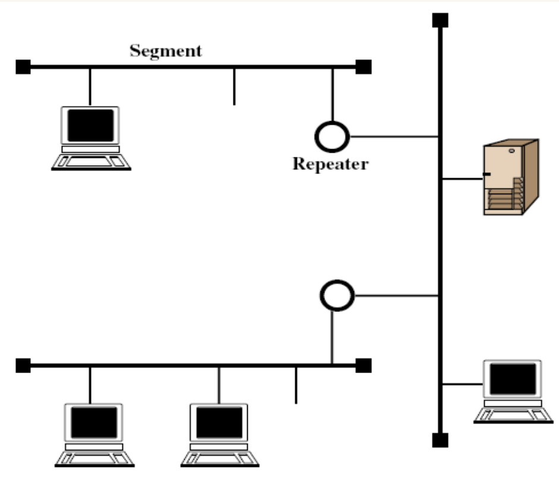

*그림 5. 리피터로 이은 기저대역 동축 케이블 세그먼트*

그림 5에서 세로로 놓인 긴 케이블이 백본 세그먼트이고, 위와 아래의 두 세그먼트가 각각 리피터(원)로 백본에 이어진다. 각 세그먼트의 양 끝(검은 사각형)에는 터미네이터가 있다. 위 세그먼트의 PC가 보낸 신호는 리피터에서 재생되어 백본으로, 다시 아래 세그먼트의 리피터를 거쳐 아래 세그먼트의 PC까지 전달된다. 전기적으로는 여러 세그먼트이지만 논리적으로는 하나의 버스이다.

### 2.3 광대역 동축 케이블

광대역 동축 케이블의 특징은 다음과 같다.

- 음성 수준(4 kHz) 채널보다 넓은 채널을 쓴다.
- LAN과 MAN의 데이터를 동축 케이블에 FDM 아날로그 시그널링으로 싣는다.
- 버스/트리 토폴로지에 쓴다.
- 아날로그 시그널링이므로 중간에 앰프를 두어 신호를 키우면서 훨씬 먼 거리까지 전송할 수 있다.

**듀얼 케이블과 스플릿 구성(dual-cable and split configurations).** 광대역 시스템은 다음 성질 때문에 특별한 구성이 필요하다.

- 탭에서 들어간 신호는 한 방향으로만 전파된다.
- 여러 주파수대의 신호를 양방향으로 증폭하는 앰프를 만들기 어렵기 때문이다.
- 따라서 전송한 신호는 그 탭보다 하류(downstream)에 있는 스테이션만 받을 수 있다.
- 모든 스테이션이 서로 통신하려면 두 개의 경로(two paths)가 필요하며, 두 경로는 헤드엔드에서 만난다.
- 모든 스테이션은 헤드엔드 방향으로 송신하고(inbound), 헤드엔드로부터 수신한다(outbound).

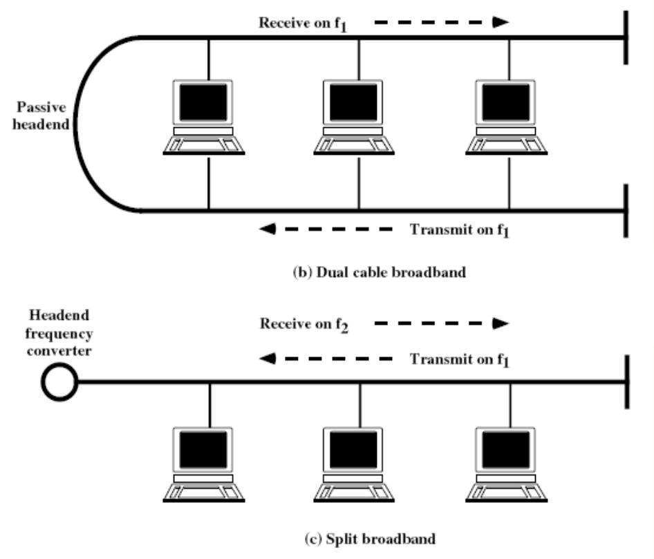

*그림 6. 듀얼 케이블 광대역 구성과 스플릿 광대역 구성*

그림 6의 위쪽은 듀얼 케이블 구성이다. 스테이션은 아래 케이블에 주파수 f<sub>1</sub>로 송신하고(transmit on f<sub>1</sub>), 신호는 왼쪽의 수동 헤드엔드(passive headend)에서 위 케이블로 넘어가 모든 스테이션이 같은 주파수 f<sub>1</sub>로 수신한다(receive on f<sub>1</sub>). 아래쪽은 스플릿 구성이다. 케이블은 하나이고, 스테이션은 f<sub>1</sub>로 송신하며, 왼쪽의 헤드엔드 주파수 변환기(headend frequency converter)가 이를 f<sub>2</sub>로 바꾸어 되돌려 보내면 모든 스테이션이 f<sub>2</sub>로 수신한다.

| 구분 | 듀얼 케이블 구성 | 스플릿 구성 |
|:-----|:-----|:-----|
| 케이블 | 인바운드 채널과 아웃바운드 채널이 서로 다른 케이블이다. | 인바운드 채널과 아웃바운드 채널이 서로 다른 주파수로 하나의 케이블을 쓴다. |
| 헤드엔드 | 두 케이블을 수동적으로 이어 줄 뿐이다. | 인바운드 주파수를 아웃바운드 주파수로 변환한다. |
| 주파수 | 송신과 수신이 같은 주파수이다. | 송신과 수신이 다른 주파수이다. |
| 용량 | 케이블의 대역 전체를 각 방향에 쓰므로 용량이 상대적으로 크다. | 케이블 하나의 대역을 두 방향이 나누어 쓴다. |
| 알맞은 경우 | 장치가 많지 않을 때, 헤드엔드의 고정 비용을 피하기 위해 쓴다. | 장치가 많을 때, 케이블 비용을 절약하기 위해 쓴다. |

*표 13. 듀얼 케이블 구성과 스플릿 구성의 비교*

스플릿 구성의 헤드엔드에는 다음 장치가 있다.

- **주파수 변환기:** 아날로그 신호의 주파수를 인바운드 대역에서 아웃바운드 대역으로 옮긴다.
- **리모듈레이터(remodulator):** 받은 아날로그 신호를 디지털로 복조하여 그동안 쌓인 잡음과 감쇠를 없앤 뒤, 아웃바운드 주파수로 다시 변조한다.

### 2.4 광대역 구성 요소와 캐리어 대역

광대역 시스템은 다음 구성 요소로 이루어진다.

| 구성 요소 | 역할 |
|:-----|:-----|
| 케이블 | 헤드엔드에서 나오는 굵은 간선인 트렁크 케이블(trunk cable), 트렁크에서 갈라져 구역에 신호를 나누는 분배 케이블(distribution cable) 또는 피더 케이블(feeder cable), 분배 케이블에서 각 장치까지 내려가는 드롭 케이블(drop cable)이 있다. |
| 터미네이터(terminators) | 케이블 끝에서 신호를 흡수하여 반사를 막는다. |
| 앰프(amplifiers) | 감쇠한 아날로그 신호를 키운다. 한 방향으로만 증폭한다. |
| 방향성 커플러(directional couplers) | 신호를 나누거나 빼내는 부품으로, 케이블을 가지로 나누는 스플리터(splitter)와 장치를 연결하는 탭(tap)이 있다. |
| 모뎀(modems) | 장치의 디지털 데이터를 할당된 주파수의 아날로그 신호로 변조하고 복조한다. |

*표 14. 광대역 시스템의 구성 요소*

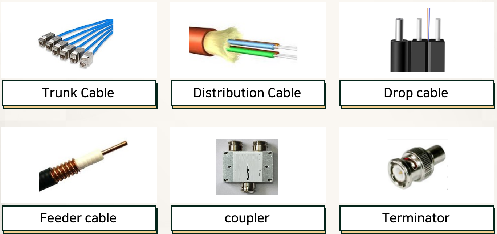

*그림 7. 광대역 구성 요소: 트렁크 케이블, 분배 케이블, 드롭 케이블, 피더 케이블, 커플러, 터미네이터*

그림 7의 사진은 위 줄 왼쪽부터 커넥터가 달린 트렁크 케이블 묶음, 여러 가닥의 심선이 든 분배 케이블, 가는 드롭 케이블이고, 아래 줄 왼쪽부터 금속 차폐층이 드러난 굵은 피더 케이블, 입출력 단자가 있는 금속 상자 모양의 커플러, 케이블 끝에 끼우는 원통형 터미네이터이다.

**캐리어 대역(carrier band)** 은 단일 채널 광대역이라고도 하며 다음과 같은 특징이 있다.

- FDM 없이 전송 매체의 전체 스펙트럼을 하나의 채널로 쓰는 아날로그 시그널링이다.
- 버스 토폴로지에서 양방향으로 전송한다.
- 모뎀 출력을 좁은 대역 안에 맞출 필요가 없으므로 광대역용 모뎀보다 단순하지만, 디지털 신호를 그대로 싣는 기저대역보다는 모뎀이 필요한 만큼 하드웨어 가격이 비싸다.
- 성능과 가격 면에서 기저대역에 견줄 만한 수준이다 [3].

### 2.5 광섬유 버스

광섬유로 버스를 만들 때는 스테이션을 연결하는 **탭(tap)** 을 두 가지 방식으로 만든다.

- **능동식 탭(active tap):** 리피터처럼 동작한다. 들어온 빛을 광 검출기(optical detector)로 전기 신호로 바꾸어 복호화(decoder)하고 노드에 넘기며, 노드가 보낼 데이터와 함께 다시 부호화(coder)하여 광 송신기(optical transmitter)로 다음 광섬유에 내보낸다. 따라서 네트워크는 점대점 링크의 사슬(chain)이 되며, 탭마다 송신용과 수신용의 두 광섬유 케이블이 필요하다.
- **수동식 탭(passive tap):** 꼬임쌍선이나 동축 케이블의 탭과 비슷하게 광섬유를 지나는 빛의 일부를 빼내고 넣는다. 빛을 빼내어 수신기(O→E, 광 신호를 전기 신호로 변환)로 보내는 탭과 송신기(E→O)의 빛을 넣는 탭, 즉 두 개의 탭이 필요하다.

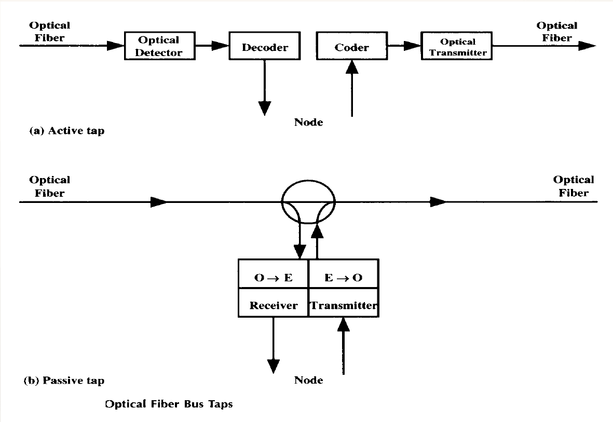

*그림 8. 광섬유 버스의 능동식 탭과 수동식 탭*

광섬유 안의 빛은 한 방향으로만 진행하므로, 버스 하나로는 하류의 스테이션에만 보낼 수 있다. 모든 스테이션이 서로 통신하려면 다음 구성 가운데 하나를 쓴다.

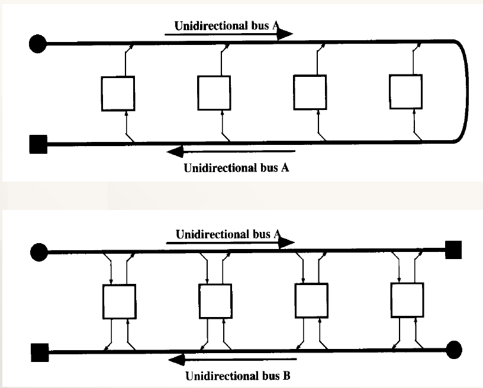

*그림 9. 광섬유 버스의 루프 버스 구성과 듀얼 버스 구성*

그림 9의 위쪽은 **루프 버스(loop bus)** 이다. 단방향 버스 A가 오른쪽 끝에서 되접혀 돌아오므로, 각 스테이션은 위쪽 구간에 송신하고 아래쪽 구간에서 수신한다. 어느 스테이션이 보낸 신호도 되접힌 구간을 지나며 모든 스테이션에 도달한다. 아래쪽은 **듀얼 버스(dual bus)** 이다. 방향이 반대인 단방향 버스 A와 B를 나란히 두어, 오른쪽에 있는 스테이션에는 버스 A로, 왼쪽에 있는 스테이션에는 버스 B로 보낸다. 3주차의 DQDB가 듀얼 버스 구성이다.

### 2.6 링 토폴로지의 동작

링 토폴로지의 특성은 다음과 같다.

- 단방향 링크로 리피터들을 연결한다.
- 리피터는 무엇이든 수신한 것을 다음 링크로 전송한다.
- 링에 대한 데이터의 삽입(insertion), 수신(reception), 삭제(removal)가 필요하다.
- 데이터는 그 데이터를 전송한 리피터에서 삭제한다.
- 이 구조 덕분에 **자동 확인 응답(automatic acknowledgement)** 과 **멀티캐스트와 브로드캐스트**가 자연스럽게 가능하다.

**링 토폴로지용 리피터**의 특징은 다음과 같다.

- 링의 능동적 구성 요소 가운데 하나이다.
- 데이터 삽입을 위한 장치의 연결 지점이다. 스테이션은 리피터를 통해 링에 데이터를 넣는다.
- 리피터는 지나가는 패킷의 목적지 주소를 복사하여 연결된 스테이션에 전달한다. 스테이션이 이 주소를 자신의 주소로 인식하면 나머지 패킷도 복사한다.
- 데이터를 언제 어떻게 삽입하고 삭제할지에 대한 방식과 시간 제어 전략은 MAC 프로토콜이 정한다(7주차).
- 버스의 탭처럼 데이터의 삽입과 삭제를 담당한다.

**데이터 삭제(data removal)** 는 링의 고유한 문제이다.

- 버스와 트리에서는 신호가 양 끝의 종단 저항(터미네이터)에 흡수되어 저절로 사라진다.
- 링은 폐루프이므로 특별히 삭제하지 않으면 신호가 무한히 순환한다.
- 삭제 방법은 두 가지이다. 정해진 리피터가 삭제하거나, 데이터를 전송한 리피터가 한 바퀴 돌아온 데이터를 삭제한다.
- 송신한 리피터가 삭제하는 경우, 되돌아오는 패킷으로 자동 확인 응답이 이루어진다. 목적지가 패킷을 복사하면서 패킷 안의 특정 비트를 바꾸어 두면, 송신자는 돌아온 패킷의 그 비트로 목적지가 받았는지 알 수 있다.
- 패킷이 링을 한 바퀴 도는 동안 여러 스테이션이 같은 패킷을 복사할 수 있으므로 멀티캐스트가 쉽다.

### 2.7 링 리피터의 상태

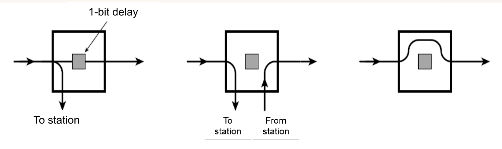

*그림 10. 링 리피터의 수신 상태, 송신 상태, 바이패스 상태*

그림 10의 세 상자는 왼쪽부터 수신 상태, 송신 상태, 바이패스 상태의 리피터이다. 각 상자의 가운데 작은 사각형은 1비트 지연(1-bit delay) 버퍼이다.

**(1) 수신 상태(listen state).** 왼쪽 그림처럼 들어온 비트가 1비트 지연을 거쳐 다음 링크로 나가고, 동시에 스테이션 쪽(to station)으로도 전달된다.

- 지나가는 비트들에서 주소와 토큰 같은 정해진 패턴을 찾는다(scan). 패턴을 확인하는 데 필요한 1비트만큼 지연된다.
- 수신되는 비트(incoming bits)를 복사하여 다음 리피터로 보내면서 스테이션에도 전달한다.
- 전달하면서 비트 하나를 고칠 수 있다. 예를 들어 목적지는 프레임을 받았다는 표시 비트를 바꾸어 두고, 보낼 데이터가 있는 스테이션은 지나가는 토큰의 비트 하나를 바꾸어 프레임의 시작으로 만든다.

**(2) 송신 상태(transmit state).** 가운데 그림처럼 들어온 링의 비트는 스테이션 쪽으로 가고, 스테이션에서 온 비트(from station)가 다음 링크로 나간다.

- 리피터가 전송 권한을 얻으면, 스테이션으로부터 받은 비트를 다음 링크로 전달한다.
- 이 동안에도 링에서 비트가 들어올 수 있으며, 다음과 같이 처리한다.
  - 자신이 송신하는 프레임이 한 바퀴 돌아온 것이면 스테이션에 전달한다. 스테이션은 이것으로 확인 응답을 점검하거나 프레임을 회수한다.
  - 다른 스테이션의 패킷이면 버퍼에 넣어 두었다가 나중에 다시 보낸다. 링에 여러 패킷이 동시에 있을 수 있는 MAC 방식에서 생기는 경우이다 [3].

**(3) 바이패스 상태(bypass state).** 오른쪽 그림처럼 신호가 리피터를 거치지 않고 지나간다. 스테이션이 꺼져 있거나 고장 났을 때 바이패스 릴레이가 작동한다.

- 지연이 없다(no delay).
- 고장 난 리피터를 우회하므로 신뢰성이 높다.
- 링 전체의 지연이 줄어 전송 성능이 높다.

### 2.8 링 토폴로지의 장점과 문제점

링 토폴로지의 장점은 다음과 같다.

- **점대점 통신 링크:** 각 링크는 리피터 둘만 잇는 점대점 링크이므로, 다음 장점이 있다.
  - 각 리피터가 신호를 재생하므로 기저대역 버스보다 먼 거리를 연결할 수 있다.
  - 점대점 전송에 알맞은 광케이블을 그대로 적용할 수 있다.
  - 멀티포인트 링크보다 전기적 설계가 간단하고 유지보수에 유리하다. 신호 밸런싱 문제가 없기 때문이다.
- **주소 복사를 통한 간단한 오류 확인:** 목적지 스테이션은 프레임을 복사하면서 비트 몇 개를 바꾸어 두고, 이 바뀐 비트가 목적지가 보내는 확인 응답(ACK) 역할을 한다. 송신 스테이션은 한 바퀴 돌아온 프레임을 보고 문제가 생겼는지 곧바로 알 수 있다.

링 토폴로지의 문제점은 다음과 같다.

- **케이블의 취약성:** 케이블의 한 부분이 끊기면 링 전체가 멈춘다.
- **리피터의 고장:** 리피터 하나가 고장 나도 링 전체가 멈춘다.
- **설치상의 어려움:**
  - 토폴로지상 인접한 두 리피터를 식별해야 한다. 물리적으로 가까워도 링의 순서로는 인접하지 않을 수 있다.
  - 새 리피터를 넣으면서 길이가 다른 케이블을 쓰면 타이밍을 다시 조정(튜닝)해야 한다.
  - 제거되지 않은 오래된 케이블이 누적될 수 있다.
  - 고리라는 특이한 구조 때문에 새 리피터를 설치하기 어렵다.
- **크기의 한계:**
  - 리피터가 많을수록 신뢰성과 유지보수의 문제가 커진다.
  - 시간 동기가 어려워진다(타이밍 지터, 2.9절).
  - 리피터마다 지연이 조금씩 더해진다.
  - 이런 이유로 링 하나에 둘 수 있는 리피터는 수백 개가 한계이다.

**링 지연의 계산.** 4 Mbps 링에 리피터 100개가 있고 각 리피터가 1비트를 지연시키며, 케이블 전체 길이가 2 km이고 신호가 1 km를 지나는 데 5 µs가 걸린다고 가정한다. 한 비트의 시간은 $1 / (4 \times 10^6) = 0.25$ µs이므로 리피터 지연은 $100 \times 0.25 = 25$ µs이고, 전파 지연은 $2 \times 5 = 10$ µs이다. 비트가 링을 한 바퀴 도는 데 $25 + 10 = 35$ µs가 걸리며, 이는 $35 / 0.25 = 140$비트에 해당한다. 즉 링 위에는 최대 140비트가 동시에 존재할 수 있다. 리피터가 늘어날수록 이 지연이 커져 접근 제어의 효율이 떨어진다.

### 2.9 타이밍 지터

> **용어 정의:** **타이밍 지터(timing jitter)** 는 디지털 펄스 신호에서 원하는 신호와 실제 신호 사이의 시간 축상의 차이, 즉 펄스가 와야 할 시각과 실제로 온 시각의 어긋남이다.

타이밍 지터의 원인과 영향, 대책은 다음과 같다.

- 시간 지연으로 생기는 왜곡 때문에 시간 정보에 편차가 생긴다.
- 주파수 성분에 따라 신호의 전파 속도가 다르므로, 펄스를 이루는 성분들이 조금씩 다른 시각에 도착해 펄스의 경계가 흔들린다.
- 링에서는 각 리피터가 받은 신호에서 시계를 뽑아 다음 링크로 보내므로, 각 전송의 시간 정보가 앞 전송의 시간 정보에 연계된다.
- 따라서 전송 시간의 오차가 리피터를 지날 때마다 누적되고, 누적된 오차는 무작위 비트 시간 오류를 일으킨다. 링이 클수록 지터가 커지는 이유가 이것이다.
- 대책으로, 인접한 비트 사이의 비트 시간 차이를 줄이기 위해 위상 고정 루프(PLL, phase-locked loop)를 쓴다. PLL은 들어오는 신호의 위상을 따라가며 흔들림을 평균하여 안정된 시계를 만드는 회로이다.
- 또 링에서 감시를 맡는 모니터 리피터나 스테이션에 기준 시계나 탄력적 버퍼(elastic buffer)를 둔다. 탄력적 버퍼는 들어오는 비트의 속도가 조금 빠르거나 느려도 버퍼의 채움 정도를 늘리고 줄여 흡수하는 버퍼이다.

### 2.10 스타-링 아키텍처

링의 문제점을 줄이기 위해 링을 스타 모양으로 배선하는 방법이 쓰인다.

**배선 집중기(wiring concentrator)** 를 쓰면 다음 장점이 있다.

- 고장 난 부분을 찾아 격리하기에 유리하다.
- 리피터를 추가하기에 유리하다.

**스타-링 토폴로지(star ring)** 의 특징은 다음과 같다.

- 모든 케이블이 하나의 중앙 사이트(배선 집중기)를 거쳐 두 리피터를 연결한다. 즉 링의 각 링크가 중앙을 들렀다 가므로, 논리적으로는 링이지만 물리적으로는 스타이다.
- 중앙에서 모든 링크의 신호에 접근할 수 있다.
- 따라서 고장 위치를 특정하고 고장 부분을 격리하기에 유리하다.
- 새 리피터를 설치하기 쉽다. 연결 사이트에 두 가닥의 선을 연결하기만 하면 된다.
- 연결 커넥터에 바이패스 릴레이를 두어, 고장 난 리피터와 그 링크를 자동으로 우회하게 한다.
- 우회한 뒤에도 작동하는 리피터 사이의 거리는 비슷하게 유지되므로, 링의 신호 레벨도 비슷하게 유지된다.

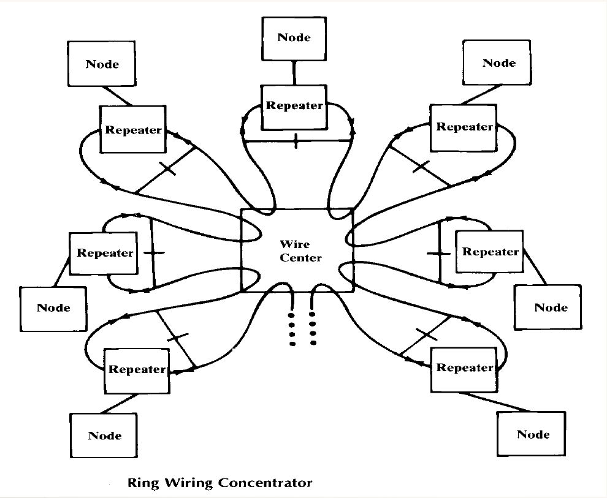

*그림 11. 링 배선 집중기를 쓴 스타-링 구성*

그림 11의 가운데 배선 집중기(그림의 wire center)에서 일곱 개의 리피터(repeater)로 각각 케이블이 나갔다가 돌아오고, 각 리피터에 노드(node)가 붙어 있다. 배선 집중기 아래의 점은 같은 방식으로 리피터를 더 연결할 수 있음을 나타낸다. 신호는 배선 집중기에서 한 리피터로 나갔다가 돌아와 다음 리피터로 가는 식으로 모든 리피터를 차례로 돌아 링을 이룬다. 링크 위의 짧은 사선은 바이패스할 수 있는 지점을 나타낸다.

**브리지를 포함한 링 토폴로지.** 넓은 지역에서 많은 리피터를 링 하나에 연결하면 케이블 길이 때문에 크기 한계에 부딪힌다. 이때는 배선 집중기의 연결 순서로 여러 개의 작은 링 구조를 구성하고, 링 구조들을 브리지로 연결한다. 이를 **세그먼트화된 링(segmented rings)** 이라 한다.

세그먼트화된 링의 장점은 다음과 같다.

- 링 하나에 두는 리피터 수가 제한되므로 타이밍 지터의 상한이 정해진다.
- 리피터나 링크가 고장 나도 전체 네트워크 가운데 그 링만 멈춘다.
- 하나 이상의 링 구조를 쓰므로, 각 링이 동시에 전송할 수 있어 큰 용량을 구성할 수 있다.

세그먼트화된 링의 단점은 다음과 같다.

- 다른 링으로 간 프레임은 송신자에게 돌아오지 않으므로 자동 확인 응답이 없다. 그래서 확인 응답을 처리하는 상위 프로토콜이 필요하다.
- 링 사이의 트래픽이 많으면 브리지가 병목이 되어 성능상의 이점이 크지 않다.

---

<br>

## 3. 스타 토폴로지와 구조화된 케이블 시스템

### 3.1 꼬임쌍선 스타 LAN

스타 토폴로지의 LAN은 꼬임쌍선이나 광케이블을 기반으로 하며, 다음과 같은 특성이 있다.

- 건물에 미리 깔려 있는 꼬임쌍선(전화선)을 쓸 수 있다.
- 중앙의 허브가 리피터 역할을 한다.

꼬임쌍선은 다음 성질이 있다.

- 네트워크 비용의 큰 부분은 케이블 가격이 아니라 설치 비용이다.
- 동축 케이블에 비하여 성능이 낮다.

그런데도 스타 레이아웃의 비차폐(unshielded) 꼬임쌍선으로 버스/트리 LAN을 만드는 이유는 다음과 같다.

- 대부분의 사무실 건물에는 전화용 꼬임쌍선이 이미 있으므로, 추가 배선에 드는 설치비가 적다.
- 전화선을 쓰면 어디에서나 활용할 수 있지만, 동축 케이블은 새로 깔아야 하므로 추가 비용이 크다.

꼬임쌍선 스타 LAN의 특성은 다음과 같다.

- 각 스테이션은 송신용과 수신용의 두 꼬임쌍선으로 허브에 연결된다.
- 허브는 한 스테이션에서 들어온(incoming) 신호를 모든 나가는(outgoing) 채널로 중계한다.
- 스테이션과 허브 사이의 거리는 UTP로 약 100 m, 광케이블로 약 500 m이다.
- 물리적으로는 스타(star) 모양이다.
- 논리적으로는 버스(bus) 모양이다. 전송된 데이터를 다른 모든 스테이션이 받을 수 있고, 둘 이상이 동시에 전송하면 충돌이 생긴다.

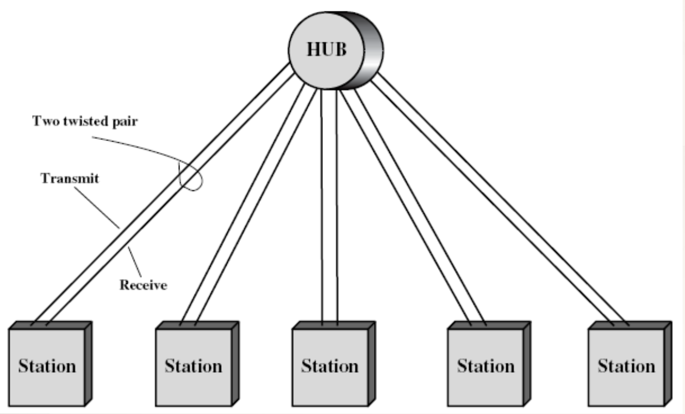

*그림 12. 송신용과 수신용 꼬임쌍선으로 허브에 연결된 스테이션*

그림 12에서 다섯 스테이션은 각각 두 가닥의 꼬임쌍선(two twisted pair)으로 허브에 연결되며, 한 쌍은 송신(transmit), 다른 한 쌍은 수신(receive)에 쓰인다.

### 3.2 StarLAN과 계층형 허브

**StarLAN**은 꼬임쌍선 스타 LAN의 초기 규격으로, 다음과 같이 발전했다.

- 1 Mbps로 시작했다. IEEE 802.3의 1BASE5 규격이다 [4].
- 이후 같은 스타 배선 방식이 10 Mbps와 100 Mbps를 거쳐 1 Gbps의 꼬임쌍선 이더넷(10BASE-T, 100BASE-TX, 1000BASE-T)으로 진화했다.
- 기존 전화선을 그대로 쓰는 방식은 기술적 문제로 10 Mbps와 100 Mbps 수준까지만 발전했다. 전화선은 고속 전송용으로 만든 것이 아니어서 감쇠가 크고, 꼬임선이 빽빽하게 묶여 있으면 이웃 쌍 사이의 간섭(누화, cross-talk)이 생기기 때문이다. 더 높은 속도에는 더 좋은 등급의 케이블이 필요하다.

StarLAN은 **계층적 구조(hierarchical configuration)** 를 쓴다.

- **헤더 허브(header hub, HHUB):** 계층의 맨 위에 하나 있다.
- **중간 허브(intermediate hub, IHUB):** 헤더 허브 아래에 놓여 여러 스테이션이나 다른 허브를 모은다.
- 한 스테이션이 보낸 전송은 맨 위의 헤더 허브까지 올라간 뒤, 거기서 아래쪽의 모든 꼬임쌍선으로 퍼진다. 그래서 여러 단계의 허브가 있어도 모든 스테이션이 모든 전송을 받는 논리적 버스가 된다.
- StarLAN은 이 구조로 1 Mbps를 전송했다.

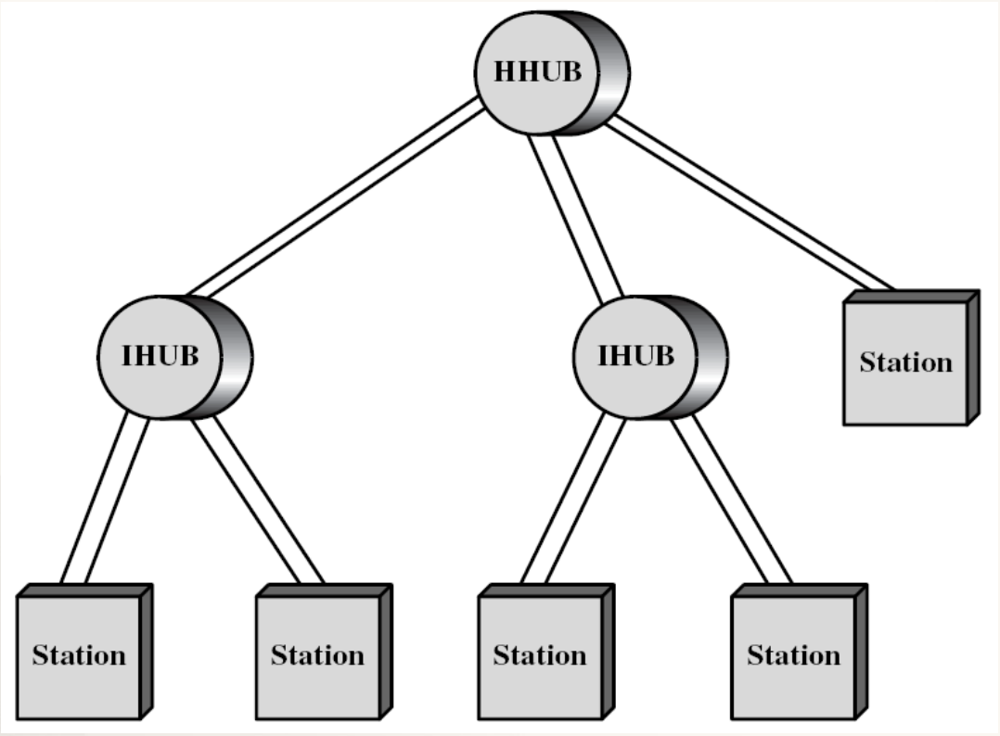

*그림 13. 헤더 허브와 중간 허브로 이루어진 StarLAN의 계층 구조*

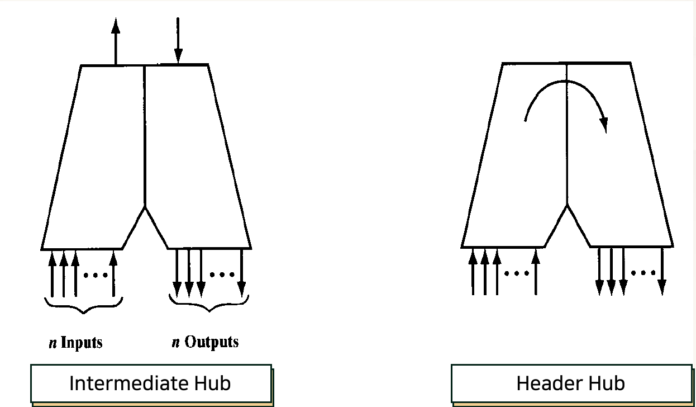

*그림 14. 중간 허브와 헤더 허브의 내부 동작*

그림 13에서 맨 위의 HHUB 아래에 IHUB 두 개와 스테이션 하나가, 각 IHUB 아래에 스테이션 두 개가 연결된다. 그림 14의 왼쪽 중간 허브는 아래의 n개 입력(n inputs)을 합쳐 위쪽 허브로 올려 보내고, 위에서 내려온 신호를 아래의 n개 출력(n outputs)으로 나누어 보낸다. 오른쪽 헤더 허브는 아래에서 올라온 모든 입력을 합친 뒤 위로 보내지 않고 곧바로 되돌려(U자 화살표) 아래의 모든 출력으로 내보낸다. 따라서 어느 스테이션의 신호든 헤더 허브에서 방향을 바꾸어 모든 스테이션에 도달한다.

### 3.3 버스, 허브, 스위칭 허브

허브와 스위치는 다음과 같이 다르다.

- 버스와 허브에서는 한 번에 하나의 스테이션만 전송할 수 있다.
- 여러 스테이션이 동시에 전송하려면 **스위칭 허브(switching hub)**, 즉 **LAN 스위치(LAN switch)** 를 쓴다.

스위칭 허브의 특징은 다음과 같다.

- 메시지에 나타난 목적지 스테이션의 주소로만 프레임을 전송한다.
- 허브를 스위칭 허브로 바꾸어도 연결된 장치의 소프트웨어나 하드웨어를 바꿀 필요가 없다. 장치들은 그대로 같은 프레임 형식을 쓴다.
- 각 스테이션이 자신의 링크 용량을 전용으로 쓴다.
- 확장이 쉽다. 스테이션을 늘려도 각 스테이션의 용량이 줄지 않는다.

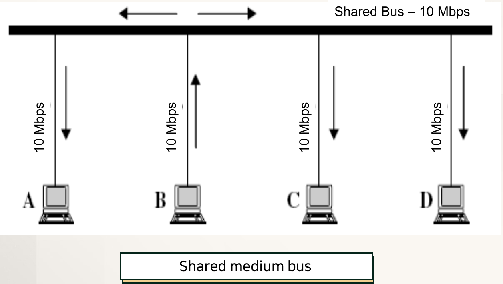

*그림 15. 10 Mbps 공유 매체 버스*

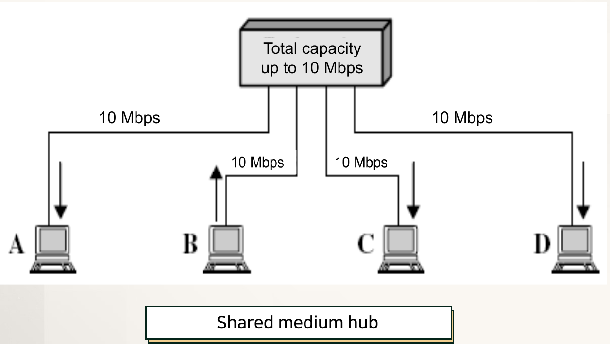

*그림 16. 전체 용량이 10 Mbps인 공유 매체 허브*

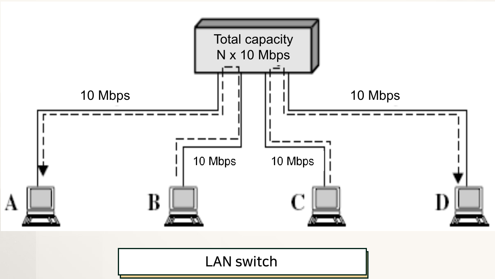

*그림 17. 전체 용량이 N × 10 Mbps인 LAN 스위치*

그림 15의 공유 매체 버스(shared medium bus)에서는 B가 10 Mbps로 보내는 동안 A, C, D가 모두 그 신호를 받으며, 버스 전체의 용량은 10 Mbps이다. 그림 16의 공유 매체 허브(shared medium hub)도 같다. 각 스테이션은 10 Mbps 링크로 허브에 연결되지만, 허브가 B의 신호를 모든 포트로 내보내므로 전체 용량은 최대 10 Mbps(total capacity up to 10 Mbps)이다. 그림 17의 LAN 스위치에서는 점선처럼 B에서 A로, C에서 D로의 전송이 동시에 이루어진다. 각 포트가 동시에 10 Mbps로 데이터를 나를 수 있으므로, 포트가 $N$개이면 전체 용량은 최대 $N \times 10$ Mbps이다.

**용량의 비교.** 스테이션 8대가 있고 두 대씩 짝을 지어 네 쌍이 동시에 통신한다고 가정한다. 10 Mbps 허브에서는 네 쌍이 10 Mbps를 나누어 쓰므로 한 쌍은 평균 $10 / 4 = 2.5$ Mbps를 얻는다. 10 Mbps 포트의 LAN 스위치에서는 네 쌍이 서로 다른 포트를 쓰므로 각 쌍이 10 Mbps를 온전히 쓰고, 동시에 흐르는 데이터는 $4 \times 10 = 40$ Mbps이다.

### 3.4 LAN 스위치의 전달 방식

LAN 스위치는 프레임을 언제 내보내는지에 따라 두 종류로 나뉜다.

| 종류 | 동작 | 특징 |
|:-----|:-----|:-----|
| 저장 후 전달 스위치(store-and-forward switch) | 프레임 전체를 버퍼에 저장하고, 모든 비트가 저장되어 오류 검사가 끝난 뒤 내보낸다. | 오류가 있는 프레임을 걸러 내지만, 그만큼 느리다. |
| 컷스루 스위치(cut-through switch) | 프레임 앞부분의 목적지 주소 필드를 읽으면 바로 내보내기 시작한다. | 오류를 거르지 않고 내보내므로 빠르다. |

*표 15. LAN 스위치의 두 가지 전달 방식*

**지연 시간의 계산.** 100 Mbps 이더넷에서 1518바이트 프레임을 전달한다고 가정한다. 저장 후 전달 스위치는 프레임 앞의 프리앰블과 시작 구분자 8바이트까지 합해 $1518 + 8 = 1526$바이트를 모두 받아야 하므로 $1526 \times 8 / (100 \times 10^6) = 122.08$ µs를 기다린 뒤 내보낸다. 컷스루 스위치는 프리앰블과 시작 구분자 8바이트와 목적지 주소 6바이트, 합해 14바이트만 받으면 되므로 $14 \times 8 / (100 \times 10^6) = 1.12$ µs 뒤에 내보낸다. 그 대신 컷스루 스위치는 프레임 끝의 CRC를 확인하기 전에 이미 전달을 시작하므로, 손상된 프레임도 그대로 다음 링크로 내보낸다.

### 3.5 수동적 스타 커플러

광섬유 LAN에서 스타 토폴로지의 중앙에 쓰는 장치가 **수동적 스타 커플러(passive star coupler)** 이다.

- 광섬유 LAN으로는 처음 상용화된 방식 가운데 하나이다.
- 여러 광섬유를 융합한 형태이다.
- 한 광섬유로 들어온 빛이 모든 출력 광섬유로 똑같이 나뉜다.
- 물리적으로는 스타 모양이다.
- 논리적으로는 버스 형태이므로, 한 스테이션의 전송이 모든 스테이션에 브로드캐스트되고, 둘이 동시에 보내면 데이터 충돌이 생긴다.
- 연결성: 수십 개의 스테이션을 연결할 수 있고, 1 km 안팎 또는 그 이상의 거리에 알맞다. 정확한 규모는 광 손실에 따라 달라진다(3.6절).

커플러를 만드는 방법은 두 가지이다.

- **바이코닉 융합 커플러(biconic fused coupler):** 여러 광섬유를 모아 꼬고 가열하면서 잡아당겨 녹여 붙인다. 가운데가 가늘어지는 양쪽 원뿔(biconical) 모양이 되며, 가늘어진 결합 영역(coupling region)에서 빛이 광섬유 사이로 넘나들어 섞인다.
- **믹싱 로드 커플러(mixing rod coupler):** 입력 광섬유와 출력 광섬유를 짧은 유리 막대(mixer rod)의 양 끝에 붙인다. 막대 안에서 빛이 퍼져 섞인 뒤 출력 광섬유들로 나뉜다. 더 큰 규모로 만들 수 있고 제조가 비교적 쉽다.

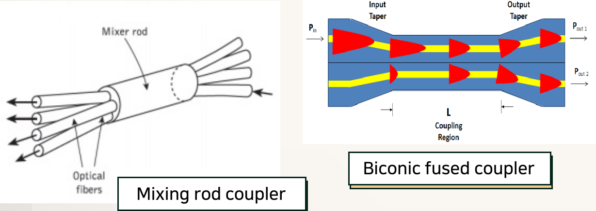

*그림 18. 믹싱 로드 커플러와 바이코닉 융합 커플러*

그림 18의 왼쪽은 믹싱 로드 커플러로, 광섬유 다발(optical fibers)이 유리 막대(mixer rod)의 양쪽에 붙어 있다. 오른쪽은 바이코닉 융합 커플러의 단면으로, 입력 테이퍼(input taper)에서 가늘어진 두 광섬유가 결합 영역 L을 지나는 동안 빛(빨간 화살표)을 주고받은 뒤 출력 테이퍼(output taper)에서 다시 굵어져, 입력 P<sub>in</sub>이 두 출력 P<sub>out1</sub>, P<sub>out2</sub>로 나뉜다.

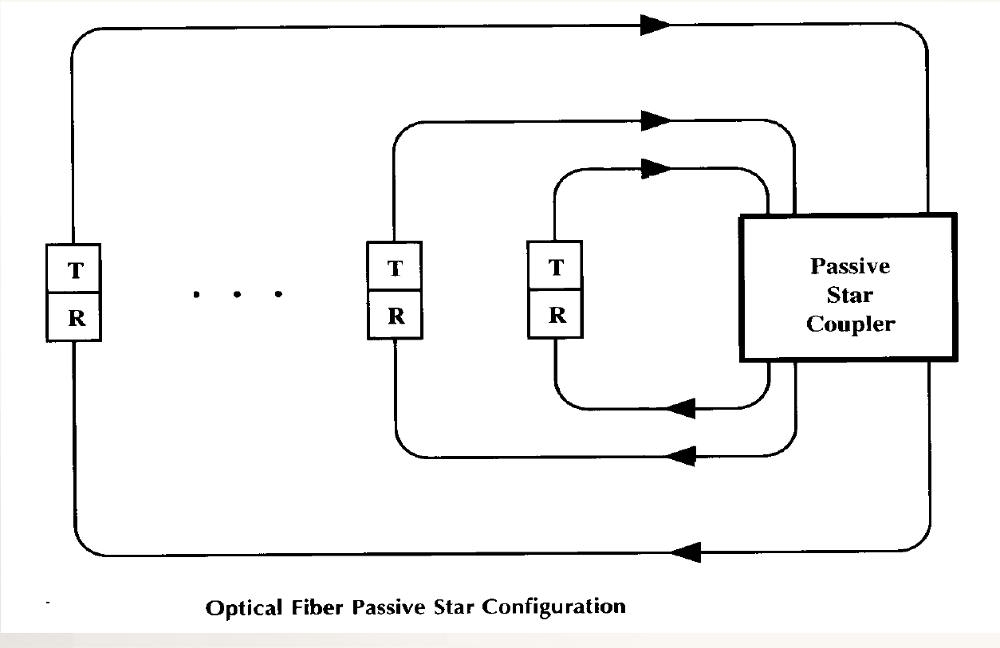

*그림 19. 수동적 스타 커플러를 쓴 광섬유 LAN의 구성*

그림 19에서 각 스테이션은 송신기(T)와 수신기(R)를 가지며, 송신용 광섬유와 수신용 광섬유로 수동적 스타 커플러(passive star coupler)에 연결된다. 어느 스테이션의 T가 보낸 빛도 커플러에서 나뉘어 모든 스테이션의 R로 돌아온다.

### 3.6 광 손실과 운용 범위

광섬유 LAN의 범위는 빛이 송신기에서 수신기까지 가는 동안 잃는 세기, 즉 **광 손실**로 정해진다. 손실은 데시벨(dB)로 나타낸다. 입력 세기 $P_{in}$이 출력 세기 $P_{out}$으로 줄었다면 손실은 다음과 같다.

```math
\text{손실(dB)} = 10 \log_{10} \frac{P_{in}}{P_{out}}
```

예를 들어 세기가 절반이 되면 $10 \log_{10} 2 \approx 3$ dB, 1/10이 되면 10 dB이다. 데시벨은 곱셈을 덧셈으로 바꾸므로, 여러 구성 요소를 지날 때의 전체 손실은 각 손실의 합이다.

광 손실이 생기는 구성 요소는 **커넥터, 케이블, 커플러**의 세 가지이며, 손실 특성은 다음과 같다.

| 구성 요소 | 손실 |
|:-----|:-----|
| 송신기와 수신기 사이의 허용 손실(손실 예산) | 25\~30 dB |
| 광 커넥터 | 광섬유를 잇는 커넥터마다 1\~1.5 dB, 커넥터 4개까지 4\~6 dB |
| 광섬유 케이블의 감쇠 | 1 km당 3\~6 dB |
| 커플러 | $10 \log_{10} N$ dB ($N$은 노드의 수). 16노드 커플러는 약 12 dB |

*표 16. 광섬유 LAN의 손실 요소*

커플러의 손실이 $10 \log_{10} N$인 이유는 들어온 빛이 $N$개의 출력으로 똑같이 나뉘어 각 출력에 $1/N$만 가기 때문이다. $N = 16$이면 $10 \log_{10} 16 = 12.04$ dB이다. 노드를 두 배로 늘릴 때마다 커플러 손실은 약 3 dB씩 커진다.

이 손실을 피하는 방법은 두 가지이다.

- **능동적 스타 커플러(active star coupler):** 커플러가 빛을 전기 신호로 바꾸어 재생한 뒤 모든 출력으로 다시 내보내는 리피터 역할을 한다. 그래서 커플러 단에서는 세기 손실이 없다.
- **광섬유 링(optical fiber ring):** 각 노드의 리피터가 신호를 재생하는 링 구조를 쓴다.

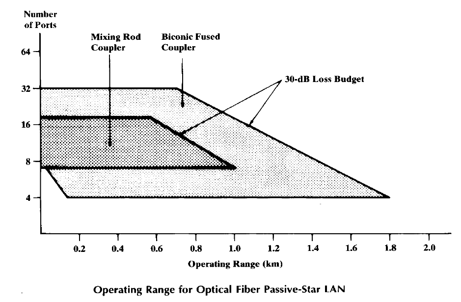

*그림 20. 손실 예산 30 dB에서 수동적 스타 커플러 LAN의 포트 수와 운용 범위*

그림 20의 가로축은 운용 범위(operating range, km), 세로축은 포트 수(number of ports)이며 로그 눈금이다. 30 dB 손실 예산(30-dB loss budget) 아래에서 바이코닉 융합 커플러로 표시된 넓은 영역은 4포트에서 약 1.8 km, 32포트에서 약 0.7 km까지이고, 믹싱 로드 커플러로 표시된 좁은 영역은 8\~16포트에서 약 1 km 이하이다. 두 영역 모두 포트가 많을수록 범위가 줄어드는 사선의 경계를 가진다. 그림에서 믹싱 로드 커플러는 바이코닉 융합 커플러보다 포트 수의 범위가 좁고, 같은 손실 예산에서 운용 범위도 더 짧다. 즉 믹싱 로드 커플러는 큰 규모로 만들기 쉽다는 제조상의 장점이 있지만, 30 dB 손실 예산 아래에서 쓸 수 있는 포트 수와 거리는 바이코닉 융합 커플러보다 작다.

**운용 범위의 계산.** 이 사선은 손실 예산으로 설명할 수 있다. 커플러의 중심에서 각 스테이션까지의 거리를 $L$ km라 하면, 빛은 송신 스테이션에서 커플러까지 $L$, 커플러에서 수신 스테이션까지 $L$을 지나 모두 $2L$ km를 진행한다. 광섬유 감쇠를 1 km당 4 dB, 커넥터와 커플러의 과잉 손실을 합한 고정 손실을 9 dB(커넥터 4개 6 dB와 커플러 자체의 손실 3 dB)로 가정하면, 손실 예산 30 dB는 다음과 같이 나누어 쓴다.

```math
30 = 9 + 10 \log_{10} N + 4 \times 2L \quad \Rightarrow \quad L = \frac{21 - 10 \log_{10} N}{8}
```

| 포트 수 $N$ | 커플러의 분배 손실 $10 \log_{10} N$ (dB) | 광섬유에 남는 예산 (dB) | 운용 범위 $L$ (km) |
|:-----|:-----|:-----|:-----|
| 4 | 6.02 | 14.98 | 1.87 |
| 8 | 9.03 | 11.97 | 1.50 |
| 16 | 12.04 | 8.96 | 1.12 |
| 32 | 15.05 | 5.95 | 0.74 |

*표 17. 손실 예산 30 dB에서 포트 수에 따른 운용 범위의 계산*

예를 들어 $N = 16$이면 커플러에서 12.04 dB를 쓰고, 30 dB에서 고정 손실 9 dB와 12.04 dB를 빼면 광섬유에 8.96 dB가 남는다. 이를 $2L$ km의 감쇠 $8L$ dB에 쓰면 $L = 8.96 / 8 = 1.12$ km이다. 계산 결과(4포트 1.87 km, 32포트 0.74 km)는 그림 20의 바이코닉 융합 커플러 영역(약 1.8 km, 약 0.7 km)과 잘 맞는다. 포트 수가 두 배가 될 때마다 분배 손실이 3 dB 늘어 범위가 약 $3 / 8 \approx 0.38$ km씩 줄어들므로, 그래프의 경계가 로그 눈금 위에서 곧은 사선이 된다.

### 3.7 구조화된 케이블 시스템

> **용어 정의:** **구조화된 케이블 시스템(structured cabling system)** 은 건물 안의 통신 배선을 표준에 따라 계층적으로 설계하여, 어떤 장비나 네트워크 기술이 들어와도 같은 배선을 쓸 수 있게 하는 배선 체계이다.

상업용 건물의 배선 표준은 다음과 같다.

- **EIA/TIA-568** Commercial Building Telecommunications Cabling Standard: 미국의 상업용 건물 통신 배선 표준이며, 현재는 ANSI/TIA-568 시리즈로 이어진다 [5].
- **ISO/IEC 11801**: 국제 표준이며, 현재의 판은 ISO/IEC 11801-1 "Information technology - Generic cabling for customer premises"이다 [6].

배선은 수직적인 스타 구조로 배치한다.

- 배선은 건물의 장비실(equipment room)에서 시작한다.
- 외부에서 들어오는 케이블(통신사 회선 등)은 장비실에 연결된다.
- 장비실에서 각 층의 통신 공간(telecommunications closet)으로 **백본 케이블(backbone cable)** 이 수직으로 연결된다.
- 각 층에서는 통신 공간에서 사무실의 콘센트까지 **수평 케이블(horizontal cable)** 이 연결된다.

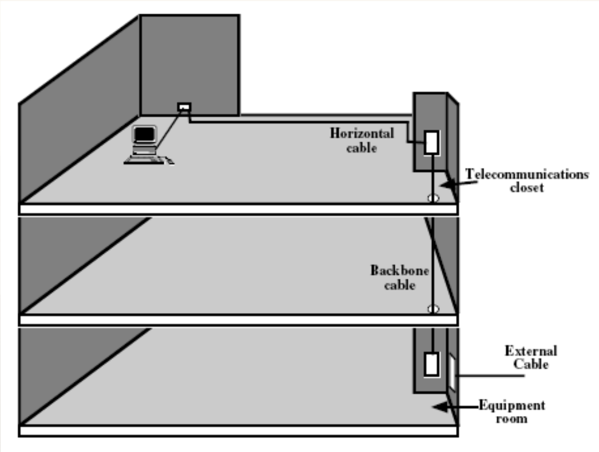

*그림 21. 건물의 구조화된 케이블 시스템*

그림 21은 3층 건물의 단면이다. 맨 아래층의 장비실(equipment room)에 외부 케이블(external cable)이 들어오고, 백본 케이블(backbone cable)이 위층의 통신 공간(telecommunications closet)으로 올라가며, 맨 위층에서는 통신 공간에서 수평 케이블(horizontal cable)이 책상 위 컴퓨터의 콘센트까지 이어진다.

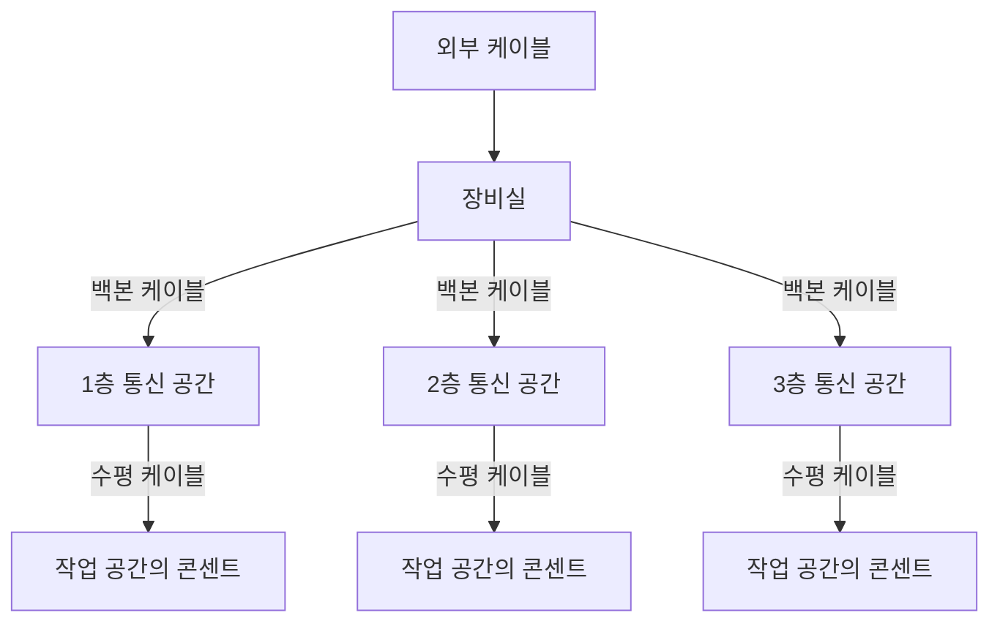

*그림 22. 구조화된 케이블 시스템의 계층적 스타 구조*

그림 22처럼 구조화된 케이블 시스템은 장비실을 뿌리로 하는 2단계의 스타, 즉 트리 모양이다. TIA-568은 수평 케이블의 고정 배선을 최대 90 m로 하고, 양 끝의 패치 코드를 더한 전체 채널을 100 m 이하로 정한다 [5]. 3.1절에서 UTP의 스테이션과 허브 사이 거리가 약 100 m인 것과 같은 값이다. 배선이 표준화되어 있으므로, 나중에 허브를 스위치로 바꾸거나 전화 대신 이더넷을 쓰더라도 벽 속의 케이블을 다시 깔 필요가 없다.

---

<br>

## 4. 부록: 영국의 HORIBA MIRA

### 4.1 개요와 연혁

**HORIBA MIRA**는 영국의 자동차 연구 기관이다.

- 1946년에 MIRA(Motor Industry Research Association)라는 이름의 정부 지원 자동차 산업 연구 기관으로 영국에서 설립되었다 [7].
- 엔지니어링 서비스, 기술 개발 컨설팅, 시험 인증 등의 업무를 수행한다.
- 2015년에 일본의 계측 장비 기업 HORIBA가 MIRA를 인수하여 사명을 HORIBA MIRA로 바꾸었다 [7].
- 잉글랜드 중부의 워릭셔(Warwickshire) 주 너니턴(Nuneaton)에 있다. 버밍엄과 코번트리 인근이며, 런던 시내에서 북쪽으로 약 160 km 떨어져 있어 차로 2시간 정도 걸린다.

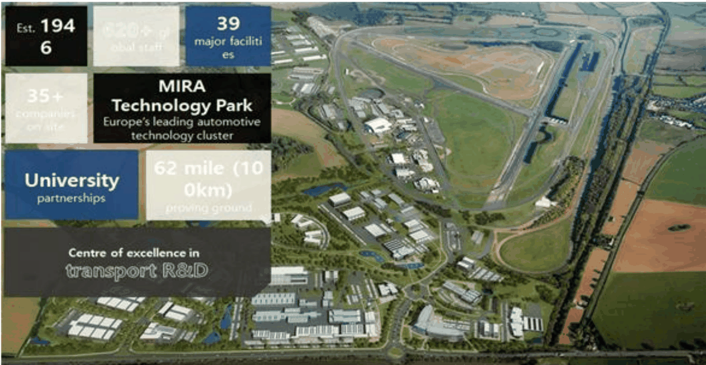

*그림 23. MIRA 테크놀로지 파크의 전경과 주요 수치*

그림 23은 시험장과 연구 단지를 하늘에서 본 사진이며, 왼쪽에 주요 수치가 적혀 있다. 1946년 설립(Est. 1946), 전 세계 620명 이상의 직원(620+ global staff), 39개의 주요 시설(39 major facilities), 단지에 입주한 35개 이상의 기업, 대학과의 협력(University partnerships), 총 62마일(100 km)의 프루빙 그라운드, 교통 연구 개발의 중심(centre of excellence in transport R&D)이 표시되어 있다. 가운데 상자의 MIRA 테크놀로지 파크(MIRA Technology Park)는 유럽의 대표적인 자동차 기술 클러스터를 내세운다.

> **용어 정의:** **프루빙 그라운드(proving ground, PG)** 는 고속 주회로, 핸들링 시험로, 험로, 제동 시험로처럼 여러 도로 조건을 재현한 차량 시험장이다.

### 4.2 사업 분야와 규모

HORIBA MIRA의 현황은 다음과 같다.

- 다양한 산업 분야의 기업 고객을 대상으로 업무를 수행하며, 업무 비중은 자동차 분야가 75%, 국방 분야가 25%이다. 사업 분야는 자동차(automotive), 국방(defence), 건설과 농업용 같은 비도로 차량(off highway), 모터스포츠(motorsport)에 걸친다. 고객으로는 Airbus, Boeing, Bombardier 같은 항공 우주 기업, JCB, Caterpillar, Terex 같은 건설 장비 기업, Jaguar, Land Rover, Ford, Toyota, Volkswagen, Hyundai, Tata, Geely 같은 자동차 제조사, Bosch, ZF, Continental 같은 부품 기업, BAE Systems, Thales, Lockheed Martin, General Dynamics 같은 방산 기업, Red Bull Racing, Williams Martini Racing 같은 모터스포츠 팀, Innovate UK와 유럽 연합 같은 공공 기관이 있다.
- 600명 이상의 직원이 39개의 주요 시험 장비를 가지고 다양한 형태의 시험 인증과 연구 개발 지원 업무를 수행한다.
- 총 길이 약 100 km의 시험로를 갖춘 프루빙 그라운드를 보유하여 다양한 종류의 차량을 시험할 수 있다. 부지는 297 ha에 이른다 [7].
- MIRA 테크놀로지 파크(MTP)라는 자동차 기술 클러스터 단지를 영국 정부와 함께 구축하고 지원한다. 40여 개의 자동차 관련 기관, 업체, 대학이 입주하여 기술적, 상업적 시너지를 만든다.
- 최근 자동차 산업의 흐름에 맞추어 친환경, 고효율 미래차 기술에 집중하여 연구하고 투자한다.

### 4.3 메인 프루빙 그라운드

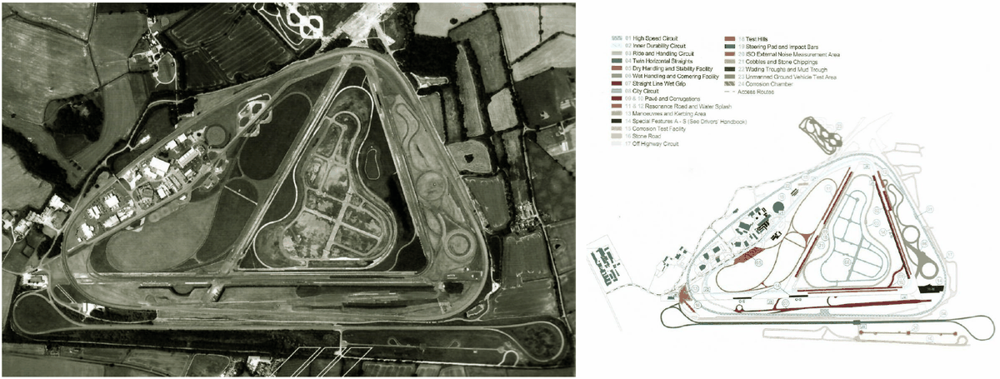

*그림 24. MIRA 메인 프루빙 그라운드의 항공 사진과 시설 배치도*

그림 24의 왼쪽은 메인 프루빙 그라운드의 항공 사진으로, 삼각형 모양의 고속 주회로 안쪽에 여러 시험로가 들어서 있다. 오른쪽은 같은 시험장의 배치도로, 시험로마다 다른 색으로 칠하고 번호를 붙였다. 메인 주회로의 사양은 다음과 같다.

| 항목 | 값 |
|:-----|:-----|
| 주회로 길이 | 4.5 km |
| 노면 | 4차로 아스팔트 |
| 곡선 구간 | 세 곳이며, 최대 33°까지 경사(bank)가 져 있다 |
| 곡선 구간의 반지름 | 216 m |
| 중립 속도(neutral speed) | 86 mph(약 138 km/h) |
| 차로별 길이(차로 중심선 기준) | 안쪽 차로 4.452 km, 2차로 4.478 km, 3차로 4.495 km, 4차로 4.513 km |

*표 18. MIRA 메인 주회로의 사양*

**중립 속도의 계산.** 경사진 곡선 도로에서 **중립 속도(neutral speed)** 는 운전자가 조향으로 옆 방향의 힘을 보태지 않아도, 즉 타이어와 노면 사이의 옆 방향 마찰 없이 차가 곡선을 따라 돌 수 있는 속도이다. 경사각이 $\theta$, 곡선의 반지름이 $r$일 때, 차에 작용하는 수직항력 $N$의 수직 성분은 중력 $mg$와, 수평 성분은 원운동에 필요한 구심력 $mv^2/r$과 같아야 한다.

```math
N \cos\theta = mg, \qquad N \sin\theta = \frac{mv^2}{r}
```

두 식을 나누면 $\tan\theta = v^2 / (rg)$이므로 중립 속도는 $v = \sqrt{rg\tan\theta}$이다. $r = 216$ m, $\theta = 33^\circ$, $g = 9.81$ m/s²를 넣으면 $rg = 2118.96$, $\tan 33^\circ = 0.6494$이므로 $v = \sqrt{2118.96 \times 0.6494} = \sqrt{1376.1} \approx 37.1$ m/s, 즉 약 134 km/h(83 mph)이다. 공식 중립 속도 86 mph(38.4 m/s)는 이 계산값보다 약간 크다. 경사 33°에서 86 mph가 나오는 반지름은 $r = v^2 / (g\tan\theta) = 38.4^2 / (9.81 \times 0.6494) \approx 232$ m이므로, 공식 값은 표의 반지름 216 m와 최대 경사 33°만으로는 재현되지 않는다.

메인 프루빙 그라운드의 시설은 다음과 같다.

| 번호 | 시설 | 번호 | 시설 |
|:-----|:-----|:-----|:-----|
| 01 | High Speed Circuit (고속 주회로) | 13 | Manoeuvres and Kerbing Area (저속 기동과 연석 시험 구역) |
| 02 | Inner Durability Circuit (안쪽 내구 주회로) | 14 | Special Features A-S (특수 노면 A\~S) |
| 03 | Ride and Handling Circuit (승차감과 핸들링 주회로) | 15 | Corrosion Test Facility (부식 시험 시설) |
| 04 | Twin Horizontal Straights (평탄 직선로 두 개) | 16 | Stone Road (돌길) |
| 05 | Dry Handling and Stability Facility (마른 노면 핸들링과 안정성 시설) | 17 | Off Highway Circuit (비포장 주회로) |
| 06 | Wet Handling and Cornering Facility (젖은 노면 핸들링과 선회 시설) | 18 | Test Hills (경사로) |
| 07 | Straight Line Wet Grip (직선 젖은 노면 제동 시험로) | 19 | Steering Pad and Impact Bars (선회 시험장과 충격 바) |
| 08 | City Circuit (도심 주회로) | 20 | ISO External Noise Measurement Area (ISO 차외 소음 측정 구역) |
| 09, 10 | Pavé and Corrugations (돌포장과 요철 노면) | 21 | Cobbles and Stone Chippings (자갈과 쇄석 노면) |
| 11, 12 | Resonance Road and Water Splash (공진 노면과 물 튀김 구간) | 22 | Wading Troughs and Mud Trough (도하 수조와 진흙 수조) |
| | | 23 | Unmanned Ground Vehicle Test Area (무인 지상 차량 시험 구역) |
| | | 24 | Corrosion Chamber (부식 챔버) |

*표 19. MIRA 메인 프루빙 그라운드의 시설*

### 4.4 직선 젖은 노면 제동 시험로

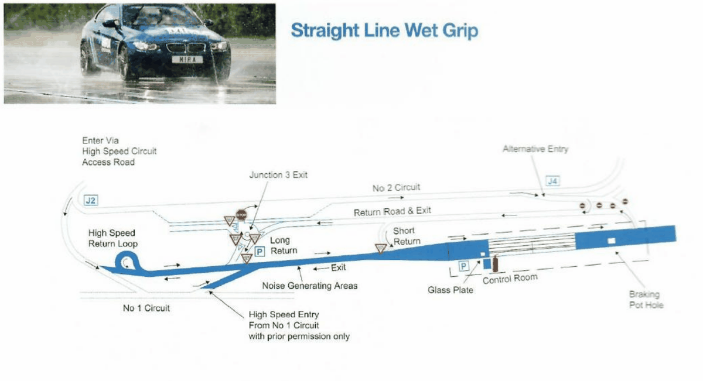

*그림 25. 직선 젖은 노면 제동 시험로의 위치와 시험 장면*

그림 25의 위 사진은 물을 뿌린 노면에서 제동하는 시험 차량이고, 아래 배치도는 고속 주회로에서 들어와(enter via high speed circuit access road) 파란색으로 표시한 긴 직선 시험로를 달린 뒤, 왼쪽의 고속 회귀 루프(high speed return loop)나 회귀로로 돌아가는 동선을 보여 준다. 직선로에는 마찰 계수가 서로 다른 여러 노면이 이어져 있다.

| 노면 | 크기 | 젖은 노면의 마찰 계수 $\mu$ | 물 공급 |
|:-----|:-----|:-----|:-----|
| 매끄러운 콘크리트(smooth concrete) | 100 m × 4 m | 0.40 | 분사와 보(weir) |
| 브리드포트 노면(규암 포함) | 100 m × 4 m | 0.40 | 분사와 보 |
| ISO 제동 시험용 아스팔트 | 100 m × 4 m | 0.50 | 분사와 보 |
| 델루그립(Delugrip) | 100 m × 4 m | 0.65 | 분사 |
| 현무암 타일(basalt tiles) | 200 m × 7 m | 0.20 | 분사 |
| 세라믹 타일(ceramic tiles) | 100 m × 3 m | 0.10 | 분사 |
| 수막 현상 시험로(매끄러운 콘크리트) | 66 m × 4 m | - | 분사와 직접 공급 |

*표 20. 직선 젖은 노면 시험로의 노면*

> **용어 정의:** **마찰 계수(friction coefficient)** $\mu$는 타이어가 노면에 미끄러지지 않고 낼 수 있는 최대 힘을 차의 무게로 나눈 값이다. 값이 클수록 잘 서고, 빙판은 0.1 안팎이다.

> **용어 정의:** **보(weir)** 는 물을 일정 깊이로 고이게 하는 둑이다.

> **용어 정의:** **수막 현상(aquaplaning)** 은 타이어와 노면 사이에 물막이 생겨 타이어가 물 위에 뜨는 현상이다.

**제동 거리의 계산.** 마찰이 일정하면 최대 감속도는 $\mu g$이므로, 속도 $v$에서 정지할 때까지의 거리는 $d = v^2 / (2\mu g)$이다. 80 km/h($80 / 3.6 = 22.2$ m/s)에서 제동하면 $v^2 = 493.8$이므로 다음과 같다.

- 델루그립($`\mu = 0.65`$): $d = 493.8 / (2 \times 0.65 \times 9.81) \approx 38.7$ m
- 매끄러운 콘크리트($`\mu = 0.40`$): $d \approx 62.9$ m
- 현무암 타일($`\mu = 0.20`$): $d \approx 125.8$ m
- 세라믹 타일($`\mu = 0.10`$): $d \approx 251.7$ m

세라믹 타일에서는 80 km/h의 제동 거리가 노면 길이 100 m를 훨씬 넘는다. 50 km/h(13.9 m/s)로 낮추면 $d = 13.9^2 / (2 \times 0.10 \times 9.81) \approx 98$ m로 100 m 안에 들어온다. 이처럼 마찰 계수가 낮은 노면에서는 제동 거리가 노면 길이 안에 들도록 시험 속도를 낮추어야 한다.

### 4.5 CAV 시험장

HORIBA MIRA는 최근 커넥티드 자율주행차(CAV, connected automated vehicle)를 위한 시험장인 ASSURED CAV를 건설했다. 전체 시설에는 약 1억 파운드가 투입되었다 [8].

- **CAV 시험장(HIGHWAY):** 직선로가 대형 원선회로에 연결된 형태이다. 지름 300 m의 평탄한 동적 플랫폼에서 차선과 교차로 표시를 자유롭게 바꾸어, 차로 합류, 차선 유지 보조, 충돌 회피 같은 ADAS와 자율주행 기능을 시나리오에 따라 차량의 제어 한계까지 시험한다.
- **도심 자율주행 시험로(CITY):** 주차 건물, 교차로, 모의 건물, 통신 인프라 등으로 구성된, 제어할 수 있고 설정을 바꿀 수 있는 연결된 도심과 교외 주행 환경이다. 여러 형태의 교차로와 도로 시설물로 복잡한 자율주행 시스템과 교통 시나리오를 안전하게 반복 검증한다. 교차로의 신호등은 V2X 통신(유럽의 ITS-G5)으로 차량과 정보를 주고받는다 [8].
- **주차 시험 건물(PARKING):** 여러 층의 주차 건물로, 좁은 시야, 좁은 공간의 기동, GPS 신호 단절을 재현하여 자동 발레 주차(automated valet parking) 시스템을 개발한다 [8].


*그림 26. ASSURED CAV의 고속도로 시험장과 도심 시험장*

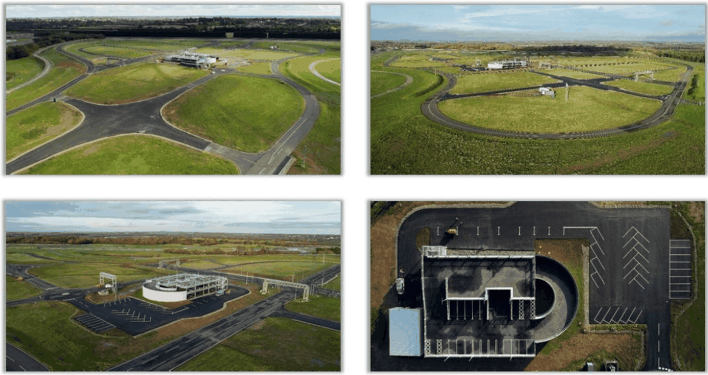

*그림 27. CAV 시험장의 주차 시험 건물과 도심 시험로*

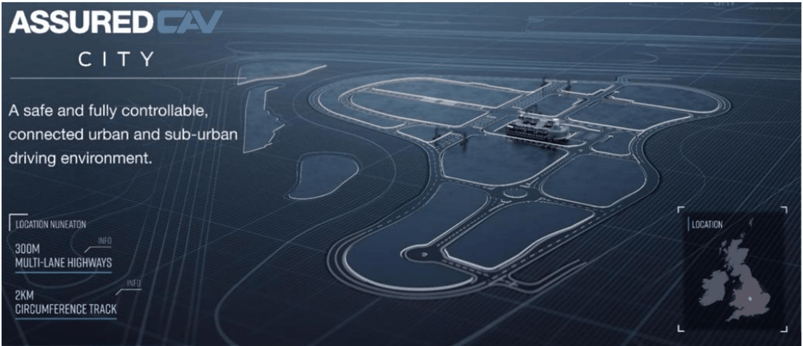

*그림 28. ASSURED CAV CITY 도심 자율주행 시험로의 조감도*

그림 26의 왼쪽은 넓은 원형 포장면에 직선로가 이어진 고속도로 시험장(ASSURED CAV HIGHWAY), 오른쪽은 여러 형태의 교차로가 있는 도심 시험장(ASSURED CAV CITY)의 항공 사진이다. 그림 27은 도심 시험로의 교차로들과 원형 경사로가 붙은 여러 층의 주차 시험 건물이다. 그림 28은 도심 시험로의 조감도로, 너니턴(Nuneaton)에 있으며 300 m의 다차로 도로(multi-lane highways)와 2 km의 주회로(circumference track)를 갖추었다고 표시되어 있다. 이 시험장은 11\~14주차에서 다루는 V2X 통신과 커넥티드 자율주행 기술을 실제 차량으로 검증하는 곳이다.

---

<br>

## 개념 적용

| 상황 | 적용할 개념 |
|:-----|:-----|
| 사무실의 10 Mbps 허브에 PC를 계속 추가했더니 네트워크가 점점 느려졌다. | 허브는 모든 포트가 하나의 충돌 도메인을 공유하므로 스위치로 바꾸어 포트마다 충돌 도메인을 나눈다(1.2절, 3.3절). |
| 두 층의 LAN을 연결하되, 각 층 안의 트래픽이 다른 층으로 넘어가지 않게 하려 한다. | 브리지나 L2 스위치의 필터링으로 같은 세그먼트 안의 프레임은 다른 세그먼트로 보내지 않는다(1.3절). |
| 웹 서버 세 대에 요청을 고르게 나누어 보내려 한다. | IP 주소와 포트 번호로 연결을 분배하는 L4 스위치의 부하 분산을 쓴다(1.4절). |
| 링 LAN에서 리피터 하나가 고장 날 때마다 링 전체가 멈춘다. | 배선 집중기와 바이패스 릴레이를 쓰는 스타-링 구조로 고장 난 리피터를 자동 우회한다(2.10절). |
| 수동적 스타 커플러 광 LAN의 노드를 16개에서 32개로 늘렸더니 먼 스테이션이 통신하지 못한다. | 커플러 손실이 약 3 dB 늘어 광섬유에 쓸 예산이 줄었으므로 운용 범위가 짧아졌다(3.6절). |
| 새 건물에 나중에 어떤 네트워크 장비가 들어와도 쓸 수 있는 배선을 하려 한다. | 장비실, 백본, 통신 공간, 수평 케이블의 계층적 스타 구조인 구조화된 케이블 시스템을 따른다(3.7절). |

*표 21. 개념 적용 사례*

**T/F 점검:**

| 문장 | 판단과 근거 |
|:-----|:-----|
| 허브는 MAC 주소를 보고 목적지 포트로만 프레임을 보낸다. | **F.** 허브는 MAC 주소를 이용하지 않고 받은 프레임을 모든 포트로 복제한다. |
| 브리지는 목적지 MAC 주소가 테이블에 없으면 프레임을 버린다. | **F.** 테이블에 없으면 들어온 포트를 뺀 모든 포트로 플러딩한다. |
| 링 토폴로지에서는 종단 저항이 신호를 흡수하므로 데이터를 따로 삭제할 필요가 없다. | **F.** 링은 폐루프이므로 정해진 리피터나 송신한 리피터가 데이터를 삭제해야 한다. |
| 광대역 동축 케이블에서 탭이 보낸 신호는 하류의 스테이션에만 전달된다. | **T.** 앰프가 한 방향으로만 증폭하므로 신호가 단방향으로 전파되며, 그래서 헤드엔드를 거치는 두 경로가 필요하다. |
| 컷스루 스위치는 저장 후 전달 스위치보다 지연이 짧지만 손상된 프레임을 걸러 내지 못한다. | **T.** 목적지 주소만 읽고 곧바로 내보내므로 CRC를 확인하기 전에 전달이 시작된다. |
| 16노드 수동적 스타 커플러의 분배 손실은 16 dB이다. | **F.** $10 \log_{10} 16 \approx 12$ dB이다. |

---

<br>

## 요약

| 개념 | 핵심 요약 |
|:-----|:-----|
| 게이트웨이 | 좁은 뜻으로는 전송 계층 이상에서 서로 다른 프로토콜을 변환하는 장치이고, 넓은 뜻으로는 네트워크를 연결하여 신호를 중계하는 장비 전반이다. |
| 리피터와 허브 | 물리 계층 장비로 신호를 재생하여 전달하며, 허브는 모든 포트로 복제하므로 물리적으로 스타, 논리적으로 버스이다. |
| 브리지 | 데이터 링크 계층에서 학습, 플러딩, 포워딩, 필터링, 에이징으로 프레임을 전달하며 세그먼트의 트래픽을 고립시킨다. |
| 스위치 | 브리지의 기능을 하드웨어로 처리하며, 판단에 쓰는 정보에 따라 L2, L3, L4, L7 스위치로 나뉜다. |
| 라우터 | 네트워크 계층에서 IP 주소로 네트워크 사이의 최적 경로를 정하며, 위치와 용도에 따라 여러 이름으로 불린다. |
| 버스와 트리 | 스테이션이 탭으로 공유 매체에 붙고 데이터가 매체 전체로 퍼지며, 양 끝의 터미네이터가 신호를 흡수한다. |
| 링 | 리피터가 단방향 점대점 링크로 폐루프를 이루며, 송신한 리피터가 데이터를 삭제하고 돌아온 프레임으로 자동 확인 응답을 얻는다. |
| 스타 | 모든 스테이션이 중앙 장치에 연결되며, 중앙이 브로드캐스트 노드면 논리적 버스, 스위칭 노드면 목적지에만 전달한다. |
| 토폴로지와 매체 선택 | 토폴로지는 신뢰성, 확장성, 성능으로, 매체는 토폴로지, 전송 용량, 신뢰성, 데이터 형태, 외부 환경으로 고른다. |
| 기저대역과 광대역 | 기저대역은 디지털 신호를 양방향으로 수 km까지, 광대역은 FDM 아날로그 신호를 단방향으로 수십 km까지 보내며 헤드엔드가 필요하다. |
| 링 리피터 | 수신 상태는 1비트 지연으로 비트를 스캔하고 복사하며, 송신 상태는 스테이션의 비트를 내보내고, 바이패스 상태는 리피터를 우회한다. |
| 타이밍 지터 | 비트 시간의 오차가 리피터마다 누적되어 링의 크기를 제한하며, PLL과 탄력적 버퍼로 줄인다. |
| LAN 스위치 | 공유 허브의 전체 용량은 10 Mbps이지만 스위치는 N × 10 Mbps이며, 저장 후 전달과 컷스루 방식이 있다. |
| 수동적 스타 커플러 | 빛을 N개의 출력으로 나누어 10 log N dB를 잃으므로, 손실 예산 안에서 포트 수가 늘수록 운용 범위가 줄어든다. |
| 구조화된 케이블 시스템 | 장비실에서 백본 케이블로 층별 통신 공간에, 거기서 수평 케이블로 작업 공간에 연결하는 계층적 스타 배선이다. |
| HORIBA MIRA | 1946년에 세워져 2015년 HORIBA에 인수된 영국의 자동차 연구 기관으로, 대규모 프루빙 그라운드와 ASSURED CAV 시험장을 운영한다. |

---

<br>

## 점검 문제

1. **장비의 동작 계층:** 리피터, 허브, 브리지, 스위치, 라우터를 동작 계층에 따라 나누고, 각 장비가 데이터의 어느 정보를 보고 판단하는지 쓰라.

   <details>
   <summary>정답</summary>

   리피터와 허브는 물리 계층 장비로, 주소를 보지 않고 신호를 재생하여 내보낸다. 브리지와 스위치는 데이터 링크 계층 장비로, 프레임의 MAC 주소를 보고 어느 포트로 보낼지 정한다. 라우터는 네트워크 계층 장비로, IP 헤더의 목적지 IP 주소를 보고 경로를 정한다.

   </details>

2. **브리지의 동작:** 포트 1에 A, B가, 포트 2에 C가 있는 브리지의 테이블이 비어 있다. B → C, C → B, A → B, A → C의 순서로 프레임이 지날 때 각 프레임에 대한 브리지의 동작을 쓰라.

   <details>
   <summary>정답</summary>

   B → C: B를 포트 1로 학습하고, C가 테이블에 없으므로 포트 2로 플러딩한다. C → B: C를 포트 2로 학습하고, B가 포트 1에 있으므로 포트 1로 포워딩한다. A → B: A를 포트 1로 학습하고, B가 같은 포트 1 쪽에 있으므로 필터링하여 포트 2로 보내지 않는다. A → C: C가 포트 2에 있으므로 포트 2로 포워딩한다.

   </details>

3. **토폴로지의 고장:** 버스, 링, 스타 토폴로지에서 (가) 스테이션 하나가 꺼졌을 때와 (나) 케이블 한 곳이 끊겼을 때 각각 어떤 일이 생기는지 비교하라. 링의 리피터에는 바이패스 기능이 없다고 가정한다.

   <details>
   <summary>정답</summary>

   (가) 버스에서는 스테이션이 탭으로 매달려 있을 뿐이므로 나머지는 계속 통신한다. 링에서는 꺼진 스테이션의 리피터가 신호를 전달하지 못하므로 링 전체가 멈춘다. 스타에서는 그 스테이션의 링크만 쓰이지 않고 나머지는 계속 통신한다. (나) 버스에서는 끊긴 지점이 종단 저항 없는 끝이 되어 반사가 생기고 양쪽이 서로 통신하지 못하므로 사실상 전체가 영향을 받는다. 링에서는 단방향 링크가 끊겨 링 전체가 멈춘다. 스타에서는 끊긴 케이블에 연결된 스테이션만 고립되며, 중앙 장치가 고장 나면 전체가 멈춘다.

   </details>

4. **기저대역 규격:** 10BASE5의 이름이 뜻하는 바를 설명하고, 세그먼트 길이와 리피터 수로 네트워크 범위 2500 m가 나오는 과정을 쓰라.

   <details>
   <summary>정답</summary>

   10은 10 Mbps의 전송 속도, BASE는 기저대역 전송, 5는 최대 세그먼트 길이 500 m를 뜻한다. 리피터 4개로 세그먼트 5개를 이을 수 있으므로 네트워크 범위는 $500 \times 5 = 2500$ m이다.

   </details>

5. **광대역 구성:** 광대역 동축 케이블에 헤드엔드가 필요한 이유를 신호의 방향성으로 설명하고, 장치 수에 따라 듀얼 케이블과 스플릿 구성 중 어느 것을 고르는지 쓰라.

   <details>
   <summary>정답</summary>

   광대역 시스템의 앰프는 여러 주파수대를 한 방향으로만 증폭하므로, 탭에서 보낸 신호는 하류의 스테이션에만 전달된다. 모든 스테이션이 서로 통신하려면 신호를 헤드엔드 쪽으로 보내고(인바운드) 헤드엔드에서 모든 스테이션 쪽으로 되돌려 보내는(아웃바운드) 두 경로가 필요하다. 장치가 적으면 헤드엔드의 주파수 변환기 같은 고정 비용을 피하기 위해 듀얼 케이블을, 장치가 많으면 케이블 비용을 아끼기 위해 스플릿 구성을 쓴다.

   </details>

6. **링 지연:** 16 Mbps 링에 리피터 50개가 있고 각 리피터가 1비트 지연을 주며, 케이블 전체 길이는 1 km이고 전파 지연은 1 km당 5 µs이다. 링을 한 바퀴 도는 시간과 그 시간에 해당하는 비트 수를 구하라.

   <details>
   <summary>정답</summary>

   한 비트의 시간은 $1 / (16 \times 10^6) = 0.0625$ µs이므로 리피터 지연은 $50 \times 0.0625 = 3.125$ µs이고, 전파 지연은 5 µs이다. 한 바퀴는 $3.125 + 5 = 8.125$ µs이며, 이는 $8.125 / 0.0625 = 130$비트에 해당한다.

   </details>

7. **링 리피터의 상태:** 링 리피터의 수신 상태에서 1비트 지연이 필요한 이유와, 송신 상태에서 다른 스테이션의 패킷이 들어오면 어떻게 처리하는지 설명하라.

   <details>
   <summary>정답</summary>

   수신 상태의 리피터는 지나가는 비트에서 주소와 토큰 같은 패턴을 찾고, 필요하면 비트 하나를 바꾸어(예: 토큰을 프레임 시작으로, 수신 확인 비트 표시) 내보내야 하므로, 비트를 확인하고 고칠 시간으로 1비트만큼 지연시킨다. 송신 상태에서 다른 스테이션의 패킷 비트가 들어오면 버퍼에 저장해 두었다가 자신의 송신이 끝난 뒤 다시 보낸다.

   </details>

8. **허브와 스위치의 용량:** 100 Mbps 포트 24개가 있는 허브와 LAN 스위치에서 12쌍의 스테이션이 동시에 통신할 때, 각 쌍이 얻는 평균 대역폭과 동시에 흐르는 전체 데이터양을 비교하라.

   <details>
   <summary>정답</summary>

   허브는 전체 용량이 100 Mbps이므로 12쌍이 나누어 쓰면 한 쌍은 평균 $100 / 12 \approx 8.3$ Mbps이고, 동시에 흐르는 데이터는 최대 100 Mbps이다(충돌로 실제로는 더 낮다). LAN 스위치에서는 각 쌍이 서로 다른 포트를 쓰므로 한 쌍이 100 Mbps를 쓰고, 동시에 흐르는 데이터는 $12 \times 100 = 1200$ Mbps이다.

   </details>

9. **광 손실 예산:** 손실 예산 30 dB, 고정 손실 9 dB, 광섬유 감쇠 1 km당 4 dB인 수동적 스타 커플러 LAN에서 노드 수가 64일 때 운용 범위를 구하라. 같은 조건에서 운용 범위 1.5 km를 얻으려면 노드를 최대 몇 개까지 둘 수 있는가?

   <details>
   <summary>정답</summary>

   $10 \log_{10} 64 = 18.06$ dB이므로 $L = (21 - 18.06) / 8 = 0.37$ km이다. $L = 1.5$ km이면 $10 \log_{10} N = 21 - 8 \times 1.5 = 9$ dB이므로 $N = 10^{0.9} \approx 7.9$이고, 노드는 최대 7개이다. 커플러는 보통 2의 거듭제곱 포트로 만들므로 실제로는 4포트 커플러를 쓰거나, 8포트 커플러를 쓰고 범위를 1.5 km보다 약간 줄여야 한다.

   </details>

10. **구조화된 케이블과 중립 속도:** (가) 구조화된 케이블 시스템에서 수평 케이블의 고정 배선을 90 m로 제한하는 것이 UTP 스타 LAN의 어떤 규격과 관련되는지 쓰라. (나) MIRA 주회로의 곡선 반지름 216 m, 경사 33°에서 중립 속도를 km/h로 구하라.

    <details>
    <summary>정답</summary>

    (가) UTP로 스테이션과 허브(또는 스위치) 사이를 약 100 m까지 연결할 수 있다는 규격과 관련된다. 수평 케이블 90 m에 양 끝의 패치 코드를 더해도 전체 채널이 100 m를 넘지 않게 한 것이다. (나) $v = \sqrt{rg\tan\theta} = \sqrt{216 \times 9.81 \times 0.6494} \approx 37.1$ m/s이고, $37.1 \times 3.6 \approx 134$ km/h이다.

    </details>

---

<br>

## 참고 문헌

1. IEEE, *IEEE Standard for Local and Metropolitan Area Networks: Media Access Control (MAC) Bridges*, IEEE Std 802.1D-2004, 2004.
2. ITU-T, *Recommendation G.984.1: Gigabit-capable passive optical networks (GPON): General characteristics*, International Telecommunication Union, 2008.
3. W. Stallings, *Data and Computer Communications*, 10th ed. Boston, MA, USA: Pearson, 2014.
4. IEEE, *IEEE Standard for Ethernet*, IEEE Std 802.3-2022, 2022.
5. Telecommunications Industry Association, *ANSI/TIA-568 Commercial Building Telecommunications Cabling Standard* series, Arlington, VA, USA.
6. ISO/IEC 11801-1:2017, *Information technology - Generic cabling for customer premises - Part 1: General requirements*, International Organization for Standardization, 2017.
7. HORIBA, Ltd., "HORIBA acquires UK based company MIRA Ltd.," news release, Jul. 14, 2015. https://www-origin.horiba.com/corporate-news/news/article/horiba-acquires-uk-based-company-mira-ltd-39703
8. HORIBA MIRA, "HORIBA MIRA's ASSURED CAV is Now Open," HORIBA MIRA news. https://www.horiba-mira.com/?p=39649
