# Week 6 Lecture — Network Topologies

[Repository Guide](../../README.md) | [English](Concepts_Lecture.md) | [한국어](Concepts_Lecture.ko.md)

> **Last Updated:** 2026-11-17

> **Learning Objectives:**
> 1. Distinguish repeaters, hubs, bridges, switches, routers, and gateways by operating layer and function, and apply the five bridge operations to an example
> 2. Compare the structure, operation, advantages, and disadvantages of bus, tree, ring, and star topologies, and choose a topology and transmission medium that meet given requirements
> 3. Explain baseband and broadband coaxial cable transmission, dual-cable and split configurations, and the tap methods of an optical fiber bus
> 4. Explain the three states of a ring repeater, data removal on a ring, timing jitter, and the advantages of the star-ring architecture
> 5. Compare hubs and LAN switches, and compute the operating range of a passive-star-coupler LAN from its optical loss budget
> 6. Describe the composition of a structured cabling system and the test facilities of HORIBA MIRA in the United Kingdom

---

## Table of Contents

- [1. Network Interconnection Devices and Types of Topologies](#1-network-interconnection-devices-and-types-of-topologies)
  - [1.1 Concept and Types of Gateways](#11-concept-and-types-of-gateways)
  - [1.2 Repeaters and Hubs](#12-repeaters-and-hubs)
  - [1.3 Bridges](#13-bridges)
  - [1.4 Switches](#14-switches)
  - [1.5 Routers](#15-routers)
  - [1.6 Definition of Topology](#16-definition-of-topology)
  - [1.7 Bus and Tree Topologies](#17-bus-and-tree-topologies)
  - [1.8 Ring Topology](#18-ring-topology)
  - [1.9 Star Topology](#19-star-topology)
  - [1.10 Choosing a Topology](#110-choosing-a-topology)
  - [1.11 Choosing a Transmission Medium and Its Relation to Topology](#111-choosing-a-transmission-medium-and-its-relation-to-topology)
- [2. Bus/Tree Topology and Ring Topology](#2-bustree-topology-and-ring-topology)
  - [2.1 Problems of Multipoint Configurations](#21-problems-of-multipoint-configurations)
  - [2.2 Baseband Coaxial Cable](#22-baseband-coaxial-cable)
  - [2.3 Broadband Coaxial Cable](#23-broadband-coaxial-cable)
  - [2.4 Broadband Components and Carrier Band](#24-broadband-components-and-carrier-band)
  - [2.5 Optical Fiber Bus](#25-optical-fiber-bus)
  - [2.6 Operation of the Ring Topology](#26-operation-of-the-ring-topology)
  - [2.7 States of a Ring Repeater](#27-states-of-a-ring-repeater)
  - [2.8 Advantages and Problems of the Ring Topology](#28-advantages-and-problems-of-the-ring-topology)
  - [2.9 Timing Jitter](#29-timing-jitter)
  - [2.10 Star-Ring Architecture](#210-star-ring-architecture)
- [3. Star Topology and Structured Cabling Systems](#3-star-topology-and-structured-cabling-systems)
  - [3.1 Twisted-Pair Star LANs](#31-twisted-pair-star-lans)
  - [3.2 StarLAN and Hierarchical Hubs](#32-starlan-and-hierarchical-hubs)
  - [3.3 Buses, Hubs, and Switching Hubs](#33-buses-hubs-and-switching-hubs)
  - [3.4 Forwarding Methods of LAN Switches](#34-forwarding-methods-of-lan-switches)
  - [3.5 Passive Star Couplers](#35-passive-star-couplers)
  - [3.6 Optical Loss and Operating Range](#36-optical-loss-and-operating-range)
  - [3.7 Structured Cabling Systems](#37-structured-cabling-systems)
- [4. Appendix: HORIBA MIRA of the United Kingdom](#4-appendix-horiba-mira-of-the-united-kingdom)
  - [4.1 Overview and History](#41-overview-and-history)
  - [4.2 Business Areas and Scale](#42-business-areas-and-scale)
  - [4.3 Main Proving Ground](#43-main-proving-ground)
  - [4.4 Straight Line Wet Grip Track](#44-straight-line-wet-grip-track)
  - [4.5 CAV Test Facility](#45-cav-test-facility)
- [Concept Applications](#concept-applications)
- [Summary](#summary)
- [Self-Check Questions](#self-check-questions)
- [References](#references)

---

<br>

## 1. Network Interconnection Devices and Types of Topologies

### 1.1 Concept and Types of Gateways

> **Definition:** A **gateway** is a device that connects networks so that even networks using different protocols can communicate. In the narrow sense, it is a device that interprets data up to the transport layer or above of the seven OSI layers and converts protocols.

In the broad sense, every device that physically connects one network to another, or one segment to another, and relays or amplifies signals before sending them on is sometimes called a gateway. This section follows the broad sense and summarizes five kinds of network interconnection devices. The devices are distinguished by how far up the OSI layers they interpret the data.

| Device | Operating layer | Characteristics |
|:-----|:-----|:-----|
| Repeater | Physical layer (layer 1) | A device that regenerates a weakened signal and sends it on. |
| Hub | Physical layer (layer 1) | Acts as a repeater but can connect several devices. |
| Bridge | Data link layer (layer 2) | A device that connects network segments to each other. |
| Switch | Data link layer (layer 2) | Does the same job as a bridge, but a switch works in hardware whereas a bridge works in software. |
| Router | Network layer (layer 3) | Sets up the best path (route) and transmits data. |

*Table 1. Types of network interconnection devices*

A device operating at a higher layer reads more of the data's headers and makes more refined decisions, but its processing is correspondingly more complex and expensive. In vehicles too, the central gateway ECU, which converts and forwards messages between in-vehicle networks with different protocols such as CAN, LIN, FlexRay, and Ethernet, is a gateway in the narrow sense (Weeks 2 and 9).

### 1.2 Repeaters and Hubs

The characteristics of a **repeater** are as follows.

- It is a physical layer (layer 1) device.
- It is a regenerating device that simply joins segments to extend the communication distance. A signal traveling along a wire weakens (attenuates) and becomes distorted with distance, so the repeater receives the signal, regenerates it to its original strength and shape, and sends it on.
- It regenerates and retransmits the transmitted signal from one segment of a LAN to another segment.
- Recent network equipment has the repeater function built in, so separate repeaters are rarely used.

> **Note:** A repeater is sometimes described as a simple amplifier that boosts signal strength, but a repeater in a digital LAN is a regenerator that decides the 0s and 1s of the incoming signal and generates a clean new signal. An amplifier boosts the noise along with the signal, whereas a repeater does not pass noise on to the next segment as long as its decisions are correct (the amplifiers and repeaters of Week 4).

> **Definition:** A **segment** is one stretch of transmission medium between devices such as repeaters or bridges, together with the stations attached to it. A segment in this section has a different meaning from the TCP segment of Week 5.

The characteristics of a **hub** are as follows.

- It is a physical layer (layer 1) device: a multiport repeater that acts as a repeater but can connect several devices.
- The devices connected to a hub share one medium, so they access the medium with CSMA/CD, and several devices cannot transmit data at the same time. If B transmits while A is transmitting, a collision occurs, so the more devices are connected, the more frequent the collisions. CSMA/CD is covered in Week 7.
- It is physically a star structure but logically a bus structure. Because the cables gather at one place, the hub, wiring is easier than joining segments with repeaters.
- It duplicates an incoming frame and delivers it identically to all ports, without using MAC addresses. That is, it only regenerates and sends out the received signal bit by bit, without interpreting to whom the frame is going.
- All ports have the same speed (for example, every port of a 10 Mbps hub is 10 Mbps).

**Computing the bandwidth of a hub.** If eight PCs are connected to a 10 Mbps hub and all of them keep trying to send data, they share one medium, so the average bandwidth available to each PC is at most $10 / 8 = 1.25$ Mbps. In practice it is lower because of collisions and retransmissions.

### 1.3 Bridges

The characteristics of a **bridge** are as follows.

- It is a data link layer (layer 2) device.
- It is a device that connects network segments to each other. It first stores every received frame in a buffer and then forwards the frame to the destination port (a different link layer network) according to its address.
- Unlike repeaters and hubs, it can isolate the traffic within each LAN segment instead of propagating it to other segments.
- Each port can have a different speed. Because the frame is stored in a buffer before being sent, a frame received from a 10 Mbps segment can be sent to a 100 Mbps segment.

A bridge processes frames with the following five operations. The **MAC address table** is a table in which the bridge records which MAC address is on the side of which port.

| Operation | Description |
|:-----|:-----|
| Learning | Stores in the MAC address table the MAC address of the host that sent the data and the port through which the frame arrived, and decides on forwarding based on it. |
| Flooding | If the destination MAC address is not in the table, sends the same data to all ports except the one the frame arrived on. |
| Forwarding | If the destination MAC address is in the table, sends the data only to the port where that destination is. |
| Filtering | Determines the destination MAC address and, if the source and destination are on the same segment, blocks the way to the other segments. This function makes it possible to divide collision domains. |
| Aging | If no frame arrives from a MAC address within 300 seconds, automatically deletes that address from the MAC address table. |

*Table 2. The five operations of a bridge*

> **Definition:** A **collision domain** is the part of a network in which a collision occurs if two devices transmit at the same time. Devices connected by a hub are all in the same collision domain, while the ports of a bridge or switch divide collision domains.

The aging time of 300 seconds is the default value recommended by the IEEE 802.1D standard [1]. When a device is moved to another port or removed from the network, the table entries become stale, so entries that have not been heard from for a certain time are deleted to keep the table up to date.

**Example of bridge operation.** Port 1 of a bridge is connected to segment 1 with hosts A and B, and port 2 to segment 2 with hosts C and D; the MAC address table is initially empty.

| Order | Frame | Learned (MAC address table) | Bridge action |
|:-----|:-----|:-----|:-----|
| 1 | A → C | A on port 1 | C is not in the table, so it floods to port 2. |
| 2 | C → A | A on port 1, C on port 2 | A is on port 1, so it forwards only to port 1. |
| 3 | B → A | A and B on port 1, C on port 2 | A is on the same port 1 side as B, so it filters and does not send to port 2. |
| 4 | No frame from A for 300 seconds | B on port 1, C on port 2 | Aging deletes A's entry. Frames for A are flooded again afterward. |

*Table 3. Learning, flooding, forwarding, filtering, and aging at a bridge joining two segments*

Frame 3 travels only within segment 1, so C and D on segment 2 can communicate freely with each other in the meantime. This is what it means for a bridge to isolate the traffic within a segment.

### 1.4 Switches

The characteristics of a **switch** are as follows.

- It is a data link layer (layer 2) device.
- The difference from a bridge is the processing method. A switch handles frame forwarding with dedicated hardware (circuits such as ASICs), while a bridge handles it in software.
- A switch is therefore much faster, offers more ports, and allows the speed to be set per port.
- Since a switch is an upward-compatible replacement for a bridge, separate bridges are no longer used.

Switches are classified as follows according to how far up the layers they look before forwarding.

| Type | Decision basis | Characteristics |
|:-----|:-----|:-----|
| L2 switch | MAC address | The most basic switch, operating at the data link layer. It forwards packets based on MAC addresses and is cheaper than other switches. |
| L3 switch | IP address | An L2 switch with a routing function added. It switches by looking at IP information and, working in hardware, is faster than a router. |
| L4 switch | IP address and port number | Uses the information of the layer 4 protocols TCP and UDP to switch based on IP addresses and port numbers. It provides load balancing. |
| L7 switch | Payload (application data) | Has the same functions and role as an L4 switch, but processes packets by analyzing even their payload. It is advantageous for security but expensive. |

*Table 4. Types of switches*

**Example of load balancing.** When three web servers (S1, S2, S3) provide a service through one representative IP address, an L4 switch distributes new connections arriving at port 80 of this IP address to S1, S2, and S3 in turn. The three servers share the requests evenly so that no single server is overloaded, and if one server fails, the switch sends only to the remaining two. An L7 switch goes further and can look at the URL of an HTTP request to send, for example, image requests to an image server and payment requests to a payment server.

### 1.5 Routers

The characteristics of a **router** are as follows.

- It is a network layer (layer 3) device.
- It sets up the best path (route) between networks needed for data transfer and transmits the data. It connects different networks by looking at IP addresses (Week 5).
- It is relatively expensive and its initial configuration is complex, because the rules for deciding routes (routing tables, routing protocols) and the network address of each port must be configured.

Routers are called by various names according to where they are placed and what they are used for. The names reflect their roles, and the functions of the devices overlap.

| Type | Location and use |
|:-----|:-----|
| Core router | A high-performance backbone router that interconnects the LANs of an Internet service provider (ISP) or the networks of several ISPs. |
| Center router | A router placed at a central site such as a headquarters or data center that aggregates connections from several remote sites. |
| Edge router | A router placed at the boundary between an organization's internal network and the external network (ISP). |
| Remote router | A router placed at a branch or remote office that connects it to the network of the central site. |
| Broadband router | A router that connects a home or small-office network to a broadband Internet line. A home Internet router is of this type. |
| Hotspot router | A router that provides wireless Internet access in public places. |
| ISP router | A router operated by an ISP that connects subscriber lines to the ISP's network. |

*Table 5. Types of routers by location and use*

### 1.6 Definition of Topology

LAN and MAN technologies are determined by three elements.

1. **Topology:** In what shape the devices are connected
2. **Transmission medium:** With what they are connected
3. **Medium access control technique:** How communication over the transmission medium is controlled

> **Definition:** A **topology** is the way the communication environment is organized, in which end points, that is, stations, are interconnected. A topology is (1) the layout of communication links and switching elements and (2) determines the paths that data follow.

> **Definition:** A **station** is a device (computer, controller, and so on) that is connected to a network and sends and receives data. It is sometimes used with the same meaning as node.

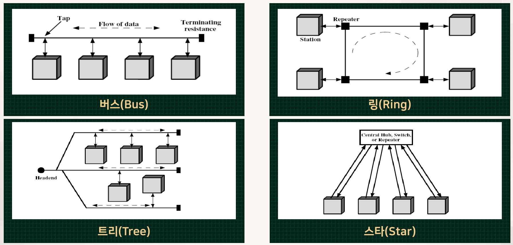

*Figure 1. Bus, ring, tree, and star topologies*

The four topologies in Figure 1 are as follows. A bus is a single cable with termination resistors at both ends, from which stations hang by taps; data flow in both directions. A ring is a loop of repeaters with a station attached to each repeater; data circulate in one direction. A tree is a cable starting at a headend that branches out. A star has every station connected individually to a central hub, switch, or repeater. The basic operation of the bus and ring was covered in Week 3.

### 1.7 Bus and Tree Topologies

The characteristics of the **bus topology** are as follows.

- It is the simplest form, with the transmission medium laid out linearly, and is common in small networks.
- It has no switches or repeaters.
- Stations attach directly to the bus through **taps**. A tap is a connection component that attaches a device to the cable.
- Data transmitted by one station propagate through the entire transmission medium and are received by all attached stations.
- At both ends there is a **terminator**, that is, a termination resistor, that absorbs all signals. Without terminators, signals would reflect at the cable ends, travel back, and overlap with later signals.

The bus topology has the following problems.

- Since every station receives, the intended receiver must be designated.
- Only one station can transmit at a given time. If two transmit at once, the signals overlap and are corrupted.
- Since every station receives every signal, the performance of the whole network drops as the number of stations grows.

These problems are solved with **frames**. A frame is a destination address plus data. Stations not indicated by the address ignore the frame, and the destination station copies the frame as it passes. In addition, adding control information to the frame makes access control possible, determining who may transmit and when.

The characteristics of the **tree topology** are as follows.

- It is a generalization of the bus.
- It has no closed loop; the transmission medium branches out like a tree from a **headend**. The headend sits at the root of the tree and is the point that sends out or collects signals.
- Transmitted data propagate through the entire transmission medium, as on a bus.

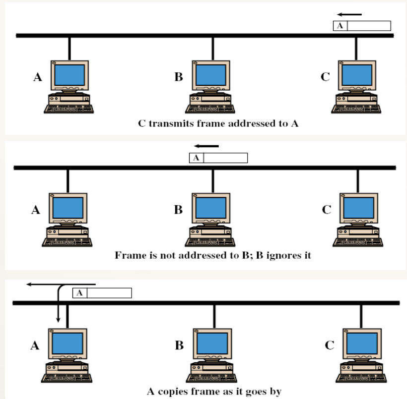

*Figure 2. Delivery of a frame sent by C to A on a bus topology*

Figure 2 shows how a frame is delivered on a bus. At the top, C sends a frame carrying destination address A, and the frame spreads to the left along the bus. In the middle, the frame passes B, but the address is not B, so B ignores it. At the bottom, A copies the frame as it goes by. The frame continues and is absorbed by the terminator at the end of the bus. A tree topology works the same way, with the frame spreading into all branches at each branching point.

### 1.8 Ring Topology

The characteristics of the **ring topology** are as follows.

- Repeaters are connected by point-to-point links in a closed loop.
- Each node is connected to two other nodes.
- No separate flag is needed to determine whether data have reached their destination. Even if data have not reached their destination, they travel once around the circuit and come back to the node that sent them.
- **Repeater:** Receives data on one link and sends them on the other link. A station is attached to each repeater.
- **Link:** Links are directional, and all links point in the same direction.
- Because several stations may try to transmit at the same time, access control is needed (Week 7).

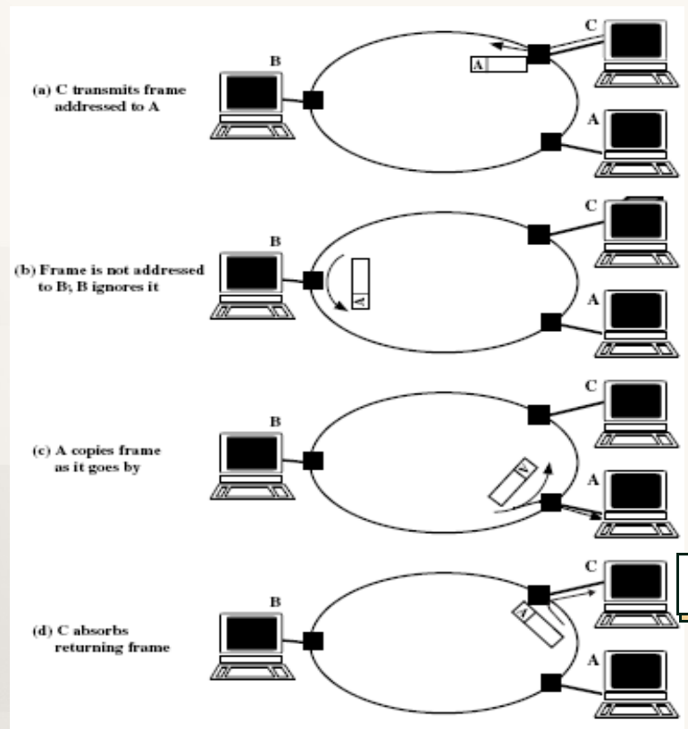

*Figure 3. Delivery of a frame sent by C to A on a ring topology*

Figure 3 shows the four stages of frame delivery on a ring. (a) C sends a frame carrying destination address A onto the ring. (b) The frame passes B's repeater, but the address is not B, so B ignores it. (c) A copies the frame as it goes by. The frame does not stop at A and keeps circulating. (d) C absorbs the frame that has returned after one trip around the ring, removing it from the ring.

The advantages of the ring topology are as follows.

- Data circulate in a fixed direction and order, so network operation is very orderly.
- Network control is simple.
- All nodes in the network have equal rights, and none has priority in using network resources.
- For the same number of nodes, the load on the network is lower than with other structures.
- No server is needed to build the network.

The disadvantages of the ring topology are as follows.

- If one node fails, the entire network is paralyzed. The failed node also has a connection on its other side, but the links are directional, so traffic cannot go around that way.
- It is slow, and data that pass through many nodes become much slower.
- Adding a new node makes it correspondingly slower.
- Adding nodes or locating faults requires dealing with the whole ring, so network maintenance costs are high.

### 1.9 Star Topology

The characteristics of the **star topology** are as follows.

- Every station is connected to a central switch (or hub). The central device is also called a **star coupler**.
- Each station is connected to the center by two links, one for transmitting and one for receiving.
- Apart from the central system, no nodes are in direct contact with one another.
- Communication between any two nodes completes in at least 2 and at most 4 transfers. Two transfers, from the sending node to the center and from the center to the receiving node, deliver the data, and even including the receiving node's response coming back through the center, there are four.
- Nodes not involved in a communication cannot tell that the data were exchanged (when the center is a switching node).
- Since it is the basic centralized form, it suits any network structure that wants to add functions at the center.
- Building variations, such as adding stations or central nodes, is very simple.

The central node operates in one of two ways.

- **Broadcast node:** The central node sends a frame received from one station to all stations. It is physically a star but logically the same structure as a bus. A hub works this way.
- **Switching node:** The central node sends the frame only to the destination station. A switch works this way.

A home network plugged into an Internet router is an example of a star topology. All the lines of the PCs, laptop, printer, and server gather at the center (the router), and if the router goes down, the whole network becomes unusable.

The advantages of the star topology are as follows.

- Communication between nodes completes in at least 2 and at most 4 steps involving only those nodes, which is very efficient.
- Since nodes have no contact points with one another, the failure of some nodes does not affect the operation of the whole network.
- Adding a new node is very simple, and adding it does not degrade the performance of the whole network (with a switching node).
- Building the network is very simple, and little effort is needed for maintenance.

The disadvantages of the star topology are as follows.

- If the central system fails, the entire network becomes inoperable.
- If a node is very far from the central system, connecting it becomes difficult, because every node must run its own cable to the center.
- All data pass through the central system, so its security level must be very high.
- If the central system cannot handle a large volume of data, the network goes out of control (suspension, server failure, and so on).

### 1.10 Choosing a Topology

Choosing a topology weighs three factors: **reliability**, **expandability**, and **performance**. Reliability is the degree to which communication continues despite failures, expandability is the ease of adding stations or extending the coverage, and performance is the transmission speed and delay.

| Topology | Strength | Description |
|:-----|:-----|:-----|
| Bus/tree | Most flexible | Accommodates a wide range of numbers of devices, data rates, and data types. |
| Ring | Fastest | With optical fiber it can reach the highest speeds, but it is vulnerable if even one link is cut. |
| Star | Easiest layout | Advantageous for short distances and suited to high-speed communication among a small number of devices. |

*Table 6. Selection criteria by topology*

### 1.11 Choosing a Transmission Medium and Its Relation to Topology

Choosing a transmission medium involves the following five factors.

| Factor | Meaning |
|:-----|:-----|
| Topology | Each medium supports different topologies, so a medium suited to the chosen topology is selected. |
| Capacity | It must handle the required data rate and bandwidth. |
| Reliability | It must meet the allowed error rate and tolerance to failures. |
| Data types | It must carry the kinds of data to be supported, such as data, voice, and video. |
| Environment | It must withstand environmental conditions at the installation site, such as distance, electromagnetic noise, and temperature. |

*Table 7. Factors in choosing a transmission medium*

The characteristics of representative media are as follows. The structure of each medium was covered in Week 4.

| Medium | Characteristics |
|:-----|:-----|
| Twisted pair | Cheap and widely used, and already installed in most office buildings. It is the most cost-effective choice within a single building and suited to low-speed LANs. |
| Coaxial cable | More expensive than twisted pair but with greater capacity. It meets a wide range of LAN and MAN requirements and suits networks connecting many devices with substantial data traffic. It is suited to office automation and factory automation. |
| Optical fiber cable | Used for point-to-point links, and usable in ring and star topologies. Multipoint optical fiber systems are expected to find a variety of applications in LANs and MANs. |

*Table 8. Characteristics of representative transmission media*

> **Note:** The statement that optical fiber is used only for point-to-point links reflects the situation up to the 1990s. Today, passive optical networks (PON), a point-to-multipoint method in which a passive splitter divides the optical signal so that several subscribers share one fiber, are widely used for home fiber Internet (FTTH) [2].

Media and topologies are related as follows.

- **Broadband coaxial cable** is not suited to the ring topology. A ring repeater must regenerate every channel, and multichannel repeaters that regenerate many frequency channels at once are expensive.
- **Bidirectional baseband coaxial cable** is not suited to the tree structure. Baseband signals suffer reflection and attenuation at branching points, which makes them hard to send along several branches.
- The data rate is generally higher on a ring topology than on a bus/tree topology.
- A ring topology needs point-to-point links, so it uses twisted pair, baseband coaxial cable, or optical fiber cable. Broadband coaxial cable is unsuitable because of the cost of multichannel repeaters.

LAN transmission techniques are of the following three kinds.

| Technique | Method | Characteristics |
|:-----|:-----|:-----|
| Baseband | Transmits the digital signal as it is, without modulation. | Disadvantaged for long-distance transmission. Digital signals are sent over twisted pair or coaxial cable. |
| Broadband | Modulates onto analog signals for transmission. | Long-distance transmission is possible. Analog signals are divided into several channels by FDM and sent over coaxial cable or similar media. |
| Single-channel broadband (carrier band) | Uses analog signals, but only one channel without FDM. | Covered in Section 2.4. |

*Table 9. The three LAN transmission techniques*

| Medium | Ring | Bus | Tree | Star |
|:-----|:-----|:-----|:-----|:-----|
| Twisted pair | ● | ● | | ● |
| Baseband coaxial cable | ● | ● | | |
| Broadband coaxial cable | | ● | ● | |
| Optical fiber | ● | ● | | ● |
| Wireless | ● | ● | | ● |

*Table 10. Relation between transmission media and topologies*

---

<br>

## 2. Bus/Tree Topology and Ring Topology

### 2.1 Problems of Multipoint Configurations

In a **multipoint** configuration such as a bus or tree, in which several stations attach to one medium, two things must be considered.

1. **Collision:** If several stations transmit at once, the signals overlap.
2. **Signal balancing:** The signal strength must be appropriate between every pair of stations.

On a multipoint link, the destination is identified by the **MAC (medium access control) address**, and there are two ways to decide who uses the medium.

- **Central polling:** One controller asks the stations in turn whether they have something to send, and only the permitted station sends.
- **Distributed access:** Without a central controller, each station decides by itself when to send according to set rules. CSMA/CD is an example (Week 7).

> **Definition:** A **MAC address** is a unique identifier assigned to a network interface at the data link layer of a network segment. It is usually assigned by the manufacturer of the network interface controller (NIC) and stored in hardware. It is also called the Ethernet hardware address (EHA), hardware address, or physical address; physical address here is a different concept from a physical memory address.

The problems of multipoint links are as follows.

**(1) Medium access control.** It is harder than on point-to-point links. A point-to-point link is used by only two devices, whereas a multipoint link is shared by many. Polling has long been used, but since all communication passes through the controller, polling does not benefit distributed systems in which stations are peers, and it is not suited to direct communication between two stations that are not the controller.

**(2) Signal balancing.** The transmitted signal must satisfy all of the following conditions.

- After attenuation, it must still be strong enough at the farthest receiver.
- Even at the nearest receiver, it must be weaker than the maximum strength the receiver allows. An overly strong signal saturates the receiver circuit and causes distortion.
- These conditions must be met for each station, and also within network segments connected to other parts through repeaters or amplifiers.

With $N$ stations there are $N(N-1)$ sender-receiver pairs, and the signal strength must fall within the allowed range for all of them [3]. With 100 stations, all $100 \times 99 = 9900$ pairs must be satisfied, so designing a multipoint network is far more demanding than designing a point-to-point link.

### 2.2 Baseband Coaxial Cable

The two transmission techniques for bus/tree topologies differ as follows.

| Aspect | Baseband | Broadband |
|:-----|:-----|:-----|
| Signal | Digital signal | Analog signal (requires an RF modem) |
| Use of bandwidth | One signal uses the entire bandwidth; no FDM. | FDM is possible, carrying multiple data channels together with video and audio. |
| Direction | Bidirectional | Unidirectional |
| Topology | Bus | Bus or tree |
| Distance | Up to a few kilometers | Up to tens of kilometers |

*Table 11. Transmission techniques for bus/tree topologies*

The characteristics of baseband coaxial cable are as follows.

- It uses digital signaling.
- Signals propagate in both directions. A signal entering at a tap spreads toward both ends of the cable and is absorbed at both ends.
- It uses voltage pulses based on Manchester or differential Manchester coding (Week 4).
- It uses the entire spectrum of the transmission medium and needs no FDM.

```text
  Packet absorbed                                               Packet absorbed
                        Packet travels in both directions
         |            <- - - - - - - - - - - - - - - - - ->            |
         v                                                             v
        [T]────────────────────┬─────────────────┬────────────────────[T]
                               │                 │
                           [Station]         [Station]
T: terminator
```

*Figure 4. A packet on a baseband bus that spreads in both directions and is absorbed at both ends*

Baseband Ethernet (Ethernet with baseband) became the basis of the IEEE 802.3 standard. The specifications of 10 Mbps baseband coaxial cable bus LANs are as follows.

| Parameter | 10BASE5 | 10BASE2 |
|:-----|:-----|:-----|
| Data rate | 10 Mbps | 10 Mbps |
| Maximum segment length | 500 m | 185 m |
| Network span | 2500 m | 1000 m |
| Nodes per segment | 100 | 30 |
| Node spacing | 2.5 m | 0.5 m |
| Cable diameter | 0.4 in. | 0.25 in. |

*Table 12. IEEE 802.3 specifications for 10 Mbps baseband coaxial cable bus LANs*

In the names, 10 stands for the 10 Mbps data rate, BASE for baseband, and the final digit for the maximum segment length in units of roughly 100 m (5 for 500 m, and 2 for 185 m rounded to 200 m). 10BASE5 uses thick, stiff coaxial cable and is also called thick Ethernet, and 10BASE2 uses thin cable and is also called thin Ethernet.

> **Note:** The network span of 10BASE2 is $185 \times 5 = 925$ m when five segments are joined by four repeaters, and this is sometimes given as about 1000 m. For 10BASE5, the same reasoning gives $500 \times 5 = 2500$ m [4].

Baseband coaxial cable involves the following **trade-off**.

- A lower data rate allows a longer cable.
- The longer the cable, the greater the signal attenuation and noise.
- At a lower data rate each bit lasts longer, so the bit information can be recovered even if the signal is somewhat degraded.

The characteristics of a **repeater for baseband coaxial cable** are as follows.

- It is used to extend the network, joining two segments of the network.
- It is completely transparent to the rest of the system; that is, stations do not need to know that a repeater is present.
- It transmits signals in both directions, creating (regenerating) new voltage pulses as it sends them out.
- The IEEE specification allows four repeaters in a 2.5 km network.
- It differs from a ring topology repeater, which relays in only one direction and serves as a station's attachment point, in that it relays signals in both directions and is not an attachment point for a station.

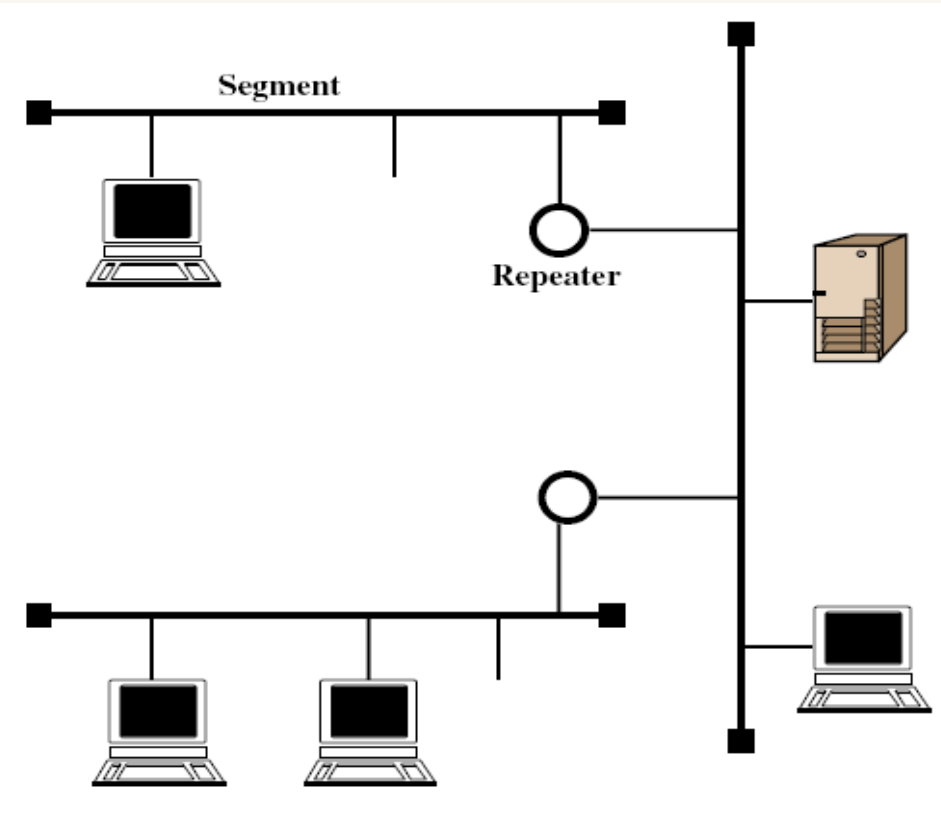

*Figure 5. Baseband coaxial cable segments joined by repeaters*

In Figure 5, the long vertical cable is the backbone segment, and the upper and lower segments are each joined to the backbone by a repeater (circle). Each segment has terminators at both ends (black squares). A signal sent by a PC on the upper segment is regenerated at the repeater, passes onto the backbone, goes through the lower segment's repeater, and reaches the PCs on the lower segment. Electrically there are several segments, but logically it is one bus.

### 2.3 Broadband Coaxial Cable

The characteristics of broadband coaxial cable are as follows.

- It uses channels wider than a voice-grade (4 kHz) channel.
- It carries LAN and MAN data on coaxial cable using FDM analog signaling.
- It is used in bus/tree topologies.
- Because the signaling is analog, amplifiers can be placed along the way to boost the signal, allowing transmission over much longer distances.

**Dual-cable and split configurations.** Broadband systems need special configurations because of the following properties.

- A signal entering at a tap propagates in only one direction.
- This is because it is difficult to build amplifiers that amplify signals in many frequency bands in both directions.
- Therefore a transmitted signal can be received only by stations downstream of that tap.
- For all stations to communicate with one another, two paths are needed, and the two paths meet at the headend.
- All stations transmit toward the headend (inbound) and receive from the headend (outbound).

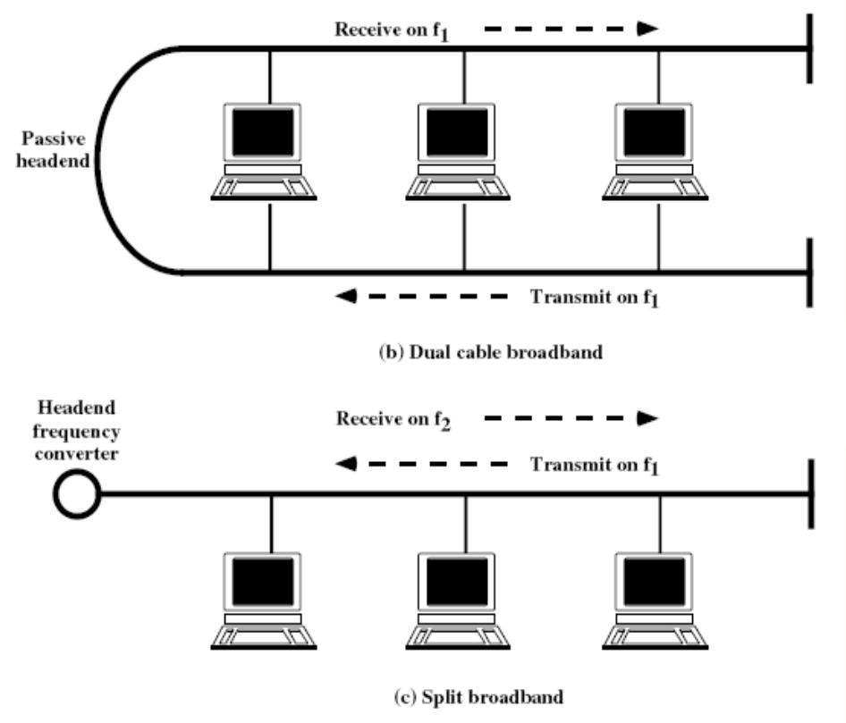

*Figure 6. Dual-cable broadband and split broadband configurations*

The upper part of Figure 6 is the dual-cable configuration. Stations transmit on frequency f<sub>1</sub> on the lower cable (transmit on f<sub>1</sub>), the signal passes through the passive headend on the left onto the upper cable, and all stations receive on the same frequency f<sub>1</sub> (receive on f<sub>1</sub>). The lower part is the split configuration. There is one cable; stations transmit on f<sub>1</sub>, the headend frequency converter on the left converts the signal to f<sub>2</sub> and sends it back, and all stations receive on f<sub>2</sub>.

| Aspect | Dual-cable configuration | Split configuration |
|:-----|:-----|:-----|
| Cable | The inbound and outbound channels are on separate cables. | The inbound and outbound channels use one cable on different frequencies. |
| Headend | Merely connects the two cables passively. | Converts the inbound frequency to the outbound frequency. |
| Frequency | Transmission and reception use the same frequency. | Transmission and reception use different frequencies. |
| Capacity | Each direction uses the full band of a cable, so capacity is relatively large. | The two directions share the band of one cable. |
| Suitable when | Used when there are not many devices, to avoid the fixed cost of the headend. | Used when there are many devices, to save cable cost. |

*Table 13. Comparison of the dual-cable and split configurations*

The headend of a split configuration contains the following devices.

- **Frequency converter:** Shifts the analog signal from the inbound band to the outbound band.
- **Remodulator:** Demodulates the received analog signal to digital form to remove the accumulated noise and attenuation, then modulates it again onto the outbound frequency.

### 2.4 Broadband Components and Carrier Band

A broadband system consists of the following components.

| Component | Role |
|:-----|:-----|
| Cables | There are trunk cables, the thick main lines leaving the headend; distribution or feeder cables, which branch from the trunk to distribute the signal to an area; and drop cables, which run from a distribution cable down to each device. |
| Terminators | Absorb the signal at the cable end to prevent reflection. |
| Amplifiers | Boost the attenuated analog signal. They amplify in one direction only. |
| Directional couplers | Components that divide or extract the signal: splitters, which branch the cable, and taps, which attach devices. |
| Modems | Modulate a device's digital data onto an analog signal at the assigned frequency, and demodulate it. |

*Table 14. Components of a broadband system*

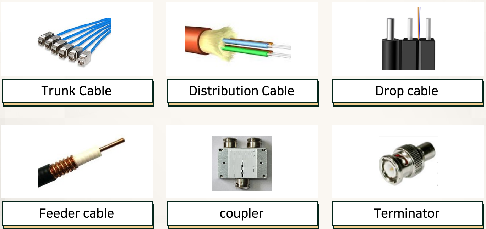

*Figure 7. Broadband components: trunk cable, distribution cable, drop cable, feeder cable, coupler, terminator*

The photographs in Figure 7 show, from the left in the top row, a bundle of trunk cables with connectors, a distribution cable containing several cores, and a thin drop cable, and from the left in the bottom row, a thick feeder cable with its metal shield exposed, a coupler in a metal box with input and output terminals, and a cylindrical terminator that fits onto the cable end.

**Carrier band**, also called single-channel broadband, has the following characteristics.

- It is analog signaling that uses the entire spectrum of the transmission medium as one channel, without FDM.
- It transmits in both directions on a bus topology.
- Since the modem output need not be confined to a narrow band, it is simpler than a broadband modem, but because a modem is needed, the hardware is more expensive than baseband, which carries the digital signal as it is.
- In performance and cost, it is comparable to baseband [3].

### 2.5 Optical Fiber Bus

When a bus is built with optical fiber, the **taps** that attach stations are made in one of two ways.

- **Active tap:** Acts like a repeater. It converts the incoming light into an electrical signal with an optical detector, decodes it (decoder), and passes it to the node, then encodes it again together with the node's data (coder) and sends it into the next fiber with an optical transmitter. The network thus becomes a chain of point-to-point links, and each tap needs two fiber cables, one for transmitting and one for receiving.
- **Passive tap:** Like taps for twisted pair or coaxial cable, it extracts part of the light passing through the fiber and injects light. Two taps are needed: one that extracts light and sends it to the receiver (O→E, converting the optical signal to electrical), and one that injects the light from the transmitter (E→O).

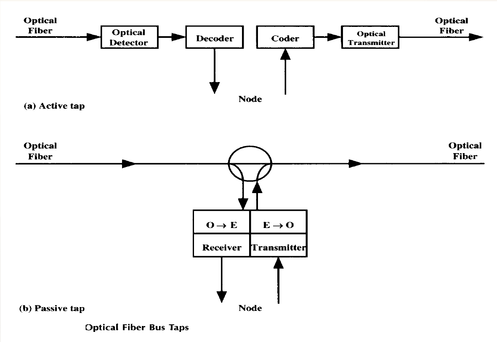

*Figure 8. Active and passive taps of an optical fiber bus*

Light in an optical fiber travels in only one direction, so a single bus can reach only downstream stations. For all stations to communicate with one another, one of the following configurations is used.

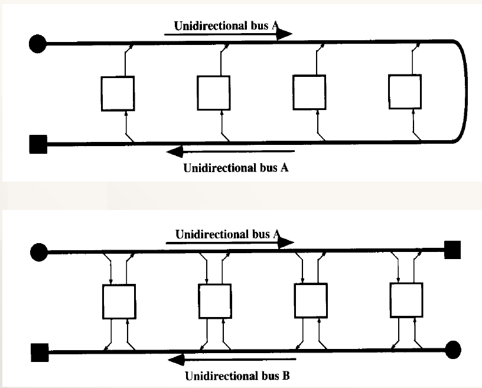

*Figure 9. Loop bus and dual bus configurations of an optical fiber bus*

The upper part of Figure 9 is the **loop bus**. Unidirectional bus A folds back at the right end, so each station transmits on the upper section and receives on the lower section. A signal sent by any station reaches all stations as it passes through the folded-back section. The lower part is the **dual bus**. Unidirectional buses A and B, running in opposite directions, are placed side by side, so a station sends on bus A to stations on its right and on bus B to stations on its left. The DQDB of Week 3 is a dual bus configuration.

### 2.6 Operation of the Ring Topology

The characteristics of the ring topology are as follows.

- Repeaters are connected by unidirectional links.
- A repeater transmits whatever it receives onto the next link.
- Data insertion, reception, and removal on the ring are required.
- Data are removed at the repeater that transmitted them.
- This structure naturally enables **automatic acknowledgement** and **multicast and broadcast**.

The characteristics of a **repeater for the ring topology** are as follows.

- It is one of the active components of the ring.
- It is the attachment point of a device for data insertion. A station inserts data into the ring through its repeater.
- The repeater copies the destination address of a passing packet and passes it to the attached station. If the station recognizes the address as its own, it also copies the rest of the packet.
- The method and timing strategy for when and how data are inserted and removed are determined by the MAC protocol (Week 7).
- Like a tap on a bus, it handles data insertion and removal.

**Data removal** is a problem peculiar to the ring.

- On buses and trees, the signal is absorbed by the termination resistors (terminators) at both ends and disappears by itself.
- A ring is a closed loop, so unless data are specifically removed, the signal circulates forever.
- There are two removal methods: a designated repeater removes the data, or the repeater that transmitted the data removes them after one trip around.
- When the transmitting repeater removes the data, the returning packet provides an automatic acknowledgment. If the destination changes a certain bit in the packet as it copies it, the sender can tell from that bit of the returned packet whether the destination received it.
- Several stations can copy the same packet while it travels once around the ring, so multicast is easy.

### 2.7 States of a Ring Repeater

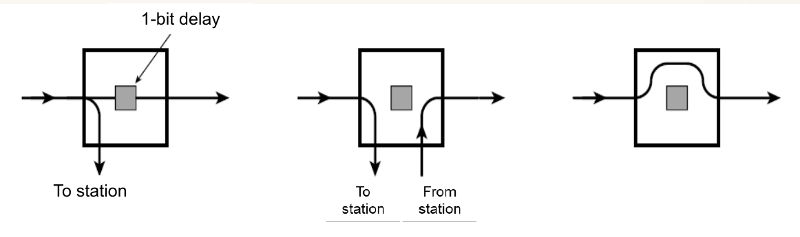

*Figure 10. Listen, transmit, and bypass states of a ring repeater*

The three boxes in Figure 10 are, from the left, a repeater in the listen state, the transmit state, and the bypass state. The small square in the middle of each box is a 1-bit delay buffer.

**(1) Listen state.** As in the left drawing, incoming bits pass through the 1-bit delay onto the next link and are delivered at the same time toward the station (to station).

- The repeater scans the passing bits for set patterns such as addresses and tokens. It delays by 1 bit, the time needed to check a pattern.
- It copies the incoming bits and passes them to the station while sending them on to the next repeater.
- It can modify one bit as it passes it on. For example, the destination flips a bit indicating that it received the frame, and a station with data to send flips one bit of a passing token to turn it into the start of a frame.

**(2) Transmit state.** As in the middle drawing, bits coming in from the ring go toward the station, and bits from the station (from station) go out onto the next link.

- When the repeater gains permission to transmit, it passes the bits received from the station onto the next link.
- Bits may still arrive from the ring during this time, and they are handled as follows.
  - If they are the repeater's own frame returning after a trip around the ring, they are passed to the station. The station uses them to check the acknowledgment or to reclaim the frame.
  - If they are another station's packet, they are buffered and sent later. This occurs with MAC schemes that allow several packets on the ring at once [3].

**(3) Bypass state.** As in the right drawing, the signal passes without going through the repeater. A bypass relay activates when the station is switched off or has failed.

- There is no delay.
- Because a failed repeater is bypassed, reliability is high.
- The delay around the whole ring is reduced, so transmission performance is high.

### 2.8 Advantages and Problems of the Ring Topology

The advantages of the ring topology are as follows.

- **Point-to-point communication links:** Each link is a point-to-point link joining only two repeaters, which brings the following advantages.
  - Each repeater regenerates the signal, so longer distances can be covered than with a baseband bus.
  - Optical fiber cable, well suited to point-to-point transmission, can be applied as it is.
  - The electrical design is simpler than for multipoint links and maintenance is easier, since there is no signal balancing problem.
- **Simple error checking by address copying:** As the destination station copies a frame, it changes a few bits, and these changed bits act as the acknowledgment (ACK) from the destination. The sending station can tell immediately whether a problem occurred by looking at the frame that has come back around.

The problems of the ring topology are as follows.

- **Vulnerability of the cable:** If one part of the cable is cut, the whole ring stops.
- **Repeater failure:** If even one repeater fails, the whole ring stops.
- **Installation difficulties:**
  - The two repeaters that are adjacent in the topology must be identified. Repeaters close together physically may not be adjacent in ring order.
  - If a new repeater is inserted with cables of different lengths, the timing must be adjusted (tuned) again.
  - Old cables that are not removed can accumulate.
  - The unusual loop structure makes installing new repeaters difficult.
- **Size limits:**
  - The more repeaters, the greater the reliability and maintenance problems.
  - Time synchronization becomes difficult (timing jitter, Section 2.9).
  - Each repeater adds a little delay.
  - For these reasons, a few hundred repeaters is the limit for one ring.

**Computing ring delay.** Suppose a 4 Mbps ring has 100 repeaters, each delaying by 1 bit, the total cable length is 2 km, and a signal takes 5 µs to travel 1 km. One bit lasts $1 / (4 \times 10^6) = 0.25$ µs, so the repeater delay is $100 \times 0.25 = 25$ µs and the propagation delay is $2 \times 5 = 10$ µs. A bit takes $25 + 10 = 35$ µs to travel once around the ring, which corresponds to $35 / 0.25 = 140$ bits. That is, up to 140 bits can be on the ring at the same time. As repeaters are added, this delay grows and the efficiency of access control drops.

### 2.9 Timing Jitter

> **Definition:** **Timing jitter** is the difference along the time axis between the desired signal and the actual signal in a digital pulse signal, that is, the offset between the instant a pulse should arrive and the instant it actually arrives.

The causes, effects, and countermeasures of timing jitter are as follows.

- Distortion caused by time delays introduces deviations in the timing information.
- Signal components propagate at different speeds depending on frequency, so the components making up a pulse arrive at slightly different times and the pulse edges wander.
- On a ring, each repeater extracts a clock from the received signal and uses it to send on the next link, so the timing information of each transmission is linked to that of the previous transmission.
- Therefore transmission timing errors accumulate at every repeater, and the accumulated errors cause random bit timing errors. This is why jitter grows with the size of the ring.
- As a countermeasure, a phase-locked loop (PLL) is used to reduce the bit time differences between adjacent bits. A PLL is a circuit that tracks the phase of the incoming signal and averages out its wander to produce a stable clock.
- In addition, a reference clock or an elastic buffer is placed in the monitoring repeater or station of the ring. An elastic buffer is a buffer that absorbs incoming bits arriving slightly fast or slow by increasing or decreasing how full it is.

### 2.10 Star-Ring Architecture

To reduce the problems of the ring, the ring is wired in the shape of a star.

Using a **wiring concentrator** brings the following advantages.

- It is easier to locate and isolate failed parts.
- It is easier to add repeaters.

The characteristics of the **star ring topology** are as follows.

- Every cable connecting two repeaters passes through one central site (the wiring concentrator). Since every link of the ring stops by the center, it is logically a ring but physically a star.
- The signals of all links are accessible at the center.
- It is therefore easier to pinpoint the location of a fault and isolate the failed part.
- New repeaters are easy to install: one only connects two wires at the connection site.
- Bypass relays are built into the connectors so that a failed repeater and its links are bypassed automatically.
- Even after bypassing, the distances between working repeaters stay similar, so the signal levels on the ring also stay similar.

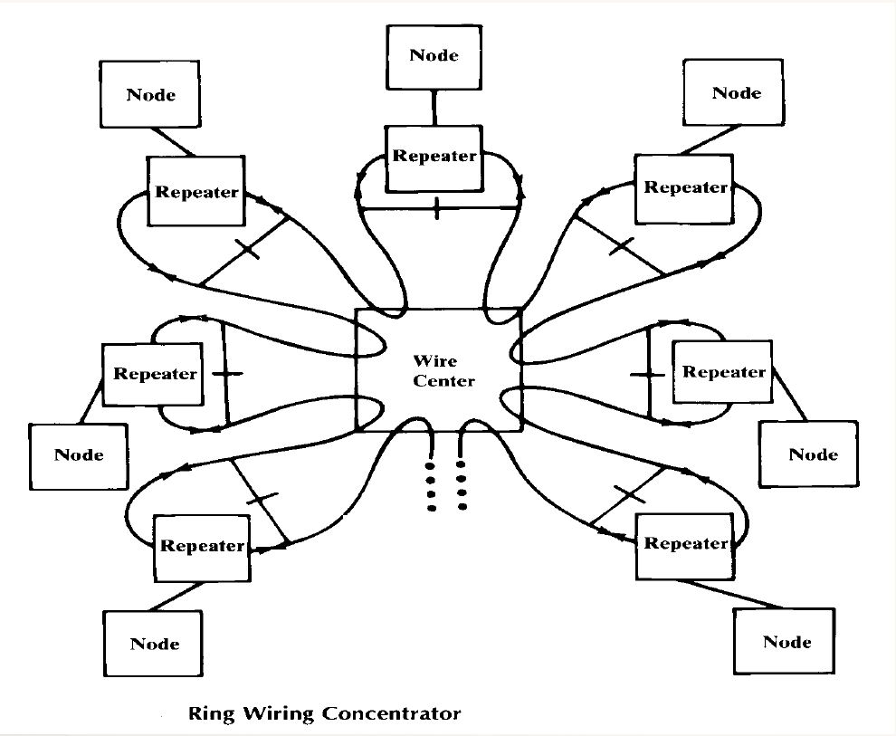

*Figure 11. Star-ring configuration with a ring wiring concentrator*

From the wiring concentrator (labeled wire center) in the middle of Figure 11, cable loops go out to each of seven repeaters and come back, and a node is attached to each repeater. The dots below the wiring concentrator indicate that more repeaters can be connected in the same way. The signal goes out from the wiring concentrator to one repeater, comes back, and goes on to the next repeater, visiting every repeater in turn to form a ring. The short slashes across the links mark the points that can be bypassed.

**Ring topology with bridges.** Connecting many repeaters over a large area to one ring runs into size limits because of cable length. In that case, several small ring structures are formed by the connection order at the wiring concentrators, and the ring structures are connected by bridges. This is called **segmented rings**.

The advantages of segmented rings are as follows.

- The number of repeaters per ring is limited, which bounds the timing jitter.
- If a repeater or link fails, only that ring of the whole network stops.
- Since more than one ring structure is used, each ring can transmit simultaneously, allowing a large capacity.

The disadvantages of segmented rings are as follows.

- A frame that goes to another ring does not return to its sender, so there is no automatic acknowledgment. A higher-level protocol that handles acknowledgments is therefore needed.
- If there is a lot of traffic between rings, the bridge becomes a bottleneck and the performance advantage is small.

---

<br>

## 3. Star Topology and Structured Cabling Systems

### 3.1 Twisted-Pair Star LANs

Star topology LANs are based on twisted pair or optical fiber cable and have the following characteristics.

- They can use twisted pair (telephone wire) already laid in the building.
- The central hub acts as a repeater.

Twisted pair has the following properties.

- A large part of the network cost is the installation cost, not the price of the cable.
- Its performance is lower than that of coaxial cable.

Nevertheless, the reasons for building a bus/tree LAN with unshielded twisted pair in a star layout are as follows.

- Most office buildings already have twisted pair for telephones, so the installation cost of additional wiring is low.
- Telephone wire can be used anywhere, whereas coaxial cable must be newly laid, at a large additional cost.

The characteristics of a twisted-pair star LAN are as follows.

- Each station is connected to the hub by two twisted pairs, one for transmitting and one for receiving.
- The hub relays the incoming signal from one station onto all outgoing channels.
- The distance between a station and the hub is about 100 m with UTP and about 500 m with optical fiber cable.
- Physically, it is star-shaped.
- Logically, it is bus-shaped. Transmitted data can be received by all other stations, and a collision occurs if two or more transmit at the same time.

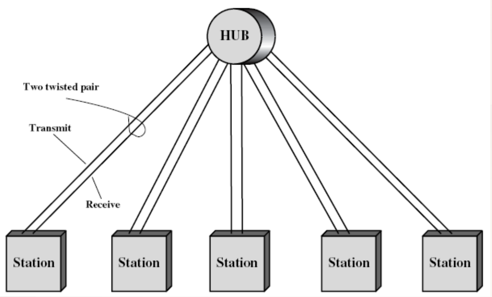

*Figure 12. Stations connected to a hub by transmit and receive twisted pairs*

In Figure 12, each of the five stations is connected to the hub by two twisted pairs, one pair used for transmitting and the other for receiving.

### 3.2 StarLAN and Hierarchical Hubs

**StarLAN** was an early specification for twisted-pair star LANs and evolved as follows.

- It started at 1 Mbps. It is the 1BASE5 specification of IEEE 802.3 [4].
- The same star wiring later evolved through 10 Mbps and 100 Mbps to 1 Gbps twisted-pair Ethernet (10BASE-T, 100BASE-TX, 1000BASE-T).
- Using existing telephone wire as it is developed only to the 10 Mbps and 100 Mbps level because of technical problems. Telephone wire was not made for high-speed transmission, so its attenuation is high, and when twisted pairs are densely bundled, interference between neighboring pairs (crosstalk) occurs. Higher speeds require better grades of cable.

StarLAN uses a **hierarchical configuration**.

- **Header hub (HHUB):** There is one at the top of the hierarchy.
- **Intermediate hub (IHUB):** Placed below the header hub, it gathers several stations or other hubs.
- A transmission sent by a station goes up to the header hub at the top and from there propagates to all twisted pairs below. So even with several levels of hubs, the result is a logical bus in which every station receives every transmission.
- StarLAN transmitted at 1 Mbps with this structure.

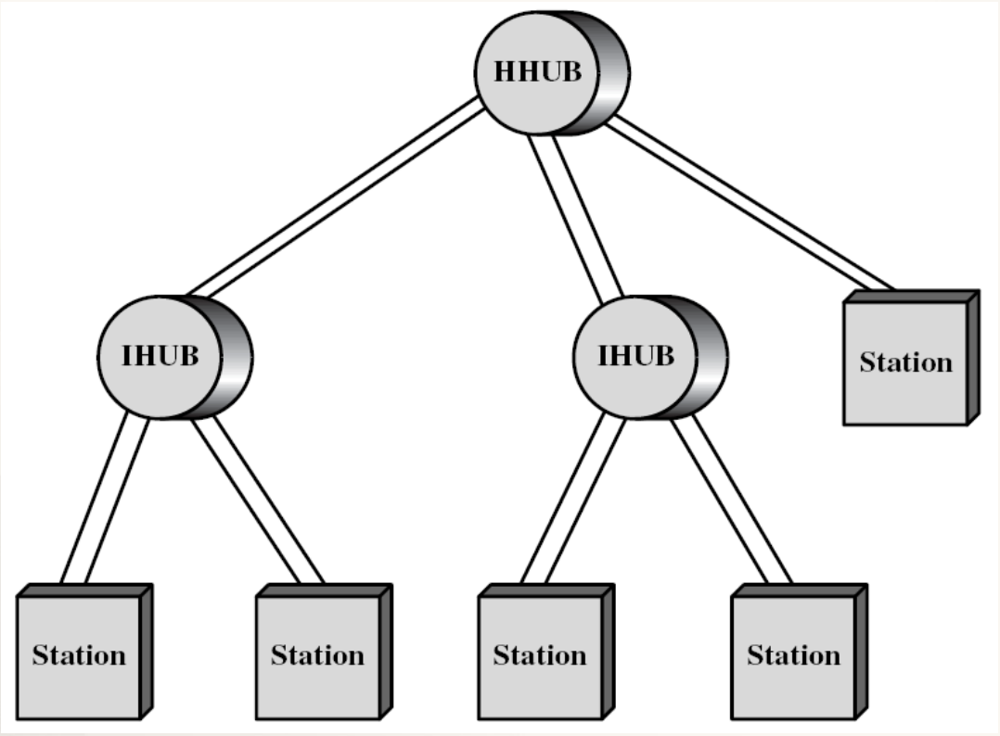

*Figure 13. Hierarchical structure of StarLAN made of a header hub and intermediate hubs*

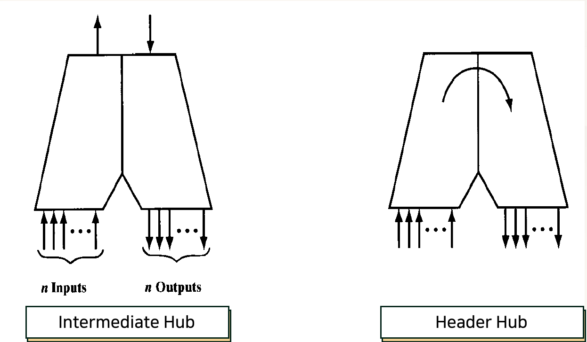

*Figure 14. Internal operation of an intermediate hub and a header hub*

In Figure 13, two IHUBs and one station are connected below the HHUB at the top, and two stations below each IHUB. The intermediate hub on the left of Figure 14 merges its n inputs from below and sends them up to the upper hub, and distributes the signal coming down from above to its n outputs below. The header hub on the right merges all inputs coming up from below and, instead of sending them further up, turns them right back (the U-shaped arrow) to all outputs below. A signal from any station therefore turns around at the header hub and reaches every station.

### 3.3 Buses, Hubs, and Switching Hubs

Hubs and switches differ as follows.

- On a bus or hub, only one station can transmit at a time.
- For several stations to transmit at the same time, a **switching hub**, that is, a **LAN switch**, is used.

The characteristics of a switching hub are as follows.

- It sends a frame only to the destination station address indicated in the message.
- Replacing a hub with a switching hub does not require changing the software or hardware of the attached devices; they keep using the same frame format.
- Each station has the capacity of its link dedicated to it.
- It scales easily: adding stations does not reduce the capacity of each station.

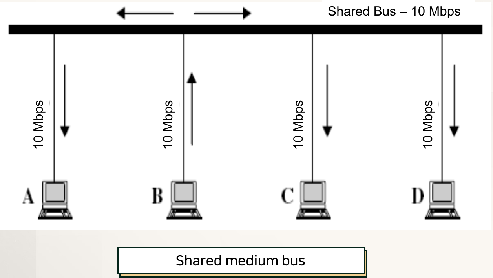

*Figure 15. 10 Mbps shared medium bus*

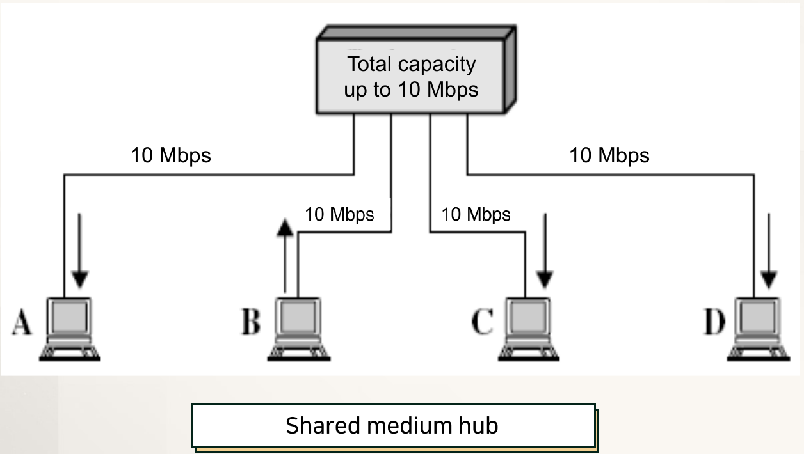

*Figure 16. Shared medium hub with a total capacity of 10 Mbps*

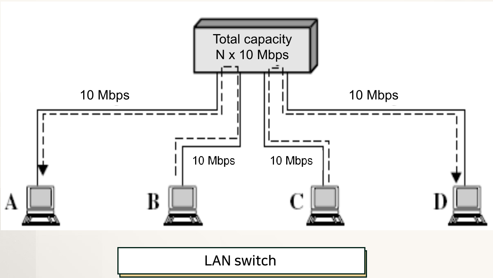

*Figure 17. LAN switch with a total capacity of N × 10 Mbps*

On the shared medium bus of Figure 15, while B sends at 10 Mbps, A, C, and D all receive the signal, and the capacity of the whole bus is 10 Mbps. The shared medium hub of Figure 16 is the same. Each station is connected to the hub by a 10 Mbps link, but the hub sends B's signal out of every port, so the total capacity is up to 10 Mbps. On the LAN switch of Figure 17, as the dashed lines show, transmissions from B to A and from C to D take place at the same time. Each port can carry data at 10 Mbps simultaneously, so with $N$ ports the total capacity is up to $N \times 10$ Mbps.

**Comparing capacities.** Suppose there are eight stations, paired into four pairs that communicate at the same time. On a 10 Mbps hub, the four pairs share 10 Mbps, so each pair gets an average of $10 / 4 = 2.5$ Mbps. On a LAN switch with 10 Mbps ports, the four pairs use different ports, so each pair uses the full 10 Mbps, and $4 \times 10 = 40$ Mbps of data flow at the same time.

### 3.4 Forwarding Methods of LAN Switches

LAN switches fall into two types according to when they send a frame out.

| Type | Operation | Characteristics |
|:-----|:-----|:-----|
| Store-and-forward switch | Stores the whole frame in a buffer and sends it out after all bits have been stored and the error check is complete. | Filters out frames with errors, but is correspondingly slower. |
| Cut-through switch | Starts sending as soon as it has read the destination address field at the front of the frame. | Sends without filtering errors, so it is fast. |

*Table 15. The two forwarding methods of LAN switches*

**Computing the delay.** Suppose a 1518-byte frame is forwarded on 100 Mbps Ethernet. A store-and-forward switch must receive all $1518 + 8 = 1526$ bytes, including the 8 bytes of preamble and start delimiter in front of the frame, so it waits $1526 \times 8 / (100 \times 10^6) = 122.08$ µs before sending. A cut-through switch needs to receive only the 8 bytes of preamble and start delimiter and the 6 bytes of destination address, 14 bytes in all, so it sends after $14 \times 8 / (100 \times 10^6) = 1.12$ µs. In exchange, a cut-through switch has already started forwarding before checking the CRC at the end of the frame, so it passes even a damaged frame on to the next link.

### 3.5 Passive Star Couplers

The device used at the center of a star topology in optical fiber LANs is the **passive star coupler**.

- It was one of the first commercialized approaches to optical fiber LANs.
- It is a fusion of several optical fibers.
- Light entering on one fiber is divided equally among all output fibers.
- Physically, it is star-shaped.
- Logically, it is a bus, so one station's transmission is broadcast to all stations, and a data collision occurs if two transmit at the same time.
- Connectivity: it can connect tens of stations and suits distances of around 1 km or more. The exact scale depends on the optical loss (Section 3.6).

Couplers are made in two ways.

- **Biconic fused coupler:** Several fibers are bundled, twisted, and fused together while being heated and pulled. The result has a biconical shape narrowing in the middle, and in the narrowed coupling region light crosses between the fibers and mixes.
- **Mixing rod coupler:** The input and output fibers are attached to the two ends of a short glass rod (mixer rod). Light spreads and mixes inside the rod and is then divided among the output fibers. It can be built at a larger scale and is relatively easy to manufacture.

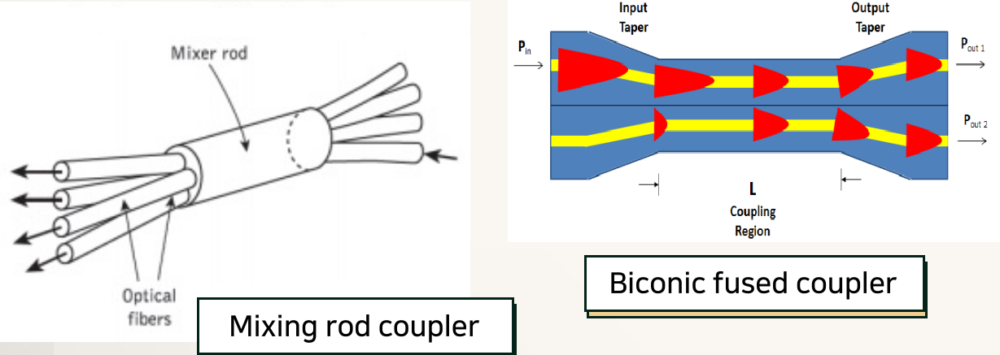

*Figure 18. Mixing rod coupler and biconic fused coupler*

The left of Figure 18 is a mixing rod coupler, with bundles of optical fibers attached on both sides of a glass rod (mixer rod). The right is a cross section of a biconic fused coupler: the two fibers, narrowed in the input taper, exchange light (red arrows) while passing through coupling region L and widen again in the output taper, so the input P<sub>in</sub> is divided into two outputs P<sub>out1</sub> and P<sub>out2</sub>.

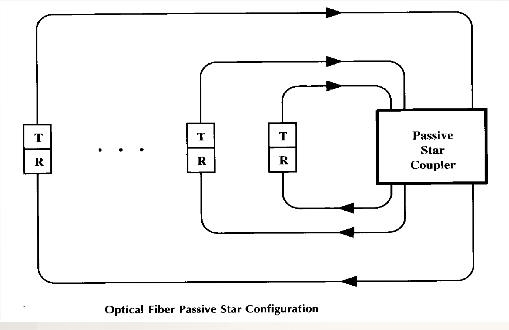

*Figure 19. Configuration of an optical fiber LAN using a passive star coupler*

In Figure 19, each station has a transmitter (T) and a receiver (R) and is connected to the passive star coupler by a transmit fiber and a receive fiber. Light sent by any station's T is divided at the coupler and returns to the R of every station.

### 3.6 Optical Loss and Operating Range

The range of an optical fiber LAN is set by the strength that light loses on the way from transmitter to receiver, that is, the **optical loss**. Loss is expressed in decibels (dB). If input power $P_{in}$ falls to output power $P_{out}$, the loss is as follows.

```math
\text{loss (dB)} = 10 \log_{10} \frac{P_{in}}{P_{out}}
```

For example, halving the power is $10 \log_{10} 2 \approx 3$ dB, and reducing it to 1/10 is 10 dB. Decibels turn multiplication into addition, so the total loss through several components is the sum of the individual losses.

Optical loss arises in three kinds of components, **connectors, cable, and couplers**, with the following loss characteristics.

| Component | Loss |
|:-----|:-----|
| Allowed loss between transmitter and receiver (loss budget) | 25-30 dB |
| Optical connectors | 1-1.5 dB per connector joining fibers; 4-6 dB for up to four connectors |
| Attenuation of optical fiber cable | 3-6 dB per km |
| Coupler | $10 \log_{10} N$ dB ($N$ is the number of nodes). About 12 dB for a 16-node coupler |

*Table 16. Loss elements of an optical fiber LAN*

The coupler loss is $10 \log_{10} N$ because the incoming light is divided equally among $N$ outputs, so each output receives only $1/N$. For $N = 16$ this is $10 \log_{10} 16 = 12.04$ dB. Each doubling of the number of nodes increases the coupler loss by about 3 dB.

There are two ways to avoid this loss.

- **Active star coupler:** The coupler acts as a repeater, converting the light to an electrical signal, regenerating it, and sending it out again to all outputs. There is therefore no power loss at the coupler.
- **Optical fiber ring:** A ring structure is used in which each node's repeater regenerates the signal.

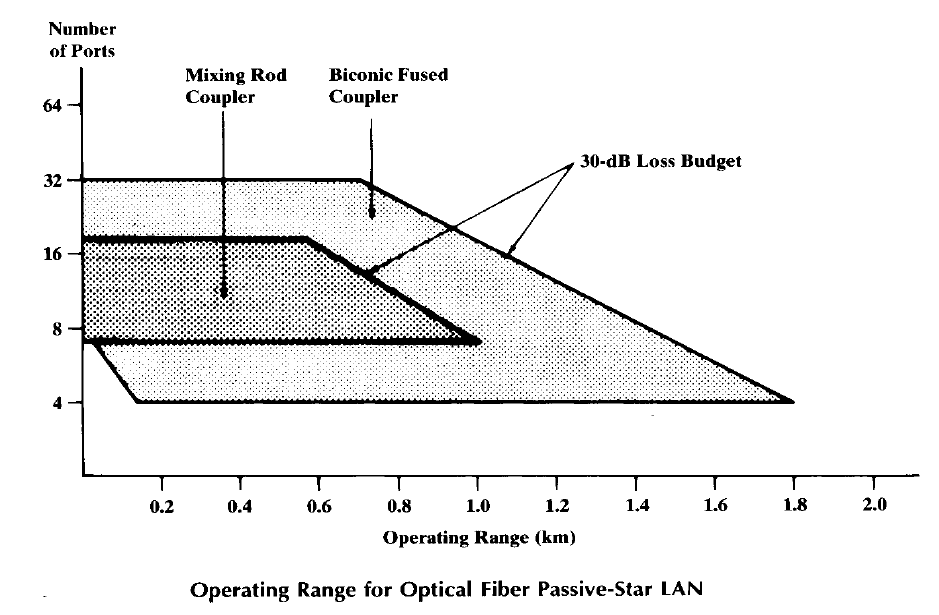

*Figure 20. Number of ports and operating range of a passive-star-coupler LAN with a 30 dB loss budget*

In Figure 20, the horizontal axis is the operating range (km) and the vertical axis is the number of ports, on a logarithmic scale. Under the 30-dB loss budget, the wide region marked as the biconic fused coupler extends to about 1.8 km at 4 ports and about 0.7 km at 32 ports, while the narrow region marked as the mixing rod coupler covers 8-16 ports at about 1 km or less. Both regions have a slanted boundary along which the range shrinks as the number of ports grows. In the figure, the mixing rod coupler covers a narrower range of port counts than the biconic fused coupler and has a shorter operating range under the same loss budget. In other words, the mixing rod coupler has the manufacturing advantage of being easy to build at a large scale, but under a 30 dB loss budget the number of ports and the distance it can serve are smaller than those of the biconic fused coupler.

**Computing the operating range.** This slanted boundary can be explained with the loss budget. Let $L$ km be the distance from the coupler to each station; light then travels $L$ from the sending station to the coupler and $L$ from the coupler to the receiving station, $2L$ km in all. Assuming fiber attenuation of 4 dB per km and a fixed loss of 9 dB combining connectors and the coupler's excess loss (6 dB for four connectors and 3 dB for the coupler itself), the 30 dB loss budget is spent as follows.

```math
30 = 9 + 10 \log_{10} N + 4 \times 2L \quad \Rightarrow \quad L = \frac{21 - 10 \log_{10} N}{8}
```

| Number of ports $N$ | Coupler splitting loss $10 \log_{10} N$ (dB) | Budget left for fiber (dB) | Operating range $L$ (km) |
|:-----|:-----|:-----|:-----|
| 4 | 6.02 | 14.98 | 1.87 |
| 8 | 9.03 | 11.97 | 1.50 |
| 16 | 12.04 | 8.96 | 1.12 |
| 32 | 15.05 | 5.95 | 0.74 |

*Table 17. Operating range by number of ports with a 30 dB loss budget*

For example, with $N = 16$ the coupler uses 12.04 dB, and subtracting the 9 dB fixed loss and 12.04 dB from 30 dB leaves 8.96 dB for the fiber. Spending this on the $8L$ dB of attenuation over $2L$ km gives $L = 8.96 / 8 = 1.12$ km. The results (1.87 km at 4 ports, 0.74 km at 32 ports) agree well with the biconic fused coupler region of Figure 20 (about 1.8 km and about 0.7 km). Each doubling of the number of ports adds 3 dB of splitting loss and shortens the range by about $3 / 8 \approx 0.38$ km, which is why the boundary of the graph is a straight slanted line on the logarithmic scale.

### 3.7 Structured Cabling Systems

> **Definition:** A **structured cabling system** is a wiring scheme in which the communication cabling inside a building is designed hierarchically according to standards, so that the same cabling can be used whatever equipment or network technology is installed.

The cabling standards for commercial buildings are as follows.

- **EIA/TIA-568** Commercial Building Telecommunications Cabling Standard: the U.S. telecommunications cabling standard for commercial buildings, now continued as the ANSI/TIA-568 series [5].
- **ISO/IEC 11801**: the international standard, whose current edition is ISO/IEC 11801-1 "Information technology - Generic cabling for customer premises" [6].

The cabling is laid out in a hierarchical star structure.

- The cabling starts in the building's equipment room.
- Cables coming in from outside (carrier lines and so on) connect to the equipment room.
- **Backbone cables** run vertically from the equipment room to the telecommunications closet on each floor.
- On each floor, **horizontal cables** run from the telecommunications closet to the outlets in the offices.

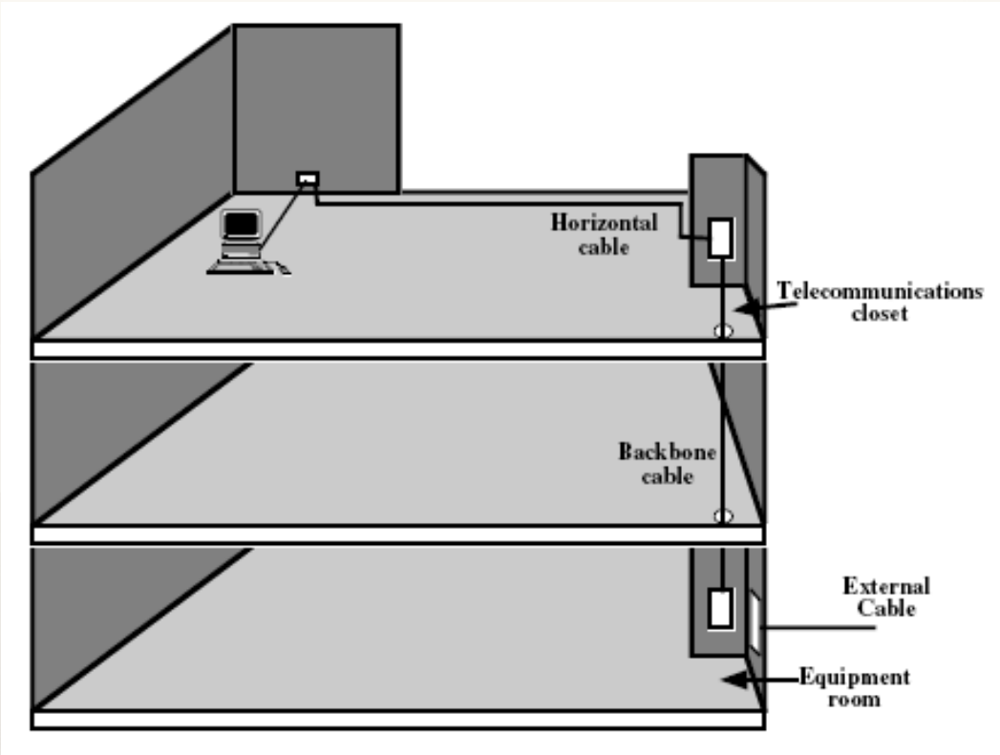

*Figure 21. Structured cabling system of a building*

Figure 21 is a cross section of a three-story building. External cable enters the equipment room on the bottom floor, backbone cable rises to the telecommunications closets on the upper floors, and on the top floor horizontal cable runs from the telecommunications closet to the outlet of the computer on the desk.

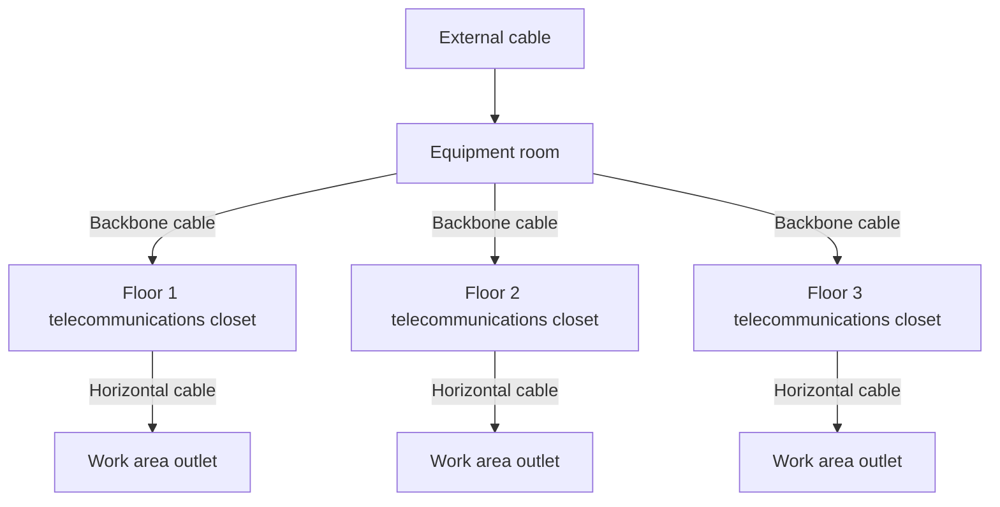

*Figure 22. Hierarchical star structure of a structured cabling system*

As Figure 22 shows, a structured cabling system is a two-level star rooted at the equipment room, that is, a tree. TIA-568 limits the fixed wiring of a horizontal cable to at most 90 m and the whole channel, including the patch cords at both ends, to 100 m or less [5]. This is the same value as the station-to-hub distance of about 100 m for UTP in Section 3.1. Because the cabling is standardized, the cables in the walls do not need to be laid again even if a hub is later replaced by a switch or Ethernet is used instead of telephones.

---

<br>

## 4. Appendix: HORIBA MIRA of the United Kingdom

### 4.1 Overview and History

**HORIBA MIRA** is an automotive research institute in the United Kingdom.

- It was founded in the United Kingdom in 1946 as a government-funded automotive industry research body named MIRA (Motor Industry Research Association) [7].
- It provides engineering services, technology development consulting, testing and certification, and similar work.
- In 2015, the Japanese measurement equipment company HORIBA acquired MIRA and renamed it HORIBA MIRA [7].
- It is located in Nuneaton, Warwickshire, in central England. It is near Birmingham and Coventry, about 160 km north of central London, about two hours by car.

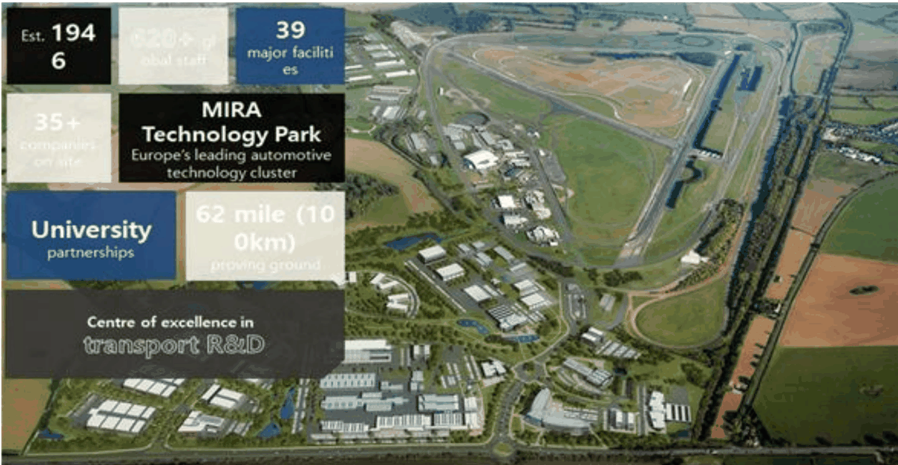

*Figure 23. Aerial view and key figures of MIRA Technology Park*

Figure 23 is an aerial photograph of the proving ground and research park, with key figures on the left: established in 1946 (Est. 1946), more than 620 staff worldwide (620+ global staff), 39 major facilities, more than 35 companies on site, university partnerships, a proving ground of 62 miles (100 km) in total, and a centre of excellence in transport R&D. The box in the middle presents MIRA Technology Park as Europe's leading automotive technology cluster.

> **Definition:** A **proving ground (PG)** is a vehicle test site that reproduces a variety of road conditions, such as high-speed circuits, handling tracks, rough roads, and braking tracks.

### 4.2 Business Areas and Scale

The current status of HORIBA MIRA is as follows.

- It works for corporate customers in a variety of industries, with the automotive sector accounting for 75% of the work and the defense sector for 25%. Its business areas span automotive, defence, off-highway vehicles such as construction and agricultural machines, and motorsport. Its customers include aerospace companies such as Airbus, Boeing, and Bombardier; construction equipment companies such as JCB, Caterpillar, and Terex; vehicle manufacturers such as Jaguar, Land Rover, Ford, Toyota, Volkswagen, Hyundai, Tata, and Geely; suppliers such as Bosch, ZF, and Continental; defense companies such as BAE Systems, Thales, Lockheed Martin, and General Dynamics; motorsport teams such as Red Bull Racing and Williams Martini Racing; and public bodies such as Innovate UK and the European Union.
- More than 600 employees, with 39 major test facilities, carry out various forms of testing, certification, and R&D support.
- It has a proving ground with test tracks totaling about 100 km, allowing many types of vehicles to be tested. The site covers 297 ha [7].
- Together with the UK government, it built and supports an automotive technology cluster called MIRA Technology Park (MTP). Some 40 automotive institutions, companies, and universities are located there, creating technical and commercial synergy.
- In line with recent trends in the automotive industry, it focuses its research and investment on eco-friendly, high-efficiency future vehicle technologies.

### 4.3 Main Proving Ground

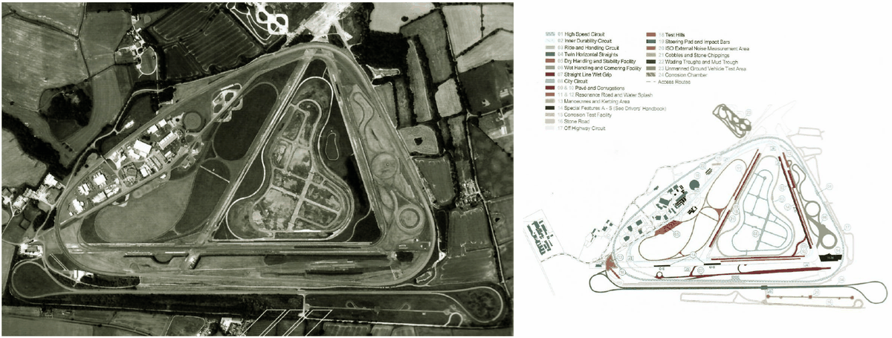

*Figure 24. Aerial photograph and facility layout of the MIRA main proving ground*

The left of Figure 24 is an aerial photograph of the main proving ground, with many test tracks inside the triangular high-speed circuit. The right is a layout of the same site, with each track painted in a different color and numbered. The specifications of the main circuit are as follows.

| Item | Value |
|:-----|:-----|
| Circuit length | 4.5 km |
| Surface | Four-lane asphalt |
| Bends | Three, banked up to 33° |
| Radius on the bends | 216 m |
| Neutral speed | 86 mph (about 138 km/h) |
| Lane lengths (measured on the lane centerlines) | Inner lane 4.452 km, 2nd lane 4.478 km, 3rd lane 4.495 km, 4th lane 4.513 km |

*Table 18. Specifications of the MIRA main circuit*

**Computing the neutral speed.** On a banked bend, the **neutral speed** is the speed at which a car can follow the bend without the driver adding sideways force by steering, that is, without lateral friction between tires and road. With bank angle $\theta$ and bend radius $r$, the vertical component of the normal force $N$ on the car must equal gravity $mg$, and its horizontal component must equal the centripetal force $mv^2/r$ required for circular motion.

```math
N \cos\theta = mg, \qquad N \sin\theta = \frac{mv^2}{r}
```

Dividing the two equations gives $\tan\theta = v^2 / (rg)$, so the neutral speed is $v = \sqrt{rg\tan\theta}$. Substituting $r = 216$ m, $\theta = 33°$, and $g = 9.81$ m/s² gives $rg = 2118.96$ and $\tan 33° = 0.6494$, so $v = \sqrt{2118.96 \times 0.6494} = \sqrt{1376.1} \approx 37.1$ m/s, or about 134 km/h (83 mph). The official neutral speed of 86 mph (38.4 m/s) is slightly higher than this result. The radius that gives 86 mph at a 33° bank is $r = v^2 / (g\tan\theta) = 38.4^2 / (9.81 \times 0.6494) \approx 232$ m, so the official value cannot be reproduced from the 216 m radius and the 33° maximum bank in the table alone.

The facilities of the main proving ground are as follows.

| No. | Facility | No. | Facility |
|:-----|:-----|:-----|:-----|
| 01 | High Speed Circuit | 13 | Manoeuvres and Kerbing Area |
| 02 | Inner Durability Circuit | 14 | Special Features A-S |
| 03 | Ride and Handling Circuit | 15 | Corrosion Test Facility |
| 04 | Twin Horizontal Straights | 16 | Stone Road |
| 05 | Dry Handling and Stability Facility | 17 | Off Highway Circuit |
| 06 | Wet Handling and Cornering Facility | 18 | Test Hills |
| 07 | Straight Line Wet Grip | 19 | Steering Pad and Impact Bars |
| 08 | City Circuit | 20 | ISO External Noise Measurement Area |
| 09, 10 | Pavé and Corrugations | 21 | Cobbles and Stone Chippings |
| 11, 12 | Resonance Road and Water Splash | 22 | Wading Troughs and Mud Trough |
| | | 23 | Unmanned Ground Vehicle Test Area |
| | | 24 | Corrosion Chamber |

*Table 19. Facilities of the MIRA main proving ground*

### 4.4 Straight Line Wet Grip Track

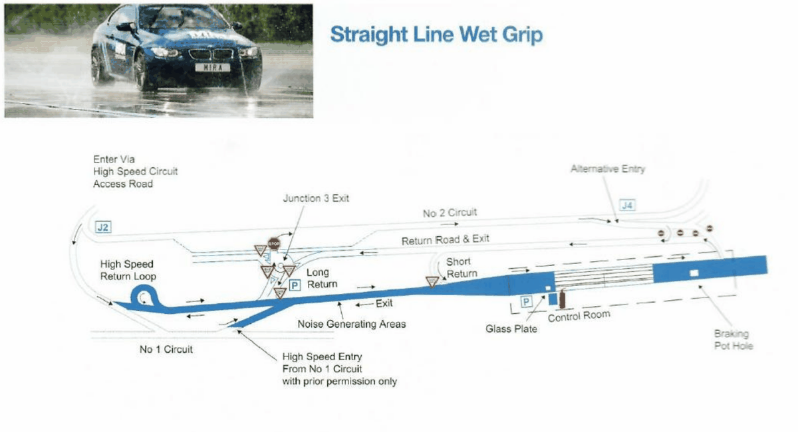

*Figure 25. Location of the straight line wet grip track and a test in progress*

The upper photograph of Figure 25 shows a test vehicle braking on a wetted surface, and the layout below shows the route: entering via the high speed circuit access road, running along the long straight track marked in blue, and returning by the high speed return loop on the left or by the return roads. The straight track consists of a series of surfaces with different friction coefficients.

| Surface | Size | Wet friction coefficient $\mu$ | Watering |
|:-----|:-----|:-----|:-----|
| Smooth concrete | 100 m × 4 m | 0.40 | Spray and weir |
| Bridport (with quartzite) | 100 m × 4 m | 0.40 | Spray and weir |
| ISO braking asphalt | 100 m × 4 m | 0.50 | Spray and weir |
| Delugrip | 100 m × 4 m | 0.65 | Spray |
| Basalt tiles | 200 m × 7 m | 0.20 | Spray |
| Ceramic tiles | 100 m × 3 m | 0.10 | Spray |
| Aquaplaning (smooth concrete) | 66 m × 4 m | - | Spray and direct |

*Table 20. Surfaces of the straight line wet grip track*

> **Definition:** The **friction coefficient** $\mu$ is the maximum force a tire can exert on the road without slipping, divided by the weight of the car. The larger the value, the better the car stops; ice is around 0.1.

> **Definition:** A **weir** is a dam that holds water at a set depth.

> **Definition:** **Aquaplaning** is the phenomenon in which a film of water forms between tire and road so that the tire rides on the water.

**Computing braking distance.** If friction is constant, the maximum deceleration is $\mu g$, so the distance to stop from speed $v$ is $d = v^2 / (2\mu g)$. Braking from 80 km/h ($80 / 3.6 = 22.2$ m/s) gives $v^2 = 493.8$, so:

- Delugrip ($`\mu = 0.65`$): $d = 493.8 / (2 \times 0.65 \times 9.81) \approx 38.7$ m
- Smooth concrete ($`\mu = 0.40`$): $d \approx 62.9$ m
- Basalt tiles ($`\mu = 0.20`$): $d \approx 125.8$ m
- Ceramic tiles ($`\mu = 0.10`$): $d \approx 251.7$ m

On ceramic tiles, the braking distance from 80 km/h far exceeds the 100 m length of the surface. Lowering the speed to 50 km/h (13.9 m/s) gives $d = 13.9^2 / (2 \times 0.10 \times 9.81) \approx 98$ m, which fits within 100 m. On low-friction surfaces, therefore, the test speed must be lowered so that the braking distance fits within the surface length.

### 4.5 CAV Test Facility

HORIBA MIRA recently built ASSURED CAV, a test facility for connected automated vehicles (CAV). About £100 million was invested in the whole facility [8].

- **CAV test area (HIGHWAY):** A straight track connected to a large circular area. On a level dynamic platform 300 m in diameter, lane and junction markings can be reconfigured freely to test ADAS and automated driving functions, such as merging, lane assist, and collision avoidance, scenario by scenario up to the limit of the vehicle's controllability.
- **Urban automated driving test track (CITY):** A controllable, configurable, connected urban and suburban driving environment made up of a parking building, junctions, mock buildings, communication infrastructure, and so on. A variety of junction types and street furniture allow complex automated driving systems and traffic scenarios to be validated repeatedly and safely. The traffic lights at the junctions exchange information with vehicles by V2X communication (ITS-G5 in Europe) [8].
- **Parking test building (PARKING):** A multi-story car park that reproduces restricted visibility, tight maneuvers, and GPS signal loss for developing automated valet parking systems [8].


*Figure 26. Highway and city test areas of ASSURED CAV*

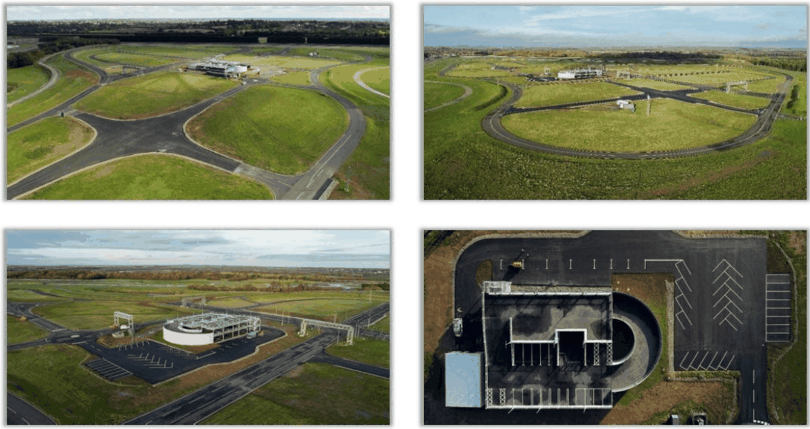

*Figure 27. Parking test building and urban test track of the CAV test facility*

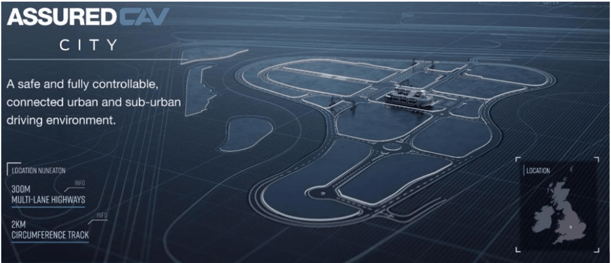

*Figure 28. Bird's-eye view of the ASSURED CAV CITY urban automated driving test track*

The left of Figure 26 is an aerial photograph of the highway test area (ASSURED CAV HIGHWAY), a wide circular paved area joined by a straight track, and the right is the city test area (ASSURED CAV CITY) with junctions of various shapes. Figure 27 shows the junctions of the urban test track and the multi-story parking test building with its circular ramp. Figure 28 is a bird's-eye view of the urban test track, located in Nuneaton and labeled as having 300 m multi-lane highways and a 2 km circumference track. This facility is where the V2X communication and connected automated driving technologies covered in Weeks 11-14 are validated with real vehicles.

---

<br>

## Concept Applications

| Situation | Concept to apply |
|:-----|:-----|
| PCs kept being added to an office's 10 Mbps hub, and the network grew steadily slower. | All ports of a hub share one collision domain, so replace it with a switch, which separates the collision domain per port (Sections 1.2 and 3.3). |
| The LANs on two floors are to be connected, but traffic within each floor should not cross to the other. | With the filtering of a bridge or L2 switch, frames within the same segment are not sent to other segments (Section 1.3). |
| Requests are to be distributed evenly across three web servers. | Use the load balancing of an L4 switch, which distributes connections by IP address and port number (Section 1.4). |
| On a ring LAN, the whole ring stops every time a single repeater fails. | A star-ring structure with a wiring concentrator and bypass relays automatically bypasses the failed repeater (Section 2.10). |
| After the nodes of a passive-star-coupler optical LAN were increased from 16 to 32, distant stations could no longer communicate. | The coupler loss grew by about 3 dB, reducing the budget left for the fiber, so the operating range became shorter (Section 3.6). |
| A new building is to be cabled so that it can serve whatever network equipment is installed later. | Follow a structured cabling system: a hierarchical star of equipment room, backbone, telecommunications closets, and horizontal cables (Section 3.7). |

*Table 21. Concept application cases*

**True/False Check:**

| Statement | Judgment and Reason |
|:-----|:-----|
| A hub looks at the MAC address and sends a frame only to the destination port. | **F.** A hub does not use MAC addresses and duplicates the received frame to all ports. |
| A bridge discards a frame if its destination MAC address is not in the table. | **F.** If it is not in the table, the bridge floods the frame to all ports except the one it arrived on. |
| On a ring topology, termination resistors absorb the signal, so data need not be removed separately. | **F.** A ring is a closed loop, so a designated repeater or the transmitting repeater must remove the data. |
| On broadband coaxial cable, a signal sent from a tap reaches only downstream stations. | **T.** Amplifiers amplify in only one direction, so signals propagate one way, which is why two paths through the headend are needed. |
| A cut-through switch has a shorter delay than a store-and-forward switch but cannot filter out damaged frames. | **T.** It reads only the destination address and sends at once, so forwarding begins before the CRC is checked. |
| The splitting loss of a 16-node passive star coupler is 16 dB. | **F.** It is $10 \log_{10} 16 \approx 12$ dB. |

---

<br>

## Summary

| Concept | Key Summary |
|:-----|:-----|
| Gateway | In the narrow sense, a device that converts between different protocols at the transport layer or above; in the broad sense, network interconnection equipment that relays signals in general. |
| Repeaters and hubs | Physical layer devices that regenerate and pass on signals; a hub duplicates to all ports, so it is physically a star and logically a bus. |
| Bridge | Forwards frames at the data link layer by learning, flooding, forwarding, filtering, and aging, isolating the traffic of each segment. |
| Switch | Performs the bridge's function in hardware and is classified as an L2, L3, L4, or L7 switch by the information it uses to decide. |
| Router | Decides the best path between networks by IP address at the network layer and is called by various names by location and use. |
| Bus and tree | Stations attach to a shared medium by taps, data spread over the whole medium, and terminators at both ends absorb the signal. |
| Ring | Repeaters form a closed loop of unidirectional point-to-point links; the transmitting repeater removes the data and gets an automatic acknowledgment from the returning frame. |
| Star | Every station connects to a central device; with a broadcast node it is a logical bus, and with a switching node frames go only to the destination. |
| Choosing topology and medium | A topology is chosen by reliability, expandability, and performance, and a medium by topology, capacity, reliability, data types, and environment. |
| Baseband and broadband | Baseband sends digital signals bidirectionally up to a few kilometers, while broadband sends FDM analog signals unidirectionally up to tens of kilometers and needs a headend. |
| Ring repeater | The listen state scans and copies bits with a 1-bit delay, the transmit state sends the station's bits, and the bypass state routes around the repeater. |
| Timing jitter | Bit timing errors accumulate at each repeater and limit the size of the ring; PLLs and elastic buffers reduce it. |
| LAN switch | The total capacity of a shared hub is 10 Mbps, while that of a switch is N × 10 Mbps; switches use store-and-forward or cut-through forwarding. |
| Passive star coupler | It divides light among N outputs and loses 10 log N dB, so within a loss budget the operating range shrinks as the number of ports grows. |
| Structured cabling system | A hierarchical star cabling that connects the equipment room by backbone cables to the telecommunications closet on each floor, and from there by horizontal cables to the work areas. |
| HORIBA MIRA | A UK automotive research institute founded in 1946 and acquired by HORIBA in 2015, operating a large proving ground and the ASSURED CAV test facility. |

---

<br>

## Self-Check Questions

1. **Operating layers of devices:** Classify repeaters, hubs, bridges, switches, and routers by operating layer, and state what information in the data each device uses to decide.

   <details>
   <summary>Answer</summary>

   Repeaters and hubs are physical layer devices that regenerate and send out signals without looking at addresses. Bridges and switches are data link layer devices that decide which port to send to by looking at the MAC address of the frame. Routers are network layer devices that decide the path by looking at the destination IP address in the IP header.

   </details>

2. **Bridge operation:** A bridge has A and B on port 1 and C on port 2, and its table is empty. For frames passing in the order B → C, C → B, A → B, A → C, state the bridge's action for each frame.

   <details>
   <summary>Answer</summary>

   B → C: it learns B on port 1 and, since C is not in the table, floods to port 2. C → B: it learns C on port 2 and, since B is on port 1, forwards to port 1. A → B: it learns A on port 1 and, since B is on the same port 1 side, filters and does not send to port 2. A → C: since C is on port 2, it forwards to port 2.

   </details>

3. **Topology failures:** For the bus, ring, and star topologies, compare what happens when (a) one station is switched off and (b) a cable is cut at one point. Assume ring repeaters have no bypass function.

   <details>
   <summary>Answer</summary>

   (a) On a bus, stations only hang from taps, so the others keep communicating. On a ring, the switched-off station's repeater cannot pass the signal on, so the whole ring stops. On a star, only that station's link goes unused and the others keep communicating. (b) On a bus, the cut point becomes an end without a termination resistor, causing reflections, and the two sides cannot communicate with each other, so in effect the whole network is affected. On a ring, a unidirectional link is broken and the whole ring stops. On a star, only the station on the cut cable is isolated, but if the central device fails, the whole network stops.

   </details>

4. **Baseband specification:** Explain what the name 10BASE5 means, and show how the network span of 2500 m follows from the segment length and the number of repeaters.

   <details>
   <summary>Answer</summary>

   10 stands for the 10 Mbps data rate, BASE for baseband transmission, and 5 for the maximum segment length of 500 m. Four repeaters can join five segments, so the network span is $500 \times 5 = 2500$ m.

   </details>

5. **Broadband configuration:** Explain, in terms of signal direction, why broadband coaxial cable needs a headend, and state which of the dual-cable and split configurations is chosen depending on the number of devices.

   <details>
   <summary>Answer</summary>

   The amplifiers of a broadband system amplify many frequency bands in one direction only, so a signal sent from a tap reaches only downstream stations. For all stations to communicate, two paths are needed: one carrying signals toward the headend (inbound) and one carrying them back from the headend toward all stations (outbound). With few devices, the dual-cable configuration is used to avoid fixed costs such as the headend frequency converter; with many devices, the split configuration is used to save cable cost.

   </details>

6. **Ring delay:** A 16 Mbps ring has 50 repeaters, each giving a 1-bit delay; the total cable length is 1 km and the propagation delay is 5 µs per km. Find the time for one trip around the ring and the number of bits that time corresponds to.

   <details>
   <summary>Answer</summary>

   One bit lasts $1 / (16 \times 10^6) = 0.0625$ µs, so the repeater delay is $50 \times 0.0625 = 3.125$ µs and the propagation delay is 5 µs. One trip takes $3.125 + 5 = 8.125$ µs, which corresponds to $8.125 / 0.0625 = 130$ bits.

   </details>

7. **Ring repeater states:** Explain why a 1-bit delay is needed in the listen state of a ring repeater, and how the repeater handles another station's packet arriving while it is in the transmit state.

   <details>
   <summary>Answer</summary>

   In the listen state, the repeater must look for patterns such as addresses and tokens in the passing bits and, if necessary, change one bit (for example, turning a token into the start of a frame or setting a receipt bit) before sending it on, so it delays by one bit to have time to check and modify the bit. In the transmit state, if bits of another station's packet arrive, it stores them in a buffer and sends them again after its own transmission ends.

   </details>

8. **Capacity of hubs and switches:** On a hub and a LAN switch, each with 24 ports of 100 Mbps, 12 pairs of stations communicate at the same time. Compare the average bandwidth each pair gets and the total amount of data flowing at the same time.

   <details>
   <summary>Answer</summary>

   The hub's total capacity is 100 Mbps, so when 12 pairs share it, each pair gets an average of $100 / 12 \approx 8.3$ Mbps, and at most 100 Mbps flow at the same time (less in practice because of collisions). On the LAN switch, each pair uses different ports, so each pair gets 100 Mbps, and $12 \times 100 = 1200$ Mbps flow at the same time.

   </details>

9. **Optical loss budget:** For a passive-star-coupler LAN with a 30 dB loss budget, 9 dB of fixed loss, and fiber attenuation of 4 dB per km, find the operating range with 64 nodes. Under the same conditions, what is the maximum number of nodes that still gives an operating range of 1.5 km?

   <details>
   <summary>Answer</summary>

   $10 \log_{10} 64 = 18.06$ dB, so $L = (21 - 18.06) / 8 = 0.37$ km. For $L = 1.5$ km, $10 \log_{10} N = 21 - 8 \times 1.5 = 9$ dB, so $N = 10^{0.9} \approx 7.9$, and at most 7 nodes are possible. Since couplers are usually made with a power-of-two number of ports, in practice one would use a 4-port coupler, or use an 8-port coupler and accept a range slightly shorter than 1.5 km.

   </details>

10. **Structured cabling and neutral speed:** (a) State which UTP star LAN specification the 90 m limit on the fixed wiring of a horizontal cable in a structured cabling system relates to. (b) Find the neutral speed in km/h for the MIRA circuit with a bend radius of 216 m and a bank of 33°.

    <details>
    <summary>Answer</summary>

    (a) It relates to the specification that UTP can connect a station and a hub (or switch) over up to about 100 m. With 90 m of horizontal cable, the whole channel stays within 100 m even after adding the patch cords at both ends. (b) $v = \sqrt{rg\tan\theta} = \sqrt{216 \times 9.81 \times 0.6494} \approx 37.1$ m/s, and $37.1 \times 3.6 \approx 134$ km/h.

    </details>

---

<br>

## References

1. IEEE, *IEEE Standard for Local and Metropolitan Area Networks: Media Access Control (MAC) Bridges*, IEEE Std 802.1D-2004, 2004.
2. ITU-T, *Recommendation G.984.1: Gigabit-capable passive optical networks (GPON): General characteristics*, International Telecommunication Union, 2008.
3. W. Stallings, *Data and Computer Communications*, 10th ed. Boston, MA, USA: Pearson, 2014.
4. IEEE, *IEEE Standard for Ethernet*, IEEE Std 802.3-2022, 2022.
5. Telecommunications Industry Association, *ANSI/TIA-568 Commercial Building Telecommunications Cabling Standard* series, Arlington, VA, USA.
6. ISO/IEC 11801-1:2017, *Information technology - Generic cabling for customer premises - Part 1: General requirements*, International Organization for Standardization, 2017.
7. HORIBA, Ltd., "HORIBA acquires UK based company MIRA Ltd.," news release, Jul. 14, 2015. https://www-origin.horiba.com/corporate-news/news/article/horiba-acquires-uk-based-company-mira-ltd-39703
8. HORIBA MIRA, "HORIBA MIRA's ASSURED CAV is Now Open," HORIBA MIRA news. https://www.horiba-mira.com/?p=39649
