# 7주차 이론 — LLC와 MAC, CSMA/CD, 브리지와 라우터, CRC

[레포지토리 안내](../../README.ko.md) | [English](Concepts_Lecture.md) | [한국어](Concepts_Lecture.ko.md)

> **최종 수정일:** 2026-11-27

> **학습 목표:**
> 1. IEEE 802 참조 모델이 OSI의 데이터 링크 계층을 LLC와 MAC으로 나누는 이유와 각 부계층의 기능을 설명할 수 있다
> 2. LLC의 서비스 유형, 2단계 주소 지정, 그룹 주소의 아홉 가지 조합을 설명할 수 있다
> 3. MAC 기법을 제어의 위치와 방식(라운드 로빈, 예약, 경합)으로 분류하고 토폴로지별 표준 기법과 연결할 수 있다
> 4. ALOHA, CSMA의 지속성 방식, CSMA/CD의 동작과 충돌 검출 시간, 이진 지수 백오프를 설명할 수 있다
> 5. 리피터, 허브, 브리지, LAN 스위치, 라우터, 게이트웨이의 동작 계층과 역할을 구분할 수 있다
> 6. 생성 다항식으로 CRC를 계산하고 검증하며, 비트 오류율로 프레임 오류 확률을 구할 수 있다

---

## 목차

- [1. IEEE 802 참조 모델: LLC와 MAC](#1-ieee-802-참조-모델-llc와-mac)
  - [1.1 IEEE 802 참조 모델의 개념](#11-ieee-802-참조-모델의-개념)
  - [1.2 참조 모델의 세 계층](#12-참조-모델의-세-계층)
  - [1.3 LLC의 원칙](#13-llc의-원칙)
  - [1.4 LLC의 서비스: 비연결형과 연결형](#14-llc의-서비스-비연결형과-연결형)
  - [1.5 2단계 주소 지정](#15-2단계-주소-지정)
  - [1.6 그룹 주소](#16-그룹-주소)
  - [1.7 MAC: 제어의 위치](#17-mac-제어의-위치)
  - [1.8 MAC: 제어의 방식](#18-mac-제어의-방식)
  - [1.9 토폴로지별 표준 MAC 기법](#19-토폴로지별-표준-mac-기법)
  - [1.10 MAC 프레임 형식과 캡슐화](#110-mac-프레임-형식과-캡슐화)
- [2. CSMA/CD](#2-csmacd)
  - [2.1 CSMA/CD의 개념](#21-csmacd의-개념)
  - [2.2 ALOHA와 Slotted ALOHA](#22-aloha와-slotted-aloha)
  - [2.3 CSMA](#23-csma)
  - [2.4 CSMA의 지속성 방식](#24-csma의-지속성-방식)
  - [2.5 CSMA/CD의 동작](#25-csmacd의-동작)
  - [2.6 기저대역 버스의 충돌 검출 시간](#26-기저대역-버스의-충돌-검출-시간)
  - [2.7 광대역 버스의 충돌 검출 시간](#27-광대역-버스의-충돌-검출-시간)
  - [2.8 전송 효율과 이진 지수 백오프](#28-전송-효율과-이진-지수-백오프)
  - [2.9 반송파 감지와 충돌 검출의 구현](#29-반송파-감지와-충돌-검출의-구현)
- [3. 브리지와 라우터, CRC](#3-브리지와-라우터-crc)
  - [3.1 브리지](#31-브리지)
  - [3.2 라우터](#32-라우터)
  - [3.3 라우터를 거치는 데이터 전송](#33-라우터를-거치는-데이터-전송)
  - [3.4 네트워킹 장치](#34-네트워킹-장치)
  - [3.5 CRC의 원리](#35-crc의-원리)
  - [3.6 CRC 계산 예제](#36-crc-계산-예제)
  - [3.7 CRC의 검출 능력](#37-crc의-검출-능력)
  - [3.8 비트 오류율과 프레임 오류 확률](#38-비트-오류율과-프레임-오류-확률)
- [4. 부록: IEEE 802 표준 기술위원회](#4-부록-ieee-802-표준-기술위원회)
  - [4.1 위원회의 역할과 원칙](#41-위원회의-역할과-원칙)
  - [4.2 참조 모델과 구현 모델](#42-참조-모델과-구현-모델)
  - [4.3 작업 그룹의 구성](#43-작업-그룹의-구성)
  - [4.4 FDDI와 LAN/MAN 표준의 전체 구성](#44-fddi와-lanman-표준의-전체-구성)
- [개념 적용](#개념-적용)
- [요약](#요약)
- [점검 문제](#점검-문제)
- [참고 문헌](#참고-문헌)

---

<br>

## 1. IEEE 802 참조 모델: LLC와 MAC

### 1.1 IEEE 802 참조 모델의 개념

LAN(local area network)은 건물, 공장, 차량처럼 좁은 지역 안의 장치들을 연결하는 네트워크이다(3주차). LAN의 표준은 전기전자공학자협회(IEEE)의 802 위원회가 만들며, 이 위원회가 LAN 표준의 구조를 정리한 틀이 **IEEE 802 참조 모델(IEEE 802 reference model)** 이다. 이 모델의 기본 생각은 두 가지이다.

- 네트워크 계층과 전송 계층(3, 4계층) 같은 상위 계층은 네트워크의 종류와 무관하게 동작한다.
- 하위 계층만 LAN의 특성에 맞추어 정의한다. 즉 IEEE 802 표준의 범위는 OSI 참조 모델의 1계층과 2계층이다.

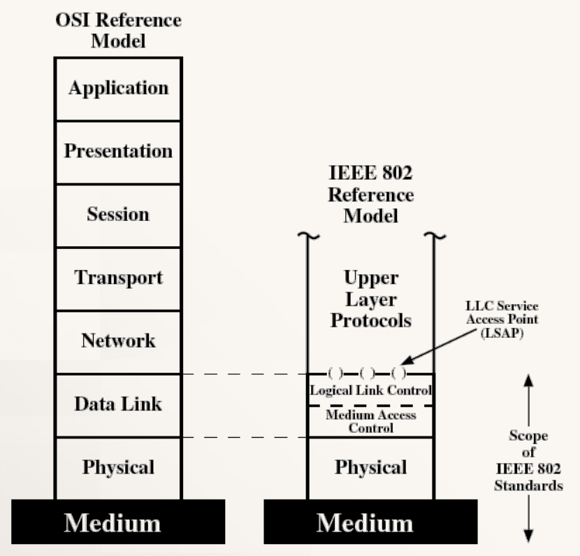

*그림 1. OSI 참조 모델과 IEEE 802 참조 모델의 대응*

그림 1의 왼쪽은 OSI 7계층이고 오른쪽은 IEEE 802 참조 모델이다. OSI의 물리 계층은 IEEE 802의 물리 계층에 대응하고, OSI의 데이터 링크 계층은 IEEE 802에서 **논리 링크 제어(LLC, logical link control)** 와 **매체 접근 제어(MAC, medium access control)** 의 두 부계층으로 나뉜다. LLC의 위쪽 경계에 그려진 작은 원들은 상위 계층 프로토콜이 LLC의 서비스를 이용하는 접점인 LLC 서비스 접근점(LSAP)이다. 오른쪽 화살표는 IEEE 802 표준이 다루는 범위가 물리 계층부터 LLC까지임을 나타낸다.

> **[컴퓨터네트워크]** OSI 참조 모델은 통신 기능을 7계층으로 나누고, 각 계층이 바로 아래 계층의 서비스를 이용하여 바로 위 계층에 서비스를 제공하게 한 모델이다. 데이터 링크 계층은 직접 연결된 장치 사이에서 프레임을 오류 없이 주고받게 하는 계층이다. OSI 모델은 5주차에서 자세히 다루었다.

데이터 링크 계층을 둘로 나누는 이유는 LAN의 특성에 있다. 전통적인 데이터 링크 프로토콜(HDLC 등)은 두 장치가 전용 회선으로 연결된 점대점 링크를 가정한다. LAN에서는 여러 스테이션이 하나의 전송 매체를 공유하므로, 누가 언제 매체를 쓸지 정하는 기능이 추가로 필요하다. 이 매체 공유 기능은 토폴로지와 전송 매체에 따라 달라지므로 MAC으로 따로 떼어 내고, 매체와 무관한 링크 제어 기능은 LLC로 공통화한다. 그러면 여러 종류의 MAC 위에서 같은 LLC를 쓸 수 있다.

> **용어 정의:** **스테이션(station)** 은 LAN에 연결되어 프레임을 주고받는 장치(컴퓨터, 제어기 등)이다.

> **용어 정의:** **전송 매체(transmission medium)** 는 신호가 지나가는 물리적 통로(동축 케이블, 꼬임쌍선, 광섬유, 무선)이다.

### 1.2 참조 모델의 세 계층

| 계층 | 기능 |
|:-----|:-----|
| 물리 계층(physical layer) | 신호의 부호화와 복호화(encoding/decoding), 동기를 위한 프리앰블(preamble) 같은 물리 계층 헤더의 생성과 제거, 비트 단위의 송신과 수신을 맡는다. 물리 계층의 특성은 전송 매체에 따라 달라진다. |
| LLC | 하나 이상의 서비스 접근점(SAP)을 상위 계층에 제공하고, 오류 제어와 흐름 제어를 맡는다. |
| MAC | 송신할 때 데이터에 주소와 오류 검출 필드를 붙여 프레임을 조립하고, 수신할 때 프레임을 분해하여 주소를 확인하고 오류를 검출한다. 전송 매체에 대한 접근을 통제한다. |

*표 1. IEEE 802 참조 모델의 계층별 기능*

> **용어 정의:** **서비스 접근점(SAP, service access point)** 은 한 계층이 바로 위 계층에 서비스를 제공하는 논리적인 접점이다.

> **용어 정의:** LLC의 SAP를 특히 **LSAP(LLC service access point)** 라고 하며, 한 스테이션 안에서 LLC를 이용하는 여러 상위 프로세스를 구별하는 번호 역할을 한다.

### 1.3 LLC의 원칙

LLC는 중간에 스위칭 노드가 없는 두 스테이션, 즉 같은 LAN에 붙은 두 스테이션 사이의 프레임 전송을 다룬다. LLC가 맡는 일은 다음과 같다.

- **주소 지정(addressing)과 데이터 링크 제어:** 프레임이 어느 LLC 사용자에게서 와서 어느 LLC 사용자에게 가는지 표시한다(1.5절).
- **흐름 제어(flow control):** 수신자가 처리할 수 있는 속도보다 빠르게 보내지 않도록 송신 속도를 조절한다.
- **확인 응답(ACK)과 오류 복구(error recovery):** 수신자가 프레임을 받았음을 알리고, 잃어버리거나 손상된 프레임을 다시 보내게 한다.

LLC는 전통적인 링크 계층과 두 가지 점에서 다르다.

1. **다중 접근(multi-access)을 지원한다.** 여러 스테이션이 공유하는 매체를 전제로 하므로, 하나의 링크에 여러 목적지가 있을 수 있다.
2. **일부 기능은 하위 MAC 계층의 서비스에 기반한다.** 프레임의 오류 검출(FCS 계산)과 매체 접근은 MAC이 하고, LLC는 그 서비스 위에서 동작한다.

### 1.4 LLC의 서비스: 비연결형과 연결형

LLC가 상위 계층에 제공하는 서비스는 연결의 유무에 따라 두 가지로 나뉜다.

- **비연결형 서비스(connectionless service):** 연결을 맺지 않고 프레임 하나하나를 독립적으로 보낸다. 연결을 설정하고 해제하는 오버헤드가 없으므로, 트래픽이 많고 신뢰성은 상위 계층이 맡는 환경에 알맞다.
- **연결형 서비스(connection-oriented service):** 데이터를 보내기 전에 논리적인 연결을 맺고, 순서 번호와 확인 응답으로 안정적인 전송을 보장한다.

LLC 표준인 IEEE 802.2는 이를 세 가지 서비스로 구체화한다 [1], [2].

| 서비스 | 연결 설정 | 확인 응답 | 알맞은 경우 |
|:-----|:-----|:-----|:-----|
| 확인 응답 없는 비연결형(unacknowledged connectionless) | 없음 | 없음 | 상위 계층(TCP 등)이 오류 복구를 맡는 대부분의 LAN 트래픽 |
| 연결형(connection-mode) | 있음 | 있음 (흐름 제어, 오류 복구 포함) | 상위 계층이 단순하여 링크 수준의 신뢰성이 필요한 장치 |
| 확인 응답 있는 비연결형(acknowledged connectionless) | 없음 | 프레임마다 있음 | 연결 상태를 유지할 여유는 없지만 전달 확인이 필요한 경우(공정 제어의 경보 등) |

*표 2. IEEE 802.2 LLC의 세 가지 서비스*

> **용어 정의:** **다중화(multiplexing)** 는 하나의 물리적 링크 위에 여러 끝점(end point) 사이의 논리적 연결을 동시에 싣는 것이다. LLC에서는 한 스테이션의 여러 LSAP가 같은 LAN 연결을 나누어 쓰는 것이 다중화이다.

**연결형 서비스의 예.** 스테이션과 LSAP의 쌍으로 주소를 나타낸다. 예를 들어 (A, 1)은 스테이션 A의 LSAP 1이다.

1. 스테이션 A의 응용 X가 A의 LSAP 1에 접속한다.
2. A의 LLC가 출발지 주소 (A, 1), 목적지 주소 (C, 1), 연결 요청을 뜻하는 제어 비트를 담은 연결 요청(connection request) 프레임을 보낸다.
3. (C, 1)에 연결된 응용이 연결을 받을 수 있으면, C의 LLC가 연결이 수립되었다는 확인 프레임을 돌려보낸다.
4. 이후 응용 X의 모든 데이터는 출발지 (A, 1), 목적지 (C, 1)인 프레임으로 보낸다. C는 (A, 1)에서 온 프레임 가운데 목적지가 (C, 1)인 것만 받아들여 ACK를 보내고, 그렇지 않은 프레임은 거절한다. 따라서 이 연결에서 C의 LSAP 1은 (A, 1)에서 온 프레임만 받는다.
5. 같은 시간에 A의 다른 응용은 다른 LSAP를 통해 다른 연결을 맺거나 다른 서비스를 이용할 수 있다. 예를 들어 (A, 2)에서 (B, 1)로 가는 연결을 동시에 유지할 수 있으며, 이것이 다중화이다.

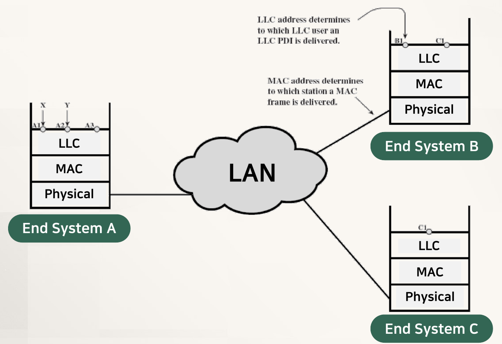

*그림 2. LLC 주소와 MAC 주소로 데이터가 전달되는 세 종단 시스템*

그림 2에서 종단 시스템 A, B, C는 각각 LLC, MAC, 물리 계층을 갖고 하나의 LAN에 연결되어 있다. A의 LLC 위에는 LSAP A1, A2, A3이 있고, 응용 X와 Y가 A1과 A2에 접속해 있다. 그림의 설명처럼 **MAC 주소는 MAC 프레임을 어느 스테이션에 전달할지 정하고, LLC 주소는 LLC PDU를 그 스테이션의 어느 LLC 사용자에게 전달할지 정한다.**

### 1.5 2단계 주소 지정

한 스테이션 안에는 LLC를 이용하는 프로세스나 응용이 여러 개 있을 수 있다. 그래서 LAN의 주소 지정은 두 단계로 이루어진다.

1. **스테이션 단계:** 프레임이 처리가 실행되는 스테이션에 도달하게 한다. 이때 쓰는 것이 MAC 주소이며, MAC 주소를 담은 MAC PDU를 **프레임(frame)** 이라고도 부른다. MAC은 SAP 주소를 상관하지 않는다.
2. **프로세스 단계:** 도착한 PDU를 스테이션 안의 어느 사용자에게 줄지 찾는다. 이때 쓰는 것이 LLC 주소(LSAP)이며, LLC PDU는 목적지 SAP를 포함하는 헤더와 사용자 데이터로 이루어진다.

> **용어 정의:** **PDU(protocol data unit, 프로토콜 데이터 단위)** 는 한 계층의 프로토콜이 주고받는 데이터 단위로, 그 계층의 헤더(와 트레일러)와 위 계층에서 받은 데이터로 이루어진다.

MAC 주소는 스테이션을 식별하기 위한 것이고, LLC 주소는 LLC 사용자, 즉 호스트에서 실행되는 처리나 네트워크 인터페이스 장치의 일부를 식별하기 위한 것이다.

```text
                          ┌──────────────────────────────┐
                          │          User data           │
                          └──────────────────────────────┘
               ┌──────────┬──────────────────────────────┐
     LLC PDU   │   LLC    │          User data           │
               │  header  │                              │
               └──────────┴──────────────────────────────┘
  ┌────────────┬──────────┬──────────────────────────────┬─────────────┐
  │    MAC     │   LLC    │          User data           │     MAC     │   MAC frame
  │   header   │  header  │                              │   trailer   │
  └────────────┴──────────┴──────────────────────────────┴─────────────┘
   contains MAC addresses  (LLC header contains LLC addresses: DSAP, SSAP)
```

*그림 3. LLC PDU와 MAC 프레임의 구성*

그림 3처럼 사용자 데이터에 LLC 헤더가 붙어 LLC PDU가 되고, LLC PDU 전체가 MAC 헤더와 MAC 트레일러 사이에 들어가 MAC 프레임이 된다. LLC 헤더에는 출발지와 목적지의 LLC 주소가, MAC 헤더에는 출발지와 목적지의 MAC 주소가 들어 있다.

> **참고:** **주소 필드의 실제 형식.** IEEE 802.2의 LLC 헤더는 목적지 LSAP인 DSAP(destination service access point) 8비트, 출발지 LSAP인 SSAP(source service access point) 8비트, 제어 필드 8비트 또는 16비트로 이루어진다. DSAP의 첫 비트는 그 주소가 개별 주소인지 그룹 주소인지를 나타내는 I/G 비트이고, SSAP의 첫 비트는 명령(command)과 응답(response)을 구별하는 C/R 비트이므로, 실제 주소로 쓰는 것은 7비트이다 [2]. 오늘날 널리 쓰이는 48비트 MAC 주소도 첫 비트가 개별(0)과 그룹(1)을 구별하며, 48비트가 모두 1인 주소(FF-FF-FF-FF-FF-FF)는 모든 스테이션을 뜻하는 브로드캐스트 주소이다 [3].

### 1.6 그룹 주소

**그룹 주소(group address)** 는 하나 이상의 개체를 묶어 한 번에 가리키기 위한 주소이다. 그룹 주소에는 두 종류가 있다.

- **브로드캐스트(broadcast) 주소:** 모든 개체를 가리킨다.
- **멀티캐스트(multicast) 주소:** 개체들의 특정 부분 집합을 가리킨다.

스테이션 주소(MAC 주소)와 LSAP 주소(LLC 주소)가 각각 개별, 멀티캐스트, 브로드캐스트의 세 가지 값을 가질 수 있으므로, 두 주소의 조합은 $3 \times 3 = 9$가지이다.

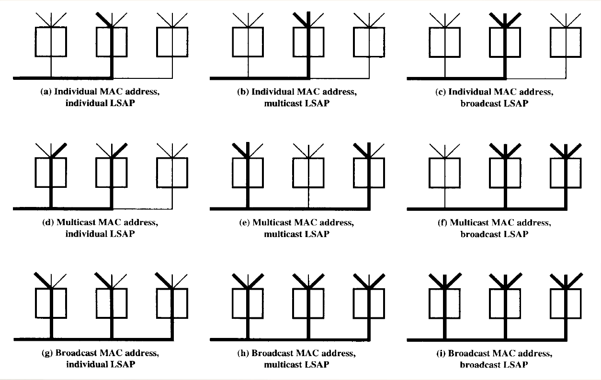

*그림 4. MAC 주소와 LSAP 주소의 아홉 가지 조합*

그림 4의 각 칸에는 LAN에 연결된 세 스테이션이 있고, 스테이션 위로 뻗은 세 갈래 선은 그 스테이션의 LSAP 세 개이다. 굵은 선은 프레임이 전달되는 경로이다.

| MAC 주소 \ LSAP 주소 | 개별 LSAP | 멀티캐스트 LSAP | 브로드캐스트 LSAP |
|:-----|:-----|:-----|:-----|
| 개별 MAC | (a) 한 스테이션의 한 LSAP | (b) 한 스테이션의 일부 LSAP | (c) 한 스테이션의 모든 LSAP |
| 멀티캐스트 MAC | (d) 일부 스테이션 각각의 한 LSAP | (e) 일부 스테이션 각각의 일부 LSAP | (f) 일부 스테이션의 모든 LSAP |
| 브로드캐스트 MAC | (g) 모든 스테이션 각각의 한 LSAP | (h) 모든 스테이션 각각의 일부 LSAP | (i) 모든 스테이션의 모든 LSAP |

*표 3. 그룹 주소의 조합에 따른 전달 범위*

LLC 주소는 **한 스테이션 안에서만 유일하다.** 다른 방법으로 LLC 주소를 네트워크 전체에서 유일하게 만들 수도 있지만, 그러면 네트워크 전체가 쓸 수 있는 프로세스의 수가 주소 공간의 크기로 제한되고, SAP를 배정하는 중앙 관리 기구가 필요해진다. 그래서 LLC 주소는 스테이션마다 독립적으로 배정하되, 스테이션 관리(station management)처럼 여러 스테이션에 공통으로 있는 특정 프로세스에는 모든 스테이션에서 같은 LLC 주소를 배정한다. 그래야 멀티캐스트나 브로드캐스트 MAC 주소와 개별 또는 멀티캐스트 LSAP를 함께 쓰는 (d), (e), (g), (h)의 경우에, 여러 스테이션에서 같은 기능을 하는 프로세스에 한 번에 프레임을 전달할 수 있다.

### 1.7 MAC: 제어의 위치

> **용어 정의:** **MAC(medium access control, 매체 접근 제어)** 은 여러 장치가 네트워크의 전송 매체를 공유하도록 하는 수단이다. 공유 매체에서 둘 이상이 동시에 보내면 신호가 겹쳐 망가지므로, 매체를 언제 누가 쓸지 정하는 규칙이 필요하다.

MAC 기법은 두 가지 질문으로 분류한다. 제어를 **어디서(where)** 하는가와, **어떻게(how)** 하는가이다. 먼저 제어의 위치에 따라 두 가지로 나뉜다.

- **집중형 제어(centralized control):** 지정된 중앙 제어기(central controller)가 있다. 네트워크에 연결된 스테이션이 요청(request)하면 중앙 제어기가 네트워크에 대한 접근 권한을 준다.
- **분산형 제어(distributed control):** 중앙 제어기 없이 스테이션들이 유기적으로 동작한다. 어느 스테이션이 보낼지는 스테이션들의 공동(collective) MAC 기능이 동적으로 결정한다.

| 구분 | 집중형 제어 | 분산형 제어 |
|:-----|:-----|:-----|
| 장점 | 우선순위(priorities), 중단(overrides), 용량 보장 같은 정교한 제어가 쉽다. 일반 스테이션의 로직이 간단하다. 여러 스테이션 사이의 조정이 편리하다. | 한 장치의 고장이 전체를 멈추지 않는다. 중앙 제어기라는 병목이 없다. |
| 단점 | 중앙 제어기 하나가 고장 나면 네트워크 전체가 불능이 된다(단일 고장점). 중앙 제어기가 병목이 되어 네트워크 효율을 낮출 수 있다. | 모든 스테이션이 MAC 로직을 갖추어야 하고, 우선순위나 용량 보장 같은 제어가 어렵다. |

*표 4. 집중형 제어와 분산형 제어의 비교*

### 1.8 MAC: 제어의 방식

제어의 방식을 정하는 요소는 토폴로지, 가격과 성능과 복잡도 사이의 절충, 그리고 동기식과 비동기식의 선택이다.

- **동기식(synchronous) 방식:** 각 연결에 일정한 용량을 미리 지정한다. 시분할 다중화(TDM)가 그 예이다(4주차). LAN의 트래픽은 언제 얼마나 생길지 예측할 수 없으므로, 고정 용량을 배정하면 보낼 것이 없는 스테이션의 몫이 낭비된다. 그래서 LAN에는 적합하지 않다.
- **비동기식(asynchronous) 방식:** 그때그때 필요에 따라 네트워크 용량을 동적으로 할당한다. 라운드 로빈, 예약, 경합의 세 종류가 있다.

**1. 라운드 로빈(round robin, 순환 순서 방식).** 모든 스테이션이 차례로 한 번씩 전송 기회를 받는다.

- 자기 차례가 온 스테이션은 정해진 시간 안에 전송하거나, 보낼 것이 없으면 전송을 거절하고 차례를 넘긴다.
- 차례를 정하는 방법에는 중앙 제어기가 스테이션을 차례로 불러 묻는 **폴링(polling)** 같은 집중형 기술과, 스테이션들이 전송 권한을 뜻하는 토큰을 차례로 넘기는 **토큰 전달(token passing)** 같은 분산형 기술이 있다.
- 많은 스테이션이 오랫동안 보낼 데이터를 갖고 있으면 효율이 높다. 반대로 보낼 것이 있는 스테이션이 적은 저용량 트래픽에서는 순서대로 차례를 넘기는 오버헤드 때문에 효율이 낮다 [1].

**2. 예약(reservation) 방식.** 전송 매체의 사용 시간을 시간 슬롯(time slot)으로 나눈다.

- 보내려는 스테이션은 다음(미래의) 슬롯을 예약한다. 예약은 무기한일 수도 있다.
- 음성, 원격 측정(telemetry), 대용량 파일 전송처럼 길고 비교적 지속적인 전송에 알맞다.

**3. 경합(contention) 방식.** 누가 보낼지 제어하는 장치가 없다.

- 모든 스테이션이 보낼 것이 생기면 매체를 차지하려고 경쟁하며, 분산형 기술의 극단적인 경우이다.
- 구현이 간단하고, 매체의 트래픽이 낮을 때 효율적이며, 산발적이거나 갑작스러운(bursty) 트래픽에 알맞다.
- 대용량 트래픽이 발생하면 충돌이 잦아져 효율이 붕괴될 수 있다.

| 구분 | 예약 방식 | 라운드 로빈 | 경합 방식 |
|:-----|:-----|:-----|:-----|
| 교차로에 비유하면 | 교통 신호등이 있는 교차로: 신호가 정한 시간에만 지나간다. | 정지 표지판이 있는 교차로: 차들이 한 대씩 멈췄다가 순서대로 지나간다. | 신호 없는 교차로: 비어 있으면 먼저 들어가고, 동시에 들어가면 부딪힌다. |
| 알맞은 트래픽 | 길고 지속적인 흐름 | 많은 스테이션의 지속적인 트래픽 | 낮고 산발적인 트래픽 |

*표 5. 세 가지 비동기식 MAC 방식의 비교*

LAN은 주로 경합 방식이나 라운드 로빈 방식을 쓴다.

### 1.9 토폴로지별 표준 MAC 기법

| 방식 | 버스 토폴로지 | 링 토폴로지 | 스위치 토폴로지 |
|:-----|:-----|:-----|:-----|
| 라운드 로빈 | 토큰 버스(IEEE 802.4), 폴링(IEEE 802.11) | 토큰 링(IEEE 802.5, FDDI) | 요구 우선순위(IEEE 802.12) |
| 예약 | DQDB(IEEE 802.6) | | |
| 경합 | CSMA/CD(IEEE 802.3), CSMA(IEEE 802.11) | | CSMA/CD(IEEE 802.3) |

*표 6. 토폴로지별로 표준화된 MAC 기법*

표 6의 각 항목은 다음과 같다. 토폴로지 자체는 6주차에서 다루었다.

- **토큰 버스(token bus):** 버스에 연결된 스테이션들이 논리적인 순서를 정해 토큰을 넘긴다.
- **토큰 링(token ring):** 링을 따라 토큰이 돌고, 토큰을 잡은 스테이션만 보낸다(3주차). FDDI는 광섬유 이중 링을 쓰는 100 Mbps 토큰 링이다(4.4절).
- **DQDB(distributed queue dual bus):** 두 개의 단방향 버스와 분산된 대기열로 슬롯을 예약하는 MAN 기술이다(3주차).
- **요구 우선순위(demand priority):** 허브가 스테이션들의 전송 요청을 받아 우선순위와 순서에 따라 허락한다.
- **CSMA/CD:** 이더넷의 방식으로, 2절에서 자세히 다룬다.
- **IEEE 802.11:** 무선 LAN은 경합 방식의 CSMA를 기본으로 하고, 선택적으로 접속점(AP)이 폴링하는 방식도 정의했다.

> **참고:** IEEE 802.11의 경합 방식은 충돌을 검출하는 CSMA/CD가 아니라 충돌을 피하려고 하는 **CSMA/CA(collision avoidance)** 이다. 무선 송신기는 자기가 보내는 강한 신호 때문에 같은 순간에 다른 스테이션의 약한 신호를 들을 수 없고, 서로의 신호가 닿지 않는 숨은 단말(hidden terminal)도 있어 충돌 검출이 어렵기 때문이다 [4].

### 1.10 MAC 프레임 형식과 캡슐화

일반적인 MAC 프레임은 다음 요소로 이루어진다.

```text
┌───────────┬──────────────────┬──────────────────┬─────────────────┬─────────┐
│    MAC    │   Destination    │      Source      │     LLC PDU     │   CRC   │
│  control  │   MAC address    │   MAC address    │                 │  (FCS)  │
└───────────┴──────────────────┴──────────────────┴─────────────────┴─────────┘
```

*그림 5. 일반적인 MAC 프레임의 형식*

- **MAC 제어(MAC control):** 우선순위처럼 MAC 프로토콜의 동작에 필요한 제어 정보이다.
- **목적지 MAC 주소와 출발지 MAC 주소:** 프레임을 받을 스테이션과 보낸 스테이션의 물리적 주소이다.
- **LLC 데이터:** 위 계층에서 받은 LLC PDU이다.
- **CRC:** 프레임 검사 순서(FCS, frame check sequence)라고도 하며, 오류 검출에 쓰는 비트열이다(3.5절).

오류 제어의 역할은 두 계층이 나누어 맡는다. **MAC은 오류를 검출하고**, 오류가 있는 프레임을 버린다. **오류의 복구는 LLC가 한다.** 즉 LLC(또는 그 위의 계층)가 확인 응답이 오지 않은 프레임을 다시 보낸다.

TCP/IP 응용의 데이터가 LAN으로 나갈 때 각 계층이 헤더를 붙이는 과정, 즉 **캡슐화(encapsulation)** 는 다음과 같다.

```text
                                  ┌──────────────────────┐
                                  │   Application data   │            Application layer
                                  └──────────────────────┘
                        ┌─────────┬──────────────────────┐
                        │   TCP   │   Application data   │            TCP layer
                        │ header  │                      │
                        └─────────┴──────────────────────┘
               ┌────────┬─────────┬──────────────────────┐
               │   IP   │   TCP   │   Application data   │            IP layer
               │ header │ header  │                      │
               └────────┴─────────┴──────────────────────┘
       ┌───────┬────────┬─────────┬──────────────────────┐
       │  LLC  │   IP   │   TCP   │   Application data   │            LLC layer
       │header │ header │ header  │                      │
       └───────┴────────┴─────────┴──────────────────────┘
┌──────┬───────┬────────┬─────────┬──────────────────────┬─────────┐
│ MAC  │  LLC  │   IP   │   TCP   │   Application data   │   MAC   │  MAC layer
│header│header │ header │ header  │                      │ trailer │
└──────┴───────┴────────┴─────────┴──────────────────────┴─────────┘
                        │<-------- TCP segment --------->│
               │<------------- IP datagram ------------->│
       │<---------------- LLC protocol data unit ------->│
│<------------------------------- MAC frame ---------------------->│
```

*그림 6. 계층마다 헤더가 붙는 캡슐화 과정*

그림 6에서 TCP 헤더와 응용 데이터를 합친 것이 **TCP 세그먼트**, 여기에 IP 헤더를 붙인 것이 **IP 데이터그램**, 다시 LLC 헤더를 붙인 것이 **LLC PDU**, 마지막으로 MAC 헤더와 트레일러로 감싼 것이 **MAC 프레임**이다. 수신 측에서는 반대 순서로 각 계층이 자기 헤더를 떼어 내고 나머지를 위 계층에 넘긴다.

---

<br>

## 2. CSMA/CD

### 2.1 CSMA/CD의 개념

> **용어 정의:** **CSMA/CD(carrier sense multiple access with collision detection)** 는 보내기 전에 매체를 듣고, 보내는 동안에도 계속 들어 충돌을 검출하면 즉시 전송을 멈추는 경합 방식의 MAC 기법이다. 이더넷(Ethernet)과 IEEE 802.3 LAN이 이 방식을 쓴다.

> **참고:** CSMA/CD를 IEEE 802.11 무선 LAN에서도 쓴다고 설명하는 자료가 있으나, 802.11은 충돌을 검출하는 대신 충돌을 피하려 하는 CSMA/CA를 쓴다(1.9절).

CSMA/CD는 사무실 같은 상용 네트워크와 산업 현장에서 쓰기 위해 개발되었으며, 물리 계층과 MAC 계층에 걸쳐 동작한다. 반송파 감지와 충돌 검출은 물리 계층의 신호로 하고, 언제 보내고 언제 다시 보낼지는 MAC 계층이 정하기 때문이다. 이름의 세 부분은 다음을 뜻한다.

| 약어 | 이름 | 의미 |
|:-----|:-----|:-----|
| CS | 반송파 감지(carrier sensing) | 스테이션이 매체에 신호(반송파)가 있는지 감지하여, 다른 스테이션이 전송하지 않을 때만 전송한다. |
| MA | 다중 접근(multiple access) | 여러 스테이션이 하나의 매체에 접근한다. |
| CD | 충돌 검출(collision detection) | 보내는 동안 다른 스테이션의 신호와 겹치는 충돌을 감지한다. |

*표 7. CSMA/CD라는 이름의 구성*

> **용어 정의:** **반송파(carrier)** 는 원래 정보를 싣는 기준 신호를 뜻하며, 여기서는 매체 위에 어떤 전송 신호가 있는 상태를 가리킨다.

> **용어 정의:** **충돌(collision)** 은 둘 이상의 스테이션이 동시에 보내 신호가 겹쳐 수신자가 어느 쪽도 올바르게 읽지 못하는 상태이다.

CSMA/CD는 단번에 만들어진 것이 아니라 ALOHA, CSMA를 거쳐 다듬어진 방식이다. 이 흐름을 차례로 살핀다.

### 2.2 ALOHA와 Slotted ALOHA

CSMA/CD와 비슷한 기술로 **임의 접근(random access)** 또는 **경합(contention)** 기술이 있다. 이 기술들의 공통점은 다음 두 가지이다.

- 전송에 정해진 시간이나 순서가 없다.
- 공유하는 전송 매체의 사용 시간을 스테이션들이 경합한다.

**ALOHA(Pure ALOHA).** 가장 오래된 경합 방식이며, 하와이 대학교가 섬들 사이를 지상 무선으로 연결한 패킷 무선(packet radio) 네트워크에서 처음 쓰였다 [5]. 동작은 다음과 같다.

1. 스테이션은 보낼 프레임이 생길 때마다 곧바로 전송한다.
2. 보낸 뒤에는 네트워크에서 가능한 최대 왕복 전파 지연(maximum round-trip propagation delay) 동안 기다린다.
3. 이 시간 안에 ACK를 받으면 전송이 완료된 것으로 본다. 받지 못하면 프레임을 다시 보낸다.
4. 정해진 횟수만큼 반복해도 ACK를 받지 못하면 전송을 포기한다.
5. 수신 스테이션은 받은 프레임의 체크섬(checksum)으로 데이터가 올바른지 확인한다. 문제가 없으면 즉시 ACK를 보낸다.
6. 잡음이나 충돌 때문에 데이터에 문제가 있으면 수신을 무시한다. 그러면 송신 측은 ACK를 받지 못하므로 3단계에 따라 다시 보낸다.

> **용어 정의:** **전파 지연(propagation delay)** 은 신호가 매체의 한 지점에서 다른 지점까지 이동하는 데 걸리는 시간이다. 거리를 신호의 전파 속도로 나눈 값이며, 구리선에서 신호는 빛의 속도의 약 2/3인 $2 \times 10^8$ m/s 정도로 진행한다.

**Slotted ALOHA.** 충돌을 줄이기 위해 시간을 나눈 방식이다.

- 시간을 프레임 하나의 전송 시간과 같은 길이의 **시간 슬롯(time slot)** 으로 나눈다.
- 모든 노드는 슬롯이 언제 시작하는지 알 수 있도록 동기화되어 있다고 가정한다.
- 노드는 프레임을 슬롯이 시작할 때만 보낸다. 보낼 프레임이 생기면 다음 슬롯을 기다려 전송한다.
- 충돌이 없으면 전송이 끝난다. 충돌이 발생하면 다음 슬롯부터 각 슬롯에서 확률 $p$로 재전송한다.
- 한 슬롯에서 둘 이상의 노드가 충돌하면 모든 노드가 충돌을 감지한다.
- 활성 노드가 많으면 충돌이 빈번하고, 아무도 보내지 않는 빈 슬롯이 생길 수 있으며, 시간 동기화가 필요하다.

**전파 지연과 충돌.** 프레임의 전송 시간이 길수록 그 프레임이 다른 프레임과 겹칠 수 있는 구간도 길어져 충돌 확률이 높아진다. 그런데 대부분의 LAN에서는 프레임의 전송 시간에 비해 전파 지연이 매우 짧다. 그러므로 한 스테이션이 보내기 시작하면 다른 스테이션들은 곧바로 그 신호를 감지할 수 있다. 스테이션이 매체에 이미 신호가 있음을 감지할 수 있다면, 그 갱신된 정보를 바탕으로 전송 여부를 정할 수 있다. 이 생각이 2.3절의 CSMA로 이어진다.

> **참고:** **ALOHA의 처리율.** 프레임 길이가 모두 같고, 새 프레임과 재전송 프레임을 합친 전송 시도가 Poisson 과정을 따른다고 가정한다. 한 프레임 시간 동안의 평균 시도 수를 부하 $G$라 하면, 어느 프레임이 성공하려면 그 프레임의 시작 전후 한 프레임 시간씩, 즉 두 프레임 시간 동안 다른 시도가 없어야 한다. 그 확률이 $e^{-2G}$이므로 처리율(성공한 프레임의 비율)은 $S = G e^{-2G}$이고, $G = 0.5$에서 최댓값 $1/(2e) \approx 0.184$가 된다. Slotted ALOHA에서는 같은 슬롯에서 시작한 프레임끼리만 충돌하므로 취약 구간이 한 프레임 시간으로 줄어 $S = G e^{-G}$이고, $G = 1$에서 최댓값 $1/e \approx 0.368$이 된다 [4]. 즉 슬롯을 나누는 것만으로 최대 처리율이 두 배가 된다.

> **[확률및통계]** Poisson 분포는 단위 시간에 평균 $\lambda$번 일어나는 사건이 서로 독립일 때 $k$번 일어날 확률을 $P(k) = \lambda^k e^{-\lambda} / k!$로 주는 분포이다. 위의 $e^{-2G}$는 평균이 $2G$인 Poisson 분포에서 $k = 0$일 확률이다.

### 2.3 CSMA

> **용어 정의:** **CSMA(carrier sense multiple access)** 는 보내기 전에 매체를 듣는 경합 방식이다.

> **용어 정의:** 이 원칙을 **전송 전에 듣기(LBT, listen before talk)** 라 한다.

CSMA의 동작은 다음과 같다.

- 프레임을 보내려는 스테이션은 먼저 전송 매체를 듣고 다른 스테이션이 송신하고 있는지 확인한다.
- 매체가 사용 중(busy)이면 잠시 뒤에 다시 시도하고, 조용하면(quiet) 전송을 시작한다.
- 보낸 뒤에는 신호의 왕복 전파 지연과 경합 과정을 고려한 일정 시간 동안 ACK를 기다린다. ACK가 없으면 충돌이 일어난 것으로 보고 다시 보낸다.

CSMA에서도 충돌은 일어난다. 한 스테이션이 보내기 시작한 뒤 그 신호가 다른 스테이션에 도달하기까지 전파 지연이 있으므로, 그 사이에 다른 스테이션이 매체를 조용하다고 판단하고 보내기 시작하면 충돌한다. 반대로 프레임의 첫 비트가 매체의 끝까지 전파되고 나면 모든 스테이션이 매체가 사용 중임을 알게 되므로, 그 프레임이 끝날 때까지는 충돌이 없다.

따라서 CSMA는 **전파 지연보다 전송 시간이 월등히 긴 경우에 효과적이다.** 충돌이 일어날 수 있는 구간이 프레임 전체가 아니라 처음 전파 지연만큼으로 줄어들기 때문이다. 전송 시간과 지연 시간을 함께 고려하면 CSMA는 ALOHA나 Slotted ALOHA보다 월등한 성능을 낸다.

**계산 예.** 길이 1 km의 버스에서 신호가 $2 \times 10^8$ m/s로 진행하면 끝에서 끝까지의 전파 지연은 다음과 같다.

```math
\tau = \frac{1000\ \text{m}}{2 \times 10^8\ \text{m/s}} = 5 \times 10^{-6}\ \text{s} = 5\ \mu\text{s}
```

1,000비트 프레임을 10 Mbps로 보내는 전송 시간은 $`T = 1000 / 10^7 = 100\ \mu`$s이다. 충돌이 일어날 수 있는 구간 5 µs는 전송 시간 100 µs의 5%에 불과하다. 두 값의 비 $a = \tau / T = 0.05$가 작을수록 CSMA의 효율이 높다.

### 2.4 CSMA의 지속성 방식

매체가 사용 중일 때 기다리는 방법에 따라 CSMA는 세 가지로 나뉜다.

**1. 비지속(nonpersistent) CSMA.**

- 매체가 비어 있으면(idle) 즉시 보낸다.
- 사용 중이면 확률적으로 정한 임의의 시간만큼 기다린 뒤 매체를 다시 확인한다.
- 여러 스테이션이 서로 다른 시간만큼 기다리므로 충돌은 줄지만, 매체가 비었는데도 모두 기다리고 있어 낭비되는 시간이 생긴다.

**2. 1-지속(1-persistent) CSMA.**

- 매체가 사용 중이면 비어 있는 상태(idle)가 될 때까지 계속 듣다가, 비는 즉시 전송을 시작한다.
- 비어 있는 시간을 낭비하지 않지만, 둘 이상의 스테이션이 기다리고 있었다면 반드시 충돌한다.

**3. p-지속(p-persistent) CSMA.**

1. 매체가 비어 있으면 확률 $p$로 보내고, 확률 $1 - p$로 한 시간 단위만큼 전송을 미룬다. 시간 단위는 보통 최대 전파 지연이다.
2. 매체가 사용 중이면 빌 때까지 계속 듣다가, 비면 1단계의 규칙대로 전송한다.
3. 전송을 미룬 경우에는 한 시간 단위 뒤에 1단계를 다시 수행한다.

$p$의 값은 다음처럼 정한다. $n$개의 스테이션이 전송을 기다리고 있으면, 매체가 빈 순간 전송을 시작하는 스테이션 수의 기댓값은 $np$이다. $np > 1$이면 평균적으로 둘 이상이 동시에 보내므로, 대기 중인 스테이션과 새로 전송하려는 스테이션 때문에 충돌이 계속될 수 있다. 그래서 $p$는 $np < 1$을 유지할 만큼 작게 정한다. 그러나 $p$가 지나치게 작으면 아무도 보내지 않는 시간 단위가 이어져 스테이션들의 대기 시간이 불필요하게 길어진다.

**계산 예.** 10개의 스테이션이 대기 중일 때, 한 시간 단위에서 **정확히 한 스테이션만** 보내 성공할 확률은 이항 분포로 $P_1 = np(1-p)^{n-1}$이다.

| $p$ | $np$ | $P_1 = np(1-p)^{n-1}$ |
|:-----|:-----|:-----|
| 0.05 | 0.5 | $0.5 \times 0.95^9 \approx 0.315$ |
| 0.1 | 1.0 | $1.0 \times 0.9^9 \approx 0.387$ |
| 0.2 | 2.0 | $2.0 \times 0.8^9 \approx 0.268$ |

*표 8. 대기 스테이션이 10개일 때 p 값에 따른 단독 전송 확률*

$p$가 너무 크면(0.2) 충돌이 늘고, 너무 작으면(0.05) 빈 시간이 늘어 성공 확률이 모두 낮아진다. 이 예에서는 $p = 1/n = 0.1$일 때 성공 확률이 가장 높다.

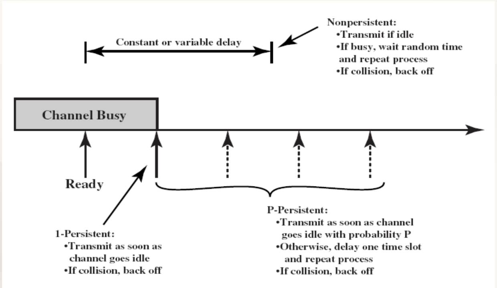

*그림 7. 매체가 사용 중일 때 세 지속성 방식의 동작*

그림 7에서 회색 상자는 매체가 사용 중인 구간이고, "Ready"는 스테이션이 보낼 준비가 된 시점이다. 1-지속 방식은 매체가 비는 순간(굵은 화살표) 바로 보내고, 비지속 방식은 일정하거나 가변적인 지연 뒤에 다시 확인하며, p-지속 방식은 매체가 빈 뒤 시간 슬롯(점선 화살표)마다 확률 $p$로 보낸다. 세 방식 모두 충돌이 나면 물러나서(back off) 다시 시도한다.

| 방식 | 매체가 사용 중일 때 | 장점 | 단점 |
|:-----|:-----|:-----|:-----|
| 비지속 | 임의의 시간 뒤 다시 확인 | 충돌이 적다. | 매체가 비어도 아무도 쓰지 않는 시간이 생긴다. |
| 1-지속 | 빌 때까지 듣다가 즉시 전송 | 빈 시간을 낭비하지 않는다. | 대기자가 둘 이상이면 반드시 충돌한다. |
| p-지속 | 빌 때까지 듣다가 확률 $p$로 전송 | $p$를 조절하여 충돌과 빈 시간을 절충한다. | 알맞은 $p$를 정하기 어렵다. |

*표 9. CSMA의 세 지속성 방식 비교*

### 2.5 CSMA/CD의 동작

CSMA에서는 충돌이 일어나도 스테이션들이 프레임을 끝까지 보낸 뒤 ACK가 오지 않아야 충돌을 알게 된다. 그동안 충돌한 프레임의 전송에 전송 용량이 낭비된다. CSMA/CD는 여기에 **보내는 동안 듣기(LWT, listen while talk)** 를 더하여 이 낭비를 줄인다.

1. 매체가 비어 있으면 전송한다. 사용 중이면 2단계로 간다.
2. 매체가 사용 중이면 빌 때까지 계속 듣다가 즉시 전송한다(1-지속 방식).
3. 전송 중에 충돌을 감지하면 진행 중인 전송을 즉시 멈추고, 짧은 **재밍 신호(jamming signal)** 를 보내 모든 스테이션에 충돌이 일어났음을 알린다.
4. 재밍 신호를 보낸 뒤 임의의 시간을 기다렸다가 1단계부터 다시 시도한다.

> **용어 정의:** **재밍 신호(jamming signal)** 는 충돌을 감지한 스테이션이 보내는 짧은 비트열로, 충돌에 관련된 모든 스테이션이 충돌을 확실히 감지하게 하는 역할을 한다. IEEE 802.3에서는 32비트이다 [6].

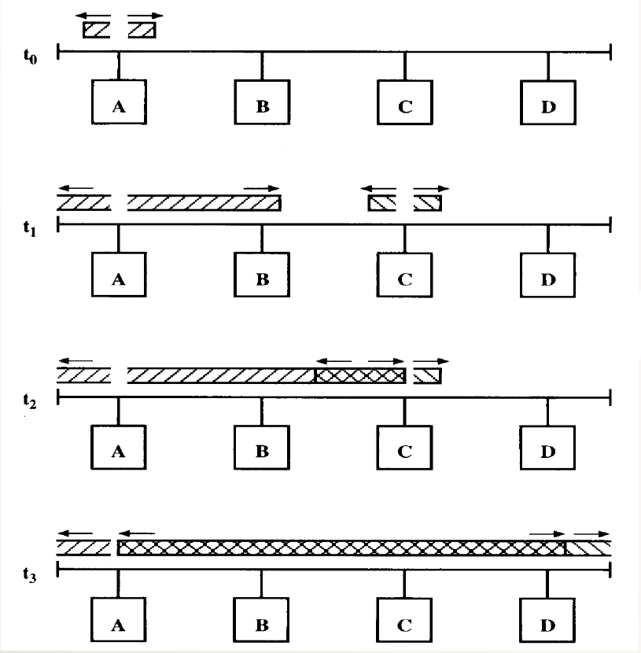

*그림 8. 버스에서 CSMA/CD가 동작하는 시간 순서*

그림 8은 스테이션 A, B, C, D가 연결된 버스에서 시간 $t_0$부터 $t_3$까지의 상황이다. 빗금 친 막대는 신호가 퍼져 나가는 모습이고, 교차 빗금은 두 신호가 겹친 충돌 구간이다.

| 시각 | 상황 |
|:-----|:-----|
| $t_0$ | A가 전송을 시작한다. A의 신호가 양쪽으로 퍼져 나간다. |
| $t_1$ | B와 C에 보낼 프레임이 준비된다. B에는 이미 A의 신호가 도착했으므로 B는 매체가 사용 중임을 알고 전송을 미룬다. C에는 아직 A의 신호가 도착하지 않았으므로 C는 매체가 비었다고 판단하고 전송을 시작한다. |
| $t_2$ | A의 신호가 C에 도달한다. C는 충돌을 감지하고 전송을 멈춘다. |
| $t_3$ | 충돌 신호가 A에도 도달한다. A도 충돌을 감지하고 전송을 멈춘다. |

*표 10. 그림 8의 시각별 상황*

전체 동작을 흐름도로 정리하면 다음과 같다.

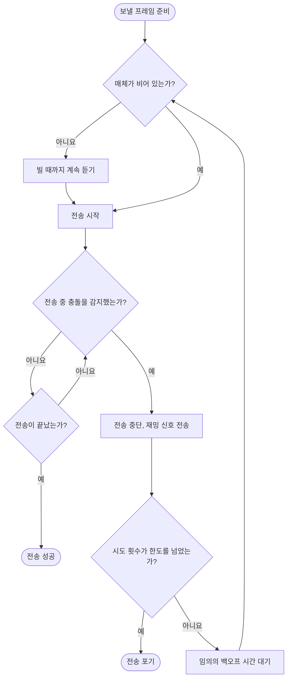

*그림 9. CSMA/CD 스테이션의 동작 흐름*

### 2.6 기저대역 버스의 충돌 검출 시간

> **용어 정의:** **기저대역(baseband)** 전송은 디지털 신호를 변조하지 않고 그대로 매체에 싣는 방식으로, 신호가 버스의 양쪽 방향으로 퍼져 나간다.

> **용어 정의:** **광대역(broadband)** 전송은 신호를 반송파로 변조하여 특정 주파수 대역에 싣는 방식이다(6주차).

충돌을 감지하는 데 걸리는 시간은 두 스테이션 사이의 거리가 가장 멀 때 가장 길다. 버스의 양 끝에 있는 A와 D를 생각한다. 버스의 끝에서 끝까지의 전파 지연을 $\tau$라 한다.

1. 시각 0에 A가 전송을 시작한다.
2. A의 신호가 D에 도착하기 직전(시각 $\tau$ 바로 전)에 D의 프레임이 준비된다. D는 매체가 비었다고 판단하고 전송을 시작하며, 곧바로 A의 신호와 부딪혀 충돌을 감지한다.
3. D가 보낸 신호(충돌)는 다시 최대 전파 지연 $\tau$ 뒤에 A에 도달한다.
4. 따라서 A는 전송을 시작한 지 **최대 전파 지연의 거의 2배($`2\tau`$)** 가 지나서야 충돌을 검출한다.

이 결과에서 중요한 조건이 나온다. A가 충돌을 검출하려면 시각 $2\tau$까지 아직 전송 중이어야 한다. 만약 A가 그 전에 전송을 끝내 버리면, 충돌로 프레임이 망가졌는데도 A는 성공한 것으로 알게 된다. 그러므로 **프레임의 전송 시간은 $2\tau$ 이상이어야 하고**, 이것이 CSMA/CD에서 최소 프레임 길이가 정해지는 이유이다.

```math
L_{min} = R \times 2\tau
```

여기서 $R$은 전송 속도(bps)이다.

**계산 예.** 500 m 버스에서 신호 속도가 $2 \times 10^8$ m/s이면 $`\tau = 500 / (2 \times 10^8) = 2.5\ \mu`$s이고 $`2\tau = 5\ \mu`$s이다. 10 Mbps에서 최소 프레임 길이는 다음과 같다.

```math
L_{min} = 10^7\ \text{bps} \times 5 \times 10^{-6}\ \text{s} = 50\ \text{비트}
```

> **참고:** 실제 10 Mbps 이더넷 규격은 리피터로 여러 세그먼트를 이어 최대 2.5 km까지 늘린 네트워크와 리피터의 지연까지 고려하여, 왕복 시간의 상한인 **슬롯 시간(slot time)** 을 512비트 시간(10 Mbps에서 51.2 µs)으로 정한다. 그래서 이더넷 프레임은 최소 512비트, 즉 64바이트이다 [6].

### 2.7 광대역 버스의 충돌 검출 시간

광대역 버스는 하나의 케이블 끝에 **헤드엔드(headend)** 를 둔다. 스테이션은 한 주파수 대역(입력 채널)으로 헤드엔드를 향해 보내고, 헤드엔드는 받은 신호를 다른 주파수 대역(출력 채널)으로 바꾸어 모든 스테이션에 다시 내보낸다. 즉 신호는 헤드엔드까지 갔다가 돌아와야 다른 스테이션에 들린다.

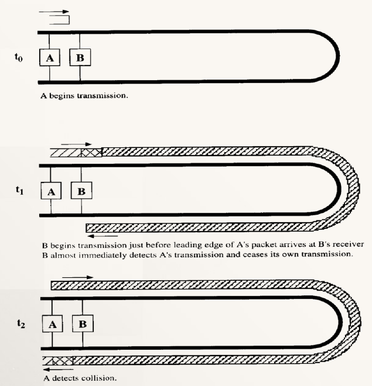

*그림 10. 광대역 버스의 충돌 검출 시간*

그림 10에서 케이블의 굽은 쪽이 헤드엔드 방향이고, 서로 이웃한 A와 B는 헤드엔드에서 가장 먼 끝에 있다. 스테이션과 헤드엔드 사이의 전파 지연을 $\tau$라 한다. A와 B는 헤드엔드에서 가장 먼 끝에 있으므로 $\tau$는 케이블의 끝에서 끝까지의 전파 지연과 같다.

1. $t_0$: A가 전송을 시작한다.
2. $t_1$: A의 신호는 헤드엔드까지 갔다가 돌아와야 B에 들리므로, B는 A가 보낸 지 $2\tau$ 가까이 지날 때까지 매체가 비었다고 판단할 수 있다. B는 A의 신호 앞부분이 자기 수신기에 도착하기 직전에 전송을 시작하고, 곧바로 A의 신호를 감지하여 전송을 멈춘다.
3. $t_2$: B가 보낸 신호도 헤드엔드를 거쳐 A에 도달하는 데 다시 $2\tau$가 걸린다. A는 이때 충돌을 검출한다.

따라서 최악의 경우 충돌 검출에 **끝에서 끝까지 지연의 4배($`4\tau`$)** 가 걸린다. 기저대역 버스의 $2\tau$보다 두 배 길다.

### 2.8 전송 효율과 이진 지수 백오프

**전송 효율.** CSMA/CD가 효율적이려면 프레임의 전송 시간이 충돌 검출에 걸리는 시간보다 충분히 길어야 한다. 스테이션이 전송 중에 충돌을 검출하려면 프레임이 길어야 하며, 그렇지 않으면 충돌을 검출하기 전에 전송이 끝나 CSMA/CD의 장점이 사라진다. 이 경우 효율은 CSMA와 같거나 더 낮아진다.

**매체가 사용 중일 때의 알고리즘.** 이더넷, MITREnet, IEEE 802.3 같은 대부분의 CSMA/CD 시스템은 1-지속 방식을 쓴다. 그 이유는 다음과 같다.

- 트래픽이 낮을 때는 매체가 비는 즉시 보내므로 효율이 높다.
- 트래픽이 높을 때 1-지속 방식은 충돌을 자주 일으키지만, CSMA/CD에서는 충돌이 곧바로 검출되어 전송이 중단되므로 낭비되는 시간이 크지 않다.
- 직전 충돌에 관련된 스테이션들이 다시 충돌하지 않도록 **임의 백오프(random backoff)** 를 둔다.

> **용어 정의:** **백오프(backoff)** 는 충돌한 스테이션이 다시 보내기 전에 기다리는 임의의 시간이다.

> **용어 정의:** **이진 지수 백오프(binary exponential backoff)** 는 충돌이 반복될 때마다 기다릴 시간을 고르는 범위를 2배씩 늘리는 방식이다.

이더넷과 IEEE 802.3의 이진 지수 백오프는 다음과 같이 동작한다 [6].

- 한 프레임이 $n$번째 충돌을 겪으면, $0$부터 $2^{k} - 1$까지의 정수 가운데 하나를 같은 확률로 골라 $r$이라 한다. 여기서 $k = \min(n, 10)$이다.
- $r \times$ 슬롯 시간(512비트 시간)만큼 기다린 뒤 다시 시도한다.
- 최대 16번 시도하고, 그래도 실패하면 전송을 포기하고 상위 계층에 오류를 알린다.

| 충돌 횟수 $n$ | 고르는 범위 | 10 Mbps에서 최대 대기 시간 |
|:-----|:-----|:-----|
| 1 | 0\~1 | $`1 \times 51.2 = 51.2\ \mu`$s |
| 2 | 0\~3 | $`3 \times 51.2 = 153.6\ \mu`$s |
| 3 | 0\~7 | $`7 \times 51.2 = 358.4\ \mu`$s |
| 10\~15 | 0\~1023 | $1023 \times 51.2 \approx 52.4$ ms |
| 16 | 전송 포기 | |

*표 11. 이진 지수 백오프의 대기 범위*

충돌이 거듭된다는 것은 경쟁하는 스테이션이 많다는 뜻이므로, 범위를 넓혀 서로 다른 값을 고를 가능성을 높인다. 이 방식은 가벼운 부하부터 무거운 부하까지 넓은 범위에서 효율적이다. 다만 공정하지 않은 면이 있다. 여러 번 충돌하여 범위가 넓어진 오래된 프레임보다, 처음 시도하여 범위가 좁은 새 프레임이 먼저 전송될 가능성이 높다. 즉 충돌한 프레임들 가운데 새로운 프레임이 더 빠르게 전송된다.

### 2.9 반송파 감지와 충돌 검출의 구현

**반송파 감지.** 기저대역 시스템은 Manchester 부호(Manchester coding)로 비트를 싣는다. Manchester 부호는 모든 비트의 가운데에서 신호가 반드시 바뀌므로(4주차의 바이페이즈 부호), 신호의 전이가 감지되면 누군가 전송 중인 것으로 판단할 수 있다.

**충돌 검출 1: 기저대역 동축 케이블.**

- 두 스테이션이 동시에 보내면 두 신호가 더해져, 한 스테이션이 보낼 때보다 큰 전압 변화(voltage swing)가 나타난다.
- 트랜시버 하나가 단독으로 만들 수 있는 최대 전압보다 높은 전압이 감지되면 충돌로 판정한다.
- 그런데 신호는 케이블을 지나며 감쇠한다. 멀리서 온 약한 신호와 섞이면 합쳐진 전압이 충돌 검출 문턱보다 낮을 수 있다. 이것이 IEEE가 한 세그먼트의 길이를 500 m로 제한하는 이유 가운데 하나이다.

**충돌 검출 2: 꼬임선 스타 배선(twisted-pair star-wiring) 방식.**

- 전압이 아니라 논리적으로 충돌을 감지한다.
- 스타 배선에서는 각 스테이션이 허브에 별도의 선으로 연결되므로, 어떤 허브에서든 둘 이상의 입력 채널에 활성(active) 신호가 들어오면 충돌이다.
- 그러면 허브는 충돌 있음(CP, collision presence) 신호를 만들어 모든 출력으로 전파한다.
- 어느 허브든 입력 선 가운데 한 곳에서라도 CP 신호가 들어오면 그 허브도 CP를 모든 출력으로 전파한다.

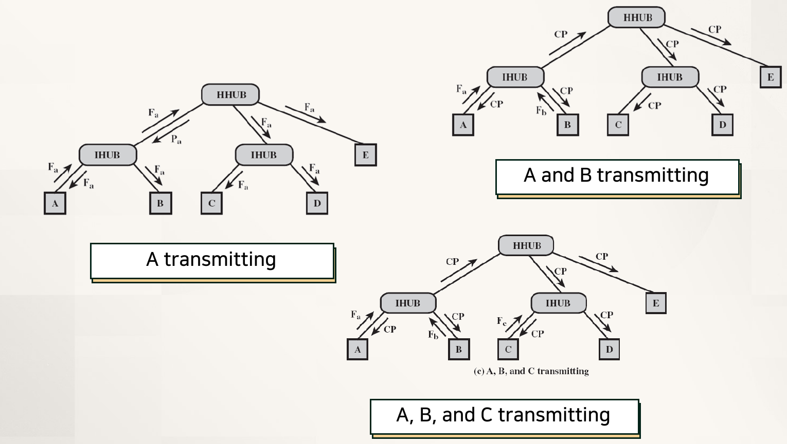

*그림 11. 꼬임선 스타 배선에서 허브가 충돌을 알리는 과정*

그림 11은 맨 위의 헤더 허브(HHUB, header hub) 아래에 중간 허브(IHUB, intermediate hub) 두 개가 있고, 스테이션 A\~E가 연결된 계층형 스타이다.

- **A만 보낼 때:** A의 프레임 $F_a$가 IHUB를 거쳐 HHUB까지 올라간 뒤, HHUB가 이를 모든 아래쪽 선으로 내려보내 모든 스테이션이 $F_a$를 받는다.
- **A와 B가 함께 보낼 때:** A와 B가 연결된 IHUB는 두 입력에 동시에 활성 신호가 있음을 감지하고, 위로는 CP를 보내고 아래로도 CP를 보낸다. HHUB는 입력에 CP가 들어왔으므로 모든 아래쪽 선에 CP를 보내고, 결국 모든 스테이션이 충돌을 알게 된다.
- **A, B, C가 함께 보낼 때:** 서로 다른 IHUB에 연결된 스테이션들이 보내도, CP가 HHUB를 거쳐 전체로 퍼지므로 모든 스테이션이 충돌을 감지한다.

**충돌 검출 3: 광대역 시스템.**

- 송신한 데이터와 수신한 데이터를 비트 단위로 비교한다. 즉 스테이션은 입력 채널(inbound)로 보낸 비트가 헤드엔드를 거쳐 출력 채널(outbound)로 돌아올 때 같은지 확인한다.
- IEEE 802.3에서는 출발지 주소의 마지막 비트까지 비교한다. 서로 다른 스테이션이 보낸 프레임은 적어도 출발지 주소가 다르므로, 출발지 주소까지 비교하면 겹친 전송을 반드시 찾아낼 수 있다.
- 잡음이나 충돌 검출의 실패로 손상된 신호를 수신 측이 처리해야 할 수도 있으므로, 이런 상황을 피하도록 시스템을 조정할 때 주의해야 한다.
- 송신용과 수신용 케이블을 따로 두는 이중 케이블(dual cable) 시스템에서는, 같은 주파수로 동시에 송신과 수신을 하는 두 RF 모뎀 사이에 신호 혼선(crosstalk)이 생기지 않도록 차폐(shield)가 중요하다.
- 한 케이블에 두 주파수 채널을 두는 분할(split) 시스템에서는 충돌 검출 기능을 헤드엔드에 두는 것이 알맞다.

> **참고:** 오늘날의 이더넷은 대부분 스위치에 꼬임쌍선으로 일대일 연결하고, 송신과 수신을 동시에 하는 전이중(full duplex) 방식으로 동작한다. 전이중 링크에서는 충돌 자체가 일어나지 않으므로 CSMA/CD가 실제로 쓰이지 않는다. CSMA/CD는 여러 스테이션이 매체를 공유하는 반이중(half duplex) 환경을 위한 방식이다 [6].

---

<br>

## 3. 브리지와 라우터, CRC

### 3.1 브리지

> **용어 정의:** **브리지(bridge)** 는 같은 MAC 프로토콜을 쓰는 LAN들을 연결하는 장치이다. 예를 들어 두 이더넷 LAN을 하나로 잇는다. 브리지는 MAC 계층(2계층)에서 프레임을 받아 다른 LAN으로 중계한다.

하나의 큰 LAN을 만들 수 있는데도 브리지로 여러 LAN을 나누어 연결하는 이유는 다음과 같다.

| 이유 | 설명 |
|:-----|:-----|
| 신뢰성 | 한 LAN에서 스테이션이나 매체가 고장 나도 그 영향이 다른 LAN으로 번지지 않는다. |
| 성능 | 한 LAN에 스테이션이 많고 길이가 길수록 충돌과 지연이 늘어 성능이 떨어진다. 나누면 각 LAN의 트래픽이 줄어든다. |
| 보안 | 회계용, 개인용처럼 서로 다른 종류의 데이터를 다루는 네트워크를 분리하여, 한 LAN의 트래픽이 다른 LAN에 노출되지 않게 한다. |
| 지리적 조건 | 길 건너의 두 건물처럼 떨어진 곳의 네트워크를 연결한다. |

*표 12. 브리지로 LAN을 나누어 연결하는 이유*

브리지의 기능은 다음과 같다.

1. **단순 복사:** 한 LAN의 프레임을 읽어 다른 LAN에 그대로 복사한다.
2. **지능적인 라우팅과 주소 판단:** 여러 LAN이 브리지로 연결되어 있으면, 브리지는 각 네트워크에 어떤 주소의 스테이션이 있는지 알아야 프레임을 어느 쪽으로 보낼지 정할 수 있다.
3. **MAC 수준의 중계:** 브리지는 MAC 프레임을 중계하므로, 양쪽 LAN의 LLC와 그 상위 계층은 동일해야 한다. 두 LAN을 잇는 도중의 네트워크(예: 점대점 링크)는 MAC이 달라도 된다.

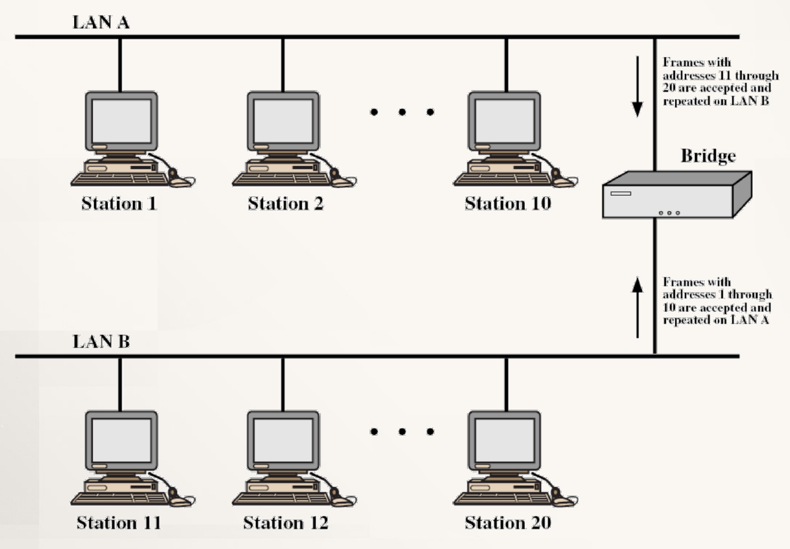

*그림 12. 브리지로 연결한 두 LAN*

그림 12에서 LAN A에는 스테이션 1\~10이, LAN B에는 스테이션 11\~20이 있다. 브리지는 LAN A에서 주소가 11\~20인 프레임을 받아 LAN B로 다시 보내고, LAN B에서 주소가 1\~10인 프레임을 받아 LAN A로 다시 보낸다. 같은 LAN 안의 스테이션끼리 주고받는 프레임은 다른 LAN으로 넘기지 않으므로 각 LAN의 트래픽이 줄어든다.

> **참고:** 실제 브리지는 각 포트로 들어오는 프레임의 **출발지 주소**를 보고 어느 스테이션이 어느 쪽에 있는지 표를 스스로 만든다. 이를 학습 브리지(learning bridge)라 하며, 목적지가 표에 없으면 그 프레임을 받은 포트를 뺀 모든 포트로 내보낸다. 이 동작은 IEEE 802.1D가 표준화했다 [7].

### 3.2 라우터

> **용어 정의:** **라우터(router)** 는 서로 유사성이 없는(dissimilar) 네트워크들을 상호 연결하는 장치이다. 3계층(네트워크 계층)에서 동작하며, 목적지까지의 경로를 정해 패킷을 전달한다.

브리지가 같은 종류의 LAN만 이을 수 있는 반면, 라우터는 다음과 같은 차이가 있는 네트워크들을 연결해야 한다.

| 차이 | 설명 |
|:-----|:-----|
| 주소 구조 | 주소 필드의 길이, 표현 방식(2진수 또는 10진수), 주소를 찾는 디렉터리 서비스가 네트워크마다 다르다. 예를 들어 IEEE 802 LAN은 16비트 또는 48비트 2진수 주소를, X.25 망은 12자리 10진수 주소를 쓴다. |
| 최대 프레임 크기 | 한 프레임에 실을 수 있는 최대 길이가 다르다. 예를 들어 이더넷의 데이터 필드는 최대 1,500바이트이고, 예로 든 X.25 망은 1,000바이트이다. 최대 길이를 넘는 데이터는 나누어(segmentation) 보내야 한다. |
| 인터페이스 | 네트워크에 접속하는 하드웨어와 소프트웨어 인터페이스가 다르다. |
| 신뢰성 | 네트워크 서비스마다 제공하는 신뢰성의 수준이 다르다. 어떤 네트워크는 전달을 보장하고, 어떤 네트워크는 보장하지 않는다. |

*표 13. 라우터가 다루어야 하는 네트워크 사이의 차이*

라우터는 3계층에서 동작한다. 라우터로 연결되는 모든 시스템은 3계층과 그 이상에서 동일한 계층 구조(예: IP)를 쓰고, 라우터는 3계층까지만 구현한다. 그 아래의 2계층과 1계층은 연결되는 네트워크마다 달라도 된다.

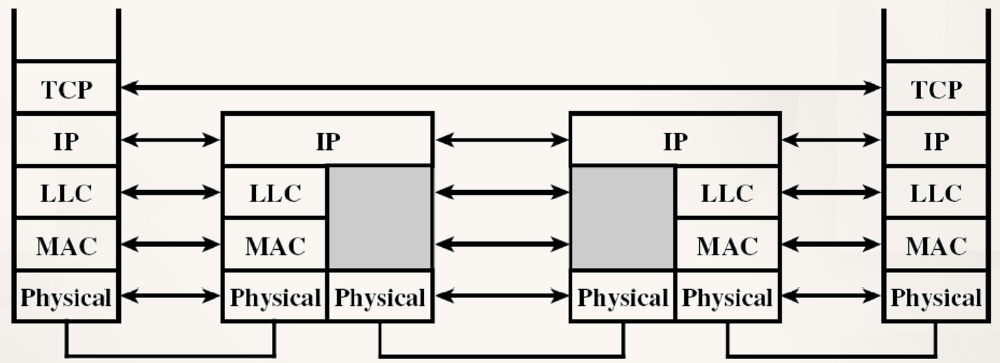

*그림 13. 라우터 두 대로 연결된 종단 시스템의 프로토콜 구조*

그림 13의 양 끝은 TCP, IP, LLC, MAC, 물리 계층을 모두 가진 종단 시스템이다. 가운데의 두 라우터는 IP 계층만 공통으로 갖고, 그 아래에는 연결된 두 네트워크 각각에 맞는 하위 계층을 둔다. 왼쪽 라우터의 왼쪽 반은 LAN의 LLC, MAC, 물리 계층이고, 오른쪽 반(회색)은 두 라우터 사이의 중간 네트워크에 맞는 계층이다. TCP는 종단 시스템끼리만 직접 대화하므로 라우터에는 TCP 계층이 없다.

라우터는 문헌에 따라 다음 이름으로도 불린다.

- **IS(intermediate system, 중간 시스템):** OSI 용어로, 종단 시스템(end system) 사이에서 중계하는 시스템이다.
- **IWU(internetworking unit, 인터네트워킹 장치)**
- **네트워크 중계기(network relay)**
- **게이트웨이(gateway):** 초기 인터넷 문헌에서 라우터를 가리키던 이름이다. 오늘날에는 보통 3.4절처럼 프로토콜 변환까지 하는 장치를 가리킨다.

### 3.3 라우터를 거치는 데이터 전송

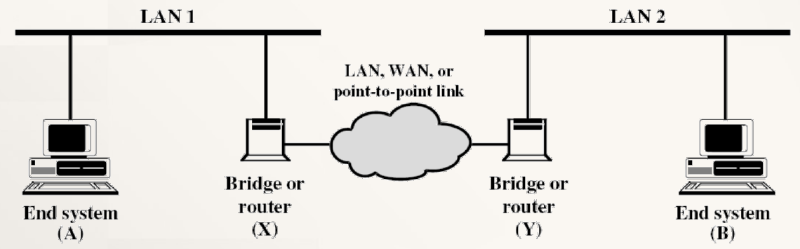

*그림 14. 브리지나 라우터 두 대를 거쳐 종단 시스템 A에서 B로 가는 데이터*

그림 14에서 종단 시스템 A는 LAN 1에, B는 LAN 2에 있고, 두 LAN은 각각 라우터 X와 Y에 연결되며 X와 Y 사이는 LAN, WAN, 또는 점대점 링크로 이어져 있다. A에서 B로 데이터를 보내는 과정은 다음과 같다.

1. A의 IP는 B가 다른 네트워크에 있음을 인지한다. B의 전역 네트워크 주소(IP 주소)로 이를 알 수 있다.
2. A는 데이터를 IP 데이터그램에 담고, 이를 LAN 1의 MAC 프레임에 실어 라우터 X로 보낸다. IP 데이터그램에는 최종 목적지 B의 전역 주소가 추가 주소 정보로 들어 있고, MAC 프레임의 목적지 주소는 라우터 X의 MAC 주소이다.
3. X는 경로를 결정한다. B가 X에 직접 연결된 네트워크에 있으면 바로 보내고, 그렇지 않으면 하나 이상의 라우터를 거치도록 다음 라우터(여기서는 Y)를 고른다.
4. X는 IP 데이터 단위를 중간 네트워크의 패킷 형태(예: X.25 패킷)로 감싸 Y로 보낸다.
5. Y는 중간 네트워크의 패킷에서 IP 데이터 단위를 꺼내고, LAN 2에 맞는 LLC PDU와 MAC 프레임을 새로 만들어 B로 보낸다.

이 방식에서는 **패킷의 전달과 순서가 보장되지 않는다.** 그 의미와 결과는 다음과 같다.

- IP는 신뢰성 있는 전달을 위해 중간 네트워크의 서비스에 의존하지 않는다. 신뢰성 있는 전달은 종단 시스템의 TCP가 담당한다.
- 중간 네트워크가 제공해야 하는 서비스에 제한이 없으므로 유연하다. 라우터는 다양한 서브네트워크의 조합과 함께 쓰일 수 있다.
- IP 데이터 단위는 혼잡이나 고장에 대응하여 서로 다른 경로를 이용할 수 있다. 그래서 같은 송신자의 패킷이라도 도착 순서가 바뀔 수 있다.

> **[컴퓨터네트워크]** IP는 최선형(best-effort) 서비스를 제공한다. 즉 패킷을 전달하려고 노력하지만 손실, 중복, 순서 바뀜을 막지 않는다. TCP는 순서 번호, 확인 응답, 재전송으로 그 위에 신뢰성 있는 바이트 스트림을 만든다. TCP와 IP의 헤더는 5주차에서 다루었다.

### 3.4 네트워킹 장치

네트워크를 연결하는 장치에는 리피터, 브리지, 라우터, 게이트웨이, 허브, LAN 스위치가 있다(6주차).

| 장치 | 동작 계층 | 역할 |
|:-----|:-----|:-----|
| 리피터(repeater) | 1계층 | 감쇠한 신호를 다시 증폭하고 재생하여 케이블의 길이를 늘린다. 프레임의 내용은 보지 않는다. |
| 허브(hub) | 1계층 | 데이터 충돌이 있는 신호를 처리하는 로직을 갖춘 다중 포트 리피터이다. 한 포트로 들어온 신호를 모든 포트로 내보낸다. |
| 브리지(bridge) | 2계층 | 같은 MAC을 쓰는 LAN들을 MAC 주소에 따라 연결한다. |
| LAN 스위치(LAN switch) | 2계층 | 브리지 기능을 갖춘 전이중(full duplex) 허브, 즉 여러 포트를 가진 브리지이다. |
| 라우터(router) | 3계층 | 서로 다른 네트워크를 IP 주소에 따라 연결하고 경로를 정한다. |
| 게이트웨이(gateway) | 4계층(전송 계층) 이상 | 프로토콜이 서로 다른 네트워크 사이에서 프로토콜을 변환한다. |

*표 14. 네트워킹 장치의 동작 계층과 역할*

LAN 스위치와 전통적인 브리지는 같은 2계층 장치이지만 다음 점에서 다르다.

- **구현:** 브리지는 소프트웨어로 프레임을 처리하는 경우가 많았고, 스위치는 하드웨어(전용 칩)로 처리한다.
- **동시 처리:** 브리지는 한 번에 한 프레임을 처리하고, 스위치는 여러 포트 사이에서 여러 프레임을 동시에 처리한다.
- **전달 방식:** 브리지는 저장 후 전달(store-and-forward)만 하고, 스위치는 저장 후 전달과 컷스루(cut-through)를 모두 쓸 수 있다.

> **용어 정의:** **저장 후 전달(store-and-forward)** 은 프레임 전체를 다 받은 뒤 FCS로 오류를 검사하고 나서 내보내는 방식이다.

> **용어 정의:** **컷스루(cut-through)** 는 프레임의 앞부분, 즉 목적지 주소만 읽고 곧바로 내보내기 시작하는 방식이다. 컷스루는 지연이 짧지만, 오류가 있는 프레임도 그대로 전달할 수 있다.

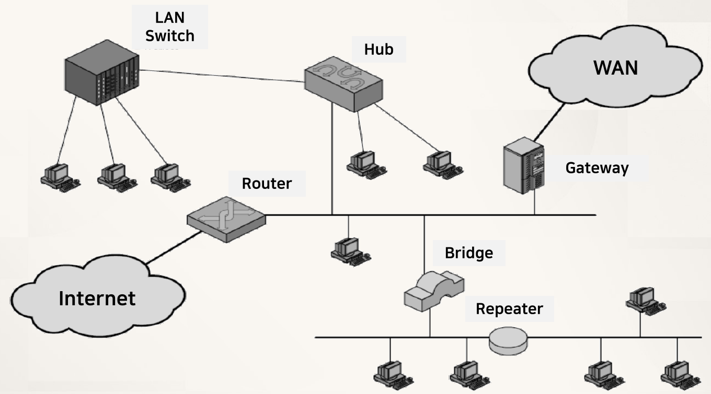

*그림 15. 네트워킹 장치의 배치 예*

그림 15에서 LAN 스위치와 허브는 여러 스테이션을 한 지점에 모으고, 라우터는 LAN을 인터넷에 연결한다. 게이트웨이는 LAN을 다른 프로토콜의 WAN에 연결하고, 브리지는 버스 형태의 두 LAN 세그먼트를 잇는다. 리피터는 한 세그먼트 위에서 신호를 재생하여 버스를 연장한다.

### 3.5 CRC의 원리

> **용어 정의:** **FCS(frame check sequence, 프레임 검사 순서)** 는 수신 측이 오류를 검출할 수 있도록 프레임의 끝부분에 넣는 필드이다.

> **용어 정의:** **CRC(cyclic redundancy check, 순환 중복 검사)** 는 FCS를 만드는 대표적인 방법으로, FCS 필드에는 CRC 기법으로 만든 비트열이 들어간다.

CRC는 비트열을 다항식으로 다룬다. $k$비트 비트열의 각 비트를 다항식의 계수로 보아, 가장 왼쪽 비트를 $x^{k-1}$의 계수, 가장 오른쪽 비트를 $x^0$의 계수로 둔다. 예를 들어 비트열 110011은 다음 다항식이다.

```math
1 \cdot x^5 + 1 \cdot x^4 + 0 \cdot x^3 + 0 \cdot x^2 + 1 \cdot x^1 + 1 \cdot x^0 = x^5 + x^4 + x + 1
```

계수의 계산은 **모듈로 2 산술(modulo-2 arithmetic)** 을 쓴다. 덧셈과 뺄셈 모두 자리올림과 빌림이 없는 배타적 논리합(XOR)이며($0+0=0$, $0+1=1$, $1+0=1$, $`1+1=0`$), 따라서 덧셈과 뺄셈이 같다. 다항식의 나눗셈도 같은 규칙으로, 비트열에서는 자릿수를 맞추어 XOR을 반복하는 것과 같다.

> **[논리설계]** XOR(배타적 논리합)은 두 입력이 서로 다를 때 1을 내는 연산이다. 모듈로 2 덧셈이 XOR과 같으므로 CRC는 시프트 레지스터와 XOR 게이트만으로 하드웨어에서 빠르게 계산할 수 있다.

CRC 필드는 다음 기호로 만든다.

- $d(x)$: 보낼 $k$비트 데이터
- $g(x)$: 송신자와 수신자가 미리 약속한 $m$차 **생성 다항식(generator polynomial)**. 최고차항과 상수항의 계수가 1인 $m + 1$비트 비트열이다.
- $p(x)$: $m$비트 CRC(나머지)
- $c(x)$: 실제로 전송하는 $k + m$비트 프레임

```math
p(x) = \mathrm{Rem}\left[\frac{x^m d(x)}{g(x)}\right], \qquad c(x) = x^m d(x) + p(x)
```

$x^m d(x)$는 데이터 뒤에 0을 $m$개 붙인 것이고, 여기에 나머지 $p(x)$를 더하면 그 $m$자리를 CRC로 채운 것이 된다. 이렇게 만든 **$c(x)$는 $g(x)$로 나머지 없이 정확히 나누어떨어진다.** 그 이유는 다음과 같다. $x^m d(x)$를 $g(x)$로 나눈 몫을 $q(x)$라 하면 $x^m d(x) = q(x) g(x) + p(x)$이다. 양변에 $p(x)$를 더하면, 모듈로 2에서 $p(x) + p(x) = 0$이므로

```math
c(x) = x^m d(x) + p(x) = q(x) g(x)
```

가 된다. 수신자는 받은 비트열을 $g(x)$로 나누어 나머지가 0이면 오류가 없는 것으로, 0이 아니면 오류가 있는 것으로 판단한다.

> **참고:** 생성 다항식을 "$`m - 1`$차"로 적은 설명도 있으나, CRC가 $m$비트이고 프레임이 $k + m$비트가 되려면 생성 다항식은 $m$차($m + 1$비트)여야 한다. 3.6절의 예에서도 $m = 4$이고 $g(x)$는 4차이다.

### 3.6 CRC 계산 예제

데이터 $d = 110011$을 생성 다항식 $g(x) = x^4 + x^3 + 1$로 보호하는 CRC를 구한다.

- $d(x) = x^5 + x^4 + x + 1$이고, $d$가 6비트이므로 $k = 6$이다.
- $g(x) = x^4 + x^3 + 1$은 비트열 11001이고, 4차이므로 $m = 4$이다.

**1단계: $x^4 d(x)$ 만들기.** 데이터에 $x^4$를 곱한다. 비트열로는 뒤에 0을 4개 붙이는 것과 같다.

```math
x^4 d(x) = x^4 (x^5 + x^4 + x + 1) = x^9 + x^8 + x^5 + x^4 \quad \rightarrow \quad 1100110000
```

**2단계: $g(x)$로 나누어 나머지 구하기.** 다항식의 나눗셈은 최고차항을 없애는 일을 반복한다.

- $x^9$를 없애기 위해 몫에 $x^5$를 두고 $x^5 g(x) = x^9 + x^8 + x^5$를 뺀다(모듈로 2에서는 더한다). $(x^9 + x^8 + x^5 + x^4) + (x^9 + x^8 + x^5) = x^4$이다.
- 남은 $x^4$를 없애기 위해 몫에 $1$을 두고 $g(x) = x^4 + x^3 + 1$을 뺀다. $x^4 + (x^4 + x^3 + 1) = x^3 + 1$이다.
- $x^3 + 1$은 $g(x)$보다 차수가 낮으므로 더 나눌 수 없다. 따라서 몫은 $q(x) = x^5 + 1$, 나머지는 $p(x) = x^3 + 1$이다.

같은 계산을 비트열의 나눗셈으로 쓰면 다음과 같다. 각 단계에서 맨 앞 비트가 1인 자리에 11001을 맞추어 XOR한다.

```text
                     1 0 0 0 0 1    quotient q(x) = x^5 + 1
           ┌─────────────────────
 1 1 0 0 1 │ 1 1 0 0 1 1 0 0 0 0    x^4 d(x) = x^9 + x^8 + x^5 + x^4
             1 1 0 0 1              XOR x^5 g(x)
             ─────────
             0 0 0 0 0 1 0 0 0 0    result of the first XOR
                       1 1 0 0 1    XOR 1 * g(x)
                       ─────────
                       0 1 0 0 1    remainder p(x) = x^3 + 1 -> 1001
```

*그림 16. 비트열 1100110000을 11001로 나누는 모듈로 2 나눗셈*

그림 16의 첫 XOR 뒤에는 1100110000 XOR 1100100000 = 0000010000이 남는다. 앞의 0 네 자리에서는 몫이 0이므로 XOR할 것이 없고, 다음 1에서 11001을 맞추어 10000 XOR 11001 = 01001을 얻는다. 남은 네 비트 1001이 나머지 $p(x) = x^3 + 1$이다.

**3단계: 전송할 프레임 만들기.**

```math
c(x) = x^4 d(x) + p(x) = x^9 + x^8 + x^5 + x^4 + x^3 + 1 \quad \rightarrow \quad 110011\ 1001
```

데이터 110011 뒤에 CRC 1001이 붙은 10비트 1100111001을 보낸다.

**4단계: 수신 측의 검사.** 오류 없이 받은 1100111001을 11001로 나누면 나머지가 0000이므로 오류가 없다고 판단한다. 받은 비트열을 $r(x) = c(x) + e(x)$로 쓰면, $e(x)$는 오류가 난 자리에 1을 둔 **오류 다항식**이다. $c(x)$는 $g(x)$로 나누어떨어지므로 다음이 성립한다.

```math
\mathrm{Rem}\left[\frac{r(x)}{g(x)}\right] = \mathrm{Rem}\left[\frac{e(x)}{g(x)}\right]
```

즉 나머지는 오류의 모양에만 달려 있다. 예를 들어 전송 중에 $x^5$ 자리의 비트가 뒤집혀 1100011001을 받으면, 나머지는 $x^5$를 $g(x)$로 나눈 나머지와 같은 1011이 되어 오류가 검출된다. 열 자리 각각에서 한 비트 오류가 났을 때의 나머지는 다음과 같다.

| 오류 위치 | $x^9$ | $x^8$ | $x^7$ | $x^6$ | $x^5$ | $x^4$ | $x^3$ | $x^2$ | $x^1$ | $x^0$ |
|:-----|:-----|:-----|:-----|:-----|:-----|:-----|:-----|:-----|:-----|:-----|
| 나머지 | 0101 | 1110 | 0111 | 1111 | 1011 | 1001 | 1000 | 0100 | 0010 | 0001 |

*표 15. 생성 다항식 11001에서 한 비트 오류 위치별 나머지*

열 가지 나머지가 모두 0이 아니므로 어느 자리의 한 비트 오류든 검출된다. 게다가 나머지가 모두 서로 다르므로, 이 예에서는 나머지를 보고 오류의 위치까지 알 수 있다.

### 3.7 CRC의 검출 능력

CRC로 검출하지 못하는 오류는 오류 다항식 $e(x)$가 $g(x)$로 나누어떨어지는 경우뿐이다. 이 사실에서 다음 성질이 나온다 [4].

- **모든 한 비트 오류(single error):** $e(x) = x^i$이다. $g(x)$가 둘 이상의 항을 가지면 $x^i$를 나눌 수 없으므로 모든 한 비트 오류가 검출된다.
- **모든 홀수 개의 오류(odd number of errors):** $g(x)$가 인수 $(x + 1)$을 가지면 검출된다. 항이 홀수 개인 $e(x)$에 $x = 1$을 넣으면 $e(1) = 1$인데, $(x + 1)$의 배수는 $x = 1$에서 0이 되므로 그런 $e(x)$는 $g(x)$의 배수가 될 수 없다.
- **길이가 $m$ 이하인 모든 연집 오류(burst error):** 연속된 구간 안에서 처음과 마지막 비트가 틀린 오류를 연집 오류라 한다. 상수항이 있는 $m$차 $g(x)$는 길이가 $m$ 이하인 모든 연집 오류를 검출하고, 그보다 긴 연집 오류도 대부분 검출한다(길이가 $m + 1$이면 $1 - 2^{-(m-1)}$, 그보다 길면 $1 - 2^{-m}$의 비율).
- **검출하지 못하는 오류:** $e(x)$가 우연히 $g(x)$의 배수가 되는 오류는 검출하지 못한다. 그런 일은 낮은 확률로 일어난다.

3.6절의 $g(x) = x^4 + x^3 + 1$에 이 성질을 적용하면 다음과 같다.

- 세 개의 항을 가지므로 모든 한 비트 오류를 검출한다(표 15).
- $g(1) = 1 + 1 + 1 = 1 \ne 0$이므로 $(x + 1)$을 인수로 갖지 않는다. 따라서 홀수 개의 오류를 모두 검출한다고 보장할 수 없다. 실제로 $e(x) = x^4 + x^3 + 1$, 즉 세 비트가 틀린 오류는 $g(x)$ 자신이므로 검출되지 않는다.
- 4차이므로 길이 4 이하의 연집 오류는 모두 검출한다.

실제 통신 규격은 이런 성질을 고려하여 고른 생성 다항식을 쓴다. 예를 들어 CAN은 15차 다항식 $x^{15} + x^{14} + x^{10} + x^8 + x^7 + x^4 + x^3 + 1$을 쓰고(3주차, 9주차) [8], 이더넷은 32차 다항식으로 32비트 FCS를 만든다 [6].

### 3.8 비트 오류율과 프레임 오류 확률

> **용어 정의:** **비트 오류율(BER, bit error rate)** 은 전송한 비트 가운데 오류가 난 비트의 비율로, 한 비트가 틀릴 확률 $p$로 생각할 수 있다.

BER이 $p = 1.0 \times 10^{-8}$인 링크에서 1,000비트 프레임에 오류가 생길 확률을 구한다. 각 비트의 오류가 서로 독립이라고 가정한다.

1. 한 비트가 오류 없이 전송될 확률은 $1 - p$이다.
2. 1,000비트가 모두 오류 없이 전송될 확률은 독립 사건의 곱이므로 $(1 - p)^{1000}$이다.
3. 1,000비트 가운데 하나라도 오류를 가지고 전송될 확률은 그 여사건이다.

```math
P_{error} = 1 - (1 - p)^{1000} = 1 - 0.99999000005 \approx 9.99995 \times 10^{-6}
```

이 값은 $np = 1000 \times 10^{-8} = 10^{-5}$와 거의 같다. $np$가 1보다 훨씬 작으면 $1 - (1 - p)^n \approx np$로 근사할 수 있다.

> **[확률및통계]** $n$번의 독립 시행에서 각 시행의 실패 확률이 $p$일 때 한 번도 실패하지 않을 확률은 $(1-p)^n$이다. 이항 정리로 전개하면 $(1-p)^n = 1 - np + \binom{n}{2}p^2 - \cdots$이므로, $np \ll 1$이면 $1 - (1-p)^n \approx np$이다.

| BER $p$ | 프레임 길이 $n$ | $P_{error} = 1 - (1-p)^n$ | 근사 $np$ |
|:-----|:-----|:-----|:-----|
| $10^{-8}$ | 1,000비트 | $9.99995 \times 10^{-6}$ | $1.0 \times 10^{-5}$ |
| $10^{-8}$ | 12,000비트(1,500바이트) | $1.19993 \times 10^{-4}$ | $1.2 \times 10^{-4}$ |
| $10^{-6}$ | 1,000비트 | $9.995 \times 10^{-4}$ | $1.0 \times 10^{-3}$ |
| $10^{-6}$ | 12,000비트(1,500바이트) | $1.193 \times 10^{-2}$ | $1.2 \times 10^{-2}$ |

*표 16. 비트 오류율과 프레임 길이에 따른 프레임 오류 확률*

표 16에서 보듯이 프레임이 길수록, BER이 높을수록 프레임에 오류가 생길 확률이 커진다. CRC는 이렇게 생긴 오류를 수신 측이 검출하게 하는 장치이다.

---

<br>

## 4. 부록: IEEE 802 표준 기술위원회

### 4.1 위원회의 역할과 원칙

**IEEE 802 기술위원회**(IEEE 802 LAN/MAN Standards Committee)는 LAN(local area network), PAN(personal area network), MAN(metropolitan area network)에 대한 표준을 담당한다 [9]. 위원회가 LAN 표준화를 시작한 배경은 LAN 개발에 필요한 저비용 인터페이스였다.

- **저비용 인터페이스:** LAN이 널리 쓰이려면 각 장치를 네트워크에 붙이는 인터페이스가 싸야 하며, 이를 위해 저비용 칩과 VLSI(초고밀도 집적 회로)가 필요하다.
- **대량 생산을 통한 비용 감소:** 칩을 대량으로 생산해야 가격이 내려간다.
- **표준화:** 여러 제조사가 같은 칩을 대량으로 만들려면 표준이 있어야 한다.

위원회는 두 가지 결론을 내렸다.

1. **"작은 일로 나눈다."** LAN 표준이라는 큰 문제를 LLC, MAC, 물리 계층처럼 다루기 쉬운 작은 부분으로 나누어 각각 표준화한다.
2. **"다양한 요건에 하나의 표준으로 대응할 필요가 없다."** 토폴로지, MAC, 전송 매체에 대한 요구가 응용마다 다르므로, 하나의 표준을 강요하지 않고 여러 MAC과 매체의 선택지를 표준으로 둔다. 대신 그 위의 LLC는 공통으로 한다.

IEEE 802 표준은 1985년에 미국 국가 표준 기구(ANSI, American National Standards Institute)가 미국 국가 표준으로, 1987년에 ISO가 국제 표준으로 채택했다. ISO는 이 표준들을 ISO 8802 시리즈(예: ISO/IEC 8802-3)로 발행한다 [1].

### 4.2 참조 모델과 구현 모델

LAN을 실제로 적용할 때는 주어진 MAC에 대해 전송 매체를 고를 수 있어야 한다. 그래서 물리 계층의 기능을 두 종류로 나눈다.

- **전송 매체의 형태와 무관한 물리 계층 기능:** 부호화와 복호화처럼 매체가 바뀌어도 같은 기능이다.
- **전송 매체의 형태에 의존하는 물리 계층 기능:** 케이블이나 광섬유에 맞는 전기적, 광학적 신호를 만드는 기능이다.

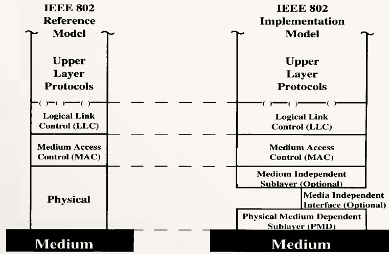

*그림 17. IEEE 802 참조 모델과 구현 모델*

그림 17의 왼쪽 참조 모델에서는 물리 계층이 하나이다. 오른쪽 구현 모델은 물리 계층을 다음처럼 나눈다.

| 구현 모델의 부분 | 역할 |
|:-----|:-----|
| 매체 독립 부계층(medium independent sublayer, 선택) | 매체와 무관한 물리 계층 기능을 맡는다. |
| 매체 독립 인터페이스(media independent interface, 선택) | 매체 독립 부계층과 매체 의존 부계층 사이의 표준 인터페이스이다. |
| 물리 매체 의존 부계층(PMD, physical medium dependent sublayer) | 실제 매체에 맞는 송수신 회로와 커넥터를 맡는다. |

*표 17. IEEE 802 구현 모델의 물리 계층 구성*

이렇게 나누면 MAC을 구현한 칩은 그대로 두고 매체 의존 부분만 바꾸어 여러 매체에 쓸 수 있다. 이더넷의 MII(media independent interface)가 이 생각을 구현한 예이며, 9주차의 차량용 이더넷도 같은 MAC에 차량용 물리 계층을 붙인다.

### 4.3 작업 그룹의 구성

IEEE 802 위원회는 주제별로 **작업 그룹(WG, working group)** 과 **기술 자문 그룹(TAG, technical advisory group)** 을 두고, 각각 802.1부터 802.24까지 번호를 붙였다. 802.11(무선 LAN)처럼 표준 이름의 번호가 바로 그 작업 그룹의 번호이다.

| 번호 | 주제 | 번호 | 주제 |
|:-----|:-----|:-----|:-----|
| 802.1 | 상위 계층 LAN 프로토콜(higher layer LAN protocols) | 802.12 | 요구 우선순위(demand priority) |
| 802.2 | 논리 링크 제어(LLC) | 802.14 | 케이블 모뎀(cable modem) |
| 802.3 | 이더넷(Ethernet) | 802.15 | 무선 개인 영역 네트워크(WPAN) |
| 802.4 | 토큰 버스(token bus) | 802.16 | 광대역 무선 접속(broadband wireless access) |
| 802.5 | 토큰 링(token ring) | 802.17 | 탄력적 패킷 링(resilient packet ring) |
| 802.6 | MAN(metropolitan area network) | 802.18 | 무선 규제 TAG(radio regulatory TAG) |
| 802.7 | 광대역 TAG(broadband TAG) | 802.19 | 무선 공존(wireless coexistence) |
| 802.8 | 광섬유 TAG(fiber optic TAG) | 802.21 | 매체 독립 핸드오버 서비스(media independent handover services) |
| 802.9 | 등시성 LAN(isochronous LAN) | 802.22 | 무선 지역 네트워크(wireless regional area networks) |
| 802.10 | 보안(security) | 802.23 | 긴급 서비스(emergency services) |
| 802.11 | 무선 LAN(wireless LAN) | 802.24 | 수직 응용 TAG(vertical applications TAG) |

*표 18. IEEE 802의 작업 그룹과 기술 자문 그룹*

작업 그룹은 표준을 완성하고 유지할 일이 남아 있으면 활동(active)하고, 당분간 할 일이 없으면 휴면(inactive)하며, 기술이 쓰이지 않게 되면 해산(disbanded)한다.

| 상태 | 작업 그룹 |
|:-----|:-----|
| 활동 | 802.1 상위 계층 LAN 프로토콜, 802.3 이더넷, 802.11 무선 LAN, 802.15 WPAN, 802.16 광대역 무선 접속, 802.18 무선 규제 TAG, 802.19 공존 TAG, 802.21 매체 독립 핸드오버, 802.22 무선 지역 네트워크, 802.24 수직 응용 TAG |
| 휴면 | 802.17 탄력적 패킷 링, 802.20 이동 광대역 무선 접속(MBWA) |
| 해산 | 802.2 LLC, 802.4 토큰 버스, 802.5 토큰 링, 802.6 MAN, 802.7 광대역 TAG, 802.8 광섬유 TAG 등 |

*표 19. IEEE 802 작업 그룹의 상태 구분 예*

> **참고:** 작업 그룹의 상태는 시기에 따라 바뀐다. 표 19는 한 시점의 구분이며, 현재의 구성은 IEEE 802 위원회의 웹 사이트에서 확인할 수 있다 [9].

### 4.4 FDDI와 LAN/MAN 표준의 전체 구성

> **용어 정의:** **FDDI(fiber distributed data interface)** 는 광섬유로 된 이중 링에서 토큰 링 방식으로 100 Mbps를 전송하는 LAN 표준이다. IEEE가 아니라 ANSI가 개발했지만, IEEE 802 참조 모델의 구조를 따르므로 IEEE 802.2 LLC와 함께 쓰인다 [1].

LAN/MAN 표준 전체를 IEEE 802 참조 모델의 계층으로 정리하면 다음과 같다. 모든 표준의 위에는 공통으로 IEEE 802.2 LLC가 있으며, 확인 응답 없는 비연결형, 연결형, 확인 응답 있는 비연결형의 세 서비스를 제공한다(1.4절).

| 표준 | MAC | 토폴로지 | 물리 계층(매체: 속도) |
|:-----|:-----|:-----|:-----|
| IEEE 802.3 | CSMA/CD | 버스, 트리, 스타 | 기저대역 동축: 10 Mbps, UTP: 10, 100 Mbps, STP: 100 Mbps, 광대역 동축: 10 Mbps, 광섬유: 10 Mbps |
| IEEE 802.4 | 토큰 버스 | 버스, 트리, 스타 | 광대역 동축: 1, 5, 10 Mbps, 캐리어 대역 동축: 1, 5, 10 Mbps, 광섬유: 5, 10, 20 Mbps |
| IEEE 802.12 | 라운드 로빈, 우선순위 | 버스, 트리, 스타 | UTP: 100 Mbps |
| IEEE 802.5 | 토큰 링 | 링 | STP: 4, 16 Mbps, UTP: 4 Mbps |
| FDDI | 토큰 링 | 링 | 광섬유: 100 Mbps, UTP: 100 Mbps |
| IEEE 802.6 | DQDB | 이중 버스 | 광섬유: 100 Mbps |
| IEEE 802.11 | CSMA, 폴링 | 무선 | 적외선: 1, 2 Mbps, 대역 확산: 1, 2 Mbps |

*표 20. LAN/MAN 표준의 MAC과 물리 계층*

UTP(unshielded twisted pair)는 차폐하지 않은 꼬임쌍선, STP(shielded twisted pair)는 차폐한 꼬임쌍선이다. 캐리어 대역(carrier band)은 하나의 채널만 쓰는 단순한 광대역 방식이다. 표 20의 속도는 각 표준이 처음 정해졌을 때의 값이며, 802.3과 802.11은 그 뒤에도 계속 개정되어 오늘날에는 훨씬 높은 속도를 지원한다.

---

<br>

## 개념 적용

| 상황 | 연결할 개념과 이유 |
|:-----|:-----|
| 공장 LAN에서 제어기들이 주기적인 센서 값을 정해진 시간 안에 반드시 보내야 한다. | **라운드 로빈 또는 예약 방식.** 차례나 슬롯이 정해져 있어 최악의 대기 시간을 보장할 수 있다. 경합 방식은 부하가 높으면 대기 시간을 보장하지 못한다. |
| 사무실에서 여러 컴퓨터가 가끔씩 짧은 메시지를 주고받는다. | **경합 방식(CSMA/CD).** 산발적이고 낮은 트래픽에서 구현이 간단하고 효율적이다. |
| 길 건너 두 건물의 이더넷 LAN을 하나로 묶되, 각 건물 안의 트래픽은 다른 건물로 넘어가지 않게 하고 싶다. | **브리지.** 같은 MAC을 쓰는 LAN을 MAC 주소로 걸러 연결한다. |
| 이더넷 LAN의 컴퓨터가 X.25 망 건너편의 컴퓨터와 통신해야 한다. | **라우터.** 주소 구조와 최대 프레임 크기가 다른 네트워크를 IP 계층에서 연결한다. |
| 수신한 프레임을 생성 다항식으로 나눈 나머지가 0이 아니다. | **CRC 오류 검출.** MAC이 프레임을 버리고, LLC나 상위 계층의 재전송으로 복구한다. |
| 이더넷 스테이션이 같은 프레임으로 세 번 연속 충돌했다. | **이진 지수 백오프.** 0\~7 가운데 하나를 골라 그만큼의 슬롯 시간을 기다린 뒤 다시 시도한다. |

*표 21. 상황별로 연결할 개념*

**T/F 점검:**

| 문장 | 판단과 근거 |
|:-----|:-----|
| IEEE 802 참조 모델의 LLC는 토폴로지와 전송 매체에 따라 달라진다. | **F.** 매체에 따라 달라지는 기능은 MAC과 물리 계층에 두고, LLC는 모든 MAC 위에서 공통으로 쓴다. |
| CSMA에서는 프레임의 첫 비트가 매체 끝까지 전파된 뒤에는 그 프레임이 충돌하지 않는다. | **T.** 그 뒤에는 모든 스테이션이 매체가 사용 중임을 감지한다. |
| 기저대역 버스에서 CSMA/CD의 최악의 충돌 검출 시간은 끝에서 끝까지 전파 지연의 4배이다. | **F.** 기저대역에서는 약 2배이고, 헤드엔드를 거치는 광대역 버스에서 4배이다. |
| 생성 다항식이 $(x+1)$을 인수로 가지면 홀수 개의 비트 오류를 모두 검출한다. | **T.** 홀수 개의 항을 가진 오류 다항식은 $x = 1$에서 1이 되어 $(x+1)$의 배수가 될 수 없다. |
| 브리지는 LLC와 상위 계층이 다른 두 LAN도 연결할 수 있다. | **F.** 브리지는 MAC 수준에서 중계하므로 양쪽의 LLC와 상위 계층이 같아야 한다. |

---

<br>

## 요약

| 개념 | 핵심 요약 |
|:-----|:-----|
| IEEE 802 참조 모델 | LAN 표준의 범위를 OSI 1, 2계층으로 두고, 데이터 링크 계층을 매체와 무관한 LLC와 매체 공유를 맡는 MAC으로 나눈다. |
| LLC | 상위 계층에 LSAP를 제공하고 흐름 제어와 오류 복구를 맡으며, 확인 응답 없는 비연결형, 연결형, 확인 응답 있는 비연결형 서비스를 제공한다. |
| 2단계 주소 지정 | MAC 주소로 스테이션에 도달하고, LLC 주소(LSAP)로 스테이션 안의 사용자를 찾는다. |
| 그룹 주소 | MAC 주소와 LSAP가 각각 개별, 멀티캐스트, 브로드캐스트일 수 있어 아홉 가지 조합이 있고, 공통 프로세스에는 모든 스테이션에서 같은 LSAP를 준다. |
| MAC 기법의 분류 | 제어의 위치에 따라 집중형과 분산형, 방식에 따라 라운드 로빈, 예약, 경합으로 나누며, LAN은 주로 경합과 라운드 로빈을 쓴다. |
| ALOHA | 보낼 것이 생기면 바로 보내고 ACK가 없으면 재전송하며, 최대 처리율은 Pure ALOHA가 약 18.4%, Slotted ALOHA가 약 36.8%이다. |
| CSMA | 보내기 전에 들으며, 매체가 사용 중일 때의 처리에 따라 비지속, 1-지속, p-지속 방식으로 나뉜다. |
| CSMA/CD | 보내는 동안에도 듣다가 충돌을 감지하면 즉시 멈추고 재밍 신호를 보낸 뒤 백오프하며, 대부분 1-지속 방식을 쓴다. |
| 충돌 검출 시간 | 기저대역 버스에서 최악 $2\tau$, 광대역 버스에서 $4\tau$이며, 프레임 전송 시간은 이보다 길어야 한다. |
| 이진 지수 백오프 | $n$번째 충돌 뒤 $0$\~$`2^{\min(n,10)} - 1`$ 슬롯 가운데 하나를 골라 기다리고, 16번 실패하면 포기한다. |
| 브리지와 라우터 | 브리지는 같은 MAC의 LAN을 2계층에서, 라우터는 서로 다른 네트워크를 3계층에서 연결한다. |
| CRC | $p(x) = \mathrm{Rem}[x^m d(x) / g(x)]$를 붙여 $g(x)$로 나누어떨어지는 프레임을 보내고, 수신 측은 나머지가 0인지 검사한다. |
| BER과 프레임 오류 | $n$비트 프레임의 오류 확률은 $1 - (1-p)^n$이며, $np \ll 1$이면 $np$로 근사된다. |
| IEEE 802 위원회 | LAN, PAN, MAN 표준을 담당하며, 문제를 작게 나누고 여러 MAC과 매체를 표준으로 허용하되 LLC를 공통으로 한다. |

---

<br>

## 점검 문제

1. **LLC와 MAC:** IEEE 802 참조 모델이 데이터 링크 계층을 LLC와 MAC으로 나누는 이유를 설명하라.

   <details>
   <summary>정답</summary>

   LAN은 여러 스테이션이 하나의 매체를 공유하므로 누가 언제 매체를 쓸지 정하는 기능이 필요하고, 이 기능은 토폴로지와 매체에 따라 달라진다. 이 매체 의존 기능을 MAC으로 분리하고, 주소 지정, 흐름 제어, 오류 복구처럼 매체와 무관한 기능을 LLC로 공통화하면, 여러 종류의 MAC 위에서 같은 LLC를 쓸 수 있다.

   </details>

2. **그룹 주소:** 멀티캐스트 MAC 주소와 개별 LSAP를 함께 쓴 프레임은 어디로 전달되는가? 이 조합이 의미를 가지려면 어떤 조건이 필요한가?

   <details>
   <summary>정답</summary>

   멀티캐스트 그룹에 속한 여러 스테이션 각각의 한 LSAP로 전달된다. LLC 주소는 스테이션 안에서만 유일하므로, 이 조합이 같은 기능을 하는 프로세스에 전달되려면 스테이션 관리 같은 공통 프로세스에 모든 스테이션에서 같은 LSAP를 배정해 두어야 한다.

   </details>

3. **MAC 방식:** 라운드 로빈 방식의 효율이 트래픽이 낮을 때 떨어지는 이유와, 경합 방식의 효율이 트래픽이 높을 때 떨어지는 이유를 각각 설명하라.

   <details>
   <summary>정답</summary>

   라운드 로빈은 보낼 것이 없는 스테이션에도 차례를 돌려야 하므로, 보낼 것이 있는 스테이션이 적으면 차례를 넘기는 오버헤드가 전송 시간에 비해 커진다. 경합 방식은 보내려는 스테이션이 많아지면 충돌이 잦아지고, 충돌한 전송과 재전송에 매체 시간을 쓰느라 실제로 성공하는 전송의 비율이 떨어진다.

   </details>

4. **p-지속 CSMA:** 20개의 스테이션이 대기 중이다. $np < 1$을 유지하려면 $p$를 얼마보다 작게 해야 하는가? $p$를 너무 작게 하면 어떤 문제가 생기는가?

   <details>
   <summary>정답</summary>

   $np = 20p < 1$이어야 하므로 $p < 0.05$이다. $p$가 너무 작으면 매체가 비어 있는데도 아무도 보내지 않는 시간 단위가 이어져 스테이션들의 대기 시간이 불필요하게 길어진다.

   </details>

5. **최소 프레임 길이:** 길이 2 km의 기저대역 버스에서 신호 속도가 $2 \times 10^8$ m/s이고 전송 속도가 10 Mbps일 때, CSMA/CD가 충돌을 확실히 검출하기 위한 최소 프레임 길이를 구하라.

   <details>
   <summary>정답</summary>

   $`\tau = 2000 / (2 \times 10^8) = 10\ \mu`$s이므로 최악의 충돌 검출 시간은 $`2\tau = 20\ \mu`$s이다. 프레임의 전송 시간이 이보다 길어야 하므로 $L_{min} = 10^7 \times 20 \times 10^{-6} = 200$비트이다.

   </details>

6. **광대역의 검출 시간:** 광대역 버스의 최악의 충돌 검출 시간이 기저대역 버스의 두 배인 이유를 설명하라.

   <details>
   <summary>정답</summary>

   광대역 버스에서는 모든 신호가 헤드엔드까지 갔다가 돌아와야 다른 스테이션에 들린다. 헤드엔드에서 가장 먼 끝의 A가 보낸 신호가 이웃한 B에 들리기까지 $2\tau$가 걸리고, B가 그 직전에 보낸 신호가 다시 헤드엔드를 거쳐 A에 들리기까지 $2\tau$가 걸리므로 모두 $4\tau$이다. 기저대역 버스에서는 신호가 직접 양방향으로 퍼지므로 $2\tau$이다.

   </details>

7. **이진 지수 백오프:** 10 Mbps 이더넷에서 한 프레임이 다섯 번째 충돌을 겪었다. 고를 수 있는 대기 슬롯 수의 범위와 최대 대기 시간을 구하라.

   <details>
   <summary>정답</summary>

   $k = \min(5, 10) = 5$이므로 0부터 $2^5 - 1 = 31$까지의 정수 가운데 하나를 고른다. 슬롯 시간이 51.2 µs이므로 최대 대기 시간은 $`31 \times 51.2 = 1587.2\ \mu`$s, 약 1.59 ms이다.

   </details>

8. **CRC 계산:** 데이터 1101을 생성 다항식 $g(x) = x^3 + x + 1$로 보호하는 CRC와 전송할 비트열을 구하라.

   <details>
   <summary>정답</summary>

   $g(x)$는 1011이고 $m = 3$이므로 데이터 뒤에 0을 세 개 붙인 1101000을 1011로 나눈다. 맨 앞 네 비트 1101 XOR 1011 = 0110이므로 0110000이 된다. 다음 1부터의 네 비트 1100 XOR 1011 = 0111이므로 0011100이 된다. 다음 1부터의 네 비트 1110 XOR 1011 = 0101이므로 0001010이 된다. 다음 1부터의 네 비트 1010 XOR 1011 = 0001이므로 0000001이 된다. 나머지는 001이고, 전송할 비트열은 1101001이다. 검산하면 1101001을 1011로 나눈 나머지는 000이다.

   </details>

9. **CRC의 성질:** 생성 다항식 $x^4 + x^3 + 1$이 홀수 개의 비트 오류를 모두 검출한다고 보장할 수 없는 이유를 설명하고, 검출되지 않는 오류의 예를 들어라.

   <details>
   <summary>정답</summary>

   $x = 1$을 넣으면 $1 + 1 + 1 = 1$이므로 $(x + 1)$을 인수로 갖지 않는다. 홀수 개의 오류를 모두 검출한다는 보장은 $(x + 1)$을 인수로 가질 때만 성립한다. 예를 들어 오류 다항식이 $g(x)$ 자신인 $e(x) = x^4 + x^3 + 1$, 즉 세 비트 오류는 $g(x)$로 나누어떨어지므로 검출되지 않는다.

   </details>

10. **프레임 오류 확률:** BER이 $10^{-7}$인 링크에서 10,000비트 프레임에 오류가 생길 확률을 근사하여 구하라.

    <details>
    <summary>정답</summary>

    $np = 10^4 \times 10^{-7} = 10^{-3}$으로 1보다 훨씬 작으므로 $1 - (1 - p)^n \approx np = 10^{-3}$이다. 정확한 값은 $1 - (1 - 10^{-7})^{10000} \approx 9.995 \times 10^{-4}$이다.

    </details>

11. **라우터와 브리지:** 라우터가 연결하는 두 네트워크의 최대 프레임 크기가 다를 때 라우터가 해야 하는 일과, 이 차이를 브리지가 다루기 어려운 이유를 설명하라.

    <details>
    <summary>정답</summary>

    라우터는 큰 데이터 단위를 작은 최대 프레임 크기에 맞게 나누어(분할) 보내야 한다. 라우터는 3계층에서 IP 데이터 단위를 꺼내 새 하위 계층 프레임을 만들기 때문에 이런 변환을 할 수 있다. 브리지는 MAC 프레임을 그대로 중계하는 2계층 장치이므로, 같은 MAC을 쓰는 LAN처럼 프레임 형식과 크기가 호환되는 네트워크만 연결할 수 있다.

    </details>

---

<br>

## 참고 문헌

1. W. Stallings, *Local and Metropolitan Area Networks*, 6th ed. Upper Saddle River, NJ, USA: Prentice Hall, 2000.
2. ISO/IEC 8802-2:1998 (IEEE Std 802.2, 1998 Edition), *Information technology - Telecommunications and information exchange between systems - Local and metropolitan area networks - Specific requirements - Part 2: Logical Link Control*, IEEE, 1998.
3. IEEE Std 802-2014, *IEEE Standard for Local and Metropolitan Area Networks: Overview and Architecture*, IEEE, 2014.
4. A. S. Tanenbaum and D. J. Wetherall, *Computer Networks*, 5th ed. Boston, MA, USA: Pearson, 2011.
5. N. Abramson, "The ALOHA System: Another alternative for computer communications," in *Proc. AFIPS Fall Joint Computer Conference*, 1970, pp. 281-285.
6. IEEE Std 802.3-2022, *IEEE Standard for Ethernet*, IEEE, 2022.
7. IEEE Std 802.1D-2004, *IEEE Standard for Local and Metropolitan Area Networks: Media Access Control (MAC) Bridges*, IEEE, 2004.
8. Robert Bosch GmbH, *CAN Specification, Version 2.0*, Stuttgart, Germany, 1991.
9. IEEE 802 LAN/MAN Standards Committee, "IEEE 802 LAN/MAN Standards Committee." https://www.ieee802.org/
