# Week 7 Lecture — LLC and MAC, CSMA/CD, Bridges and Routers, and CRC

[Repository Guide](../../README.md) | [English](Concepts_Lecture.md) | [한국어](Concepts_Lecture.ko.md)

> **Last Updated:** 2026-11-04

> **Learning Objectives:**
> 1. Explain why the IEEE 802 reference model divides the OSI data link layer into LLC and MAC, and describe the functions of each sublayer
> 2. Explain the LLC service types, two-level addressing, and the nine combinations of group addresses
> 3. Classify MAC techniques by where and how control is exercised (round robin, reservation, contention) and relate them to the standard techniques for each topology
> 4. Explain ALOHA, the persistence methods of CSMA, the operation and collision detection time of CSMA/CD, and binary exponential backoff
> 5. Distinguish the operating layers and roles of repeaters, hubs, bridges, LAN switches, routers, and gateways
> 6. Compute and verify a CRC with a generator polynomial, and derive the frame error probability from the bit error rate

---

## Table of Contents

- [1. The IEEE 802 Reference Model: LLC and MAC](#1-the-ieee-802-reference-model-llc-and-mac)
  - [1.1 Concept of the IEEE 802 Reference Model](#11-concept-of-the-ieee-802-reference-model)
  - [1.2 The Three Layers of the Reference Model](#12-the-three-layers-of-the-reference-model)
  - [1.3 Principles of LLC](#13-principles-of-llc)
  - [1.4 LLC Services: Connectionless and Connection-Oriented](#14-llc-services-connectionless-and-connection-oriented)
  - [1.5 Two-Level Addressing](#15-two-level-addressing)
  - [1.6 Group Addresses](#16-group-addresses)
  - [1.7 MAC: Where Control Is Exercised](#17-mac-where-control-is-exercised)
  - [1.8 MAC: How Control Is Exercised](#18-mac-how-control-is-exercised)
  - [1.9 Standard MAC Techniques by Topology](#19-standard-mac-techniques-by-topology)
  - [1.10 MAC Frame Format and Encapsulation](#110-mac-frame-format-and-encapsulation)
- [2. CSMA/CD](#2-csmacd)
  - [2.1 Concept of CSMA/CD](#21-concept-of-csmacd)
  - [2.2 ALOHA and Slotted ALOHA](#22-aloha-and-slotted-aloha)
  - [2.3 CSMA](#23-csma)
  - [2.4 Persistence Methods of CSMA](#24-persistence-methods-of-csma)
  - [2.5 Operation of CSMA/CD](#25-operation-of-csmacd)
  - [2.6 Collision Detection Time on a Baseband Bus](#26-collision-detection-time-on-a-baseband-bus)
  - [2.7 Collision Detection Time on a Broadband Bus](#27-collision-detection-time-on-a-broadband-bus)
  - [2.8 Efficiency and Binary Exponential Backoff](#28-efficiency-and-binary-exponential-backoff)
  - [2.9 Implementing Carrier Sense and Collision Detection](#29-implementing-carrier-sense-and-collision-detection)
- [3. Bridges, Routers, and CRC](#3-bridges-routers-and-crc)
  - [3.1 Bridges](#31-bridges)
  - [3.2 Routers](#32-routers)
  - [3.3 Data Transfer Through Routers](#33-data-transfer-through-routers)
  - [3.4 Networking Devices](#34-networking-devices)
  - [3.5 Principle of CRC](#35-principle-of-crc)
  - [3.6 A Worked CRC Example](#36-a-worked-crc-example)
  - [3.7 Error Detection Capability of CRC](#37-error-detection-capability-of-crc)
  - [3.8 Bit Error Rate and Frame Error Probability](#38-bit-error-rate-and-frame-error-probability)
- [4. Appendix: The IEEE 802 Standards Committee](#4-appendix-the-ieee-802-standards-committee)
  - [4.1 Role and Principles of the Committee](#41-role-and-principles-of-the-committee)
  - [4.2 Reference Model and Implementation Model](#42-reference-model-and-implementation-model)
  - [4.3 Organization of the Working Groups](#43-organization-of-the-working-groups)
  - [4.4 FDDI and the Overall LAN/MAN Standards](#44-fddi-and-the-overall-lanman-standards)
- [Concept Applications](#concept-applications)
- [Summary](#summary)
- [Self-Check Questions](#self-check-questions)
- [References](#references)

---

<br>

## 1. The IEEE 802 Reference Model: LLC and MAC

### 1.1 Concept of the IEEE 802 Reference Model

A LAN (local area network) is a network that connects devices within a small area such as a building, a factory, or a vehicle (Week 3). LAN standards are developed by the 802 committee of the Institute of Electrical and Electronics Engineers (IEEE), and the framework in which this committee organizes the structure of LAN standards is the **IEEE 802 reference model**. The model rests on two ideas.

- Higher layers such as the network and transport layers (layers 3 and 4) operate independently of the type of network.
- Only the lower layers are defined to suit the characteristics of LANs. That is, the scope of the IEEE 802 standards is layers 1 and 2 of the OSI reference model.

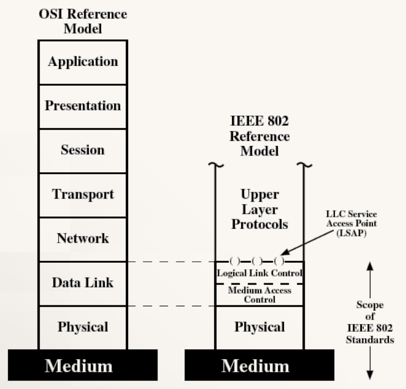

*Figure 1. Correspondence between the OSI reference model and the IEEE 802 reference model*

The left side of Figure 1 is the seven-layer OSI model and the right side is the IEEE 802 reference model. The OSI physical layer corresponds to the IEEE 802 physical layer, and the OSI data link layer is divided in IEEE 802 into two sublayers: **logical link control (LLC)** and **medium access control (MAC)**. The small circles on the upper boundary of LLC are LLC service access points (LSAPs), the points at which higher-layer protocols use the services of LLC. The arrow on the right indicates that the IEEE 802 standards cover the physical layer up to LLC.

> **[Computer Networks]** The OSI reference model divides communication functions into seven layers, each of which uses the services of the layer immediately below to provide services to the layer immediately above. The data link layer lets directly connected devices exchange frames without errors. The OSI model was covered in detail in Week 5.

The reason for splitting the data link layer in two lies in the nature of LANs. Traditional data link protocols (such as HDLC) assume a point-to-point link in which two devices are connected by a dedicated line. In a LAN, several stations share one transmission medium, so an additional function is needed to decide who may use the medium and when. Because this medium-sharing function differs with the topology and the transmission medium, it is separated out as MAC, while the link control functions that do not depend on the medium are made common in LLC. The same LLC can then run on top of many kinds of MAC.

> **Definition:** A **station** is a device (a computer, a controller, and so on) attached to a LAN that sends and receives frames. A **transmission medium** is the physical path over which signals travel (coaxial cable, twisted pair, optical fiber, or radio).

### 1.2 The Three Layers of the Reference Model

| Layer | Functions |
|:-----|:-----|
| Physical layer | Handles encoding and decoding of signals, generation and removal of physical layer headers such as the preamble used for synchronization, and transmission and reception of individual bits. The characteristics of the physical layer depend on the transmission medium. |
| LLC | Provides one or more service access points (SAPs) to the higher layer and handles error control and flow control. |
| MAC | On transmission, assembles the data into a frame with address and error detection fields; on reception, disassembles the frame, checks the address, and detects errors. Governs access to the transmission medium. |

*Table 1. Functions of each layer of the IEEE 802 reference model*

> **Definition:** A **service access point (SAP)** is a logical point at which a layer provides services to the layer immediately above it. The SAP of LLC is called an **LSAP (LLC service access point)**, and it serves as a number that distinguishes the several higher-layer processes using LLC within one station.

### 1.3 Principles of LLC

LLC deals with the transmission of frames between two stations with no intermediate switching node, that is, two stations attached to the same LAN. LLC is responsible for the following.

- **Addressing and data link control:** It indicates from which LLC user a frame comes and to which LLC user it goes (Section 1.5).
- **Flow control:** It regulates the sending rate so that the sender does not transmit faster than the receiver can process.
- **Acknowledgment (ACK) and error recovery:** It lets the receiver report that a frame has arrived and has lost or damaged frames retransmitted.

LLC differs from a traditional link layer in two respects.

1. **It supports multi-access.** Because it assumes a medium shared by several stations, one link can have several destinations.
2. **Some of its functions rely on the services of the MAC layer below.** Error detection of frames (FCS calculation) and medium access are done by MAC, and LLC operates on top of those services.

### 1.4 LLC Services: Connectionless and Connection-Oriented

The services that LLC offers to the higher layer fall into two kinds according to whether a connection is used.

- **Connectionless service:** Each frame is sent independently without setting up a connection. There is no overhead for setting up and releasing connections, so it suits environments with heavy traffic in which the higher layers take care of reliability.
- **Connection-oriented service:** A logical connection is set up before data is sent, and sequence numbers and acknowledgments guarantee reliable delivery.

IEEE 802.2, the LLC standard, makes these concrete as three services [1], [2].

| Service | Connection setup | Acknowledgment | Suitable when |
|:-----|:-----|:-----|:-----|
| Unacknowledged connectionless | None | None | Most LAN traffic, where a higher layer (such as TCP) performs error recovery |
| Connection-mode | Yes | Yes (including flow control and error recovery) | Devices whose higher layers are simple and need link-level reliability |
| Acknowledged connectionless | None | For each frame | Confirmation of delivery is needed but there is no room to keep connection state (such as alarms in process control) |

*Table 2. The three services of IEEE 802.2 LLC*

> **Definition:** **Multiplexing** carries logical connections between several end points simultaneously over one physical link. In LLC, multiplexing means that the several LSAPs of a station share the same LAN connection.

**An example of connection-oriented service.** An address is written as a pair of a station and an LSAP. For example, (A, 1) is LSAP 1 of station A.

1. Application X in station A attaches to LSAP 1 of A.
2. The LLC of A sends a connection request frame containing the source address (A, 1), the destination address (C, 1), and control bits that indicate a connection request.
3. If the application attached to (C, 1) can accept the connection, the LLC of C returns a frame confirming that the connection is established.
4. From then on, all data of application X is sent in frames whose source is (A, 1) and whose destination is (C, 1). Among the frames from (A, 1), C accepts only those addressed to (C, 1) and returns ACKs, and it rejects the others. On this connection, LSAP 1 of C therefore receives only frames from (A, 1).
5. At the same time, another application of A can set up another connection or use another service through a different LSAP. For example, a connection from (A, 2) to (B, 1) can be maintained simultaneously, and this is multiplexing.

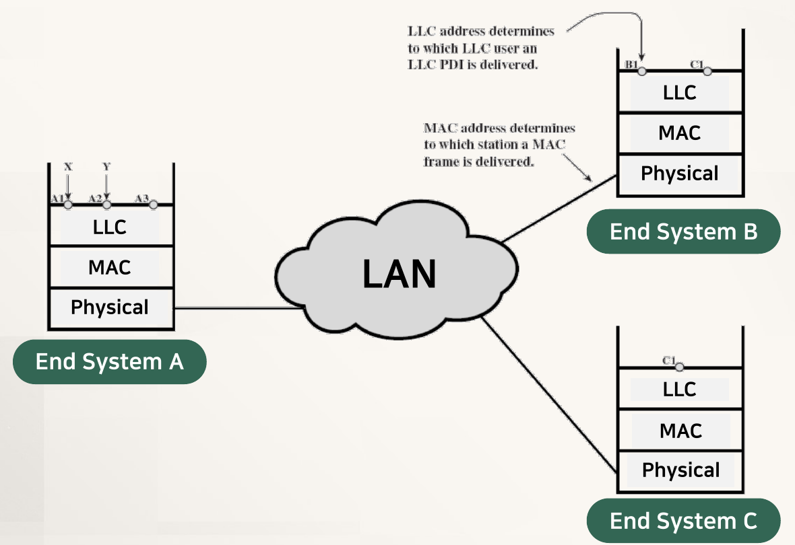

*Figure 2. Three end systems to which data is delivered by LLC and MAC addresses*

In Figure 2, end systems A, B, and C each have LLC, MAC, and physical layers and are attached to one LAN. Above the LLC of A are LSAPs A1, A2, and A3, and applications X and Y are attached to A1 and A2. As the labels in the figure state, **the MAC address determines to which station a MAC frame is delivered, and the LLC address determines to which LLC user in that station an LLC PDU is delivered.**

### 1.5 Two-Level Addressing

A station can contain several processes or applications that use LLC. LAN addressing therefore takes place at two levels.

1. **Station level:** The frame must reach the station on which the process runs. This uses the MAC address, and a MAC PDU carrying MAC addresses is also called a **frame**. MAC does not care about SAP addresses.
2. **Process level:** The arriving PDU must be handed to the right user within the station. This uses the LLC address (LSAP), and an LLC PDU consists of a header containing the destination SAP and the user data.

> **Definition:** A **PDU (protocol data unit)** is the unit of data exchanged by the protocol of one layer, consisting of that layer's header (and trailer) and the data received from the layer above.

The MAC address identifies a station, and the LLC address identifies an LLC user, that is, a process running on a host or part of a network interface unit.

```text
                          ┌──────────────────────────────┐
                          │          User data           │
                          └──────────────────────────────┘
               ┌──────────┬──────────────────────────────┐
     LLC PDU   │   LLC    │          User data           │
               │  header  │                              │
               └──────────┴──────────────────────────────┘
  ┌────────────┬──────────┬──────────────────────────────┬─────────────┐
  │    MAC     │   LLC    │          User data           │     MAC     │   MAC frame
  │   header   │  header  │                              │   trailer   │
  └────────────┴──────────┴──────────────────────────────┴─────────────┘
   contains MAC addresses  (LLC header contains LLC addresses: DSAP, SSAP)
```

*Figure 3. Composition of the LLC PDU and the MAC frame*

As Figure 3 shows, the user data receives an LLC header to become an LLC PDU, and the whole LLC PDU is placed between the MAC header and the MAC trailer to become a MAC frame. The LLC header holds the source and destination LLC addresses, and the MAC header holds the source and destination MAC addresses.

> **Note:** **Actual format of the address fields.** The IEEE 802.2 LLC header consists of an 8-bit DSAP (destination service access point), which is the destination LSAP, an 8-bit SSAP (source service access point), which is the source LSAP, and an 8-bit or 16-bit control field. The first bit of the DSAP is the I/G bit, which shows whether the address is an individual or a group address, and the first bit of the SSAP is the C/R bit, which distinguishes commands from responses, so 7 bits are used as the actual address [2]. In the 48-bit MAC addresses widely used today, the first bit likewise distinguishes individual (0) from group (1) addresses, and the address with all 48 bits set to 1 (FF-FF-FF-FF-FF-FF) is the broadcast address meaning all stations [3].

### 1.6 Group Addresses

A **group address** is an address that refers to a set of one or more entities at once. There are two kinds of group addresses.

- **Broadcast address:** refers to all entities.
- **Multicast address:** refers to a particular subset of the entities.

Because the station address (MAC address) and the LSAP address (LLC address) can each take one of three kinds of values, individual, multicast, or broadcast, there are $3 \times 3 = 9$ combinations of the two addresses.

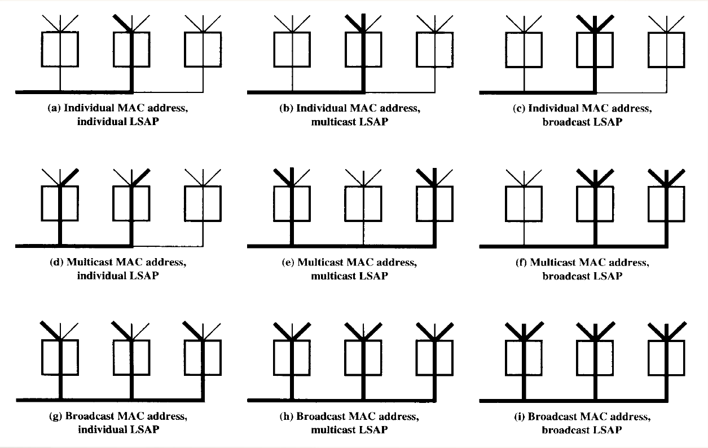

*Figure 4. The nine combinations of MAC and LSAP addresses*

Each panel of Figure 4 shows three stations attached to a LAN, and the three branches rising from each station are its three LSAPs. The bold lines are the paths along which the frame is delivered.

| MAC address \ LSAP address | Individual LSAP | Multicast LSAP | Broadcast LSAP |
|:-----|:-----|:-----|:-----|
| Individual MAC | (a) One LSAP of one station | (b) Some LSAPs of one station | (c) All LSAPs of one station |
| Multicast MAC | (d) One LSAP in each of some stations | (e) Some LSAPs in each of some stations | (f) All LSAPs of some stations |
| Broadcast MAC | (g) One LSAP in each of all stations | (h) Some LSAPs in each of all stations | (i) All LSAPs of all stations |

*Table 3. Delivery scope for each combination of group addresses*

LLC addresses are **unique only within a station**. Alternatively, LLC addresses could be made unique across the entire network, but then the number of processes the whole network could use would be limited by the size of the address space, and a central authority would be needed to assign SAPs. LLC addresses are therefore assigned independently in each station, but certain processes common to many stations, such as station management, are given the same LLC address in every station. Only then can a frame in cases (d), (e), (g), and (h), which combine a multicast or broadcast MAC address with an individual or multicast LSAP, be delivered at once to the processes that perform the same function in several stations.

### 1.7 MAC: Where Control Is Exercised

> **Definition:** **MAC (medium access control)** is the means by which several devices share the transmission medium of a network. If two or more devices transmit on a shared medium at the same time, the signals overlap and are destroyed, so rules are needed that decide who may use the medium and when.

MAC techniques are classified by two questions: **where** control is exercised and **how** it is exercised. By where control is exercised, there are two kinds.

- **Centralized control:** There is a designated central controller. When a station attached to the network makes a request, the central controller grants it access to the network.
- **Distributed control:** The stations operate together without a central controller. Which station transmits is decided dynamically by the collective MAC function of the stations.

| Aspect | Centralized control | Distributed control |
|:-----|:-----|:-----|
| Advantages | Sophisticated control such as priorities, overrides, and guaranteed capacity is easy. The logic in each ordinary station is simple. Coordination among stations is convenient. | The failure of one device does not stop the whole network. There is no bottleneck in the form of a central controller. |
| Disadvantages | If the single central controller fails, the whole network is disabled (single point of failure). The central controller can become a bottleneck and reduce network efficiency. | Every station must contain MAC logic, and controls such as priorities and guaranteed capacity are hard to provide. |

*Table 4. Comparison of centralized and distributed control*

### 1.8 MAC: How Control Is Exercised

The factors that determine how control is exercised are the topology, the trade-off among cost, performance, and complexity, and the choice between synchronous and asynchronous operation.

- **Synchronous methods:** A fixed capacity is assigned to each connection in advance. Time-division multiplexing (TDM) is an example (Week 4). LAN traffic is unpredictable in when and how much it occurs, so assigning fixed capacity wastes the share of stations that have nothing to send. Synchronous methods are therefore unsuitable for LANs.
- **Asynchronous methods:** Network capacity is allocated dynamically on demand. There are three kinds: round robin, reservation, and contention.

**1. Round robin.** Every station receives a transmission opportunity in turn.

- A station whose turn has come transmits within a set time, or, if it has nothing to send, declines and passes the turn on.
- The turns can be arranged by centralized techniques such as **polling**, in which a central controller asks the stations one after another, or by distributed techniques such as **token passing**, in which the stations pass a token, representing the right to transmit, from one to the next.
- Efficiency is high when many stations have data to send over a long period. Conversely, under light traffic in which few stations have something to send, the overhead of passing the turn from station to station makes the efficiency low [1].

**2. Reservation.** The time during which the transmission medium is used is divided into time slots.

- A station that wants to transmit reserves next (future) slots. Reservations can even be indefinite.
- This suits long and relatively continuous transmissions such as voice, telemetry, and bulk file transfer.

**3. Contention.** There is no device that controls who transmits.

- Every station competes for the medium whenever it has something to send, so this is the extreme case of distributed techniques.
- It is simple to implement, efficient when traffic on the medium is light, and well suited to sporadic or bursty traffic.
- When heavy traffic occurs, collisions become frequent and the efficiency can collapse.

| Aspect | Reservation | Round robin | Contention |
|:-----|:-----|:-----|:-----|
| As an intersection | An intersection with traffic lights: cars pass only at the times the lights allow. | An intersection with stop signs: cars stop one at a time and pass in turn. | An intersection without signals: whoever finds it empty enters first, and cars that enter together collide. |
| Suitable traffic | Long, continuous flows | Sustained traffic from many stations | Light, sporadic traffic |

*Table 5. Comparison of the three asynchronous MAC methods*

LANs mainly use contention or round robin methods.

### 1.9 Standard MAC Techniques by Topology

| Method | Bus topology | Ring topology | Switched topology |
|:-----|:-----|:-----|:-----|
| Round robin | Token bus (IEEE 802.4), polling (IEEE 802.11) | Token ring (IEEE 802.5, FDDI) | Request/priority (IEEE 802.12) |
| Reservation | DQDB (IEEE 802.6) | | |
| Contention | CSMA/CD (IEEE 802.3), CSMA (IEEE 802.11) | | CSMA/CD (IEEE 802.3) |

*Table 6. Standardized MAC techniques by topology*

The entries in Table 6 are as follows. Topologies themselves were covered in Week 6.

- **Token bus:** The stations on a bus establish a logical order and pass a token along it.
- **Token ring:** A token circulates around the ring, and only the station holding the token transmits (Week 3). FDDI is a 100 Mbps token ring on a dual optical fiber ring (Section 4.4).
- **DQDB (distributed queue dual bus):** A MAN technology that reserves slots with two unidirectional buses and a distributed queue (Week 3).
- **Demand priority:** A hub receives transmission requests from the stations and grants them according to priority and order.
- **CSMA/CD:** The method of Ethernet, covered in detail in Section 2.
- **IEEE 802.11:** Wireless LANs use contention-based CSMA as the basic method and also defined an optional method in which the access point (AP) polls the stations.

> **Note:** The contention method of IEEE 802.11 is not CSMA/CD, which detects collisions, but **CSMA/CA (collision avoidance)**, which tries to avoid them. A wireless transmitter cannot hear the weak signal of another station while its own strong signal is being sent, and there are hidden terminals whose signals do not reach each other, so collision detection is difficult [4].

### 1.10 MAC Frame Format and Encapsulation

A general MAC frame consists of the following elements.

```text
┌───────────┬──────────────────┬──────────────────┬─────────────────┬─────────┐
│    MAC    │   Destination    │      Source      │     LLC PDU     │   CRC   │
│  control  │   MAC address    │   MAC address    │                 │  (FCS)  │
└───────────┴──────────────────┴──────────────────┴─────────────────┴─────────┘
```

*Figure 5. General format of a MAC frame*

- **MAC control:** Control information needed for the operation of the MAC protocol, such as a priority.
- **Destination and source MAC addresses:** The physical addresses of the station that is to receive the frame and the station that sent it.
- **LLC data:** The LLC PDU received from the layer above.
- **CRC:** Also called the frame check sequence (FCS), a bit string used for error detection (Section 3.5).

The two layers share the job of error control. **MAC detects errors** and discards frames that contain errors. **LLC performs error recovery.** That is, LLC (or a layer above it) retransmits frames whose acknowledgments did not arrive.

When the data of a TCP/IP application goes out onto a LAN, each layer adds a header. This process, called **encapsulation**, is as follows.

```text
                                  ┌──────────────────────┐
                                  │   Application data   │            Application layer
                                  └──────────────────────┘
                        ┌─────────┬──────────────────────┐
                        │   TCP   │   Application data   │            TCP layer
                        │ header  │                      │
                        └─────────┴──────────────────────┘
               ┌────────┬─────────┬──────────────────────┐
               │   IP   │   TCP   │   Application data   │            IP layer
               │ header │ header  │                      │
               └────────┴─────────┴──────────────────────┘
       ┌───────┬────────┬─────────┬──────────────────────┐
       │  LLC  │   IP   │   TCP   │   Application data   │            LLC layer
       │header │ header │ header  │                      │
       └───────┴────────┴─────────┴──────────────────────┘
┌──────┬───────┬────────┬─────────┬──────────────────────┬─────────┐
│ MAC  │  LLC  │   IP   │   TCP   │   Application data   │   MAC   │  MAC layer
│header│header │ header │ header  │                      │ trailer │
└──────┴───────┴────────┴─────────┴──────────────────────┴─────────┘
                        │<-------- TCP segment --------->│
               │<------------- IP datagram ------------->│
       │<---------------- LLC protocol data unit ------->│
│<------------------------------- MAC frame ---------------------->│
```

*Figure 6. Encapsulation, in which each layer adds a header*

In Figure 6, the TCP header plus the application data is a **TCP segment**, adding the IP header gives an **IP datagram**, adding the LLC header gives an **LLC PDU**, and wrapping it finally in the MAC header and trailer gives a **MAC frame**. At the receiver, each layer removes its own header in the reverse order and passes the rest to the layer above.

---

<br>

## 2. CSMA/CD

### 2.1 Concept of CSMA/CD

> **Definition:** **CSMA/CD (carrier sense multiple access with collision detection)** is a contention-based MAC technique in which a station listens to the medium before sending, keeps listening while sending, and stops transmitting immediately when it detects a collision. Ethernet and IEEE 802.3 LANs use this method.

CSMA/CD was developed for use in commercial networks such as offices and in industrial environments, and it operates across the physical layer and the MAC layer. Carrier sensing and collision detection are done with physical layer signals, while the MAC layer decides when to transmit and when to retransmit. The three parts of the name mean the following.

| Abbreviation | Name | Meaning |
|:-----|:-----|:-----|
| CS | Carrier sensing | A station senses whether there is a signal (carrier) on the medium and transmits only when no other station is transmitting. |
| MA | Multiple access | Several stations access one medium. |
| CD | Collision detection | While transmitting, a station detects a collision in which its signal overlaps with the signal of another station. |

*Table 7. Composition of the name CSMA/CD*

> **Definition:** A **carrier** originally means the reference signal that carries information; here it refers to the presence of any transmitted signal on the medium. A **collision** is the state in which two or more stations transmit at the same time and their signals overlap so that a receiver cannot read either correctly.

CSMA/CD did not appear all at once; it was refined through ALOHA and CSMA. The following sections trace this development in order.

### 2.2 ALOHA and Slotted ALOHA

Techniques similar to CSMA/CD are called **random access** or **contention** techniques. They share two features.

- There is no fixed time or order for transmission.
- Stations contend for the time of the shared transmission medium.

**ALOHA (pure ALOHA).** It is the oldest contention method and was first used in a packet radio network with which the University of Hawaii linked its islands by terrestrial radio [5]. It operates as follows.

1. A station transmits a frame immediately whenever it has one to send.
2. After sending, it waits for the maximum round-trip propagation delay possible in the network.
3. If it receives an ACK within this time, the transmission is considered complete. If not, it sends the frame again.
4. If it still receives no ACK after a fixed number of repetitions, it gives up.
5. The receiving station checks with the frame's checksum whether the data is correct. If there is no problem, it sends an ACK immediately.
6. If the data is damaged by noise or a collision, the receiver ignores it. The sender then receives no ACK and retransmits according to step 3.

> **Definition:** **Propagation delay** is the time a signal takes to travel from one point of the medium to another. It equals the distance divided by the propagation speed of the signal; in copper, a signal travels at roughly $2 \times 10^8$ m/s, about two thirds of the speed of light.

**Slotted ALOHA.** This method divides time to reduce collisions.

- Time is divided into **time slots** whose length equals the transmission time of one frame.
- All nodes are assumed to be synchronized so that they know when each slot begins.
- A node sends a frame only at the start of a slot. When it has a frame to send, it waits for the next slot and transmits.
- If there is no collision, the transmission is complete. If a collision occurs, the node retransmits in each subsequent slot with probability $p$.
- When two or more nodes collide in a slot, all of the nodes detect the collision.
- With many active nodes, collisions are frequent, empty slots in which nobody transmits can occur, and time synchronization is required.

**Propagation delay and collisions.** The longer the transmission time of a frame, the longer the interval in which it can overlap with other frames, so the probability of collision rises. In most LANs, however, the propagation delay is very short compared with the transmission time of a frame. Once a station starts transmitting, the other stations can therefore sense its signal almost immediately. If a station can sense that a signal is already on the medium, it can decide whether to transmit on the basis of this updated information. This idea leads to CSMA in Section 2.3.

> **Note:** **Throughput of ALOHA.** Assume that all frames have the same length and that the transmission attempts, new frames and retransmissions together, follow a Poisson process. Let the load $G$ be the average number of attempts per frame time. For a frame to succeed, no other attempt may occur within one frame time before and one frame time after its start, that is, during two frame times. The probability of this is $e^{-2G}$, so the throughput (the fraction of frames that succeed) is $S = G e^{-2G}$, which has its maximum $1/(2e) \approx 0.184$ at $G = 0.5$. In slotted ALOHA, only frames that start in the same slot collide, so the vulnerable period shrinks to one frame time, $S = G e^{-G}$, and the maximum is $1/e \approx 0.368$ at $G = 1$ [4]. Merely dividing time into slots doubles the maximum throughput.

> **[Probability and Statistics]** The Poisson distribution gives the probability that an event occurring on average $\lambda$ times per unit time, independently, occurs $k$ times: $P(k) = \lambda^k e^{-\lambda} / k!$. The $e^{-2G}$ above is the probability of $k = 0$ in a Poisson distribution with mean $2G$.

### 2.3 CSMA

> **Definition:** **CSMA (carrier sense multiple access)** is a contention method in which a station listens to the medium before sending. This principle is called **listen before talk (LBT)**.

CSMA operates as follows.

- A station that wants to send a frame first listens to the transmission medium to check whether another station is transmitting.
- If the medium is busy, it tries again a little later; if it is quiet, it starts transmitting.
- After sending, it waits for an ACK for a fixed time that accounts for the round-trip propagation delay of the signal and the contention process. If no ACK arrives, it assumes a collision occurred and sends again.

Collisions still occur in CSMA. Because there is a propagation delay before the signal of a station that has started transmitting reaches other stations, a collision occurs if another station judges the medium quiet and starts transmitting during that delay. On the other hand, once the first bit of a frame has propagated to the end of the medium, every station knows that the medium is busy, so there is no collision for the rest of that frame.

CSMA is therefore **effective when the transmission time is much longer than the propagation delay.** The interval in which a collision can occur shrinks from the whole frame to the first propagation delay. Taking both transmission time and delay into account, CSMA performs far better than ALOHA or slotted ALOHA.

**A worked example.** On a 1 km bus on which signals travel at $2 \times 10^8$ m/s, the end-to-end propagation delay is as follows.

$$
\tau = \frac{1000\ \text{m}}{2 \times 10^8\ \text{m/s}} = 5 \times 10^{-6}\ \text{s} = 5\ \mu\text{s}
$$

The transmission time of a 1,000-bit frame at 10 Mbps is $T = 1000 / 10^7 = 100\ \mu$s. The 5 µs interval in which a collision can occur is only 5% of the 100 µs transmission time. The smaller the ratio $a = \tau / T = 0.05$, the more efficient CSMA is.

### 2.4 Persistence Methods of CSMA

According to how a station waits when the medium is busy, CSMA comes in three kinds.

**1. Nonpersistent CSMA.**

- If the medium is idle, the station transmits immediately.
- If it is busy, the station waits for a random time determined by a probability distribution and then checks the medium again.
- Because stations wait for different times, collisions are reduced, but time is wasted when the medium has become idle while everyone is still waiting.

**2. 1-persistent CSMA.**

- If the medium is busy, the station keeps listening until it becomes idle and starts transmitting the instant it does.
- No idle time is wasted, but if two or more stations were waiting, a collision is certain.

**3. p-persistent CSMA.**

1. If the medium is idle, the station transmits with probability $p$ and delays one time unit with probability $1 - p$. The time unit is usually the maximum propagation delay.
2. If the medium is busy, the station keeps listening until it becomes idle and then transmits according to the rule of step 1.
3. If the transmission was delayed, the station repeats step 1 after one time unit.

The value of $p$ is chosen as follows. If $n$ stations are waiting to transmit, the expected number of stations that start transmitting when the medium becomes idle is $np$. If $np > 1$, two or more stations transmit at once on average, so the waiting stations together with newly arriving ones can cause continuous collisions. $p$ is therefore chosen small enough to keep $np < 1$. If $p$ is too small, however, time units in which nobody transmits follow one another and the stations wait unnecessarily long.

**A worked example.** With 10 stations waiting, the probability that **exactly one station** transmits, and thus succeeds, in a time unit follows from the binomial distribution as $P_1 = np(1-p)^{n-1}$.

| $p$ | $np$ | $P_1 = np(1-p)^{n-1}$ |
|:-----|:-----|:-----|
| 0.05 | 0.5 | $0.5 \times 0.95^9 \approx 0.315$ |
| 0.1 | 1.0 | $1.0 \times 0.9^9 \approx 0.387$ |
| 0.2 | 2.0 | $2.0 \times 0.8^9 \approx 0.268$ |

*Table 8. Probability of a single transmission for each value of p with 10 waiting stations*

When $p$ is too large (0.2) collisions increase, and when it is too small (0.05) idle time increases, so in both cases the probability of success is lower. In this example the probability of success is highest at $p = 1/n = 0.1$.

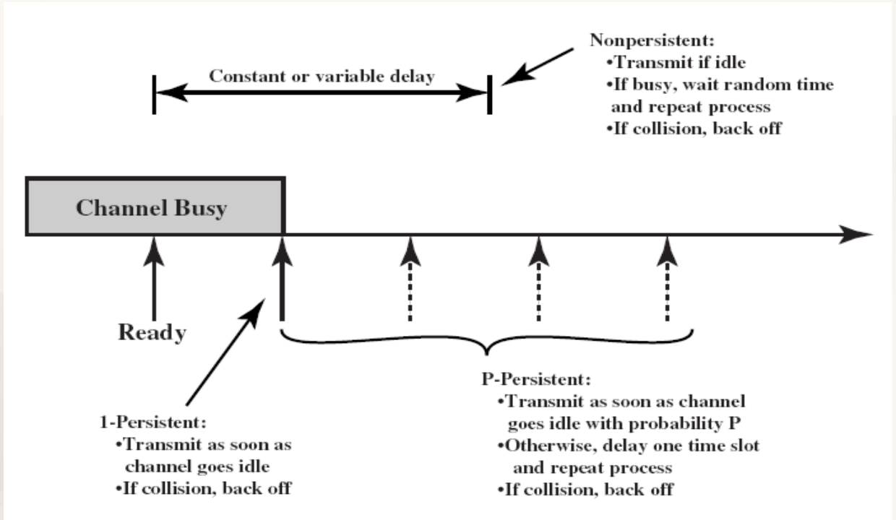

*Figure 7. Behavior of the three persistence methods when the medium is busy*

In Figure 7 the gray box is the interval during which the medium is busy, and "Ready" is the moment the station becomes ready to send. The 1-persistent method sends as soon as the medium becomes idle (bold arrow), the nonpersistent method checks again after a constant or variable delay, and the p-persistent method sends with probability $p$ in each time slot (dashed arrows) after the medium becomes idle. In all three methods, a station that suffers a collision backs off and tries again.

| Method | When the medium is busy | Advantage | Disadvantage |
|:-----|:-----|:-----|:-----|
| Nonpersistent | Check again after a random time | Few collisions | Time arises in which the medium is idle but nobody uses it. |
| 1-persistent | Listen until idle, then transmit immediately | No idle time is wasted. | A collision is certain if two or more stations are waiting. |
| p-persistent | Listen until idle, then transmit with probability $p$ | Adjusting $p$ trades collisions against idle time. | A suitable $p$ is hard to choose. |

*Table 9. Comparison of the three persistence methods of CSMA*

### 2.5 Operation of CSMA/CD

In CSMA, even when a collision occurs, the stations learn of it only after sending their frames to the end and receiving no ACK. Transmission capacity is wasted on sending the collided frames during that time. CSMA/CD reduces this waste by adding **listen while talk (LWT)**.

1. If the medium is idle, transmit. If it is busy, go to step 2.
2. If the medium is busy, keep listening until it becomes idle and transmit immediately (1-persistent).
3. If a collision is detected during transmission, stop the transmission in progress immediately and send a short **jamming signal** to inform all stations that a collision has occurred.
4. After sending the jamming signal, wait for a random time and try again from step 1.

> **Definition:** A **jamming signal** is a short bit sequence sent by a station that has detected a collision; it makes sure that every station involved in the collision detects it. In IEEE 802.3 it is 32 bits long [6].

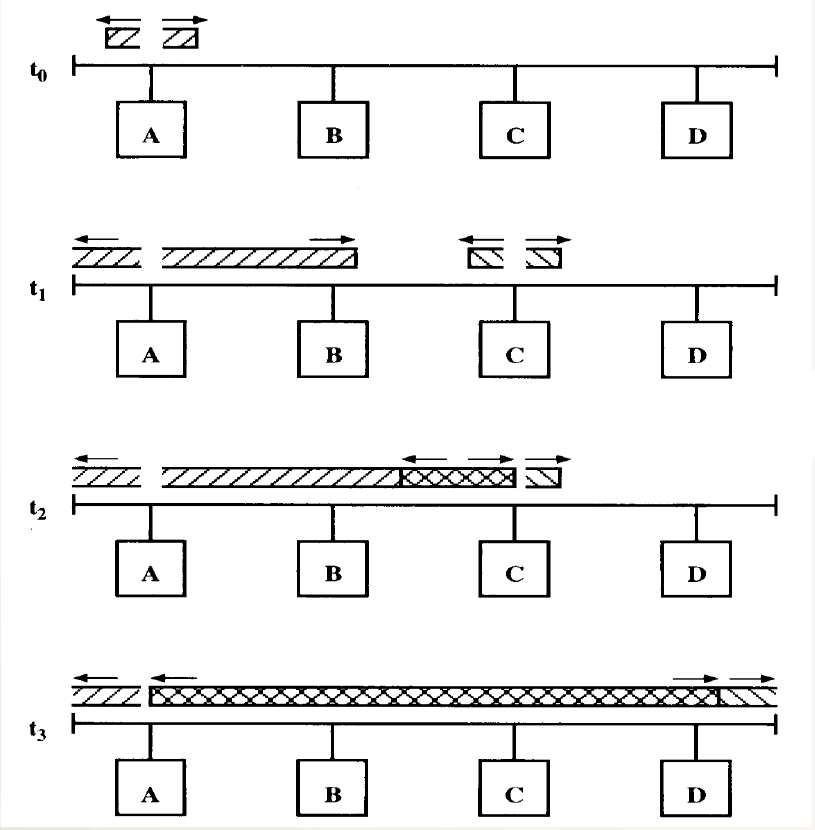

*Figure 8. Time sequence of CSMA/CD operation on a bus*

Figure 8 shows a bus with stations A, B, C, and D from time $t_0$ to $t_3$. The hatched bars show signals spreading out, and the cross-hatched part is the collision interval in which two signals overlap.

| Time | Situation |
|:-----|:-----|
| $t_0$ | A starts transmitting. A's signal spreads in both directions. |
| $t_1$ | B and C have frames ready. A's signal has already reached B, so B knows the medium is busy and defers. A's signal has not yet reached C, so C judges the medium idle and starts transmitting. |
| $t_2$ | A's signal reaches C. C detects the collision and stops transmitting. |
| $t_3$ | The collision signal also reaches A. A also detects the collision and stops transmitting. |

*Table 10. Situation at each time in Figure 8*

The whole operation can be summarized in a flowchart as follows.

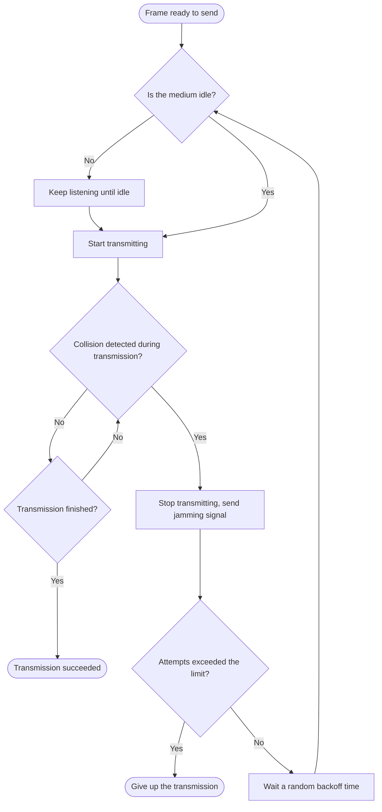

*Figure 9. Operating flow of a CSMA/CD station*

### 2.6 Collision Detection Time on a Baseband Bus

> **Definition:** **Baseband** transmission puts a digital signal on the medium as it is, without modulation, and the signal spreads in both directions along the bus. **Broadband** transmission modulates the signal onto a carrier and places it in a particular frequency band (Week 6).

The time needed to detect a collision is longest when the two stations are farthest apart. Consider A and D at the two ends of the bus, and let $\tau$ be the end-to-end propagation delay of the bus.

1. At time 0, A starts transmitting.
2. Just before A's signal reaches D (immediately before time $\tau$), D's frame becomes ready. D judges the medium idle and starts transmitting, and it immediately collides with A's signal and detects the collision.
3. The signal sent by D (the collision) reaches A after another maximum propagation delay $\tau$.
4. A therefore detects the collision only **almost twice the maximum propagation delay ($2\tau$)** after it began transmitting.

An important condition follows from this result. For A to detect the collision, it must still be transmitting at time $2\tau$. If A finished transmitting before then, it would believe it had succeeded even though its frame was destroyed by the collision. Therefore **the transmission time of a frame must be at least $2\tau$**, and this is why CSMA/CD has a minimum frame length.

$$
L_{min} = R \times 2\tau
$$

Here $R$ is the data rate (bps).

**A worked example.** On a 500 m bus with a signal speed of $2 \times 10^8$ m/s, $\tau = 500 / (2 \times 10^8) = 2.5\ \mu$s and $2\tau = 5\ \mu$s. At 10 Mbps, the minimum frame length is as follows.

$$
L_{min} = 10^7\ \text{bps} \times 5 \times 10^{-6}\ \text{s} = 50\ \text{bits}
$$

> **Note:** The actual 10 Mbps Ethernet specification considers networks extended up to 2.5 km by joining several segments with repeaters, together with the delays of the repeaters, and sets the upper bound on the round-trip time, the **slot time**, to 512 bit times (51.2 µs at 10 Mbps). An Ethernet frame is therefore at least 512 bits, that is, 64 bytes [6].

### 2.7 Collision Detection Time on a Broadband Bus

A broadband bus has a **headend** at one end of a single cable. Stations transmit toward the headend in one frequency band (the inbound channel), and the headend converts the received signal to another frequency band (the outbound channel) and sends it out again to all stations. A signal must therefore travel to the headend and back before other stations can hear it.

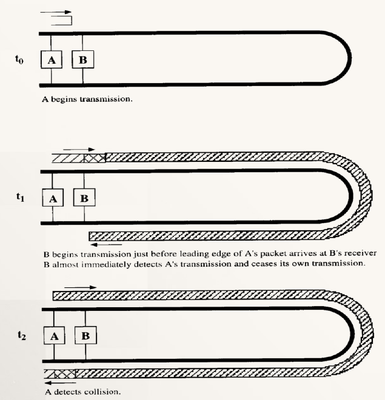

*Figure 10. Collision detection time on a broadband bus*

In Figure 10 the curved side of the cable faces the headend, and the neighboring stations A and B are at the end farthest from the headend. Let $\tau$ be the propagation delay between a station and the headend.

1. $t_0$: A starts transmitting.
2. $t_1$: A's signal must go to the headend and come back before B can hear it, so B may judge the medium idle until nearly $2\tau$ after A started. B starts transmitting just before the leading edge of A's signal arrives at its receiver, then senses A's signal almost immediately and stops.
3. $t_2$: The signal sent by B also takes another $2\tau$ to reach A through the headend. A detects the collision at this point.

In the worst case, collision detection therefore takes **four times the end-to-end delay ($4\tau$)**, twice as long as the $2\tau$ of a baseband bus.

### 2.8 Efficiency and Binary Exponential Backoff

**Efficiency.** For CSMA/CD to be efficient, the transmission time of a frame must be sufficiently longer than the time needed to detect a collision. Frames must be long for a station to detect a collision while still transmitting; otherwise the transmission ends before the collision is detected and the advantage of CSMA/CD disappears. In that case the efficiency is the same as or lower than that of CSMA.

**Algorithm used when the medium is busy.** Most CSMA/CD systems, such as Ethernet, MITREnet, and IEEE 802.3, use the 1-persistent method, for the following reasons.

- When traffic is light, a station sends as soon as the medium becomes idle, so efficiency is high.
- When traffic is heavy, the 1-persistent method causes frequent collisions, but in CSMA/CD collisions are detected at once and the transmissions are aborted, so little time is wasted.
- **Random backoff** keeps the stations involved in the previous collision from colliding again.

> **Definition:** **Backoff** is the random time a station that suffered a collision waits before sending again. **Binary exponential backoff** doubles the range from which the waiting time is chosen each time the collisions repeat.

The binary exponential backoff of Ethernet and IEEE 802.3 works as follows [6].

- When a frame suffers its $n$th collision, the station chooses an integer $r$ uniformly at random from $0$ to $2^{k} - 1$, where $k = \min(n, 10)$.
- It waits $r \times$ the slot time (512 bit times) and then tries again.
- It makes at most 16 attempts; if all fail, it gives up and reports an error to the higher layer.

| Number of collisions $n$ | Range | Maximum wait at 10 Mbps |
|:-----|:-----|:-----|
| 1 | 0-1 | $1 \times 51.2 = 51.2\ \mu$s |
| 2 | 0-3 | $3 \times 51.2 = 153.6\ \mu$s |
| 3 | 0-7 | $7 \times 51.2 = 358.4\ \mu$s |
| 10-15 | 0-1023 | $1023 \times 51.2 \approx 52.4$ ms |
| 16 | Give up | |

*Table 11. Waiting ranges of binary exponential backoff*

Repeated collisions mean that many stations are competing, so widening the range raises the chance that they choose different values. This method is efficient over a wide range of loads, from light to heavy. It is, however, unfair in one respect. A new frame making its first attempt with a narrow range is more likely to be sent first than an older frame whose range has widened after several collisions. That is, among the colliding frames, newer frames tend to be transmitted faster.

### 2.9 Implementing Carrier Sense and Collision Detection

**Carrier sense.** Baseband systems carry bits with Manchester coding. Because the signal always changes in the middle of every bit in Manchester coding (the biphase codes of Week 4), the detection of signal transitions shows that someone is transmitting.

**Collision detection 1: baseband coaxial cable.**

- When two stations transmit at the same time, the two signals add up and produce a larger voltage swing than when one station transmits.
- A collision is declared when a voltage higher than the maximum that a single transceiver can produce is detected.
- Signals, however, are attenuated as they travel along the cable. When mixed with a weak signal from far away, the combined voltage can be lower than the collision detection threshold. This is one of the reasons why IEEE limits the length of a segment to 500 m.

**Collision detection 2: the twisted-pair star-wiring approach.**

- Collisions are detected logically rather than by voltage.
- In star wiring each station is connected to a hub by its own line, so a collision exists when active signals arrive on more than one input channel of any hub.
- The hub then generates a collision presence (CP) signal and propagates it to all outputs.
- Any hub that receives a CP signal on even one of its input lines also propagates CP to all of its outputs.

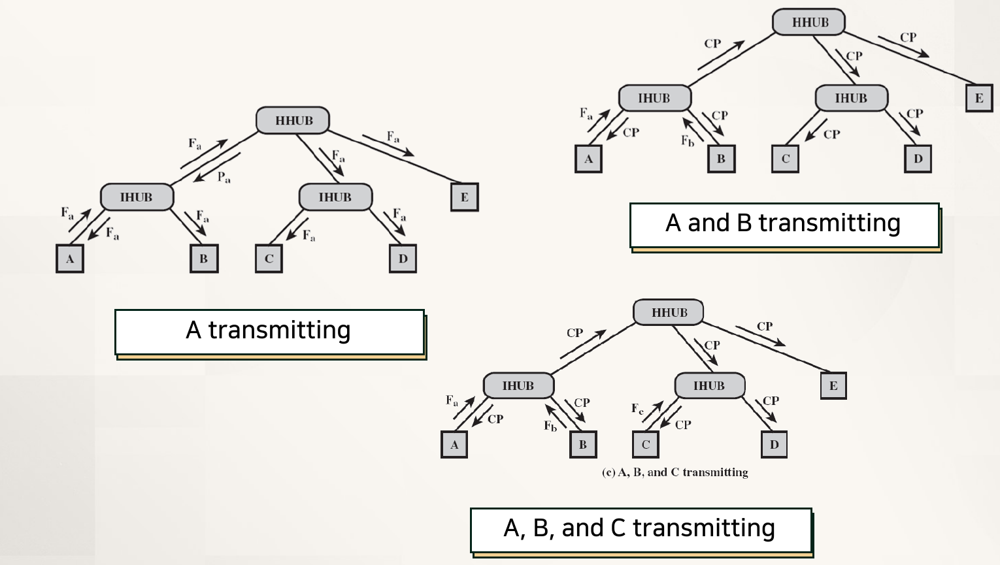

*Figure 11. How hubs signal a collision in twisted-pair star wiring*

Figure 11 shows a hierarchical star with two intermediate hubs (IHUBs) below a header hub (HHUB) at the top, and stations A-E attached.

- **When only A transmits:** A's frame $F_a$ goes up through the IHUB to the HHUB, which sends it down all of its lower lines, so every station receives $F_a$.
- **When A and B transmit together:** The IHUB to which A and B are attached detects active signals on two inputs at once and sends CP both upward and downward. Because CP has arrived on its input, the HHUB sends CP down all of its lower lines, and eventually every station learns of the collision.
- **When A, B, and C transmit together:** Even when the transmitting stations are attached to different IHUBs, CP spreads through the HHUB to the whole network, so every station detects the collision.

**Collision detection 3: broadband systems.**

- The transmitted data is compared bit by bit with the received data. That is, a station checks whether the bits it sent on the inbound channel come back unchanged on the outbound channel through the headend.
- In IEEE 802.3, the comparison continues up to the last bit of the source address. Frames sent by different stations differ at least in their source addresses, so comparing up to the source address is certain to reveal overlapping transmissions.
- The receiver may have to deal with signals damaged by noise or by a failure of collision detection, so care is needed when tuning the system to avoid such situations.
- In dual-cable systems, which have separate cables for transmission and reception, shielding between the two RF modems that transmit and receive at the same frequency at the same time is important to prevent crosstalk.
- In split systems, which have two frequency channels on one cable, it is appropriate to place the collision detection function at the headend.

> **Note:** Most of today's Ethernet connects each station one-to-one to a switch with twisted pair and operates in full duplex, sending and receiving at the same time. Collisions cannot occur on a full-duplex link, so CSMA/CD is not actually used there. CSMA/CD is a method for half-duplex environments in which several stations share the medium [6].

---

<br>

## 3. Bridges, Routers, and CRC

### 3.1 Bridges

> **Definition:** A **bridge** is a device that connects LANs using the same MAC protocol, for example joining two Ethernet LANs into one. A bridge receives frames at the MAC layer (layer 2) and relays them to the other LAN.

Even though one large LAN could be built, several LANs are divided and connected by bridges for the following reasons.

| Reason | Explanation |
|:-----|:-----|
| Reliability | If a station or the medium fails in one LAN, the effect does not spread to the other LANs. |
| Performance | The more stations and the greater the length of a LAN, the more collisions and delay increase and the lower the performance. Dividing the LAN reduces the traffic in each part. |
| Security | Networks handling different kinds of data, such as accounting and personal data, are separated so that the traffic of one LAN is not exposed to another. |
| Geography | Networks in separate places, such as two buildings across a road, are connected. |

*Table 12. Reasons for dividing LANs and connecting them with bridges*

The functions of a bridge are as follows.

1. **Simple copying:** It reads the frames of one LAN and copies them unchanged to the other LAN.
2. **Intelligent routing and address handling:** When several LANs are connected by bridges, a bridge must know which station addresses are on each network to decide in which direction to send a frame.
3. **MAC-level relay:** Because a bridge relays MAC frames, the LLC and higher layers of the LANs on both sides must be identical. An intermediate network joining the two LANs (such as a point-to-point link) may use a different MAC.

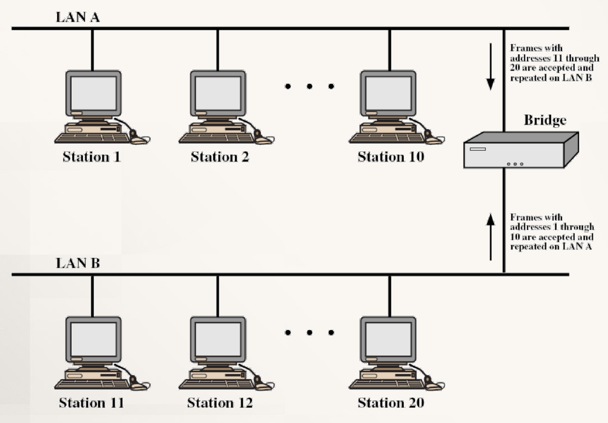

*Figure 12. Two LANs connected by a bridge*

In Figure 12, LAN A has stations 1-10 and LAN B has stations 11-20. The bridge accepts frames on LAN A addressed to 11-20 and repeats them on LAN B, and accepts frames on LAN B addressed to 1-10 and repeats them on LAN A. Frames exchanged between stations on the same LAN are not passed to the other LAN, so the traffic on each LAN decreases.

> **Note:** A real bridge builds its own table of which station lies in which direction by looking at the **source address** of the frames arriving on each port. Such a bridge is called a learning bridge, and when a destination is not in the table it sends the frame out of every port except the one on which it arrived. This behavior is standardized in IEEE 802.1D [7].

### 3.2 Routers

> **Definition:** A **router** is a device that interconnects dissimilar networks. It operates at layer 3 (the network layer), determines the route to the destination, and forwards packets.

Whereas a bridge can join only LANs of the same kind, a router must connect networks that differ in the following ways.

| Difference | Explanation |
|:-----|:-----|
| Addressing scheme | The length of the address field, its representation (binary or decimal), and the directory service used to look up addresses differ from network to network. For example, IEEE 802 LANs use 16-bit or 48-bit binary addresses, and X.25 networks use 12-digit decimal addresses. |
| Maximum frame size | The maximum length that one frame can carry differs. For example, the Ethernet data field is at most 1,500 bytes, and the X.25 network in the example allows 1,000 bytes. Data exceeding the maximum must be divided (segmentation) before it is sent. |
| Interface | The hardware and software interfaces for attaching to the network differ. |
| Reliability | Each network service offers a different level of reliability. Some networks guarantee delivery and some do not. |

*Table 13. Differences between networks that a router must handle*

A router operates at layer 3. All systems connected through routers use an identical layer structure (such as IP) at layer 3 and above, and a router implements only up to layer 3. Layers 2 and 1 below may differ for each network connected.

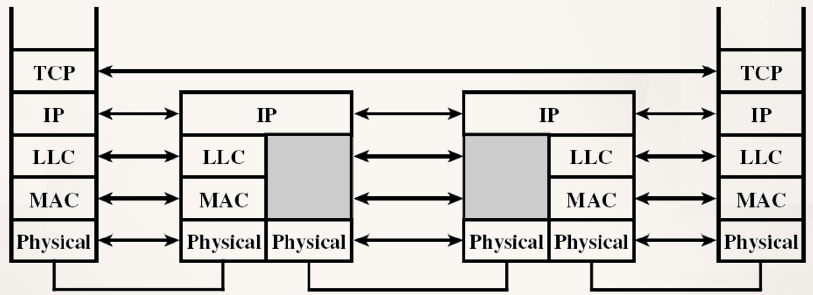

*Figure 13. Protocol architecture of end systems connected through two routers*

At both ends of Figure 13 are end systems that have all the TCP, IP, LLC, MAC, and physical layers. The two routers in the middle share only the IP layer, and below it each has lower layers suited to each of the two networks it connects. The left half of the left router consists of the LLC, MAC, and physical layers of the LAN, and the right half (gray) consists of the layers suited to the intermediate network between the two routers. TCP communicates directly only between end systems, so the routers have no TCP layer.

Depending on the literature, routers are also called by the following names.

- **IS (intermediate system):** The OSI term for a system that relays between end systems.
- **IWU (internetworking unit)**
- **Network relay**
- **Gateway:** The name used for routers in the early Internet literature. Today it usually refers to a device that also performs protocol conversion, as in Section 3.4.

### 3.3 Data Transfer Through Routers

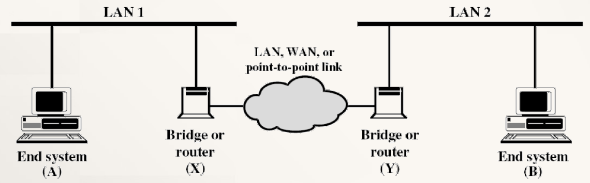

*Figure 14. Data traveling from end system A to B through two bridges or routers*

In Figure 14, end system A is on LAN 1 and B is on LAN 2; the two LANs are attached to routers X and Y respectively, and X and Y are connected by a LAN, a WAN, or a point-to-point link. Data is sent from A to B as follows.

1. The IP of A recognizes that B is on another network. It can tell this from B's global network address (IP address).
2. A puts the data in an IP datagram, carries it in a MAC frame of LAN 1, and sends it to router X.
3. X determines the route. If B is on a network directly attached to X, X sends to it directly; otherwise it chooses the next router (Y here) so that the datagram passes through one or more routers.
4. X wraps the IP data unit in the packet format of the intermediate network (such as an X.25 packet) and sends it to Y.
5. Y extracts the IP data unit from the packet of the intermediate network, builds a new LLC PDU and MAC frame suited to LAN 2, and sends them to B.

In this scheme **neither delivery nor order of the packets is guaranteed.** The meaning and consequences are as follows.

- IP does not depend on the services of the intermediate networks for reliable delivery. Reliable delivery is the responsibility of TCP in the end systems.
- There are no restrictions on the services the intermediate networks must provide, which gives flexibility. Routers can be used with various combinations of subnetworks.
- IP data units can take different routes in response to congestion or failures. Packets from the same sender can therefore arrive out of order.

> **[Computer Networks]** IP provides a best-effort service. It tries to deliver packets but does not prevent loss, duplication, or reordering. TCP builds a reliable byte stream on top of it with sequence numbers, acknowledgments, and retransmission. The TCP and IP headers were covered in Week 5.

### 3.4 Networking Devices

Devices that connect networks include repeaters, bridges, routers, gateways, hubs, and LAN switches (Week 6).

| Device | Operating layer | Role |
|:-----|:-----|:-----|
| Repeater | Layer 1 | Amplifies and regenerates attenuated signals to extend the cable length. It does not look at the contents of frames. |
| Hub | Layer 1 | A multiport repeater with logic for handling signals with data collisions. It sends a signal arriving on one port out of all ports. |
| Bridge | Layer 2 | Connects LANs using the same MAC according to MAC addresses. |
| LAN switch | Layer 2 | A full-duplex hub with bridge functions, that is, a bridge with many ports. |
| Router | Layer 3 | Connects different networks according to IP addresses and determines routes. |
| Gateway | Layer 4 (transport) and above | Converts protocols between networks that use different protocols. |

*Table 14. Operating layers and roles of networking devices*

LAN switches and traditional bridges are both layer 2 devices, but they differ in the following respects.

- **Implementation:** Bridges often processed frames in software, whereas switches process them in hardware (dedicated chips).
- **Concurrent processing:** A bridge processes one frame at a time, whereas a switch processes several frames simultaneously between several ports.
- **Forwarding method:** A bridge performs only store-and-forward, whereas a switch can use both store-and-forward and cut-through.

> **Definition:** **Store-and-forward** receives the entire frame, checks it for errors with the FCS, and only then sends it out. **Cut-through** reads only the leading part of the frame, that is, the destination address, and starts sending it out immediately. Cut-through has a shorter delay but can forward frames that contain errors.

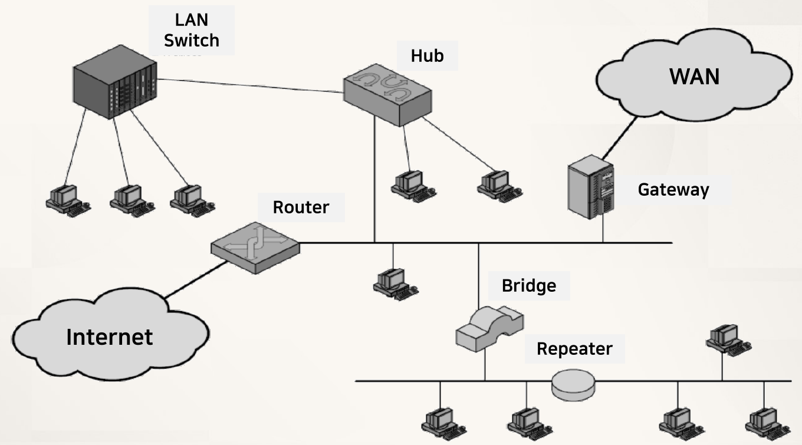

*Figure 15. An example arrangement of networking devices*

In Figure 15, the LAN switch and the hub gather several stations at one point, and the router connects the LAN to the Internet. The gateway connects the LAN to a WAN that uses another protocol, and the bridge joins two bus-shaped LAN segments. The repeater regenerates the signal on one segment to extend the bus.

### 3.5 Principle of CRC

> **Definition:** The **FCS (frame check sequence)** is a field placed at the end of a frame so that the receiver can detect errors. The **CRC (cyclic redundancy check)** is the most common method for generating the FCS, and the FCS field contains the bit string produced by the CRC technique.

CRC treats bit strings as polynomials. Each bit of a $k$-bit string is regarded as a coefficient of a polynomial, with the leftmost bit as the coefficient of $x^{k-1}$ and the rightmost bit as the coefficient of $x^0$. For example, the bit string 110011 is the following polynomial.

$$
1 \cdot x^5 + 1 \cdot x^4 + 0 \cdot x^3 + 0 \cdot x^2 + 1 \cdot x^1 + 1 \cdot x^0 = x^5 + x^4 + x + 1
$$

The coefficients are computed with **modulo-2 arithmetic**. Addition and subtraction are both the exclusive OR (XOR) without carries or borrows ($0+0=0$, $0+1=1$, $1+0=1$, $1+1=0$), so addition and subtraction are the same. Polynomial division follows the same rules, and on bit strings it amounts to repeating XOR with the digits aligned.

> **[Digital Logic Design]** XOR (exclusive OR) is the operation that outputs 1 when its two inputs differ. Because modulo-2 addition equals XOR, a CRC can be computed quickly in hardware with only a shift register and XOR gates.

The CRC field is generated with the following symbols.

- $d(x)$: the $k$-bit data to be sent
- $g(x)$: the **generator polynomial** of degree $m$ agreed upon in advance by sender and receiver; an $(m + 1)$-bit string whose highest-order and constant coefficients are 1
- $p(x)$: the $m$-bit CRC (the remainder)
- $c(x)$: the $(k + m)$-bit frame actually transmitted

$$
p(x) = \mathrm{Rem}\left[\frac{x^m d(x)}{g(x)}\right], \qquad c(x) = x^m d(x) + p(x)
$$

$x^m d(x)$ is the data with $m$ zeros appended, and adding the remainder $p(x)$ fills those $m$ positions with the CRC. **The resulting $c(x)$ is exactly divisible by $g(x)$ with no remainder.** The reason is as follows. Let $q(x)$ be the quotient of $x^m d(x)$ divided by $g(x)$, so that $x^m d(x) = q(x) g(x) + p(x)$. Adding $p(x)$ to both sides, and noting that $p(x) + p(x) = 0$ in modulo 2,

$$
c(x) = x^m d(x) + p(x) = q(x) g(x)
$$

is obtained. The receiver divides the received bit string by $g(x)$ and judges that there is no error if the remainder is 0 and that there is an error otherwise.

> **Note:** Some explanations describe the generator polynomial as being "of degree $m - 1$", but for the CRC to have $m$ bits and the frame to have $k + m$ bits, the generator polynomial must be of degree $m$ ($m + 1$ bits). In the example of Section 3.6 as well, $m = 4$ and $g(x)$ has degree 4.

### 3.6 A Worked CRC Example

Let us find the CRC that protects the data $d = 110011$ with the generator polynomial $g(x) = x^4 + x^3 + 1$.

- $d(x) = x^5 + x^4 + x + 1$, and since $d$ has 6 bits, $k = 6$.
- $g(x) = x^4 + x^3 + 1$ is the bit string 11001, and since it has degree 4, $m = 4$.

**Step 1: form $x^4 d(x)$.** Multiply the data by $x^4$. On bit strings this is the same as appending four zeros.

$$
x^4 d(x) = x^4 (x^5 + x^4 + x + 1) = x^9 + x^8 + x^5 + x^4 \quad \rightarrow \quad 1100110000
$$

**Step 2: divide by $g(x)$ to obtain the remainder.** Polynomial division repeatedly eliminates the highest-order term.

- To eliminate $x^9$, put $x^5$ in the quotient and subtract (in modulo 2, add) $x^5 g(x) = x^9 + x^8 + x^5$. $(x^9 + x^8 + x^5 + x^4) + (x^9 + x^8 + x^5) = x^4$.
- To eliminate the remaining $x^4$, put $1$ in the quotient and subtract $g(x) = x^4 + x^3 + 1$. $x^4 + (x^4 + x^3 + 1) = x^3 + 1$.
- $x^3 + 1$ has a lower degree than $g(x)$, so it cannot be divided further. The quotient is therefore $q(x) = x^5 + 1$ and the remainder is $p(x) = x^3 + 1$.

The same computation written as a division of bit strings is as follows. At each step, 11001 is aligned under the leading 1 and XORed.

```text
                     1 0 0 0 0 1    quotient q(x) = x^5 + 1
           ┌─────────────────────
 1 1 0 0 1 │ 1 1 0 0 1 1 0 0 0 0    x^4 d(x) = x^9 + x^8 + x^5 + x^4
             1 1 0 0 1              XOR x^5 g(x)
             ─────────
             0 0 0 0 0 1 0 0 0 0    result of the first XOR
                       1 1 0 0 1    XOR 1 * g(x)
                       ─────────
                       0 1 0 0 1    remainder p(x) = x^3 + 1 -> 1001
```

*Figure 16. Modulo-2 division of the bit string 1100110000 by 11001*

After the first XOR in Figure 16, 1100110000 XOR 1100100000 = 0000010000 remains. For the four leading zeros the quotient digits are 0 and nothing is XORed; at the next 1, 11001 is aligned to give 10000 XOR 11001 = 01001. The last four bits, 1001, are the remainder $p(x) = x^3 + 1$.

**Step 3: build the frame to be transmitted.**

$$
c(x) = x^4 d(x) + p(x) = x^9 + x^8 + x^5 + x^4 + x^3 + 1 \quad \rightarrow \quad 110011\ 1001
$$

The 10 bits 1100111001, the data 110011 followed by the CRC 1001, are sent.

**Step 4: check at the receiver.** Dividing the error-free 1100111001 by 11001 gives the remainder 0000, so the receiver judges that there is no error. Writing the received bit string as $r(x) = c(x) + e(x)$, $e(x)$ is the **error polynomial**, which has a 1 at each position where an error occurred. Because $c(x)$ is divisible by $g(x)$, the following holds.

$$
\mathrm{Rem}\left[\frac{r(x)}{g(x)}\right] = \mathrm{Rem}\left[\frac{e(x)}{g(x)}\right]
$$

That is, the remainder depends only on the pattern of the error. For example, if the bit at position $x^5$ is flipped during transmission and 1100011001 is received, the remainder is 1011, the same as the remainder of $x^5$ divided by $g(x)$, and the error is detected. The remainders for a single-bit error at each of the ten positions are as follows.

| Error position | $x^9$ | $x^8$ | $x^7$ | $x^6$ | $x^5$ | $x^4$ | $x^3$ | $x^2$ | $x^1$ | $x^0$ |
|:-----|:-----|:-----|:-----|:-----|:-----|:-----|:-----|:-----|:-----|:-----|
| Remainder | 0101 | 1110 | 0111 | 1111 | 1011 | 1001 | 1000 | 0100 | 0010 | 0001 |

*Table 15. Remainder for each single-bit error position with the generator polynomial 11001*

None of the ten remainders is 0, so a single-bit error at any position is detected. Moreover, all the remainders differ, so in this example even the position of the error can be found from the remainder.

### 3.7 Error Detection Capability of CRC

The only errors a CRC cannot detect are those whose error polynomial $e(x)$ is divisible by $g(x)$. The following properties follow from this fact [4].

- **All single-bit errors:** $e(x) = x^i$. If $g(x)$ has two or more terms it cannot divide $x^i$, so all single-bit errors are detected.
- **All errors with an odd number of bits:** These are detected if $g(x)$ has the factor $(x + 1)$. Substituting $x = 1$ into an $e(x)$ with an odd number of terms gives $e(1) = 1$, whereas any multiple of $(x + 1)$ is 0 at $x = 1$, so such an $e(x)$ cannot be a multiple of $g(x)$.
- **All burst errors of length $m$ or less:** A burst error is an error confined to a contiguous span whose first and last bits are wrong. A $g(x)$ of degree $m$ with a constant term detects all burst errors of length $m$ or less and most longer ones as well (a fraction $1 - 2^{-(m-1)}$ for length $m + 1$ and $1 - 2^{-m}$ for longer bursts).
- **Undetectable errors:** Errors whose $e(x)$ happens to be a multiple of $g(x)$ cannot be detected. Such errors occur with low probability.

Applying these properties to the $g(x) = x^4 + x^3 + 1$ of Section 3.6 gives the following.

- It has three terms, so it detects all single-bit errors (Table 15).
- $g(1) = 1 + 1 + 1 = 1 \ne 0$, so it does not have $(x + 1)$ as a factor. Detection of all errors with an odd number of bits is therefore not guaranteed. Indeed, $e(x) = x^4 + x^3 + 1$, an error in three bits, is $g(x)$ itself and goes undetected.
- It has degree 4, so it detects all burst errors of length 4 or less.

Real communication standards use generator polynomials chosen with these properties in mind. For example, CAN uses the degree-15 polynomial $x^{15} + x^{14} + x^{10} + x^8 + x^7 + x^4 + x^3 + 1$ (Weeks 3 and 9) [8], and Ethernet uses a degree-32 polynomial to form a 32-bit FCS [6].

### 3.8 Bit Error Rate and Frame Error Probability

> **Definition:** The **bit error rate (BER)** is the fraction of transmitted bits that are in error, and it can be regarded as the probability $p$ that one bit is wrong.

Let us find the probability that an error occurs in a 1,000-bit frame on a link whose BER is $p = 1.0 \times 10^{-8}$, assuming that the errors in different bits are independent.

1. The probability that one bit is transmitted without error is $1 - p$.
2. The probability that all 1,000 bits are transmitted without error is the product of independent events, $(1 - p)^{1000}$.
3. The probability that the 1,000 bits are transmitted with at least one error is the complement.

$$
P_{error} = 1 - (1 - p)^{1000} = 1 - 0.99999000005 \approx 9.99995 \times 10^{-6}
$$

This value is almost the same as $np = 1000 \times 10^{-8} = 10^{-5}$. When $np$ is much smaller than 1, $1 - (1 - p)^n \approx np$ is a good approximation.

> **[Probability and Statistics]** In $n$ independent trials with failure probability $p$ each, the probability of no failure at all is $(1-p)^n$. Expanding with the binomial theorem gives $(1-p)^n = 1 - np + \binom{n}{2}p^2 - \cdots$, so $1 - (1-p)^n \approx np$ when $np \ll 1$.

| BER $p$ | Frame length $n$ | $P_{error} = 1 - (1-p)^n$ | Approximation $np$ |
|:-----|:-----|:-----|:-----|
| $10^{-8}$ | 1,000 bits | $9.99995 \times 10^{-6}$ | $1.0 \times 10^{-5}$ |
| $10^{-8}$ | 12,000 bits (1,500 bytes) | $1.19993 \times 10^{-4}$ | $1.2 \times 10^{-4}$ |
| $10^{-6}$ | 1,000 bits | $9.995 \times 10^{-4}$ | $1.0 \times 10^{-3}$ |
| $10^{-6}$ | 12,000 bits (1,500 bytes) | $1.193 \times 10^{-2}$ | $1.2 \times 10^{-2}$ |

*Table 16. Frame error probability by bit error rate and frame length*

As Table 16 shows, the longer the frame and the higher the BER, the greater the probability that a frame contains an error. CRC is the mechanism that lets the receiver detect such errors.

---

<br>

## 4. Appendix: The IEEE 802 Standards Committee

### 4.1 Role and Principles of the Committee

The **IEEE 802 committee** (IEEE 802 LAN/MAN Standards Committee) is responsible for standards for LANs (local area networks), PANs (personal area networks), and MANs (metropolitan area networks) [9]. The committee began standardizing LANs because LAN development needed low-cost interfaces.

- **Low-cost interfaces:** For LANs to spread, the interface that attaches each device to the network must be cheap, which requires low-cost chips and VLSI (very large scale integration).
- **Cost reduction through mass production:** Prices fall only when chips are produced in large volumes.
- **Standardization:** For many manufacturers to mass-produce the same chips, there must be a standard.

The committee reached two conclusions.

1. **"Divide the work into small pieces."** The large problem of a LAN standard is divided into manageable pieces such as LLC, MAC, and the physical layer, and each is standardized separately.
2. **"There is no need to meet diverse requirements with a single standard."** Requirements for topology, MAC, and transmission medium differ by application, so instead of forcing one standard, several MAC and medium options are standardized. The LLC above them, however, is common.

The IEEE 802 standards were adopted as a US national standard by the American National Standards Institute (ANSI) in 1985 and as international standards by ISO in 1987. ISO publishes them as the ISO 8802 series (for example, ISO/IEC 8802-3) [1].

### 4.2 Reference Model and Implementation Model

When a LAN is actually deployed, it must be possible to choose the transmission medium for a given MAC. The functions of the physical layer are therefore divided into two kinds.

- **Physical layer functions independent of the type of medium:** functions such as encoding and decoding that stay the same when the medium changes.
- **Physical layer functions dependent on the type of medium:** functions that produce electrical or optical signals suited to a cable or an optical fiber.

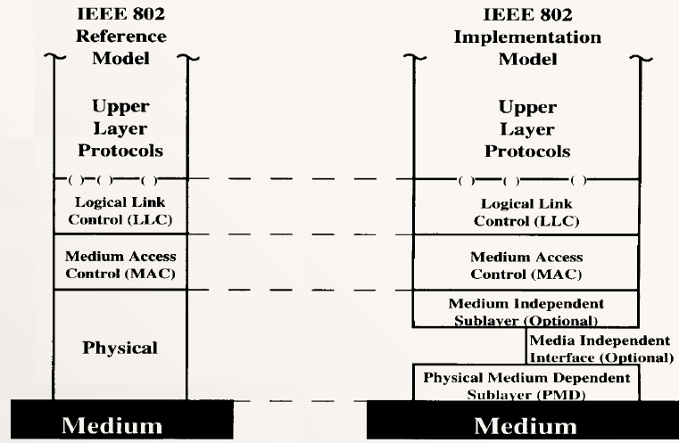

*Figure 17. The IEEE 802 reference model and implementation model*

In the reference model on the left of Figure 17 there is a single physical layer. The implementation model on the right divides the physical layer as follows.

| Part of the implementation model | Role |
|:-----|:-----|
| Medium independent sublayer (optional) | Handles the physical layer functions that do not depend on the medium. |
| Media independent interface (optional) | The standard interface between the medium independent sublayer and the medium dependent sublayer. |
| Physical medium dependent sublayer (PMD) | Handles the transmit and receive circuits and connectors suited to the actual medium. |

*Table 17. Physical layer structure of the IEEE 802 implementation model*

With this division, a chip implementing the MAC can stay unchanged while only the medium dependent part is replaced, so it can be used with many media. The MII (media independent interface) of Ethernet is an example that implements this idea, and the automotive Ethernet of Week 9 likewise attaches an automotive physical layer to the same MAC.

### 4.3 Organization of the Working Groups

The IEEE 802 committee has a **working group (WG)** or a **technical advisory group (TAG)** for each subject, numbered from 802.1 to 802.24. As with 802.11 (wireless LAN), the number in the name of a standard is the number of its working group.

| Number | Subject | Number | Subject |
|:-----|:-----|:-----|:-----|
| 802.1 | Higher layer LAN protocols | 802.12 | Demand priority |
| 802.2 | Logical link control (LLC) | 802.14 | Cable modem |
| 802.3 | Ethernet | 802.15 | Wireless personal area networks (WPAN) |
| 802.4 | Token bus | 802.16 | Broadband wireless access |
| 802.5 | Token ring | 802.17 | Resilient packet ring |
| 802.6 | Metropolitan area network (MAN) | 802.18 | Radio regulatory TAG |
| 802.7 | Broadband TAG | 802.19 | Wireless coexistence |
| 802.8 | Fiber optic TAG | 802.21 | Media independent handover services |
| 802.9 | Isochronous LAN | 802.22 | Wireless regional area networks |
| 802.10 | Security | 802.23 | Emergency services |
| 802.11 | Wireless LAN | 802.24 | Vertical applications TAG |

*Table 18. Working groups and technical advisory groups of IEEE 802*

A working group is active while work remains to complete and maintain its standards, becomes inactive when it has nothing to do for the time being, and is disbanded when its technology falls out of use.

| Status | Working groups |
|:-----|:-----|
| Active | 802.1 higher layer LAN protocols, 802.3 Ethernet, 802.11 wireless LAN, 802.15 WPAN, 802.16 broadband wireless access, 802.18 radio regulatory TAG, 802.19 coexistence TAG, 802.21 media independent handoff, 802.22 wireless regional area networks, 802.24 vertical applications TAG |
| Inactive | 802.17 resilient packet ring, 802.20 mobile broadband wireless access (MBWA) |
| Disbanded | 802.2 LLC, 802.4 token bus, 802.5 token ring, 802.6 MAN, 802.7 broadband TAG, 802.8 fiber optic TAG, and others |

*Table 19. An example classification of the status of IEEE 802 working groups*

> **Note:** The status of the working groups changes over time. Table 19 is a classification at one point in time, and the current organization can be checked on the website of the IEEE 802 committee [9].

### 4.4 FDDI and the Overall LAN/MAN Standards

> **Definition:** **FDDI (fiber distributed data interface)** is a LAN standard that transmits at 100 Mbps with a token ring method on a dual ring of optical fiber. It was developed by ANSI rather than IEEE, but it follows the structure of the IEEE 802 reference model and is therefore used with IEEE 802.2 LLC [1].

The LAN/MAN standards as a whole can be arranged by the layers of the IEEE 802 reference model as follows. Above every standard is the common IEEE 802.2 LLC, which provides three services: unacknowledged connectionless, connection-mode, and acknowledged connectionless (Section 1.4).

| Standard | MAC | Topology | Physical layer (medium: rate) |
|:-----|:-----|:-----|:-----|
| IEEE 802.3 | CSMA/CD | Bus, tree, star | Baseband coaxial: 10 Mbps, UTP: 10, 100 Mbps, STP: 100 Mbps, broadband coaxial: 10 Mbps, optical fiber: 10 Mbps |
| IEEE 802.4 | Token bus | Bus, tree, star | Broadband coaxial: 1, 5, 10 Mbps, carrier band coaxial: 1, 5, 10 Mbps, optical fiber: 5, 10, 20 Mbps |
| IEEE 802.12 | Round robin, priority | Bus, tree, star | UTP: 100 Mbps |
| IEEE 802.5 | Token ring | Ring | STP: 4, 16 Mbps, UTP: 4 Mbps |
| FDDI | Token ring | Ring | Optical fiber: 100 Mbps, UTP: 100 Mbps |
| IEEE 802.6 | DQDB | Dual bus | Optical fiber: 100 Mbps |
| IEEE 802.11 | CSMA, polling | Wireless | Infrared: 1, 2 Mbps, spread spectrum: 1, 2 Mbps |

*Table 20. MAC and physical layers of the LAN/MAN standards*

UTP (unshielded twisted pair) is twisted pair without shielding, and STP (shielded twisted pair) is twisted pair with shielding. Carrier band is a simple broadband scheme that uses only one channel. The rates in Table 20 are those defined when each standard was first issued; 802.3 and 802.11 have been revised continually since then and support far higher rates today.

---

<br>

## Concept Applications

| Situation | Concept to Apply and Why |
|:-----|:-----|
| In a factory LAN, controllers must send periodic sensor values within a fixed time without fail. | **Round robin or reservation.** Turns or slots are fixed, so the worst-case waiting time can be guaranteed. Contention cannot guarantee the waiting time under heavy load. |
| In an office, several computers occasionally exchange short messages. | **Contention (CSMA/CD).** It is simple to implement and efficient for sporadic, light traffic. |
| The Ethernet LANs of two buildings across a road are to be joined into one, while traffic inside each building stays out of the other building. | **Bridge.** It connects LANs that use the same MAC, filtering by MAC address. |
| A computer on an Ethernet LAN must communicate with a computer on the far side of an X.25 network. | **Router.** It connects, at the IP layer, networks that differ in addressing scheme and maximum frame size. |
| The remainder of a received frame divided by the generator polynomial is not 0. | **CRC error detection.** MAC discards the frame, and retransmission by LLC or a higher layer recovers it. |
| An Ethernet station has collided three times in a row with the same frame. | **Binary exponential backoff.** It chooses one of 0-7 and waits that many slot times before trying again. |

*Table 21. Concepts to apply in each situation*

**True/False Check:**

| Statement | Judgment and Reason |
|:-----|:-----|
| The LLC of the IEEE 802 reference model differs with the topology and the transmission medium. | **F.** Functions that depend on the medium are placed in MAC and the physical layer, and LLC is used in common on top of every MAC. |
| In CSMA, once the first bit of a frame has propagated to the end of the medium, that frame does not collide. | **T.** From then on, every station senses that the medium is busy. |
| On a baseband bus, the worst-case collision detection time of CSMA/CD is four times the end-to-end propagation delay. | **F.** It is about twice on a baseband bus; it is four times on a broadband bus, where signals pass through the headend. |
| If the generator polynomial has $(x+1)$ as a factor, all errors with an odd number of bits are detected. | **T.** An error polynomial with an odd number of terms equals 1 at $x = 1$ and cannot be a multiple of $(x+1)$. |
| A bridge can also connect two LANs whose LLC and higher layers differ. | **F.** A bridge relays at the MAC level, so the LLC and higher layers on both sides must be the same. |

---

<br>

## Summary

| Concept | Key Summary |
|:-----|:-----|
| IEEE 802 reference model | It places the scope of LAN standards at OSI layers 1 and 2 and divides the data link layer into medium-independent LLC and MAC, which handles medium sharing. |
| LLC | It provides LSAPs to the higher layer, handles flow control and error recovery, and offers unacknowledged connectionless, connection-mode, and acknowledged connectionless services. |
| Two-level addressing | The MAC address reaches the station, and the LLC address (LSAP) finds the user within the station. |
| Group addresses | MAC addresses and LSAPs can each be individual, multicast, or broadcast, giving nine combinations, and common processes receive the same LSAP in every station. |
| Classification of MAC techniques | By where control is exercised they are centralized or distributed, and by how they are round robin, reservation, or contention; LANs mainly use contention and round robin. |
| ALOHA | A station sends as soon as it has something to send and retransmits if no ACK arrives; the maximum throughput is about 18.4% for pure ALOHA and about 36.8% for slotted ALOHA. |
| CSMA | A station listens before sending, and the methods are nonpersistent, 1-persistent, and p-persistent according to what is done when the medium is busy. |
| CSMA/CD | A station keeps listening while sending, stops immediately on detecting a collision, sends a jamming signal, and backs off; most systems use the 1-persistent method. |
| Collision detection time | The worst case is $2\tau$ on a baseband bus and $4\tau$ on a broadband bus, and the frame transmission time must exceed it. |
| Binary exponential backoff | After the $n$th collision a station waits a number of slots chosen from $0$ to $2^{\min(n,10)} - 1$, and it gives up after 16 failures. |
| Bridges and routers | A bridge connects LANs with the same MAC at layer 2, and a router connects different networks at layer 3. |
| CRC | The sender appends $p(x) = \mathrm{Rem}[x^m d(x) / g(x)]$ to send a frame divisible by $g(x)$, and the receiver checks whether the remainder is 0. |
| BER and frame errors | The error probability of an $n$-bit frame is $1 - (1-p)^n$, which is approximated by $np$ when $np \ll 1$. |
| IEEE 802 committee | It is responsible for LAN, PAN, and MAN standards, divides the problem into small pieces, and allows several MACs and media as standards while keeping LLC common. |

---

<br>

## Self-Check Questions

1. **LLC and MAC:** Explain why the IEEE 802 reference model divides the data link layer into LLC and MAC.

   <details>
   <summary>Answer</summary>

   In a LAN, several stations share one medium, so a function is needed that decides who uses the medium and when, and this function differs with the topology and the medium. Separating this medium-dependent function into MAC and making the medium-independent functions, such as addressing, flow control, and error recovery, common in LLC allows the same LLC to run on top of many kinds of MAC.

   </details>

2. **Group addresses:** Where is a frame delivered that uses a multicast MAC address together with an individual LSAP? What condition is needed for this combination to be meaningful?

   <details>
   <summary>Answer</summary>

   It is delivered to one LSAP in each of the several stations that belong to the multicast group. Because LLC addresses are unique only within a station, the same LSAP must be assigned in every station to a common process such as station management for this combination to reach processes that perform the same function.

   </details>

3. **MAC methods:** Explain why the efficiency of round robin falls when traffic is light and why the efficiency of contention falls when traffic is heavy.

   <details>
   <summary>Answer</summary>

   Round robin must give turns even to stations that have nothing to send, so when few stations have data, the overhead of passing the turn becomes large compared with the transmission time. In contention, as more stations try to send, collisions become frequent and medium time is spent on collided transmissions and retransmissions, so the fraction of transmissions that actually succeed falls.

   </details>

4. **p-persistent CSMA:** Twenty stations are waiting. Below what value must $p$ be kept to maintain $np < 1$? What problem arises if $p$ is made too small?

   <details>
   <summary>Answer</summary>

   Since $np = 20p < 1$ is required, $p < 0.05$. If $p$ is too small, time units in which nobody transmits follow one another even though the medium is idle, and the stations wait unnecessarily long.

   </details>

5. **Minimum frame length:** On a 2 km baseband bus with a signal speed of $2 \times 10^8$ m/s and a data rate of 10 Mbps, find the minimum frame length that lets CSMA/CD reliably detect collisions.

   <details>
   <summary>Answer</summary>

   $\tau = 2000 / (2 \times 10^8) = 10\ \mu$s, so the worst-case collision detection time is $2\tau = 20\ \mu$s. The transmission time of a frame must be longer than this, so $L_{min} = 10^7 \times 20 \times 10^{-6} = 200$ bits.

   </details>

6. **Detection time on broadband:** Explain why the worst-case collision detection time of a broadband bus is twice that of a baseband bus.

   <details>
   <summary>Answer</summary>

   On a broadband bus every signal must go to the headend and come back before other stations can hear it. The signal sent by A at the end farthest from the headend takes $2\tau$ to be heard by its neighbor B, and the signal B sent just before that takes another $2\tau$ to be heard by A through the headend, giving $4\tau$ in total. On a baseband bus the signal spreads directly in both directions, so the time is $2\tau$.

   </details>

7. **Binary exponential backoff:** On 10 Mbps Ethernet, a frame has suffered its fifth collision. Find the range of slot counts that can be chosen and the maximum waiting time.

   <details>
   <summary>Answer</summary>

   $k = \min(5, 10) = 5$, so an integer from 0 to $2^5 - 1 = 31$ is chosen. The slot time is 51.2 µs, so the maximum waiting time is $31 \times 51.2 = 1587.2\ \mu$s, about 1.59 ms.

   </details>

8. **CRC computation:** Find the CRC that protects the data 1101 with the generator polynomial $g(x) = x^3 + x + 1$, and the bit string to be transmitted.

   <details>
   <summary>Answer</summary>

   $g(x)$ is 1011 and $m = 3$, so 1101000, the data with three zeros appended, is divided by 1011. The leading four bits 1101 XOR 1011 = 0110, giving 0110000. The four bits from the next 1, 1100 XOR 1011 = 0111, give 0011100. The four bits from the next 1, 1110 XOR 1011 = 0101, give 0001010. The four bits from the next 1, 1010 XOR 1011 = 0001, give 0000001. The remainder is 001, and the bit string to be transmitted is 1101001. As a check, dividing 1101001 by 1011 leaves the remainder 000.

   </details>

9. **Properties of CRC:** Explain why the generator polynomial $x^4 + x^3 + 1$ cannot be guaranteed to detect all errors with an odd number of bits, and give an example of an undetected error.

   <details>
   <summary>Answer</summary>

   Substituting $x = 1$ gives $1 + 1 + 1 = 1$, so it does not have $(x + 1)$ as a factor. The guarantee of detecting all errors with an odd number of bits holds only when $(x + 1)$ is a factor. For example, the error polynomial $e(x) = x^4 + x^3 + 1$, which is $g(x)$ itself, that is, a three-bit error, is divisible by $g(x)$ and goes undetected.

   </details>

10. **Frame error probability:** On a link with a BER of $10^{-7}$, find approximately the probability that a 10,000-bit frame contains an error.

    <details>
    <summary>Answer</summary>

    $np = 10^4 \times 10^{-7} = 10^{-3}$ is much smaller than 1, so $1 - (1 - p)^n \approx np = 10^{-3}$. The exact value is $1 - (1 - 10^{-7})^{10000} \approx 9.995 \times 10^{-4}$.

    </details>

11. **Routers and bridges:** Explain what a router must do when the two networks it connects have different maximum frame sizes, and why a bridge has difficulty handling this difference.

    <details>
    <summary>Answer</summary>

    The router must divide large data units to fit the smaller maximum frame size (segmentation) before sending them. A router can perform this conversion because it extracts the IP data unit at layer 3 and builds a new lower-layer frame. A bridge is a layer 2 device that relays MAC frames as they are, so it can connect only networks whose frame formats and sizes are compatible, such as LANs that use the same MAC.

    </details>

---

<br>

## References

1. W. Stallings, *Local and Metropolitan Area Networks*, 6th ed. Upper Saddle River, NJ, USA: Prentice Hall, 2000.
2. IEEE Std 802.2-1998, *IEEE Standard for Information Technology - Local and Metropolitan Area Networks - Part 2: Logical Link Control*, IEEE, 1998.
3. IEEE Std 802-2014, *IEEE Standard for Local and Metropolitan Area Networks: Overview and Architecture*, IEEE, 2014.
4. A. S. Tanenbaum and D. J. Wetherall, *Computer Networks*, 5th ed. Boston, MA, USA: Pearson, 2011.
5. N. Abramson, "The ALOHA System: Another alternative for computer communications," in *Proc. AFIPS Fall Joint Computer Conference*, 1970, pp. 281-285.
6. IEEE Std 802.3-2022, *IEEE Standard for Ethernet*, IEEE, 2022.
7. IEEE Std 802.1D-2004, *IEEE Standard for Local and Metropolitan Area Networks: Media Access Control (MAC) Bridges*, IEEE, 2004.
8. Robert Bosch GmbH, *CAN Specification, Version 2.0*, Stuttgart, Germany, 1991.
9. IEEE 802 LAN/MAN Standards Committee, "IEEE 802 LAN/MAN Standards Committee." https://www.ieee802.org/
