# 9주차 이론 — 차량용 IVN 상세: LIN, FlexRay, 차량용 이더넷, CAN, CAN FD

[레포지토리 안내](../../README.ko.md) | [English](Concepts_Lecture.md) | [한국어](Concepts_Lecture.ko.md)

> **최종 수정일:** 2026-11-04

> **학습 목표:**
> 1. 도메인별 차량용 네트워크(LIN, CAN, FlexRay, MOST, TTEthernet)를 속도, 비용, 통신 방식으로 비교하고, 사건 기반과 시간 기반 통신의 차이를 설명할 수 있다
> 2. LIN의 마스터/슬레이브 구조와 프레임 형식을 설명하고, 보호 식별자, 체크섬, 프레임 시간을 계산할 수 있다
> 3. FlexRay의 통신 사이클(정적 구간, 동적 구간)과 프레임 형식을 설명할 수 있다
> 4. 차량용 이더넷이 등장한 배경과 표준 이더넷과의 물리 계층 차이, 차량 아키텍처에서의 역할을 설명할 수 있다
> 5. CAN의 신호 레벨, 프레임, 중재, 오류 처리와 결함 국한, 비트 타이밍, 웨이크업을 설명하고 관련 값을 계산할 수 있다
> 6. CAN FD가 CAN과 다른 점(전송 속도 전환, 64바이트 데이터, DLC, CRC)을 설명하고 전송 시간을 비교할 수 있다

---

## 목차

- [1. 차량 IVN 비교와 LIN](#1-차량-ivn-비교와-lin)
  - [1.1 자동차 전장 시스템의 구성 요소](#11-자동차-전장-시스템의-구성-요소)
  - [1.2 차량 통신 네트워크의 발전과 대역폭 요구](#12-차량-통신-네트워크의-발전과-대역폭-요구)
  - [1.3 차량 CAN 통신의 버스 부하와 지터](#13-차량-can-통신의-버스-부하와-지터)
  - [1.4 사건 기반 통신과 시간 기반 통신](#14-사건-기반-통신과-시간-기반-통신)
  - [1.5 도메인별 IVN 비교](#15-도메인별-ivn-비교)
  - [1.6 서브 네트워크와 LIN의 위치](#16-서브-네트워크와-lin의-위치)
  - [1.7 LIN 표준의 구성](#17-lin-표준의-구성)
  - [1.8 LIN의 개념과 특징](#18-lin의-개념과-특징)
  - [1.9 마스터와 슬레이브의 역할](#19-마스터와-슬레이브의-역할)
  - [1.10 시간 기반 스케줄과 메시지 길이](#110-시간-기반-스케줄과-메시지-길이)
  - [1.11 LIN 메시지 프레임](#111-lin-메시지-프레임)
  - [1.12 LIN 통신의 세 가지 유형](#112-lin-통신의-세-가지-유형)
  - [1.13 메시지 지연](#113-메시지-지연)
- [2. FlexRay와 차량용 이더넷](#2-flexray와-차량용-이더넷)
  - [2.1 FlexRay의 개요](#21-flexray의-개요)
  - [2.2 FlexRay의 특성](#22-flexray의-특성)
  - [2.3 FlexRay 노드의 구조](#23-flexray-노드의-구조)
  - [2.4 통신 사이클의 구조](#24-통신-사이클의-구조)
  - [2.5 FlexRay 프레임 형식](#25-flexray-프레임-형식)
  - [2.6 정적 프레임과 동적 프레임의 비트 열](#26-정적-프레임과-동적-프레임의-비트-열)
  - [2.7 매체 접근 제어: 정적 TDMA와 동적 미니슬롯](#27-매체-접근-제어-정적-tdma와-동적-미니슬롯)
  - [2.8 차량용 이더넷의 필요성: 중앙 게이트웨이](#28-차량용-이더넷의-필요성-중앙-게이트웨이)
  - [2.9 MOST와 USB의 한계](#29-most와-usb의-한계)
  - [2.10 차량용 이더넷의 등장](#210-차량용-이더넷의-등장)
  - [2.11 표준 이더넷과 차량용 이더넷의 비교](#211-표준-이더넷과-차량용-이더넷의-비교)
  - [2.12 차량용 이더넷의 특성](#212-차량용-이더넷의-특성)
  - [2.13 발전 단계와 차량 아키텍처의 변화](#213-발전-단계와-차량-아키텍처의-변화)
  - [2.14 OPEN Alliance와 BroadR-Reach](#214-open-alliance와-broadr-reach)
  - [2.15 차량용 이더넷 관련 IEEE 규격](#215-차량용-이더넷-관련-ieee-규격)
- [3. CAN 심화와 CAN FD](#3-can-심화와-can-fd)
  - [3.1 CAN의 필요성](#31-can의-필요성)
  - [3.2 CAN의 특징과 계층 구조](#32-can의-특징과-계층-구조)
  - [3.3 CAN의 역사와 관련 표준](#33-can의-역사와-관련-표준)
  - [3.4 CAN의 특성과 노드 구성](#34-can의-특성과-노드-구성)
  - [3.5 NRZ 부호화와 비트 레벨](#35-nrz-부호화와-비트-레벨)
  - [3.6 고속 CAN과 저속 CAN의 신호 레벨](#36-고속-can과-저속-can의-신호-레벨)
  - [3.7 비트 스터핑](#37-비트-스터핑)
  - [3.8 전송 속도와 버스 길이](#38-전송-속도와-버스-길이)
  - [3.9 배선 기술과 전자기 간섭](#39-배선-기술과-전자기-간섭)
  - [3.10 CAN 데이터 프레임](#310-can-데이터-프레임)
  - [3.11 인터미션과 버스 유휴 상태](#311-인터미션과-버스-유휴-상태)
  - [3.12 방송형 통신과 통신 절차](#312-방송형-통신과-통신-절차)
  - [3.13 원격 프레임](#313-원격-프레임)
  - [3.14 다중 버스 접근과 비트 단위 중재](#314-다중-버스-접근과-비트-단위-중재)
  - [3.15 메시지 프레임의 종류](#315-메시지-프레임의-종류)
  - [3.16 오류 프레임](#316-오류-프레임)
  - [3.17 오류의 종류와 결함 국한](#317-오류의-종류와-결함-국한)
  - [3.18 비트 타이밍](#318-비트-타이밍)
  - [3.19 저전력 모드와 웨이크업](#319-저전력-모드와-웨이크업)
  - [3.20 CAN FD의 등장](#320-can-fd의-등장)
  - [3.21 CAN과 CAN FD의 비교](#321-can과-can-fd의-비교)
  - [3.22 CAN FD 프레임 형식](#322-can-fd-프레임-형식)
- [개념 적용](#개념-적용)
- [요약](#요약)
- [점검 문제](#점검-문제)
- [참고 문헌](#참고-문헌)

---

<br>

## 1. 차량 IVN 비교와 LIN

### 1.1 자동차 전장 시스템의 구성 요소

**전장(電裝) 시스템**은 자동차에 들어가는 전기, 전자 장치와 그 제어 시스템 전체를 말한다. 자동차 전장 시스템은 소프트웨어, 하드웨어, 네트워크의 세 기술로 구성된다.

| 구성 요소 | 주도하는 기술과 기업 |
|:-----|:-----|
| 소프트웨어(플랫폼) | AUTOSAR, GENIVI 같은 표준 소프트웨어 플랫폼이 주도한다. |
| 하드웨어(ECU) | Freescale, STMicroelectronics, Renesas, NXP 같은 반도체 기업이 주도한다. |
| 네트워크 | LIN, CAN, CAN FD, 이더넷 같은 차량용 통신 기술이 주도한다. |

*표 1. 자동차 전장 시스템의 세 구성 요소*

> **용어 정의:** **AUTOSAR(AUTomotive Open System ARchitecture)** 는 자동차 제조사와 부품사가 함께 만든 ECU 소프트웨어의 표준 아키텍처이다. 응용 소프트웨어와 하드웨어 사이에 표준화된 기반 소프트웨어 계층을 두어, 같은 응용 소프트웨어를 여러 ECU에 옮겨 쓸 수 있게 한다. **GENIVI** 는 차량 인포테인먼트(IVI) 시스템을 위한 오픈 소스 소프트웨어 플랫폼을 만든 단체이다.

이 세 요소가 하나의 차량에서 결합된다. 32비트급 고성능 마이크로컨트롤러(Infineon, ST, Freescale 등의 반도체) 위에 표준 소프트웨어 플랫폼을 올리고, Vector, Elektrobit, ETAS 같은 기업의 개발 도구로 소프트웨어를 만들어, 현대모비스, 만도, Bosch 같은 부품사가 고신뢰성 차량용 ECU로 공급한다. 이 ECU들을 서로 연결하는 것이 차량 내부 네트워크(IVN, in-vehicle network)이다(3주차).

### 1.2 차량 통신 네트워크의 발전과 대역폭 요구

차량 안의 전자 장치와 그 통신량은 빠르게 늘어 왔다.

- 고급 차종에서는 ECU의 수가 크게 늘어, LEXUS(토요타)는 약 100개, GENESIS(현대)는 약 60개의 ECU를 쓴다.
- 전장 배선의 길이는 1995년 약 45 m에서 2000년 약 4 km로 늘었다.
- 차량용 소프트웨어의 코드 줄 수(LoC, lines of code)는 1965년 약 100줄에서 오늘날 약 1억 줄로 늘었다.

> **참고:** 배선 길이의 증가를 "900% 증가"로 적은 자료가 있으나, 45 m에서 4 km($4000 / 45 \approx 89$배)는 약 8,800% 증가에 해당한다. 어느 쪽이든 배선이 한 자릿수 이상 늘어 차량의 무게, 비용, 고장 지점이 함께 늘었다는 점이 핵심이다.

앞으로 적용될 X-by-wire 시스템(2주차)과 센서가 요구하는 대역폭을 합하면 다음과 같다.

| 향후 적용 분야 | 필요 대역폭 |
|:-----|:-----|
| 조향 바이 와이어(steer-by-wire) | 178 kbit/s |
| 제동 바이 와이어(brake-by-wire) | 100 kbit/s |
| 현가 바이 와이어(suspension-by-wire) | 128 kbit/s |
| 센서(레이더, 적외선 등 7종) | 350 kbit/s |
| 기타 정보 | 150 kbit/s |
| 합계 | 906 kbit/s |

*표 2. 향후 적용 분야별 필요 대역폭*

합계 906 kbit/s를 각 네트워크의 대역폭과 비교하면 다음과 같다.

```math
\text{CAN 점유율} = \frac{906\ \text{kbit/s}}{1\ \text{Mbit/s}} = 90.6\%, \qquad \text{FlexRay 점유율} = \frac{906\ \text{kbit/s}}{10\ \text{Mbit/s}} \approx 9\%
```

최고 속도 1 Mbit/s인 CAN으로는 대역폭의 90% 이상을 써야 하므로 사실상 감당할 수 없고, 채널당 10 Mbit/s(두 채널을 따로 쓰면 20 Mbit/s)인 FlexRay로는 약 9%만 쓰면 된다. 이 차이가 FlexRay 같은 고속 네트워크가 필요한 이유이다.

### 1.3 차량 CAN 통신의 버스 부하와 지터

CAN의 이론적인 최고 통신 속도는 1 Mbps이지만, 실제 차량에서는 버스 길이와 잡음에 대한 여유를 고려하여 250 kbps나 500 kbps를 주로 쓴다.

> **용어 정의:** **버스 부하(bus load)** 는 전체 시간 가운데 버스가 프레임을 나르느라 사용 중인 시간의 비율이다. **지터(jitter)** 는 주기적으로 보내는 메시지가 도착하는 시점이 원래의 주기에서 벗어나는 정도, 즉 지연 시간의 흔들림이다.

차량 CAN 통신에는 두 가지 특징이 있다.

- **지터의 편차가 심하다.** 전체 트래픽은 거의 일정한데도, 어느 순간 여러 메시지가 동시에 보내려 하면 우선순위가 낮은 메시지는 중재에서 져서 기다려야 하므로 지연이 들쭉날쭉해진다.
- **상위 차종의 버스 부하가 계속 늘고 있다.** 예를 들어 개발 코드명 KH인 국산 상위 차종은 75.9%, VI는 53.6%, Mercedes-Benz 차종은 37.9%, Infiniti M35는 47.5%의 버스 부하를 보였다.

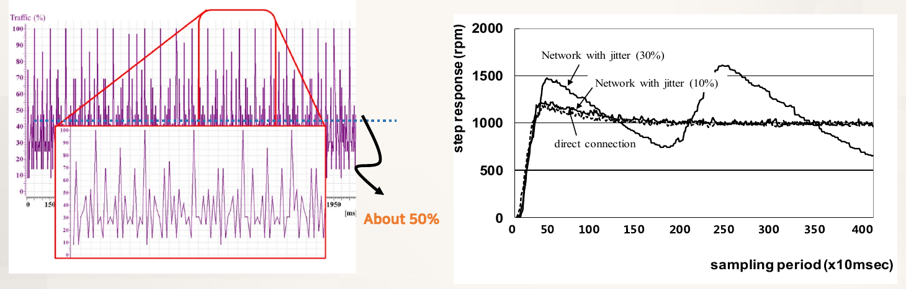

*그림 1. 차량 CAN 버스의 트래픽과 네트워크 지터에 따른 제어 응답*

그림 1의 왼쪽은 시간에 따른 CAN 버스의 트래픽(%)으로, 순간 값은 크게 출렁이지만 평균은 약 50%이다. 오른쪽은 회전수(rpm)를 1000으로 맞추는 제어 시스템의 계단 응답(step response)이다. 센서와 제어기를 직접 연결하면(direct connection) 응답이 목표값에 빠르게 수렴하지만, 네트워크를 거치면서 지터가 10%, 30%로 커지면 응답이 목표값을 크게 넘었다가(오버슈트) 출렁이며 늦게 수렴한다. 즉 지터는 단순한 지연이 아니라 제어 성능 자체를 떨어뜨린다.

CAN 설계에서는 이런 이유로 **전체 대역폭의 약 50% 이하로 트래픽을 유지할 것을 권장한다.** 버스 부하가 높을수록 낮은 우선순위 메시지의 대기 시간과 지터가 급격히 커지기 때문이다.

### 1.4 사건 기반 통신과 시간 기반 통신

차량 네트워크의 통신 방식은 메시지를 보내는 시점을 정하는 방법에 따라 두 가지로 나뉜다.

> **용어 정의:** **사건 기반(event-triggered) 통신** 은 보낼 사건(값의 변화, 요청)이 생길 때 메시지를 보내는 방식이다. **시간 기반(time-triggered) 통신** 은 미리 정한 시간표에 따라 정해진 시각에만 메시지를 보내는 방식이다.

| 구분 | 사건 기반 | 시간 기반 |
|:-----|:-----|:-----|
| 성격 | 비결정적 접근(nondeterministic approach): 메시지가 언제 전달될지 미리 정해지지 않는다. | 결정적 접근(deterministic approach): 메시지가 언제 전달될지 미리 정해진다. |
| 비유 | 자가용과 택시: 원할 때 바로 출발할 수 있다. | 기차와 비행기: 시간표에 따라 출발한다. |
| 장점 | 필요할 때 바로 보낼 수 있어 유연하고, 보낼 것이 없으면 대역폭을 쓰지 않는다. | 전달 시각과 지연이 보장되어 안전 관련 제어에 알맞고, 시스템을 검증하기 쉽다. |
| 단점 | 여러 메시지가 몰리면 교통 체증처럼 지연이 커지고 예측하기 어렵다. | 급한 메시지도 자기 차례를 기다려야 하고, 일정이 몰리면 붐비며, 노드를 추가하려면 시간표를 다시 짜야 한다. |
| 예 | CAN | TTP, FlexRay의 정적 구간, LIN의 스케줄 |

*표 3. 사건 기반 통신과 시간 기반 통신의 비교*

### 1.5 도메인별 IVN 비교

차량 기능은 요구하는 속도, 실시간성, 비용에 따라 여러 도메인으로 나뉘고, 도메인마다 알맞은 네트워크가 쓰인다.

| 도메인 | 요구 속도 | 비용 | 대표 프로토콜 |
|:-----|:-----|:-----|:-----|
| 바디(body) | 20 kbit/s 미만 | 낮음 | LIN |
| 바디(body) | 1 Mbit/s 미만 | 낮음 | CAN |
| 파워트레인(PT, powertrain) | 10 Mbit/s 미만 | 중간 | TTP/C |
| 섀시(chassis) | 20 Mbit/s 미만 | 중간 | FlexRay |
| 멀티미디어(multimedia) | 25 Mbit/s 미만 | 높음 | MOST |
| 안전(safety) | 100 Mbit/s 미만 | 매우 높음 | TTEthernet |

*표 4. 도메인별 요구 속도, 비용, 대표 프로토콜*

표 4는 오른쪽 아래로 갈수록 속도와 비용이 함께 올라가는 계단 모양의 관계를 보여 준다. 각 프로토콜의 특징은 다음과 같다.

**LIN(바디 도메인).**

- 개발 목적: 메카트로닉스 시스템(전기 모터와 기계 장치가 결합된 시스템)을 위한 통신 표준
- 설계 비용: 매우 낮다.
- 케이블: 단일 전선(single-wire) 연결
- 통신 속도: 최대 20 kbps
- 통신 방식: 마스터/슬레이브 방식을 쓰며, 시간 동기화에 의한 데이터 전송 방식을 쓸 수 있다.

**CAN(바디, 섀시 도메인).**

- 개발 목적: 범용으로 쓸 수 있는 버스 연결(universally usable bus connection)
- 케이블: 두 가닥의 꼬임쌍선(twisted pair). 50 kbps에서 최대 1 km까지 전송한다.
- 통신 속도: 최대 1 Mbps이며, 일반적으로 250 kbps를 쓴다. 전체 대역폭의 약 50% 이하로 트래픽을 유지할 것을 권장한다.
- 통신 방식: 식별자(ID) 경쟁을 통한 사건 기반 방식(우선순위 제어, priority-controlled)

**FlexRay(섀시 도메인).**

- 프로토콜 개발의 핵심 회원: BMW, Bosch, DaimlerChrysler, GM, Philips, Motorola, Volkswagen
- TTP/C가 제공하는 안전성과 Byteflight의 유연성을 함께 확보했다.
- 정적 구간은 시간 기반, 동적 구간은 사건 기반으로 동작한다(2.4절).
- 2004년에 프로토콜 규격이 공개되었고, 이후 버전 3.0까지 개정되었다 [1].

**MOST(멀티미디어 도메인).**

- 개발 목적: 꽂으면 바로 동작하는(plug-and-play) 멀티미디어 시스템
- 설계 비용: 비교적 비싸다.
- 케이블: 광케이블. 전자기 간섭이나 반사의 영향을 받지 않는다.
- 통신 속도: 최대 22.5 Mbps
- 통신 방식: 오디오, 영상 같은 동기식 부분은 시간 제어(time-controlled), 제어 메시지 같은 비동기식 부분은 사건 제어(event-controlled)로 보낸다.

**TTEthernet(안전 도메인).**

- 개발 목적: ADAS(첨단 운전자 보조 시스템)용 통합 네트워크
- 설계 비용: 비교적 낮다.
- 케이블: 꼬임쌍선. 회선 교환을 흉내 낸 방식(circuit switching emulation)으로 시간 기반 트래픽의 전달을 보장한다.
- 통신 속도: 최대 100 Mbps
- 하나의 이더넷 네트워크에서 세 종류의 트래픽을 함께 나른다. 시간 기반(TT, time-triggered) 트래픽은 SAE AS6802 [2], 속도 제한(RC, rate-constrained) 트래픽은 항공용 ARINC 664 Part 7, 최선형(BE, best-effort) 트래픽은 일반 IEEE 802.3 이더넷 규칙을 따른다.

> **용어 정의:** **ADAS(advanced driver assistance system, 첨단 운전자 보조 시스템)** 는 차선 유지, 긴급 제동, 적응형 순항 제어처럼 센서로 주변을 인식하여 운전자를 돕는 시스템이다.

### 1.6 서브 네트워크와 LIN의 위치

차량에는 큰 CAN 백본에 직접 붙지 않고 **서브 네트워크(sub-network)** 에 연결된 소형 ECU가 많다. 예를 들어 도어 하나에는 미러, 잠금장치, 창문 모터, 스위치가 있는데, 이들은 각각 단순한 일만 하고 데이터도 적다.

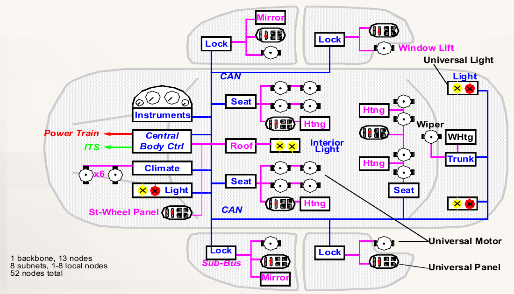

*그림 2. 차량의 CAN 백본과 서브 네트워크*

그림 2는 계기판(Instruments), 중앙 바디 제어기(Central Body Ctrl), 공조(Climate), 도어, 시트, 지붕(Roof) 같은 제어기를 CAN 백본(파란 선)으로 잇고, 각 제어기 아래에 미러, 잠금장치, 열선(Htng), 램프, 와이퍼, 트렁크 같은 소형 노드를 서브 버스(분홍 선)로 연결한 구성이다. 이 예는 백본 하나에 13개 노드, 서브넷 8개에 각각 1\~8개의 로컬 노드가 있어 모두 52개 노드로 이루어진다. 52개 노드를 모두 CAN으로 연결하면 비용이 크게 늘어나므로, 서브넷에는 더 싼 네트워크가 필요하다. 이것이 LIN이다.

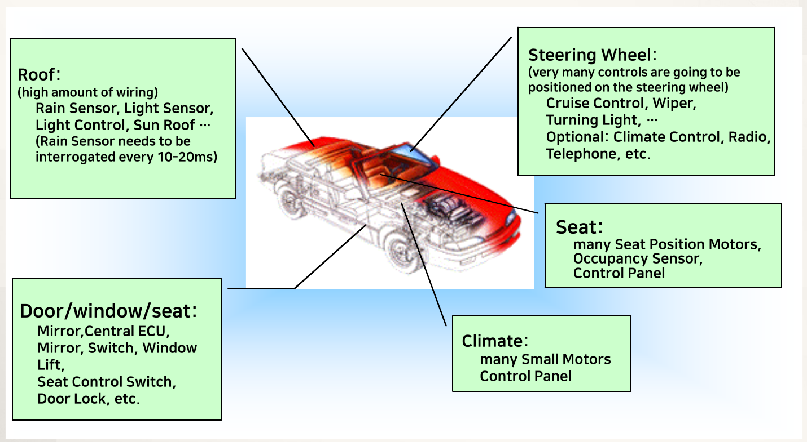

*그림 3. 차량에서 LIN이 쓰이는 곳*

그림 3이 보여 주는 LIN의 일반적인 활용은 다음과 같다.

| 위치 | LIN으로 연결하는 장치 |
|:-----|:-----|
| 지붕(roof) | 배선이 많은 곳이다. 레인 센서, 조도 센서, 라이트 제어, 선루프 등을 연결한다. 레인 센서는 10\~20 ms마다 상태를 물어야 한다. |
| 스티어링 휠 | 많은 조작 장치가 스티어링 휠로 모인다. 크루즈 컨트롤, 와이퍼, 방향 지시등을 연결하고, 선택적으로 공조, 라디오, 전화 조작도 연결한다. |
| 시트 | 시트 위치 조절 모터 여러 개, 탑승자 감지 센서, 조작 패널을 연결한다. |
| 공조 | 작은 모터 여러 개와 조작 패널을 연결한다. |
| 도어, 창문, 시트 | 미러, 중앙 ECU, 미러 스위치, 창문 리프트, 시트 조절 스위치, 도어 잠금장치 등을 연결한다. |

*표 5. 차량에서 LIN의 일반적인 활용*

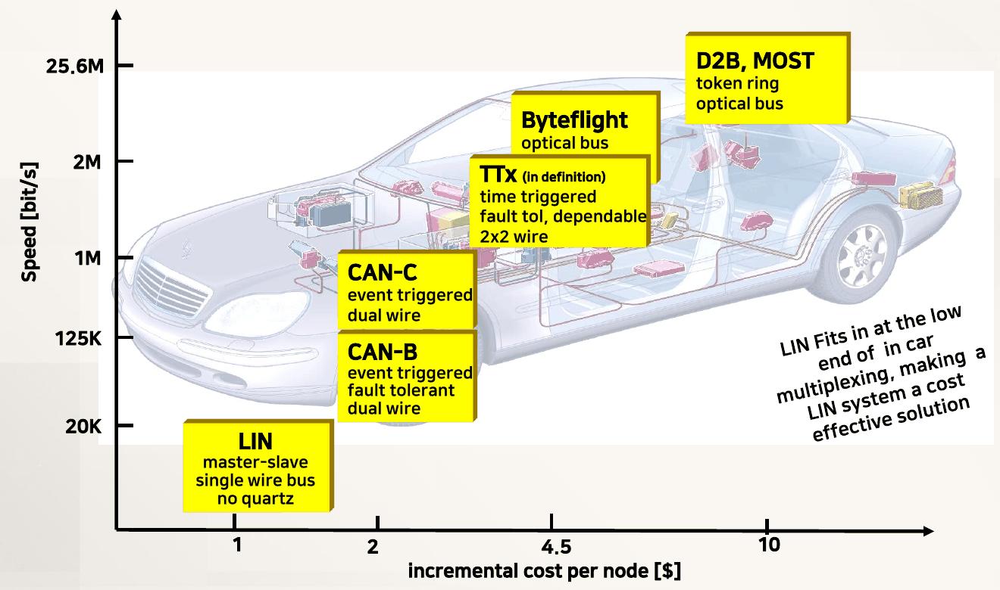

*그림 4. 노드당 추가 비용과 속도에 따른 차량용 네트워크의 위치*

그림 4는 가로축에 노드 하나를 추가하는 비용(달러), 세로축에 속도(bit/s)를 두고 네트워크를 배치한 것이다.

- **LIN:** 20 kbit/s, 노드당 약 1달러이다. 마스터/슬레이브 방식의 단일 전선 버스이며, 슬레이브에 수정 진동자(quartz)가 필요 없다.
- **CAN-B:** 125 kbit/s급 저속 CAN이다. 사건 기반이고 결함 허용(fault tolerant) 기능을 갖춘 두 가닥 전선이다.
- **CAN-C:** 1 Mbit/s급 고속 CAN이다. 사건 기반의 두 가닥 전선이다.
- **TTx:** 당시 정의 중이던 시간 기반 결함 허용 프로토콜의 자리로, 2×2가닥 전선을 쓴다. TTP/C나 FlexRay 같은 프로토콜이 이 자리에 해당한다.
- **Byteflight:** 2 Mbit/s급 광 버스이다.
- **D2B, MOST:** 25.6 Mbit/s급 토큰 링 방식의 광 버스이다.

가로축의 눈금 1, 2, 4.5, 10달러에는 대략 LIN, CAN(CAN-B와 CAN-C), TTx와 Byteflight, D2B와 MOST가 차례로 놓여, 속도가 높은 네트워크일수록 노드당 추가 비용도 높다. 그림의 설명처럼 LIN은 차량 내 다중화 네트워크의 저가 영역을 맡아, LIN 시스템을 비용 효율적인 해법으로 만든다.

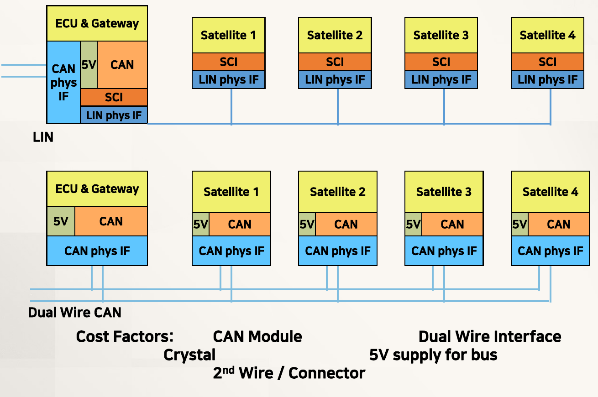

*그림 5. LIN과 두 가닥 CAN으로 구성한 서브 네트워크의 비교*

그림 5의 위쪽은 LIN으로, 아래쪽은 두 가닥 CAN으로 같은 서브 네트워크를 만든 것이다. LIN에서는 게이트웨이 역할을 하는 ECU만 CAN과 LIN을 모두 갖고, 위성 노드(satellite) 1\~4는 마이크로컨트롤러에 기본으로 있는 직렬 통신 인터페이스(SCI)와 LIN 물리 인터페이스만 있으면 된다. CAN으로 만들면 위성 노드마다 CAN 모듈, 수정 진동자(crystal), 버스용 5 V 전원, 두 가닥 인터페이스, 두 번째 전선과 커넥터가 추가로 필요하며, 이것이 비용 요인이다.

### 1.7 LIN 표준의 구성

LIN 표준은 프로토콜 규격만이 아니라 ECU 개발과 도구까지 아우르는 규격의 묶음이다.

| 수준 | 규격 | 내용 |
|:-----|:-----|:-----|
| 소프트웨어 | LIN API 규격 | 응용 프로그램이 LIN 통신 관리자를 쓰는 프로그래밍 인터페이스 |
| 소프트웨어 | LIN 프로토콜 규격 | 프레임 형식, 스케줄, 오류 처리 같은 통신 규칙 |
| 소프트웨어 | LIN 구성 언어(configuration language) | 네트워크의 노드, 신호, 프레임, 스케줄을 기술하는 파일 형식 |
| 소프트웨어 | 메시지와 식별자의 권장 사용법 | 식별자를 어떻게 배정할지에 대한 지침 |
| 하드웨어 | LIN 물리 계층 규격 | 버스 트랜시버와 전기적 특성 |
| 전체 | LIN 적합성 시험 규격(conformance test) | 장치가 규격을 지키는지 시험하는 방법 |

*표 6. LIN 표준을 이루는 규격*

도구로는 신호 데이터베이스를 관리하는 SDM/L(Signal Database Manager), 구성 언어로부터 설정을 만드는 LCFG(Network Configuration Generator), 버스 분석기(LINSpector) 등이 있다. 개발자는 신호 데이터베이스에서 네트워크 구성 파일을 만들고, 이 파일로 각 ECU의 통신 관리자를 설정하며, 버스 분석기로 실제 통신을 확인한다.

### 1.8 LIN의 개념과 특징

> **용어 정의:** **LIN(Local Interconnect Network)** 은 차량의 단순한 센서와 액추에이터를 위한 저가의 단일 전선 직렬 통신 프로토콜이다(3주차). 진단용 K-라인 규격인 ISO 9141을 개선한 물리 계층을 쓴다.

LIN의 특징은 다음과 같다 [3].

- **저가의 단일 전선(single wire):** 신호선 한 가닥과 차체 접지로 통신한다.
- **최대 20 kbit/s:** 전송 속도의 상한은 전자기 간섭(EMI) 때문에 정해진다. 신호가 빠르게 바뀔수록 전선이 안테나처럼 잡음을 내보내므로, 단일 전선에서는 속도를 낮게 유지한다.
- **단일 마스터와 다중 슬레이브(single master / multiple slave):** 마스터 하나가 통신을 모두 지휘한다.
- **중재가 필요 없다:** 마스터가 정한 순서대로만 보내므로 충돌이 일어나지 않는다.
- **공통 UART/SCI 하드웨어 기반:** 대부분의 마이크로컨트롤러가 이미 갖고 있는 범용 비동기 직렬 통신 장치(UART, SCI)로 구현할 수 있어 실리콘 비용이 낮다.
- **자가 동기화(self synchronization):** 슬레이브 노드는 수정 진동자나 세라믹 공진기 없이 내부의 부정확한 발진기를 쓰고, 마스터가 보내는 동기 필드로 자기 속도를 맞춘다(1.11절).
- **하드웨어 플랫폼 가격의 획기적인 절감:** 위의 특징 덕분에 노드당 비용이 크게 낮다.
- **예측 가능성:** 한 번의 전송에 걸리는 지연 시간이 보장된다.

> **용어 정의:** **UART(universal asynchronous receiver/transmitter)** 와 **SCI(serial communication interface)** 는 별도의 클록 선 없이 시작 비트와 정지 비트로 한 바이트씩 직렬 전송하는 하드웨어 장치이다. 두 이름은 제조사에 따라 같은 장치를 부르는 말이다.

### 1.9 마스터와 슬레이브의 역할

LIN은 마스터/슬레이브 프로토콜이다. 노드 안의 역할을 **태스크(task)** 로 나누어, 마스터 노드는 마스터 태스크와 슬레이브 태스크를 모두 갖고, 슬레이브 노드는 슬레이브 태스크만 갖는다.

**마스터 태스크(master task).** 마스터는 전체 버스와 프로토콜을 통제한다. 버스에 어느 메시지가 언제 전송될지를 제어하고, 오류 통제도 담당한다.

- 메시지의 순서와 우선순위를 결정한다.
- 동기 브레이크(sync break), 동기 바이트(sync byte), 식별자 필드(ID field)를 보낸다. 즉 모든 프레임의 머리(header)를 마스터가 보낸다.
- 데이터 바이트와 체크 바이트를 모니터링하여 일치하는지 평가한다.
- 클록의 기준(reference) 역할을 한다. 그래서 마스터에는 안정된 클록(수정 진동자)이 필요하다.
- 버스가 비활성 상태일 때 슬레이브 노드가 보내는 웨이크업 브레이크(wake-up break)를 받고, 필요하면 동작을 시작한다.

**슬레이브 태스크(slave task).** 슬레이브는 버스에 연결된 2\~16개 구성원 가운데 하나로, 마스터가 해당 식별자를 보내면 데이터를 받거나 보낸다.

- 버스의 식별자를 모니터링한다.
- 식별자에 따라 무엇을 할지(데이터 수신, 데이터 송신, 대기) 결정한다.
- 송신할 차례이면 데이터(1\~8바이트)와 체크 바이트를 보낸다.
- 마스터 노드도 슬레이브 태스크를 가지므로, 마스터가 자기 데이터를 보낼 때는 슬레이브가 될 수도 있다.

### 1.10 시간 기반 스케줄과 메시지 길이

LIN은 시간 기반 방식이다. 마스터는 미리 정한 **스케줄 표(schedule table)** 에 따라 정해진 시각마다 정해진 식별자의 프레임 머리를 보낸다. 각 프레임은 스케줄 표에서 자기 시간 칸인 **프레임 슬롯(frame slot)** 을 가진다.

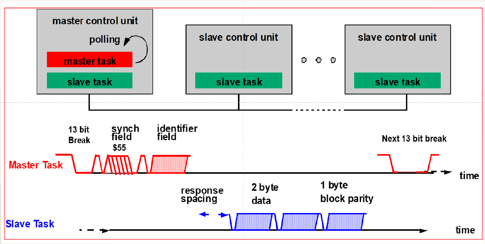

*그림 6. LIN의 시간 기반 동작: 마스터 태스크의 머리와 슬레이브 태스크의 응답*

그림 6의 위쪽은 마스터 제어 장치(master control unit)와 슬레이브 제어 장치들이다. 마스터 제어 장치 안의 마스터 태스크가 스케줄에 따라 폴링(polling)하고, 모든 제어 장치에 슬레이브 태스크가 있다. 아래쪽 시간축에서 마스터 태스크는 13비트 브레이크, 동기 필드(16진수 55), 식별자 필드를 보내고, 응답 간격(response spacing) 뒤에 해당 슬레이브 태스크가 2바이트 데이터와 1바이트 블록 패리티(체크섬)를 보낸다. 다음 프레임은 다음 13비트 브레이크로 시작한다.

시간을 보장하려면 각 메시지의 길이가 예측 가능해야 한다.

- 메시지마다 보내는 데이터 바이트 수가 정해져 있으므로 최소 길이를 계산할 수 있다.
- 각 메시지는 최소 길이의 **140%** 를 길이 예산(length budget)으로 가진다. 바이트 사이에 생길 수 있는 작은 간격과 응답 지연을 위한 여유이다.
- 그 결과 메시지의 최대 허용 길이가 정해지고, 스케줄 표에서 두 메시지 사이의 간격이 정해진다.

**프레임 시간 계산.** LIN 2.x 규격은 공칭 프레임 시간을 다음처럼 정의한다 [3]. 바이트 하나는 시작 비트와 정지 비트를 포함해 10비트이고, 머리는 브레이크와 브레이크 구분자, 동기 바이트, 식별자 바이트로 34비트이다.

```math
T_{header} = 34 \times T_{bit}, \quad T_{response} = 10 \times (N_{data} + 1) \times T_{bit}, \quad T_{frame,max} = 1.4 \times (T_{header} + T_{response})
```

여기서 $N_{data}$는 데이터 바이트 수이고, $+1$은 체크섬 바이트이다. 19.2 kbit/s($`T_{bit} \approx 52.1\ \mu`$s)에서 계산하면 다음과 같다.

| 데이터 바이트 수 | 공칭 비트 수 | 공칭 프레임 시간 | 최대 프레임 시간(140%) |
|:-----|:-----|:-----|:-----|
| 2 | $34 + 10 \times 3 = 64$ | 3.33 ms | 4.67 ms |
| 4 | $34 + 10 \times 5 = 84$ | 4.38 ms | 6.13 ms |
| 8 | $34 + 10 \times 9 = 124$ | 6.46 ms | 9.04 ms |

*표 7. 19.2 kbit/s에서 LIN 프레임 시간*

예를 들어 4바이트 프레임에는 스케줄 표에서 최소 6.13 ms의 프레임 슬롯을 주어야 한다. 레인 센서를 10 ms마다 물어야 한다면, 그 사이에 다른 프레임을 넣을 수 있는 시간도 이 계산으로 정한다.

### 1.11 LIN 메시지 프레임

LIN 프레임은 마스터가 보내는 **메시지 머리(message header)** 와 슬레이브가 보내는 **메시지 응답(message response)** 으로 이루어진다.

```text
|<------------- message header ------------->|<------------- message response ------------->|
┌──────────────────┬───────────┬─────────────┬───────────────────────────────┬──────────────┐
│   synch break    │synch field│ identifier  │      0 to 8 data fields       │   checksum   │
│  (>= 13 bits     │ (0x55)    │  field      │                               │              │
│   dominant)      │           │  (6 + 2)    │                               │              │
└──────────────────┴───────────┴─────────────┴───────────────────────────────┴──────────────┘

each byte field (SCI / UART format, 10 bits):
┌───────┬─────┬─────┬─────┬─────┬─────┬─────┬─────┬─────┬──────┐
│ start │  0  │  1  │  2  │  3  │  4  │  5  │  6  │  7  │ stop │
│  (0)  │ LSB │     │     │     │     │     │     │ MSB │  (1) │
└───────┴─────┴─────┴─────┴─────┴─────┴─────┴─────┴─────┴──────┘
```

*그림 7. LIN 메시지 프레임과 바이트 필드의 구성*

각 필드는 다음과 같다.

- **동기 브레이크(synch break):** 13비트 이상 이어지는 우성(0) 구간과 그 뒤의 짧은 열성 구분자이다. 보통의 바이트는 0이 최대 9비트(시작 비트와 데이터 8비트)까지만 이어지므로, 13비트 이상의 0은 새 프레임의 시작임을 확실히 알린다.
- **동기 필드(synch field):** 16진수 55(2진수 01010101)를 보낸다. 바이트는 최하위 비트(LSB)부터 보내므로 실제 선 위의 비트열은 시작 비트 0, 1, 0, 1, 0, 1, 0, 1, 0, 정지 비트 1이 되어 매 비트마다 값이 바뀐다. 이 바이트는 시간 기준(time base)을 정하기 위한 특정 패턴으로, 슬레이브는 에지 사이의 시간 간격을 재어 비트 시간을 알아낸다. 예를 들어 첫 하강 에지(시작 비트의 시작)부터 마지막 하강 에지(비트 7의 시작)까지는 정확히 8비트 시간이므로, 그 시간을 8로 나누면 비트 시간이 된다. 동기 바이트는 모든 메시지 프레임의 앞에 온다.
- **식별자 필드(identifier field):** 메시지 식별자이다. 아래에서 자세히 다룬다.
- **데이터 필드(data field):** 1\~8개의 데이터 바이트이다. 각 바이트는 UART 형식으로 시작 비트, 데이터 8비트(LSB부터), 정지 비트의 10비트로 보낸다.
- **체크섬(checksum):** 전송 오류를 검사하는 1바이트이다.

**식별자 필드.** 마스터 노드가 모든 LIN 노드로 보내는 8비트 필드로, 6비트 식별자와 2비트 패리티로 이루어진다.

- 6비트이므로 서로 다른 식별자는 $2^6 = 64$개이다.
- 식별자는 받는 노드의 주소가 아니라 메시지의 내용을 나타낸다. 식별자에 따라 어느 노드가 보내고 어느 노드들이 받는지, 데이터가 무엇이고 길이가 얼마인지가 정해진다. 보통 식별자는 그 뒤에 LIN 버스로 전송되는 신호와 관련된다.
- 식별자를 잘못 읽으면 다른 노드가 응답하게 되므로, 중요한 식별자를 보호하기 위해 패리티 비트 2개를 붙인다. 6비트 식별자에 패리티를 붙인 8비트를 **보호 식별자(PID, protected identifier)** 라 한다.
- 식별자는 LIN 슬레이브 노드를 슬립 모드(sleep mode)로 들어가게 할 수도 있다. 이 경우 그 뒤로 LIN 버스에서 데이터가 전송되지 않는다. LIN 2.x에서는 진단용 식별자 60(16진수 3C)의 첫 데이터 바이트를 0으로 보내는 것이 슬립 명령이다 [3].

패리티 비트는 식별자 비트 $ID_0 \sim ID_5$로 다음과 같이 계산한다($\oplus$는 XOR) [3].

```math
P_0 = ID_0 \oplus ID_1 \oplus ID_2 \oplus ID_4, \qquad P_1 = \overline{ID_1 \oplus ID_3 \oplus ID_4 \oplus ID_5}
```

**계산 예.** 식별자 16진수 10(2진수 010000, 즉 $ID_4 = 1$이고 나머지는 0)의 보호 식별자를 구한다.

1. $P_0 = 0 \oplus 0 \oplus 0 \oplus 1 = 1$
2. $ID_1 \oplus ID_3 \oplus ID_4 \oplus ID_5 = 0 \oplus 0 \oplus 1 \oplus 0 = 1$이므로 $P_1 = \overline{1} = 0$
3. 비트 7부터 $P_1, P_0, ID_5, \ldots, ID_0$ 순서로 쓰면 0101 0000, 즉 보호 식별자는 16진수 50이다.

**데이터 길이.** LIN 1.x 규격에서는 식별자의 상위 두 비트 $ID_5, ID_4$가 데이터 바이트 수를 정했다. 00과 01은 2바이트, 10은 4바이트, 11은 8바이트로, 64개의 식별자가 16개씩 네 묶음으로 나뉜다 [4]. LIN 2.x부터는 데이터 길이를 구성 파일에서 1\~8바이트로 자유롭게 정한다 [3].

> **참고:** 데이터 길이를 1, 2, 4, 8바이트의 네 종류로, 그 부호의 위치를 식별자 필드의 하위 두 비트로 설명하는 자료도 있다. LIN 1.3 규격에서 길이를 정하는 것은 6비트 식별자의 상위 두 비트 $ID_5, ID_4$이며, 길이는 2, 2, 4, 8바이트이다 [4].

**체크섬.** 체크섬은 바이트들을 **자리올림을 되돌려 더하는 8비트 합**(합이 255를 넘으면 255를 빼는 덧셈)으로 더한 뒤 모든 비트를 반전한 값이다. 더하는 범위에 따라 두 종류가 있다 [3].

- **고전 체크섬(classic checksum):** 데이터 바이트만 더한다. LIN 1.x와 진단 프레임에서 쓴다.
- **향상 체크섬(enhanced checksum):** 보호 식별자와 데이터 바이트를 함께 더한다. LIN 2.x의 일반 프레임에서 쓴다.

**계산 예.** 데이터 4A, 55, 93, E5(16진수)의 고전 체크섬을 구한다.

| 단계 | 계산 | 누적 합 |
|:-----|:-----|:-----|
| 1 | 4A | 4A |
| 2 | 4A + 55 = 9F | 9F |
| 3 | 9F + 93 = 132, 255(FF)를 넘으므로 132 - FF = 33 | 33 |
| 4 | 33 + E5 = 118, 118 - FF = 19 | 19 |
| 5 | 19의 비트 반전: 0001 1001 → 1110 0110 | E6 |

*표 8. 고전 체크섬의 계산 과정*

체크섬은 16진수 E6이다. 수신자가 데이터 바이트와 체크섬을 같은 방식으로 모두 더하면 결과가 FF가 되어야 오류가 없다($`19 + E6 = FF`$). 같은 데이터에 보호 식별자 50을 포함하는 향상 체크섬은 50부터 더하기 시작하여 누적 합이 69가 되고, 반전하면 96이 된다.

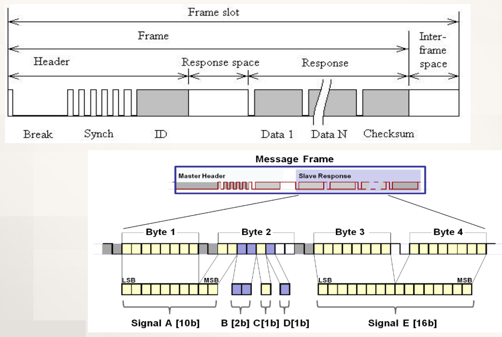

*그림 8. LIN의 프레임 슬롯과 데이터 바이트 안의 신호 배치*

그림 8의 위쪽은 하나의 **프레임 슬롯**이 머리(브레이크, 동기, 식별자), 응답 공간(response space), 응답(데이터 1\~N, 체크섬), 프레임 간 공간(inter-frame space)으로 이루어짐을 보여 준다. 응답 공간은 슬레이브가 식별자를 해석하고 응답을 준비하는 시간이다. 아래쪽은 데이터 바이트 안에 여러 **신호(signal)** 가 비트 단위로 묶여 들어가는 모습이다. 바이트 1\~4의 32비트 안에 10비트 신호 A, 2비트 신호 B, 1비트 신호 C와 D, 16비트 신호 E가 들어 있으며, 각 신호는 LSB부터 차례로 놓인다. 예를 들어 신호 A는 바이트 1의 8비트와 바이트 2의 하위 2비트를 쓴다. 이처럼 프레임은 운반 단위이고, 응용이 실제로 쓰는 값은 그 안의 신호이다.

### 1.12 LIN 통신의 세 가지 유형

LIN 통신의 공통 성질은 다음과 같다.

- 단일 마스터, 다중 슬레이브 프로토콜이다.
- 시간 기반이며 중재가 없다.
- 식별자는 메시지 내용을 나타내며, 물리 주소는 없다.
- 하나의 응답을 여러 노드가 함께 받을 수 있는 멀티캐스트 메시지이다.
- 전송 속도(baud rate)는 프로토콜(동기 필드)을 통해 동기화된다.
- 슬립 모드를 통해 전력을 절약한다.

머리는 항상 마스터 태스크가 보내지만, 응답을 누가 보내고 누가 받는지에 따라 세 가지 유형이 있다.

| 유형 | 머리를 보내는 태스크 | 응답을 보내는 태스크 | 응답을 받는 태스크 |
|:-----|:-----|:-----|:-----|
| 슬레이브에서 마스터로 | 마스터 노드의 마스터 태스크 | 슬레이브 노드의 슬레이브 송신 태스크 | 마스터 노드의 슬레이브 수신 태스크 |
| 마스터에서 슬레이브들로 | 마스터 노드의 마스터 태스크 | 마스터 노드의 슬레이브 송신 태스크 | 슬레이브 노드 A, B의 슬레이브 수신 태스크 |
| 슬레이브에서 슬레이브로 | 마스터 노드의 마스터 태스크 | 슬레이브 노드 A의 슬레이브 송신 태스크 | 슬레이브 노드 B의 슬레이브 수신 태스크 |

*표 9. LIN 통신의 세 가지 유형*

예를 들어 슬레이브에서 마스터로 보내는 경우, 마스터가 도어 스위치 상태를 뜻하는 식별자의 머리를 보내면 도어 스위치 노드가 그 상태를 응답으로 보내고, 마스터가 이를 받는다. 슬레이브에서 슬레이브로 보내는 경우에도 머리는 마스터가 보내므로, 두 슬레이브가 직접 통신하더라도 그 시점은 마스터의 스케줄이 정한다.

### 1.13 메시지 지연

센서의 값이 바뀐 때부터 그 값을 다른 노드의 응용이 쓰기까지는 여러 단계의 지연이 쌓인다.

```text
 notional     new value      start of      completion of   new value        notional
 generation   available for  frame         frame           available for    consumption
     |        transmission   transmission  transmission    read call            |
     |             |              |              |              |               |
-----+-------------+--------------+--------------+--------------+---------------+-----> time
     | generation  |  scheduling  |   message    | notification |  consumption  |
     |  latency    |   latency    |   length     |   latency    |   latency     |
     |  (signal)   |   (frame)    |   (frame)    |   (frame)    |   (signal)    |
                   |<------------ LIN availability time ------->|
     |<---------------------------- maximum age (signal) ---------------------->|
```

*그림 9. LIN 메시지가 생성되어 소비되기까지의 지연 구성*

| 지연 | 단위 | 의미 |
|:-----|:-----|:-----|
| 생성 지연(generation latency) | 신호 | 물리적인 값이 바뀐 때부터 응용이 새 값을 전송할 수 있게 내놓을 때까지 |
| 스케줄 지연(scheduling latency) | 프레임 | 새 값이 준비된 때부터 그 값을 담은 프레임의 전송이 시작될 때까지. 스케줄 표에서 다음 프레임 슬롯을 기다리는 시간이다. |
| 메시지 길이(message length) | 프레임 | 프레임을 전송하는 데 걸리는 시간(1.10절) |
| 통지 지연(notification latency) | 프레임 | 프레임 수신이 끝난 때부터 수신 노드의 응용이 새 값을 읽을 수 있을 때까지 |
| 소비 지연(consumption latency) | 신호 | 응용이 새 값을 읽어 실제로 쓰기까지 |

*표 10. LIN 메시지 지연의 구성 요소*

가운데 세 지연을 합친 것이 **LIN 가용 시간(LIN availability time)**, 즉 LIN 통신이 책임지는 부분이다. 다섯 지연을 모두 합친 것이 신호의 **최대 나이(maximum age)**, 즉 소비되는 값이 실제 물리 값보다 얼마나 오래된 값일 수 있는지이다. LIN은 시간 기반이므로 스케줄 지연과 메시지 길이의 최댓값을 미리 계산할 수 있고, 따라서 최대 나이도 보장할 수 있다.

---

<br>

## 2. FlexRay와 차량용 이더넷

### 2.1 FlexRay의 개요

> **용어 정의:** **FlexRay** 는 차량의 안전 관련 실시간 제어를 위해 만든 결함 허용(fault tolerant) 고속 버스 시스템이다. 한 통신 주기 안에 시간 기반의 정적 구간과 사건 기반의 동적 구간을 함께 둔다(3주차).

FlexRay가 만들어진 배경은 다음과 같다.

- 제어 장치 사이의 통신량이 늘어나면서, 기존 CAN보다 빠르면서도 신뢰도를 확보할 수 있는 통신이 필요해졌다.
- BMW가 에어백 같은 용도로 개발한 광 버스 Byteflight와 시간 기반 프로토콜 TTP를 바탕으로, BMW와 DaimlerChrysler가 함께 개발을 시작했다.
- FlexRay 컨소시엄은 Byteflight의 시간 결정성(time determination)과 오류 허용 한계(error tolerance) 같은 특성을 발전시켰다. 컨소시엄에는 Freescale, Bosch, NXP, BMW, Volkswagen, Daimler, GM 등이 참여했다.
- BMW X5(E70)를 시작으로 많은 BMW, Audi, Mercedes-Benz, Land Rover, Volvo 차량에 양산 적용되었다.

### 2.2 FlexRay의 특성

| 특성 | 내용 |
|:-----|:-----|
| 동기식(synchronous) 프레임 전송 | 미리 정한 시간 슬롯에 보내므로 프레임 지연 시간(frame latency)과 지터(jitter)가 보장된다. |
| 비동기식(asynchronous) 프레임 전송 | 필요할 때 보내며, 프레임 사이의 우선순위(prioritization)를 조정할 수 있다. |
| 멀티 마스터 클록 동기화 | 특정 마스터 없이 여러 노드가 함께 전체 시간을 맞추는 분산 클록 동기화를 한다. |
| 버스 가디언(bus guardian) | 오류 검출과 오류 방지 기능을 버스 가디언 장치로 수행한다. |
| 확장 가능한 결함 허용(scalable fault tolerance) | 채널 하나로도, 두 채널로도 구성할 수 있다. |

*표 11. FlexRay의 특성*

> **용어 정의:** **버스 가디언(bus guardian)** 은 노드가 자기에게 배정된 시간 슬롯 밖에서 송신하지 못하도록 송신기를 막는 독립된 감시 장치이다. 고장 난 노드가 아무 때나 신호를 내보내 버스 전체를 마비시키는 현상(babbling idiot)을 막는다.

FlexRay는 채널 A와 B의 두 채널을 가질 수 있고, 각 채널은 최대 10 Mbit/s로 동작한다. 두 채널에 같은 데이터를 보내면 한 채널이 고장 나도 통신이 유지되고(이중화), 서로 다른 데이터를 보내면 모두 20 Mbit/s를 쓸 수 있다 [1]. 1.2절의 "채널당 10 Mbit/s(두 채널을 따로 쓰면 20 Mbit/s)"와 표 4의 "20 Mbit/s 미만"이 이 뜻이다.

### 2.3 FlexRay 노드의 구조

FlexRay 노드(ECU)는 다음 구성 요소로 이루어진다(규격 버전 2.1의 노드 구조).

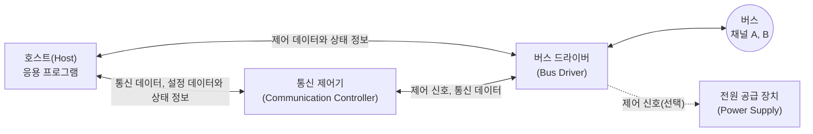

*그림 10. FlexRay 노드의 구성 요소와 인터페이스*

- **호스트(host):** 응용 프로그램을 실행하는 마이크로컨트롤러이다. 통신 제어기에 보낼 데이터를 쓰고 받은 데이터를 읽으며, 통신 제어기를 설정하고 상태를 읽는다.
- **통신 제어기(CC, communication controller):** FlexRay 프로토콜을 실행한다. 프레임의 부호화와 복호화, 시간 슬롯에 맞춘 송신, 클록 동기화를 맡는다.
- **버스 드라이버(BD, bus driver):** 통신 제어기의 논리 신호를 버스의 전기 신호로 바꾸는 트랜시버이다. 호스트는 버스 드라이버의 동작 모드를 제어하고 상태를 읽는다.
- **전원 공급 장치:** 버스 드라이버가 웨이크업 신호를 감지하면 전원을 켜는 식으로 선택적으로 연동된다.

통신 제어기 안의 프로토콜 처리는 다음 블록으로 나뉜다.

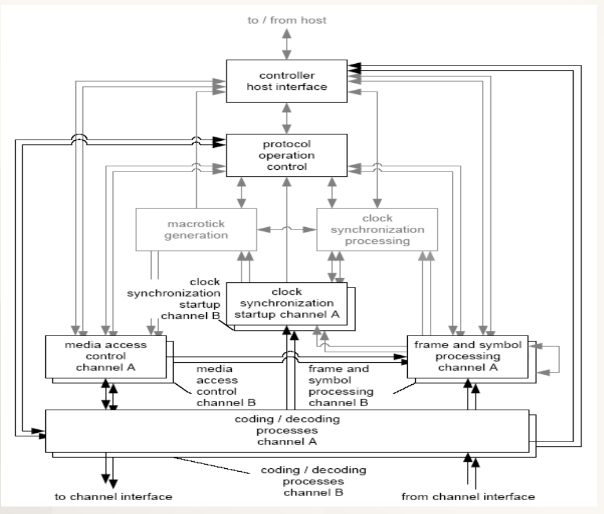

*그림 11. FlexRay 통신 제어기의 프로토콜 처리 블록*

| 블록 | 역할 |
|:-----|:-----|
| 제어기 호스트 인터페이스(controller host interface) | 호스트와 데이터, 설정, 상태를 주고받는다. |
| 프로토콜 운영 제어(protocol operation control) | 시동, 정상 동작, 정지 같은 전체 동작 상태를 관리한다. |
| 매크로틱 생성(macrotick generation) | 네트워크 공통 시간 단위인 매크로틱을 만든다. |
| 클록 동기화 처리(clock synchronization processing) | 다른 노드의 동기 프레임 도착 시각으로 자기 클록의 오차를 계산하고 보정한다. |
| 클록 동기화 시동(clock synchronization startup, 채널 A, B) | 네트워크를 처음 시작할 때 공통 시간을 세운다. |
| 매체 접근 제어(media access control, 채널 A, B) | 통신 사이클에 따라 언제 보낼지 정한다. |
| 프레임과 심볼 처리(frame and symbol processing, 채널 A, B) | 받은 프레임과 심볼의 형식과 시간이 올바른지 검사한다. |
| 부호화와 복호화(coding / decoding, 채널 A, B) | 프레임을 비트 열로 바꾸어 채널 인터페이스로 보내고, 그 반대로 바꾼다. |

*표 12. FlexRay 통신 제어기의 처리 블록*

### 2.4 통신 사이클의 구조

FlexRay는 시간 동기화가 된 형태이므로, 각 노드는 자기에게 할당된 시간에 데이터를 보낸다. 그래서 노드를 추가하면 스케줄을 바꾸어야 하고, 긴급한 데이터를 보낼 때도 자기 순서를 기다려야 한다.

FlexRay의 매체 접근은 반복되는 **통신 사이클(communication cycle)** 에 기반한다. 사이클에는 0부터 63까지 번호가 붙고, 64개 사이클마다 처음으로 돌아간다. 한 사이클은 네 부분으로 이루어진다.

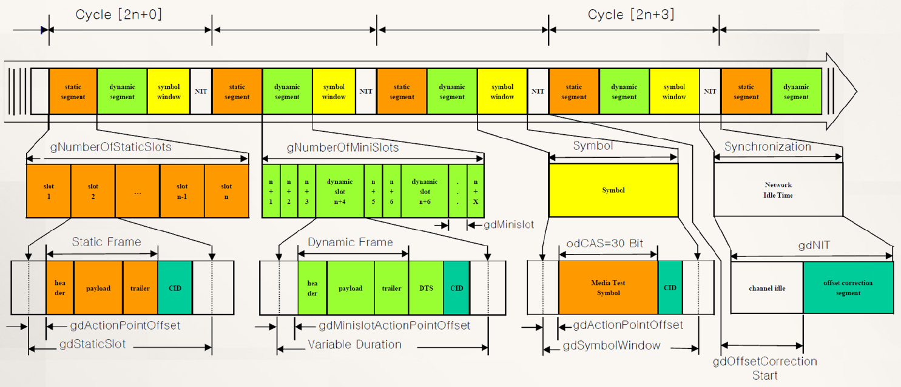

*그림 12. FlexRay 통신 사이클의 구조*

| 부분 | 내용 |
|:-----|:-----|
| 정적 구간(static segment) | 길이가 같은 정적 슬롯(static slot) `gNumberOfStaticSlots`개로 이루어진다. 각 슬롯은 한 노드에 배정되며, 그 노드는 슬롯 시작에서 `gdActionPointOffset`만큼 지난 시점(동작점, action point)부터 정적 프레임을 보낸다. 프레임 뒤에는 채널 유휴 구분자(CID)가 온다. |
| 동적 구간(dynamic segment) | 짧은 미니슬롯(minislot) `gNumberOfMinislots`개로 이루어진다. 보낼 것이 있는 노드만 보내며, 동적 프레임은 여러 미니슬롯에 걸쳐 가변 길이로 놓인다(2.7절). 프레임 끝에는 DTS와 CID가 온다. |
| 심볼 창(symbol window) | 매체 시험 심볼(MTS, media test symbol) 같은 특수 심볼을 보내는 구간이다. 그림 12에서 심볼의 길이는 30비트(odCAS = 30비트)이다. 선택 사항이다. |
| 네트워크 유휴 시간(NIT, network idle time) | 아무도 보내지 않는 구간이다. 각 노드는 이 시간에 클록 보정값을 계산하고, 그 가운데 오프셋 보정 구간(offset correction segment)에서 보정을 적용한다. |

*표 13. FlexRay 통신 사이클의 구성*

그림 12의 위쪽 띠는 사이클이 정적 구간, 동적 구간, 심볼 창, NIT의 순서로 반복되는 모습이고, 아래쪽은 각 부분을 확대한 것이다. 정적 구간의 슬롯 1\~n은 모두 같은 길이(`gdStaticSlot`)이고, 동적 구간의 동적 슬롯은 보낸 프레임의 길이에 따라 차지하는 미니슬롯 수가 달라진다(`Variable Duration`).

FlexRay의 시간은 네 수준의 계층으로 구성된다.

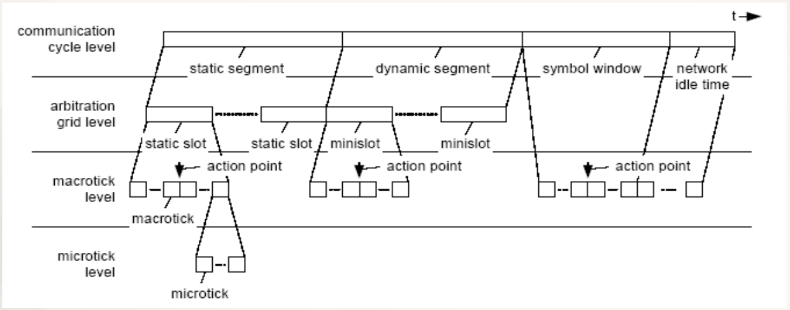

*그림 13. FlexRay 매체 접근 제어의 시간 계층*

| 수준 | 단위 | 의미 |
|:-----|:-----|:-----|
| 통신 사이클 수준 | 정적 구간, 동적 구간, 심볼 창, NIT | 사이클을 이루는 부분 |
| 중재 격자 수준(arbitration grid level) | 정적 슬롯, 미니슬롯 | 매체 접근을 결정하는 단위. 각 슬롯과 미니슬롯 안에 동작점(action point)이 있다. |
| 매크로틱 수준 | 매크로틱(macrotick) | 모든 노드가 공유하는 네트워크 공통 시간 단위. 슬롯과 미니슬롯은 정수 개의 매크로틱으로 이루어진다. |
| 마이크로틱 수준 | 마이크로틱(microtick) | 각 노드의 발진기에서 나오는 지역 시간 단위. 매크로틱 하나는 여러 마이크로틱으로 이루어지며, 클록 보정은 매크로틱에 들어가는 마이크로틱 수를 조절하여 한다. |

*표 14. FlexRay의 시간 계층*

### 2.5 FlexRay 프레임 형식

FlexRay 프레임은 머리(header), 페이로드(payload), 꼬리(trailer)로 이루어진다.

```text
|<------------------------- header (5 bytes) -------------------------->|<- payload ->|<- trailer ->|
┌──┬──┬──┬──┬──┬───────────┬────────────┬──────────────┬────────────────┬─────────────┬─────────────┐
│ 1│ 2│ 3│ 4│ 5│  Frame ID │  Payload   │  Header CRC  │  Cycle count   │  Data 0..n  │     CRC     │
│  │  │  │  │  │           │   length   │              │                │             │  (24 bits)  │
└──┴──┴──┴──┴──┴───────────┴────────────┴──────────────┴────────────────┴─────────────┴─────────────┘
|<-- 5 bits -->|  11 bits      7 bits       11 bits          6 bits       0-254 bytes     24 bits
         |<-- covered by header CRC --->|
 1: reserved  2: payload preamble indicator  3: null frame indicator
 4: sync frame indicator  5: startup frame indicator
```

*그림 14. FlexRay 프레임의 형식*

| 필드 | 비트 수 | 의미 |
|:-----|:-----|:-----|
| 예약 비트(reserved) | 1 | 항상 0으로 보낸다. |
| 페이로드 프리앰블 표시자(payload preamble indicator) | 1 | 1이면 페이로드 앞부분에 특수 정보가 있다. 정적 프레임에서는 0\~12바이트의 네트워크 관리(NW management) 벡터, 동적 프레임에서는 2바이트 메시지 ID이다. 0이면 보통의 페이로드이다. |
| 널 프레임 표시자(null frame indicator) | 1 | 0이면 유효한 데이터가 없는 널 프레임, 1이면 보통 프레임이다. 정적 슬롯은 보낼 데이터가 없어도 비워 둘 수 없으므로 널 프레임을 보낸다. |
| 동기 프레임 표시자(sync frame indicator) | 1 | 1이면 클록 동기화에 쓰는 동기 프레임이다. |
| 시동 프레임 표시자(startup frame indicator) | 1 | 1이면 네트워크 시동에 쓰는 시동 프레임이다. |
| 프레임 ID(frame ID) | 11 | 프레임을 보내는 슬롯 번호이다. 1\~2047을 쓴다. |
| 페이로드 길이(payload length) | 7 | 페이로드의 길이를 2바이트 단위(word)로 나타낸다. 0\~127워드, 즉 0\~254바이트(0\~2,032비트)이다. |
| 머리 CRC(header CRC) | 11 | 동기 프레임 표시자, 시동 프레임 표시자, 프레임 ID, 페이로드 길이를 보호하는 CRC이다. |
| 사이클 카운트(cycle count) | 6 | 현재 통신 사이클의 번호 0\~63이다. |
| 페이로드(payload) | 0\~2,032 | 실제 데이터이다. |
| 꼬리 CRC(trailer CRC) | 24 | 머리와 페이로드 전체를 보호하는 24비트 CRC이다. |

*표 15. FlexRay 프레임의 필드*

페이로드 길이를 2바이트 단위로 세므로, 7비트로 $127 \times 2 = 254$바이트까지 나타낸다. CAN의 최대 8바이트와 비교하면 한 프레임에 30배 이상의 데이터를 실을 수 있다.

### 2.6 정적 프레임과 동적 프레임의 비트 열

프레임의 각 바이트는 실제 선 위에서 다음 시퀀스와 함께 전송된다.

| 약어 | 이름 | 내용 |
|:-----|:-----|:-----|
| TSS | 전송 시작 시퀀스(transmission start sequence) | 프레임 맨 앞의 3\~15비트 저(low) 구간. 버스 드라이버와 스타 커플러가 신호 경로를 여는 시간을 준다. |
| FSS | 프레임 시작 시퀀스(frame start sequence) | TSS 뒤의 고(high) 1비트 |
| BSS | 바이트 시작 시퀀스(byte start sequence) | 모든 바이트 앞의 2비트(고, 저). 바이트마다 하강 에지를 만들어 수신자가 비트 타이밍을 다시 맞추게 한다. |
| FES | 프레임 끝 시퀀스(frame end sequence) | 마지막 바이트 뒤의 2비트(저, 고) |
| DTS | 동적 꼬리 시퀀스(dynamic trailing sequence) | 동적 프레임에만 FES 뒤에 붙는다. 프레임의 끝을 다음 미니슬롯의 동작점에 맞추는 가변 길이 구간이다. |

*표 16. FlexRay 프레임의 부호화 시퀀스*

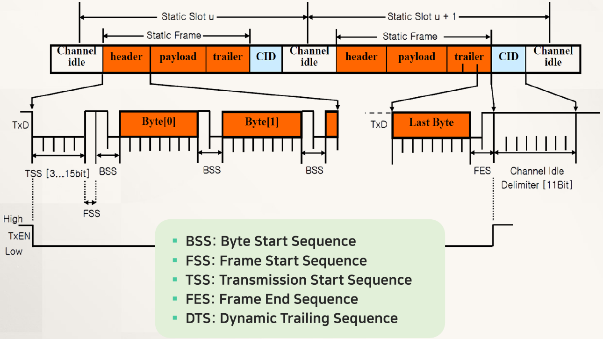

*그림 15. FlexRay 정적 프레임의 비트 열*

그림 15의 위쪽은 정적 슬롯 u와 u+1이고, 각 슬롯은 채널 유휴, 정적 프레임(머리, 페이로드, 꼬리), CID로 이루어진다. 아래쪽은 송신선(TxD)의 실제 비트 열로, TSS(3\~15비트), FSS, 각 바이트 앞의 BSS, 마지막 바이트 뒤의 FES가 차례로 놓이고, 그 뒤 11비트의 채널 유휴 구분자(channel idle delimiter)가 온다. 맨 아래의 TxEN은 송신 활성 신호로, 프레임을 보내는 동안만 저(low)가 된다. 동적 프레임은 같은 구조에 FES 뒤의 DTS가 더해진다.

**계산 예.** 페이로드가 16바이트인 정적 프레임은 머리 5바이트, 페이로드 16바이트, 꼬리 3바이트로 모두 24바이트이다. 바이트마다 BSS 2비트가 붙어 10비트가 되므로, TSS를 5비트로 설정하면 프레임의 비트 수는 다음과 같다.

```math
\underbrace{5}_{TSS} + \underbrace{1}_{FSS} + \underbrace{24 \times 10}_{\text{bytes with BSS}} + \underbrace{2}_{FES} = 248\ \text{비트}
```

10 Mbit/s에서 이 프레임의 전송 시간은 $`248 \times 0.1\ \mu\text{s} = 24.8\ \mu`$s이다. 정적 슬롯은 이 시간에 동작점 오프셋과 채널 유휴 구분자를 더한 것보다 길게 설정해야 한다.

### 2.7 매체 접근 제어: 정적 TDMA와 동적 미니슬롯

하나의 통신 사이클 안에서 FlexRay는 두 가지 매체 접근 방식을 제공한다.

**1. 정적 TDMA(time division multiple access) 방식.** 정적 구간의 각 슬롯은 프레임 ID가 같은 한 노드에 미리 배정된다. 노드는 자기 슬롯의 동작점에서만 보내므로 충돌이 없고, 전달 시각과 지터가 보장된다. 보낼 데이터가 없어도 슬롯은 그 노드의 것이므로 널 프레임을 보내며, 이것이 시간 기반 방식의 대가이다.

**2. 동적 미니슬롯(mini-slotting) 방식.** 동적 구간에서는 슬롯 카운터가 정적 구간에 이어 계속 증가한다.

1. 슬롯 카운터의 값과 같은 프레임 ID를 가진 노드가 보낼 데이터가 있으면, 그 미니슬롯의 동작점에서 프레임을 보낸다. 프레임이 끝날 때까지 여러 미니슬롯이 지나가며, 그동안 카운터는 멈춘다.
2. 해당 노드에 보낼 데이터가 없으면 미니슬롯 하나만 지나가고 카운터가 1 증가한다.
3. 동적 구간에 남은 미니슬롯이 프레임을 보내기에 부족하면, 그 노드는 다음 사이클을 기다린다.

```text
slot counter :  61 |       62       | 63 |   64   | 65 | 66 | ...
minislots    : [  ]|[  ][  ][  ][  ]|[  ]|[  ][  ]|[  ]|[  ]| ...
activity     : idle|  frame ID 62   |idle| ID 64  |idle|idle| ...
```

*그림 16. 동적 구간에서 미니슬롯을 쓰는 예*

그림 16에서 프레임 ID 61과 63의 노드는 보낼 것이 없어 미니슬롯 하나씩만 지나가고, ID 62의 노드는 미니슬롯 4개, ID 64의 노드는 2개를 쓰는 프레임을 보낸다. 슬롯 카운터가 작은 ID부터 차례로 지나가므로 **프레임 ID가 작을수록 우선순위가 높다.** 보낼 것이 없는 노드는 미니슬롯 하나만 쓰므로, 동적 구간은 사건 기반의 메시지를 효율적으로 나른다.

### 2.8 차량용 이더넷의 필요성: 중앙 게이트웨이

차량용 이더넷의 필요성은 **중앙 게이트웨이 ECU(central gateway ECU)** 에서 시작되었다. 2004년에 BMW는 2008년 모델에 중앙 게이트웨이 ECU를 도입하기로 했다. 중앙 게이트웨이 ECU의 역할은 다음과 같다.

1. CAN, FlexRay, MOST 버스 사이의 라우터 역할을 한다.
2. 차량 외부와의 자기 진단 및 프로그래밍 인터페이스 역할을 한다.

특히 차량 진단 단자(OBD)를 통해 차량 안의 모든 ECU의 소프트웨어를 갱신하여, 사용자가 항상 최신 소프트웨어를 쓰게 하는 방식이 계획되었고, 이를 위해 이더넷의 사용이 고려되었다. 기존 방식으로는 대역폭이 부족했기 때문이다.

- OBD에는 고속 CAN(HS-CAN)이 쓰였는데, 그 속도는 500 kbps(최대 속도 1 Mbps의 절반)이고, 프로토콜 규격에 따른 오버헤드를 빼면 실제 데이터는 약 200 kbps 수준이다.
- 2008년 차량의 소프트웨어 데이터는 약 1 GB, 지도 같은 일부 멀티미디어 데이터는 100 MB 수준으로 예상되었고, 여기에 FlexRay 방식의 장치도 상당한 트래픽을 만들었다.

**계산 예.** 1 GB($8 \times 10^9$비트)를 200 kbps로 보내는 데 걸리는 시간은 다음과 같다.

```math
\frac{8 \times 10^9\ \text{비트}}{2 \times 10^5\ \text{비트/s}} = 4 \times 10^4\ \text{s} \approx 11.1\ \text{시간}
```

정비소에서 차 한 대의 소프트웨어를 갱신하는 데 11시간이 걸리는 것은 받아들일 수 없다. 같은 데이터를 100 Mbps 이더넷으로 보내면 $8 \times 10^9 / 10^8 = 80$초면 된다.

> **참고:** **200 kbps가 나오는 이유.** 500 kbps CAN에서 8바이트 표준 프레임은 프레임 간격을 포함해 111비트이므로, 스터핑이 없어도 데이터 비율은 $64 / 111$이고 데이터 속도는 $500 \times 64 / 111 \approx 288$ kbps이다. 최악의 경우 비트 스터핑으로 24비트가 더해져 135비트가 되면 $500 \times 64 / 135 \approx 237$ kbps이다. 여기에 진단 프로토콜의 머리와 응답 대기 시간이 더해지면 약 200 kbps 수준이 된다.

### 2.9 MOST와 USB의 한계

BMW는 이더넷 이전에 MOST와 USB를 개발하고 적용하려 했지만, 두 방식 모두 한계에 부딪혔다.

**MOST 25의 문제.**

- **전송 속도 부족:** MOST 25의 비동기 데이터 채널이 실제로 낼 수 있는 최대 대역폭은 약 7 Mbps에 불과했다.
- **많은 자원 요구:** 7 Mbps를 내려면 1,014바이트 데이터 패킷을 쓰고, 64개 패킷을 하나의 확인 응답(ACK) 블록으로 묶어야 했다. 그러면 전송 전에 64개의 MOST 패킷을 모아 두어야 하므로, 처리에만 약 64 KB($64 \times 1014$바이트)의 RAM을 쓰고 CPU 용량도 많이 차지했다.
- **토폴로지 부적합:** 자기 진단은 정비소에서 진단기를 잠깐 연결하는 방식인데, MOST는 링 토폴로지이므로 진단기를 연결하려면 링을 끊거나 또 다른 두 번째 링이 필요할 수 있었다.
- **새로운 인터페이스:** 개발자에게 생소한 통신 방식이었다.
- **높은 가격:** 인터페이스 부품이 비쌌다.
- MOST 150 기술도 소개되었으나 대량 적용에는 실패했다.

**차량용 USB의 문제.**

- 일반에 잘 알려진 인터페이스이고, USB 2.0의 480 Mbps는 충분한 속도이다.
- **안정성과 강건성 문제:** USB로 차량 수준의 신뢰성을 얻으려면 매우 비싼 케이블과 커넥터가 필요했다.
- **불충분한 케이블 길이:** 약 4 m가 한계여서, 큰 정비 공장에서 소프트웨어 갱신이나 진단에 쓰기 어려웠다.
- **네트워크 미지원:** USB는 하나의 호스트가 장치들을 제어하는 호스트 중심 방식이라 여러 장비가 대등하게 연결되는 네트워크를 이룰 수 없어, 진단기와 소프트웨어 갱신 장비를 동시에 연결할 수 없었다.
- **새로운 프로토콜:** 차량용으로 새로운 프로토콜 스택과 드라이버를 개발해야 했다.

### 2.10 차량용 이더넷의 등장

다음으로 연구된 기술이 이더넷이었다.

- 차량용 이더넷 가운데 처음 등장한 것은 사무실 LAN과 같은 100BASE-TX 이더넷이었다.
- 이더넷은 충분한 전송 속도를 제공하고, 일반에 널리 쓰이며, 네트워크를 구성할 수 있다.
- 차량 외부와의 인터페이스에도 알맞고, 여러 개의 자기 진단 채널이나 소프트웨어 갱신 채널을 동시에 연결할 수 있다.
- 2011년에 차량용 이더넷을 위한 OPEN(One-Pair Ether-Net) Alliance가 설립되어 개발이 시작되었다(2.14절).
- 2015년부터 BMW, Jaguar, Volkswagen이 본격적으로 적용하기 시작했다.
- IEEE는 2015년에 차량용 이더넷 표준 IEEE 802.3bw-2015를 제정했다. 이는 한 쌍의 평형 꼬임쌍선으로 100 Mb/s를 전송하는 물리 계층(100BASE-T1)의 규격과 관리 변수를 정한 이더넷 표준의 개정이다 [5].

### 2.11 표준 이더넷과 차량용 이더넷의 비교

차량용 이더넷의 기본 구조, 즉 MAC과 프레임 형식은 일반 이더넷과 같다(7주차). 다른 것은 물리 계층이다.

| 구분 | 꼬임쌍선 | 전선 수 |
|:-----|:-----|:-----|
| 표준 이더넷(100BASE-TX) | 2쌍을 쓴다. 1쌍은 수신, 1쌍은 송신 | 4가닥 |
| 차량용 이더넷(100BASE-T1) | 1쌍을 쓴다. 1쌍으로 수신과 송신을 함께 | 2가닥 |

*표 17. 표준 이더넷과 차량용 이더넷의 선로 구성*

차량용 이더넷은 차량의 가혹한 전자파 환경과 내환경 특성 때문에 케이블 길이를 짧게(약 15 m 이하) 쓰며, 전자파, 방수, 온도, 습도, 진동 같은 요구 조건을 반영하여 개발되었다.

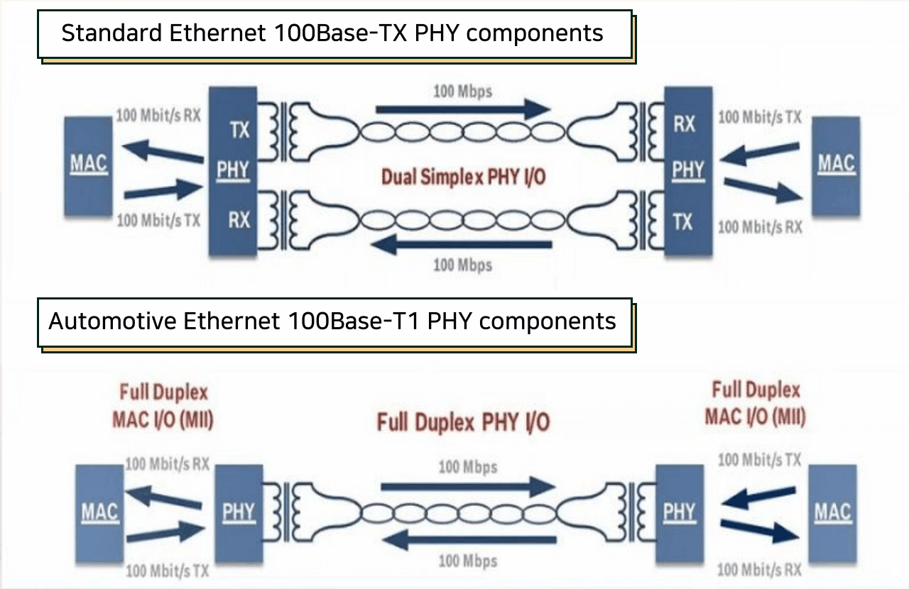

*그림 17. 표준 이더넷 100BASE-TX와 차량용 이더넷 100BASE-T1의 물리 계층 구성*

그림 17의 위쪽 100BASE-TX는 두 쌍의 선을 각각 한 방향으로만 쓰는 이중 단방향(dual simplex) 방식이다. 아래쪽 100BASE-T1은 한 쌍의 선으로 양방향 100 Mbps를 동시에 주고받는 전이중(full duplex) 방식이다. 같은 선에서 동시에 보내고 받으려면, 수신기가 받은 신호에서 자기가 보낸 신호(반향)를 빼내야 하며, 이를 반향 제거(echo cancellation)라 한다 [5].

| 규격 | MAC 인터페이스 | 부호화와 변조 | 선로 |
|:-----|:-----|:-----|:-----|
| 100BASE-TX(고속 이더넷) | MII | 4B/5B, MLT-3 | 쌍당 100 Mbit/s, 125 MBaud, 단방향, 2쌍 |
| 1000BASE-T(기가비트 이더넷) | GMII | 8B/9B, PAM-5 | 쌍당 250 Mbit/s, 125 MBaud, 양방향, 4쌍 |
| BroadR-Reach(차량용 이더넷) | MII | PCS, PAM-3 | 쌍당 100 Mbit/s, 66.6 MBaud, 양방향, 1쌍 |

*표 18. 이더넷 물리 계층의 비교*

> **용어 정의:** **보(baud)** 는 1초에 보내는 기호(symbol, 신호 레벨)의 수이다. **PAM-n(pulse amplitude modulation)** 은 n개의 전압 레벨을 쓰는 변조로, 기호 하나가 최대 $\log_2 n$비트를 나른다.

표 18에서 BroadR-Reach는 100 Mbit/s를 66.6 MBaud로 보내므로 기호 하나가 $100 / 66.67 = 1.5$비트를 나른다. 3레벨인 PAM-3은 기호당 최대 $\log_2 3 \approx 1.58$비트를 나를 수 있으므로 가능한 값이다. 100BASE-TX가 4B/5B 부호 때문에 125 MBaud를 쓰는 것과 비교하면, 기호 속도가 낮아 신호의 주파수 대역이 좁고, 그만큼 전자파 방사가 적어 차량의 EMC(전자파 적합성) 요구를 맞추기 쉽다.

### 2.12 차량용 이더넷의 특성

- **주소 기반 통신과 서비스 프로토콜:** 이더넷은 주소 체계를 바탕으로 데이터를 주고받으며, 차량용 이더넷은 여기에 서비스와 기능에 따른 별도의 프로토콜인 이더넷 AVB(Audio Video Bridging) 등을 함께 쓴다(2.15절).
- **높은 전송 속도:** 최대 10 Gbps까지 지원하므로 여러 개의 CAN 버스를 하나의 이더넷 링크로 연결할 수 있다. 그만큼 배선, 설치, 유지보수 비용이 절감된다.
- **QoS와 TSN 지원:** 서비스 품질(QoS, quality of service)과 시간 민감 네트워킹(TSN, time-sensitive networking)을 지원하므로, 실시간 통신과 우선순위를 고려한 데이터 전송이 모두 가능하다.
- **보안:** 외부 사이버 공격을 막는 기술이 발달해 있다.
- **기술 갱신의 용이성:** 널리 쓰이는 기술에 기반하므로, 이더넷의 새로운 기술을 적용하여 기술적으로 갱신하기 유리하다.
- **일대일 연결:** 버스가 아니라 노드와 스위치를 1:1로 연결하여 네트워크를 구성한다.
- **송신과 수신의 분리:** 송신 채널과 수신 채널이 분리되어(전이중) 두 제어기가 동시에 송수신할 수 있다.
- **패킷 교환:** 스위치가 패킷을 목적지 주소에 따라 전달한다(4주차).
- **계층적 구성:** 메인 네트워크와 서브 네트워크를 계층적으로 구성할 수 있다.

### 2.13 발전 단계와 차량 아키텍처의 변화

차량용 이더넷은 세 세대로 발전해 왔다.

| 세대 | 시기 | 응용 | 관련 기술 |
|:-----|:-----|:-----|:-----|
| 1세대 | 2010년 무렵 | 독립된 서브 시스템과 진단, ECU 프로그래밍(flashing), 후방 카메라 | 100BASE-TX 고속 이더넷(IEEE 802.3u), IP 기반 진단(ISO 13400) |
| 2세대 | 2015년 무렵 | 인포테인먼트와 운전자 보조 시스템 | BroadR-Reach(OPEN Alliance), 에너지 효율 이더넷(IEEE 802.3az), A/V 브리징 1세대, 영상 통신 인터페이스(ISO 17215) |
| 3세대 | 2020년 무렵 | 네트워크 백본으로서의 이더넷 | 한 쌍 기가비트 이더넷, 부분 네트워킹(partial networking), A/V 브리징 2세대, 시간 기반 이더넷 |

*표 19. 차량용 이더넷의 세대별 발전*

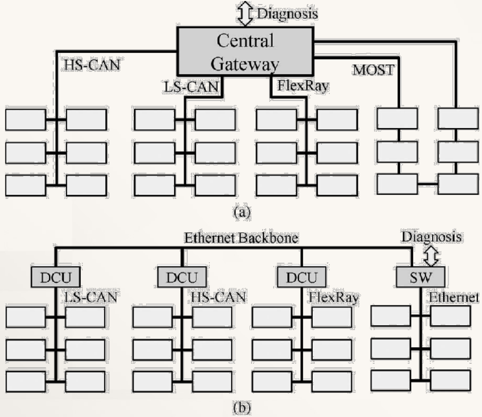

*그림 18. 중앙 게이트웨이 구조와 이더넷 백본 구조*

그림 18의 (a)는 중앙 게이트웨이 하나가 HS-CAN, LS-CAN, FlexRay, MOST 버스를 모두 직접 잇고 외부 진단 단자를 제공하는 구조이다. (b)는 이더넷 백본(backbone) 위에 도메인 제어 장치(DCU, domain control unit)들을 두고, 각 DCU가 LS-CAN, HS-CAN, FlexRay 같은 하위 버스를 맡으며, 이더넷 스위치(SW)가 이더넷 장치와 진단 단자를 연결하는 구조이다. (b)에서는 도메인 사이의 대용량 데이터가 고속 이더넷 백본으로 오가므로 중앙 게이트웨이의 병목이 사라진다.

차량용 이더넷의 대표적인 활용 분야는 다음 네 가지이다.

- **ADAS:** 차량 주위를 둘러싼 카메라와 레이더의 대용량 데이터를 모아 처리한다.
- **OBD(on-board diagnostics):** 엔진, 변속기, ABS, 에어백(SRS) 같은 시스템의 진단과 소프트웨어 갱신을 빠르게 한다.
- **인포테인먼트:** 내비게이션, 영상, 오디오 데이터를 나른다.
- **게이트웨이:** 서로 다른 차량 네트워크를 연결하는 백본 역할을 한다.

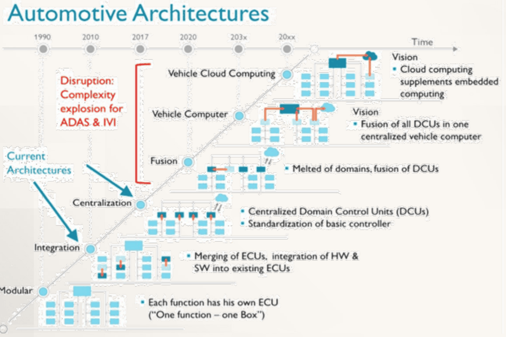

*그림 19. 자동차 전장 아키텍처의 발전 전망*

그림 19는 Bosch가 제시한 자동차 전장 아키텍처의 발전 단계이다.

| 단계 | 내용 |
|:-----|:-----|
| 모듈형(modular) | 기능마다 자기 ECU를 가진다("하나의 기능, 하나의 상자"). |
| 통합(integration) | ECU를 합치고, 하드웨어와 소프트웨어를 기존 ECU에 통합한다. |
| 중앙 집중(centralization) | 도메인별 중앙 제어 장치(DCU)를 두고, 기본 제어기를 표준화한다. |
| 융합(fusion) | 도메인의 경계가 녹아 DCU들이 합쳐진다. |
| 차량 컴퓨터(vehicle computer) | 모든 DCU를 하나의 중앙 차량 컴퓨터로 합친다. |
| 차량 클라우드 컴퓨팅(vehicle cloud computing) | 클라우드 컴퓨팅이 차량에 내장된 컴퓨팅을 보완한다. |

*표 20. 자동차 전장 아키텍처의 발전 단계*

그림 위쪽의 시간 눈금으로 보면 모듈형은 1990년, 통합은 2010년, 중앙 집중은 2017년, 융합은 2020년, 차량 컴퓨터는 2030년대, 차량 클라우드 컴퓨팅은 그 뒤에 대응한다. 현재의 아키텍처는 통합과 중앙 집중 단계에 있으며, ADAS와 인포테인먼트(IVI)의 복잡도가 폭발적으로 늘어나는 것이 이후 단계로의 변화를 이끈다. 단계가 올라갈수록 소수의 고성능 컴퓨터 사이에 대용량 데이터가 오가므로 고속 백본인 이더넷의 역할이 커진다.

자동차 시장이 차량용 이더넷에 요구하는 것은 혹한 같은 가혹한 환경에서의 신뢰성, **비용 절감(costs down)**, **효율 향상(efficiency up)**, 엄격한 **EMC 시험의 통과**, **저전력 소비(low power consumption)** 이다. 이 요구를 맞추는 차량용 이더넷에는 OPEN Alliance의 BroadR-Reach(OABR, OPEN Alliance BroadR-Reach)와, IEEE의 100BASE-T1, 1000BASE-T1(개발 과정의 이름은 RTPGE, reduced twisted pair gigabit Ethernet)이 있다.

### 2.14 OPEN Alliance와 BroadR-Reach

**OPEN Alliance SIG(One-Pair Ether-Net Alliance Special Interest Group)** 는 차량 환경에 알맞은 이더넷 표준을 만들어 그 사용을 확산하는 것을 목적으로 2011년 11월에 설립된 단체이다 [6].

- 개발 목적은 ADAS용 통합 네트워크이다.
- 물리 계층(PHY) 부분만 표준으로 정하고, 그 위는 기존 IEEE 802.3 이더넷 표준을 따른다.
- Broadcom의 BroadR-Reach 이더넷 기술을 표준으로 채택했다. 이 기술은 이후 IEEE 802.3bw(100BASE-T1)의 바탕이 되었다.

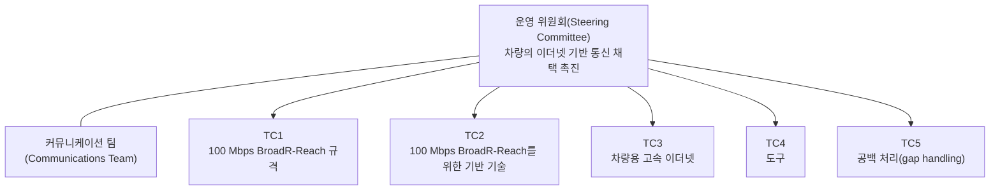

*그림 20. OPEN Alliance의 조직*

TC(technical committee)는 기술 위원회이다. TC1과 TC2가 정의한 BroadR-Reach 사양은 다음과 같다.

- **TC1:** 100 Mbps BroadR-Reach 규격을 명확히 하고, 상호 운용성(interoperability)과 적합성(compliance) 시험을 정의한다.
- **TC2:** PHY의 최소 진단 요구 사항을 정하고, 케이블, 커넥터, 하네스 조립품의 요구 규격과 시험 방법을 정의한다.
- **산출물:** 규격 문서, 적합성 시험 규격, 상호 운용성 시험 규격, 그리고 트랜시버, 공통 모드 초크(CMC), 스위치, 케이블, 커넥터에 대한 EMC 시험 규격이다.

하나의 링크는 PHY(또는 스위치)의 송수신단, 저역 통과 필터, 공통 모드 초크, 커넥터, 배선, 커넥터의 순서로 이어진다. TC1은 PHY 쪽을, TC2는 커넥터와 배선 쪽을 맡는다.

| 종류 | 데이터 속도 | 케이블 도달 거리 | 케이블(쌍 수 × 종류) |
|:-----|:-----|:-----|:-----|
| 1000BASE-T | 1000 Mbps | 100 m | 4쌍 × Cat 5/Cat 5e |
| 100BASE-TX | 100 Mbps | 100 m | 2쌍 × Cat 5 |
| 10BASE-T | 10 Mbps | 100 m | 2쌍 × Cat 3 이상 |
| 1BR-100 | 100 Mbps | 300 m | 1쌍 × Cat 5 |
| 1BR-10 | 10 Mbps | 500 m | 1쌍 × 24 AWG 이상 |

*표 21. 이더넷 종류별 데이터 속도와 케이블*

표 21의 1BR-100, 1BR-10은 BroadR-Reach 기술의 장거리 모드로, 한 쌍의 선으로 기존 이더넷보다 먼 거리를 보낼 수 있음을 보여 준다. 차량 안에서는 이보다 훨씬 짧은 거리(약 15 m)를 쓰는 대신 엄격한 EMC 조건을 만족해야 한다.

BroadR-Reach PHY는 MAC과 같은 MII(또는 RGMII) 인터페이스로 연결된다. 표준 10/100/1000BASE-T PHY가 네 쌍의 선(`TRD[0]`\~`TRD[3]`)과 자기 변압기(magnetics), RJ-45 커넥터로 연결되는 것과 달리, BroadR-Reach PHY는 한 쌍의 선(`TRD[0]`)만 쓴다. 그래서 MAC과 상위 소프트웨어는 그대로 두고 PHY만 바꾸면 된다(7주차의 구현 모델).

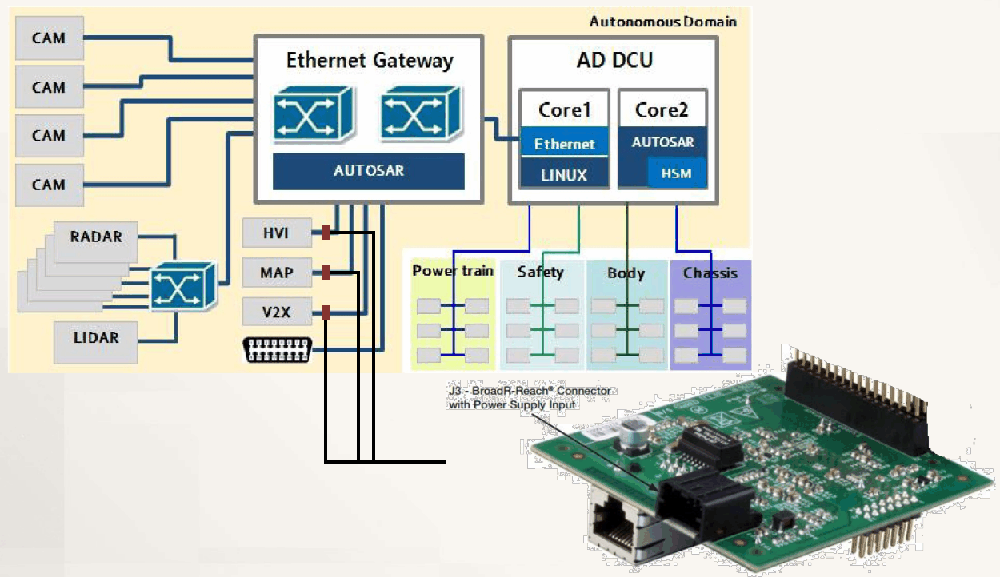

*그림 21. BroadR-Reach 기반의 차량 네트워크 구성 예와 미디어 컨버터*

그림 21의 위쪽은 자율주행 도메인의 구성 예이다. 카메라 4대, 레이더, 라이다의 데이터가 이더넷 스위치를 거쳐 이더넷 게이트웨이(AUTOSAR 기반)와 자율주행 DCU(AD DCU)로 모인다. AD DCU의 코어 1은 이더넷과 Linux를, 코어 2는 AUTOSAR를 실행하며 하드웨어 보안 모듈(HSM)을 갖춘다. 게이트웨이는 HVI(사람과 차량의 인터페이스), 지도(MAP), V2X 장치와 파워트레인, 안전, 바디, 섀시 도메인을 잇는다. 아래쪽 기판은 **BroadR-Reach 미디어 컨버터(MC, media converter)** 로, 일반 이더넷(RJ-45)과 BroadR-Reach(한 쌍 선) 신호를 서로 바꾸어 PC 같은 일반 장비로 차량용 이더넷을 시험하고 모니터링할 수 있게 한다.

### 2.15 차량용 이더넷 관련 IEEE 규격

차량용 이더넷에 쓰이는 IEEE 규격은 세 묶음으로 나뉜다.

| 묶음 | 규격 | 내용 |
|:-----|:-----|:-----|
| AVB: 시간 동기, 대역폭 예약과 보장 | IEEE 1588, 802.1AS-2011 | 네트워크의 시간 동기화. 802.1AS는 1588을 이더넷 브리지 네트워크에 맞춘 프로파일이다. |
| AVB | IEEE 1722, 1722a | 시간 민감 스트림을 위한 2계층 전송 프로토콜(AVBTP) |
| AVB | IEEE 802.1Qav | 시간 민감 스트림을 위한 전달과 대기열 개선(트래픽 클래스, 우선순위, 신용 기반 셰이핑) |
| AVB | IEEE 802.1Qat | 스트림 예약 프로토콜(SRP) |
| AVB | IEEE 802.1BA | AVB 네트워크 시스템과 AVB 프로파일 |
| TSN: 지연의 감소와 보장, 이중화 | IEEE 802.1AS-REV | 시간 동기의 개선(한 단계 타임스탬프, 이중화된 그랜드 마스터 클록과 빠른 전환, 이중화된 동기 메시지 경로) |
| TSN | IEEE 802.1Qbu | 패킷 선점(preemption) |
| TSN | IEEE 802.1Qbv | 시간 인지 트래픽 스케줄링(time-aware scheduling) |
| TSN | IEEE 802.1Qcc | SRP의 개선(SRP 메시지의 크기와 빈도 감소, IGMP와의 연동) |
| TSN | IEEE 802.1CB | 신뢰성을 위한 프레임 복제와 제거 |
| 차량용 PHY: 저가의 한 쌍 UTP, 우수한 EMI 특성 | IEEE 802.3bw | 100BASE-T1: 한 쌍 평형 꼬임쌍선 위의 100 Mb/s PHY, 15 m, 전이중, PAM-3 부호화 [5] |
| 차량용 PHY | IEEE 802.3bp | 1000BASE-T1: 한 쌍 평형 꼬임쌍선 위의 1 Gb/s PHY, 15 m, 전이중, PAM-3 부호화, RS FEC [7] |

*표 22. 차량용 이더넷 관련 IEEE 규격*

> **용어 정의:** **AVB(Audio Video Bridging)** 는 이더넷에서 오디오와 영상 스트림을 정해진 지연 안에 끊김 없이 전달하기 위한 IEEE 802.1 규격의 묶음이다. 그 범위를 차량과 산업의 제어 데이터까지 넓힌 것이 **TSN(time-sensitive networking)** 이다. **RS FEC(Reed-Solomon forward error correction)** 는 수신 측이 재전송 없이 오류를 고칠 수 있도록 덧붙이는 오류 정정 부호이다.

---

<br>

## 3. CAN 심화와 CAN FD

### 3.1 CAN의 필요성

시스템이 대형화, 지능화, 유연화되면서 센서, 액추에이터, 제어기 같은 현장 기기(field device)의 수가 기하급수적으로 늘었다. 전통적인 **점대점(point-to-point) 연결**은 센서와 제어기를 직접(direct) 연결하므로, 기기가 늘수록 전선과 케이블도 기하급수적으로 늘어난다.

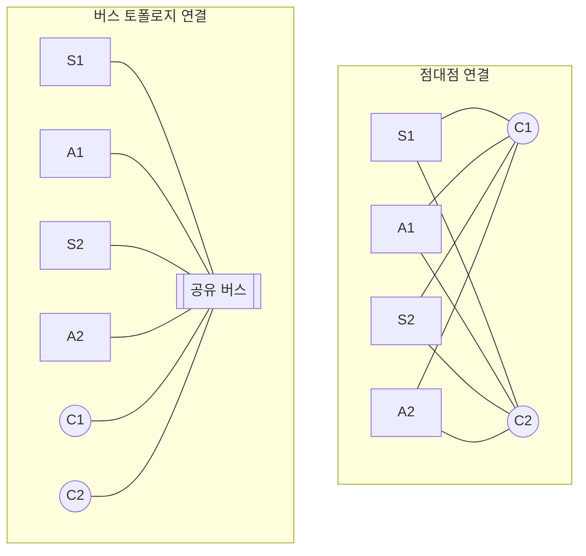

*그림 22. 점대점 연결과 버스 토폴로지 연결*

그림 22에서 S는 센서, A는 액추에이터, C는 제어기이다. 센서 2개와 액추에이터 2개가 각각 제어기 2개와 통신해야 하면, 점대점 연결에는 $4 \times 2 = 8$개의 링크가 필요하지만 버스에는 공유 선로 하나만 있으면 된다. 점대점 연결의 대안으로 등장한 **버스 토폴로지 연결**은 공유된 전선으로 모든 기기를 연결하며, 다음 장점이 있다.

1. 배선이 절감된다.
2. 고장 감시와 고장 해결이 쉽다.
3. 설계 변경이 쉽다. 새 기기를 버스에 붙이기만 하면 된다.
4. 유지보수가 쉽다.

### 3.2 CAN의 특징과 계층 구조

CAN(Controller Area Network)은 1983년 Bosch의 내부 프로젝트로 개발이 시작되어 1986년에 공식 소개되었고, 1993년 ISO 11898로 표준화되었다. CAN의 특징은 다음과 같다.

- 널리 인정받는 표준이다.
- 직렬 통신 방식을 쓴다.
- 물리 계층과 데이터 링크 계층의 2계층 구조이다(3주차의 표 1).
- 다수의 마이크로컨트롤러와 하드웨어, 소프트웨어를 활용할 수 있다.

| 계층 | 부계층 | 기능 |
|:-----|:-----|:-----|
| 2. 데이터 링크 계층 | LLC | 데이터 전송, 원격 데이터 요청, 메시지 필터링, 회복 관리와 과부하 통지 |
| 2. 데이터 링크 계층 | MAC | 프레이밍과 중재, 오류 검사와 오류 플래그, 결함 국한, 비트 타이밍 |
| 1. 물리 계층 | | 비트의 전기적 송수신 |

*표 23. CAN이 정의하는 계층과 기능*

3계층부터 7계층까지는 CAN 규격이 정하지 않는다. CAN의 LLC와 MAC은 7주차에서 다룬 IEEE 802 참조 모델과 같은 방식으로 데이터 링크 계층을 나눈 것이다.

### 3.3 CAN의 역사와 관련 표준

| 연도 | 사건 |
|:-----|:-----|
| 1983 | Bosch 내부 프로젝트로 IVN 개발 시작 |
| 1986 | 공식 CAN 프로토콜 소개(SAE 학회 발표) |
| 1987 | Intel과 Philips 반도체에서 첫 CAN 컨트롤러 칩 출시 |
| 1991 | Bosch의 CAN 2.0 규격 출판. Kvaser가 CAN 기반 상위 계층 프로토콜(CAN Kingdom) 소개 |
| 1992 | 국제 사용자 및 제조사 단체 CiA(CAN in Automation) 설립, CiA가 CAL(CAN Application Layer) 출판. Mercedes-Benz가 CAN을 적용한 첫 차량 출시 |
| 1993 | ISO 11898 표준 출판 |
| 1994 | CiA가 첫 국제 CAN 학회(iCC) 개최 |
| 1995 | Allen-Bradley가 DeviceNet 프로토콜 소개. ISO 11898의 확장 프레임 형식 출판, CANopen 프로토콜 출판 |
| 2000 | 자동차와 산업용 응용에서 CAN 사용이 폭발적으로 증가. TTCAN(time-triggered CAN) 개발 |
| 2001 | TTCAN의 산업용 도입 시작 |
| 2003 | 미국과 일본에서도 CAN 사용 확대 |
| 2012 | Bosch가 CAN FD(CAN with Flexible Data Rate) 공개 |
| 2015 | CAN FD가 ISO 11898-1로 표준화 |

*표 24. CAN의 역사*

CAN 2.0 규격은 표준 프레임(CAN 2.0A)과 확장 프레임(CAN 2.0B)을 함께 정의한다 [8]. CAN과 관련된 주요 표준은 다음과 같다.

| 표준 | 제목(Road vehicles) | 내용 |
|:-----|:-----|:-----|
| ISO 11898-1 | Controller area network (CAN) - Part 1 | 데이터 링크 계층과 물리 부호화 부계층(physical coding sublayer) |
| ISO 11898-2 | Controller area network (CAN) - Part 2 | 고속(high-speed) 물리 매체 접속(PMA) 부계층 |
| ISO 11898-3 | Controller area network (CAN) - Part 3 | 저속, 결함 허용(fault-tolerant), 매체 의존 인터페이스 |
| ISO 11898-4 | Controller area network (CAN) - Part 4 | 시간 기반(time-triggered) 통신 |
| ISO 11898-5 | Controller area network (CAN) - Part 5 | 저전력 모드를 갖춘 고속 매체 접근 장치 |
| ISO 11898-6 | Controller area network (CAN) - Part 6 | 선택적 웨이크업(selective wake-up) 기능을 갖춘 고속 매체 접근 장치 |
| ISO 11519-1, -2, -3 | Low-speed serial data communication | 저속 직렬 통신: 일반 사항과 정의, 저속 CAN, VAN(vehicle area network) |
| ISO 11992-1\~4 | Interchange of digital information between towing and towed vehicles | 견인차와 피견인차(트레일러) 사이의 전기 연결을 통한 디지털 정보 교환 |
| SAE J2411 | Single Wire CAN Network for Vehicle Applications | 차량용 단일 전선 CAN |

*표 25. CAN 관련 표준*

> **참고:** ISO 11898-1:2015는 기존 CAN과 함께 CAN FD도 정의하며 [9], ISO 11898-2:2016은 ISO 11898-5와 ISO 11898-6의 내용을 통합했다 [10]. 그래서 오늘날 고속 CAN 트랜시버의 저전력 모드와 선택적 웨이크업(3.19절)은 ISO 11898-2에서 찾는다.

### 3.4 CAN의 특성과 노드 구성

CAN은 분산 실시간 제어와 다중화를 지원하는 직렬 통신 프로토콜이다. 그 특성은 다음과 같다.

- **직렬 데이터 통신, 다중 마스터(multi-master) 버스 통신:** 모든 노드가 버스가 비면 스스로 전송을 시작할 수 있다.
- **비동기 전송, 시분할 다중화:** 별도의 클록 선 없이 보내고, 여러 노드의 메시지가 시간을 나누어 한 버스를 쓴다.
- **최대 전송 속도 1 Mbps:** 버스 길이 약 30 m 이하에서이다.
- **최대 전송 거리 1,000 m:** 속도를 62.5 kbps 정도로 낮출 때이다(3.8절).
- **최대 32개 노드:** 1 Mbps 기준이다. 연결할 수 있는 노드 수는 트랜시버가 감당하는 전기적 부하로 정해지므로, 트랜시버에 따라 더 많을 수도 있다(3주차).

CAN 노드(ECU)는 마이크로컨트롤러(MCU), CAN 컨트롤러, CAN 트랜시버로 이루어지고, 차폐하지 않은 꼬임쌍선(UTP)의 CAN_H와 CAN_L에 연결된다. 버스의 양 끝에는 120 Ω 종단 저항이 있다(3주차). ISO 11898-2를 따르는 버스 노드에서 CAN 컨트롤러와 트랜시버는 세 선으로 연결된다.

1. **Tx:** 컨트롤러에서 트랜시버로 가는 직렬 데이터 출력 선
2. **Rx:** 트랜시버에서 컨트롤러로 가는 직렬 데이터 입력 선
3. **Vref:** 트랜시버가 내보내는 기준 전압 출력으로, 공칭값은 전원 전압의 절반($`0.5\,V_{CC}`$, 5 V 전원이면 2.5 V)이다.

외부 연결에는 흔히 D-sub 9핀 커넥터를 쓰며, 2번 핀이 CAN_L, 7번 핀이 CAN_H, 3번 핀이 CAN 접지, 5번 핀이 선택적 차폐, 6번 핀이 선택적 전원 접지, 9번 핀이 선택적 전원(CAN_V+)이고, 1, 4, 8번 핀은 예비이다(3주차의 표 5).

### 3.5 NRZ 부호화와 비트 레벨

CAN은 비트를 **NRZ(non-return-to-zero)** 부호로 싣는다. NRZ는 한 비트 시간 동안 레벨을 그대로 유지하는 방식이다. 이와 달리 **RZ(return-to-zero)** 부호는 신호가 각 비트 주기 안에서 반드시 0으로 돌아온다. NRZ는 같은 대역폭에서 더 많은 비트를 보낼 수 있지만, 긴 시간 동안 레벨에 변화가 없으면 수신기의 동기화 기능이 떨어진다(3.7절).

CAN의 비트 레벨은 다음과 같다.

- **우성(dominant):** 2진수 0
- **열성(recessive):** 2진수 1

```text
bit value       1      0      0      1      0      1      1
             _______               ______        _____________    recessive (1)
TX logic            |_____________|      |______|                 dominant (0)
             |<--->|
             1 bit time
```

*그림 23. 컨트롤러 송신 신호(TX)의 NRZ 비트 레벨*

그림 23은 컨트롤러의 TX 논리 신호이다. 열성(1)은 높은 레벨(예: 5 V), 우성(0)은 낮은 레벨(0 V)이고, 같은 값이 이어지는 동안은 레벨이 바뀌지 않는다. 버스 위의 차동 전압은 반대로, 우성일 때 커지고 열성일 때 0에 가깝다(3.6절).

### 3.6 고속 CAN과 저속 CAN의 신호 레벨

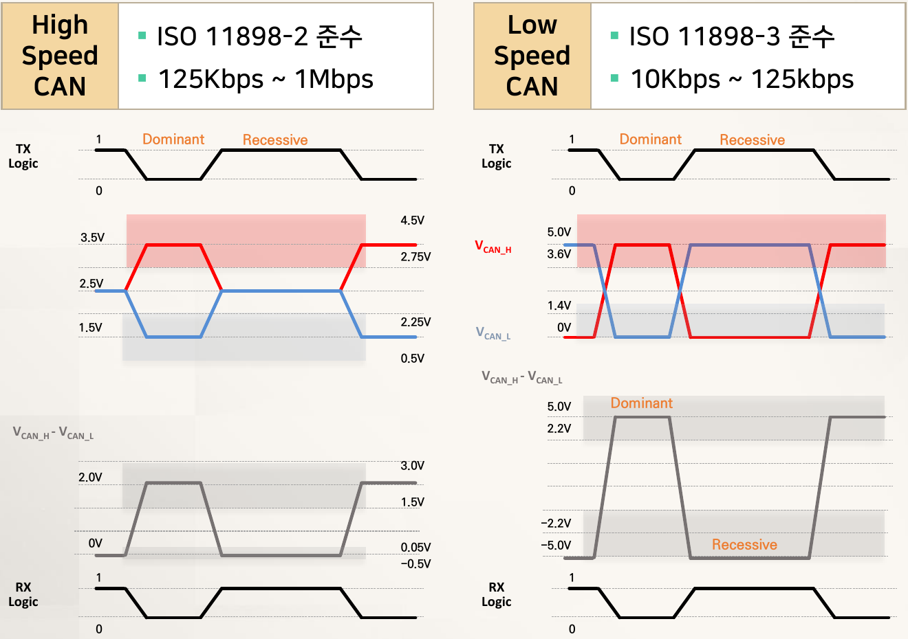

*그림 24. 고속 CAN과 저속 CAN의 버스 전압과 송수신 논리*

| 구분 | 고속 CAN | 저속 CAN |
|:-----|:-----|:-----|
| 표준 | ISO 11898-2 | ISO 11898-3 |
| 속도 | 125 kbps\~1 Mbps | 10 kbps\~125 kbps |
| 열성일 때 $`V_{CAN\_H}`$, $`V_{CAN\_L}`$ | 둘 다 약 2.5 V | 약 0 V, 약 5 V |
| 우성일 때 $`V_{CAN\_H}`$, $`V_{CAN\_L}`$ | 약 3.5 V(2.75\~4.5 V), 약 1.5 V(0.5\~2.25 V) | 약 3.6 V, 약 1.4 V |
| 열성일 때 $`V_{CAN\_H} - V_{CAN\_L}`$ | 약 0 V(-0.5\~0.05 V) | 약 -5 V |
| 우성일 때 $`V_{CAN\_H} - V_{CAN\_L}`$ | 약 2.0 V(1.5\~3.0 V) | 약 2.2 V(2.2\~5.0 V) |

*표 26. 고속 CAN과 저속 CAN의 신호 레벨*

그림 24의 위쪽은 컨트롤러의 TX 논리, 가운데는 두 버스 선의 전압과 그 차이, 아래쪽은 트랜시버가 컨트롤러에 돌려주는 RX 논리이다. 두 방식 모두 TX가 0(우성)이면 CAN_H가 올라가고 CAN_L이 내려가 차동 전압이 양수가 되며, RX는 TX를 그대로 따른다. 저속 CAN은 열성일 때도 두 선을 0 V와 5 V로 벌려 놓으므로, 각 선의 전압이 접지에 대해서도 우성과 열성에서 크게 달라진다. 그래서 트랜시버는 한 선이 끊어지거나 접지 또는 전원과 단락된 고장을 감지하면 남은 한 선의 전압만으로 통신을 이어 가는 단일 선 동작으로 전환할 수 있으며, 이것이 저속 CAN을 결함 허용(fault-tolerant) CAN이라 부르는 이유이다.

### 3.7 비트 스터핑

NRZ에서는 다음 비트가 같은 값이면 재동기화(resynchronization)를 위한 에지가 생기지 않는다. 그래서 모든 버스 노드의 동기를 위해 **비트 스터핑(bit stuffing)** 을 쓴다. 송신기는 같은 값의 비트를 5개 연속으로 보내면 반대 값의 스터핑 비트를 하나 끼워 넣고, 수신기는 이를 제거한다. 같은 값이 6개 연속으로 나타나면 스터핑 오류이다. 보낼 비트열, 스터핑된 비트열, 스터핑을 제거한 수신 비트열의 예는 3주차의 그림 7과 같다.

### 3.8 전송 속도와 버스 길이

CAN은 50 kbps에서 버스 길이를 최대 1 km까지 쓸 수 있고, ISO 11898을 준수하는 트랜시버는 최대 1 km의 버스를 지원한다. 속도를 높이면 버스는 짧아져야 한다.

| 전송 속도 | 버스 길이 | 공칭 비트 시간 | 속도 × 길이(Mbit/s × m) |
|:-----|:-----|:-----|:-----|
| 1 Mbit/s | 30 m | 1 µs | 30 |
| 800 kbit/s | 50 m | 1.25 µs | 40 |
| 500 kbit/s | 100 m | 2 µs | 50 |
| 250 kbit/s | 250 m | 4 µs | 62.5 |
| 125 kbit/s | 500 m | 8 µs | 62.5 |
| 62.5 kbit/s | 1000 m | 16 µs | 62.5 |
| 20 kbit/s | 2500 m | 50 µs | 50 |
| 10 kbit/s | 5000 m | 100 µs | 50 |

*표 27. CAN의 실용적인 버스 길이*

표 27의 "속도 × 길이" 열에서 보듯이 두 값의 곱은 대략 일정하다. 비트 단위 중재가 성립하려면 신호가 버스를 왕복하는 시간과 트랜시버, 컨트롤러의 지연을 합한 값이 비트 시간의 일부(3.18절의 Prop_Seg) 안에 들어와야 하기 때문이다. 길이를 두 배로 늘리면 왕복 지연이 두 배가 되므로 비트 시간도 그만큼 늘려야, 즉 속도를 절반으로 낮추어야 한다. 짧은 버스에서 곱이 더 작은 것은 길이와 무관한 소자의 고정 지연이 차지하는 비중이 커지기 때문이다. 속도와 길이의 관계를 로그 눈금으로 그리면, 약 30\~40 m 이하에서는 1 Mbit/s로 평평하다가 그 뒤로 길이에 반비례하여 내려가는 선이 된다.

> **참고:** 1 km 행의 비트 시간을 20 µs로 적은 자료가 있으나, 20 µs는 50 kbit/s의 비트 시간이다($`1 / 50000 = 20\ \mu`$s). 62.5 kbit/s의 비트 시간은 16 µs이다. 1.5절의 "50 kbps에서 최대 1 km"와 함께 보면, 1 km에서의 실용적인 속도는 50\~62.5 kbit/s 정도이다.

### 3.9 배선 기술과 전자기 간섭

- 버스 선로의 반사 효과를 최소화하기 위해 한 줄로 이어진 선형(single line) 구조로 구성한다.
- 양쪽 끝은 120 Ω 저항으로 종단해야 한다. 이 저항은 색띠로 갈색(1), 빨간색(2), 갈색(×10)을 읽어 $`12 \times 10 = 120\ \Omega`$이다.
- 본선(trunk cable)의 길이는 표 27의 실용적인 버스 길이를 따른다.
- 본선에서 노드로 갈라지는 분기선(drop cable)은 최대한 짧게 하며, 1 Mbps에서는 0.3 m 이하로 한다. 분기선 끝은 종단되지 않으므로 길어지면 반사가 생긴다.
- 케이블은 차폐하지 않은 꼬임쌍선을 쓴다.

**전자기 간섭(EMI).** CAN은 두 선의 전압 차이로 값을 판단하므로 전자기 간섭에 자연히 강하다. 두 선이 같은 잡음을 받아도 두 선 사이의 전압 차이는 그대로이기 때문이다($`V_{diff} = const`$). 자세한 원리와 종단 저항의 역할은 3주차에서 다루었다.

### 3.10 CAN 데이터 프레임

**데이터 프레임(data frame)** 은 일반적인 CAN 통신의 프레임이다. 식별자의 길이에 따라 표준 프레임(CAN 2.0A, 11비트)과 확장 프레임(CAN 2.0B, 29비트)이 있다.

```text
standard frame (CAN 2.0A), field numbers 1-12:
   1        2         3     4    5     6      7       8     9     10    11    12
┌─────┬────────────┬─────┬─────┬────┬─────┬────────┬─────┬─────┬─────┬─────┬─────┬─────┐
│ SOF │ Identifier │ RTR │ IDE │ r0 │ DLC │  Data  │ CRC │ DEL │ ACK │ DEL │ EOF │ IFS │
│  1  │     11     │  1  │  1  │ 1  │  4  │  0-64  │  15 │  1  │  1  │  1  │  7  │  3  │
└─────┴────────────┴─────┴─────┴────┴─────┴────────┴─────┴─────┴─────┴─────┴─────┴─────┘

extended frame (CAN 2.0B):
┌─────┬─────────┬─────┬─────┬─────────┬─────┬────┬────┬─────┬────────┬─────┬─────┬─────┬─────┬─────┬─────┐
│ SOF │ Base ID │ SRR │ IDE │ ID ext. │ RTR │ r1 │ r0 │ DLC │  Data  │ CRC │ DEL │ ACK │ DEL │ EOF │ IFS │
│  1  │    11   │  1  │  1  │    18   │  1  │ 1  │ 1  │  4  │  0-64  │  15 │  1  │  1  │  1  │  7  │  3  │
└─────┴─────────┴─────┴─────┴─────────┴─────┴────┴────┴─────┴────────┴─────┴─────┴─────┴─────┴─────┴─────┘
```

*그림 25. CAN 2.0A 표준 데이터 프레임과 CAN 2.0B 확장 데이터 프레임*

그림 25의 숫자는 비트 수이다. 중재 필드(arbitration field)는 표준 프레임에서 12비트(식별자 11비트와 RTR), 확장 프레임에서 32비트(기본 식별자 11비트, SRR, IDE, 확장 식별자 18비트, RTR)이고, 제어 필드(control field)는 6비트(IDE 또는 r1, r0, DLC 4비트)이다. 표준 프레임의 필드 번호 1\~12의 의미는 다음과 같다.

| 번호 | 필드 | 비트 수 | 역할 |
|:-----|:-----|:-----|:-----|
| 1 | SOF(start of frame) | 1 | 우성(0)이며, 메시지의 시작을 알리고 유휴 상태 뒤의 모든 노드를 동기화한다. |
| 2 | 식별자(identifier) | 11 | 메시지의 우선순위를 정하며, 2진값이 작을수록 우선순위가 높다. 확장 프레임에서는 29비트이다. RTR과 함께 중재에 쓰인다. |
| 3 | RTR(remote transmission request) | 1 | 데이터 프레임과 원격 프레임을 구별한다. 데이터 프레임은 우성(0), 원격 프레임은 열성(1)이다. |
| 4 | IDE(identifier extension) | 1 | 표준 프레임과 확장 프레임을 구별한다. 우성(0)이면 2.0A, 열성(1)이면 2.0B이다. |
| 5 | r(r0) | 1 | 예약 비트이다. CAN FD에서는 이 자리로 CAN 프레임과 CAN FD 프레임을 구별한다. 우성(0)이면 CAN, 열성(1)이면 CAN FD이다(3.22절). |
| 6 | DLC(data length code) | 4 | 전송할 데이터의 바이트 수를 알린다. |
| 7 | 데이터 필드(data field) | 0\~64 | 0\~8바이트의 데이터이다. |
| 8 | CRC 시퀀스 | 15 | SOF부터 데이터 필드까지의 비트열로 계산한 CRC로, 메시지의 유효성을 보장한다(7주차 3.5절). |
| 9 | CRC 구분자(CRC delimiter) | 1 | 열성(1)이며 CRC의 끝을 알린다. |
| 10 | ACK 슬롯(ACK slot) | 1 | 수신 노드가 메시지를 올바르게 받았는지 확인한다. 송신기는 열성을 보내고, 올바르게 받은 수신기가 우성으로 덮어쓴다. 우성(0)이면 정상, 열성(1)이면 비정상이다. |
| 11 | ACK 구분자(ACK delimiter) | 1 | 열성(1)이며 ACK의 끝을 알린다. |
| 12 | EOF(end of frame) | 7 | 열성 비트 7개가 연속으로 나오면 메시지의 끝이다. |

*표 28. CAN 표준 데이터 프레임의 필드*

> **참고:** RTR의 값을 원격 프레임은 우성(0), 데이터 프레임은 열성(1)으로 반대로 적은 자료가 있으나, 규격에서 데이터 프레임의 RTR은 우성이다 [8]. 그래서 같은 식별자의 데이터 프레임과 원격 프레임이 동시에 중재하면 데이터 프레임이 이긴다(3.13절). 또 CRC를 "16비트"로 설명하는 경우는 15비트 CRC 시퀀스와 1비트 CRC 구분자를 합친 CRC 필드 전체를 가리킨다.

DLC의 4비트는 데이터 바이트 수를 2진수로 나타낸다.

| DLC3 DLC2 DLC1 DLC0 | 0000 | 0001 | 0010 | 0011 | 0100 | 0101 | 0110 | 0111 | 1000 |
|:-----|:-----|:-----|:-----|:-----|:-----|:-----|:-----|:-----|:-----|
| 데이터 바이트 수 | 0 | 1 | 2 | 3 | 4 | 5 | 6 | 7 | 8 |

*표 29. CAN 데이터 프레임의 DLC 부호*

DLC가 9\~15(1001\~1111)이면 기존 CAN에서는 8바이트로 처리한다 [8]. CAN FD는 이 값들에 더 큰 길이를 배정한다(3.22절).

### 3.11 인터미션과 버스 유휴 상태

EOF 뒤에는 다음 메시지가 오기 전에 필요한 3비트의 **인터미션(ITM, intermission)** 이 온다. 인터미션 동안에는 아무 노드도 데이터 프레임이나 원격 프레임을 시작할 수 없다.

```text
┌──────┬─────┬──────┬─────┬────────┬────────┬──────────┐
│ ...  │ CRC │ ACK  │ ACK │  EOF   │  ITM   │ bus idle │
│      │ DEL │ slot │ DEL │ 7 bits │ 3 bits │          │
└──────┴─────┴──────┴─────┴────────┴────────┴──────────┘
                    |<- 11 recessive bits ->|
```

*그림 26. ACK 구분자부터 버스 유휴까지의 열성 비트*

ACK 구분자 1비트, EOF 7비트, ITM 3비트를 합하면 $1 + 7 + 3 = 11$비트의 열성이 이어진다. ACK 구분자부터 11개의 열성 비트가 이어져 인터미션이 끝나면 노드는 버스가 **유휴(idle)** 상태라고 판단한다. 프레임 안에서는 비트 스터핑 때문에 같은 값이 5개를 넘어 이어질 수 없으므로, 11개의 연속 열성은 프레임이 끝났다는 확실한 표시이다. 그래서 새로 켜진 노드도 11개의 연속 열성 비트를 확인한 뒤에야 버스 통신에 참여한다 [8].

### 3.12 방송형 통신과 통신 절차

CAN은 방송형 통신을 한다(3주차).

- 네트워크의 모든 노드는 전송 스테이션의 프레임을 들을(listen) 수 있다.
- 프레임을 받은 뒤 각 노드는 그 프레임을 받아들일지 스스로 결정한다.
- 따라서 모든 CAN 노드에는 수신을 위한 필터링(수용 필터)이 적용되어야 한다.

노드의 통신 절차는 다음과 같다. 전원이 켜지면 노드는 버스가 비어 있는지 확인한다. 비어 있고 보낼 메시지가 있으면 전송하고, 충돌(동시 전송)이 일어나면 중재에서 이겼는지에 따라 전송을 계속하거나 멈춘다. 버스가 비어 있지 않으면 식별자를 확인하여 받아야 할 메시지이면 수신한다. 이 흐름은 3주차의 그림 13과 같다.

CAN은 두 가지 통신 서비스를 제공한다.

| 서비스 | 쓰는 프레임 | 동작 |
|:-----|:-----|:-----|
| 쓰기 객체(write object) | 데이터 프레임 | 생산자(producer)가 요청(request)하면 0\~8바이트의 데이터 프레임을 일반적인 방식으로 방송하고, 소비자(consumer)들에게 지시(indication)가 전달된다. |
| 읽기 객체(read object) | 원격 프레임과 데이터 프레임 | 소비자가 원격 프레임으로 원격 요청(remote request)을 하면 생산자에게 지시가 전달되고, 생산자가 데이터 프레임으로 응답(response)하면 소비자들이 확인(confirmation)을 받는다. |

*표 30. CAN의 두 가지 통신 서비스*

### 3.13 원격 프레임

> **용어 정의:** **원격 프레임(remote frame)** 은 CAN 노드가 다른 노드에게 특정 식별자의 데이터를 보내 달라고 요청하는 데 쓰는 프레임이다. 원격 전송 요청(RTR, remote transmission request)이라고도 한다.

원격 프레임의 형식은 다음과 같다.

- 중재 필드와 제어 필드는 데이터 프레임과 같으며, CAN 2.0A와 2.0B를 모두 지원한다.
- 데이터 필드가 없다.
- CAN 2.0A에서는 RTR이 열성(1)이다. CAN 2.0B에서는 SRR, IDE, RTR이 모두 열성(1)이다.
- DLC에는 요청하는 데이터의 길이를 넣는다.

원격 프레임의 동작은 다음과 같다. 각 컨트롤러 안에서 송신은 준비(prepare), 프레임 구성(원격 프레임 또는 데이터 프레임), 송신(send)의 순서로, 수신은 수신(receive), 수용 필터에 의한 선택(select), 수락(accept)의 순서로 이루어진다.

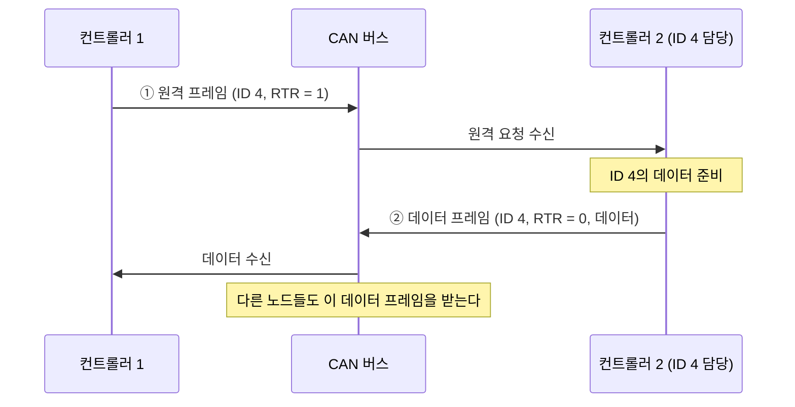

*그림 27. 원격 프레임으로 데이터를 요청하고 받는 과정*

1. 특정 노드(컨트롤러 1)가 원격 요청을 위한 원격 프레임을 보낸다. 식별자 4, RTR = 1이다.
2. 그 식별자에 해당하는 노드(컨트롤러 2)는 다음 통신에서 응답으로 데이터 프레임(식별자 4, RTR = 0)을 만든다.
3. 방송형 통신이므로 요청한 노드뿐 아니라 다른 노드들도 이 데이터 프레임을 받는다.

원격 프레임은 차량에서는 거의 쓰지 않는다. 차량의 ECU들은 대부분 값을 정해진 주기로 스스로 보내기 때문이다.

### 3.14 다중 버스 접근과 비트 단위 중재

CAN 프로토콜은 서로 다른 노드들이 동시에 버스에 접근하는 것을 허용한다. 여러 노드가 동시에 버스에 접근하면 **중재(arbitration)** 가 필요하며, CAN은 이를 **CSMA/CD+AMP(carrier sense multiple access with collision detection and arbitration on message priority)** 로 해결한다(3주차). 이 중재는 비파괴적(non-destructive)이고 비트 단위(bit-wise)로 이루어진다.

**CSMA/CD 부분.** 각 노드는 전송하면서 버스 선을 계속 듣고(listen), 자기가 보낸 데이터와 버스 위의 데이터를 비교(compare)한다. 둘이 다르면 즉시 전송을 멈춘다. 이미 다른 노드의 전송이 이긴 상태에서 전송을 계속하는 것은 의미가 없으므로 시간 낭비를 없애는 것이다.

> **참고:** CSMA/CD를 설명하며 "임의의 시간 동안 기다린 뒤 다시 시도한다"고 하는 것은 이더넷의 동작이다(7주차 2.8절). CAN에서 중재에 진 노드는 임의의 시간을 기다리지 않고, 이긴 노드의 프레임이 끝나 버스가 다시 유휴 상태가 되면 곧바로 다시 중재에 참여한다 [8]. 이더넷과 달리 CAN의 충돌은 이긴 프레임을 망가뜨리지 않으므로 무작위로 물러날 필요가 없다.

**AMP 부분.** 식별자에 따라 우선순위가 정해지고, 중재 단계에서는 우성 비트가 이긴다. 우성(0)은 트랜시버가 능동적으로 만드는 상태이고 열성(1)은 아무도 구동하지 않는 상태이므로, 한 노드라도 우성을 보내면 버스는 우성이 된다(와이어드 AND). 컨트롤러의 논리 신호로 보면 열성 버스 상태는 신호가 높은(high) 경우, 우성 버스 상태는 신호가 낮은(low) 경우이다.

**예제.** 세 노드가 동시에 SOF를 보내고 중재를 시작한다.

```text
bit      SOF  10  9   8   7   6   5   4   3   2   1   0  RTR
Node 1    0   1   1   0   0   1   0   1   1   1   .   .   .    -> lost at ID2, listen only
Node 2    0   1   1   0   0   1   1   .   .   .   .   .   .    -> lost at ID5, listen only
Node 3    0   1   1   0   0   1   0   1   1   0   0   1   0    -> wins (ID 0x659)
Bus       D   R   R   D   D   R   D   R   R   D   D   R   D
```

*그림 28. 세 노드의 비트 단위 중재(D는 우성, R은 열성)*

1. **ID10, ID9:** 세 노드 모두 1(열성)을 보내므로 버스는 R이다.
2. **ID8, ID7:** 세 노드 모두 0(우성)을 보내므로 버스는 D이다.
3. **ID6:** 모두 1이므로 버스는 R이다.
4. **ID5:** 노드 1과 3은 0, 노드 2는 1을 보낸다. 버스는 D가 되고, 1을 보냈는데 D를 읽은 노드 2가 중재에서 진다. 노드 2는 그 뒤로 듣기만 한다(listen only).
5. **ID4, ID3:** 노드 1과 3이 모두 1을 보내 버스는 R이다.
6. **ID2:** 노드 1은 1, 노드 3은 0을 보낸다. 버스는 D가 되고 노드 1이 진다.
7. **ID1, ID0, RTR:** 노드 3만 남아 0, 1, 0을 보낸다. 노드 3의 식별자는 2진수 110 0101 1001, 즉 16진수 659이다.

버스에 나타난 비트열은 처음부터 끝까지 노드 3의 비트열과 같으므로, 노드 3의 프레임은 손상되지 않았다. 세 식별자 가운데 노드 3의 값이 가장 작으므로(앞부분이 같고 처음 갈리는 자리에서 0을 가짐) 우선순위가 가장 높다.

### 3.15 메시지 프레임의 종류

| 프레임 | 용도 |
|:-----|:-----|
| 데이터 프레임(data frame) | ISO 11898-1 표준을 따르는 일반적인 CAN 통신 프레임이다. |
| 원격 프레임(remote frame) | 보낸 식별자에 대한 데이터를 요청한다. 차량에서는 거의 쓰지 않는다. |
| 오류 프레임(error frame) | 통신 도중 검출한 오류를 알린다. 오류가 발생한 데이터 전송은 중단되고 오류 프레임이 동작한다. 그 구조는 중단된 데이터 프레임이나 원격 프레임과 다르며, 오류 플래그(error flag)와 오류 구분자(error delimiter)의 두 부분으로 이루어진다. |
| 과부하 프레임(overload frame) | CAN 컨트롤러가 이전 메시지의 처리를 아직 마치지 못했을 때 다음 메시지의 시작을 늦추는 데 쓴다. 오류 카운터의 값에 영향을 주지 않는다. |

*표 31. CAN 메시지 프레임의 종류*

과부하 프레임은 오류 프레임과 같은 모양으로, 우성 비트 6개의 과부하 플래그와 열성 비트 8개의 과부하 구분자로 이루어진다. 인터미션에서 우성 비트를 감지했을 때도 보내며, 다음 프레임을 늦추기 위해 연속으로 최대 두 개까지 보낼 수 있다 [8].

### 3.16 오류 프레임

**오류 처리의 원칙.** CAN은 **네트워크 범위의 데이터 일관성(network-wide data consistency)**, 즉 모든 노드가 같은 프레임을 받거나 모두 버리는 것을 보장한다. 그래서 어느 노드가 오류를 검출하면 그 사실을 모든 CAN 노드와 공유한다.

- 오류가 발생하면 검출한 노드는 즉시 오류 프레임을 보낸다.
- 단, CRC 오류는 ACK 구분자 다음, 즉 EOF의 첫 번째 비트 자리가 되어서야 오류 프레임을 보낸다. 수신기는 CRC 시퀀스를 다 받아야 오류를 알 수 있고, 그 뒤의 ACK 슬롯과 ACK 구분자는 다른 노드들의 확인 응답 동작이므로 그 구간을 그대로 둔 뒤에 오류를 알린다.

**오류 프레임의 형식.** 오류 프레임은 오류 플래그와 오류 구분자로 이루어지고, 그 뒤에 프레임 간 공간(IFS)이 온다.

```text
         error detected
                v
┌───────────────┬────────────┬──────────────┬─────────────┬───────────┬─────────────────┐
│   data frame  │ error flag │  error flag  │    error    │    IFS    │    data frame   │
│ (interrupted) │ (primary)  │ (secondary)  │  delimiter  │           │ (retransmitted) │
│               │ 6 dominant │ 0-6 dominant │ 8 recessive │ >= 3 bits │                 │
└───────────────┴────────────┴──────────────┴─────────────┴───────────┴─────────────────┘
                |<-- 6-12 dominant bits --->|
                |<------------- error frame ------------->|
```

*그림 29. 오류 프레임의 구성과 재전송*

| 부분 | 내용 |
|:-----|:-----|
| 능동 오류 플래그(active error flag) | 우성 비트 6개이다. 오류 활성 상태의 노드가 보낸다. 같은 값 6개는 비트 스터핑 규칙을 일부러 어기는 것이므로(의도적인 스터핑 오류), 다른 모든 노드도 오류를 감지한다. |
| 수동 오류 플래그(passive error flag) | 열성 비트 6개이다. 오류 수동 상태의 노드가 보낸다. 열성이므로 다른 노드의 통신을 방해하지 못한다. |
| 중첩(superposition) | 처음 오류를 검출한 노드의 1차 플래그(primary)를 보고 스터핑 오류를 감지한 다른 노드들이 자기 오류 플래그(2차 플래그, secondary)를 보내면서 플래그들이 겹친다. 그래서 우성 구간은 6\~12비트가 된다. |
| 오류 구분자(error delimiter) | 열성 비트 8개이다. 오류 플래그가 끝났음을 알린다. |
| 프레임 간 공간(IFS) | 최소 3비트 이상의 휴지기가 필요하다. |

*표 32. 오류 프레임의 구성*

그림 29처럼 데이터 프레임을 보내는 도중 오류가 검출되면 오류 프레임이 그 전송을 끊고, IFS 뒤에 원래의 송신자가 중단된 데이터 프레임을 다시 보낸다.

### 3.17 오류의 종류와 결함 국한

| 수준 | 오류 종류 | 조건 | 검출 주체 |
|:-----|:-----|:-----|:-----|
| 비트 | 비트 오류(bit error) | 송신한 비트와 버스에서 받은 비트가 다르다(중재 필드와 ACK 슬롯은 제외). | 송신 노드 |
| 비트 | 스터핑 오류(stuff error) | 같은 상태가 6번째까지 연속으로 검출된다. | 수신 노드 |
| 메시지 | 형식 오류(form error) | 1로 고정된 비트인 CRC 구분자, ACK 구분자, EOF가 0이다. | 수신 노드 |
| 메시지 | CRC 오류(CRC error) | 송신한 CRC와 수신 노드가 계산한 CRC가 일치하지 않는다. | 수신 노드 |
| 메시지 | ACK 오류(ACK error) | ACK 슬롯이 1(열성)인 상태이다. 모든 수신 장치가 접속되어 있지 않거나 통신 선로가 끊어진 경우이다. | 송신 노드 |

*표 33. CAN 오류의 종류와 검출 주체*

다섯 오류가 검출되는 프레임의 위치는 다음과 같다. 스터핑 오류는 비트 스터핑이 적용되는 SOF부터 CRC 시퀀스까지에서, CRC 오류는 CRC 시퀀스에서, ACK 오류는 ACK 슬롯에서, 형식 오류는 CRC 구분자, ACK 구분자, EOF에서, 비트 오류는 송신기가 보내는 프레임 전체에서 검출된다.

**결함 국한(fault confinement).** 오류를 계속 일으키는 노드가 버스 전체를 마비시키지 않도록, 각 노드는 송신 오류 카운터(TEC)와 수신 오류 카운터(REC)를 두고 그 값에 따라 오류 활성, 오류 수동, 버스 오프 상태를 오간다(3주차의 그림 14와 표 9). 카운터의 주요 증감 규칙은 다음과 같다 [8].

| 사건 | 카운터 변화 |
|:-----|:-----|
| 수신기가 오류를 검출 | REC + 1 |
| 수신기가 오류 플래그를 보낸 직후 첫 비트로 우성을 검출(자기가 처음 검출한 오류임을 확인) | REC + 8 |
| 송신기가 오류 플래그를 보냄 | TEC + 8 |
| 송신기가 능동 오류 플래그나 과부하 플래그를 보내는 중에 비트 오류를 검출 | TEC + 8 |
| 수신기가 능동 오류 플래그나 과부하 플래그를 보내는 중에 비트 오류를 검출 | REC + 8 |
| 송신에 성공(ACK를 받고 EOF까지 오류 없음) | TEC - 1 (0보다 클 때) |
| 수신에 성공 | REC - 1 (1\~127일 때), 127보다 크면 119\~127 사이의 값으로 낮춤 |

*표 34. CAN 오류 카운터의 주요 증감 규칙*

규격에는 이 밖에 몇 가지 예외가 있다. 예를 들어 오류 수동 상태의 송신기가 ACK 오류를 검출하고, 수동 오류 플래그를 보내는 동안 우성 비트를 감지하지 않았다면 TEC를 늘리지 않는다. 다른 노드가 하나도 없어 아무도 ACK를 보내지 않는 경우에 혼자 버스 오프로 가지 않게 하기 위해서이다.

**계산 예.** 고장 난 송신기가 보내는 프레임마다 오류가 나서 한 번도 성공하지 못한다고 가정한다. 실패할 때마다 TEC가 8씩 늘어나므로, $128 / 8 = 16$번 실패하면 TEC = 128 > 127이 되어 오류 수동 상태가 된다. 그 뒤로도 계속 실패하면 $256 / 8 = 32$번째 실패에서 TEC = 256 > 255가 되어 버스 오프 상태가 되고, 이 노드는 버스에서 논리적으로 분리된다. 반면 송신이 성공할 때마다 TEC는 1씩만 줄어들므로, 가끔 생기는 오류는 곧 회복되지만 반복되는 오류는 빠르게 쌓인다.

### 3.18 비트 타이밍

CAN 컨트롤러는 메시지의 비트 하나를 시간 구간에 따라 네 부분으로 나누어 분석한다 [11].

- 메시지의 동기(sync)와 지연(delay)을 보정하는 구간: Sync_Seg와 Prop_Seg
- 비트의 값을 어느 시점에 읽을지 정하는 구간: 표본점(sample point)
- 비트 타이밍은 제조사마다 조금씩 다르므로, 서로 다른 제조사의 컨트롤러를 함께 쓸 때는 별도의 설정이 필요할 수도 있다.

> **용어 정의:** **타임 퀀텀(tq, time quantum)** 은 비트 타이밍의 최소 시간 단위로, 컨트롤러의 발진기 클록을 분주기(BRP, baud rate prescaler)로 나누어 만든다. 한 비트는 정수 개의 타임 퀀텀으로 이루어진다.

```text
|<----------------- nominal bit time = 16 tq = 2 us at 500 kbit/s ----------------->|
┌─────┬──────────────────────────────┬───────────────────────────────────┬──────────┐
│ Sync│           Prop_Seg           │             Phase_Seg1            │Phase_Seg2│
│ 1 tq│             6 tq             │                7 tq               │   2 tq   │
└─────┴──────────────────────────────┴───────────────────────────────────┴──────────┘
                                                                         ^
                                                             sample point (14/16 = 87.5%)
```

*그림 30. CAN 비트 시간의 네 구간과 표본점*

| 구간 | 범위 | 역할 |
|:-----|:-----|:-----|
| BRP | 1\~32 | 발진기 클록을 나누어 타임 퀀텀의 길이를 정한다. |
| Sync_Seg | 1 tq | 길이가 고정되어 있으며, 버스의 에지가 이 구간에 오도록 노드들의 시계를 맞춘다. |
| Prop_Seg | 1\~8 tq | 물리적인 지연 시간(버스의 왕복 전파 지연과 트랜시버, 컨트롤러의 지연)을 보상한다. |
| Phase_Seg1 | 1\~8 tq | 재동기화 때 일시적으로 늘어날 수 있다. |
| Phase_Seg2 | 1\~8 tq | 재동기화 때 일시적으로 줄어들 수 있다. |
| SJW(synchronization jump width) | 1\~4 tq | 재동기화 한 번에 늘이거나 줄일 수 있는 최대량이다. 어느 위상 버퍼 구간보다도 길 수 없다. |

*표 35. CAN 비트 시간의 매개변수*

표본점은 Phase_Seg1과 Phase_Seg2의 경계이다. 표 35의 범위는 CAN 프로토콜이 요구하는 최소한의 설정 범위이다.

**계산 예.** CAN 컨트롤러의 클록이 16 MHz이고 500 kbit/s로 통신하려 한다.

1. BRP = 2로 정하면 타임 퀀텀은 $`t_q = 2 / 16\ \text{MHz} = 125`$ ns이다.
2. 500 kbit/s의 비트 시간은 $`1 / 500000 = 2\ \mu`$s이므로, 한 비트는 $`2\ \mu\text{s} / 125\ \text{ns} = 16`$ tq이다.
3. Sync_Seg = 1 tq, Prop_Seg = 6 tq, Phase_Seg1 = 7 tq, Phase_Seg2 = 2 tq로 나누면 합이 $1 + 6 + 7 + 2 = 16$ tq이다.
4. 표본점은 비트 시작에서 $`(1 + 6 + 7) / 16 = 87.5\%`$ 지점, 즉 1.75 µs이다.
5. SJW는 4 tq와 Phase_Seg2 = 2 tq 가운데 작은 값 이하여야 하므로 최대 2 tq이다.

Prop_Seg = 6 tq = 750 ns는 왕복 지연을 덮어야 한다. 40 m 버스에서 신호가 1 m에 약 5 ns 걸리면 버스의 왕복 지연은 $2 \times 40 \times 5 = 400$ ns이고, 트랜시버와 컨트롤러의 왕복 지연을 약 300 ns로 가정하면 합이 약 700 ns이므로 750 ns 안에 들어온다.

### 3.19 저전력 모드와 웨이크업

차량이 시동을 끈 동안에도 ECU가 계속 전력을 쓰면 배터리가 방전되므로, CAN 트랜시버는 **저전력 모드(low power mode)** 로 들어가 대기한다. 저전력 모드의 트랜시버가 다시 깨어나는 방식에는 세 가지가 있다.

- **기본 웨이크업(basic wake-up):** 버스에서 정해진 시간보다 긴 우성 신호를 감지하면 깨어나는 단순한 방식이다.
- **웨이크업 패턴 웨이크업(wake-up pattern wake-up):** 정해진 모양의 패턴(WUP)을 감지하면 깨어난다.
- **선택적 웨이크업(selective wake-up):** 정해진 내용의 프레임(WUF)을 받았을 때만 깨어난다.

> **용어 정의:** **CAN 활동 필터 시간(CAN activity filter time)** 은 CAN 버스의 활동을 감시하기 위해 CAN_H와 CAN_L의 우성 레벨과 열성 레벨이 지속되어야 하는 시간이다. 이보다 짧은 펄스는 잡음으로 보고 무시한다.

- **WUP(wake-up pattern, 웨이크업 패턴):** 저전력 모드 동안 트랜시버는 버스 선 CAN_H와 CAN_L에서 WUP를 감시해야 한다. 선택적 웨이크업이 비활성화된 상태에서 WUP를 받으면 웨이크업을 수행한다.
- **WUF(wake-up frame, 웨이크업 프레임):** 선택적 웨이크업 기능이 있는 트랜시버는 버스 선에서 WUF를 감시한다. 선택적 웨이크업이 활성화된 상태에서 "유효한 WUF"를 받으면 웨이크업을 수행한다. 같은 버스의 다른 노드들을 깨우지 않고 필요한 노드만 깨울 수 있어, 부분 네트워킹(partial networking)으로 전력을 아낀다.

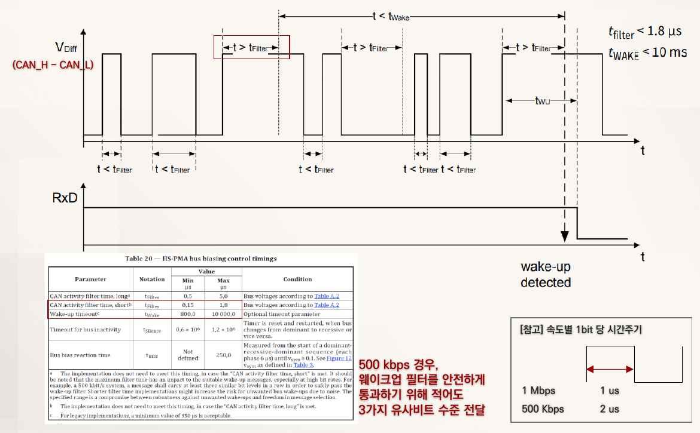

*그림 31. 웨이크업 패턴의 검출*

그림 31은 차동 전압 $`V_{Diff} = V_{CAN\_H} - V_{CAN\_L}`$의 파형과 트랜시버의 RxD 출력이다. 필터 시간 $t_{Filter}$보다 짧은 펄스($`t < t_{Filter}`$)는 모두 무시된다. **우성 구간이 $t_{Filter}$보다 길고, 이어서 열성 구간이 $t_{Filter}$보다 길고, 다시 우성 구간이 $t_{Filter}$보다 긴 패턴**이 웨이크업 시간 제한 $t_{Wake}$ 안에 완성되면 유효한 WUP이다. 마지막 우성 구간이 $t_{Filter}$를 넘는 순간 웨이크업이 검출되고, RxD가 낮은(low) 레벨로 바뀌어 마이크로컨트롤러에 알린다. 이 예의 트랜시버에서 짧은 필터 시간은 최대 1.8 µs, 웨이크업 시간 제한은 최대 10 ms이다 [12], [10].

| 매개변수 | 기호 | 최소 | 최대 |
|:-----|:-----|:-----|:-----|
| CAN 활동 필터 시간(긴 것) | $t_{Filter}$ | 0.5 µs | 5.0 µs |
| CAN 활동 필터 시간(짧은 것) | $t_{Filter}$ | 0.15 µs | 1.8 µs |
| 웨이크업 시간 제한 | $t_{Wake}$ | 800 µs | 10,000 µs |
| 버스 비활성 시간 제한 | $t_{Silence}$ | 0.6 s | 1.2 s |
| 버스 바이어스 반응 시간 | $t_{Bias}$ | | 250 µs |

*표 36. 고속 CAN 물리 매체 접속(HS-PMA)의 버스 바이어스 제어 시간*

긴 필터 시간과 짧은 필터 시간은 둘 가운데 하나만 만족하면 된다. 필터 시간이 짧으면 잡음 때문에 원치 않는 웨이크업이 일어날 위험이 커지고, 길면 특히 높은 비트 속도에서 웨이크업에 쓸 수 있는 메시지가 제한되므로, 규정된 범위는 두 요구의 절충이다. 웨이크업 시간 제한은 선택적인 매개변수이며, 기존 구현에는 최솟값 350 µs도 허용된다. 버스 비활성 시간 제한 $t_{Silence}$의 타이머는 버스가 우성에서 열성으로, 또는 그 반대로 바뀔 때마다 다시 시작되며, 이 시간 동안 바뀜이 없으면 트랜시버는 버스가 비활성 상태라고 판단하고 버스 바이어스를 끈다. 버스 바이어스 반응 시간 $t_{Bias}$는 각 단계가 6 µs인 우성, 열성, 우성의 순서가 시작된 때부터 트랜시버가 버스 바이어스를 다시 켜기까지의 시간으로, 최대 250 µs이다 [10].

**계산 예.** 500 kbps에서 한 비트는 2 µs이다(1 Mbps면 1 µs). 필터 시간이 가장 긴 경우(5.0 µs)에도 웨이크업 필터를 안전하게 통과하려면, 메시지 안에서 같은 레벨의 비트가 적어도 3개 연속으로 이어져야 한다($`3 \times 2 = 6\ \mu\text{s} > 5.0\ \mu`$s). 2개($`4\ \mu`$s)로는 부족할 수 있다.

웨이크업 뒤의 동작은 다음과 같다. 유효한 WUP가 검출되면 RxD 출력 핀은 지연 시간 $t_{WU}$ 뒤에 고속 CAN 버스 신호를 따른다. 대기(stand-by) 모드에서 정상 동작(normal-operating) 모드로 전환하는 동안 RxD 출력은 $`t_{RxD\_Rec} < 5\ \mu`$s의 지연으로 "high"에 고정되고, 전환 시간 $t_{Mode}$가 지나면 풀려나 버스의 우성 신호를 따른다 [12]. 즉 모드가 바뀌는 짧은 동안 잘못된 신호가 마이크로컨트롤러에 전달되지 않도록 RxD를 열성 레벨로 막아 둔다.

### 3.20 CAN FD의 등장

| 연도 | 사건 |
|:-----|:-----|
| 1983 | CAN 개발 시작 |
| 1986 | Bosch가 SAE 학회에서 CAN 발표 |
| 1991 | CAN 2.0 발표 |
| 1993 | CAN 표준 제정(ISO 11898) |
| 2012 | Bosch가 CAN FD 1.0 규격 공개 |
| 2015 | CAN FD 표준 제정(ISO 11898-1:2015) |

*표 37. CAN에서 CAN FD까지*

> **용어 정의:** **CAN FD(CAN with Flexible Data rate)** 는 기존 CAN의 중재 방식을 그대로 두고, 데이터 구간에서만 전송 속도를 높이고 데이터 필드를 최대 64바이트로 늘린 프로토콜이다 [13].

ADAS와 소프트웨어 갱신 등으로 차량의 데이터량이 늘면서 1 Mbps, 8바이트인 CAN의 한계가 드러났고, 이를 해결하기 위해 CAN FD가 대두되었다.

- **데이터 전송 속도 증가:** 기존 CAN의 최대 속도는 1 Mbps이지만, CAN FD는 데이터 구간에서 최대 8 Mbps까지 지원한다.
- **데이터 프레임 크기 확장:** CAN의 데이터 필드는 최대 8바이트이지만, CAN FD는 최대 64바이트까지 확장했다.
- **유연한 데이터 속도 전환:** 한 메시지를 보내는 도중에 비트 속도를 바꿀 수 있어 네트워크 효율이 높아진다. 여러 노드가 경쟁하는 중재 구간은 기존 속도로, 한 노드만 보내는 데이터 구간은 높은 속도로 보낸다.
- **향상된 오류 검출:** 강화된 CRC 알고리즘으로 오류 검출 능력을 높였다.
- **표준:** 프로토콜은 ISO 11898-1, 고속 물리 계층은 ISO 11898-2가 정한다 [9], [10].

두 프로토콜의 호환성은 다음과 같다.

- **CAN 프로토콜:** 기존 CAN 컨트롤러는 CAN FD 네트워크에서 쓸 수 없다. FDF 뒤의 비트를 기존 형식으로 해석하므로 CAN FD 프레임에서 스터핑 오류나 CRC 오류, 형식 오류를 검출하고, 오류 프레임을 보내 통신을 방해하기 때문이다.
- **CAN FD 프로토콜:** CAN FD 컨트롤러는 기존 CAN 프레임도 보내고 받을 수 있으므로, 약간의 설정 변경으로 CAN 네트워크에서 쓸 수 있다.

### 3.21 CAN과 CAN FD의 비교

| 항목 | CAN | CAN FD |
|:-----|:-----|:-----|
| 도입 시기 | 1980년대 | 2012년 |
| 데이터 속도 | 최대 1 Mbps | 최대 8 Mbps(데이터 구간) |
| 데이터 페이로드 | 최대 8바이트 | 최대 64바이트 |
| 전송 속도 변경 | 고정된 전송 속도 | 데이터 전송 중 속도 변경 가능 |
| 오류 검출 | 15비트 CRC | 강화된 17비트 또는 21비트 CRC |
| 네트워크 호환성 | CAN 기반 네트워크와 호환 | 기존 CAN 네트워크와 하위 호환 가능 |
| 하드웨어 요구 사항 | 표준 CAN 컨트롤러 | CAN FD를 지원하는 컨트롤러 필요 |

*표 38. CAN과 CAN FD의 비교*

### 3.22 CAN FD 프레임 형식

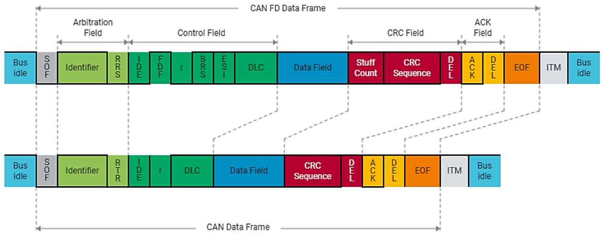

*그림 32. CAN FD 데이터 프레임과 CAN 데이터 프레임의 비교*

그림 32의 위쪽은 CAN FD 데이터 프레임, 아래쪽은 기존 CAN 데이터 프레임이다. 중재 필드는 거의 같고, 제어 필드에 FDF, BRS, ESI 같은 비트가 더해졌으며, CRC 필드 앞에 스터핑 카운트가 붙었다. 기존 CAN의 RTR 자리에는 RRS가, r0 자리에는 FDF가 온다. 각 필드는 다음과 같다(표준 식별자 형식 기준).

| 번호 | 필드 | 비트 수 | 의미 |
|:-----|:-----|:-----|:-----|
| 1 | 식별자(identifier) | 11 또는 29 | 표준 프레임은 11비트, 확장 프레임은 29비트이다. |
| 2 | RRS(remote request substitution) | 1 | 기존 CAN의 RTR 자리이다. CAN FD에는 원격 프레임이 없으므로 항상 우성으로 보내며, 수신기는 이 비트의 값에 상관하지 않는다(don't care). |
| 3 | IDE(identifier extension) | 1 | 우성(0)이면 11비트 식별자, 열성(1)이면 29비트 식별자이다. |
| 4 | FDF(FD format) | 1 | 기존 CAN 프레임에서 r(r0) 자리였던 비트로 CAN과 CAN FD를 구별한다. 우성(0)이면 CAN 프레임, 열성(1)이면 CAN FD 프레임이다. |
| | res | 1 | 예약 비트로, 우성으로 보낸다. |
| 5 | BRS(bit rate switch) | 1 | 우성(0)이면 데이터 구간도 기존 속도(예: 1 Mbps)를 유지하고, 열성(1)이면 이 비트의 표본점부터 CRC 구분자까지 더 높은 데이터 속도로 바꾼다. |
| 6 | ESI(error state indicator) | 1 | 송신 노드의 오류 상태를 알린다. 우성(0)이면 오류 활성, 열성(1)이면 오류 수동이다. |
| 7 | DLC(data length code) | 4 | 데이터 필드의 길이 부호이다. 최댓값 15가 64바이트를 뜻한다. |
| | 데이터 필드 | 0\~512 | 0\~64바이트이다. |
| 9 | 스터핑 카운트(stuff count) | 4 | 앞부분에 끼워 넣은 스터핑 비트의 수를 8로 나눈 나머지(그레이 부호 3비트)와 패리티 1비트이다. CRC와 별도로 이중화된 검사 영역이다. |
| | CRC 시퀀스 | 17 또는 21 | 데이터가 16바이트 이하이면 CRC-17, 20바이트 이상이면 CRC-21을 쓴다. |

*표 39. CAN FD 데이터 프레임의 필드*

> **참고:** DLC를 "Data Length Check"로, "3비트"로 적은 자료가 있으나, DLC는 data length code의 약자이고 기존 CAN과 같은 4비트이다 [9]. 4비트이기 때문에 0\~15의 값을 가질 수 있고, CAN FD는 그 가운데 9\~15에 8바이트보다 긴 길이를 배정한다.

CAN FD의 DLC는 다음과 같이 데이터 길이를 나타낸다. 0\~8은 기존 CAN과 같고, 9\~15는 더 긴 길이를 뜻한다 [9].

| DLC | 0\~8 | 9 | 10 | 11 | 12 | 13 | 14 | 15 |
|:-----|:-----|:-----|:-----|:-----|:-----|:-----|:-----|:-----|
| 데이터 바이트 수 | 0\~8 | 12 | 16 | 20 | 24 | 32 | 48 | 64 |

*표 40. CAN FD의 DLC와 데이터 길이*

CRC의 생성 다항식은 16진수로 다음과 같다. 최고차항을 포함하여 적은 값이다.

- **CRC-17:** 0x3685B, 즉 $x^{17} + x^{16} + x^{14} + x^{13} + x^{11} + x^6 + x^4 + x^3 + x + 1$
- **CRC-21:** 0x302899, 즉 $x^{21} + x^{20} + x^{13} + x^{11} + x^7 + x^4 + x^3 + 1$

데이터가 길수록 오류를 놓칠 가능성이 커지므로 긴 데이터에는 더 긴 CRC를 쓴다. 또 기존 CAN에서는 스터핑 비트가 잘못되면 수신기가 비트 위치를 잘못 맞추어 CRC가 오류를 놓치는 경우가 있었는데, CAN FD는 스터핑 비트까지 CRC 계산에 넣고 그 수를 스터핑 카운트로 따로 보내 이 약점을 보완했다 [9].

**계산 예.** 64바이트를 보내는 데 걸리는 시간을 비교한다. 중재 속도는 500 kbit/s, CAN FD의 데이터 속도는 2 Mbit/s로 하고, 스터핑 비트와 프레임 간 공간은 뺀 근사로 계산한다.

1. **기존 CAN:** 8바이트 표준 프레임이 108비트(3주차)이므로, 64바이트에는 프레임 8개, $8 \times 108 = 864$비트가 필요하다. $`864 / 500000 = 1728\ \mu`$s이다.
2. **CAN FD, 중재 속도로 보내는 부분:** SOF, 식별자 11비트, RRS, IDE, FDF, res, BRS의 17비트와 ACK 슬롯, ACK 구분자, EOF 7비트의 9비트, 모두 26비트이다. $`26 / 500000 = 52\ \mu`$s이다.
3. **CAN FD, 데이터 속도로 보내는 부분:** ESI 1비트, DLC 4비트, 데이터 512비트, 스터핑 카운트 4비트, CRC 21비트, CRC 구분자 1비트, 모두 543비트이다. $`543 / 2000000 = 271.5\ \mu`$s이다.
4. CAN FD 프레임 하나의 전송 시간은 $`52 + 271.5 = 323.5\ \mu`$s로, 기존 CAN의 약 1/5이다.

같은 데이터를 약 5배 빠르게 보내면서, 프레임 하나에 담기므로 64바이트가 한꺼번에 일관되게 전달된다는 장점도 있다.

---

<br>

## 개념 적용

| 상황 | 연결할 개념과 이유 |
|:-----|:-----|
| 도어 안의 미러, 창문 모터, 잠금장치를 싸게 연결하려 한다. | **LIN.** 단일 전선, 수정 진동자가 없는 슬레이브, UART 기반으로 노드당 비용이 가장 낮고, 20 kbps면 충분하다. |
| 조향과 제동을 전자식으로 하는 X-by-wire 시스템에서 메시지가 정확한 시각에 도착해야 한다. | **FlexRay의 정적 구간.** 시간 기반 TDMA로 지연과 지터가 보장되고, 두 채널로 이중화할 수 있다. |
| 서라운드 뷰 카메라 4대의 영상을 ADAS 제어기로 보내야 한다. | **차량용 이더넷(100BASE-T1, 1000BASE-T1).** CAN이나 FlexRay로는 대역폭이 부족하고, 한 쌍의 선으로 고속 전송이 가능하다. |
| 정비소에서 1 GB의 소프트웨어를 빠르게 갱신해야 한다. | **이더넷 기반 진단(중앙 게이트웨이).** 500 kbps HS-CAN으로는 약 11시간이 걸리지만 100 Mbps 이더넷으로는 약 80초이다. |
| 한 ECU가 고장 나서 보내는 프레임마다 오류를 일으킨다. | **결함 국한.** TEC가 8씩 늘어 16번 실패하면 오류 수동, 32번 실패하면 버스 오프가 되어 버스에서 분리된다. |
| CAN 메시지의 데이터가 8바이트를 넘어 여러 프레임으로 나누어 보내고 있다. | **CAN FD.** 최대 64바이트를 한 프레임에 싣고, 데이터 구간을 높은 속도로 보낸다. |

*표 41. 상황별로 연결할 개념*

**T/F 점검:**

| 문장 | 판단과 근거 |
|:-----|:-----|
| LIN에서는 슬레이브끼리 직접 통신할 때 마스터가 관여하지 않는다. | **F.** 모든 프레임의 머리는 마스터가 보내므로, 슬레이브 사이의 통신 시점도 마스터의 스케줄이 정한다. |
| FlexRay의 동적 구간에서는 프레임 ID가 작을수록 먼저 보낼 기회를 얻는다. | **T.** 슬롯 카운터가 작은 ID부터 차례로 지나가기 때문이다. |
| CAN 데이터 프레임의 RTR 비트는 열성(1)이다. | **F.** 데이터 프레임의 RTR은 우성(0)이고, 원격 프레임의 RTR이 열성(1)이다. |
| CAN에서 중재에 진 노드는 이더넷처럼 임의의 백오프 시간을 기다린다. | **F.** 버스가 다시 유휴 상태가 되면 곧바로 다시 중재에 참여한다. |
| CAN FD 컨트롤러는 기존 CAN 프레임도 보내고 받을 수 있다. | **T.** 그래서 CAN FD 컨트롤러는 기존 CAN 네트워크에서도 쓸 수 있다. 반대로 기존 CAN 컨트롤러는 CAN FD 네트워크에서 쓸 수 없다. |

---

<br>

## 요약

| 개념 | 핵심 요약 |
|:-----|:-----|
| 도메인별 IVN | 바디는 LIN과 CAN, 파워트레인과 섀시는 TTP/C와 FlexRay, 멀티미디어는 MOST, 안전은 TTEthernet이 맡으며, 속도가 높을수록 비용도 높다. |
| 사건 기반과 시간 기반 | 사건 기반(CAN)은 유연하지만 지연을 보장하지 못하고, 시간 기반(LIN 스케줄, FlexRay 정적 구간)은 전달 시각을 보장한다. |
| CAN의 버스 부하 | 실제 속도는 250\~500 kbps이며, 부하가 높을수록 지터가 커져 제어 성능이 떨어지므로 50% 이하가 권장된다. |
| LIN | 단일 마스터와 다중 슬레이브의 단일 전선 버스로 최대 20 kbps이며, 마스터의 머리(브레이크, 동기 55, 보호 식별자)와 슬레이브의 응답(데이터, 체크섬)으로 프레임을 이룬다. |
| LIN의 계산 | 패리티는 $P_0 = ID_0 \oplus ID_1 \oplus ID_2 \oplus ID_4$, $P_1 = \overline{ID_1 \oplus ID_3 \oplus ID_4 \oplus ID_5}$이고, 체크섬은 자리올림을 되돌린 8비트 합의 반전이며, 최대 프레임 시간은 공칭의 140%이다. |
| FlexRay | 채널당 10 Mbit/s의 두 채널을 쓰며, 통신 사이클은 정적 구간(TDMA), 동적 구간(미니슬롯), 심볼 창, NIT로 이루어지고, 프레임은 5바이트 머리, 최대 254바이트 페이로드, 24비트 CRC 꼬리이다. |
| 차량용 이더넷 | 진단과 소프트웨어 갱신의 대역폭 요구에서 시작되었고, 한 쌍의 꼬임쌍선으로 전이중 100 Mbps(100BASE-T1)나 1 Gbps(1000BASE-T1)를 보내며, AVB와 TSN으로 실시간성을 지원한다. |
| CAN의 물리 계층 | NRZ 부호, 우성 0과 열성 1, 고속 CAN은 차동 전압 약 2 V와 0 V, 저속 CAN은 결함 허용이며, 속도와 버스 길이의 곱은 대략 일정하다. |
| CAN 프레임 | 데이터 프레임은 SOF, 식별자, RTR, IDE, r0, DLC, 데이터, CRC, ACK, EOF로 이루어지고, 11개의 연속 열성 비트가 버스 유휴를 뜻한다. |
| 중재 | CSMA/CD+AMP로 식별자의 각 비트에서 우성이 이기며, 진 노드는 듣기만 하다가 버스가 비면 다시 참여한다. |
| 오류 처리 | 비트, 스터핑, 형식, CRC, ACK 오류를 검출하면 오류 프레임(6비트 플래그, 8비트 구분자)으로 알리고 재전송하며, TEC와 REC로 오류 활성, 오류 수동, 버스 오프를 오간다. |
| 비트 타이밍 | 한 비트를 Sync_Seg, Prop_Seg, Phase_Seg1, Phase_Seg2로 나누고 Phase_Seg1과 Phase_Seg2의 경계에서 값을 읽는다. |
| 웨이크업 | 저전력 모드의 트랜시버는 필터 시간보다 긴 우성, 열성, 우성의 WUP나 선택적 웨이크업용 WUF를 받으면 깨어난다. |
| CAN FD | 중재 구간은 기존 속도, 데이터 구간은 최대 8 Mbps로 보내고, 데이터 필드는 최대 64바이트이며, FDF, BRS, ESI와 스터핑 카운트, CRC-17과 CRC-21을 더했다. |

---

<br>

## 점검 문제

1. **대역폭 점유율:** X-by-wire와 센서가 요구하는 대역폭의 합이 906 kbit/s일 때, 이를 CAN과 FlexRay로 처리하는 경우의 점유율을 구하고 CAN이 알맞지 않은 이유를 설명하라.

   <details>
   <summary>정답</summary>

   CAN은 $`906 / 1000 = 90.6\%`$, FlexRay(채널당 10 Mbit/s)는 $`906 / 10000 \approx 9\%`$이다. CAN은 지터와 낮은 우선순위 메시지의 지연을 고려하여 부하를 약 50% 이하로 유지할 것을 권장하므로, 90%가 넘는 부하로는 안전 관련 메시지의 지연을 보장할 수 없다.

   </details>

2. **LIN 보호 식별자:** 식별자 16진수 23(2진수 100011)의 패리티 비트 $P_0$, $P_1$과 보호 식별자를 구하라.

   <details>
   <summary>정답</summary>

   $ID_0 = 1, ID_1 = 1, ID_2 = 0, ID_3 = 0, ID_4 = 0, ID_5 = 1$이다. $P_0 = 1 \oplus 1 \oplus 0 \oplus 0 = 0$이고, $ID_1 \oplus ID_3 \oplus ID_4 \oplus ID_5 = 1 \oplus 0 \oplus 0 \oplus 1 = 0$이므로 $P_1 = \overline{0} = 1$이다. 비트 7부터 쓰면 1010 0011이므로 보호 식별자는 16진수 A3이다.

   </details>

3. **LIN 프레임 시간:** 19.2 kbit/s의 LIN에서 데이터 8바이트 프레임의 공칭 프레임 시간과, 스케줄 표에서 그 프레임에 배정해야 하는 최소 시간을 구하라.

   <details>
   <summary>정답</summary>

   공칭 비트 수는 머리 34비트와 응답 $10 \times (8 + 1) = 90$비트를 합한 124비트이다. 비트 시간이 $`1 / 19200 \approx 52.1\ \mu`$s이므로 공칭 프레임 시간은 약 6.46 ms이다. 최대 프레임 시간은 공칭의 140%인 $1.4 \times 124 = 173.6$비트, 약 9.04 ms이므로 프레임 슬롯은 최소 약 9.04 ms여야 한다.

   </details>

4. **FlexRay 동적 구간:** FlexRay의 동적 구간에서 보낼 데이터가 없는 노드는 시간을 얼마나 쓰는가? 이 방식이 사건 기반 메시지에 알맞은 이유를 설명하라.

   <details>
   <summary>정답</summary>

   보낼 것이 없는 노드는 미니슬롯 하나만 지나가게 하고 슬롯 카운터를 1 증가시킨다. 보낼 것이 있는 노드만 필요한 만큼 미니슬롯을 차지하므로, 메시지가 가끔 생기는 사건 기반 트래픽에서도 대역폭을 낭비하지 않는다. 또 슬롯 카운터가 작은 ID부터 지나가므로 우선순위도 자연스럽게 정해진다.

   </details>

5. **차량용 이더넷의 물리 계층:** 100BASE-T1이 100 Mbit/s를 66.6 MBaud로 보낼 때 기호 하나가 나르는 비트 수를 구하고, 100BASE-TX보다 기호 속도를 낮춘 이유를 설명하라.

   <details>
   <summary>정답</summary>

   $100 / 66.67 = 1.5$비트이다. PAM-3은 기호당 최대 $\log_2 3 \approx 1.58$비트를 나를 수 있으므로 가능하다. 기호 속도가 낮으면 신호의 주파수 대역이 좁아 전자파 방사가 줄어들므로, 차폐하지 않은 한 쌍의 선으로도 차량의 엄격한 EMC 요구를 맞추기 쉽다.

   </details>

6. **CAN 중재:** 식별자가 0x6A0, 0x69F, 0x6A1인 세 노드가 동시에 표준 데이터 프레임의 전송을 시작했다. 어느 노드가 이기며, 진 노드들은 어느 비트에서 지는가?

   <details>
   <summary>정답</summary>

   2진수로 0x6A0 = 110 1010 0000, 0x69F = 110 1001 1111, 0x6A1 = 110 1010 0001이다. ID10\~ID6은 세 값 모두 11010으로 같다. ID5에서 0x69F는 0, 나머지 둘은 1이므로 버스가 우성이 되어 0x6A0과 0x6A1이 진다. 남은 0x69F가 이긴다. 가장 작은 식별자가 이긴다는 결과와 일치한다.

   </details>

7. **오류 프레임:** 능동 오류 플래그가 우성 비트 6개인 이유와, 버스의 우성 구간이 6\~12비트가 되는 이유를 설명하라.

   <details>
   <summary>정답</summary>

   같은 값 6개는 비트 스터핑 규칙을 어기므로, 오류를 검출하지 못한 다른 노드들도 스터핑 오류를 감지하여 모든 노드가 그 프레임을 버리게 된다. 이것이 네트워크 범위의 데이터 일관성을 보장한다. 다른 노드들은 1차 플래그를 보고 늦어도 6번째 비트에서 오류를 감지하여 자기 플래그(2차 플래그)를 보내므로, 1차 플래그와 겹쳐 우성 구간은 최소 6비트, 최대 12비트가 된다.

   </details>

8. **결함 국한:** TEC가 0인 노드가 송신할 때마다 오류가 나서 한 번도 성공하지 못한다. 몇 번째 실패에서 오류 수동이 되고, 몇 번째 실패에서 버스 오프가 되는가?

   <details>
   <summary>정답</summary>

   실패마다 TEC가 8씩 늘어난다. 16번째 실패에서 TEC = 128 > 127이 되어 오류 수동이 되고, 32번째 실패에서 TEC = 256 > 255가 되어 버스 오프가 된다.

   </details>

9. **비트 타이밍:** 8 MHz 클록의 CAN 컨트롤러로 250 kbit/s를 만들려 한다. BRP = 2일 때 한 비트의 타임 퀀텀 수를 구하고, 표본점을 87.5%로 하는 구간 배분의 예를 들어라.

   <details>
   <summary>정답</summary>

   $`t_q = 2 / 8\ \text{MHz} = 250`$ ns이고 비트 시간은 $`1 / 250000 = 4\ \mu`$s이므로 한 비트는 16 tq이다. 예를 들어 Sync_Seg 1, Prop_Seg 6, Phase_Seg1 7, Phase_Seg2 2로 나누면 표본점은 $`(1 + 6 + 7) / 16 = 87.5\%`$이다. 이때 SJW는 최대 2 tq이다.

   </details>

10. **CAN FD:** CAN FD 프레임의 DLC가 13이면 데이터는 몇 바이트이며, 어떤 CRC를 쓰는가? BRS가 열성이면 무엇이 달라지는가?

    <details>
    <summary>정답</summary>

    DLC 13은 32바이트이다. 데이터가 16바이트를 넘으므로 CRC-21을 쓴다. BRS가 열성이면 BRS의 표본점부터 CRC 구분자까지의 데이터 구간을 중재 구간보다 높은 데이터 속도로 보낸다.

    </details>

11. **웨이크업:** 250 kbps CAN에서 필터 시간이 가장 긴 경우(5.0 µs)에도 웨이크업 필터를 통과하려면 같은 레벨의 비트가 최소 몇 개 연속되어야 하는가?

    <details>
    <summary>정답</summary>

    250 kbps에서 한 비트는 $`1 / 250000 = 4\ \mu`$s이다. 비트 하나(4 µs)로는 5.0 µs보다 짧으므로 부족하고, 2비트가 이어지면 $`2 \times 4 = 8\ \mu\text{s} > 5.0\ \mu`$s이므로 통과한다. 따라서 같은 레벨의 비트가 최소 2개 연속되어야 한다.

    </details>

---

<br>

## 참고 문헌

1. FlexRay Consortium, *FlexRay Communications System Protocol Specification, Version 3.0.1*, 2010.
2. SAE International, *AS6802: Time-Triggered Ethernet*, 2011.
3. LIN Consortium, *LIN Specification Package, Revision 2.2A*, 2010.
4. LIN Consortium, *LIN Specification Package, Revision 1.3*, 2002.
5. IEEE Std 802.3bw-2015, *IEEE Standard for Ethernet Amendment 1: Physical Layer Specifications and Management Parameters for 100 Mb/s Operation over a Single Balanced Twisted Pair Cable (100BASE-T1)*, IEEE, 2015.
6. OPEN Alliance, "OPEN Alliance: One-Pair Ether-Net." https://www.opensig.org/
7. IEEE Std 802.3bp-2016, *IEEE Standard for Ethernet Amendment 4: Physical Layer Specifications and Management Parameters for 1 Gb/s Operation over a Single Twisted-Pair Copper Cable*, IEEE, 2016.
8. Robert Bosch GmbH, *CAN Specification, Version 2.0*, Stuttgart, Germany, 1991.
9. ISO 11898-1:2015, *Road vehicles - Controller area network (CAN) - Part 1: Data link layer and physical signalling*, International Organization for Standardization, 2015.
10. ISO 11898-2:2016, *Road vehicles - Controller area network (CAN) - Part 2: High-speed medium access unit*, International Organization for Standardization, 2016.
11. F. Hartwich and A. Bassemir, "The Configuration of the CAN Bit Timing," in *Proc. 6th International CAN Conference (iCC)*, Turin, Italy, 1999.
12. Infineon Technologies AG, *TLE9251V High Speed CAN Transceiver, Data Sheet*, Munich, Germany.
13. Robert Bosch GmbH, *CAN with Flexible Data-Rate Specification, Version 1.0*, Gerlingen, Germany, 2012.
