# Week 9 Lecture — In-Vehicle Networks in Detail: LIN, FlexRay, Automotive Ethernet, CAN, and CAN FD

[Repository Guide](../../README.md) | [English](Concepts_Lecture.md) | [한국어](Concepts_Lecture.ko.md)

> **Last Updated:** 2026-11-04

> **Learning Objectives:**
> 1. Compare the in-vehicle networks of each domain (LIN, CAN, FlexRay, MOST, TTEthernet) by speed, cost, and communication method, and explain the difference between event-triggered and time-triggered communication
> 2. Explain the master/slave structure and frame format of LIN, and compute the protected identifier, checksum, and frame time
> 3. Explain the communication cycle of FlexRay (static and dynamic segments) and its frame format
> 4. Explain why automotive Ethernet emerged, how its physical layer differs from standard Ethernet, and its role in vehicle architectures
> 5. Explain the signal levels, frames, arbitration, error handling and fault confinement, bit timing, and wake-up of CAN, and compute related values
> 6. Explain how CAN FD differs from CAN (bit rate switching, 64-byte data, DLC, CRC) and compare their transmission times

---

## Table of Contents

- [1. Comparison of Vehicle IVNs and LIN](#1-comparison-of-vehicle-ivns-and-lin)
  - [1.1 Components of Automotive Electrical and Electronic Systems](#11-components-of-automotive-electrical-and-electronic-systems)
  - [1.2 Evolution of Vehicle Networks and Bandwidth Demand](#12-evolution-of-vehicle-networks-and-bandwidth-demand)
  - [1.3 Bus Load and Jitter in Vehicle CAN Communication](#13-bus-load-and-jitter-in-vehicle-can-communication)
  - [1.4 Event-Triggered and Time-Triggered Communication](#14-event-triggered-and-time-triggered-communication)
  - [1.5 Comparison of IVNs by Domain](#15-comparison-of-ivns-by-domain)
  - [1.6 Sub-Networks and the Place of LIN](#16-sub-networks-and-the-place-of-lin)
  - [1.7 Structure of the LIN Standard](#17-structure-of-the-lin-standard)
  - [1.8 Concept and Features of LIN](#18-concept-and-features-of-lin)
  - [1.9 Roles of the Master and Slaves](#19-roles-of-the-master-and-slaves)
  - [1.10 Time-Triggered Schedule and Message Length](#110-time-triggered-schedule-and-message-length)
  - [1.11 The LIN Message Frame](#111-the-lin-message-frame)
  - [1.12 Three Types of LIN Communication](#112-three-types-of-lin-communication)
  - [1.13 Message Latency](#113-message-latency)
- [2. FlexRay and Automotive Ethernet](#2-flexray-and-automotive-ethernet)
  - [2.1 Overview of FlexRay](#21-overview-of-flexray)
  - [2.2 Characteristics of FlexRay](#22-characteristics-of-flexray)
  - [2.3 Structure of a FlexRay Node](#23-structure-of-a-flexray-node)
  - [2.4 Structure of the Communication Cycle](#24-structure-of-the-communication-cycle)
  - [2.5 FlexRay Frame Format](#25-flexray-frame-format)
  - [2.6 Bit Streams of Static and Dynamic Frames](#26-bit-streams-of-static-and-dynamic-frames)
  - [2.7 Media Access Control: Static TDMA and Dynamic Minislots](#27-media-access-control-static-tdma-and-dynamic-minislots)
  - [2.8 Why Automotive Ethernet Was Needed: The Central Gateway](#28-why-automotive-ethernet-was-needed-the-central-gateway)
  - [2.9 Limitations of MOST and USB](#29-limitations-of-most-and-usb)
  - [2.10 Emergence of Automotive Ethernet](#210-emergence-of-automotive-ethernet)
  - [2.11 Standard Ethernet Compared with Automotive Ethernet](#211-standard-ethernet-compared-with-automotive-ethernet)
  - [2.12 Characteristics of Automotive Ethernet](#212-characteristics-of-automotive-ethernet)
  - [2.13 Generations and Changes in Vehicle Architecture](#213-generations-and-changes-in-vehicle-architecture)
  - [2.14 The OPEN Alliance and BroadR-Reach](#214-the-open-alliance-and-broadr-reach)
  - [2.15 IEEE Standards Related to Automotive Ethernet](#215-ieee-standards-related-to-automotive-ethernet)
- [3. CAN in Depth and CAN FD](#3-can-in-depth-and-can-fd)
  - [3.1 Why CAN Is Needed](#31-why-can-is-needed)
  - [3.2 Features and Layer Structure of CAN](#32-features-and-layer-structure-of-can)
  - [3.3 History and Related Standards of CAN](#33-history-and-related-standards-of-can)
  - [3.4 Characteristics of CAN and Node Composition](#34-characteristics-of-can-and-node-composition)
  - [3.5 NRZ Coding and Bit Levels](#35-nrz-coding-and-bit-levels)
  - [3.6 Signal Levels of High-Speed and Low-Speed CAN](#36-signal-levels-of-high-speed-and-low-speed-can)
  - [3.7 Bit Stuffing](#37-bit-stuffing)
  - [3.8 Data Rate and Bus Length](#38-data-rate-and-bus-length)
  - [3.9 Wiring Technology and Electromagnetic Interference](#39-wiring-technology-and-electromagnetic-interference)
  - [3.10 The CAN Data Frame](#310-the-can-data-frame)
  - [3.11 Intermission and the Bus Idle State](#311-intermission-and-the-bus-idle-state)
  - [3.12 Broadcast Communication and the Communication Procedure](#312-broadcast-communication-and-the-communication-procedure)
  - [3.13 The Remote Frame](#313-the-remote-frame)
  - [3.14 Multiple Bus Access and Bit-Wise Arbitration](#314-multiple-bus-access-and-bit-wise-arbitration)
  - [3.15 Types of Message Frames](#315-types-of-message-frames)
  - [3.16 The Error Frame](#316-the-error-frame)
  - [3.17 Types of Errors and Fault Confinement](#317-types-of-errors-and-fault-confinement)
  - [3.18 Bit Timing](#318-bit-timing)
  - [3.19 Low-Power Mode and Wake-Up](#319-low-power-mode-and-wake-up)
  - [3.20 Emergence of CAN FD](#320-emergence-of-can-fd)
  - [3.21 CAN Compared with CAN FD](#321-can-compared-with-can-fd)
  - [3.22 CAN FD Frame Format](#322-can-fd-frame-format)
- [Concept Applications](#concept-applications)
- [Summary](#summary)
- [Self-Check Questions](#self-check-questions)
- [References](#references)

---

<br>

## 1. Comparison of Vehicle IVNs and LIN

### 1.1 Components of Automotive Electrical and Electronic Systems

The **electrical and electronic (E/E) system** of a vehicle is the entirety of the electrical and electronic devices in it and their control systems. An automotive E/E system consists of three technologies: software, hardware, and networks.

| Component | Leading technologies and companies |
|:-----|:-----|
| Software (platform) | Led by standard software platforms such as AUTOSAR and GENIVI. |
| Hardware (ECU) | Led by semiconductor companies such as Freescale, STMicroelectronics, Renesas, and NXP. |
| Network | Led by vehicle communication technologies such as LIN, CAN, CAN FD, and Ethernet. |

*Table 1. The three components of an automotive E/E system*

> **Definition:** **AUTOSAR (AUTomotive Open System ARchitecture)** is a standard architecture for ECU software created jointly by vehicle manufacturers and suppliers. It places a standardized basic software layer between the application software and the hardware so that the same application software can be moved to different ECUs. **GENIVI** is an organization that created an open-source software platform for in-vehicle infotainment (IVI) systems.

These three components come together in a vehicle. A standard software platform runs on a 32-bit high-performance microcontroller (semiconductors from Infineon, ST, Freescale, and others), the software is built with development tools from companies such as Vector and ETAS, and suppliers such as Hyundai Mobis, Mando, and Bosch deliver the result as highly reliable automotive ECUs. What connects these ECUs to each other is the in-vehicle network (IVN) (Week 3).

### 1.2 Evolution of Vehicle Networks and Bandwidth Demand

The electronic devices in a vehicle and their communication volume have grown rapidly.

- The number of ECUs has risen sharply in premium models: LEXUS (Toyota) uses about 100 ECUs and GENESIS (Hyundai) about 60.
- The length of electrical wiring grew from about 45 m in 1995 to about 4 km in 2000.
- The number of lines of code (LoC) in vehicle software grew from about 100 lines in 1965 to about 100 million lines today.

> **Note:** Some sources describe the growth in wiring length as "a 900% increase", but going from 45 m to 4 km ($4000 / 45 \approx 89$ times) corresponds to an increase of about 8,800%. In either case, the key point is that wiring grew by more than an order of magnitude, increasing the weight, cost, and points of failure of the vehicle along with it.

Adding up the bandwidth required by the X-by-wire systems (Week 2) and sensors expected in the future gives the following.

| Future application | Required bandwidth |
|:-----|:-----|
| Steer-by-wire | 178 kbit/s |
| Brake-by-wire | 100 kbit/s |
| Suspension-by-wire | 128 kbit/s |
| Sensors (7 kinds including radar and infrared) | 350 kbit/s |
| Other information | 150 kbit/s |
| Total | 906 kbit/s |

*Table 2. Required bandwidth by future application*

Comparing the total of 906 kbit/s with the bandwidth of each network gives the following.

$$
\text{CAN occupancy} = \frac{906\ \text{kbit/s}}{1\ \text{Mbit/s}} = 90.6\%, \qquad \text{FlexRay occupancy} = \frac{906\ \text{kbit/s}}{10\ \text{Mbit/s}} \approx 9\%
$$

With CAN, whose maximum speed is 1 Mbit/s, more than 90% of the bandwidth would be used, which is practically unmanageable, whereas FlexRay, with 10 Mbit/s per channel (20 Mbit/s when the two channels are used separately), would use only about 9%. This difference is why high-speed networks such as FlexRay are needed.

### 1.3 Bus Load and Jitter in Vehicle CAN Communication

The theoretical maximum speed of CAN is 1 Mbps, but real vehicles mainly use 250 kbps or 500 kbps to leave margin for bus length and noise.

> **Definition:** **Bus load** is the fraction of total time during which the bus is busy carrying frames. **Jitter** is the degree to which the arrival times of periodically sent messages deviate from their original period, that is, the variation of the delay.

Vehicle CAN communication has two characteristics.

- **The jitter varies widely.** Even though the total traffic is almost constant, when several messages try to send at the same moment, lower-priority messages lose arbitration and must wait, so the delay becomes irregular.
- **The bus load of premium models keeps rising.** For example, a Korean premium model with the development code KH showed a bus load of 75.9%, VI 53.6%, a Mercedes-Benz model 37.9%, and the Infiniti M35 47.5%.

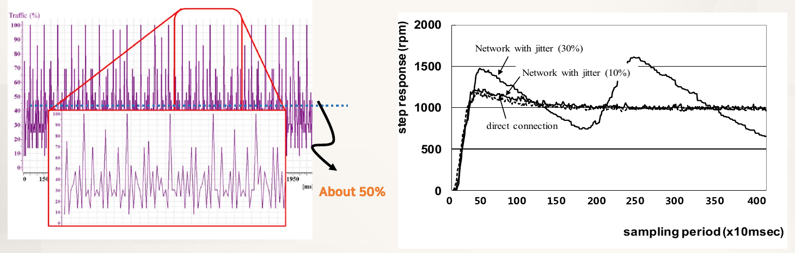

*Figure 1. Traffic on a vehicle CAN bus and the control response under network jitter*

The left side of Figure 1 is the traffic (%) on a CAN bus over time; the instantaneous value fluctuates strongly, but the average is about 50%. The right side is the step response of a control system that regulates a rotational speed (rpm) to 1000. When the sensor and controller are connected directly (direct connection), the response converges quickly to the target, but when the network introduces jitter of 10% and 30%, the response overshoots the target considerably and oscillates before converging slowly. Jitter, in other words, is not merely a delay; it degrades the control performance itself.

For this reason, CAN design **recommends keeping the traffic at or below about 50% of the total bandwidth.** The higher the bus load, the more sharply the waiting time and jitter of low-priority messages increase.

### 1.4 Event-Triggered and Time-Triggered Communication

The communication methods of vehicle networks fall into two kinds according to how the moment of sending a message is determined.

> **Definition:** **Event-triggered communication** sends a message when an event to report (a change in a value, a request) occurs. **Time-triggered communication** sends messages only at fixed times according to a timetable defined in advance.

| Aspect | Event-triggered | Time-triggered |
|:-----|:-----|:-----|
| Nature | Nondeterministic approach: when a message will be delivered is not fixed in advance. | Deterministic approach: when a message will be delivered is fixed in advance. |
| Analogy | A private car or a taxi: it can leave whenever desired. | A train or an airplane: it departs according to a timetable. |
| Advantages | Messages can be sent as soon as needed, which is flexible, and no bandwidth is used when there is nothing to send. | Delivery times and delays are guaranteed, which suits safety-related control, and the system is easy to verify. |
| Disadvantages | When many messages pile up, delays grow and become unpredictable, like a traffic jam. | Even urgent messages must wait for their turn, schedules can become crowded, and the timetable must be redesigned to add a node. |
| Examples | CAN | TTP, the static segment of FlexRay, the LIN schedule |

*Table 3. Comparison of event-triggered and time-triggered communication*

### 1.5 Comparison of IVNs by Domain

Vehicle functions are divided into several domains according to the speed, real-time behavior, and cost they require, and each domain uses a suitable network.

| Domain | Required speed | Cost | Representative protocol |
|:-----|:-----|:-----|:-----|
| Body | Below 20 kbit/s | Low | LIN |
| Body | Below 1 Mbit/s | Low | CAN |
| Powertrain (PT) | Below 10 Mbit/s | Medium | TTP/C |
| Chassis | Below 20 Mbit/s | Medium | FlexRay |
| Multimedia | Below 25 Mbit/s | High | MOST |
| Safety | Below 100 Mbit/s | Very high | TTEthernet |

*Table 4. Required speed, cost, and representative protocol by domain*

Table 4 shows a staircase-like relationship in which speed and cost rise together. The features of each protocol are as follows.

**LIN (body domain).**

- Purpose: a communication standard for mechatronic systems (systems in which electric motors and mechanical devices are combined)
- Design cost: very low
- Cable: single-wire connection
- Data rate: up to 20 kbps
- Communication method: a master/slave method, with the option of time-synchronized data transmission

**CAN (body and chassis domains).**

- Purpose: a universally usable bus connection
- Cable: two twisted wires (twisted pair), transmitting up to 1 km at 50 kbps
- Data rate: up to 1 Mbps, typically 250 kbps; keeping traffic at or below about 50% of the total bandwidth is recommended
- Communication method: event-triggered through identifier (ID) contention (priority-controlled)

**FlexRay (chassis domain).**

- Core members of protocol development: BMW, Bosch, DaimlerChrysler, GM, Philips, Motorola, Volkswagen
- It combines the safety provided by TTP/C with the flexibility of Byteflight.
- The static segment operates time-triggered and the dynamic segment event-triggered (Section 2.4).
- The protocol specification was published in 2004 and later revised up to version 3.0 [1].

**MOST (multimedia domain).**

- Purpose: plug-and-play multimedia systems
- Design cost: relatively expensive
- Cable: optical cable, unaffected by electromagnetic interference and reflections
- Data rate: up to 22.5 Mbps
- Communication method: synchronous parts such as audio and video are time-controlled, and asynchronous parts such as control messages are event-controlled.

**TTEthernet (safety domain).**

- Purpose: an integrated network for ADAS (advanced driver assistance systems)
- Design cost: relatively low
- Cable: twisted pair; delivery of time-triggered traffic is guaranteed by emulating circuit switching.
- Data rate: up to 100 Mbps
- It carries three classes of traffic on one Ethernet network. Time-triggered (TT) traffic follows SAE AS6802 [2], rate-constrained (RC) traffic follows the avionics standard ARINC 664 Part 7, and best-effort (BE) traffic follows the ordinary IEEE 802.3 Ethernet rules.

> **Definition:** **ADAS (advanced driver assistance system)** is a system that helps the driver by perceiving the surroundings with sensors, such as lane keeping, emergency braking, and adaptive cruise control.

### 1.6 Sub-Networks and the Place of LIN

A vehicle contains many small ECUs that are connected to a **sub-network** rather than directly to the large CAN backbone. A door, for example, contains a mirror, a lock, a window motor, and switches, each of which does only a simple job with little data.

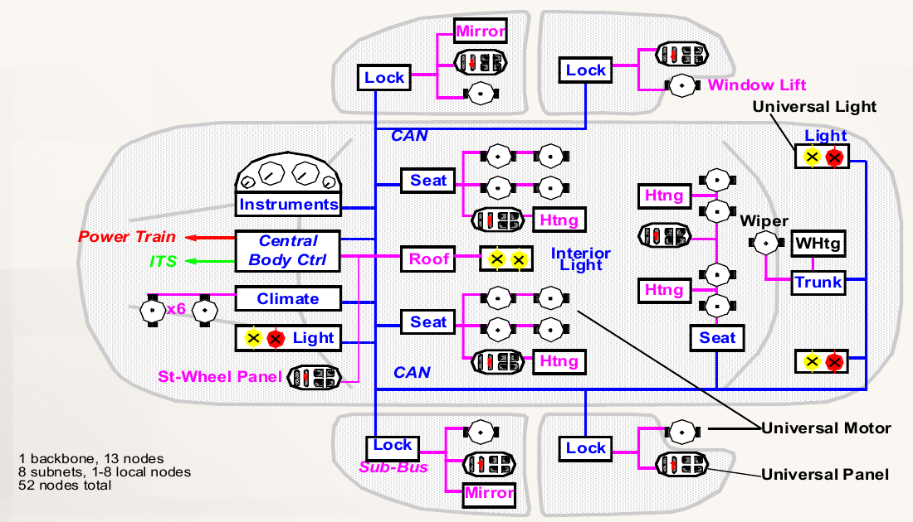

*Figure 2. The CAN backbone and sub-networks of a vehicle*

Figure 2 shows a configuration in which controllers such as the instrument cluster (Instruments), the central body controller (Central Body Ctrl), climate control (Climate), doors, seats, and the roof are joined by a CAN backbone (blue lines), and small nodes such as mirrors, locks, heaters (Htng), lamps, wipers, and the trunk are connected below each controller by sub-buses (pink lines). This example consists of 13 nodes on one backbone and 8 subnets with 1-8 local nodes each, 52 nodes in total. Connecting all 52 nodes with CAN would raise the cost considerably, so a cheaper network is needed for the subnets. That network is LIN.

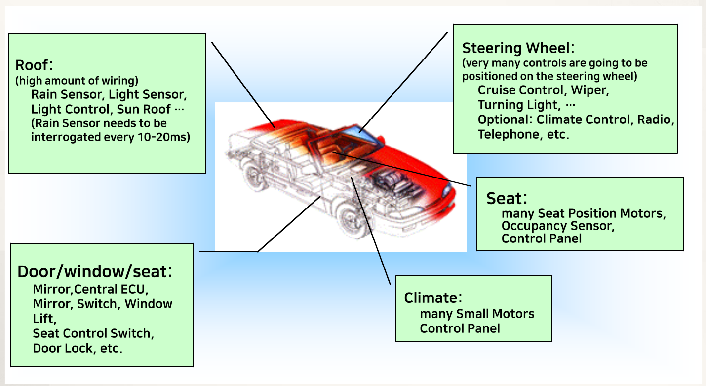

*Figure 3. Where LIN is used in a vehicle*

The typical uses of LIN shown in Figure 3 are as follows.

| Location | Devices connected by LIN |
|:-----|:-----|
| Roof | A place with much wiring. Connects the rain sensor, light sensor, light control, sunroof, and so on. The rain sensor must be interrogated every 10-20 ms. |
| Steering wheel | Many controls are being placed on the steering wheel. Connects cruise control, wipers, and turn signals, and optionally climate control, radio, and telephone controls. |
| Seat | Connects several seat position motors, an occupancy sensor, and a control panel. |
| Climate | Connects many small motors and a control panel. |
| Door, window, seat | Connects the mirror, central ECU, mirror switch, window lift, seat control switch, door lock, and so on. |

*Table 5. Typical uses of LIN in a vehicle*

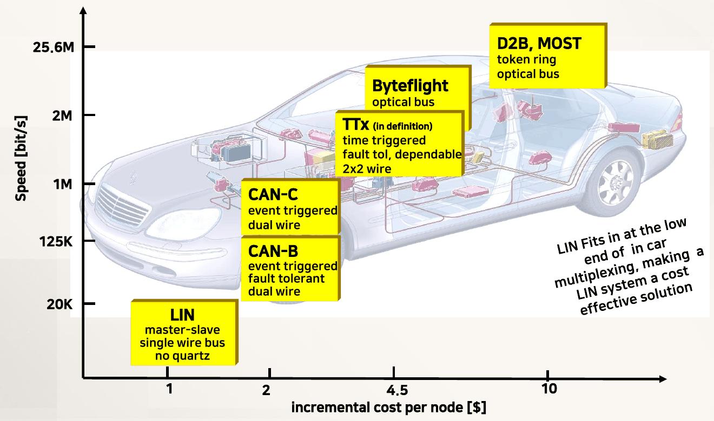

*Figure 4. Position of vehicle networks by incremental cost per node and speed*

Figure 4 places the networks with the cost of adding one node (in dollars) on the horizontal axis and speed (bit/s) on the vertical axis.

- **LIN:** 20 kbit/s, about 1 dollar per node. A master/slave single-wire bus whose slaves need no quartz crystal.
- **CAN-B:** low-speed CAN of the 125 kbit/s class. Event-triggered, fault tolerant, dual wire.
- **CAN-C:** high-speed CAN of the 1 Mbit/s class. Event-triggered, dual wire.
- **TTx:** a time-triggered, fault-tolerant protocol then being defined, using 2×2 wires (it led to FlexRay).
- **Byteflight:** an optical bus of the 2 Mbit/s class.
- **D2B, MOST:** token-ring optical buses of the 25.6 Mbit/s class.

As the caption in the figure says, LIN fits in at the low end of in-car multiplexing, making a LIN system a cost-effective solution.

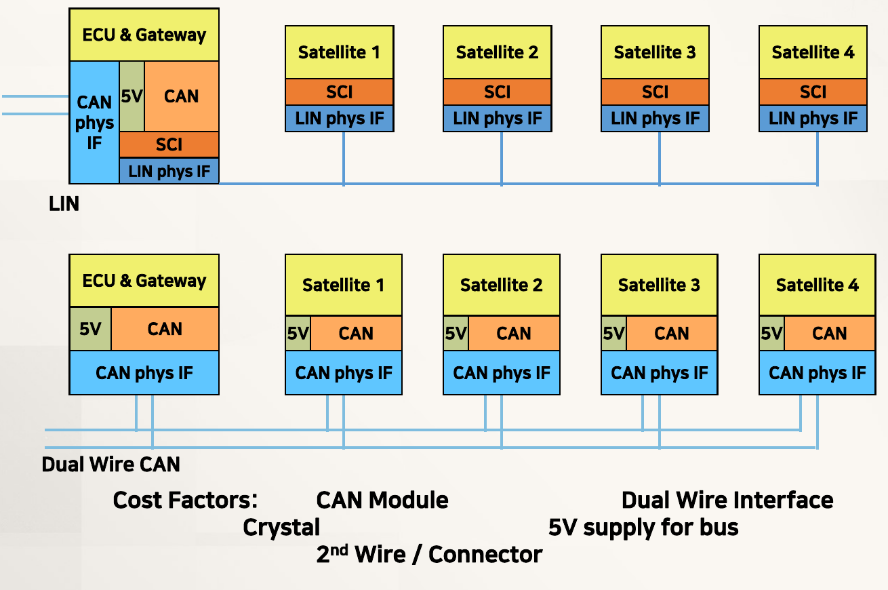

*Figure 5. Sub-networks built with LIN and with dual-wire CAN*

The upper part of Figure 5 builds a sub-network with LIN and the lower part builds the same sub-network with dual-wire CAN. With LIN, only the ECU acting as a gateway has both CAN and LIN, and satellite nodes 1-4 need only the serial communication interface (SCI) already present in the microcontroller and a LIN physical interface. With CAN, every satellite node additionally needs a CAN module, a crystal, a 5 V supply for the bus, a dual-wire interface, and a second wire and connector; these are the cost factors.

### 1.7 Structure of the LIN Standard

The LIN standard is not only a protocol specification but a package of specifications covering ECU development and tools.

| Level | Specification | Contents |
|:-----|:-----|:-----|
| Software | LIN API specification | The programming interface through which applications use the LIN communication manager |
| Software | LIN protocol specification | Communication rules such as frame format, schedule, and error handling |
| Software | LIN configuration language | A file format describing the nodes, signals, frames, and schedules of a network |
| Software | Recommended use of messages and identifiers | Guidelines on how to assign identifiers |
| Hardware | LIN physical layer specification | The bus transceiver and electrical characteristics |
| Overall | LIN conformance test specification | How to test whether a device complies with the specification |

*Table 6. Specifications that make up the LIN standard*

Tools include SDM/L (Signal Database Manager), which manages the signal database, LCFG (Network Configuration Generator), which generates settings from the configuration language, and a bus analyzer (LINSpector). Developers create a network configuration file from the signal database, configure the communication manager of each ECU with this file, and check the actual communication with the bus analyzer.

### 1.8 Concept and Features of LIN

> **Definition:** **LIN (Local Interconnect Network)** is a low-cost single-wire serial communication protocol for simple sensors and actuators in a vehicle (Week 3). It uses a physical layer that improves on ISO 9141, the K-line standard for diagnostics.

LIN has the following features [3].

- **Low-cost single wire:** It communicates over one signal wire and the vehicle body ground.
- **Up to 20 kbit/s:** The upper limit of the data rate is set by electromagnetic interference (EMI). The faster a signal changes, the more the wire radiates noise like an antenna, so the rate is kept low on a single wire.
- **Single master / multiple slaves:** One master directs all communication.
- **No arbitration needed:** Frames are sent only in the order the master determines, so collisions do not occur.
- **Based on common UART/SCI hardware:** It can be implemented with the general asynchronous serial interface (UART, SCI) that most microcontrollers already have, so the silicon cost is low.
- **Self synchronization:** Slave nodes use an inaccurate internal oscillator without a crystal or ceramic resonator and adjust their rate to the synchronization field sent by the master (Section 1.11).
- **A dramatic reduction in hardware platform cost:** Thanks to the features above, the cost per node is very low.
- **Predictability:** The delay of a single transmission is guaranteed.

> **Definition:** A **UART (universal asynchronous receiver/transmitter)** and an **SCI (serial communication interface)** are hardware units that transmit serially, one byte at a time, using start and stop bits without a separate clock line. The two names refer to the same kind of unit, depending on the manufacturer.

### 1.9 Roles of the Master and Slaves

LIN is a master/slave protocol. The roles within a node are divided into **tasks**: the master node has both a master task and a slave task, and a slave node has only a slave task.

**Master task.** The master controls the whole bus and protocol. It controls which message is sent on the bus and when, and it is also responsible for error control.

- It determines the order and priority of messages.
- It sends the sync break, the sync byte, and the identifier field (ID field). That is, the master sends the header of every frame.
- It monitors the data bytes and check byte and evaluates their consistency.
- It acts as the clock reference, so the master needs a stable clock (a crystal).
- When the bus is inactive, it receives the wake-up break sent by a slave node and starts operating if necessary.

**Slave task.** A slave is one of the 2-16 members on the bus, and when the master sends its identifier, it receives or sends data.

- It monitors the identifiers on the bus.
- Depending on the identifier, it decides what to do (receive data, send data, or wait).
- When it is its turn to send, it transmits the data (1-8 bytes) and the check byte.
- The master node also has a slave task, so the master can become a slave when it sends its own data.

### 1.10 Time-Triggered Schedule and Message Length

LIN is time-triggered. The master sends the frame header for a given identifier at given times according to a **schedule table** defined in advance. Each frame has its own time slot in the schedule table, called a **frame slot**.

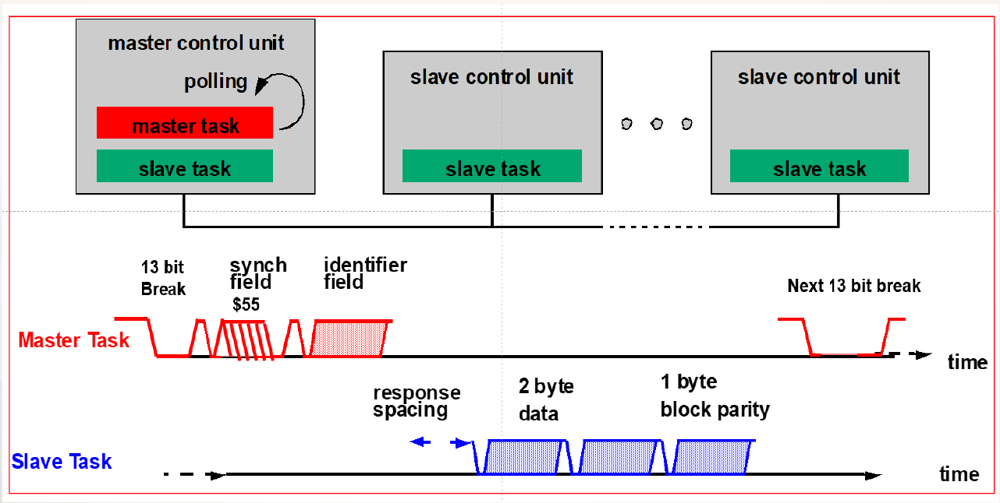

*Figure 6. Time-triggered operation of LIN: header from the master task and response from a slave task*

The upper part of Figure 6 shows the master control unit and the slave control units. The master task in the master control unit polls according to the schedule, and every control unit has a slave task. On the time axis below, the master task sends a 13-bit break, the synch field (hexadecimal 55), and the identifier field, and after the response spacing the corresponding slave task sends 2 bytes of data and a 1-byte block parity (checksum). The next frame begins with the next 13-bit break.

To guarantee timing, the length of each message must be predictable.

- Each message carries a fixed number of data bytes, so its minimum length can be computed.
- Each message has a **length budget of 140%** of its minimum length, a margin for small gaps that can occur between bytes and for the response delay.
- As a result, the maximum allowed length of a message is fixed, and so is the interval between two messages in the schedule table.

**Computing the frame time.** The LIN 2.x specification defines the nominal frame time as follows [3]. One byte is 10 bits including the start and stop bits, and the header, made of the break and break delimiter, the sync byte, and the identifier byte, is 34 bits.

$$
T_{header} = 34 \times T_{bit}, \quad T_{response} = 10 \times (N_{data} + 1) \times T_{bit}, \quad T_{frame,max} = 1.4 \times (T_{header} + T_{response})
$$

Here $N_{data}$ is the number of data bytes and the $+1$ is the checksum byte. At 19.2 kbit/s ($T_{bit} \approx 52.1\ \mu$s) the results are as follows.

| Data bytes | Nominal bits | Nominal frame time | Maximum frame time (140%) |
|:-----|:-----|:-----|:-----|
| 2 | $34 + 10 \times 3 = 64$ | 3.33 ms | 4.67 ms |
| 4 | $34 + 10 \times 5 = 84$ | 4.38 ms | 6.13 ms |
| 8 | $34 + 10 \times 9 = 124$ | 6.46 ms | 9.04 ms |

*Table 7. LIN frame times at 19.2 kbit/s*

For example, a 4-byte frame must be given a frame slot of at least 6.13 ms in the schedule table. If the rain sensor must be interrogated every 10 ms, the time available in between for other frames is also determined by this calculation.

### 1.11 The LIN Message Frame

A LIN frame consists of a **message header** sent by the master and a **message response** sent by a slave.

```text
|<------------- message header ------------->|<------------- message response ------------->|
┌──────────────────┬───────────┬─────────────┬───────────────────────────────┬──────────────┐
│   synch break    │synch field│ identifier  │      0 to 8 data fields       │   checksum   │
│  (>= 13 bits     │ (0x55)    │  field      │                               │              │
│   dominant)      │           │  (6 + 2)    │                               │              │
└──────────────────┴───────────┴─────────────┴───────────────────────────────┴──────────────┘

each byte field (SCI / UART format, 10 bits):
┌───────┬─────┬─────┬─────┬─────┬─────┬─────┬─────┬─────┬──────┐
│ start │  0  │  1  │  2  │  3  │  4  │  5  │  6  │  7  │ stop │
│  (0)  │ LSB │     │     │     │     │     │     │ MSB │  (1) │
└───────┴─────┴─────┴─────┴─────┴─────┴─────┴─────┴─────┴──────┘
```

*Figure 7. Composition of the LIN message frame and the byte field*

The fields are as follows.

- **Synch break:** A dominant (0) period of 13 or more bits followed by a short recessive delimiter. In an ordinary byte, 0 can continue for at most 9 bits (the start bit and 8 data bits), so 13 or more bits of 0 clearly announce the start of a new frame.
- **Synch field:** Hexadecimal 55 (binary 01010101) is sent. Bytes are sent least significant bit (LSB) first, so the actual bit sequence on the wire is start bit 0, then 1, 0, 1, 0, 1, 0, 1, 0, and stop bit 1, changing value at every bit. This byte is a specific pattern for establishing the time base; a slave measures the time intervals between edges to determine the bit time. For example, from the first falling edge (the beginning of the start bit) to the last falling edge (the beginning of bit 7) is exactly 8 bit times, so dividing that time by 8 gives the bit time. The sync byte precedes every message frame.
- **Identifier field:** The message identifier. It is described in detail below.
- **Data field:** 1-8 data bytes. Each byte is sent in UART format as 10 bits: a start bit, 8 data bits (LSB first), and a stop bit.
- **Checksum:** One byte for checking transmission errors.

**Identifier field.** An 8-bit field sent by the master node to all LIN nodes, consisting of a 6-bit identifier and 2 parity bits.

- With 6 bits there are $2^6 = 64$ different identifiers.
- An identifier denotes not the address of the receiving node but the content of the message. The identifier determines which node sends and which nodes receive, and what the data is and how long it is. Usually an identifier is related to the signals subsequently transmitted on the LIN bus.
- If an identifier is misread, another node may respond, so 2 parity bits are added to protect this sensitive field. The 8 bits formed by the 6-bit identifier and its parity are called the **protected identifier (PID)**.
- An identifier can also put the LIN slave nodes into sleep mode, after which no more data is transmitted on the LIN bus. In LIN 2.x, the sleep command is the diagnostic identifier 60 (hexadecimal 3C) sent with its first data byte set to 0 [3].

The parity bits are computed from the identifier bits $ID_0 \sim ID_5$ as follows ($\oplus$ is XOR) [3].

$$
P_0 = ID_0 \oplus ID_1 \oplus ID_2 \oplus ID_4, \qquad P_1 = \overline{ID_1 \oplus ID_3 \oplus ID_4 \oplus ID_5}
$$

**A worked example.** Let us find the protected identifier of identifier hexadecimal 10 (binary 010000, that is, $ID_4 = 1$ and all others 0).

1. $P_0 = 0 \oplus 0 \oplus 0 \oplus 1 = 1$
2. $ID_1 \oplus ID_3 \oplus ID_4 \oplus ID_5 = 0 \oplus 0 \oplus 1 \oplus 0 = 1$, so $P_1 = \overline{1} = 0$
3. Written from bit 7 in the order $P_1, P_0, ID_5, \ldots, ID_0$, this is 0101 0000, so the protected identifier is hexadecimal 50.

**Data length.** In the LIN 1.x specification, the two most significant identifier bits $ID_5, ID_4$ determined the number of data bytes: 00 and 01 meant 2 bytes, 10 meant 4 bytes, and 11 meant 8 bytes, dividing the 64 identifiers into four groups of 16 [4]. From LIN 2.x on, the data length is set freely to 1-8 bytes in the configuration file [3].

> **Note:** Some sources describe the data length as four classes of 1, 2, 4, and 8 bytes and place its code in the two least significant bits of the identifier field. In the LIN 1.3 specification, the bits that determine the length are the two most significant bits $ID_5, ID_4$ of the 6-bit identifier, and the lengths are 2, 2, 4, and 8 bytes [4].

**Checksum.** The checksum is the bitwise inversion of the bytes summed with an **8-bit sum with carry wrap-around** (an addition that subtracts 255 whenever the sum exceeds 255). There are two kinds according to which bytes are summed [3].

- **Classic checksum:** sums only the data bytes. Used in LIN 1.x and for diagnostic frames.
- **Enhanced checksum:** sums the protected identifier together with the data bytes. Used for ordinary frames in LIN 2.x.

**A worked example.** Let us find the classic checksum of the data 4A, 55, 93, E5 (hexadecimal).

| Step | Calculation | Running sum |
|:-----|:-----|:-----|
| 1 | 4A | 4A |
| 2 | 4A + 55 = 9F | 9F |
| 3 | 9F + 93 = 132, which exceeds 255 (FF), so 132 - FF = 33 | 33 |
| 4 | 33 + E5 = 118, 118 - FF = 19 | 19 |
| 5 | Bitwise inversion of 19: 0001 1001 → 1110 0110 | E6 |

*Table 8. Calculation of the classic checksum*

The checksum is hexadecimal E6. When the receiver sums all the data bytes and the checksum in the same way, the result must be FF for the frame to be error-free ($19 + E6 = FF$). The enhanced checksum of the same data including the protected identifier 50 starts the sum from 50, reaches a running sum of 69, and inverts it to 96.

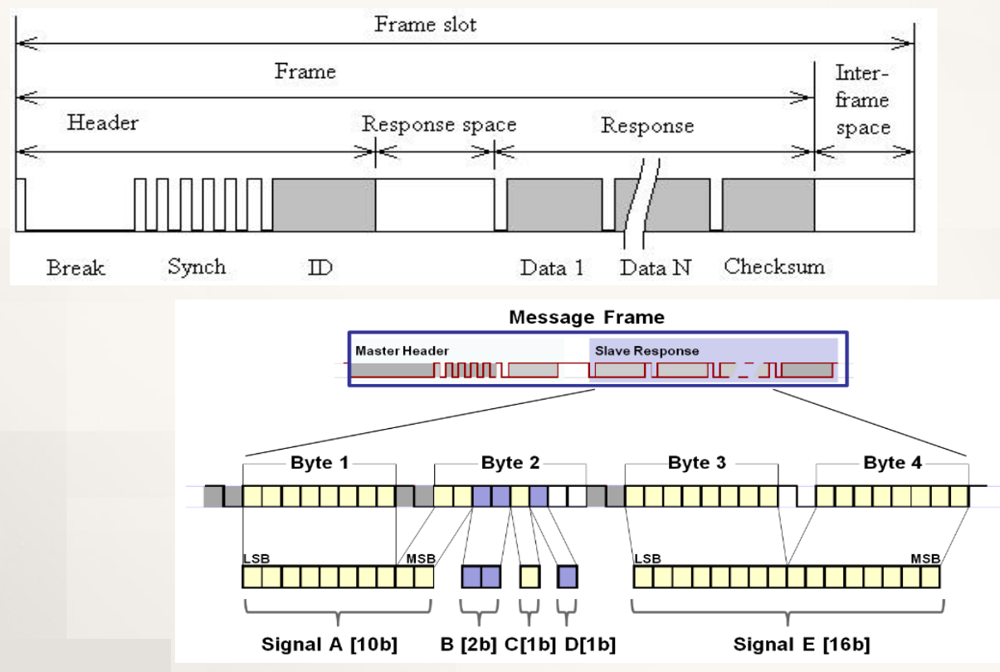

*Figure 8. The LIN frame slot and the placement of signals within data bytes*

The upper part of Figure 8 shows that one **frame slot** consists of the header (break, synch, identifier), the response space, the response (data 1-N and checksum), and the inter-frame space. The response space is the time a slave needs to interpret the identifier and prepare its response. The lower part shows several **signals** packed bit by bit into the data bytes. Within the 32 bits of bytes 1-4 are a 10-bit signal A, a 2-bit signal B, 1-bit signals C and D, and a 16-bit signal E, each placed in order starting from its LSB. Signal A, for example, uses the 8 bits of byte 1 and the lower 2 bits of byte 2. A frame is thus the unit of transport, while the values actually used by applications are the signals inside it.

### 1.12 Three Types of LIN Communication

LIN communication has the following common properties.

- It is a single-master, multi-slave protocol.
- It is time-triggered, with no arbitration.
- Identifiers denote message content; there are no physical addresses.
- Messages are multicast, so several nodes can receive one response together.
- The baud rate is synchronized through the protocol (the synch field).
- Power is saved through sleep mode.

The header is always sent by the master task, but there are three types according to who sends and who receives the response.

| Type | Task sending the header | Task sending the response | Task receiving the response |
|:-----|:-----|:-----|:-----|
| Slave to master | Master task of the master node | Slave transmit task of a slave node | Slave receive task of the master node |
| Master to slaves | Master task of the master node | Slave transmit task of the master node | Slave receive tasks of slave nodes A and B |
| Slave to slave | Master task of the master node | Slave transmit task of slave node A | Slave receive task of slave node B |

*Table 9. The three types of LIN communication*

In the slave-to-master case, for example, the master sends the header of the identifier for the door switch state, the door switch node sends that state as the response, and the master receives it. Even in the slave-to-slave case the header is sent by the master, so even when two slaves communicate directly, the timing is decided by the master's schedule.

### 1.13 Message Latency

Several stages of delay accumulate between the moment a sensor value changes and the moment the application of another node uses that value.

```text
 notional     new value      start of      completion of   new value        notional
 generation   available for  frame         frame           available for    consumption
     |        transmission   transmission  transmission    read call            |
     |             |              |              |              |               |
-----+-------------+--------------+--------------+--------------+---------------+-----> time
     | generation  |  scheduling  |   message    | notification |  consumption  |
     |  latency    |   latency    |   length     |   latency    |   latency     |
     |  (signal)   |   (frame)    |   (frame)    |   (frame)    |   (signal)    |
                   |<------------ LIN availability time ------->|
     |<---------------------------- maximum age (signal) ---------------------->|
```

*Figure 9. Composition of the latency from generation to consumption of a LIN message*

| Latency | Unit | Meaning |
|:-----|:-----|:-----|
| Generation latency | Signal | From the change of the physical value until the application makes the new value available for transmission |
| Scheduling latency | Frame | From the moment the new value is ready until transmission of the frame carrying it starts; the time spent waiting for the next frame slot in the schedule table |
| Message length | Frame | The time taken to transmit the frame (Section 1.10) |
| Notification latency | Frame | From the end of frame reception until the application of the receiving node can read the new value |
| Consumption latency | Signal | Until the application reads the new value and actually uses it |

*Table 10. Components of LIN message latency*

The sum of the middle three latencies is the **LIN availability time**, the part for which LIN communication is responsible. The sum of all five is the **maximum age** of the signal, that is, how old the consumed value can be relative to the actual physical value. Because LIN is time-triggered, the maximum scheduling latency and message length can be computed in advance, and the maximum age can therefore be guaranteed.

---

<br>

## 2. FlexRay and Automotive Ethernet

### 2.1 Overview of FlexRay

> **Definition:** **FlexRay** is a fault-tolerant, high-speed bus system built for safety-related real-time control in vehicles. Within one communication cycle it has both a time-triggered static segment and an event-triggered dynamic segment (Week 3).

FlexRay was created against the following background.

- As the volume of communication between control units grew, a communication system faster than the existing CAN that also secured reliability became necessary.
- Based on Byteflight, an optical bus that BMW developed for applications such as airbags, and on the time-triggered protocol TTP, BMW and DaimlerChrysler began joint development.
- The FlexRay consortium developed further the characteristics of Byteflight such as time determination and error tolerance. Its members included Freescale, Bosch, NXP, BMW, Volkswagen, Daimler, and GM.
- Starting with the BMW X5 (E70), it has been applied in series production to many BMW, Audi, Mercedes-Benz, Land Rover, and Volvo vehicles.

### 2.2 Characteristics of FlexRay

| Characteristic | Description |
|:-----|:-----|
| Synchronous frame transfer | Frames are sent in predetermined time slots, so frame latency and jitter are guaranteed. |
| Asynchronous frame transfer | Frames are sent when needed, and the prioritization among frames can be adjusted. |
| Multi-master clock synchronization | Several nodes jointly align the global time without a particular master, a distributed clock synchronization. |
| Bus guardian | Error detection and error prevention are performed by a bus guardian device. |
| Scalable fault tolerance | The network can be configured with either one channel or two channels. |

*Table 11. Characteristics of FlexRay*

> **Definition:** A **bus guardian** is an independent supervisory device that blocks a node's transmitter so that the node cannot transmit outside its assigned time slot. It prevents a faulty node from paralyzing the whole bus by emitting signals at arbitrary times (the babbling idiot problem).

FlexRay can have two channels, A and B, each operating at up to 10 Mbit/s. Sending the same data on both channels keeps communication going even if one channel fails (redundancy), and sending different data allows 20 Mbit/s in total [1]. This is what "10 Mbit/s per channel (20 Mbit/s when the two channels are used separately)" in Section 1.2 and "below 20 Mbit/s" in Table 4 mean.

### 2.3 Structure of a FlexRay Node

A FlexRay node (ECU) consists of the following components (the node architecture of specification version 2.1).

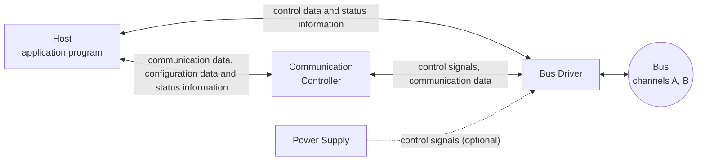

*Figure 10. Components and interfaces of a FlexRay node*

- **Host:** the microcontroller that runs the application program. It writes data to be sent to the communication controller and reads received data, configures the communication controller, and reads its status.
- **Communication controller (CC):** runs the FlexRay protocol. It handles encoding and decoding of frames, transmission aligned to time slots, and clock synchronization.
- **Bus driver (BD):** the transceiver that converts the logic signals of the communication controller into electrical signals on the bus. The host controls the operating mode of the bus driver and reads its status.
- **Power supply:** optionally linked, for example so that the power is switched on when the bus driver detects a wake-up signal.

Protocol processing inside the communication controller is divided into the following blocks.

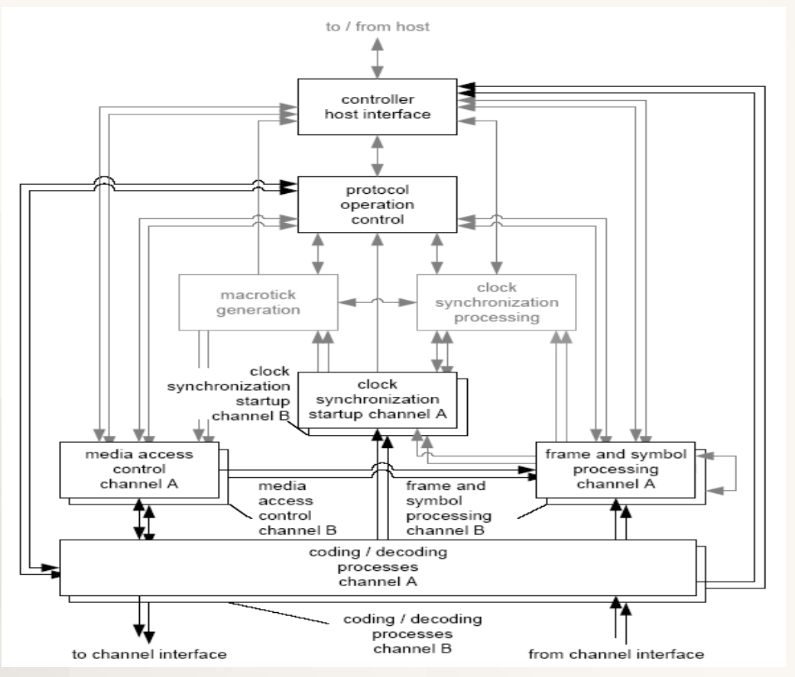

*Figure 11. Protocol processing blocks of a FlexRay communication controller*

| Block | Role |
|:-----|:-----|
| Controller host interface | Exchanges data, configuration, and status with the host. |
| Protocol operation control | Manages the overall operating state, such as startup, normal operation, and halt. |
| Macrotick generation | Generates macroticks, the network-wide common time unit. |
| Clock synchronization processing | Computes and corrects the error of its own clock from the arrival times of sync frames from other nodes. |
| Clock synchronization startup (channels A, B) | Establishes the common time when the network first starts. |
| Media access control (channels A, B) | Decides when to transmit according to the communication cycle. |
| Frame and symbol processing (channels A, B) | Checks whether the format and timing of received frames and symbols are correct. |
| Coding / decoding (channels A, B) | Converts frames into bit streams sent to the channel interface, and the reverse. |

*Table 12. Processing blocks of a FlexRay communication controller*

### 2.4 Structure of the Communication Cycle

FlexRay is time-synchronized, so each node sends data at the time allocated to it. Adding a node therefore requires changing the schedule, and even urgent data must wait for its own turn.

Media access in FlexRay is based on a repeating **communication cycle**. The cycles are numbered from 0 to 63 and return to the start every 64 cycles. A cycle consists of four parts.

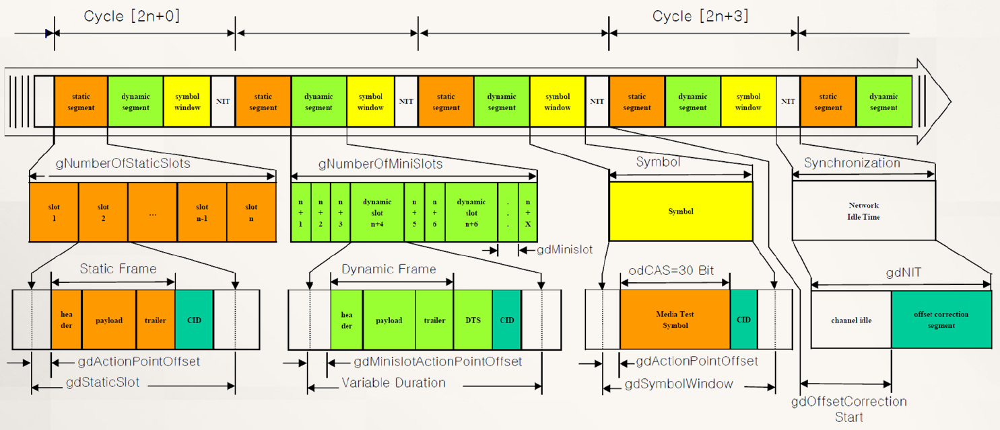

*Figure 12. Structure of the FlexRay communication cycle*

| Part | Description |
|:-----|:-----|
| Static segment | Consists of `gNumberOfStaticSlots` static slots of equal length. Each slot is assigned to one node, which sends its static frame from the point `gdActionPointOffset` after the slot start (the action point). The frame is followed by a channel idle delimiter (CID). |
| Dynamic segment | Consists of `gNumberOfMinislots` short minislots. Only nodes with something to send transmit, and a dynamic frame spans several minislots with variable length (Section 2.7). The frame ends with a DTS and a CID. |
| Symbol window | A segment for sending special symbols such as the media test symbol (MTS). It is optional. |
| Network idle time (NIT) | A segment in which nobody transmits. Each node computes its clock correction values in this time and applies the correction in the offset correction segment within it. |

*Table 13. Composition of the FlexRay communication cycle*

The upper band of Figure 12 shows the cycle repeating in the order static segment, dynamic segment, symbol window, and NIT, and the lower part enlarges each part. Slots 1-n of the static segment all have the same length (`gdStaticSlot`), while a dynamic slot in the dynamic segment occupies a different number of minislots depending on the length of the frame sent (`Variable Duration`).

Time in FlexRay is organized in a hierarchy of four levels.

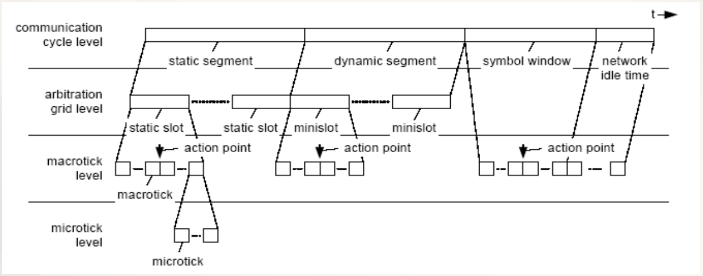

*Figure 13. Time hierarchy of FlexRay media access control*

| Level | Unit | Meaning |
|:-----|:-----|:-----|
| Communication cycle level | Static segment, dynamic segment, symbol window, NIT | The parts that make up a cycle |
| Arbitration grid level | Static slots, minislots | The units that decide media access. Each slot and minislot contains an action point. |
| Macrotick level | Macrotick | The network-wide common time unit shared by all nodes. Slots and minislots consist of an integer number of macroticks. |
| Microtick level | Microtick | The local time unit derived from each node's oscillator. One macrotick consists of several microticks, and clock correction is done by adjusting the number of microticks in a macrotick. |

*Table 14. Time hierarchy of FlexRay*

### 2.5 FlexRay Frame Format

A FlexRay frame consists of a header, a payload, and a trailer.

```text
|<------------------------- header (5 bytes) -------------------------->|<- payload ->|<- trailer ->|
┌──┬──┬──┬──┬──┬───────────┬────────────┬──────────────┬────────────────┬─────────────┬─────────────┐
│ 1│ 2│ 3│ 4│ 5│  Frame ID │  Payload   │  Header CRC  │  Cycle count   │  Data 0..n  │     CRC     │
│  │  │  │  │  │           │   length   │              │                │             │  (24 bits)  │
└──┴──┴──┴──┴──┴───────────┴────────────┴──────────────┴────────────────┴─────────────┴─────────────┘
|<-- 5 bits -->|  11 bits      7 bits       11 bits          6 bits       0-254 bytes     24 bits
         |<-- covered by header CRC --->|
 1: reserved  2: payload preamble indicator  3: null frame indicator
 4: sync frame indicator  5: startup frame indicator
```

*Figure 14. Format of a FlexRay frame*

| Field | Bits | Meaning |
|:-----|:-----|:-----|
| Reserved bit | 1 | Always sent as 0. |
| Payload preamble indicator | 1 | If 1, the beginning of the payload contains special information: a network management (NW management) vector of 0-12 bytes in static frames, or a 2-byte message ID in dynamic frames. If 0, the payload is ordinary. |
| Null frame indicator | 1 | 0 means a null frame without valid data, and 1 means an ordinary frame. A static slot cannot be left empty even when there is no data to send, so a null frame is sent. |
| Sync frame indicator | 1 | If 1, the frame is a sync frame used for clock synchronization. |
| Startup frame indicator | 1 | If 1, the frame is a startup frame used for network startup. |
| Frame ID | 11 | The number of the slot in which the frame is sent. Values 1-2047 are used. |
| Payload length | 7 | The length of the payload in 2-byte units (words): 0-127 words, that is, 0-254 bytes (0-2,032 bits). |
| Header CRC | 11 | A CRC protecting the sync frame indicator, startup frame indicator, frame ID, and payload length. |
| Cycle count | 6 | The number of the current communication cycle, 0-63. |
| Payload | 0-2,032 | The actual data. |
| Trailer CRC | 24 | A 24-bit CRC protecting the entire header and payload. |

*Table 15. Fields of a FlexRay frame*

Because the payload length is counted in 2-byte units, 7 bits can express up to $127 \times 2 = 254$ bytes. Compared with the maximum of 8 bytes in CAN, one frame can carry more than 30 times as much data.

### 2.6 Bit Streams of Static and Dynamic Frames

On the actual wire, each byte of a frame is transmitted together with the following sequences.

| Abbreviation | Name | Description |
|:-----|:-----|:-----|
| TSS | Transmission start sequence | A low period of 3-15 bits at the very beginning of the frame. It gives bus drivers and star couplers time to open the signal path. |
| FSS | Frame start sequence | One high bit after the TSS |
| BSS | Byte start sequence | Two bits (high, low) before every byte. Each produces a falling edge per byte so that the receiver can realign its bit timing. |
| FES | Frame end sequence | Two bits (low, high) after the last byte |
| DTS | Dynamic trailing sequence | Appended after the FES only in dynamic frames. A variable-length period that aligns the end of the frame with the action point of the next minislot. |

*Table 16. Coding sequences of a FlexRay frame*

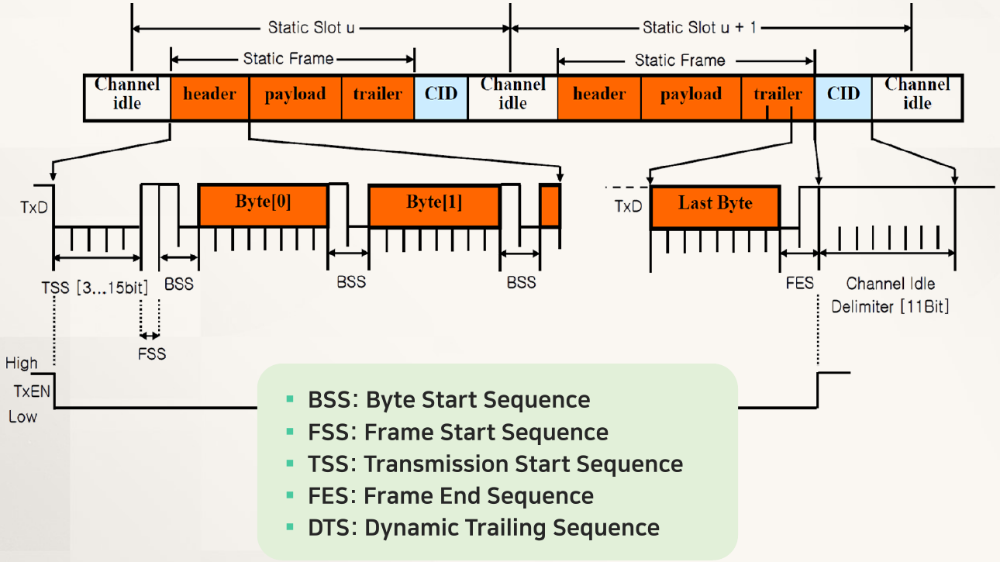

*Figure 15. Bit stream of a FlexRay static frame*

The upper part of Figure 15 shows static slots u and u+1, each consisting of channel idle, a static frame (header, payload, trailer), and a CID. The lower part is the actual bit stream on the transmit line (TxD): the TSS (3-15 bits), the FSS, the BSS before each byte, and the FES after the last byte follow in order, and then comes the 11-bit channel idle delimiter. TxEN at the bottom is the transmit enable signal, which is low only while the frame is being sent. A dynamic frame has the same structure with a DTS added after the FES.

**A worked example.** A static frame with a 16-byte payload has a 5-byte header, a 16-byte payload, and a 3-byte trailer, 24 bytes in all. Each byte receives a 2-bit BSS and becomes 10 bits, so with the TSS set to 5 bits the number of bits in the frame is as follows.

$$
\underbrace{5}_{TSS} + \underbrace{1}_{FSS} + \underbrace{24 \times 10}_{\text{bytes with BSS}} + \underbrace{2}_{FES} = 248\ \text{bits}
$$

At 10 Mbit/s, the transmission time of this frame is $248 \times 0.1\ \mu\text{s} = 24.8\ \mu$s. A static slot must be set longer than this time plus the action point offset and the channel idle delimiter.

### 2.7 Media Access Control: Static TDMA and Dynamic Minislots

Within one communication cycle, FlexRay provides two media access methods.

**1. Static TDMA (time division multiple access).** Each slot of the static segment is assigned in advance to the one node with the same frame ID. A node sends only at the action point of its own slot, so there are no collisions, and delivery time and jitter are guaranteed. Even when there is no data to send, the slot belongs to that node and a null frame is sent; this is the price of the time-triggered method.

**2. Dynamic mini-slotting.** In the dynamic segment, the slot counter keeps counting up from where the static segment left off.

1. If the node whose frame ID equals the value of the slot counter has data to send, it sends a frame at the action point of that minislot. Several minislots pass before the frame ends, and the counter stops in the meantime.
2. If that node has no data to send, only one minislot passes and the counter increases by 1.
3. If the minislots remaining in the dynamic segment are not enough to send the frame, the node waits for the next cycle.

```text
slot counter :  61 |       62       | 63 |   64   | 65 | 66 | ...
minislots    : [  ]|[  ][  ][  ][  ]|[  ]|[  ][  ]|[  ]|[  ]| ...
activity     : idle|  frame ID 62   |idle| ID 64  |idle|idle| ...
```

*Figure 16. An example of minislot use in the dynamic segment*

In Figure 16, the nodes with frame IDs 61 and 63 have nothing to send, so only one minislot each passes, while the node with ID 62 sends a frame using 4 minislots and the node with ID 64 one using 2. Because the slot counter passes the IDs in increasing order, **a smaller frame ID means a higher priority.** A node with nothing to send uses only one minislot, so the dynamic segment carries event-triggered messages efficiently.

### 2.8 Why Automotive Ethernet Was Needed: The Central Gateway

The need for automotive Ethernet began with the **central gateway ECU**. In 2004, BMW decided to introduce a central gateway ECU in its 2008 models. The roles of the central gateway ECU are as follows.

1. It acts as a router between the CAN, FlexRay, and MOST buses.
2. It acts as the self-diagnosis and programming interface to the outside of the vehicle.

In particular, a scheme was planned to update the software of every ECU in the vehicle through the on-board diagnostics (OBD) connector so that users would always have the latest software, and the use of Ethernet was considered for this purpose. The existing methods lacked the bandwidth.

- High-speed CAN (HS-CAN) was used for OBD; its rate is 500 kbps (half the maximum of 1 Mbps), and after removing the overhead imposed by the protocol specification the actual data rate is around 200 kbps.
- The software data of a 2008 vehicle was expected to reach about 1 GB, with some multimedia data such as maps at around 100 MB, and devices using FlexRay also generated considerable traffic.

**A worked example.** The time to send 1 GB ($8 \times 10^9$ bits) at 200 kbps is as follows.

$$
\frac{8 \times 10^9\ \text{bits}}{2 \times 10^5\ \text{bits/s}} = 4 \times 10^4\ \text{s} \approx 11.1\ \text{hours}
$$

Taking 11 hours to update the software of one car at a workshop is unacceptable. Sending the same data over 100 Mbps Ethernet takes only $8 \times 10^9 / 10^8 = 80$ seconds.

> **Note:** **Why the figure is 200 kbps.** On 500 kbps CAN, an 8-byte standard frame is 111 bits including the interframe space, so even without stuffing the data fraction is $64 / 111$ and the data rate is $500 \times 64 / 111 \approx 288$ kbps. In the worst case, bit stuffing adds 24 bits for 135 bits in total, giving $500 \times 64 / 135 \approx 237$ kbps. Adding the headers of the diagnostic protocol and the time spent waiting for responses brings the rate to around 200 kbps.

### 2.9 Limitations of MOST and USB

Before Ethernet, BMW tried to develop and apply MOST and USB, but both ran into limitations.

**Problems of MOST 25.**

- **Insufficient data rate:** The maximum bandwidth actually achievable on the asynchronous data channel of MOST 25 was only about 7 Mbps.
- **Heavy resource requirements:** Reaching 7 Mbps required 1,014-byte data packets with 64 packets grouped into one acknowledgment (ACK) block. Sixty-four MOST packets therefore had to be collected before transmission, so about 64 KB ($64 \times 1014$ bytes) of RAM was used for processing alone, and a large share of CPU capacity was consumed.
- **Unsuitable topology:** Self-diagnosis means briefly connecting a tester at a workshop, but MOST is a ring topology, so connecting a tester might require breaking the ring or adding a second ring.
- **New interface:** It was a communication method unfamiliar to developers.
- **High price:** The interface components were expensive.
- MOST 150 technology was also introduced but failed to achieve mass adoption.

**Problems of automotive USB.**

- It is a widely known interface, and the 480 Mbps of USB 2.0 is ample speed.
- **Reliability and robustness problems:** Achieving vehicle-grade reliability with USB required very expensive cables and connectors.
- **Insufficient cable length:** The limit was about 4 m, which made it hard to use for software updates or diagnostics in a large workshop.
- **No network support:** USB connects one host to one device and cannot form a network, so a tester and software update equipment could not be connected at the same time.
- **New protocol:** A new protocol stack and drivers had to be developed for vehicles.

### 2.10 Emergence of Automotive Ethernet

The next technology investigated was Ethernet.

- The first automotive Ethernet to appear was 100BASE-TX Ethernet, the same as in office LANs.
- Ethernet offers sufficient data rates, is widely used, and supports networking.
- It also suits the interface to the outside of the vehicle, and several self-diagnosis or software update channels can be connected at the same time.
- In 2011 the OPEN (One-Pair Ether-Net) Alliance for automotive Ethernet was founded and development began (Section 2.14).
- From 2015, BMW, Jaguar, and Volkswagen began full-scale adoption.
- In 2015 IEEE established the automotive Ethernet standard IEEE 802.3bw-2015, an amendment to the Ethernet standard that defines the physical layer specifications and management parameters for 100 Mb/s operation over a single balanced twisted pair cable (100BASE-T1) [5].

### 2.11 Standard Ethernet Compared with Automotive Ethernet

The basic structure of automotive Ethernet, that is, the MAC and the frame format, is the same as that of ordinary Ethernet (Week 7). What differs is the physical layer.

| Aspect | Twisted pairs | Number of wires |
|:-----|:-----|:-----|
| Standard Ethernet (100BASE-TX) | Uses 2 pairs: 1 pair for receiving, 1 pair for transmitting | 4 wires |
| Automotive Ethernet (100BASE-T1) | Uses 1 pair for both receiving and transmitting | 2 wires |

*Table 17. Line composition of standard and automotive Ethernet*

Because of the harsh electromagnetic and environmental conditions in vehicles, automotive Ethernet uses short cables (about 15 m or less), and it was developed to reflect requirements such as electromagnetic compatibility, waterproofing, temperature, humidity, and vibration.

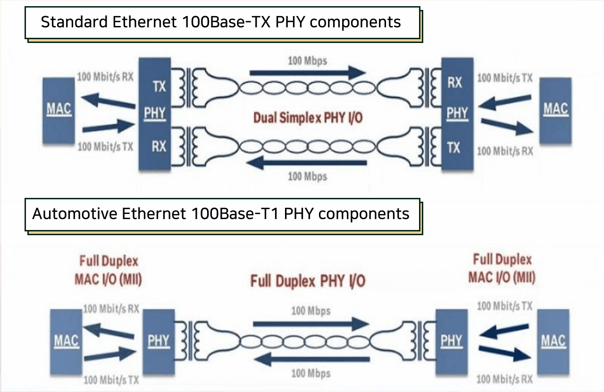

*Figure 17. Physical layer structure of standard Ethernet 100BASE-TX and automotive Ethernet 100BASE-T1*

100BASE-TX at the top of Figure 17 is a dual simplex scheme that uses each of two pairs in one direction only. 100BASE-T1 at the bottom is a full-duplex scheme that sends and receives 100 Mbps in both directions simultaneously over one pair. To send and receive on the same line at once, the receiver must subtract its own transmitted signal (the echo) from the received signal, which is called echo cancellation [5].

| Standard | MAC interface | Coding and modulation | Line |
|:-----|:-----|:-----|:-----|
| 100BASE-TX (Fast Ethernet) | MII | 4B/5B, MLT-3 | 100 Mbit/s per pair, 125 MBaud, unidirectional, 2 pairs |
| 1000BASE-T (Gigabit Ethernet) | GMII | PAM-5 | 250 Mbit/s per pair, 125 MBaud, bidirectional, 4 pairs |
| BroadR-Reach (automotive Ethernet) | MII | PCS, PAM-3 | 100 Mbit/s per pair, 66.6 MBaud, bidirectional, 1 pair |

*Table 18. Comparison of Ethernet physical layers*

> **Definition:** **Baud** is the number of symbols (signal levels) sent per second. **PAM-n (pulse amplitude modulation)** is modulation using n voltage levels, in which one symbol carries at most $\log_2 n$ bits.

In Table 18, BroadR-Reach sends 100 Mbit/s at 66.6 MBaud, so one symbol carries $100 / 66.67 = 1.5$ bits. Three-level PAM-3 can carry at most $\log_2 3 \approx 1.58$ bits per symbol, so this is feasible. Compared with 100BASE-TX, which uses 125 MBaud because of its 4B/5B code, the lower symbol rate narrows the frequency band of the signal and correspondingly reduces electromagnetic radiation, which makes it easier to meet the EMC (electromagnetic compatibility) requirements of vehicles.

### 2.12 Characteristics of Automotive Ethernet

- **Address-based communication and service protocols:** Ethernet exchanges data based on an addressing scheme, and automotive Ethernet additionally uses separate protocols for services and functions such as Ethernet AVB (Audio Video Bridging) (Section 2.15).
- **High data rates:** With support for up to 10 Gbps, several CAN buses can be connected over a single Ethernet link, reducing the cost of wiring, installation, and maintenance accordingly.
- **QoS and TSN support:** It supports quality of service (QoS) and time-sensitive networking (TSN), so both real-time communication and prioritized data transmission are possible.
- **Security:** Technologies for defending against external cyber attacks are well developed.
- **Ease of technical updates:** Being based on widely used technology, it can readily be updated by applying new Ethernet technologies.
- **One-to-one connections:** The network is formed by connecting nodes and switches 1:1 rather than by a bus.
- **Separate transmission and reception:** The transmit and receive channels are separate (full duplex), so two controllers can send and receive at the same time.
- **Packet switching:** Switches forward packets according to their destination addresses (Week 4).
- **Hierarchical structure:** Main networks and sub-networks can be arranged hierarchically.

### 2.13 Generations and Changes in Vehicle Architecture

Automotive Ethernet has developed over three generations.

| Generation | Period | Applications | Related technologies |
|:-----|:-----|:-----|:-----|
| 1st | Around 2010 | Independent subsystems and diagnostics, ECU flashing, rear-view cameras | 100BASE-TX Fast Ethernet (IEEE 802.3u), diagnostics over IP (ISO 13400) |
| 2nd | Around 2015 | Infotainment and driver assistance systems | BroadR-Reach (OPEN Alliance), Energy-Efficient Ethernet (IEEE 802.3az), A/V Bridging Gen 1, video communication interface (ISO 17215) |
| 3rd | Around 2020 | Ethernet as the network backbone | Single-pair Gigabit Ethernet, partial networking, A/V Bridging Gen 2, time-triggered Ethernet |

*Table 19. Generations of automotive Ethernet*

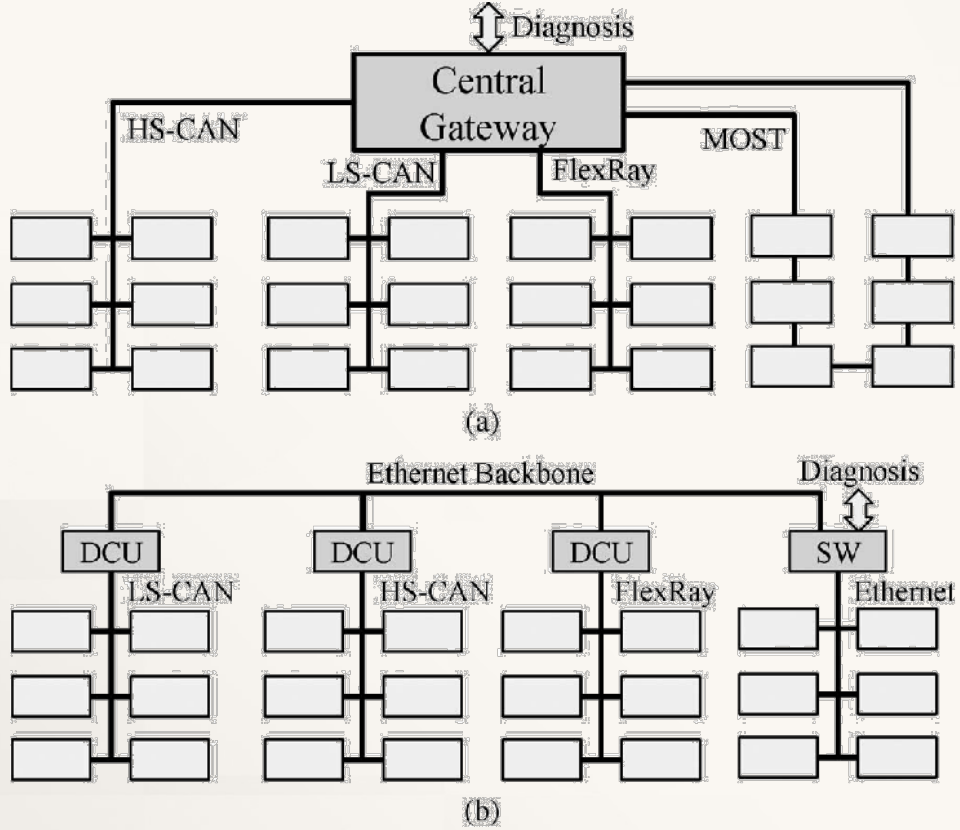

*Figure 18. Central gateway architecture and Ethernet backbone architecture*

In (a) of Figure 18, a single central gateway connects the HS-CAN, LS-CAN, FlexRay, and MOST buses directly and provides the external diagnosis port. In (b), domain control units (DCUs) sit on an Ethernet backbone, each DCU handles lower-level buses such as LS-CAN, HS-CAN, and FlexRay, and an Ethernet switch (SW) connects the Ethernet devices and the diagnosis port. In (b), large volumes of data between domains travel over the high-speed Ethernet backbone, removing the bottleneck of the central gateway.

The four representative applications of automotive Ethernet are the following.

- **ADAS:** It gathers and processes the large data volumes of the cameras and radars surrounding the vehicle.
- **OBD (on-board diagnostics):** It speeds up diagnostics and software updates for systems such as the engine, transmission, ABS, and airbags (SRS).
- **Infotainment:** It carries navigation, video, and audio data.
- **Gateway:** It serves as the backbone connecting different vehicle networks.

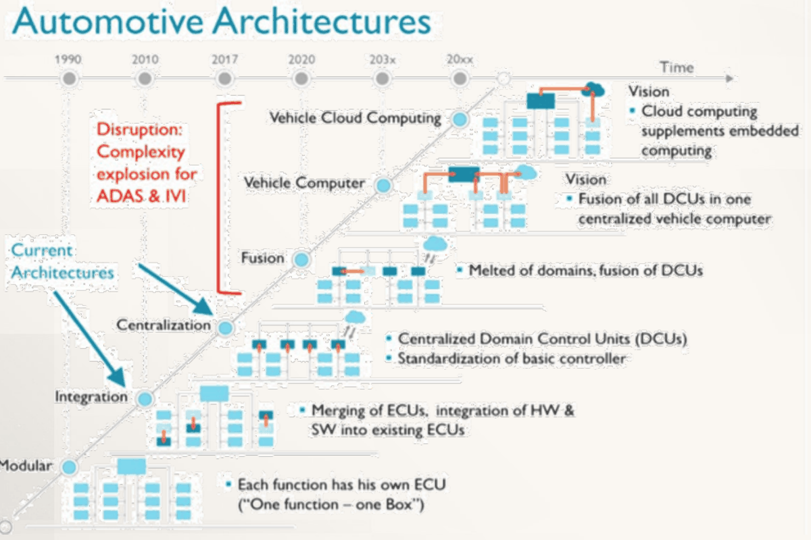

*Figure 19. Outlook for the development of automotive E/E architecture*

Figure 19 shows the stages of automotive E/E architecture proposed by Bosch.

| Stage | Description |
|:-----|:-----|
| Modular | Each function has its own ECU ("one function, one box"). |
| Integration | ECUs are merged, and hardware and software are integrated into existing ECUs. |
| Centralization | Central domain control units (DCUs) are introduced for each domain, and basic controllers are standardized. |
| Fusion | The boundaries between domains melt and the DCUs are fused. |
| Vehicle computer | All DCUs are merged into one centralized vehicle computer. |
| Vehicle cloud computing | Cloud computing supplements the computing embedded in the vehicle. |

*Table 20. Stages of automotive E/E architecture*

Current architectures are at the integration and centralization stages, and the explosive growth in the complexity of ADAS and infotainment (IVI) drives the change to later stages. The higher the stage, the more large data volumes flow among a few high-performance computers, so the role of Ethernet as a high-speed backbone grows.

What the automotive market requires of automotive Ethernet is **lower costs**, **higher efficiency**, passing strict **EMC tests**, and **low power consumption**. Automotive Ethernet technologies that meet these requirements include BroadR-Reach of the OPEN Alliance (OABR, OPEN Alliance BroadR-Reach) and 100BASE-T1 and 1000BASE-T1 of IEEE (the latter called RTPGE, reduced twisted pair gigabit Ethernet, during development).

### 2.14 The OPEN Alliance and BroadR-Reach

The **OPEN Alliance SIG (One-Pair Ether-Net Alliance Special Interest Group)** is an organization founded in November 2011 to create Ethernet standards suited to the vehicle environment and to spread their use [6].

- Its development goal is an integrated network for ADAS.
- It standardizes only the physical layer (PHY) and follows the existing IEEE 802.3 Ethernet standard above it.
- It adopted Broadcom's BroadR-Reach Ethernet technology as its standard. This technology later became the basis of IEEE 802.3bw (100BASE-T1).

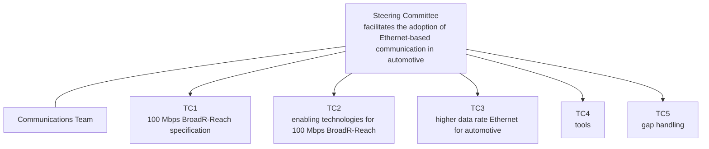

*Figure 20. Organization of the OPEN Alliance*

A TC is a technical committee. The BroadR-Reach specifications defined by TC1 and TC2 are as follows.

- **TC1:** Clarifies the 100 Mbps BroadR-Reach specification and defines interoperability and compliance tests.
- **TC2:** Sets the minimum diagnostic requirements for PHYs and defines the requirement specifications and test methods for cables, connectors, and harness assemblies.
- **Outputs:** Specification releases, compliance test specifications, interoperability test specifications, and EMC test specifications for transceivers, common mode chokes (CMCs), switches, cables, and connectors.

A link runs from the transmit and receive ends of the PHY (or switch) through a low-pass filter, a common mode choke, a connector, wiring, and another connector in that order. TC1 handles the PHY side and TC2 handles the connector and wiring side.

| Type | Data rate | Cable reach | Cable (pairs × type) |
|:-----|:-----|:-----|:-----|
| 1000BASE-T | 1000 Mbps | 100 m | 4 pairs × Cat 5/Cat 5e |
| 100BASE-TX | 100 Mbps | 100 m | 2 pairs × Cat 5 |
| 10BASE-T | 10 Mbps | 100 m | 2 pairs × Cat 3 or better |
| 1BR-100 | 100 Mbps | 300 m | 1 pair × Cat 5 |
| 1BR-10 | 10 Mbps | 500 m | 1 pair × 24 AWG or better |

*Table 21. Data rates and cables of Ethernet types*

1BR-100 and 1BR-10 in Table 21 are long-reach modes of the BroadR-Reach technology, showing that a single pair can reach farther than conventional Ethernet. Inside a vehicle, much shorter distances (about 15 m) are used, but strict EMC conditions must be met instead.

A BroadR-Reach PHY connects to the MAC through the same MII (or RGMII) interface. Unlike a standard 10/100/1000BASE-T PHY, which connects through four pairs (TRD[0]-TRD[3]), magnetics (transformers), and an RJ-45 connector, a BroadR-Reach PHY uses only one pair (TRD[0]). The MAC and higher software can therefore stay unchanged while only the PHY is replaced (the implementation model of Week 7).

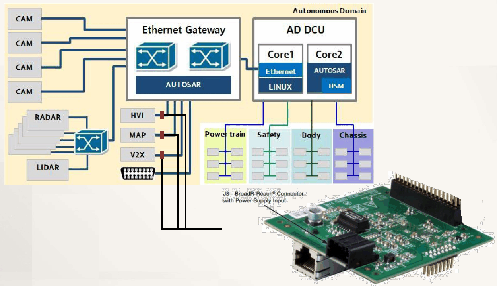

*Figure 21. An example vehicle network based on BroadR-Reach and a media converter*

The upper part of Figure 21 is an example configuration of an autonomous driving domain. Data from four cameras, a radar, and a lidar is collected through Ethernet switches into an Ethernet gateway (based on AUTOSAR) and an autonomous driving DCU (AD DCU). Core 1 of the AD DCU runs Ethernet and Linux, and core 2 runs AUTOSAR and a hardware security module (HSM). The gateway connects the HVI (human-vehicle interface), the map (MAP), and the V2X unit with the powertrain, safety, body, and chassis domains. The board at the bottom is a **BroadR-Reach media converter (MC)**, which converts between ordinary Ethernet (RJ-45) and BroadR-Reach (single-pair) signals so that ordinary equipment such as a PC can test and monitor automotive Ethernet.

### 2.15 IEEE Standards Related to Automotive Ethernet

The IEEE standards used for automotive Ethernet fall into three groups.

| Group | Standard | Contents |
|:-----|:-----|:-----|
| AVB: time sync, bandwidth reservation and guarantee | IEEE 1588, 802.1AS-2011 | Time synchronization of the network. 802.1AS is the Ethernet bridged network profile of 1588. |
| AVB | IEEE 1722, 1722a | Layer 2 transport protocol for time-sensitive streams (AVBTP) |
| AVB | IEEE 802.1Qav | Forwarding and queuing enhancements for time-sensitive streams (traffic class, priority, and credit-based shaping) |
| AVB | IEEE 802.1Qat | Stream reservation protocol (SRP) |
| AVB | IEEE 802.1BA | AVB network systems and the AVB profile |
| TSN: reduced and guaranteed latency, redundancy | IEEE 802.1AS-REV | Improved time synchronization (one-step time stamping, redundant grand master clock and fast failover, redundant sync message paths) |
| TSN | IEEE 802.1Qbu | Packet preemption |
| TSN | IEEE 802.1Qbv | Time-aware traffic scheduling |
| TSN | IEEE 802.1Qcc | SRP improvements (reduced size and frequency of SRP messaging, interoperation with IGMP) |
| TSN | IEEE 802.1CB | Frame replication and elimination for reliability |
| Automotive PHY: low-cost single-pair UTP, better EMI | IEEE 802.3bw | 100BASE-T1: 100 Mb/s PHY over a single balanced twisted pair, 15 m, full duplex, PAM-3 encoding [5] |
| Automotive PHY | IEEE 802.3bp | 1000BASE-T1: 1 Gb/s PHY over a single balanced twisted pair, 15 m, full duplex, PAM-3 encoding, RS FEC [7] |

*Table 22. IEEE standards related to automotive Ethernet*

> **Definition:** **AVB (Audio Video Bridging)** is a set of IEEE 802.1 standards for delivering audio and video streams over Ethernet without interruption within bounded delay. **TSN (time-sensitive networking)** extends its scope to control data in vehicles and industry. **RS FEC (Reed-Solomon forward error correction)** is an error-correcting code added so that the receiver can correct errors without retransmission.

---

<br>

## 3. CAN in Depth and CAN FD

### 3.1 Why CAN Is Needed

As systems became larger, smarter, and more flexible, the number of field devices such as sensors, actuators, and controllers grew exponentially. Traditional **point-to-point connection** links sensors and controllers directly, so the more devices there are, the more wires and cables grow, also exponentially.

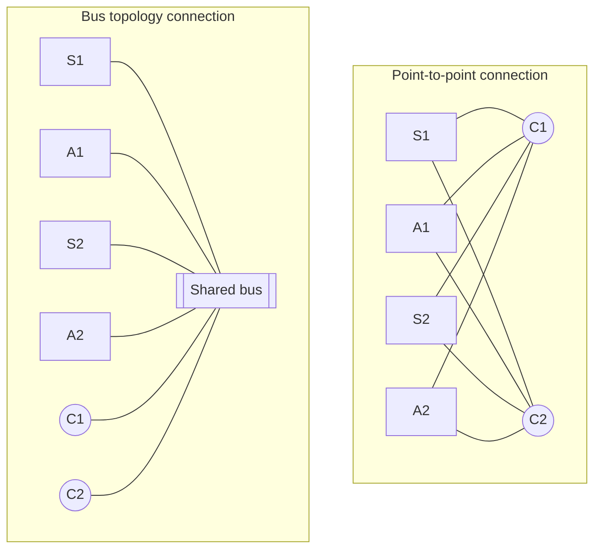

*Figure 22. Point-to-point connection and bus topology connection*

In Figure 22, S is a sensor, A an actuator, and C a controller. If two sensors and two actuators must each communicate with two controllers, point-to-point connection needs $4 \times 2 = 8$ links, whereas a bus needs only one shared line. **Bus topology connection**, which emerged as an alternative to point-to-point connection, links all devices with shared wires and has the following advantages.

1. Wiring is reduced.
2. Fault monitoring and troubleshooting are easier.
3. Design changes are easier: a new device only has to be attached to the bus.
4. Maintenance is easier.

### 3.2 Features and Layer Structure of CAN

CAN (Controller Area Network) began and was introduced as an internal Bosch project in 1983 and was standardized as ISO 11898 in 1993. The features of CAN are as follows.

- It is a widely recognized standard.
- It uses serial communication.
- It has a two-layer structure of physical layer and data link layer (Table 1 of Week 3).
- Many microcontrollers, hardware, and software products are available for it.

| Layer | Sublayer | Functions |
|:-----|:-----|:-----|
| 2. Data link layer | LLC | Data transfer, remote data request, message filtering, recovery management and overload notification |
| 2. Data link layer | MAC | Framing and arbitration, error checking and error flags, fault confinement, bit timing |
| 1. Physical layer | | Electrical transmission and reception of bits |

*Table 23. Layers and functions defined by CAN*

Layers 3 through 7 are not defined by the CAN specification. The LLC and MAC of CAN divide the data link layer in the same way as the IEEE 802 reference model covered in Week 7.

### 3.3 History and Related Standards of CAN

| Year | Event |
|:-----|:-----|
| 1983 | Development of an IVN begins as an internal Bosch project |
| 1986 | Official introduction of the CAN protocol (presentation at an SAE congress) |
| 1987 | Intel and Philips Semiconductors release the first CAN controller chips |
| 1991 | Bosch publishes the CAN 2.0 specification. Kvaser introduces a CAN-based higher-layer protocol (CAN Kingdom) |
| 1992 | The international users and manufacturers group CiA (CAN in Automation) is founded, and CiA publishes CAL (CAN Application Layer). Mercedes-Benz releases the first vehicle using CAN |
| 1993 | The ISO 11898 standard is published |
| 1994 | CiA holds the first International CAN Conference (iCC) |
| 1995 | Allen-Bradley introduces the DeviceNet protocol. The extended frame format of ISO 11898 is published, and the CANopen protocol is published |
| 2000 | Use of CAN in automotive and industrial applications grows explosively. TTCAN (time-triggered CAN) is developed |
| 2001 | Industrial introduction of TTCAN begins |
| 2003 | Use of CAN expands in the United States and Japan as well |
| 2012 | Bosch releases CAN FD (CAN with Flexible Data Rate) |
| 2015 | CAN FD is standardized in ISO 11898-1 |

*Table 24. History of CAN*

The CAN 2.0 specification defines both the standard frame (CAN 2.0A) and the extended frame (CAN 2.0B) [8]. The main standards related to CAN are as follows.

| Standard | Title (Road vehicles) | Contents |
|:-----|:-----|:-----|
| ISO 11898-1 | Controller area network (CAN) - Part 1 | Data link layer and physical coding sublayer |
| ISO 11898-2 | Controller area network (CAN) - Part 2 | High-speed physical medium attachment (PMA) sublayer |
| ISO 11898-3 | Controller area network (CAN) - Part 3 | Low-speed, fault-tolerant, medium-dependent interface |
| ISO 11898-4 | Controller area network (CAN) - Part 4 | Time-triggered communication |
| ISO 11898-5 | Controller area network (CAN) - Part 5 | High-speed medium access unit with low-power mode |
| ISO 11898-6 | Controller area network (CAN) - Part 6 | High-speed medium access unit with selective wake-up functionality |
| ISO 11519-1, -2, -3 | Low-speed serial data communication | Low-speed serial communication: general and definitions, low-speed CAN, VAN (vehicle area network) |
| ISO 11992-1-4 | Interchange of digital information between towing and towed vehicles | Exchange of digital information over electrical connections between towing and towed vehicles (trailers) |
| SAE J2411 | Single Wire CAN Network for Vehicle Applications | Single-wire CAN for vehicles |

*Table 25. Standards related to CAN*

> **Note:** ISO 11898-1:2015 defines CAN FD together with classical CAN [9], and ISO 11898-2:2016 absorbed the contents of ISO 11898-5 and ISO 11898-6 [10]. The low-power mode and selective wake-up of today's high-speed CAN transceivers (Section 3.19) are therefore found in ISO 11898-2.

### 3.4 Characteristics of CAN and Node Composition

CAN is a serial communication protocol that supports distributed real-time control and multiplexing. Its characteristics are as follows.

- **Serial data communication, multi-master bus communication:** Every node can start transmitting on its own when the bus is free.
- **Asynchronous transmission, time-division multiplexing:** It transmits without a separate clock line, and the messages of several nodes share one bus by dividing time.
- **Maximum data rate 1 Mbps:** for a bus length of about 30 m or less.
- **Maximum transmission distance 1,000 m:** when the rate is lowered to about 62.5 kbps (Section 3.8).
- **Up to 32 nodes:** at 1 Mbps. The number of nodes that can be attached is set by the electrical load the transceiver can drive, so it may be larger depending on the transceiver (Week 3).

A CAN node (ECU) consists of a microcontroller (MCU), a CAN controller, and a CAN transceiver, and it is connected to the CAN_H and CAN_L wires of an unshielded twisted pair (UTP). There is a 120 Ω termination resistor at each end of the bus (Week 3). In a bus node conforming to ISO 11898-2, the CAN controller and the transceiver are connected by three lines.

1. **Tx:** the serial data output line from the controller to the transceiver
2. **Rx:** the serial data input line from the transceiver to the controller
3. **Vref:** the reference voltage output of the transceiver, nominally half the supply voltage ($0.5\,V_{CC}$, 2.5 V for a 5 V supply)

External connections often use a D-sub 9-pin connector: pin 2 is CAN_L, pin 7 is CAN_H, pin 3 is CAN ground, pin 5 is the optional shield, pin 6 is the optional power ground, pin 9 is the optional power (CAN_V+), and pins 1, 4, and 8 are reserved (Table 5 of Week 3).

### 3.5 NRZ Coding and Bit Levels

CAN carries bits with **NRZ (non-return-to-zero)** coding. NRZ keeps the level unchanged for the whole bit time. In contrast, with **RZ (return-to-zero)** coding the signal always returns to 0 within each bit period. NRZ can send more bits in the same bandwidth, but if the level does not change for a long time, the receiver's ability to stay synchronized degrades (Section 3.7).

The bit levels of CAN are as follows.

- **Dominant:** binary 0
- **Recessive:** binary 1

```text
bit value       1      0      0      1      0      1      1
             _______               ______        _____________    recessive (1)
TX logic            |_____________|      |______|                 dominant (0)
             |<--->|
             1 bit time
```

*Figure 23. NRZ bit levels of the controller transmit signal (TX)*

Figure 23 shows the TX logic signal of the controller. Recessive (1) is the high level (for example, 5 V) and dominant (0) is the low level (0 V), and the level does not change while the same value continues. The differential voltage on the bus is the opposite: large when dominant and close to 0 when recessive (Section 3.6).

### 3.6 Signal Levels of High-Speed and Low-Speed CAN

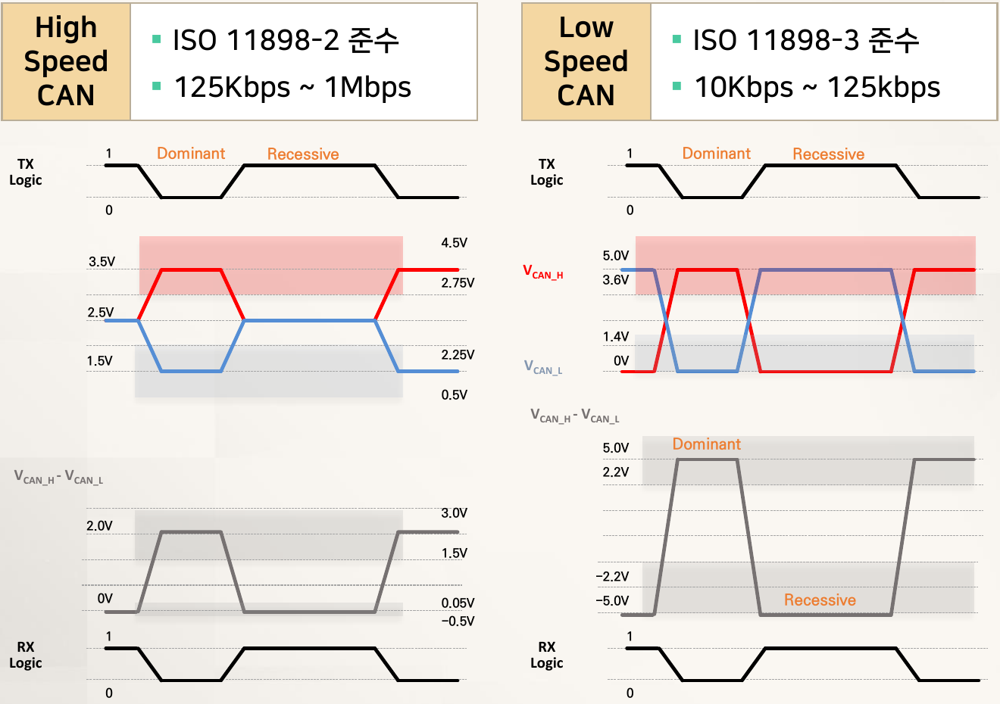

*Figure 24. Bus voltages and transmit and receive logic of high-speed and low-speed CAN*

| Aspect | High-speed CAN | Low-speed CAN |
|:-----|:-----|:-----|
| Standard | ISO 11898-2 | ISO 11898-3 |
| Rate | 125 kbps-1 Mbps | 10 kbps-125 kbps |
| $V_{CAN\_H}$, $V_{CAN\_L}$ when recessive | Both about 2.5 V | About 0 V, about 5 V |
| $V_{CAN\_H}$, $V_{CAN\_L}$ when dominant | About 3.5 V (2.75-4.5 V), about 1.5 V (0.5-2.25 V) | About 3.6 V, about 1.4 V |
| $V_{CAN\_H} - V_{CAN\_L}$ when recessive | About 0 V (-0.5 to 0.05 V) | About -5 V |
| $V_{CAN\_H} - V_{CAN\_L}$ when dominant | About 2.0 V (1.5-3.0 V) | About 2.2 V (2.2-5.0 V) |

*Table 26. Signal levels of high-speed and low-speed CAN*

The top of Figure 24 is the TX logic of the controller, the middle shows the voltages of the two bus wires and their difference, and the bottom is the RX logic that the transceiver returns to the controller. In both schemes, when TX is 0 (dominant), CAN_H rises and CAN_L falls so that the differential voltage becomes positive, and RX follows TX exactly. Low-speed CAN keeps the two wires apart at 0 V and 5 V even when recessive, so the swing of the differential voltage is large. Thanks to this large margin, communication can continue on the remaining wire even if one wire breaks or shorts to ground, which is why low-speed CAN is fault tolerant.

### 3.7 Bit Stuffing

In NRZ, no edge for resynchronization occurs when the next bit has the same value. **Bit stuffing** is therefore used to keep all bus nodes synchronized. After sending five consecutive bits of the same value, the transmitter inserts one stuff bit of the opposite value, and the receiver removes it. Six consecutive bits of the same value constitute a stuff error. An example of the bit sequence to transmit, the stuffed sequence, and the de-stuffed received sequence is the same as Figure 7 of Week 3.

### 3.8 Data Rate and Bus Length

At 50 kbps a CAN bus can be up to 1 km long, and transceivers conforming to ISO 11898 support buses up to 1 km. Raising the rate requires a shorter bus.

| Data rate | Bus length | Nominal bit time | Rate × length (Mbit/s × m) |
|:-----|:-----|:-----|:-----|
| 1 Mbit/s | 30 m | 1 µs | 30 |
| 800 kbit/s | 50 m | 1.25 µs | 40 |
| 500 kbit/s | 100 m | 2 µs | 50 |
| 250 kbit/s | 250 m | 4 µs | 62.5 |
| 125 kbit/s | 500 m | 8 µs | 62.5 |
| 62.5 kbit/s | 1000 m | 16 µs | 62.5 |
| 20 kbit/s | 2500 m | 50 µs | 50 |
| 10 kbit/s | 5000 m | 100 µs | 50 |

*Table 27. Practical bus lengths of CAN*

As the "Rate × length" column of Table 27 shows, the product of the two values is roughly constant. For bit-wise arbitration to work, the round-trip time of the signal on the bus plus the delays of the transceivers and controllers must fit within a part of the bit time (Prop_Seg in Section 3.18). Doubling the length doubles the round-trip delay, so the bit time must grow by the same factor, that is, the rate must be halved. The product is smaller on short buses because the fixed delays of the components, which do not depend on length, weigh more heavily. Plotted on logarithmic scales, the relationship between rate and length is a line that stays flat at 1 Mbit/s up to about 30-40 m and then falls in inverse proportion to length.

> **Note:** The lecture material gives a bit time of 20 µs in the 1 km row, but 20 µs is the bit time of 50 kbit/s ($1 / 50000 = 20\ \mu$s). The bit time at 62.5 kbit/s is 16 µs. Together with "up to 1 km at 50 kbps" in Section 1.5, the practical rate at 1 km is about 50-62.5 kbit/s.

### 3.9 Wiring Technology and Electromagnetic Interference

- To minimize reflections on the bus line, the bus is built as a linear (single line) structure.
- Both ends must be terminated with 120 Ω resistors. Reading the color bands brown (1), red (2), and brown (×10) gives $12 \times 10 = 120\ \Omega$.
- The length of the trunk cable follows the practical bus length of Table 27.
- Drop cables branching from the trunk to the nodes are kept as short as possible, at most 0.3 m at 1 Mbps. The end of a drop cable is not terminated, so reflections occur there if it is long.
- The cable is an unshielded twisted pair.

**Electromagnetic interference (EMI).** CAN determines values from the voltage difference between two wires, so it is naturally robust against electromagnetic interference. Even if both wires pick up the same noise, the voltage difference between them stays the same ($V_{diff} = const$). The detailed principle and the role of the termination resistors were covered in Week 3.

### 3.10 The CAN Data Frame

The **data frame** is the frame of ordinary CAN communication. According to the length of the identifier, there are standard frames (CAN 2.0A, 11 bits) and extended frames (CAN 2.0B, 29 bits).

```text
standard frame (CAN 2.0A), field numbers 1-12:
   1        2         3     4    5     6      7       8     9     10    11    12
┌─────┬────────────┬─────┬─────┬────┬─────┬────────┬─────┬─────┬─────┬─────┬─────┬─────┐
│ SOF │ Identifier │ RTR │ IDE │ r0 │ DLC │  Data  │ CRC │ DEL │ ACK │ DEL │ EOF │ IFS │
│  1  │     11     │  1  │  1  │ 1  │  4  │  0-64  │  15 │  1  │  1  │  1  │  7  │  3  │
└─────┴────────────┴─────┴─────┴────┴─────┴────────┴─────┴─────┴─────┴─────┴─────┴─────┘

extended frame (CAN 2.0B):
┌─────┬─────────┬─────┬─────┬─────────┬─────┬────┬────┬─────┬────────┬─────┬─────┬─────┬─────┬─────┬─────┐
│ SOF │ Base ID │ SRR │ IDE │ ID ext. │ RTR │ r1 │ r0 │ DLC │  Data  │ CRC │ DEL │ ACK │ DEL │ EOF │ IFS │
│  1  │    11   │  1  │  1  │    18   │  1  │ 1  │ 1  │  4  │  0-64  │  15 │  1  │  1  │  1  │  7  │  3  │
└─────┴─────────┴─────┴─────┴─────────┴─────┴────┴────┴─────┴────────┴─────┴─────┴─────┴─────┴─────┴─────┘
```

*Figure 25. CAN 2.0A standard data frame and CAN 2.0B extended data frame*

The numbers in Figure 25 are bit counts. The arbitration field is 12 bits in a standard frame (the 11-bit identifier and RTR) and 32 bits in an extended frame (11-bit base identifier, SRR, IDE, 18-bit identifier extension, RTR), and the control field is 6 bits (IDE or r1, r0, and the 4-bit DLC). The meanings of fields 1-12 of the standard frame are as follows.

| No. | Field | Bits | Role |
|:-----|:-----|:-----|:-----|
| 1 | SOF (start of frame) | 1 | Dominant (0); announces the start of a message and synchronizes all nodes after the idle state. |
| 2 | Identifier | 11 | Sets the priority of the message; the smaller the binary value, the higher the priority. It is 29 bits in an extended frame. Used for arbitration together with RTR. |
| 3 | RTR (remote transmission request) | 1 | Distinguishes data frames from remote frames. Data frames are dominant (0) and remote frames recessive (1). |
| 4 | IDE (identifier extension) | 1 | Distinguishes standard from extended frames. Dominant (0) means 2.0A and recessive (1) means 2.0B. |
| 5 | r (r0) | 1 | A reserved bit. In CAN FD this position distinguishes CAN frames from CAN FD frames: dominant (0) means CAN and recessive (1) means CAN FD (Section 3.22). |
| 6 | DLC (data length code) | 4 | Gives the number of bytes of data to be transmitted. |
| 7 | Data field | 0-64 | 0-8 bytes of data. |
| 8 | CRC sequence | 15 | A CRC computed over the bit sequence from SOF through the data field, ensuring the validity of the message (Section 3.5 of Week 7). |
| 9 | CRC delimiter | 1 | Recessive (1); marks the end of the CRC. |
| 10 | ACK slot | 1 | Confirms whether the receiving nodes received the message correctly. The transmitter sends recessive, and a receiver that received correctly overwrites it with dominant. Dominant (0) means normal and recessive (1) means abnormal. |
| 11 | ACK delimiter | 1 | Recessive (1); marks the end of the ACK. |
| 12 | EOF (end of frame) | 7 | Seven consecutive recessive bits mark the end of the message. |

*Table 28. Fields of the CAN standard data frame*

> **Note:** Some sources reverse the RTR values, giving dominant (0) for remote frames and recessive (1) for data frames, but in the specification the RTR of a data frame is dominant [8]. Consequently, when a data frame and a remote frame with the same identifier arbitrate at the same time, the data frame wins (Section 3.13). Descriptions of the CRC as "16 bits" refer to the whole CRC field, the 15-bit CRC sequence plus the 1-bit CRC delimiter.

The 4 bits of the DLC give the number of data bytes in binary.

| DLC3 DLC2 DLC1 DLC0 | 0000 | 0001 | 0010 | 0011 | 0100 | 0101 | 0110 | 0111 | 1000 |
|:-----|:-----|:-----|:-----|:-----|:-----|:-----|:-----|:-----|:-----|
| Data bytes | 0 | 1 | 2 | 3 | 4 | 5 | 6 | 7 | 8 |

*Table 29. DLC codes of the CAN data frame*

If the DLC is 9-15 (1001-1111), classical CAN treats it as 8 bytes [8]. CAN FD assigns longer lengths to these values (Section 3.22).

### 3.11 Intermission and the Bus Idle State

After the EOF comes a 3-bit **intermission (ITM)** needed before the next message. During the intermission no node may start a data frame or a remote frame.

```text
┌──────┬─────┬──────┬─────┬────────┬────────┬──────────┐
│ ...  │ CRC │ ACK  │ ACK │  EOF   │  ITM   │ bus idle │
│      │ DEL │ slot │ DEL │ 7 bits │ 3 bits │          │
└──────┴─────┴──────┴─────┴────────┴────────┴──────────┘
                    |<- 11 recessive bits ->|
```

*Figure 26. Recessive bits from the ACK delimiter to bus idle*

The 1-bit ACK delimiter, the 7-bit EOF, and the 3-bit ITM add up to $1 + 7 + 3 = 11$ consecutive recessive bits. When 11 recessive bits have followed from the ACK delimiter and the intermission has ended, a node judges that the bus is **idle**. Within a frame, bit stuffing prevents the same value from continuing for more than five bits, so 11 consecutive recessive bits are a sure sign that a frame has ended. For this reason a newly powered node also joins bus communication only after observing 11 consecutive recessive bits [8].

### 3.12 Broadcast Communication and the Communication Procedure

CAN uses broadcast communication (Week 3).

- Every node on the network can listen to the frames of the transmitting station.
- After receiving a frame, each node decides by itself whether to accept it.
- Therefore every CAN node must apply filtering (an acceptance filter) to its reception.

The communication procedure of a node is as follows. When powered on, the node checks whether the bus is free. If it is free and the node has a message to send, it transmits; if a collision (simultaneous transmission) occurs, it continues or stops transmitting according to whether it won the arbitration. If the bus is not free, the node checks the identifier and receives the message if it is one it should receive. This flow is the same as Figure 13 of Week 3.

CAN provides two communication services.

| Service | Frames used | Operation |
|:-----|:-----|:-----|
| Write object | Data frame | When the producer issues a request, a data frame of 0-8 bytes is broadcast in the ordinary way, and an indication is delivered to the consumers. |
| Read object | Remote frame and data frame | When a consumer makes a remote request with a remote frame, an indication is delivered to the producer, and when the producer answers with a data frame (response), the consumers receive a confirmation. |

*Table 30. The two communication services of CAN*

### 3.13 The Remote Frame

> **Definition:** A **remote frame** is a frame that a CAN node uses to ask another node to send the data of a particular identifier. It is also called a remote transmission request (RTR).

The format of a remote frame is as follows.

- The arbitration and control fields are the same as in a data frame, and both CAN 2.0A and 2.0B are supported.
- There is no data field.
- In CAN 2.0A the RTR is recessive (1). In CAN 2.0B the SRR, IDE, and RTR are all recessive (1).
- The DLC contains the length of the requested data.

A remote frame works as follows.

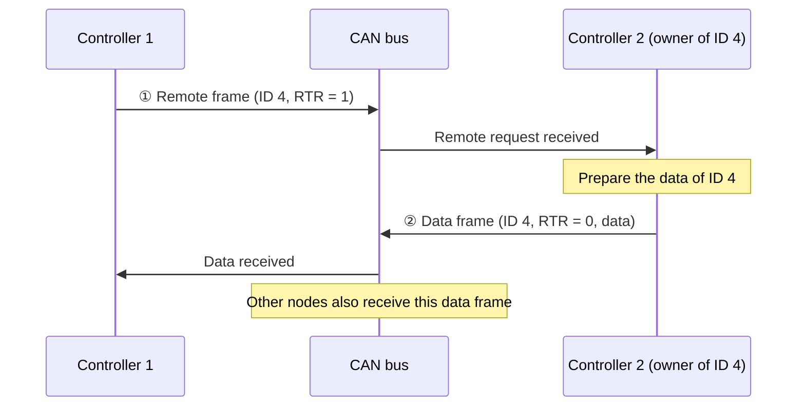

*Figure 27. Requesting and receiving data with a remote frame*

1. A particular node (controller 1) sends a remote frame for a remote request, with identifier 4 and RTR = 1.
2. The node responsible for that identifier (controller 2) produces a data frame (identifier 4, RTR = 0) as the response in the next communication.
3. Because communication is broadcast, not only the requesting node but also the other nodes receive this data frame.

Remote frames are rarely used in vehicles, because most ECUs in a vehicle send their values on their own at fixed periods.

### 3.14 Multiple Bus Access and Bit-Wise Arbitration

The CAN protocol allows different nodes to access the bus at the same time. When several nodes access the bus at once, **arbitration** is needed, and CAN resolves it with **CSMA/CD+AMP (carrier sense multiple access with collision detection and arbitration on message priority)** (Week 3). This arbitration is non-destructive and bit-wise.

**The CSMA/CD part.** Each node keeps listening to the bus line while transmitting and compares the data it sent with the data on the bus. If the two differ, it stops transmitting immediately. Continuing to transmit after another node's transmission has already won is meaningless, so this avoids wasting time.

> **Note:** Saying in a description of CSMA/CD that a node "waits for a random time and then tries again" describes the behavior of Ethernet (Section 2.8 of Week 7). In CAN, a node that loses arbitration does not wait for a random time; it rejoins arbitration as soon as the winner's frame ends and the bus becomes idle again [8]. Unlike in Ethernet, a collision in CAN does not destroy the winning frame, so there is no need to back off randomly.

**The AMP part.** Priority is determined by the identifier, and the dominant bit wins in the arbitration phase. Dominant (0) is a state that a transceiver actively drives and recessive (1) is a state that nobody drives, so if even one node sends dominant the bus becomes dominant (wired-AND). In terms of the controller's logic signal, the recessive bus state corresponds to a high signal and the dominant bus state to a low signal.

**Example.** Three nodes send SOF at the same time and start arbitration.

```text
bit      SOF  10  9   8   7   6   5   4   3   2   1   0  RTR
Node 1    0   1   1   0   0   1   0   1   1   1   .   .   .    -> lost at ID2, listen only
Node 2    0   1   1   0   0   1   1   .   .   .   .   .   .    -> lost at ID5, listen only
Node 3    0   1   1   0   0   1   0   1   1   0   0   1   0    -> wins (ID 0x659)
Bus       D   R   R   D   D   R   D   R   R   D   D   R   D
```

*Figure 28. Bit-wise arbitration among three nodes (D is dominant, R is recessive)*

1. **ID10, ID9:** All three nodes send 1 (recessive), so the bus is R.
2. **ID8, ID7:** All three nodes send 0 (dominant), so the bus is D.
3. **ID6:** All send 1, so the bus is R.
4. **ID5:** Nodes 1 and 3 send 0 and node 2 sends 1. The bus becomes D, and node 2, which sent 1 but read D, loses arbitration. From then on node 2 only listens (listen only).
5. **ID4, ID3:** Nodes 1 and 3 both send 1, so the bus is R.
6. **ID2:** Node 1 sends 1 and node 3 sends 0. The bus becomes D and node 1 loses.
7. **ID1, ID0, RTR:** Only node 3 remains and sends 0, 1, 0. The identifier of node 3 is binary 110 0101 1001, that is, hexadecimal 659.

The bit sequence that appeared on the bus is identical to node 3's bit sequence from beginning to end, so node 3's frame was not damaged. Among the three identifiers, node 3's value is the smallest (the leading bits are equal and it has 0 at the first position where they differ), so it has the highest priority.

### 3.15 Types of Message Frames

| Frame | Purpose |
|:-----|:-----|
| Data frame | The ordinary CAN communication frame following the ISO 11898-1 standard. |
| Remote frame | Requests the data for the transmitted identifier. Rarely used in vehicles. |
| Error frame | Signals an error detected during communication. The data transmission in which the error occurred is aborted and the error frame takes effect. Its structure differs from that of the aborted data or remote frame and consists of two parts, the error flag and the error delimiter. |
| Overload frame | Used to delay the start of the next message when a CAN controller has not yet finished processing the previous message. It does not affect the error counter values. |

*Table 31. Types of CAN message frames*

An overload frame has the same shape as an error frame, consisting of an overload flag of 6 dominant bits and an overload delimiter of 8 recessive bits. It is also sent when a dominant bit is detected during the intermission, and up to two can be sent in a row to delay the next frame [8].

### 3.16 The Error Frame

**Principle of error handling.** CAN guarantees **network-wide data consistency**, meaning that all nodes either receive the same frame or all discard it. So when any node detects an error, it shares that fact with all CAN nodes.

- When an error occurs, the detecting node sends an error frame immediately.
- A CRC error, however, is signaled with an error frame only after the ACK delimiter, that is, at the position of the first bit of the EOF. A receiver can know of the error only after receiving the whole CRC sequence, and the ACK slot and ACK delimiter that follow belong to the acknowledgment by the other nodes, so the error is signaled after leaving that part intact.

**Format of the error frame.** An error frame consists of an error flag and an error delimiter, followed by the interframe space (IFS).

```text
         error detected
                v
┌───────────────┬────────────┬──────────────┬─────────────┬───────────┬─────────────────┐
│   data frame  │ error flag │  error flag  │    error    │    IFS    │    data frame   │
│ (interrupted) │ (primary)  │ (secondary)  │  delimiter  │           │ (retransmitted) │
│               │ 6 dominant │ 0-6 dominant │ 8 recessive │ >= 3 bits │                 │
└───────────────┴────────────┴──────────────┴─────────────┴───────────┴─────────────────┘
                |<-- 6-12 dominant bits --->|
                |<------------- error frame ------------->|
```

*Figure 29. Composition of the error frame and retransmission*

| Part | Description |
|:-----|:-----|
| Active error flag | Six dominant bits, sent by a node in the error active state. Six equal values deliberately violate the bit stuffing rule (an intentional stuff error), so every other node also detects the error. |
| Passive error flag | Six recessive bits, sent by a node in the error passive state. Being recessive, it cannot disturb the communication of other nodes. |
| Superposition | Other nodes that detect the stuff error caused by the primary flag of the first detecting node send their own error flags (secondary flags), so the flags overlap and the dominant period becomes 6-12 bits. |
| Error delimiter | Eight recessive bits, announcing the end of the error flag. |
| Interframe space (IFS) | An idle period of at least 3 bits is required. |

*Table 32. Composition of the error frame*

As Figure 29 shows, when an error is detected while a data frame is being sent, the error frame cuts off that transmission, and after the IFS the original sender retransmits the interrupted data frame.

### 3.17 Types of Errors and Fault Confinement

| Level | Error type | Condition | Detected by |
|:-----|:-----|:-----|:-----|
| Bit | Bit error | The transmitted bit differs from the bit received on the bus (except in the arbitration field and the ACK slot). | Transmitting node |
| Bit | Stuff error | The same state is detected for the sixth consecutive time. | Receiving node |
| Message | Form error | A bit fixed at 1, namely the CRC delimiter, ACK delimiter, or EOF, is 0. | Receiving node |
| Message | CRC error | The transmitted CRC does not match the CRC calculated by the receiving node. | Receiving node |
| Message | ACK error | The ACK slot remains 1 (recessive), as when no receiving device is connected or the communication line is broken. | Transmitting node |

*Table 33. Types of CAN errors and the nodes that detect them*

The positions in the frame at which the five errors are detected are as follows. Stuff errors are detected from SOF to the CRC sequence, where bit stuffing applies; CRC errors at the CRC sequence; ACK errors at the ACK slot; form errors at the CRC delimiter, ACK delimiter, and EOF; and bit errors over the entire frame the transmitter sends.

**Fault confinement.** So that a node that keeps causing errors does not paralyze the whole bus, each node keeps a transmit error counter (TEC) and a receive error counter (REC) and moves among the error active, error passive, and bus off states according to their values (Figure 14 and Table 9 of Week 3). The main rules for changing the counters are as follows [8].

| Event | Change in counter |
|:-----|:-----|
| A receiver detects an error | REC + 1 |
| A receiver detects dominant as the first bit right after sending an error flag (confirming that it detected the error first) | REC + 8 |
| A transmitter sends an error flag | TEC + 8 |
| A transmitter detects a bit error while sending an active error flag or an overload flag | TEC + 8 |
| A receiver detects a bit error while sending an active error flag or an overload flag | REC + 8 |
| Successful transmission (ACK received and no error until the end of EOF) | TEC - 1 (if greater than 0) |
| Successful reception | REC - 1 (if 1-127); if greater than 127, it is reduced to a value between 119 and 127 |

*Table 34. Main rules for changing the CAN error counters*

The specification has a few other exceptions. For example, if an error passive transmitter detects an ACK error and detects no dominant bit while sending its passive error flag, it does not increase its TEC.

**A worked example.** Assume that a faulty transmitter suffers an error on every frame it sends and never succeeds. Each failure adds 8 to the TEC, so after $128 / 8 = 16$ failures TEC = 128 > 127 and the node becomes error passive. If it keeps failing, at the $256 / 8 = 32$nd failure TEC = 256 > 255, the node becomes bus off, and it is logically disconnected from the bus. Each successful transmission, on the other hand, reduces the TEC by only 1, so occasional errors are quickly recovered from, whereas repeated errors accumulate rapidly.

### 3.18 Bit Timing

A CAN controller analyzes one bit of a message by dividing it into four parts according to time segments [11].

- Segments that compensate for synchronization (sync) and delay in the message: Sync_Seg and Prop_Seg
- The point at which the value of the bit is read: the sample point
- Bit timing differs slightly between manufacturers, so separate settings may be needed when controllers from different manufacturers are used together.

> **Definition:** The **time quantum (tq)** is the smallest time unit of bit timing, produced by dividing the controller's oscillator clock with a baud rate prescaler (BRP). One bit consists of an integer number of time quanta.

```text
|<----------------- nominal bit time = 16 tq = 2 us at 500 kbit/s ----------------->|
┌─────┬──────────────────────────────┬───────────────────────────────────┬──────────┐
│ Sync│           Prop_Seg           │             Phase_Seg1            │Phase_Seg2│
│ 1 tq│             6 tq             │                7 tq               │   2 tq   │
└─────┴──────────────────────────────┴───────────────────────────────────┴──────────┘
                                                                         ^
                                                             sample point (14/16 = 87.5%)
```

*Figure 30. The four segments of the CAN bit time and the sample point*

| Segment | Range | Role |
|:-----|:-----|:-----|
| BRP | 1-32 | Divides the oscillator clock to define the length of the time quantum. |
| Sync_Seg | 1 tq | Fixed in length; the clocks of the nodes are aligned so that bus edges fall in this segment. |
| Prop_Seg | 1-8 tq | Compensates for physical delay times (the round-trip propagation delay of the bus and the delays of the transceivers and controllers). |
| Phase_Seg1 | 1-8 tq | May be lengthened temporarily by resynchronization. |
| Phase_Seg2 | 1-8 tq | May be shortened temporarily by resynchronization. |
| SJW (synchronization jump width) | 1-4 tq | The maximum amount by which one resynchronization can lengthen or shorten. It may not be longer than either phase buffer segment. |

*Table 35. Parameters of the CAN bit time*

The sample point is the boundary between Phase_Seg1 and Phase_Seg2. The ranges in Table 35 are the minimum programmable ranges required by the CAN protocol.

**A worked example.** A CAN controller with a 16 MHz clock is to communicate at 500 kbit/s.

1. With BRP = 2, the time quantum is $t_q = 2 / 16\ \text{MHz} = 125$ ns.
2. The bit time at 500 kbit/s is $1 / 500000 = 2\ \mu$s, so one bit is $2\ \mu\text{s} / 125\ \text{ns} = 16$ tq.
3. Dividing it into Sync_Seg = 1 tq, Prop_Seg = 6 tq, Phase_Seg1 = 7 tq, and Phase_Seg2 = 2 tq gives $1 + 6 + 7 + 2 = 16$ tq.
4. The sample point lies $(1 + 6 + 7) / 16 = 87.5\%$ into the bit, that is, at 1.75 µs.
5. SJW must not exceed the smaller of 4 tq and Phase_Seg2 = 2 tq, so it is at most 2 tq.

Prop_Seg = 6 tq = 750 ns must cover the round-trip delay. On a 40 m bus where a signal takes about 5 ns per meter, the round-trip delay of the bus is $2 \times 40 \times 5 = 400$ ns; assuming a round-trip delay of about 300 ns in the transceivers and controllers, the total is about 700 ns, which fits within 750 ns.

### 3.19 Low-Power Mode and Wake-Up

If ECUs kept drawing power while the engine is off, the battery would drain, so a CAN transceiver enters a **low-power mode** and waits. There are three ways in which a transceiver in low-power mode wakes up again.

- **Basic wake-up:** a simple method that wakes up when a dominant signal longer than a set time is detected on the bus.
- **Wake-up pattern wake-up:** wakes up when a pattern of a defined shape (WUP) is detected.
- **Selective wake-up:** wakes up only when a frame with defined contents (WUF) is received.

> **Definition:** The **CAN activity filter time** is the time for which the dominant and recessive levels of CAN_H and CAN_L must persist to be counted when monitoring activity on the CAN bus. Shorter pulses are regarded as noise and ignored.

- **WUP (wake-up pattern):** During low-power mode the transceiver must monitor the bus lines CAN_H and CAN_L for a WUP. If a WUP is received while selective wake-up is disabled, wake-up is performed.
- **WUF (wake-up frame):** A transceiver with selective wake-up monitors the bus lines for a WUF. If a "valid WUF" is received while selective wake-up is enabled, wake-up is performed. Only the needed nodes can be woken without waking the other nodes on the same bus, saving power through partial networking.

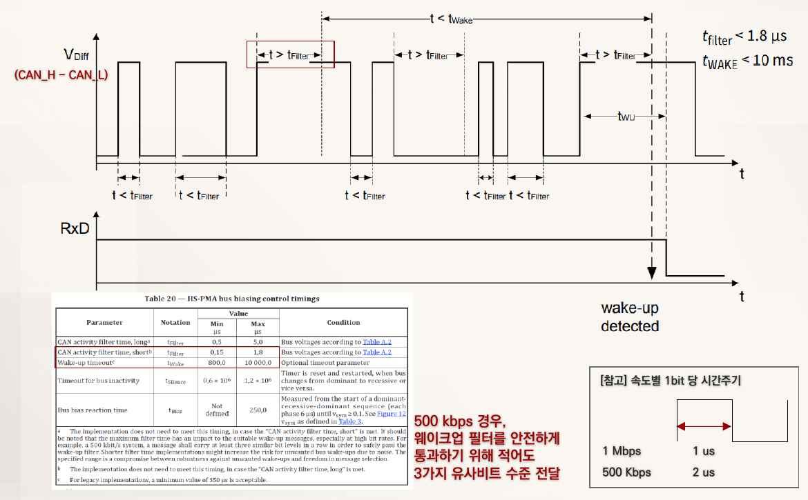

*Figure 31. Detection of a wake-up pattern*

Figure 31 shows the waveform of the differential voltage $V_{Diff} = V_{CAN\_H} - V_{CAN\_L}$ and the RxD output of the transceiver. All pulses shorter than the filter time $t_{Filter}$ ($t < t_{Filter}$) are ignored. A **pattern of a dominant period longer than $t_{Filter}$, then a recessive period longer than $t_{Filter}$, then again a dominant period longer than $t_{Filter}$** is a valid WUP if it is completed within the wake-up timeout $t_{Wake}$. At the moment the last dominant period exceeds $t_{Filter}$, the wake-up is detected and RxD changes to the low level to inform the microcontroller. For the transceiver in this example, the short filter time is at most 1.8 µs and the wake-up timeout is at most 10 ms [12], [10].

| Parameter | Symbol | Min | Max |
|:-----|:-----|:-----|:-----|
| CAN activity filter time (long) | $t_{Filter}$ | 0.5 µs | 5.0 µs |
| CAN activity filter time (short) | $t_{Filter}$ | 0.15 µs | 1.8 µs |
| Wake-up timeout | $t_{Wake}$ | 800 µs | 10,000 µs |
| Timeout for bus inactivity | $t_{Silence}$ | 0.6 s | 1.2 s |
| Bus bias reaction time | $t_{Bias}$ | | 250 µs |

*Table 36. Bus biasing control timings of the high-speed CAN physical medium attachment (HS-PMA)*

**A worked example.** At 500 kbps one bit is 2 µs (1 µs at 1 Mbps). To pass the wake-up filter safely even with the longest filter time (5.0 µs), a message must contain at least 3 consecutive bits of the same level ($3 \times 2 = 6\ \mu\text{s} > 5.0\ \mu$s). Two bits ($4\ \mu$s) may not be enough.

The behavior after wake-up is described in the transceiver's data sheet as follows. If a valid WUP has been detected, the RxD output pin follows the HS CAN bus signal after a delay $t_{WU}$. During the mode transition from stand-by mode to normal-operating mode, the RxD output is held "high" with a delay $t_{RxD\_Rec} < 5\ \mu$s, and after the transition time $t_{Mode}$ it is released and follows the dominant signal on the bus [12]. In other words, RxD is held at the recessive level during the short mode change so that no spurious signal reaches the microcontroller.

### 3.20 Emergence of CAN FD

| Year | Event |
|:-----|:-----|
| 1983 | Development of CAN begins |
| 1986 | Bosch presents CAN at an SAE congress |
| 1991 | CAN 2.0 is published |
| 1993 | The CAN standard is established (ISO 11898) |
| 2012 | Bosch releases the CAN FD 1.0 specification |
| 2015 | The CAN FD standard is established (ISO 11898-1:2015) |

*Table 37. From CAN to CAN FD*

> **Definition:** **CAN FD (CAN with Flexible Data rate)** is a protocol that keeps the arbitration method of classical CAN but raises the bit rate only in the data phase and enlarges the data field to up to 64 bytes [13].

As vehicle data volumes grew with ADAS, software updates, and other applications, the limits of CAN at 1 Mbps and 8 bytes became apparent, and CAN FD arose to overcome them.

- **Higher data rate:** The maximum rate of classical CAN is 1 Mbps, whereas CAN FD supports up to 8 Mbps in the data phase.
- **Larger data frames:** The CAN data field is at most 8 bytes, whereas CAN FD extends it to up to 64 bytes.
- **Flexible bit rate switching:** The bit rate can be changed in the middle of sending one message, improving network efficiency. The arbitration phase, in which several nodes compete, uses the original rate, and the data phase, in which only one node sends, uses the higher rate.
- **Improved error detection:** A strengthened CRC algorithm improves the error detection capability.
- **Standards:** The protocol is defined in ISO 11898-1 and the high-speed physical layer in ISO 11898-2 [9], [10].

The compatibility of the two protocols is as follows.

- **CAN protocol:** Classical CAN controllers cannot be used in CAN FD networks, because they interpret the bits after FDF in the classical format, detect stuff, CRC, or form errors in a CAN FD frame, and send error frames that disrupt communication.
- **CAN FD protocol:** CAN FD controllers can also send and receive classical CAN frames, so with a slight change of settings they can be used in CAN networks.

### 3.21 CAN Compared with CAN FD

| Item | CAN | CAN FD |
|:-----|:-----|:-----|
| Introduced | 1980s | 2012 |
| Data rate | Up to 1 Mbps | Up to 8 Mbps (data phase) |
| Data payload | Up to 8 bytes | Up to 64 bytes |
| Bit rate change | Fixed bit rate | Bit rate can change during data transmission |
| Error detection | 15-bit CRC | Strengthened 17-bit or 21-bit CRC |
| Network compatibility | Compatible with CAN-based networks | Backward compatible with existing CAN networks |
| Hardware requirement | Standard CAN controller | Controller supporting CAN FD required |

*Table 38. Comparison of CAN and CAN FD*

### 3.22 CAN FD Frame Format

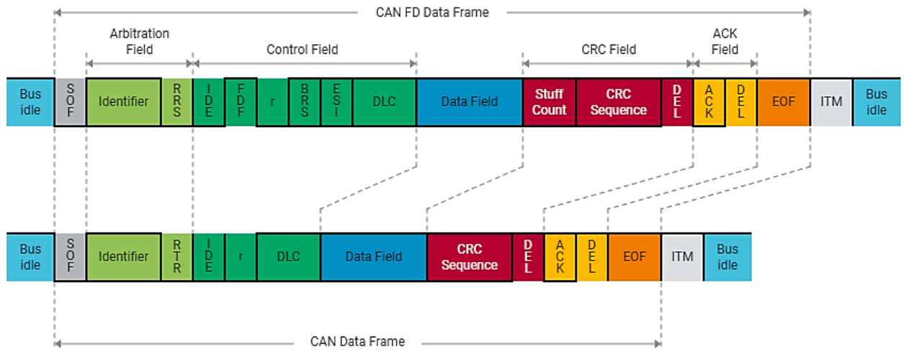

*Figure 32. The CAN FD data frame compared with the CAN data frame*

The upper part of Figure 32 is the CAN FD data frame and the lower part the classical CAN data frame. The arbitration field is almost the same, bits such as FDF, BRS, and ESI have been added to the control field, and a stuff count precedes the CRC field. RRS takes the place of the RTR of classical CAN, and FDF takes the place of r0. The fields are as follows (for the standard identifier format).

| No. | Field | Bits | Meaning |
|:-----|:-----|:-----|:-----|
| 1 | Identifier | 11 or 29 | 11 bits in a standard frame and 29 bits in an extended frame. |
| 2 | RRS (remote request substitution) | 1 | The position of RTR in classical CAN. CAN FD has no remote frames, so it is always sent dominant, and receivers do not care about its value. |
| 3 | IDE (identifier extension) | 1 | Dominant (0) means an 11-bit identifier and recessive (1) a 29-bit identifier. |
| 4 | FDF (FD format) | 1 | The bit that was r (r0) in the classical CAN frame; it distinguishes CAN from CAN FD. Dominant (0) means a CAN frame and recessive (1) a CAN FD frame. |
| | res | 1 | A reserved bit, sent dominant. |
| 5 | BRS (bit rate switch) | 1 | Dominant (0) keeps the original rate (for example, 1 Mbps) in the data phase too; recessive (1) switches to the higher data rate from the sample point of this bit until the CRC delimiter. |
| 6 | ESI (error state indicator) | 1 | Indicates the error state of the transmitting node. Dominant (0) means error active and recessive (1) error passive. |
| 7 | DLC (data length code) | 4 | The code for the length of the data field. The maximum value 15 means 64 bytes. |
| | Data field | 0-512 | 0-64 bytes. |
| 9 | Stuff count | 4 | The number of stuff bits inserted in the preceding part modulo 8 (3 bits in Gray code) plus 1 parity bit. A redundant check area separate from the CRC. |
| | CRC sequence | 17 or 21 | CRC-17 is used when the data is 16 bytes or less, and CRC-21 when it is 20 bytes or more. |

*Table 39. Fields of the CAN FD data frame*

> **Note:** Some sources write DLC as "Data Length Check" and describe it as "3 bits", but DLC stands for data length code and has 4 bits, as in classical CAN [9]. Because it has 4 bits it can take values 0-15, and CAN FD assigns lengths longer than 8 bytes to values 9-15.

The DLC of CAN FD denotes the data length as follows. Values 0-8 are the same as in classical CAN, and 9-15 denote longer lengths [9].

| DLC | 0-8 | 9 | 10 | 11 | 12 | 13 | 14 | 15 |
|:-----|:-----|:-----|:-----|:-----|:-----|:-----|:-----|:-----|
| Data bytes | 0-8 | 12 | 16 | 20 | 24 | 32 | 48 | 64 |

*Table 40. DLC and data length in CAN FD*

The generator polynomials of the CRCs in hexadecimal are as follows, written including the highest-order term.

- **CRC-17:** 0x3685B, that is, $x^{17} + x^{16} + x^{14} + x^{13} + x^{11} + x^6 + x^4 + x^3 + x + 1$
- **CRC-21:** 0x302899, that is, $x^{21} + x^{20} + x^{13} + x^{11} + x^7 + x^4 + x^3 + 1$

The longer the data, the greater the chance of missing an error, so longer data uses a longer CRC. In addition, in classical CAN a corrupted stuff bit could make the receiver misalign the bit positions so that the CRC missed the error; CAN FD remedies this weakness by including the stuff bits in the CRC calculation and sending their number separately as the stuff count [9].

**A worked example.** Let us compare the time needed to send 64 bytes. Take the arbitration rate as 500 kbit/s and the CAN FD data rate as 2 Mbit/s, and compute an approximation that leaves out stuff bits and the interframe space.

1. **Classical CAN:** An 8-byte standard frame is 108 bits (Week 3), so 64 bytes need 8 frames, $8 \times 108 = 864$ bits. $864 / 500000 = 1728\ \mu$s.
2. **CAN FD, the part sent at the arbitration rate:** the 17 bits of SOF, the 11-bit identifier, RRS, IDE, FDF, res, and BRS, plus the 9 bits of the ACK slot, ACK delimiter, and 7-bit EOF, 26 bits in all. $26 / 500000 = 52\ \mu$s.
3. **CAN FD, the part sent at the data rate:** the 1-bit ESI, 4-bit DLC, 512 bits of data, 4-bit stuff count, 21-bit CRC, and 1-bit CRC delimiter, 543 bits in all. $543 / 2000000 = 271.5\ \mu$s.
4. The transmission time of one CAN FD frame is $52 + 271.5 = 323.5\ \mu$s, about one fifth of that of classical CAN.

Besides sending the same data about 5 times faster, CAN FD has the advantage that all 64 bytes are delivered together consistently because they fit in one frame.

---

<br>

## Concept Applications

| Situation | Concept to Apply and Why |
|:-----|:-----|
| The mirror, window motor, and lock inside a door are to be connected cheaply. | **LIN.** With a single wire, slaves without crystals, and a UART basis, its cost per node is the lowest, and 20 kbps is sufficient. |
| In an X-by-wire system with electronic steering and braking, messages must arrive at exact times. | **The static segment of FlexRay.** Time-triggered TDMA guarantees delay and jitter, and the two channels allow redundancy. |
| Video from four surround-view cameras must be sent to an ADAS controller. | **Automotive Ethernet (100BASE-T1, 1000BASE-T1).** CAN and FlexRay lack the bandwidth, and high-speed transmission is possible over a single pair. |
| 1 GB of software must be updated quickly at a workshop. | **Ethernet-based diagnostics (central gateway).** It takes about 11 hours over 500 kbps HS-CAN but about 80 seconds over 100 Mbps Ethernet. |
| A faulty ECU causes an error in every frame it sends. | **Fault confinement.** The TEC grows by 8 per failure, so after 16 failures the node becomes error passive and after 32 failures bus off, disconnecting it from the bus. |
| CAN message data exceeds 8 bytes and is being split across several frames. | **CAN FD.** It carries up to 64 bytes in one frame and sends the data phase at a higher rate. |

*Table 41. Concepts to apply in each situation*

**True/False Check:**

| Statement | Judgment and Reason |
|:-----|:-----|
| In LIN, the master is not involved when slaves communicate directly with each other. | **F.** The master sends the header of every frame, so the master's schedule decides the timing of communication between slaves too. |
| In the dynamic segment of FlexRay, a smaller frame ID gets an earlier chance to send. | **T.** The slot counter passes the IDs in increasing order. |
| The RTR bit of a CAN data frame is recessive (1). | **F.** The RTR of a data frame is dominant (0); the RTR of a remote frame is recessive (1). |
| In CAN, a node that loses arbitration waits a random backoff time, as in Ethernet. | **F.** It rejoins arbitration as soon as the bus becomes idle again. |
| A CAN FD controller can also send and receive classical CAN frames. | **T.** CAN FD controllers can therefore be used in classical CAN networks as well. Conversely, classical CAN controllers cannot be used in CAN FD networks. |

---

<br>

## Summary

| Concept | Key Summary |
|:-----|:-----|
| IVNs by domain | Body uses LIN and CAN, powertrain and chassis use TTP/C and FlexRay, multimedia uses MOST, and safety uses TTEthernet; the higher the speed, the higher the cost. |
| Event-triggered and time-triggered | Event-triggered communication (CAN) is flexible but cannot guarantee delay, whereas time-triggered communication (the LIN schedule, the static segment of FlexRay) guarantees delivery times. |
| Bus load of CAN | Actual rates are 250-500 kbps, and because jitter grows and control performance degrades as load rises, a load of 50% or less is recommended. |
| LIN | A single-wire bus with a single master and multiple slaves at up to 20 kbps, whose frame consists of the master's header (break, synch 55, protected identifier) and a slave's response (data, checksum). |
| Calculations for LIN | Parity is $P_0 = ID_0 \oplus ID_1 \oplus ID_2 \oplus ID_4$ and $P_1 = \overline{ID_1 \oplus ID_3 \oplus ID_4 \oplus ID_5}$, the checksum is the inverted 8-bit sum with carry wrap-around, and the maximum frame time is 140% of nominal. |
| FlexRay | It uses two channels of 10 Mbit/s each, its communication cycle consists of the static segment (TDMA), dynamic segment (minislots), symbol window, and NIT, and its frame has a 5-byte header, a payload of up to 254 bytes, and a 24-bit CRC trailer. |
| Automotive Ethernet | It arose from the bandwidth demands of diagnostics and software updates, sends full-duplex 100 Mbps (100BASE-T1) or 1 Gbps (1000BASE-T1) over a single twisted pair, and supports real-time behavior with AVB and TSN. |
| CAN physical layer | NRZ coding, dominant 0 and recessive 1; high-speed CAN has a differential voltage of about 2 V and 0 V, low-speed CAN is fault tolerant, and the product of rate and bus length is roughly constant. |
| CAN frames | A data frame consists of SOF, identifier, RTR, IDE, r0, DLC, data, CRC, ACK, and EOF, and 11 consecutive recessive bits signify bus idle. |
| Arbitration | With CSMA/CD+AMP, dominant wins at each bit of the identifier, and losing nodes only listen and rejoin when the bus becomes free. |
| Error handling | When a bit, stuff, form, CRC, or ACK error is detected, it is signaled with an error frame (6-bit flag, 8-bit delimiter) and the frame is retransmitted, while TEC and REC move the node among error active, error passive, and bus off. |
| Bit timing | One bit is divided into Sync_Seg, Prop_Seg, Phase_Seg1, and Phase_Seg2, and the value is read at the boundary between Phase_Seg1 and Phase_Seg2. |
| Wake-up | A transceiver in low-power mode wakes up on a WUP of dominant, recessive, and dominant periods longer than the filter time, or on a WUF for selective wake-up. |
| CAN FD | The arbitration phase uses the original rate and the data phase up to 8 Mbps, the data field holds up to 64 bytes, and FDF, BRS, ESI, the stuff count, and CRC-17 and CRC-21 are added. |

---

<br>

## Self-Check Questions

1. **Bandwidth occupancy:** If the bandwidth required by X-by-wire systems and sensors totals 906 kbit/s, find the occupancy when it is handled by CAN and by FlexRay, and explain why CAN is unsuitable.

   <details>
   <summary>Answer</summary>

   CAN: $906 / 1000 = 90.6\%$; FlexRay (10 Mbit/s per channel): $906 / 10000 \approx 9\%$. For CAN it is recommended to keep the load at or below about 50% in view of jitter and the delay of low-priority messages, so with a load above 90% the delay of safety-related messages cannot be guaranteed.

   </details>

2. **LIN protected identifier:** Find the parity bits $P_0$ and $P_1$ and the protected identifier of identifier hexadecimal 23 (binary 100011).

   <details>
   <summary>Answer</summary>

   $ID_0 = 1, ID_1 = 1, ID_2 = 0, ID_3 = 0, ID_4 = 0, ID_5 = 1$. $P_0 = 1 \oplus 1 \oplus 0 \oplus 0 = 0$, and $ID_1 \oplus ID_3 \oplus ID_4 \oplus ID_5 = 1 \oplus 0 \oplus 0 \oplus 1 = 0$, so $P_1 = \overline{0} = 1$. Written from bit 7 this is 1010 0011, so the protected identifier is hexadecimal A3.

   </details>

3. **LIN frame time:** For LIN at 19.2 kbit/s, find the nominal frame time of an 8-byte data frame and the minimum time that must be allotted to that frame in the schedule table.

   <details>
   <summary>Answer</summary>

   The nominal number of bits is the 34-bit header plus the $10 \times (8 + 1) = 90$-bit response, 124 bits. The bit time is $1 / 19200 \approx 52.1\ \mu$s, so the nominal frame time is about 6.46 ms. The maximum frame time is 140% of nominal, $1.4 \times 124 = 173.6$ bits, about 9.04 ms, so the frame slot must be at least about 9.04 ms.

   </details>

4. **FlexRay dynamic segment:** In the dynamic segment of FlexRay, how much time does a node with no data to send use? Explain why this scheme suits event-triggered messages.

   <details>
   <summary>Answer</summary>

   A node with nothing to send lets only one minislot pass and the slot counter increases by 1. Only nodes with something to send occupy as many minislots as they need, so bandwidth is not wasted even for event-triggered traffic in which messages occur only occasionally. In addition, the slot counter passes the IDs in increasing order, so priority is determined naturally.

   </details>

5. **Automotive Ethernet physical layer:** When 100BASE-T1 sends 100 Mbit/s at 66.6 MBaud, find the number of bits carried by one symbol, and explain why the symbol rate was made lower than that of 100BASE-TX.

   <details>
   <summary>Answer</summary>

   $100 / 66.67 = 1.5$ bits. PAM-3 can carry at most $\log_2 3 \approx 1.58$ bits per symbol, so this is feasible. A lower symbol rate narrows the frequency band of the signal and reduces electromagnetic radiation, making it easier to meet the strict EMC requirements of vehicles even with an unshielded single pair.

   </details>

6. **CAN arbitration:** Three nodes with identifiers 0x6A0, 0x69F, and 0x6A1 start transmitting standard data frames at the same time. Which node wins, and at which bit do the losing nodes lose?

   <details>
   <summary>Answer</summary>

   In binary, 0x6A0 = 110 1010 0000, 0x69F = 110 1001 1111, and 0x6A1 = 110 1010 0001. ID10-ID6 are 11010 in all three values. At ID5, 0x69F has 0 and the other two have 1, so the bus becomes dominant and 0x6A0 and 0x6A1 lose. The remaining 0x69F wins, consistent with the rule that the smallest identifier wins.

   </details>

7. **Error frame:** Explain why the active error flag is 6 dominant bits and why the dominant period on the bus becomes 6-12 bits.

   <details>
   <summary>Answer</summary>

   Six equal values violate the bit stuffing rule, so other nodes that did not detect the error also detect a stuff error, and all nodes discard that frame. This guarantees network-wide data consistency. The other nodes detect the error at the sixth bit of the primary flag at the latest and send their own flags (secondary flags), so overlapping with the primary flag, the dominant period becomes at least 6 and at most 12 bits.

   </details>

8. **Fault confinement:** A node whose TEC is 0 suffers an error on every transmission and never succeeds. At which failure does it become error passive, and at which failure does it become bus off?

   <details>
   <summary>Answer</summary>

   Each failure adds 8 to the TEC. At the 16th failure TEC = 128 > 127 and the node becomes error passive, and at the 32nd failure TEC = 256 > 255 and it becomes bus off.

   </details>

9. **Bit timing:** A CAN controller with an 8 MHz clock is to produce 250 kbit/s. With BRP = 2, find the number of time quanta per bit, and give an example of a segment allocation with the sample point at 87.5%.

   <details>
   <summary>Answer</summary>

   $t_q = 2 / 8\ \text{MHz} = 250$ ns and the bit time is $1 / 250000 = 4\ \mu$s, so one bit is 16 tq. For example, dividing it into Sync_Seg 1, Prop_Seg 6, Phase_Seg1 7, and Phase_Seg2 2 puts the sample point at $(1 + 6 + 7) / 16 = 87.5\%$. SJW is then at most 2 tq.

   </details>

10. **CAN FD:** If the DLC of a CAN FD frame is 13, how many bytes of data are there, and which CRC is used? What changes when BRS is recessive?

    <details>
    <summary>Answer</summary>

    DLC 13 means 32 bytes. The data exceeds 16 bytes, so CRC-21 is used. When BRS is recessive, the data phase from the sample point of BRS to the CRC delimiter is sent at a data rate higher than that of the arbitration phase.

    </details>

11. **Wake-up:** On 250 kbps CAN, how many consecutive bits of the same level are needed at minimum to pass the wake-up filter even with the longest filter time (5.0 µs)?

    <details>
    <summary>Answer</summary>

    At 250 kbps one bit is $1 / 250000 = 4\ \mu$s. One bit (4 µs) is shorter than 5.0 µs and therefore not enough, while two consecutive bits give $2 \times 4 = 8\ \mu\text{s} > 5.0\ \mu$s and pass. At least two consecutive bits of the same level are therefore needed.

    </details>

---

<br>

## References

1. FlexRay Consortium, *FlexRay Communications System Protocol Specification, Version 3.0.1*, 2010.
2. SAE International, *AS6802: Time-Triggered Ethernet*, 2011.
3. LIN Consortium, *LIN Specification Package, Revision 2.2A*, 2010.
4. LIN Consortium, *LIN Specification Package, Revision 1.3*, 2002.
5. IEEE Std 802.3bw-2015, *IEEE Standard for Ethernet Amendment 1: Physical Layer Specifications and Management Parameters for 100 Mb/s Operation over a Single Balanced Twisted Pair Cable (100BASE-T1)*, IEEE, 2015.
6. OPEN Alliance, "OPEN Alliance: One-Pair Ether-Net." https://www.opensig.org/
7. IEEE Std 802.3bp-2016, *IEEE Standard for Ethernet Amendment 4: Physical Layer Specifications and Management Parameters for 1 Gb/s Operation over a Single Twisted-Pair Copper Cable*, IEEE, 2016.
8. Robert Bosch GmbH, *CAN Specification, Version 2.0*, Stuttgart, Germany, 1991.
9. ISO 11898-1:2015, *Road vehicles - Controller area network (CAN) - Part 1: Data link layer and physical signalling*, International Organization for Standardization, 2015.
10. ISO 11898-2:2016, *Road vehicles - Controller area network (CAN) - Part 2: High-speed medium access unit*, International Organization for Standardization, 2016.
11. F. Hartwich and A. Bassemir, "The Configuration of the CAN Bit Timing," in *Proc. 6th International CAN Conference (iCC)*, Turin, Italy, 1999.
12. Infineon Technologies AG, *TLE9251V High Speed CAN Transceiver, Data Sheet*, Munich, Germany.
13. Robert Bosch GmbH, *CAN with Flexible Data-Rate Specification, Version 1.0*, Gerlingen, Germany, 2012.
