# 10주차 이론 — CAN 통신 실습

[레포지토리 안내](../../README.ko.md) | [English](Concepts_Lecture.md) | [한국어](Concepts_Lecture.ko.md)

> **최종 수정일:** 2026-11-04

> **학습 목표:**
> 1. 2진수와 16진수를 서로 변환하고, 비트 순서(MSB 우선, LSB 우선)와 바이트 순서(리틀 엔디안, 빅 엔디안)를 구별할 수 있다
> 2. UART와 CAN의 신호 레벨, 프레임 구조, 통신 속도를 비교하고, 식별자 중재의 결과를 비트 단위로 추적할 수 있다
> 3. 생성 다항식으로 CRC를 계산하고 수신한 데이터를 검산할 수 있다
> 4. CAN 프레임의 종류, CAN FD, OBD-II, CAN 노드와 모니터링 장비의 구성, 신호선 연결과 종단 저항을 설명할 수 있다
> 5. CAN DB(DBC)의 메시지와 시그널 정의로 원시값을 물리값으로 바꾸고, 주어진 값 범위에 맞는 Factor와 Offset을 설계할 수 있다
> 6. 로직 애널라이저, Kvaser CanKing, Vector CANoe로 CAN 신호와 차량 데이터를 관찰하고 기록하며, 그 결과를 해석할 수 있다

---

## 목차

- [1. CAN 통신 복습](#1-can-통신-복습)
  - [1.1 CAN의 특징](#11-can의-특징)
  - [1.2 CAN의 역사](#12-can의-역사)
  - [1.3 정보의 인코딩: 2진수, 16진수, 비트, 바이트](#13-정보의-인코딩-2진수-16진수-비트-바이트)
  - [1.4 비트 순서와 바이트 순서](#14-비트-순서와-바이트-순서)
  - [1.5 직렬 통신, 병렬 통신, 부호화](#15-직렬-통신-병렬-통신-부호화)
  - [1.6 UART](#16-uart)
  - [1.7 통신 속도와 통신 거리](#17-통신-속도와-통신-거리)
  - [1.8 CAN 토폴로지와 신호 레벨](#18-can-토폴로지와-신호-레벨)
  - [1.9 CAN 메시지 프레임과 DLC](#19-can-메시지-프레임과-dlc)
  - [1.10 중재 필드와 식별자 우선순위](#110-중재-필드와-식별자-우선순위)
  - [1.11 CRC 필드와 프레임 간 공간](#111-crc-필드와-프레임-간-공간)
  - [1.12 CRC 계산과 검산](#112-crc-계산과-검산)
- [2. CAN 통신 실습 준비](#2-can-통신-실습-준비)
  - [2.1 CAN 프레임의 필드](#21-can-프레임의-필드)
  - [2.2 CAN 프레임의 종류](#22-can-프레임의-종류)
  - [2.3 CAN FD](#23-can-fd)
  - [2.4 OBD-II](#24-obd-ii)
  - [2.5 CAN 노드의 구성](#25-can-노드의-구성)
  - [2.6 CAN 모니터링 장비와 연결 구성](#26-can-모니터링-장비와-연결-구성)
  - [2.7 신호선 연결과 종단 저항](#27-신호선-연결과-종단-저항)
  - [2.8 CAN DB와 DBC 파일](#28-can-db와-dbc-파일)
  - [2.9 메시지와 시그널](#29-메시지와-시그널)
  - [2.10 메시지 변환: Factor와 Offset](#210-메시지-변환-factor와-offset)
  - [2.11 Factor와 Offset의 설계](#211-factor와-offset의-설계)
  - [2.12 CAN DB를 이용한 데이터 수집](#212-can-db를-이용한-데이터-수집)
- [3. CAN 통신 실습](#3-can-통신-실습)
  - [3.1 실습 구성과 장비](#31-실습-구성과-장비)
  - [3.2 로직 애널라이저로 UART 신호 관찰](#32-로직-애널라이저로-uart-신호-관찰)
  - [3.3 Kvaser CanKing으로 CAN 프레임 송수신](#33-kvaser-canking으로-can-프레임-송수신)
  - [3.4 로직 애널라이저로 CAN 신호 관찰](#34-로직-애널라이저로-can-신호-관찰)
  - [3.5 실험 차량의 CAN 모니터링 구성](#35-실험-차량의-can-모니터링-구성)
  - [3.6 CANoe 실행과 CAN 네트워크 설정](#36-canoe-실행과-can-네트워크-설정)
  - [3.7 CAN DB 없이 모니터링하기](#37-can-db-없이-모니터링하기)
  - [3.8 CAN DB를 추가하여 모니터링하기](#38-can-db를-추가하여-모니터링하기)
  - [3.9 실시간 그래프와 데이터 로깅](#39-실시간-그래프와-데이터-로깅)
  - [3.10 주행 중 모니터링](#310-주행-중-모니터링)
- [개념 적용](#개념-적용)
- [요약](#요약)
- [점검 문제](#점검-문제)
- [참고 문헌](#참고-문헌)

---

<br>

## 1. CAN 통신 복습

이 절은 3주차와 9주차에서 다룬 CAN을 실습에 필요한 관점에서 다시 정리한다. 실습 화면의 16진수 값과 신호 파형을 읽으려면 2진수와 16진수, 비트와 바이트의 순서, 직렬 통신과 통신 속도를 이해해야 하므로 이 기초도 함께 다룬다.

### 1.1 CAN의 특징

> **용어 정의:** **CAN(Controller Area Network)** 은 Bosch가 차량 안의 전자 제어 장치를 연결하기 위해 만든 직렬 버스 통신 프로토콜이며, ISO 11898로 국제 표준화되었다. **ECU(electronic control unit, 전자 제어 장치)** 는 센서 값을 읽고 액추에이터를 제어하여 차량의 한 기능을 맡는 마이크로컨트롤러 기반의 제어기이다(3주차).

차량의 전자화가 진행되면서 엔진, 변속기, 브레이크, 조향, 차체 같은 기능마다 ECU가 생겨 그 수가 크게 늘었다. 기존의 **점대점(point-to-point) 연결**은 통신이 필요한 ECU 쌍마다 전선을 따로 잇는 방식이다. ECU $n$개를 모두 서로 잇는다면 연결 수는 $n(n-1)/2$이므로, ECU가 10개이면 45개, 50개이면 1,225개가 되어 ECU 수의 제곱에 비례하여 늘어난다. 이 문제를 풀기 위해 여러 노드가 하나의 전송 매체를 공유하는 **버스 토폴로지(bus topology)** 의 네트워크가 필요해졌고, CAN이 그 대표이다.

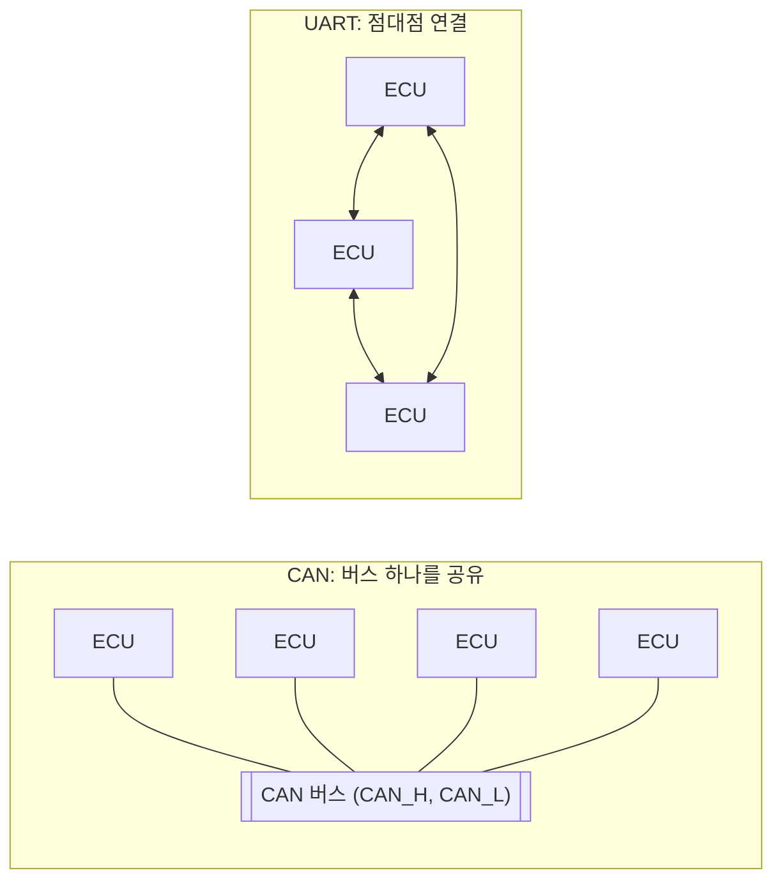

*그림 1. 버스를 공유하는 CAN과 점대점으로 연결하는 UART*

그림 1의 왼쪽은 모든 ECU가 한 쌍의 CAN 전선에 붙는 구성이고, 오른쪽은 두 장치 사이만 잇는 통신 방식인 UART(1.6절)로 ECU 세 개를 연결한 구성이다. 점대점 구성에서는 ECU가 하나 늘 때마다 기존 ECU에도 새 연결과 통신 포트를 추가해야 하지만, 버스 구성에서는 새 ECU를 버스에 붙이기만 하면 된다.

CAN의 특징은 다음과 같다.

1. **버스 구조:** 여러 노드가 하나의 전송 매체를 공유한다.
2. **많은 노드:** 노드에 주소가 없으므로 프로토콜이 노드 수를 제한하지 않으며, 실제 노드 수는 트랜시버가 구동할 수 있는 전기적 부하로 정해진다(아래 참고 상자) [1].
3. **배선 절감과 고장 관리:** 배선이 줄고, 모든 메시지가 한 버스를 지나므로 버스의 한 지점에서 고장을 감시하고 원인을 찾기 쉽다.
4. **설계 변경과 유지 보수의 용이성:** CAN 메시지에는 받는 노드의 주소가 없고 모든 노드가 모든 메시지를 받으므로(3주차의 방송형 통신), 노드를 추가하거나 바꿀 때 다른 노드를 고칠 필요가 거의 없다.
5. **고속 실시간 통신:** 최대 1 Mbit/s의 속도를 지원하고, 우선순위가 높은 메시지가 먼저 전달된다(1.10절).
6. **단순한 물리 인터페이스와 잡음 대책:** 두 가닥을 꼰 꼬임쌍선(twisted pair) 하나로 통신하며, 차동 신호 방식이므로 잡음에 강하다(1.8절).
7. **국제 표준:** ISO 11898로 제정되었다.

> **참고:** 강의자료는 이론상 최대 2032개의 노드를 연결할 수 있다고 적지만, 2032라는 수는 노드의 수가 아니라 표준 프레임에서 쓸 수 있는 11비트 식별자의 수에서 나온다. 11비트로는 $2^{11} = 2048$개의 값을 만들 수 있지만, Bosch 규격은 상위 7비트(ID10\~ID4)가 모두 열성(1)인 식별자 16개를 쓰지 못하게 하므로 $2048 - 16 = 2032$개가 남는다 [1]. 식별자는 메시지의 종류를 나타내므로 이 수는 한 버스에서 구별할 수 있는 표준 메시지의 최대 개수이다. 한 버스에 실제로 붙일 수 있는 노드의 수는 트랜시버가 구동할 수 있는 전기적 부하로 정해지며 보통 수십 개 수준이다(3주차).

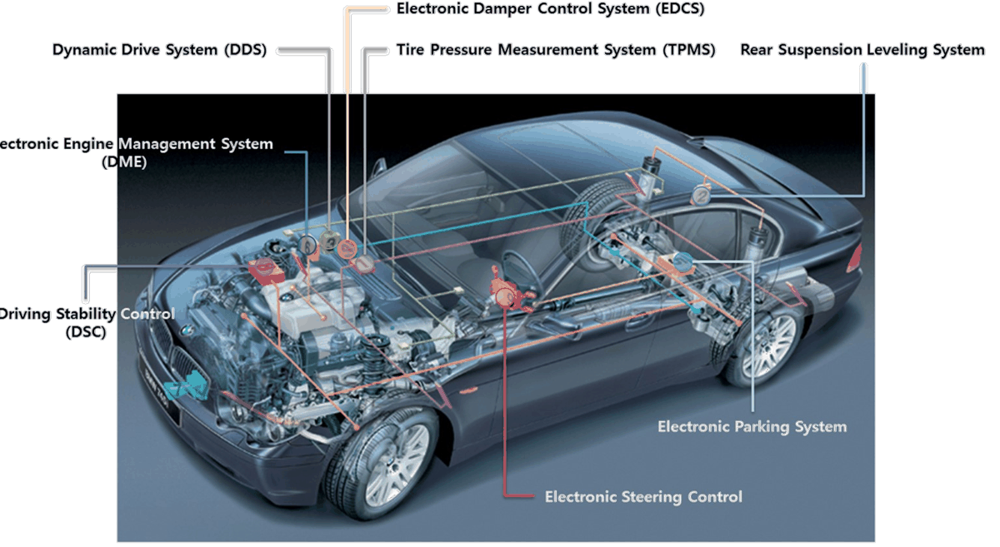

*그림 2. 섀시와 파워트레인의 제어 시스템을 CAN으로 연결한 승용차*

그림 2는 한 고급 승용차에서 CAN으로 연결된 제어 시스템의 위치를 보여 준다. 각 시스템의 역할은 다음과 같다.

| 시스템 | 역할 |
|:-----|:-----|
| 타이어 공기압 제어 시스템(RDC, TPMS) | 타이어의 공기압을 측정하여 낮아지면 운전자에게 알린다. |
| 뒤 서스펜션 레벨링 시스템 | 짐이나 승객의 무게가 달라져도 차체 뒤쪽의 높이를 일정하게 유지한다. |
| 다이내믹 드라이브(DDS) | 선회할 때 차체가 바깥쪽으로 기우는 롤(roll)을 능동적으로 줄인다. |
| 전자 댐퍼 컨트롤 시스템(EDC, EDCS) | 노면과 주행 상태에 따라 쇼크 업소버(댐퍼)의 감쇠력을 조절한다. |
| 전자 주차 시스템 | 버튼 조작으로 주차 브레이크를 걸고 푼다. |
| 전자 엔진 매니지먼트 시스템(DME) | 연료 분사와 점화 시기 같은 엔진의 동작을 제어한다. |
| 액티브 크루즈 컨트롤(ACC) | 설정한 속도를 유지하면서 앞차와의 거리를 자동으로 조절한다. |
| 주행 안정 장치(DSC) | 차가 미끄러지거나 옆으로 밀릴 때 바퀴별 제동과 엔진 출력을 조절하여 자세를 바로잡는다. |
| 전자 제어 스티어링 | 차속에 따라 조향 보조력이나 조향비를 전자적으로 조절한다. |

*표 1. 그림 2의 제어 시스템과 역할*

이 시스템들은 차속, 엔진 토크, 조향각, 바퀴 속도 같은 정보를 서로 계속 주고받아야 한다. 예를 들어 DSC는 바퀴 속도, 조향각, 엔진 정보를 함께 써서 차의 자세를 판단하므로, 각 정보를 만드는 ECU가 같은 버스에 있어야 한다.

### 1.2 CAN의 역사

| 연도 | 사건 |
|:-----|:-----|
| 1983 | Bosch가 차량 내부 네트워크를 개발하는 사내 프로젝트를 시작했다. |
| 1986 | CAN 프로토콜이 공식 발표되었다. |
| 1987 | Intel과 Philips Semiconductors가 첫 CAN 컨트롤러 칩을 시장에 내놓았다. |
| 1991 | Bosch가 CAN 규격 2.0을 발행했다. |
| 1992 | 국제 사용자와 제조사의 단체인 CiA(CAN in Automation)가 설립되었고, CiA가 응용 계층 프로토콜 CAL(CAN Application Layer)을 발표했다. Mercedes-Benz가 CAN 네트워크를 쓴 첫 양산차를 내놓았다. |
| 1993 | ISO 11898 표준이 발행되었다. |
| 1994 | CiA가 첫 국제 CAN 학회(iCC, international CAN Conference)를 열었다. |
| 1995 | Allen-Bradley가 DeviceNet 프로토콜을 발표했다. 확장 프레임 형식을 추가한 ISO 11898 개정판이 발행되었고, CiA가 CANopen 프로토콜을 발표했다. |
| 2000 | CAN 위에서 시간 기반 통신을 하는 TTCAN(time-triggered communication protocol for CAN)이 개발되었다. |
| 2012 | Bosch가 데이터 구간의 속도와 길이를 늘린 CAN FD 규격 1.0을 발표했다(2.3절) [2]. |

*표 2. CAN의 주요 역사*

CAN 규격은 OSI 7계층 가운데 물리 계층과 데이터 링크 계층만 정한다(3주차). 그래서 데이터의 의미와 장치 관리 방법을 정하는 응용 계층 프로토콜이 따로 생겼는데, CAL, CANopen, DeviceNet이 그 예이며 주로 산업 자동화에 쓰인다. TTCAN은 메시지마다 보낼 시간 구간을 미리 정해 두는 방식으로, 버스가 붐벼도 메시지의 지연 시간을 예측할 수 있게 한다(3주차의 ISO 11898-4).

> **참고:** CAN FD의 등장 연도를 2011년으로 적는 자료도 있으나, Bosch가 CAN FD 규격 1.0을 발표한 것은 2012년이다 [2].

### 1.3 정보의 인코딩: 2진수, 16진수, 비트, 바이트

> **용어 정의:** **2진법(binary)** 은 0과 1의 두 숫자(상태)의 나열로 수를 나타내는 방법이며, 오른쪽에서 $k$번째 자리(0번째부터 셈)의 가중치는 $2^k$이다. **16진법(hexadecimal)** 은 0\~9와 a\~f(a는 10, f는 15)의 16가지 숫자로 수를 나타내는 방법이며, 자리의 가중치는 $16^k$이다.

> **용어 정의:** **비트(bit)** 는 2진법에서 0 또는 1 하나를 나타내는 정보의 최소 단위이다. **바이트(byte)** 는 8비트이며, $2^8 = 256$가지 상태, 즉 0\~255의 값을 나타낸다.

10진수 220을 2진수로 바꾸려면 220을 2의 거듭제곱의 합으로 나타낸다. $220 = 128 + 64 + 16 + 8 + 4$이므로 다음과 같다.

$$
220 = 1 \times 2^7 + 1 \times 2^6 + 0 \times 2^5 + 1 \times 2^4 + 1 \times 2^3 + 1 \times 2^2 + 0 \times 2^1 + 0 \times 2^0 = 11011100_2
$$

16진수로 바꿀 때는 2진수를 오른쪽부터 4비트씩 묶는다. 4비트 하나는 0\~15를 나타내므로 16진수 한 자리와 정확히 대응한다. $1101_2 = 13 = \text{D}$, $1100_2 = 12 = \text{C}$이므로 $220 = 11011100_2 = \text{DC}_{16}$이다. 거꾸로 확인하면 $13 \times 16 + 12 = 208 + 12 = 220$이다.

| 2진수 | 10진수 | 16진수 | 2진수 | 10진수 | 16진수 |
|:-----|:-----|:-----|:-----|:-----|:-----|
| 0000 | 0 | 0 | 1000 | 8 | 8 |
| 0001 | 1 | 1 | 1001 | 9 | 9 |
| 0010 | 2 | 2 | 1010 | 10 | A |
| 0011 | 3 | 3 | 1011 | 11 | B |
| 0100 | 4 | 4 | 1100 | 12 | C |
| 0101 | 5 | 5 | 1101 | 13 | D |
| 0110 | 6 | 6 | 1110 | 14 | E |
| 0111 | 7 | 7 | 1111 | 15 | F |

*표 3. 4비트 2진수와 16진수의 대응*

한 바이트가 모두 1이면 $11111111_2 = 255 = \text{FF}_{16}$이다. 바이트는 256가지 상태를 나타내지만 0부터 세므로 가장 큰 값은 256이 아니라 255이다. CAN 데이터는 바이트 단위로 다루어지고 바이트 하나가 16진수 두 자리로 딱 맞게 표시되므로, CAN 도구들은 식별자와 데이터를 16진수로 보여 준다. 16진수임을 나타내는 표기는 도구마다 다르다. 이 정리본은 `0xDC`처럼 0x 접두사를 쓰고, Kvaser CanKing은 `$123`처럼 $ 접두사를 쓰며, CANoe는 16진수 표시 모드에서 접두사 없이 `DC`처럼 보여 준다.

### 1.4 비트 순서와 바이트 순서

> **용어 정의:** **최상위 비트(MSB, most significant bit)** 는 2진수로 쓴 비트 열에서 가장 왼쪽 자리, 즉 가중치가 가장 큰 비트이다. **최하위 비트(LSB, least significant bit)** 는 가장 오른쪽 자리, 즉 가중치가 $2^0$인 비트이다.

비트 열을 저장하거나 전송할 때는 어느 쪽 끝부터 다룰지 정해야 한다. 220을 MSB부터 늘어놓으면 1 1 0 1 1 1 0 0이고, LSB부터 늘어놓으면 순서가 뒤집혀 0 0 1 1 1 0 1 1이 된다.

```text
decimal 220 = 0xDC

bit position    7   6   5   4   3   2   1   0
bit value       1   1   0   1   1   1   0   0
               MSB                         LSB

MSB first :  1 1 0 1 1 1 0 0
LSB first :  0 0 1 1 1 0 1 1
```

*그림 3. 220의 비트 위치와 두 가지 비트 순서*

통신에서 한 바이트 안의 비트를 어느 쪽부터 보내는지를 **비트 순서(bit order)** 라 한다. UART는 LSB부터 보내고(1.6절, 3.2절), CAN은 식별자와 각 데이터 바이트를 MSB부터 보낸다(3.4절) [1]. 수신 측이 같은 순서로 다시 조립하므로 값 자체는 바뀌지 않는다.

> **용어 정의:** **엔디안(endianness)** 은 두 바이트 이상으로 된 값을 메모리나 메시지에 놓는 **바이트 순서(byte order)** 이다. **리틀 엔디안(little endian)** 은 가장 낮은 자리의 바이트를 먼저(낮은 주소나 앞쪽 바이트에) 놓고, **빅 엔디안(big endian)** 은 가장 높은 자리의 바이트를 먼저 놓는다.

```text
16-bit value 0x43A1 (= 17313)

                  first byte   second byte
little endian :       A1           43        (least significant byte first)
big endian    :       43           A1        (most significant byte first)
```

*그림 4. 16비트 값 0x43A1의 두 가지 바이트 순서*

$0\text{x}43\text{A}1 = 4 \times 4096 + 3 \times 256 + 10 \times 16 + 1 = 16384 + 768 + 160 + 1 = 17313$이다. Intel 계열 CPU는 리틀 엔디안을 쓰고, TCP/IP 같은 인터넷 프로토콜은 헤더의 여러 바이트 필드를 빅 엔디안으로 보낸다(5주차). CAN DB에서는 바이트 순서를 "Intel"(리틀 엔디안)과 "Motorola"(빅 엔디안)로 부르며, 같은 데이터 바이트라도 바이트 순서를 잘못 정하면 전혀 다른 값으로 해석된다(2.10절).

> **참고:** 강의자료는 표현되는 정보를 LSB부터 저장하는 방식을 리틀 엔디안, MSB부터 저장하는 방식을 빅 엔디안이라 하고, 220의 비트를 뒤집어 늘어놓는 예로 설명한다. 일반적으로 엔디안은 여러 바이트로 된 값의 바이트 순서를 가리키는 말이며, 한 바이트 안의 비트를 어느 쪽부터 보내는지는 위의 비트 순서로 따로 부른다. 두 개념은 모두 "어느 쪽 끝부터 다루는가"의 문제라는 점에서 닮았지만, 다루는 단위가 비트인지 바이트인지가 다르다.

### 1.5 직렬 통신, 병렬 통신, 부호화

데이터 통신은 전선 같은 전송 매체를 통해 2진수의 디지털 정보를 주고받는 일이다. 비트를 보내는 방식은 두 가지이다.

- **직렬 통신(serial communication):** 하나의 전송 매체로 2진수의 정보를 한 비트씩 순서대로 보낸다.
- **병렬 통신(parallel communication):** $n$개의 전송 매체로 2진수의 정보를 한 번에 $n$비트씩 보낸다.

```text
Serial (one line)                         Parallel (n lines)

TX  ... b2 b1 b0  ──────────▶  RX         TX   b0 ──────────▶  RX
                                               b1 ──────────▶
                                               b2 ──────────▶
                                               ...
```

*그림 5. 직렬 통신과 병렬 통신*

병렬 통신은 한 번에 여러 비트를 보내므로 같은 클록에서 빠르지만, 전선이 많이 들고 거리가 길어지면 전선마다 신호가 도착하는 시각이 조금씩 어긋나는 문제(skew)가 커진다. 그래서 차량처럼 전선의 무게와 비용이 중요하고 거리가 수 m 이상인 곳에서는 직렬 통신을 쓴다. CAN, LIN, FlexRay, 차량용 이더넷은 모두 직렬 통신이다.

> **용어 정의:** **부호화(encoding)** 는 0 또는 1의 정보를 전기 신호로 바꾸는 과정이다. 가장 단순한 예는 1을 5 V(High), 0을 0 V(Low)로 나타내는 것이다.

0과 1을 전압으로 나타내는 여러 방식(NRZ, 맨체스터 부호 등)은 4주차에서 다루었다.

### 1.6 UART

> **용어 정의:** **UART(Universal Asynchronous Receiver/Transmitter, 범용 비동기 송수신기)** 는 두 장치 사이에서 데이터를 한 비트씩 보내는 단순한 직렬 통신 방식, 또는 그 방식을 구현한 회로이다. 별도의 클록 선이 없는 **비동기(asynchronous)** 방식이므로, 송신 측과 수신 측이 통신 속도를 미리 똑같이 맞추어 둔다.

UART는 신호 0을 0 V로, 신호 1을 회로의 전원 전압인 5 V(또는 3.3 V)로 나타낸다. 한 바이트를 보내는 프레임은 다음과 같다.

1. **유휴(idle):** 보낼 것이 없으면 선을 1(High)로 유지한다.
2. **시작 비트(start bit):** 0 하나를 보낸다. 수신 측은 1에서 0으로 떨어지는 에지를 보고 바이트의 시작을 알아채어 자기 클록을 시작하고, 이후 약속한 비트 시간마다 각 비트의 가운데에서 값을 읽는다.
3. **데이터 비트(data bits):** 보통 8비트를 **LSB부터** 보낸다.
4. **패리티 비트(parity bit):** 선택 사항이며, 1의 개수가 짝수인지 홀수인지로 간단한 오류 검사를 한다.
5. **정지 비트(stop bit):** 1을 한 비트(또는 두 비트) 보내 선을 High로 되돌린다. 다음 바이트의 시작 비트가 다시 하강 에지를 만들 수 있게 하는 역할이다.

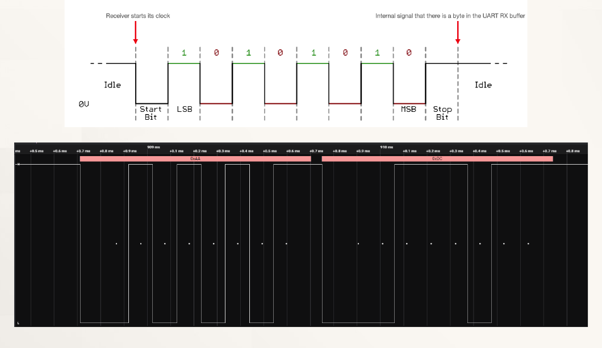

*그림 6. UART 프레임의 구조와 로직 애널라이저로 측정한 UART 파형*

그림 6의 위쪽에서 수신 측은 시작 비트의 하강 에지에서 클록을 시작하고(Receiver starts its clock), 정지 비트에 이르면 수신 버퍼에 한 바이트가 들어왔다는 내부 신호를 만든다. 데이터 비트는 LSB부터 1, 0, 1, 0, 1, 0, 1, 0이므로, MSB부터 다시 쓰면 $01010101_2 = \text{0x55}$이다. 아래쪽은 로직 애널라이저로 측정한 실제 UART 파형으로, 바이트마다 시작 비트로 시작하여 정지 비트로 끝나는 같은 구조가 반복된다.

| 항목 | UART | CAN |
|:-----|:-----|:-----|
| 연결 | 두 장치 사이의 점대점 | 여러 노드가 공유하는 버스 |
| 신호 | 접지를 기준으로 한 단일 전선의 전압(0 V와 3.3 V 또는 5 V) | CAN_H와 CAN_L의 차동 전압 |
| 동기화 | 바이트마다 시작 비트의 하강 에지 | SOF의 하강 에지와 비트 스터핑으로 보장되는 에지 |
| 비트 순서 | LSB 우선 | 필드마다 MSB 우선 |
| 오류 검출 | 선택적인 패리티 비트 | 15비트 CRC를 포함한 다섯 가지 방식(3주차) |
| 주소와 우선순위 | 없음 | 식별자로 메시지의 종류와 우선순위를 나타냄 |

*표 4. UART와 CAN의 비교*

### 1.7 통신 속도와 통신 거리

> **용어 정의:** **보 속도(baud rate)** 는 초당 보낼 수 있는 펄스(신호 요소, 심볼)의 수, 즉 신호 레벨이 1초에 바뀔 수 있는 횟수이며 단위는 baud이다. **비트 전송률(bit rate)** 은 초당 보낼 수 있는 비트의 수이며 단위는 bps(bit/s)이다. 비트 전송률은 4주차의 데이터 전송 속도와 같은 말이다.

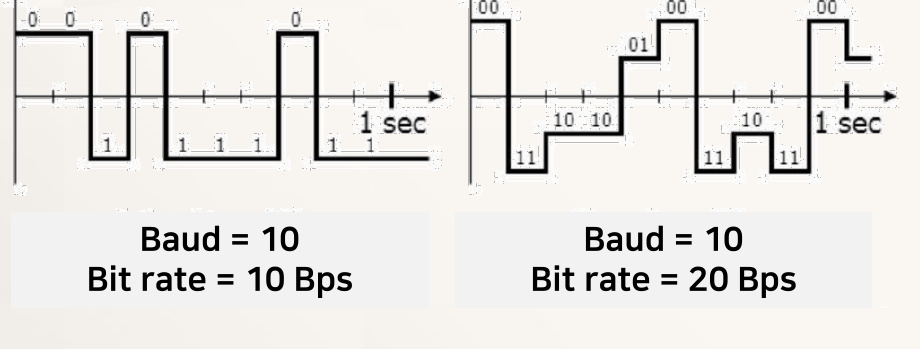

*그림 7. 보 속도가 같을 때 신호 레벨의 수에 따라 달라지는 비트 전송률*

그림 7의 두 신호는 모두 1초에 펄스 10개를 보내므로 보 속도가 10 baud이다. 왼쪽 신호는 레벨이 두 개(0과 1)이므로 펄스 하나가 1비트를 나르고, 비트 전송률은 10 bps이다. 오른쪽 신호는 레벨이 네 개(00, 01, 10, 11)이므로 펄스 하나가 2비트를 나르고, 비트 전송률은 20 bps이다. 신호 레벨이 $M$개이면 다음 관계가 성립한다(4주차).

$$
\text{비트 전송률 (bps)} = \text{보 속도 (baud)} \times \log_2 M
$$

UART와 CAN은 레벨이 두 개($M = 2$, $\log_2 2 = 1$)인 신호를 쓰므로 보 속도와 비트 전송률이 같다. 그래서 CAN 도구는 같은 속도를 "500 kBaud"(CANoe)나 "500 kbit/s"(CanKing)처럼 두 단위로 섞어 쓴다.

> **참고:** 강의자료에 인용된 설명 가운데 여러 비트를 나르는 심볼을 쓰는 시스템에서는 "the baud rate is typically much higher than the bit rate"라는 문장은 관계가 거꾸로 되어 있다. 심볼 하나가 여러 비트를 나르면 위 식에서 $\log_2 M > 1$이므로 비트 전송률이 보 속도보다 높다.

일반적으로 통신 속도가 빠를수록 통신할 수 있는 거리는 짧아진다.

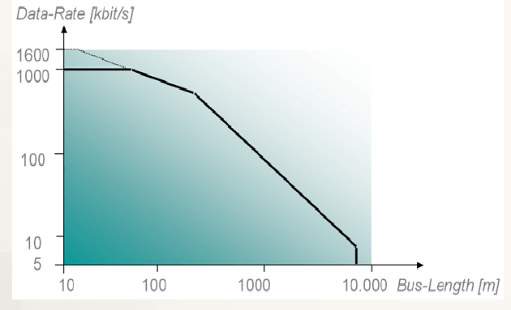

*그림 8. CAN 버스의 길이에 따른 최대 데이터 전송 속도*

그림 8은 가로축에 버스 길이(m), 세로축에 데이터 전송 속도(kbit/s)를 로그 눈금으로 둔 그래프이다. 버스가 약 40 m 이하이면 1000 kbit/s(1 Mbit/s)를 쓸 수 있지만, 버스가 길어질수록 최대 속도가 내려가 10,000 m(10 km)에서는 약 5 kbit/s가 된다. 가장 짧은 구간의 점선은 1 Mbit/s보다 높은 속도까지 이어지는데, 고전 CAN 규격의 최대 속도는 1 Mbit/s이다. 속도와 길이가 반비례하는 까닭은 CAN의 중재와 ACK에 있다. 한 노드가 보낸 비트가 버스의 가장 먼 노드까지 갔다가 그 결과가 돌아오는 시간이 한 비트 시간 안에 들어와야 하므로(3주차), 버스가 길수록 비트 시간을 늘려야, 즉 속도를 낮추어야 한다. 예를 들어 1 Mbit/s의 비트 시간은 1 µs, 500 kbit/s의 비트 시간은 2 µs이다.

### 1.8 CAN 토폴로지와 신호 레벨

**토폴로지(topology)** 는 노드와 전송 매체가 물리적으로 연결된 모양(버스형, 스타형, 링형 등)이다(6주차). CAN 네트워크는 버스형 토폴로지로 구성되며, 다음 요소로 이루어진다.

- **신호선:** CAN_H(CAN High)와 CAN_L(CAN Low)의 두 선이다.
- **종단 저항(termination resistor):** 버스의 양 끝에서 CAN_H와 CAN_L 사이에 다는 120 Ω 저항이다. 전송 매체를 따라 끝에 도달한 신호 에너지를 소비하여, 끝에서 되돌아오는 반사파가 원래 신호를 왜곡하는 것을 막는다.

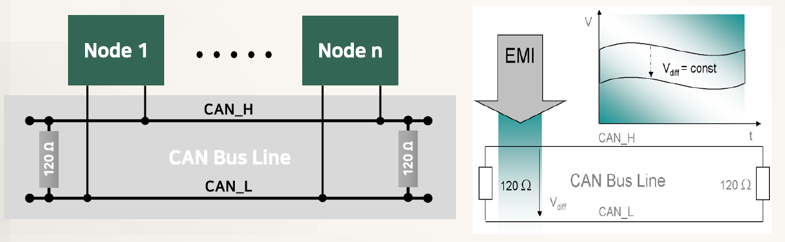

*그림 9. 양 끝에 종단 저항을 둔 CAN 버스와 전자기 간섭에 강한 차동 신호*

그림 9의 왼쪽에서 Node 1부터 Node n까지 모든 노드가 CAN_H와 CAN_L에 연결되고, 버스 양 끝에 120 Ω 저항이 있다. 줄의 한쪽 끝을 흔들면 파동이 반대쪽 끝에서 되돌아오듯이 전선의 신호도 끝에서 반사되는데, 선로의 특성 임피던스(약 120 Ω)와 같은 저항으로 끝을 막으면 에너지가 저항에서 흡수되어 반사가 생기지 않는다. 오른쪽은 외부의 전자기 간섭(EMI)이 꼬인 두 선에 똑같이 들어와도 두 선의 전압 차 $V_{diff}$는 일정하게 유지된다는 것을 보여 준다. 종단 저항의 원리와 계산은 3주차에서 자세히 다루었다.

CAN의 신호 레벨은 다음과 같이 정해진다.

- 두 가닥의 꼬임쌍선을 쓰고, 두 신호선 사이의 전압 차로 데이터를 나타낸다(**차동 신호 방식**, differential signaling).
- 데이터 0은 **우성(dominant)**, 데이터 1은 **열성(recessive)** 이다. 두 노드가 동시에 서로 다른 값을 보내면 버스는 우성이 되므로, 우성이 열성보다 우선순위가 높다.
- 수신기는 CAN_H와 CAN_L의 전압 차 $V_{diff} = V_{CAN\_H} - V_{CAN\_L}$가 0.9 V 이상(최대 약 5 V)이면 0(우성), 0.5 V 이하이면 1(열성)로 판단한다. 0.5 V와 0.9 V 사이는 어느 쪽으로도 보장되지 않는 여유 구간이다 [3].

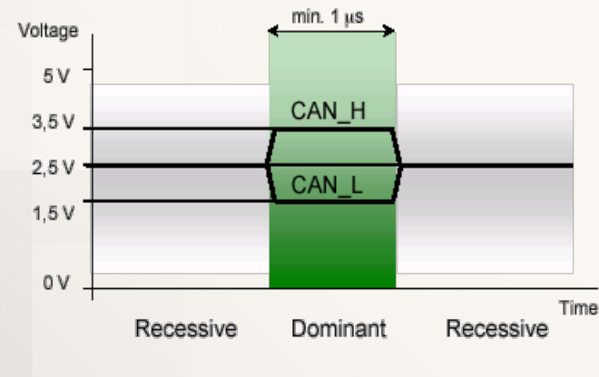

*그림 10. 열성과 우성 상태에서 CAN_H와 CAN_L의 전압*

그림 10에서 열성 상태의 CAN_H와 CAN_L은 모두 약 2.5 V이므로 $V_{diff} \approx 0$ V이다. 우성 상태에서는 CAN_H가 약 3.5 V로 올라가고 CAN_L이 약 1.5 V로 내려가므로 $V_{diff} \approx 2$ V이다. 위쪽의 "min. 1 µs"는 최고 속도 1 Mbit/s에서 한 비트가 차지하는 최소 시간이다.

> **참고:** 강의자료에 인용된 설명 가운데 CAN이 차동 맨체스터 부호(differential Manchester encoding)를 쓴다는 설명, 우성 전압은 +5 V에 가깝고 열성 전압은 0 V에 가깝다는 설명, CAN이 오류를 자동으로 정정한다는 설명은 사실과 다르다. CAN은 한 비트 시간 동안 레벨을 유지하는 NRZ 부호와 비트 스터핑을 쓰며 [1], 고속 CAN의 레벨은 그림 10과 같이 차동 전압으로 정해진다 [3]. 또 CAN은 오류를 검출하면 오류 프레임으로 알리고 송신 노드가 프레임을 다시 보낼 뿐, 오류를 정정하지는 않는다(3주차). NRZ는 비트마다 레벨 변화가 두 번 필요한 맨체스터 부호보다 같은 비트 전송률에서 신호 변화가 적고, 한 비트 내내 우성이나 열성이 유지되므로 우성이 열성을 이기는 중재와 ACK가 비트 전체에서 성립한다.

### 1.9 CAN 메시지 프레임과 DLC

CAN 메시지 프레임은 식별자의 길이에 따라 두 형식으로 나뉜다.

- **표준 CAN(Standard CAN, CAN 2.0A):** 11비트 식별자를 쓴다.
- **확장 CAN(Extended CAN, CAN 2.0B):** 29비트 식별자를 쓴다.

데이터 필드는 최대 8바이트이며, 제어 필드(control field)의 4비트 DLC(data length code)가 데이터 필드의 바이트 수를 나타낸다.

| DLC3 | DLC2 | DLC1 | DLC0 | 데이터 바이트 수 |
|:-----|:-----|:-----|:-----|:-----|
| 0 | 0 | 0 | 0 | 0 |
| 0 | 0 | 0 | 1 | 1 |
| 0 | 0 | 1 | 0 | 2 |
| 0 | 0 | 1 | 1 | 3 |
| 0 | 1 | 0 | 0 | 4 |
| 0 | 1 | 0 | 1 | 5 |
| 0 | 1 | 1 | 0 | 6 |
| 0 | 1 | 1 | 1 | 7 |
| 1 | 0 | 0 | 0 | 8 |

*표 5. DLC 값과 데이터 바이트 수*

DLC의 4비트로는 0\~15를 나타낼 수 있다. 고전 CAN에서 9\~15는 8바이트로 해석되며, CAN FD는 이 값들을 8바이트보다 긴 데이터 길이에 쓴다(2.3절) [4].

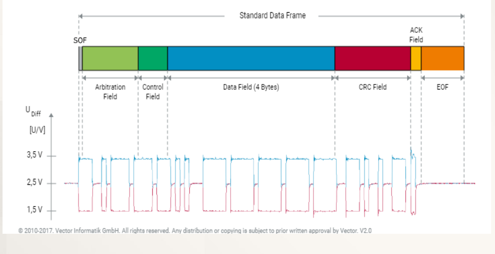

*그림 11. 4바이트 데이터를 담은 표준 데이터 프레임과 버스의 차동 전압 파형*

그림 11의 위쪽 띠는 표준 데이터 프레임을 SOF, 중재 필드, 제어 필드, 데이터 필드(4바이트), CRC 필드, ACK 필드, EOF로 나눈 것이고, 아래쪽은 같은 프레임이 버스에 실릴 때의 전압이다 [5]. 파란 선(CAN_H)은 2.5 V와 3.5 V 사이를, 빨간 선(CAN_L)은 2.5 V와 1.5 V 사이를 오가며, 두 선이 벌어진 구간이 우성 비트이다. EOF 뒤에는 두 선이 모두 2.5 V에 머무는 열성 유휴 상태가 이어진다. ACK 필드의 첫 비트는 송신 노드가 아니라 프레임을 받은 노드들이 우성으로 만들기 때문에, 그 구간의 파형 높이가 다른 구간과 조금 다르게 나타난다.

### 1.10 중재 필드와 식별자 우선순위

| 필드 | 비트 수 | 역할 |
|:-----|:-----|:-----|
| 식별자(identifier) | 11 또는 29 | 메시지의 고유 번호(ID)이며, 메시지의 우선순위를 정한다. |
| IDE(identifier extension) | 1 | 프레임이 표준 형식(우성)인지 확장 형식(열성)인지 나타낸다. |
| RTR(remote transmission request) | 1 | 프레임이 데이터 프레임(우성)인지 원격 프레임(열성)인지 나타낸다. |
| SRR(substitute remote request) | 1 | 확장 프레임(CAN 2.0B)에서 표준 프레임(CAN 2.0A)의 RTR 자리를 대신하는 비트이며, 항상 열성이다. |

*표 6. 중재와 관련된 필드*

```text
Standard (CAN 2.0A) : SOF | ID (11)      | RTR | IDE | r0 | DLC (4) | Data ...
Extended (CAN 2.0B) : SOF | Base ID (11) | SRR | IDE | ID extension (18) | RTR | r1 | r0 | DLC (4) | Data ...
```

*그림 12. 표준 형식과 확장 형식의 앞부분*

표준 형식에서 중재 필드는 식별자 11비트와 RTR이고 IDE는 제어 필드에 속한다. 확장 형식에서는 기본 식별자 11비트, SRR, IDE, 확장 식별자 18비트, RTR이 모두 중재 필드이다. 두 형식의 필드별 비트 수는 3주차에서 자세히 다루었다.

표준 형식의 식별자는 11비트이므로 16진수로 0x000\~0x7FF(10진수 0\~2047)를 나타낼 수 있다. **식별자 값이 낮을수록 우선순위가 높다.** 식별자를 MSB부터 한 비트씩 보내면서 0(우성)이 1(열성)을 이기므로, 처음으로 비트가 갈리는 자리에서 0을 가진 노드가 이기기 때문이다(3주차의 비트 단위 중재).

**예제 1.** 세 노드가 동시에 전송을 시작했다. 식별자는 Node 1이 0x65F(10진수 1631), Node 2가 0x67F(1663), Node 3이 0x659(1625)이다. 10진수 변환은 $0\text{x}65\text{F} = 6 \times 256 + 5 \times 16 + 15 = 1631$처럼 한다. 11비트 2진수는 0x65F가 110 0101 1111, 0x67F가 110 0111 1111, 0x659가 110 0101 1001이다.

```text
ID bit            10  9  8  7  6  5  4  3  2  1  0
Node 1 (0x65F)     1  1  0  0  1  0  1  1  1         -> loses at ID2
Node 2 (0x67F)     1  1  0  0  1  1                  -> loses at ID5
Node 3 (0x659)     1  1  0  0  1  0  1  1  0  0  1   -> wins
Bus                1  1  0  0  1  0  1  1  0  0  1
```

*그림 13. 식별자 0x65F, 0x67F, 0x659의 중재 과정*

1. **ID10\~ID6:** 세 노드의 비트가 1, 1, 0, 0, 1로 모두 같으므로 버스도 같은 값이 되고, 모두 전송을 계속한다.
2. **ID5:** Node 2만 1을 보내고 나머지는 0을 보낸다. 버스는 0이 되므로 1을 보내고 0을 읽은 Node 2가 중재에서 지고 수신 모드로 바뀐다.
3. **ID4, ID3:** Node 1과 Node 3이 모두 1을 보내므로 계속한다.
4. **ID2:** Node 1은 1, Node 3은 0을 보낸다. 버스는 0이 되므로 Node 1이 진다.
5. **ID1 이후:** Node 3만 남아 나머지 비트와 프레임을 보낸다. 결과는 가장 작은 값(1625)을 가진 Node 3의 승리이다.

**예제 2.** Node 1은 식별자 0x660(1632)의 데이터 프레임, Node 2는 0x659의 데이터 프레임을 보내고, Node 3은 Node 2와 같은 식별자 0x659를 보내되 RTR 자리에 1(열성)을 보낸다. 0x660은 110 0110 0000이다.

```text
ID bit            10  9  8  7  6  5  4  3  2  1  0  RTR
Node 1 (0x660)     1  1  0  0  1  1                       -> loses at ID5
Node 2 (0x659)     1  1  0  0  1  0  1  1  0  0  1   0    -> wins (data frame)
Node 3 (0x659)     1  1  0  0  1  0  1  1  0  0  1   1    -> loses at RTR
Bus                1  1  0  0  1  0  1  1  0  0  1   0
```

*그림 14. 같은 식별자에서 RTR 자리의 값으로 갈리는 중재*

Node 1은 ID5에서 1을 보내고 0을 읽어 진다. Node 2와 Node 3은 식별자 11비트가 모두 같아 ID0까지 승부가 나지 않고, RTR 자리에서 우성(0)을 보낸 Node 2가 열성(1)을 보낸 Node 3을 이긴다.

> **참고:** 강의자료는 RTR 자리가 1이면 확장 프레임이고 ID가 더 크다고 설명한다. RTR 자리의 열성 비트는 두 경우에 나타난다. 하나는 표준 형식의 원격 프레임(RTR = 1)이고, 다른 하나는 확장 프레임의 SRR(항상 1)이다. 프레임이 확장 형식인지는 그 뒤의 IDE 비트로 정해진다. 어느 경우든 같은 기본 식별자를 가진 표준 데이터 프레임은 그 자리에 0을 보내므로 이긴다. 즉 같은 식별자라면 데이터 프레임이 원격 프레임을 이기고, 같은 기본 식별자라면 표준 프레임이 확장 프레임을 이긴다 [1].

### 1.11 CRC 필드와 프레임 간 공간

**CRC 필드(cyclic redundancy check field)** 는 15비트 CRC 시퀀스와 1비트 CRC 구분자(delimiter)로 이루어진다. 송신 노드는 SOF부터 데이터 필드까지의 비트(스터핑 비트를 넣기 전의 비트)를 다음 생성 다항식으로 나눈 나머지를 CRC 시퀀스로 보낸다 [1].

$$
g(x) = x^{15} + x^{14} + x^{10} + x^{8} + x^{7} + x^{4} + x^{3} + 1
$$

이 다항식의 계수를 $x^{15}$부터 $x^0$까지 늘어놓으면 1100 0101 1001 1001(16비트)이다. CRC 구분자는 항상 열성이며, 그 뒤에 ACK 필드가 온다. 나눗셈으로 CRC를 계산하는 원리는 1.12절에서 작은 다항식으로 살펴본다.

**프레임 간 공간(interframe space, IFS)** 은 데이터 프레임이나 원격 프레임이 끝난 뒤 다음 프레임을 보내기 전까지의 대기 구간이다.

```text
... Frame | Intermission (3 bits) | Suspend Transmission (8 bits) | Bus Idle (any length) | Frame ...
          |<------------------------- interframe space ------------------------------->|
```

*그림 15. 프레임 간 공간의 구성*

- **인터미션(intermission):** 열성 3비트이다. 이 동안에는 어떤 노드도 데이터 프레임이나 원격 프레임을 시작할 수 없고, 과부하 상태만 알릴 수 있다.
- **전송 유보(suspend transmission):** 오류 수동 상태(3주차)인 노드가 방금 프레임을 보냈다면, 다시 보내기 전에 열성 8비트를 더 기다린다. 오류가 잦은 노드가 버스를 연달아 차지하지 못하게 하는 장치이다.
- **버스 유휴(bus idle):** 길이가 정해지지 않은 열성 구간이다. 보낼 것이 있는 노드는 이 구간에서 SOF를 보내 전송을 시작한다.

오류 프레임과 과부하 프레임(2.2절) 앞에는 프레임 간 공간이 오지 않는다 [1].

### 1.12 CRC 계산과 검산

> **용어 정의:** **CRC(cyclic redundancy check, 순환 중복 검사)** 는 보낼 비트 열을 생성 다항식(generator polynomial)으로 나눈 나머지를 덧붙여 보내고, 수신 측이 같은 다항식으로 나누어 나머지가 0인지로 오류를 검출하는 방법이다.

CRC의 나눗셈은 **모듈로 2 연산(modulo-2 arithmetic)** 으로 한다. 자리올림과 자리내림이 없고, 덧셈과 뺄셈이 모두 배타적 논리합(XOR)이다($0 \oplus 0 = 0$, $0 \oplus 1 = 1$, $1 \oplus 0 = 1$, $1 \oplus 1 = 0$). 비트 열은 각 비트를 계수로 하는 다항식으로 본다. 예를 들어 1101은 $x^3 + x^2 + 1$이다.

**CRC 계산.** 생성 다항식 $g(x) = x^3 + x^2 + 1$(1101)로 데이터 $k(x) = x^3 + 1$(1001)의 CRC를 구한다.

1. $g(x)$의 가장 높은 차수는 3이므로, $k(x)$에 $x^3$을 곱한다. $f(x) = x^3 k(x) = x^6 + x^3$이며, 2진수로는 데이터 뒤에 0을 세 개 붙인 1001000이다.
2. $f(x)$를 $g(x)$로 나눈다. 남은 비트 열의 첫 비트가 1이면 그 자리에 1101을 맞추어 XOR하고, 0이면 다음 자리로 넘어간다. 이렇게 하면 매번 맨 앞 비트가 0이 된다.
3. 마지막에 남는 3비트(생성 다항식의 차수만큼)가 CRC이다.

```text
          1111            <- quotient
      ---------
1101 ) 1001000
       1101
       ----
        1000
        1101
        ----
         1010
         1101
         ----
          1110
          1101
          ----
           011            <- remainder = CRC
```

*그림 16. 1001000을 1101로 나누는 모듈로 2 나눗셈*

각 단계를 따라가면 다음과 같다. 1001 XOR 1101 = 0100이고 다음 비트 0을 내려 1000이 된다. 1000 XOR 1101 = 0101이고 다음 비트 0을 내려 1010이 된다. 1010 XOR 1101 = 0111이고 마지막 비트 0을 내려 1110이 된다. 1110 XOR 1101 = 0011이므로 나머지는 011이다. 송신 측은 데이터 1001 뒤에 CRC 011을 붙여 **1001011**을 보낸다.

**CRC 검산.** 수신 측은 받은 비트 열 $1001011$, 즉 $x^6 + x^3 + x + 1$을 같은 생성 다항식으로 나눈다. 나머지가 0이면 오류가 없다고 판단하고, 0이 아니면 오류로 판단한다.

```text
          1111
      ---------
1101 ) 1001011
       1101
       ----
        1000
        1101
        ----
         1011
         1101
         ----
          1101
          1101
          ----
           000            <- remainder 0: no error detected
```

*그림 17. 오류 없이 받은 1001011의 검산*

전송 중에 왼쪽에서 세 번째 비트가 뒤집혀 1011011을 받았다면 나머지가 0이 아니다.

```text
          1100
      ---------
1101 ) 1011011
       1101
       ----
        1100
        1101
        ----
         0011
         0000
         ----
          0111
          0000
          ----
           111            <- remainder not 0: error detected
```

*그림 18. 한 비트가 뒤집힌 1011011의 검산*

이 방법이 성립하는 까닭은 다음과 같다. $f(x) = x^3 k(x)$를 $g(x)$로 나눈 몫을 $q(x)$, 나머지를 $r(x)$라 하면 $f(x) = q(x) g(x) + r(x)$이다. 모듈로 2에서는 덧셈과 뺄셈이 같으므로 송신한 비트 열 $f(x) + r(x) = q(x) g(x)$는 $g(x)$로 나누어떨어진다. 전송 중에 오류 패턴 $e(x)$가 더해지면 수신한 비트 열의 나머지는 $e(x)$를 $g(x)$로 나눈 나머지가 된다. 위의 예에서 $e(x) = x^4$(0010000)이고, $x^4 = x \cdot x^3$에 $x^3 = x^2 + 1$(모듈로 $g(x)$)을 대입하면 $x^3 + x = x^2 + x + 1$이므로 나머지 111과 일치한다. $g(x)$로 나누어떨어지는 오류 패턴만 검출하지 못하므로, CAN처럼 15차 다항식을 쓰면 대부분의 오류를 검출한다.

> **[컴퓨터네트워크]** CRC는 이더넷을 비롯한 대부분의 링크 계층 프로토콜이 쓰는 오류 검출 방법이다. 생성 다항식의 차수가 $r$이면 CRC는 $r$비트이고, 생성 다항식의 상수항이 1이면 길이가 $r$ 이하인 연속 오류(burst error)는 모두 검출된다. CRC의 원리는 7주차에서도 다루었다.

---

<br>

## 2. CAN 통신 실습 준비

이 절은 실습 화면을 해석하는 데 필요한 지식을 정리한다. CAN 프레임의 필드와 종류, CAN FD와 OBD-II, CAN 노드와 모니터링 장비의 구성, 신호선 연결, 그리고 CAN 데이터를 의미 있는 값으로 바꾸는 CAN DB와 Factor, Offset을 다룬다.

### 2.1 CAN 프레임의 필드

| 필드 | 비트 수 | 역할 |
|:-----|:-----|:-----|
| SOF(start of frame) | 1 | 메시지의 시작을 표시하는 우성 비트이다. 유휴 상태 뒤의 첫 하강 에지에서 모든 노드가 동기를 맞춘다. |
| 식별자(identifier) | 11 | 메시지의 종류와 우선순위를 정하며, 2진 값이 낮을수록 우선순위가 높다. |
| RTR(remote transmission request) | 1 | 데이터 프레임(0)과 원격 프레임(1)을 구분한다. |
| IDE(identifier extension) | 1 | 표준 프레임(0)과 확장 프레임(1)을 구분한다. |
| r0 | 1 | 예약 비트(reserved bit)이다. |
| DLC(data length code) | 4 | 데이터 필드의 바이트 수이다. |
| 데이터(data) | 0\~64 | 0\~8바이트의 데이터이다. |
| CRC(cyclic redundancy check) | 15 + 1 | 15비트 CRC 시퀀스와 1비트 구분자로, 합하여 16비트이다. |
| ACK(acknowledgement) | 1 + 1 | 수신 확인 슬롯과 구분자이다. 프레임을 올바르게 받은 노드가 슬롯을 우성으로 덮어써 수신을 확인한다. |
| EOF(end of frame) | 7 | 열성 7비트로 프레임의 끝을 표시한다. |
| IFS(interframe space) | 3 이상 | 다음 프레임까지의 대기 구간이다(1.11절). |

*표 7. 표준 CAN 데이터 프레임의 필드*

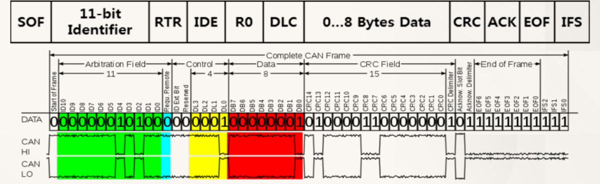

*그림 19. 표준 CAN 프레임의 필드별 비트 값과 CAN_H, CAN_L 파형*

그림 19는 한 표준 데이터 프레임의 비트를 필드별로 적은 것이다. SOF는 0, 식별자(초록)는 00000010100으로 0x014, RTR(하늘색), IDE, r0은 모두 0, DLC(노랑)는 0001로 1바이트, 데이터(빨강)는 00000001로 0x01이다. 그 뒤로 15비트 CRC, CRC 구분자 1, ACK 슬롯 0(수신 노드가 우성으로 덮어쓴 값), ACK 구분자 1, EOF 1111111, IFS 111이 이어진다. 아래 파형에서 색칠한 구간은 CAN_H와 CAN_L이 벌어진 우성 비트이고, 그 밖의 구간은 두 선이 모인 열성 비트이다.

> **주의:** 그림 19는 스터핑 비트를 넣기 전의 비트 열이다. 실제 버스에서는 SOF의 0과 식별자의 앞 네 비트 0000이 이어져 같은 값이 다섯 개가 되므로, 그 뒤에 반대 값인 1이 스터핑 비트로 들어간다(3주차의 비트 스터핑). 3.4절에서 실제로 보낸 프레임의 스터핑 비트 위치를 계산한다.

### 2.2 CAN 프레임의 종류

CAN에는 네 종류의 프레임이 있다.

| 종류 | 역할 | 구성 |
|:-----|:-----|:-----|
| 데이터 프레임(data frame) | 송신 노드가 하나 또는 여러 수신 노드에게 데이터를 보낸다. | 2.1절의 필드로 이루어진다. |
| 원격 프레임(remote frame) | 수신 노드가 특정 식별자의 데이터를 보내 달라고 송신 노드에게 요청한다. | 데이터 프레임과 같되 RTR이 열성이고 데이터 필드가 없다. DLC는 요청하는 데이터의 길이를 나타낸다. |
| 오류 프레임(error frame) | 오류를 검출한 노드가 그 프레임에 오류가 있음을 모든 노드에 알린다. | 오류 플래그(오류 활성 노드는 우성 6비트, 오류 수동 노드는 열성 6비트)와 오류 구분자(열성 8비트)로 이루어진다. |
| 과부하 프레임(overload frame) | 수신 노드가 다음 프레임을 받을 준비가 되지 않았을 때, 데이터 프레임이나 원격 프레임 사이의 대기 시간을 늘린다. | 과부하 플래그(우성 6비트)와 과부하 구분자(열성 8비트)로 이루어진다. |

*표 8. CAN 프레임의 네 가지 종류*

오류 활성 노드의 오류 플래그는 우성 비트 6개를 연달아 보내 비트 스터핑 규칙(같은 값은 5개까지)을 일부러 어긴다. 그래서 그 순간 프레임을 받던 다른 모든 노드도 스터핑 오류를 검출하고 그 프레임을 버리게 되며, 송신 노드는 프레임을 다시 보낸다 [1]. 원격 프레임은 같은 식별자의 데이터 프레임과 중재하면 진다(1.10절의 예제 2). 오늘날 차량에서는 각 ECU가 정해진 주기로 데이터 프레임을 보내는 방식이 주로 쓰이며, CAN FD에는 원격 프레임이 없다 [4].

### 2.3 CAN FD

> **용어 정의:** **CAN FD(CAN with Flexible Data-Rate)** 는 고전 CAN의 중재 방식을 그대로 두고, 데이터 필드를 최대 64바이트까지 늘리며 데이터를 보내는 구간에서만 비트 전송률을 높인 CAN의 확장 규격이다. Bosch가 2012년에 규격 1.0을 발표했고 [2], ISO 11898-1:2015에 포함되었다 [4].

CAN FD의 특징은 다음과 같다.

- 전송 가능한 데이터의 수를 최대 8바이트에서 64바이트까지 늘렸다.
- 데이터를 보내는 영역(데이터 단계)에서만 전송 속도를 높이며, 이 영역에서는 1 Mbit/s 이상의 속도를 쓸 수 있다.

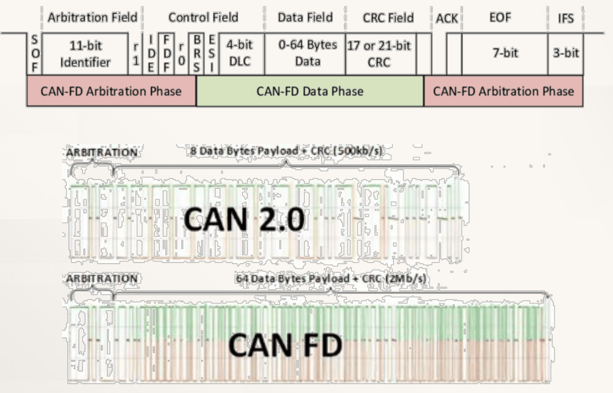

*그림 20. CAN FD 프레임의 구조와 CAN 2.0 프레임과의 비교*

그림 20의 위쪽은 CAN FD 프레임의 구조이다. SOF, 11비트 식별자, r1, IDE, EDL, r0, BRS, ESI, 4비트 DLC, 0\~64바이트 데이터, 17비트 또는 21비트 CRC, ACK, EOF 7비트, IFS 3비트가 차례로 온다. 새로 생긴 비트의 뜻은 다음과 같다.

- **EDL(extended data length):** 열성이면 CAN FD 프레임임을 나타낸다. ISO 규격에서는 FDF(FD format)라 부른다. 고전 CAN 프레임에서는 이 자리가 예약 비트 r0(우성)이다.
- **r1:** 고전 CAN의 RTR 자리이다. CAN FD에는 원격 프레임이 없으므로 항상 우성이며, ISO 규격에서는 RRS(remote request substitution)라 부른다.
- **BRS(bit rate switch):** 열성이면 BRS 비트의 표본점부터 CRC 구분자의 표본점까지를 더 높은 데이터 비트 전송률로 보낸다(표본점은 3.3절).
- **ESI(error state indicator):** 송신 노드가 오류 활성(우성)인지 오류 수동(열성)인지 알린다.
- **CRC:** 데이터가 16바이트 이하이면 17비트, 16바이트를 넘으면 21비트이다. 데이터가 길어진 만큼 더 긴 CRC로 검출 능력을 유지한다.

그림의 색 띠는 프레임을 두 단계로 나눈다. 중재 단계(CAN-FD Arbitration Phase)는 SOF부터 BRS까지와 ACK 이후이며, 고전 CAN과 같은 비트 전송률을 쓴다. 데이터 단계(CAN-FD Data Phase)는 BRS 뒤부터 CRC까지이며, 더 높은 비트 전송률을 쓴다. 데이터 단계에서만 속도를 높일 수 있는 까닭은 1.7절의 거리 제약에 있다. 중재와 ACK에서는 여러 노드가 같은 비트를 동시에 보내므로 비트 시간 안에 신호가 버스를 왕복해야 하지만, 데이터 단계에서는 중재에서 이긴 노드 하나만 보내므로 이 제약이 없다. 그림의 아래쪽은 500 kbit/s로 8바이트를 보내는 CAN 2.0 프레임과, 데이터 단계를 2 Mbit/s로 보내는 64바이트 CAN FD 프레임을 비교한 것으로, CAN FD가 8배의 데이터를 크게 다르지 않은 시간에 보낸다는 것을 보여 준다.

| DLC | 0\~8 | 9 | 10 | 11 | 12 | 13 | 14 | 15 |
|:-----|:-----|:-----|:-----|:-----|:-----|:-----|:-----|:-----|
| 데이터 바이트 수 | DLC와 같음 | 12 | 16 | 20 | 24 | 32 | 48 | 64 |

*표 9. CAN FD의 DLC와 데이터 바이트 수*

CAN FD의 상세한 프레임 형식은 9주차에서 다루었다.

### 2.4 OBD-II

> **용어 정의:** **OBD-II(On-Board Diagnostics II)** 는 차량의 고장 진단을 위한 표준 규격이다. 차량 운전석 쪽에 있는 16핀 OBD 커넥터에 진단 장비를 연결하여 차량 상태와 고장 코드를 읽으며, 정비소에서 차량을 진단할 때 쓴다. CAN을 이용하는 OBD-II 통신은 ISO 15765-4가 정한다.

OBD-II는 배출 가스 관련 고장을 감시하기 위해 의무화되었으며, 미국은 1996년형 승용차부터, 유럽연합은 휘발유차는 2001년부터 경유차는 2004년부터 의무화했다. 미국에서는 2008년형부터 OBD-II 통신에 CAN(ISO 15765-4)을 쓰는 것이 의무이다 [6]. OBD-II로 읽을 수 있는 차량 상태 정보에는 엔진 회전수(RPM), 차속, 배터리 전압, 고장 코드(DTC, diagnostic trouble code), 냉각수 온도 등이 있다.

OBD-II의 CAN 통신은 요청과 응답으로 이루어진다. 진단 장비가 식별자 0x7DF로 요청 데이터 프레임을 보내면, 해당 정보를 가진 ECU가 0x7E8\~0x7EF의 식별자로 응답 데이터 프레임을 보낸다. 요청하는 정보는 서비스(mode) 번호와 PID(parameter identifier)로 지정한다 [6], [7].

**예제.** 엔진 회전수를 읽는다. 엔진 회전수는 서비스 0x01의 PID 0x0C이다.

```text
request  ID 0x7DF  data: 02 01 0C 00 00 00 00 00   (2 bytes follow: service 0x01, PID 0x0C)
response ID 0x7E8  data: 04 41 0C 1A F8 00 00 00   (4 bytes follow: 0x41 = 0x01 + 0x40, PID 0x0C, A = 0x1A, B = 0xF8)
```

응답의 첫 바이트 04는 뒤따르는 유효 바이트의 수이고, 0x41은 서비스 0x01에 대한 긍정 응답(0x01 + 0x40)이며, 0x0C는 요청한 PID이다. 엔진 회전수는 $(256A + B)/4$로 계산하므로 $A = 0\text{x}1\text{A} = 26$, $B = 0\text{xF}8 = 248$을 넣으면 $(256 \times 26 + 248)/4 = (6656 + 248)/4 = 6904/4 = 1726$ rpm이다 [7]. 요청 프레임의 남은 바이트는 길이를 8바이트로 맞추기 위한 채움 값이다.

> **참고:** 강의자료는 OBD-II가 CAN 원격 프레임을 활용하여 차량 상태 정보를 받는다고 설명하지만, ISO 15765-4에 따른 OBD-II 통신은 위와 같이 요청과 응답 모두 데이터 프레임을 쓴다. 원격 프레임은 데이터를 담을 수 없으므로 어떤 서비스와 PID를 원하는지 전달할 수 없다.

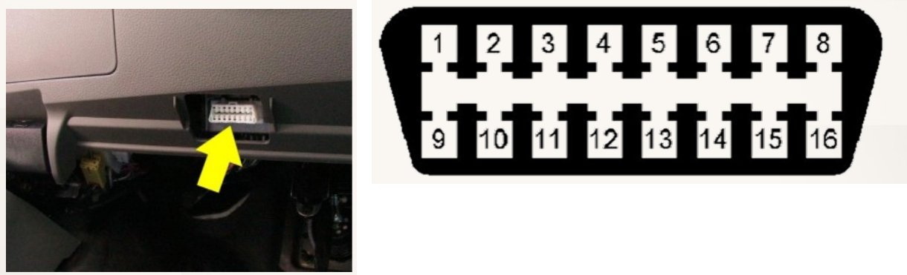

*그림 21. 운전석 아래의 OBD-II 커넥터와 16핀 배치*

| 핀 | 설명 | 핀 | 설명 |
|:-----|:-----|:-----|:-----|
| 1 | 제조사 선택(vendor option) | 9 | 제조사 선택 |
| 2 | J1850 Bus+ | 10 | J1850 Bus- |
| 3 | 제조사 선택 | 11 | 제조사 선택 |
| 4 | 차체 접지(chassis ground) | 12 | 제조사 선택 |
| 5 | 신호 접지(signal ground) | 13 | 제조사 선택 |
| 6 | CAN High(J-2284) | 14 | CAN Low(J-2284) |
| 7 | ISO 9141-2 K-Line | 15 | ISO 9141-2 L-Line |
| 8 | 제조사 선택 | 16 | 배터리 전원 |

*표 10. OBD-II 커넥터의 핀 배치*

CAN을 쓰는 차량은 6번 핀(CAN High)과 14번 핀(CAN Low)으로 진단 장비와 통신한다. J1850과 ISO 9141-2는 CAN 이전에 쓰이던 진단 통신 방식이며(3주차), 16번 핀의 배터리 전원 덕분에 진단 장비는 별도 전원 없이 동작할 수 있다.

### 2.5 CAN 노드의 구성

CAN 노드는 실제 CAN 통신을 수행하는 IC를 포함하며, 세 부분으로 이루어진다.

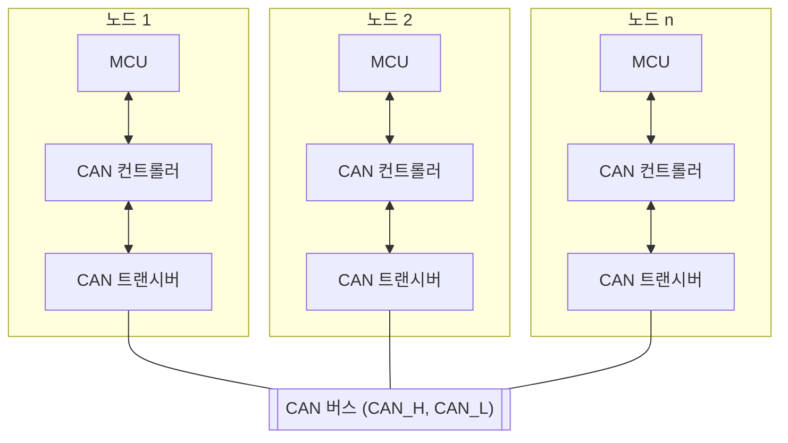

*그림 22. MCU, CAN 컨트롤러, CAN 트랜시버로 이루어진 CAN 노드*

- **MCU(microcontroller unit):** 응용 프로그램을 실행하여 보낼 데이터를 만들고 받은 데이터를 처리한다.
- **CAN 컨트롤러(CAN controller):** 프레임의 구성과 해석, 비트 스터핑, CRC 계산, 중재, 수신 확인, 오류 처리 같은 데이터 링크 계층의 일을 하드웨어로 처리한다.
- **CAN 트랜시버(CAN transceiver):** 컨트롤러의 논리 신호(Tx, Rx)를 CAN_H와 CAN_L의 차동 전압으로 바꾸고, 반대로 버스의 차동 전압을 논리 신호로 바꾼다. 고속 CAN 트랜시버의 전기적 특성은 ISO 11898-2가 정한다 [3].

실습에 쓰는 USB 방식의 CAN 인터페이스 장치(Kvaser, Vector)도 내부에 CAN 컨트롤러와 트랜시버를 갖춘 하나의 CAN 노드이며, MCU의 역할은 USB로 연결된 PC의 소프트웨어가 맡는다. 노드의 내부 구조는 3주차에서 자세히 다루었다.

### 2.6 CAN 모니터링 장비와 연결 구성

CAN 정보를 모니터링하려면 CAN 데이터를 받아 PC에 표시할 수 있는 장비가 필요하다. 실습에서는 두 가지 장비를 쓴다.

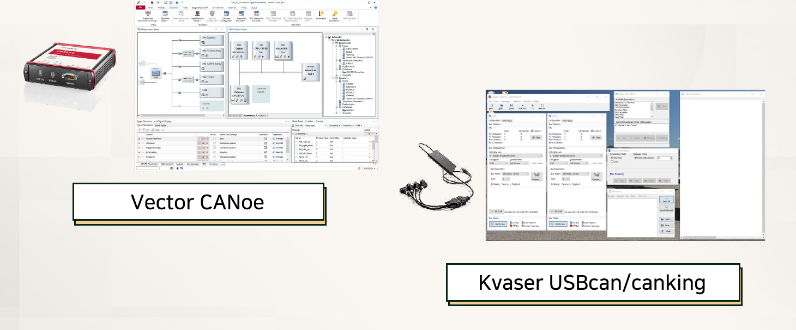

*그림 23. CAN 모니터링 장비와 소프트웨어: Vector CANoe와 Kvaser USBcan, CanKing*

- **Vector CANoe:** Vector Informatik의 차량 네트워크 개발과 시험용 소프트웨어이며, 같은 회사의 CAN 인터페이스 하드웨어(그림 23의 빨간 장치)와 함께 쓴다. 실시간 모니터링, 신호 해석, 그래프, 기록과 재생, 네트워크 시뮬레이션을 지원하고, 사용하려면 라이선스가 필요하다.
- **Kvaser USBcan과 CanKing:** Kvaser의 USB-CAN 인터페이스 장치(그림 23의 검은 케이블형 장치)와 이를 위한 소프트웨어 CanKing이다. CAN 프레임을 직접 만들어 보내고 받은 프레임을 표시하는 기본 기능을 제공한다.


*그림 24. 차량의 CAN 정보를 PC로 가져오는 연결 구성*

인터페이스 장치는 차량의 CAN 버스에 노드로 참여하여 프레임을 받고, 받은 프레임을 USB로 PC에 전달한다. PC의 소프트웨어는 이 프레임을 표시하거나 해석하고, 반대로 프레임을 만들어 장치를 통해 버스로 보낼 수도 있다.

### 2.7 신호선 연결과 종단 저항

CAN은 두 가닥의 전선만 있으면 연결할 수 있으며, 장비 사이의 연결에는 보통 **D-sub 9핀(DB-9) 커넥터**를 쓴다.

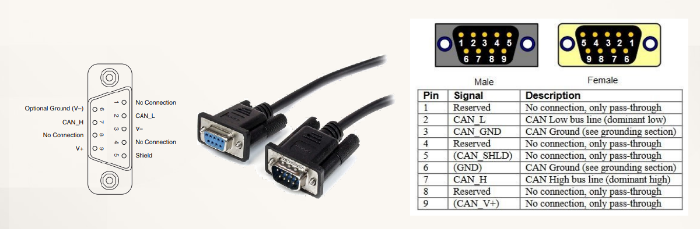

*그림 25. CAN용 DB-9 커넥터의 핀 배치와 케이블*

| 핀 | 신호 | 설명 |
|:-----|:-----|:-----|
| 1, 4, 8 | 예약(reserved) | 연결하지 않는다. |
| 2 | CAN_L | 버스의 CAN Low 선(우성일 때 낮아짐)이다. |
| 3 | CAN_GND | CAN 접지이다. |
| 5 | (CAN_SHLD) | 선택적인 케이블 차폐이다. |
| 6 | (GND) | 선택적인 접지이다. |
| 7 | CAN_H | 버스의 CAN High 선(우성일 때 높아짐)이다. |
| 9 | (CAN_V+) | 선택적인 외부 전원이다. |

*표 11. CAN용 DB-9 커넥터의 핀 배치*

표 11은 CiA 303-1의 권고를 따른 것이며, 괄호 안의 신호는 선택 사항이다 [8]. 그림 25의 왼쪽은 이 배치를 커넥터 그림으로, 가운데는 DB-9 케이블을, 오른쪽은 수(male) 커넥터와 암(female) 커넥터의 핀 번호와 각 핀의 설명을 보여 준다. 수 커넥터와 암 커넥터는 마주 보고 끼우므로 핀 번호가 좌우로 뒤집혀 있다.

전송 매체로는 일반적인 전선 두 가닥을 꼬아서 쓴다.

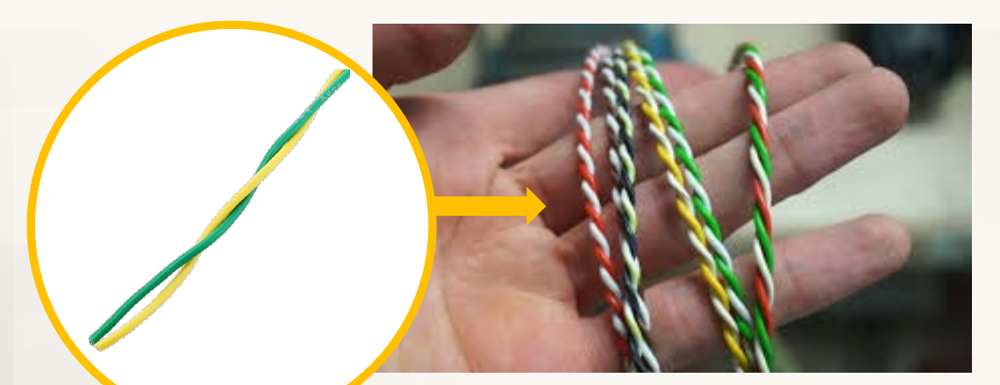

*그림 26. 두 가닥을 꼬아 만든 CAN 전송 매체*

두 선을 꼬면 두 선이 공간적으로 번갈아 자리를 바꾸므로 외부 간섭이 두 선에 거의 똑같이 들어오고, 차동 수신기에서 상쇄된다(그림 9). 또 두 선에 반대 방향으로 흐르는 전류가 만드는 자기장이 서로 상쇄되어 CAN 선 자체가 내보내는 전자기 잡음도 줄어든다. 차량의 CAN 배선이 꼬인 두 선(대개 서로 다른 색)으로 이루어진 것은 이 때문이다.

종단 저항은 CAN_H와 CAN_L 신호선 사이에 120 Ω 저항을 연결하여 만든다. 실습 장비처럼 DB-9 커넥터로 연결하는 경우에는 120 Ω 저항이 내장된 DB-9 커넥터(종단 어댑터)를 버스 끝에 끼워 쓴다.

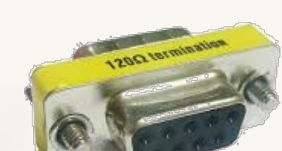

*그림 27. 120 Ω 저항이 내장된 DB-9 종단 어댑터*

> **주의:** 종단 저항은 버스의 양 끝 두 곳에만 둔다. 전원을 끈 상태에서 CAN_H와 CAN_L 사이의 저항을 재면 정상 버스는 두 120 Ω의 병렬 합성인 약 60 Ω이다. 약 120 Ω이면 종단 저항 하나가 빠진 것이고, 저항이 너무 크면 반사 때문에, 너무 작으면 차동 전압이 부족해서 통신이 불안정해진다(3주차).

### 2.8 CAN DB와 DBC 파일

CAN 신호를 그대로 수신하면 식별자와 데이터 바이트가 16진수로만 표시되므로, 어느 바이트에 어떤 정보가 들어 있는지 확인하기 어렵다. 이를 해결하는 것이 CAN DB이다.

> **용어 정의:** **CAN DB(CAN database)** 는 식별자별로 데이터 프레임이 담는 정보(메시지 이름, 시그널의 위치와 길이, 변환 방법, 단위 등)를 정리한 데이터베이스이다. **DBC 파일(CAN dbc 파일)** 은 Vector사가 만든 CAN DB 정보 파일 형식이며, 사실상 업계 표준으로 쓰인다.

차량마다 서로 다른 CAN DB를 가질 수 있으며, 그 정보는 제조사의 자산이므로 일반적으로 공개되지 않는다.

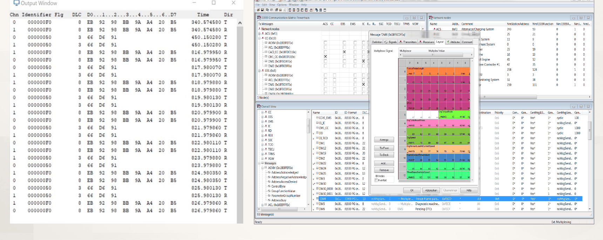

*그림 28. 16진수로 표시된 원시 CAN 데이터와 CAN DB 편집 화면*

그림 28의 왼쪽은 CAN DB 없이 받은 프레임 목록이다. 열은 채널(Chn), 식별자(Identifier), 플래그(Flg), DLC, 데이터 바이트 D0\~D7, 시각(Time), 방향(Dir, T는 송신, R은 수신)이며, 식별자 0x0F0, 0x050 같은 프레임이 주기적으로 반복되지만 각 바이트의 의미는 알 수 없다. 오른쪽은 Vector의 CAN DB 편집기(CANdb++ Editor) 화면으로, 메시지와 시그널의 목록, 시그널이 데이터 필드의 어느 비트를 차지하는지 색으로 보여 주는 배치 화면이 보인다.

DBC 파일은 텍스트 파일이다. 2.10절의 메시지 vehicle_status2(식별자 0x301)와 그 시그널 longitudinal_acceleration을 DBC 문법으로 쓰면 다음과 같다 [9].

```text
BO_ 769 vehicle_status2: 8 Vector__XXX
 SG_ longitudinal_acceleration : 0|16@1+ (0.01,-10.23) [-10.23|10.23] "m/s^2" Vector__XXX
```

- `BO_ 769 vehicle_status2: 8 Vector__XXX`: 메시지 정의이다. 식별자를 10진수로 쓰므로 769는 0x301이고, 이름은 vehicle_status2, 데이터 길이는 8바이트이며, Vector__XXX는 송신 노드를 정하지 않았다는 뜻이다.
- `SG_ longitudinal_acceleration :`: 이 메시지에 속한 시그널의 이름이다.
- `0|16`: 시작 비트가 0이고 길이가 16비트이다.
- `@1+`: `@1`은 Intel(리틀 엔디안) 바이트 순서이고(`@0`이면 Motorola), `+`는 부호 없는 값이다(`-`이면 부호 있는 값).
- `(0.01,-10.23)`: Factor가 0.01, Offset이 -10.23이다(2.10절).
- `[-10.23|10.23]`: 물리값의 최솟값과 최댓값이다.
- `"m/s^2"`와 마지막 `Vector__XXX`: 단위와 수신 노드이다.

### 2.9 메시지와 시그널

> **용어 정의:** **메시지(message)** 는 CAN 통신에서 고유한 식별자를 가지는 하나의 데이터 프레임이다. **시그널(signal)** 은 CAN을 통해 전송하려는 개별 정보(속도, 가속도, 스위치 상태 등)이며, 하나의 메시지에 여러 시그널이 들어갈 수 있다.

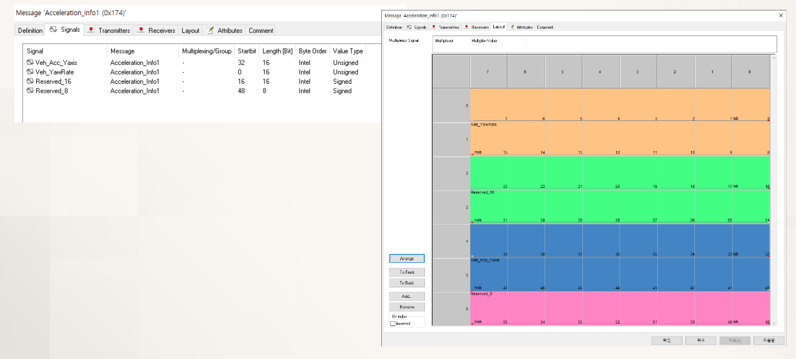

*그림 29. CAN DB 편집기에서 본 메시지 Acceleration_Info1의 시그널 목록과 배치*

그림 29의 왼쪽은 메시지 Acceleration_Info1(식별자 0x174)의 시그널 목록이고, 오른쪽은 각 시그널이 8바이트 데이터 필드의 어느 비트를 차지하는지 색으로 표시한 배치(Layout) 화면이다. 배치 화면의 행은 바이트 0\~7, 열은 각 바이트 안의 비트 7\~0이다.

| 시그널 | 시작 비트 | 길이(비트) | 바이트 순서 | 값의 형식 |
|:-----|:-----|:-----|:-----|:-----|
| Veh_YawRate | 0 | 16 | Intel | 부호 없음(unsigned) |
| Reserved_16 | 16 | 16 | Intel | 부호 있음(signed) |
| Veh_Acc_Yaxis | 32 | 16 | Intel | 부호 없음(unsigned) |
| Reserved_8 | 48 | 8 | Intel | 부호 있음(signed) |

*표 12. 메시지 Acceleration_Info1의 시그널 정의*

시그널 정의의 각 항목은 다음 뜻이다.

- **시작 비트(start bit)와 길이:** 시그널이 데이터 필드의 몇 번째 비트에서 시작하여 몇 비트를 차지하는지 나타낸다. 비트 번호는 바이트 0의 비트 0을 0으로 하여 바이트 1의 비트 0이 8, 바이트 2의 비트 0이 16인 식으로 센다. 따라서 Veh_YawRate는 바이트 0\~1, Reserved_16은 바이트 2\~3, Veh_Acc_Yaxis는 바이트 4\~5, Reserved_8은 바이트 6을 차지한다.
- **바이트 순서(byte order):** 여러 바이트에 걸친 시그널을 리틀 엔디안(Intel)으로 읽을지 빅 엔디안(Motorola)으로 읽을지 정한다(1.4절).
- **값의 형식(value type):** 비트 열을 부호 없는 정수로 읽을지, 2의 보수로 나타낸 부호 있는 정수로 읽을지 정한다.

이름이 Reserved인 시그널은 지금은 쓰지 않고 이후 기능을 위해 남겨 둔 자리이다. 표 12의 메시지는 바이트 7을 쓰지 않으므로 8바이트 가운데 7바이트에 네 개의 시그널이 들어 있다.

### 2.10 메시지 변환: Factor와 Offset

CAN 데이터 프레임은 최대 8바이트까지만 보낼 수 있으므로 보낼 수 있는 데이터가 제한된다. 그래서 실수 값을 그대로 보내지 않고 **Factor**와 **Offset**으로 정수로 바꾸어 보내며, 이렇게 하면 같은 프레임에 더 많은 시그널을 담을 수 있어 네트워크 효율이 높아진다.

> **용어 정의:** 버스에 실리는 정수를 **원시값(raw value)**, 실제 단위를 가진 값을 **물리값(physical value)** 이라 한다. 둘은 다음 1차 함수로 변환한다.

$$
\text{물리값} = \text{원시값} \times \text{Factor} + \text{Offset}, \qquad \text{원시값} = \frac{\text{물리값} - \text{Offset}}{\text{Factor}}
$$

예를 들어 가속도 데이터는 소수를 포함하므로 프로그램에서는 double형으로 표현되어 8바이트가 필요하다. Factor와 Offset으로 값을 unsigned short형(0\~65535)의 표현 범위에 들어오게 바꾸면 2바이트만 쓰면 된다. 8바이트 데이터 필드 하나에 double 값은 하나밖에 넣을 수 없지만, 2바이트 원시값은 네 개까지 넣을 수 있다.

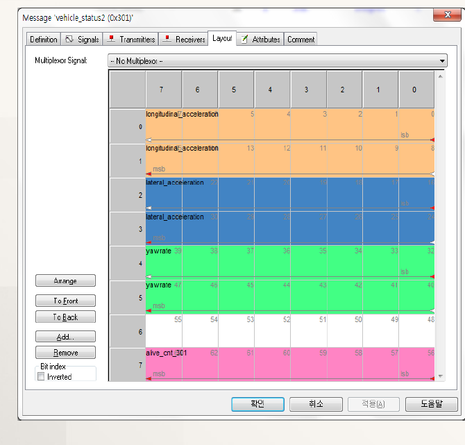

*그림 30. 메시지 vehicle_status2의 시그널 배치와 데이터 바이트의 해석*

그림 30은 메시지 vehicle_status2(식별자 0x301)의 배치이다. 바이트 0\~1에 longitudinal_acceleration(종방향 가속도), 바이트 2\~3에 lateral_acceleration(횡방향 가속도), 바이트 4\~5에 yawrate(요 레이트, 차가 수직축을 중심으로 회전하는 각속도), 바이트 7에 alive_cnt_301이 있고, 바이트 6은 비어 있다. 이 메시지의 데이터 바이트가 A1 43 C3 43 E5 43 A7 43일 때, 각 시그널은 Intel 순서이므로 낮은 바이트가 앞에 온다.

| 시그널 | 바이트 | 원시값(16진수) | 원시값(10진수) |
|:-----|:-----|:-----|:-----|
| longitudinal_acceleration | A1 43 | 0x43A1 (0100 0011 1010 0001) | 17313 |
| lateral_acceleration | C3 43 | 0x43C3 (0100 0011 1100 0011) | 17347 |
| yawrate | E5 43 | 0x43E5 (0100 0011 1110 0101) | 17381 |

*표 13. vehicle_status2의 데이터 바이트에서 읽은 원시값*

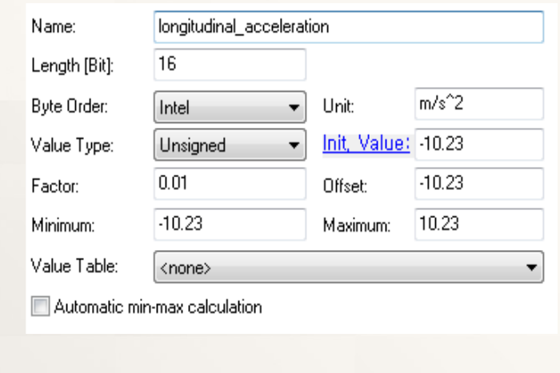

*그림 31. 시그널 longitudinal_acceleration의 정의*

그림 31의 정의에 따르면 longitudinal_acceleration은 길이 16비트, Intel 바이트 순서, 부호 없는 값이며, Factor는 0.01, Offset은 -10.23, 단위는 m/s², 최솟값은 -10.23, 최댓값은 10.23이다. 초깃값(Init. Value)은 메시지를 처음 받기 전에 쓰는 값이고, 값 테이블(Value Table)은 0: 준비 안 됨, 1: 동작처럼 원시값에 이름을 붙일 때 쓴다. 이 정의로 원시값 17313을 변환하면 다음과 같다.

$$
17313 \times 0.01 + (-10.23) = 173.13 - 10.23 = 162.9\ \text{m/s}^2
$$

> **참고:** 위 계산의 절차는 옳지만 결과 162.9 m/s²는 이 시그널에 정의된 최댓값 10.23 m/s²를 크게 넘는다. 이 정의에서 의미 있는 원시값은 0(-10.23 m/s²)부터 2046(+10.23 m/s²)까지이다. 원시값 0x43A1(17313)은 2.11절의 예제에서 Factor 0.0001274, Offset -4.174643으로 -1.9689668을 부호화한 값과 같으며, 그림 31의 정의로 해석하면 범위를 벗어나므로 그림 30의 데이터 바이트와 그림 31의 정의는 서로 맞지 않는다. 받는 쪽이 보내는 쪽과 다른 정의를 쓰면 이처럼 범위를 벗어난 값이 나오므로, 해석한 값이 정의된 범위 안에 있는지 확인하는 습관이 필요하다.

### 2.11 Factor와 Offset의 설계

Factor와 Offset은 다음 순서로 정한다.

1. 전송하려는 데이터의 범위(최솟값과 최댓값)를 구하여 $y$축(물리값)으로 놓는다.
2. CAN 데이터 프레임에서 쓰려는 바이트 수와 그 바이트로 표현할 수 있는 값의 범위를 $x$축(원시값)으로 놓는다.
3. 두 범위의 양 끝을 잇는 1차 함수 $y = ax + b$를 구한다. 기울기 $a$가 Factor, $y$절편 $b$가 Offset이다.

원시값의 비트 수를 $n$이라 하면 일반식은 다음과 같다.

$$
\text{Factor} = \frac{y_{max} - y_{min}}{2^n - 1}, \qquad \text{Offset} = y_{min}
$$

**예제.** 보내려는 데이터의 범위가 -4.174643\~+4.174516이고 2바이트를 쓴다. 2바이트는 0\~65535를 표현할 수 있다.

1. 물리값의 범위는 $\Delta y = 4.174516 - (-4.174643) = 8.349159$이다.
2. 원시값의 범위는 $\Delta x = 65535 - 0 = 65535$이다.
3. Factor는 $8.349159 / 65535 = 0.0001274$이다. 원시값 0이 최솟값 -4.174643에 대응해야 하므로 Offset은 -4.174643이다.

$$
y = \frac{4.174516 - (-4.174643)}{65535} x - 4.174643 = 0.0001274 x - 4.174643
$$

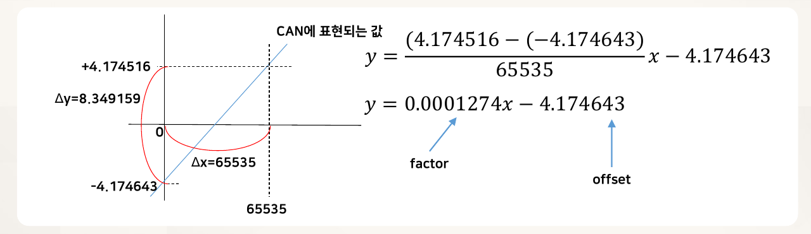

*그림 32. 물리값의 범위와 원시값의 범위를 잇는 1차 함수로 구한 Factor와 Offset*

검산하면 $x = 65535$일 때 $y = 65535 \times 0.0001274 - 4.174643 = 8.349159 - 4.174643 = 4.174516$으로 최댓값과 일치한다.

**부호화와 복호화.** 보내려는 데이터가 -1.9689668일 때, 송신 노드는 원시값을 다음과 같이 계산한다.

$$
\text{송신 노드: } \frac{-1.9689668 - (-4.174643)}{0.0001274} = \frac{2.2056762}{0.0001274} = 17313 = \text{0x43A1}
$$

17313을 16진수로 바꾸면 $17313 = 4 \times 4096 + 3 \times 256 + 10 \times 16 + 1$이므로 0x43A1이다. Intel 순서로 보내면 데이터 바이트는 A1 43이며, 그림 30의 첫 두 바이트와 같다. 수신 노드는 원래 값을 다음과 같이 복원한다.

$$
\text{수신 노드: } 17313 \times 0.0001274 - 4.174643 = 2.2056762 - 4.174643 = -1.9689668
$$

이 예에서는 원시값이 정확히 정수로 떨어져 값이 그대로 복원되지만, 일반적으로는 원시값을 가장 가까운 정수로 반올림하므로 복원한 값에 최대 Factor의 절반(여기서는 약 0.0000637)의 오차가 생긴다. 즉 Factor는 그 시그널의 **분해능(resolution)** 이다. 비트 수를 늘리면 분해능이 좋아지지만 프레임에서 차지하는 자리가 늘어나므로, 필요한 범위와 정밀도에 맞추어 비트 수를 정한다.

> **참고:** 강의자료에는 2바이트의 표현 범위 0\~65535 가운데 실제로는 0\~200만 쓰겠다는 문장이 함께 있으나, 위의 계산은 0\~65535 전체를 원시값의 범위로 쓴다. 원시값의 범위를 0\~200으로 줄이면 $\Delta x = 200$이 되어 Factor가 $8.349159 / 200 \approx 0.0417$로 커지고 분해능이 그만큼 나빠진다.

### 2.12 CAN DB를 이용한 데이터 수집

CAN DB를 모니터링 도구에 넣으면 도구가 각 메시지의 데이터 바이트를 시그널로 나누고 Factor와 Offset을 적용하여 물리값과 단위로 보여 준다.

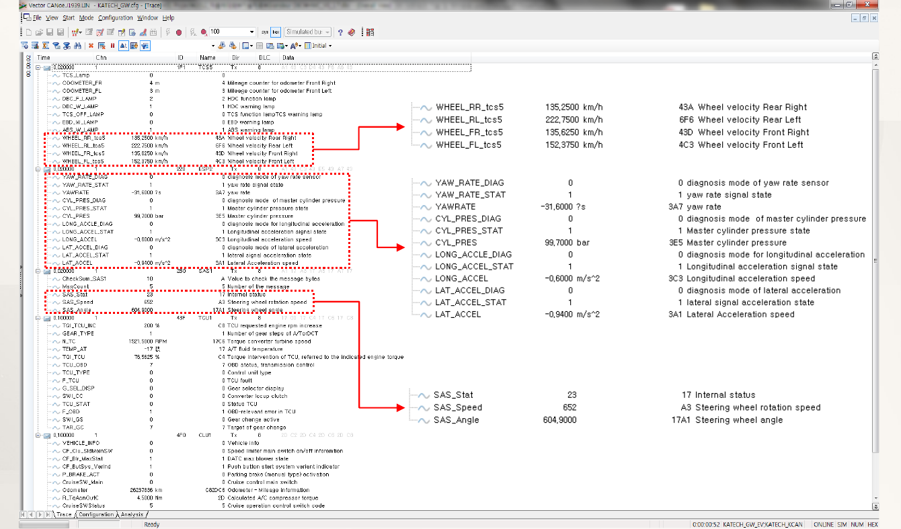

*그림 33. CAN DB를 적용하여 시그널의 물리값을 표시한 트레이스 화면*

그림 33의 왼쪽은 CAN DB를 적용한 트레이스 화면이고, 오른쪽은 점선으로 표시한 세 메시지의 시그널을 확대한 것이다. 각 시그널은 물리값, 원시값(16진수), 설명의 순서로 표시된다. 원시값과 물리값을 비교하면 각 시그널의 값이 표 14의 변환식과 맞는지 확인할 수 있다. 값 한 쌍으로는 Factor와 Offset이 하나로 정해지지 않으므로, 정의를 아는 LONG_ACCEL과 LAT_ACCEL을 빼면 표 14의 변환식은 관찰한 값을 만족하는 식이다.

| 시그널 | 설명 | 원시값 | 물리값 | 변환 |
|:-----|:-----|:-----|:-----|:-----|
| WHEEL_RR_tcs5 | 뒤 오른쪽 바퀴 속도 | 0x43A = 1082 | 135.25 km/h | $1082 \times 0.125$ |
| WHEEL_RL_tcs5 | 뒤 왼쪽 바퀴 속도 | 0x6F6 = 1782 | 222.75 km/h | $1782 \times 0.125$ |
| WHEEL_FR_tcs5 | 앞 오른쪽 바퀴 속도 | 0x43D = 1085 | 135.625 km/h | $1085 \times 0.125$ |
| WHEEL_FL_tcs5 | 앞 왼쪽 바퀴 속도 | 0x4C3 = 1219 | 152.375 km/h | $1219 \times 0.125$ |
| YAWRATE | 요 레이트 | 0x3A7 = 935 | -31.6 °/s | $935 \times 0.01 - 40.95$ |
| CYL_PRES | 브레이크 마스터 실린더 압력 | 0x3E5 = 997 | 99.7 bar | $997 \times 0.1$ |
| LONG_ACCEL | 종방향 가속도 | 0x3C3 = 963 | -0.60 m/s² | $963 \times 0.01 - 10.23$ |
| LAT_ACCEL | 횡방향 가속도 | 0x3A1 = 929 | -0.94 m/s² | $929 \times 0.01 - 10.23$ |
| SAS_Speed | 조향 휠 회전 속도 | 0xA3 = 163 | 652 | $163 \times 4$ |
| SAS_Angle | 조향 휠 각도 | 0x17A1 = 6049 | 604.9 | $6049 \times 0.1$ |

*표 14. 그림 33의 시그널에서 확인한 원시값과 물리값의 관계*

표 14에서 LONG_ACCEL과 LAT_ACCEL은 그림 31과 같은 Factor 0.01, Offset -10.23을 쓰며, 원시값이 약 1023 근처일 때 물리값이 0 근처이다. 바퀴 속도 시그널은 Offset 없이 Factor 0.125(1/8 km/h)를 쓴다. 이 밖에 _DIAG(진단 모드), _STAT(신호 상태)으로 끝나는 시그널은 센서가 진단 모드인지, 값이 유효한지를 0과 1로 알려 주며, 수신 측은 상태가 유효할 때만 값을 쓴다.

---

<br>

## 3. CAN 통신 실습

실습은 두 부분으로 이루어진다. 첫째, 책상 위에서 로직 애널라이저로 UART와 CAN의 전압 파형을 관찰하고, Kvaser CanKing으로 CAN 프레임을 직접 보내고 받는다. 둘째, 실험 차량의 CAN 버스에 Vector CANoe를 연결하여 CAN DB 없이, 그리고 CAN DB를 넣고 데이터를 모니터링하며, 그래프로 표시하고 기록한 뒤 주행하면서 값의 변화를 확인한다.

### 3.1 실습 구성과 장비

| 장비와 소프트웨어 | 역할 |
|:-----|:-----|
| 로직 애널라이저(Saleae Logic Pro 16)와 소프트웨어 Logic 2 | 신호선의 전압을 접지 기준으로 측정하여 파형으로 보여 주고, UART 같은 프로토콜을 해석한다. |
| USB-UART 변환 모듈 | PC의 USB를 UART 신호(0 V와 3.3 V)로 바꾼다. |
| ComMaster | PC에서 UART로 데이터를 보내고 받는 시리얼 터미널 프로그램이다. |
| Kvaser Leaf Light v2 두 대 | USB-CAN 인터페이스 장치이다. 한 대는 보내고 다른 한 대는 받는다. |
| Kvaser CanKing | Kvaser 장치로 CAN 프레임을 만들어 보내고 받은 프레임을 표시하는 소프트웨어이다. |
| CAN 분배기(CAN distribution) | 여러 DB-9 포트를 하나의 CAN 버스로 묶는 장치이다. 모든 포트의 2번 핀이 CAN_L, 7번 핀이 CAN_H이다. |
| DB-9 종단 어댑터 | 120 Ω 저항이 내장된 커넥터이다(그림 27). |
| Vector CAN 인터페이스(VN1610)와 CANoe | 차량의 CAN 버스를 PC로 모니터링하고 기록한다. |
| CAN DB(DBC 파일) | 실험 차량의 CAN 메시지와 시그널 정의이다. |
| 실험 차량 | 자율주행을 위해 개조한 승용차로, 내부의 CAN 정보를 외부 장비로 볼 수 있게 구성되어 있다. |

*표 15. 실습에 쓰는 장비와 소프트웨어*

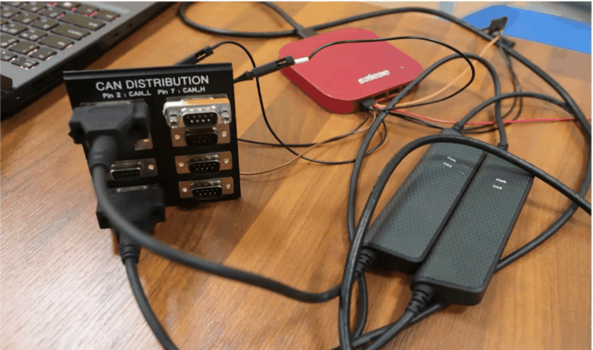

*그림 34. CAN 분배기, 로직 애널라이저, Kvaser USB-CAN 인터페이스 두 대*

그림 34의 왼쪽 검은 상자가 CAN 분배기(Pin 2: CAN_L, Pin 7: CAN_H)이고, 오른쪽 위의 빨간 상자가 로직 애널라이저, 아래의 검은 장치 두 대가 Kvaser USB-CAN 인터페이스이다.

### 3.2 로직 애널라이저로 UART 신호 관찰

UART는 3.3 V와 0 V 사이의 전압 레벨로 신호를 보내므로, 로직 애널라이저로 그 전압을 직접 측정할 수 있다. 실습 절차는 다음과 같다.

1. **장비 연결:** USB-UART 변환 모듈을 PC의 USB에 연결한다. 로직 애널라이저의 프로브는 두 곳에 연결한다. 하나는 UART 신호가 나가는 선(TX)에, 다른 하나는 모듈의 접지(GND)에 연결한다. 전압은 항상 어떤 기준점에 대한 차이이므로, 접지를 기준으로 신호선의 전압 레벨을 측정해야 하기 때문이다.
2. **통신 설정:** ComMaster에서 통신 속도(Baudrate) 9600, 데이터 비트(Data Bits) 8, 정지 비트(Stop Bits) 1, 패리티(Parity) 없음(None), 장치(Device)는 변환 모듈의 COM 포트(예: COM5)로 설정하고, Open Com을 눌러 포트를 연다.
3. **측정 시작:** Logic 2의 시작 버튼을 눌러 기록(logging)을 시작한다.
4. **데이터 전송:** ComMaster의 Send Data 칸에 AB를 입력하고 형식(Format)을 HEX로 하여 Send를 누른다. 2진수를 기본으로 설명했지만 여기서는 16진수로 1바이트 0xAB를 보낸다.
5. **파형 확대:** 측정을 멈추고 파형을 확대한다. 신호가 매우 빠르게 변하므로 처음에는 한 줄의 선으로만 보이며, 천천히 확대하면 High(3.3 V)와 0 V 사이를 오가는 파형이 나타난다.

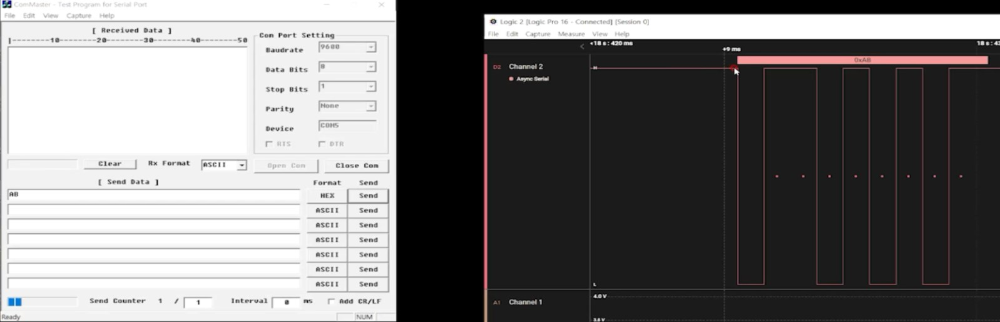

*그림 35. ComMaster로 보낸 0xAB와 로직 애널라이저로 측정하고 해석한 UART 파형*

그림 35의 왼쪽은 ComMaster의 설정과 보낸 데이터이고, 오른쪽 위(Channel 2)는 측정한 UART 파형이다. 로직 애널라이저의 UART 해석 기능(Async Serial)이 파형을 읽어 그 위에 0xAB라고 표시한다. 파형을 시간 순서로 읽으면 다음과 같다.

```text
time ->   idle | St | b0 | b1 | b2 | b3 | b4 | b5 | b6 | b7 | Sp | idle
value       1  |  0 |  1 |  1 |  0 |  1 |  0 |  1 |  0 |  1 |  1 |  1

0xAB = 1010 1011 (MSB first) -> sent LSB first: b0 b1 ... b7 = 1 1 0 1 0 1 0 1
```

*그림 36. UART로 보낸 0xAB의 비트 순서*

처음 유휴 상태(High)에서 시작 비트(Low)가 오고, 이어서 1, 1, 0, 1, 0, 1, 0, 1이 차례로 나타난 뒤 정지 비트(High)로 끝난다. 0xAB를 2진수로 쓰면 1010 1011이므로, 이 비트 열은 LSB부터 보낸 것이다. 9600 baud에서 한 비트의 시간은 $1/9600 \approx 104.2$ µs이고, 시작 비트, 데이터 8비트, 정지 비트를 합한 10비트를 보내는 데 약 1.04 ms가 걸린다.

### 3.3 Kvaser CanKing으로 CAN 프레임 송수신

다음으로 같은 로직 애널라이저로 CAN 신호의 전압 레벨을 확인한다. CAN 신호를 만들기 위해 Kvaser USB-CAN 인터페이스 두 대와 소프트웨어 CanKing을 쓴다.

1. **하드웨어 구성:** Kvaser 장치 두 대를 CAN 분배기에 연결하여 하나의 CAN 버스를 만든다. 두 장치 중 하나가 보내고 다른 하나가 받는 **루프백 시험(loopback test)** 이다. CAN 통신에는 종단 저항이 필요하므로, 종단 저항이 내장된 DB-9 커넥터를 분배기에 연결한다. 로직 애널라이저의 두 채널은 버스의 CAN_H와 CAN_L에 연결한다.
2. **소프트웨어 실행:** CanKing을 두 개 실행하고, 하나는 채널 0(0 - Kvaser Leaf Light v2), 다른 하나는 채널 1(1 - Kvaser Leaf Light v2)을 선택한다.
3. **버스 속도 설정:** 차량에서는 보통 500 kbit/s를 쓰지만, 여기서는 로직 애널라이저로 파형을 자세히 볼 수 있도록 속도를 목록의 최솟값으로 낮추어 버스 속도(Bus Speed)를 33.333 kbit/s로 설정한다. 같은 버스의 모든 노드는 반드시 같은 속도를 써야 하므로 두 CanKing 모두 같은 값으로 설정한다(Set in all은 모든 CAN 컨트롤러에 같은 속도를 적용하는 버튼이다).
4. **버스 참여:** Go On Bus 버튼을 누르면 장치가 버스에 참여하여 버스 상태를 계속 읽을 수 있는 상태가 된다. 버스 상태(Bus Status) 표시가 Off Bus에서 On Bus로 바뀐다.

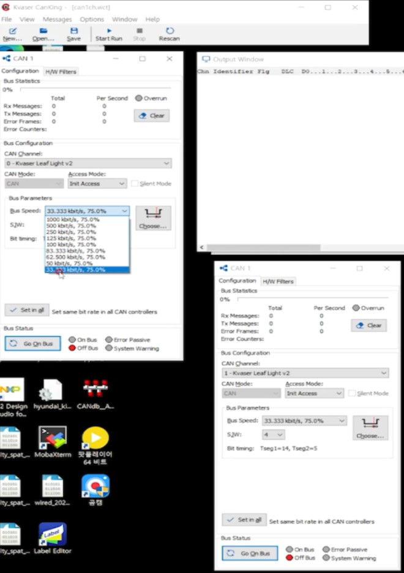

*그림 37. CanKing의 채널, 버스 속도, 비트 타이밍 설정*

그림 37의 설정 창에는 버스 통계(Bus Statistics: 수신 메시지, 송신 메시지, 오류 프레임, 오류 카운터), 버스 구성(Bus Configuration: CAN 채널, CAN 모드, 접근 모드, Silent Mode), 버스 매개변수(Bus Parameters: 버스 속도, SJW, 비트 타이밍), 버스 상태가 있다. 버스 속도 목록에는 1000, 500, 250, 125, 100, 83.333, 62.5, 50, 33.333 kbit/s가 있고, 모두 75.0%라는 표본점 위치가 함께 적혀 있다. Silent Mode는 버스를 듣기만 하고 ACK를 포함한 어떤 비트도 보내지 않는 모드로, 규격의 버스 모니터링 모드(bus monitoring mode)에 해당하며 운행 중인 차량의 버스를 방해하지 않고 관찰할 때 쓴다 [4].

**비트 타이밍.** 버스 속도 33.333 kbit/s에서 한 비트의 시간은 $1 / 33333 \approx 30$ µs이다. CAN 컨트롤러는 한 비트를 **시간 양자(time quantum, tq)** 라는 작은 단위로 나누어 다룬다. 화면의 Tseg1 = 14, Tseg2 = 5는 비트 맨 앞의 동기 구간(sync segment) 1 tq 뒤에, 표본점(sample point) 앞 구간이 14 tq, 뒤 구간이 5 tq라는 뜻이다. 따라서 한 비트는 $1 + 14 + 5 = 20$ tq이고, 1 tq는 $30 / 20 = 1.5$ µs이다. 표본점은 비트 시작에서 $(1 + 14)/20 = 75\%$ 지점이며, 화면의 75.0%가 이 값이다. 비트의 뒤쪽에서 값을 읽는 까닭은 신호가 버스를 왕복하고 안정될 시간을 주기 위해서이다. SJW(synchronization jump width) = 4는 재동기화 때 비트 구간을 한 번에 늘이거나 줄일 수 있는 최대 길이가 4 tq라는 뜻이다 [1].

이제 한 CanKing에서 가상의 메시지를 보낸다. CAN 메시지 창(CAN Message)에서 다음을 설정하고 Send 버튼을 누르면 CAN 데이터가 전송된다.

- **CAN Identifier:** `$123`(16진수 0x123)
- **Channel:** 보낼 장치의 채널(CAN 1)
- **DLC:** `$8`(8바이트)
- **Message Data:** 각 바이트의 값. 여기서는 Byte 0\~7에 `$82`, `$2A`, `$42`, `$D1`, `$F2`, `$2E`, `$56`, `$23`을 넣었다. Randomize Data를 누르면 임의의 값이 채워진다.

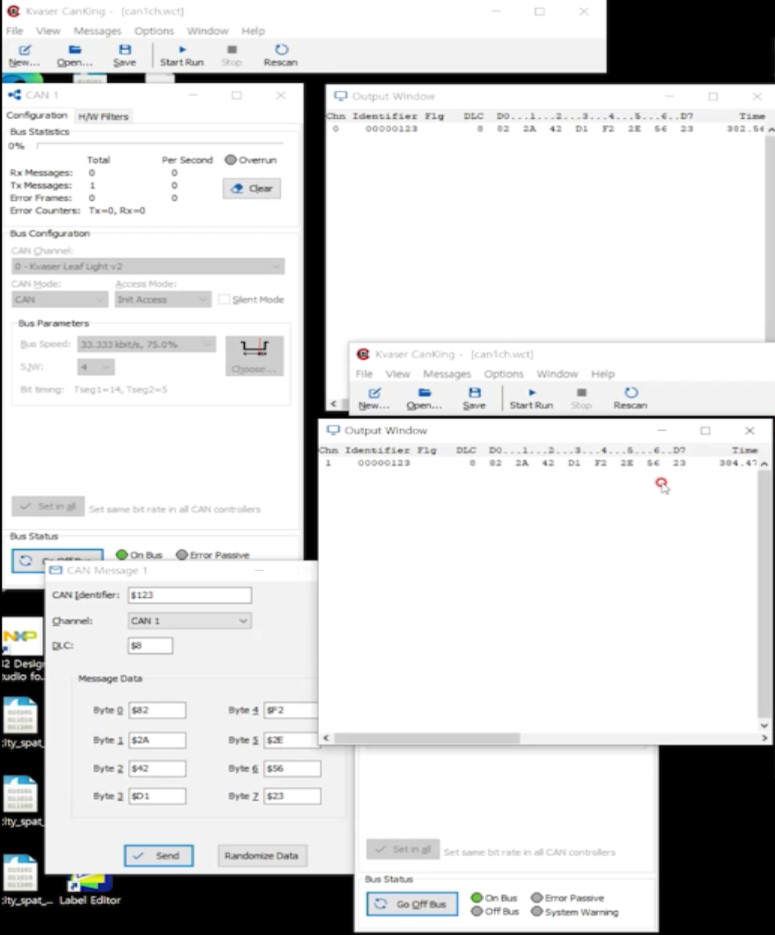

*그림 38. CanKing에서 식별자 0x123의 8바이트 메시지를 보내고 받은 화면*

그림 38에서 위쪽 출력 창(Output Window)은 보낸 장치의 기록이고, 아래쪽 출력 창은 받은 장치의 기록이다. 두 창 모두 식별자 00000123, DLC 8, 데이터 82 2A 42 D1 F2 2E 56 23이 똑같이 표시되므로, 보낸 프레임이 손상 없이 수신되었음을 확인할 수 있다. 버스 통계의 오류 카운터(Error Counters)도 Tx = 0, Rx = 0으로 오류가 없다.

> **참고:** 루프백 시험에 장치를 두 대 쓰는 까닭은 ACK에 있다. CAN 송신 노드는 ACK 슬롯에서 다른 노드가 우성을 덮어써 주어야 전송이 성공한 것으로 본다(3주차). 버스에 송신 노드 하나뿐이면 ACK 슬롯이 열성으로 남아 ACK 오류가 되고, 송신 노드는 같은 프레임을 계속 다시 보내며 송신 오류 카운터가 늘어 오류 수동 상태가 될 수 있다 [1]. 받는 장치가 있으면 그 장치가 ACK를 보내므로 정상적인 송수신을 확인할 수 있다.

### 3.4 로직 애널라이저로 CAN 신호 관찰

로직 애널라이저의 실행 버튼을 누르면 두 신호선의 전압 레벨이 표시된다. 위쪽 Channel 1이 CAN_H, 아래쪽 Channel 0이 CAN_L이다. 프레임을 보내기 전에는 두 선 모두 약 2.5 V에 머문다(화면의 표시값 2.489 V). 버스가 열성 유휴 상태이기 때문이다.

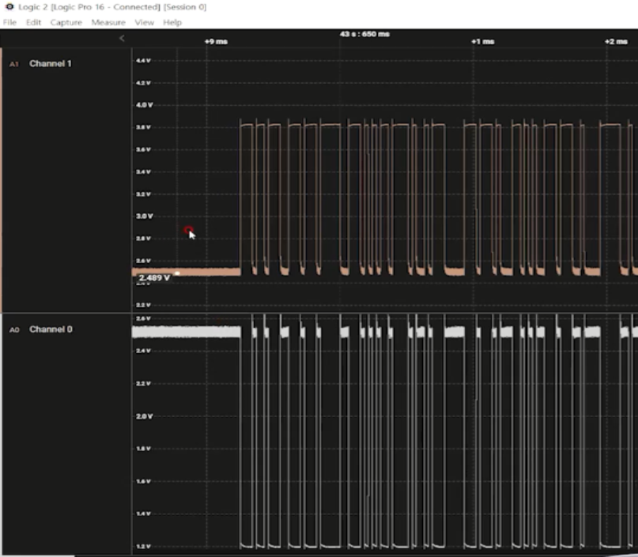

*그림 39. 로직 애널라이저로 측정한 CAN_H(Channel 1)와 CAN_L(Channel 0)의 파형*

CanKing으로 메시지를 보낸 뒤 측정을 멈추고 확대하면 그림 39와 같은 파형이 보인다. 관찰한 내용과 그 의미는 다음과 같다.

- **대칭 파형:** 우성 비트에서 CAN_H는 약 3.8 V로 올라가고 CAN_L은 약 1.2 V로 내려가며, 두 선이 2.5 V를 중심으로 서로 대칭으로 움직인다. 차동 전압은 약 $3.8 - 1.2 = 2.6$ V이고, 이는 고속 CAN 트랜시버의 우성 출력 범위(60 Ω 부하에서 1.5\~3.0 V) 안에 있다 [3]. 열성 비트에서는 두 선이 다시 약 2.5 V로 모여 차동 전압이 0에 가깝다.
- **접지 기준의 측정:** 로직 애널라이저는 각 선을 접지에 대하여 따로 재므로 두 선의 공통 전압 2.5 V가 그대로 보인다. CAN 트랜시버는 이 공통 전압이 아니라 두 선의 차만 보고 비트를 판단한다(1.8절).
- **UART보다 조밀한 신호:** 이번에도 짧은 시간에 모든 데이터가 전송되므로 처음에는 한 줄의 선으로 보이며, 확대하면 UART 신호보다 훨씬 조밀한 파형이 나타난다. 비트 전송률이 33.333 kbit/s로 UART의 9600 bit/s보다 약 3.5배 빠르고, 한 프레임에 100비트가 넘는 비트가 들어 있기 때문이다.

오실로스코프나 CAN 분석 기능을 갖춘 전문가용 도구를 쓰면 화면의 각 구간이 어떤 필드이고 어떤 값을 나타내는지까지 함께 표시할 수 있다. 같은 일을 손으로 하면 다음과 같다. 보낸 프레임의 각 필드를 MSB부터 2진수로 쓰고, 그 비트로 15비트 CRC를 계산한다(1.11절).

```text
field      bits  value (binary, MSB first)
SOF          1   0
ID          11   001 0010 0011             (0x123)
RTR          1   0                         (data frame)
IDE          1   0                         (standard frame)
r0           1   0
DLC          4   1000                      (8 bytes)
D0..D7      64   82 2A 42 D1 F2 2E 56 23   (each byte MSB first)
CRC         15   011 1100 0001 0111        (0x3C17)
CRC del.     1   1
ACK          2   0 1                       (slot overwritten by the receiver, delimiter)
EOF          7   1111111
```

*그림 40. 식별자 0x123, 8바이트 데이터 프레임의 필드별 비트*

SOF부터 CRC까지는 $1 + 11 + 1 + 1 + 1 + 4 + 64 + 15 = 98$비트이다. 이 구간에 비트 스터핑을 적용하면 세 곳에서 같은 값이 다섯 개 이어진다.

1. D0 = 1000 0010에서 첫 비트 1 다음에 0 다섯 개가 이어지는 곳: 이 0 다섯 개 뒤에 1을 넣는다.
2. D3 = 1101 0001의 마지막 비트 1과 D4 = 1111 0010의 앞 네 비트 1111이 이어지는 곳: 1 다섯 개 뒤에 0을 넣는다.
3. CRC = 011 1100 0001 0111의 가운데 0 다섯 개: 그 뒤에 1을 넣는다.

따라서 버스에 실리는 비트는 SOF부터 CRC까지 $98 + 3 = 101$비트이고, CRC 구분자 1비트, ACK 2비트, EOF 7비트를 더하면 프레임 전체가 111비트이다. 비트 시간이 30 µs이므로 프레임 하나는 $111 \times 30\ \mu\text{s} = 3.33$ ms 동안 버스를 차지한다. 같은 프레임을 차량의 500 kbit/s로 보내면 $111 \times 2\ \mu\text{s} = 222$ µs가 걸린다.

### 3.5 실험 차량의 CAN 모니터링 구성

이제 실제 차량에서 CAN 정보가 어떻게 표현되는지 확인한다. 실험 차량은 자율주행을 위해 개조한 승용차이며, 내부의 CAN 정보를 외부 장비로 볼 수 있게 구성되어 있다.

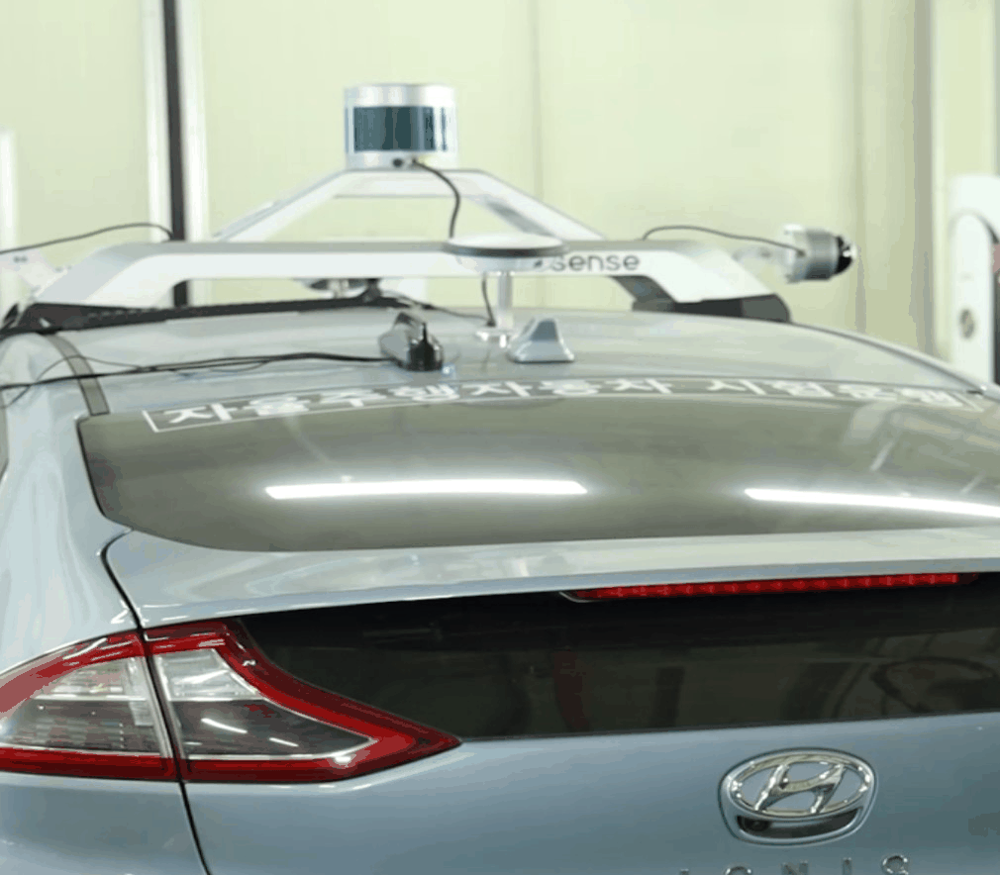

*그림 41. 지붕에 라이다, GPS 안테나, V2X 안테나를 단 실험 차량*

그림 41에서 지붕 가운데의 높은 원통이 주변 환경을 인식하는 센서인 라이다(LIDAR)이고, 가운데의 흰색 둥근 부분이 GPS 안테나, 그 왼쪽의 검은 부분이 외부 네트워크로부터 데이터를 받는 V2X 안테나이다. V2X 통신은 11주차부터 다룬다.

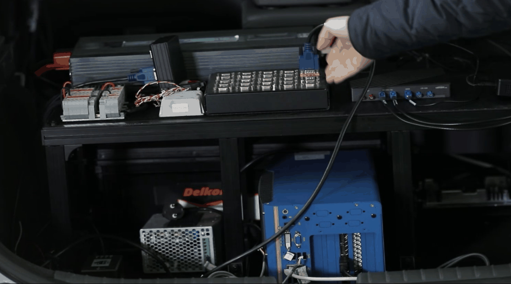

*그림 42. 실험 차량 트렁크의 전원부, 인지용 PC, CAN 분배기*

트렁크에는 여러 장비가 있다. 전원부는 장비들에 전원을 공급하고, 아래의 파란 PC는 라이다와 주변 센서의 정보를 받아 주변 상황을 인지한다. 위쪽 가운데의 DB-9 포트가 여러 개 달린 장치가 3.3절에서 쓴 CAN 분배기를 확장한 장비이다. CAN은 장비를 언제든지 버스에 끼웠다 뺐다 하며 디버깅하기 편하다는 장점이 있으므로, 더 많은 장비를 연결할 수 있도록 포트를 많이 구성하였다. 이는 1.1절에서 본 것처럼 CAN 프레임에 받는 노드의 주소가 없어, 새 장비가 버스에 붙어도 다른 노드의 설정을 바꿀 필요가 없기 때문에 가능하다.

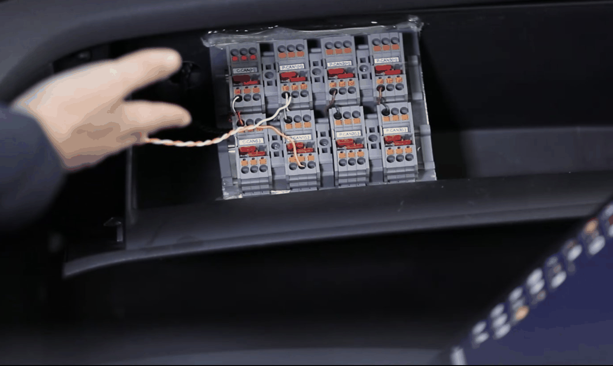

*그림 43. 차량 앞쪽 수납공간에 만든 CAN 연결 단자대*

트렁크에는 DB-9 커넥터를 쓸 수 있도록 모듈을 따로 만들었지만, 차량 앞쪽(조수석 앞 수납공간)에는 커넥터를 만들지 않고 전선을 바로 꽂을 수 있는 단자대 형태의 포트를 만들었다.

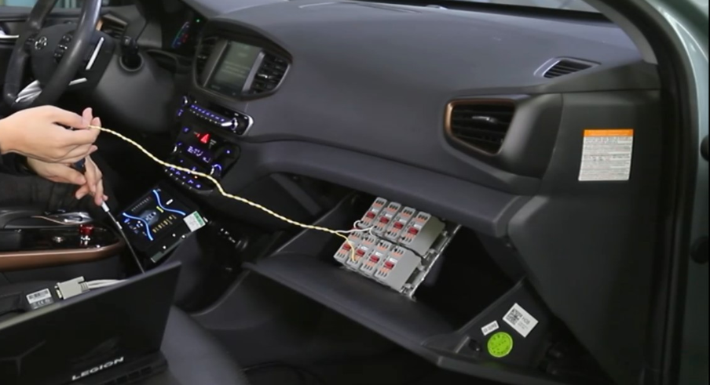

*그림 44. 꼬인 두 선으로 만든 CAN 케이블을 단자대에 연결하는 모습*

이 단자대에 연결하기 위해 CAN 전선 두 가닥을 꼬아 끝에 DB-9 커넥터를 단 케이블을 직접 만들었다(그림 44의 노란 꼬인 선). 케이블의 DB-9 쪽은 Vector CAN 인터페이스에, 인터페이스의 USB는 노트북 PC에 연결한다. Vector CANoe는 실험할 때 차량 데이터를 실시간으로 모니터링하기 위해 많이 쓰는 도구이다.

### 3.6 CANoe 실행과 CAN 네트워크 설정

CANoe로 CAN 모니터링을 시작하는 절차는 다음과 같다.

1. **장비 연결:** Vector CAN 인터페이스를 차량의 CAN 포트에 연결하고, PC와 USB로 연결한다.
2. **소프트웨어 실행:** CANoe를 실행한다. CANoe에는 라이선스가 걸려 있으므로, 시작할 때 네트워크를 통해 라이선스가 있는지 확인한다.
3. **새 구성 만들기:** File, New Configuration을 차례로 고르고, 템플릿 가운데 **CAN 500kBaud 2ch**를 선택한다. 이 차량의 CAN 통신은 500 kbit/s로 설정되어 있으므로, 모니터링할 때도 500 kbit/s의 두 채널(2ch)짜리 구성을 쓴다.
4. **구성 창 확인:** 구성이 열리면 왼쪽에 **Simulation Setup** 창, 오른쪽에 **Measurement Setup** 창이 나타난다.

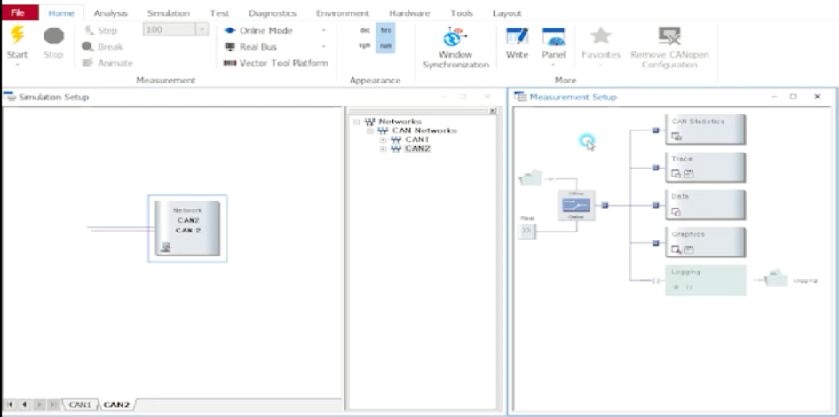

*그림 45. CANoe의 Simulation Setup과 Measurement Setup 창*

그림 45의 왼쪽 Simulation Setup은 CAN 채널과 그 채널에 붙은 CAN 노드의 구성을 보여 준다. 지금은 PC에 연결한 CANoe 장비 하나만 붙어 있으므로 네트워크 블록 하나(Network CAN 1)만 나타난다. 가운데의 트리(Networks, CAN Networks, CAN1, CAN2)에서 채널마다 노드(Nodes), 대화형 생성기(Interactive Generator), 재생 블록(Replay blocks), 데이터베이스(Databases), 채널(Channels)을 관리한다. 오른쪽 Measurement Setup은 버스에서 받은 데이터가 왼쪽의 입력(Online)에서 오른쪽의 분석 블록으로 흐르는 측정 항목을 보여 준다. 위쪽 리본의 Start(번개 모양)와 Stop은 측정을 시작하고 멈추며, Appearance의 dec/hex는 값을 10진수로 볼지 16진수로 볼지 정한다.

5. **채널 설정 확인:** Simulation Setup의 CAN Networks에서 CAN1 채널의 하드웨어 설정을 열면, 장비에 대한 설정과 속도를 확인하고 바꿀 수 있다.

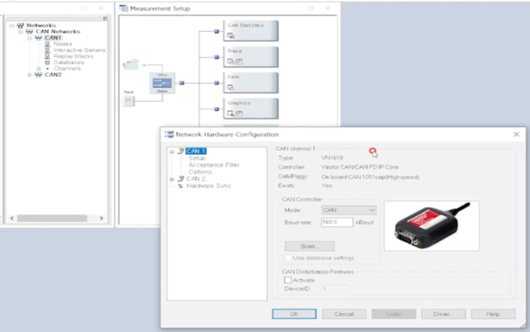

*그림 46. CAN1 채널의 Network Hardware Configuration 창*

그림 46에서 CAN 1 채널은 장치 종류(Type)가 VN1610, 컨트롤러(Controller)가 Vector CAN/CAN FD IP Core, 트랜시버(Cab/Piggy)가 On board CAN 1051cap(Highspeed)이며, CAN 컨트롤러의 모드(Mode)는 CAN, 통신 속도(Baud rate)는 500.0 kBaud이다. 왼쪽 트리의 Setup, Acceptance Filter, Options에서 채널의 세부 설정과 수용 필터(3주차)를 정한다.

> **주의:** 모니터링 장비의 비트 전송률은 차량 버스의 비트 전송률과 정확히 같아야 한다. 다르게 설정하면 장비가 비트를 잘못 읽어 오류 프레임을 보내게 되고, 운행 중인 차량의 통신을 방해할 수 있다. 차량의 속도를 모를 때는 Silent Mode 같은 수신 전용 모드로 먼저 확인한다(3.3절).

6. **측정 항목 확인:** 실제로 CAN 데이터를 모니터링하는 기능은 Measurement Setup 창의 블록들이 제공한다.

| 블록 | 기능 |
|:-----|:-----|
| CAN Statistics | 버스 부하, 초당 프레임 수, 오류 프레임 수 같은 버스 통계를 보여 준다. |
| Trace | 받은 프레임을 시각, 채널, 식별자, 이름, 방향, DLC, 데이터의 표로 실시간 표시한다. |
| Data | 선택한 시그널의 현재 값을 숫자로 보여 준다. |
| Graphics | 선택한 시그널의 값을 시간에 따른 그래프로 보여 준다. |
| Logging | 받은 데이터를 파일로 기록한다. |

*표 16. CANoe Measurement Setup의 주요 블록*

### 3.7 CAN DB 없이 모니터링하기

먼저 CAN DB 없이 CAN 데이터를 직접 모니터링한다.

1. Measurement Setup에서 **Trace** 블록을 더블 클릭하면 Trace 창이 나타난다.
2. 리본의 **Start**를 누르면 CAN 정보가 Trace 창에 실시간으로 표시된다.

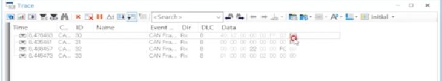

*그림 47. CAN DB 없이 받은 프레임을 16진수로 표시한 Trace 창*

Trace 창의 열은 시각(Time), 채널(Chn), 식별자(ID), 이름(Name), 이벤트 종류(Event Type), 방향(Dir), DLC, 데이터(Data)이다. 그림 47에는 식별자 30, 31, 32, 33(16진수 표시 모드이므로 0x30\~0x33)의 네 메시지가 보이며, 모두 수신(Rx)한 8바이트 CAN 프레임이다. 이름 열은 비어 있는데, CANoe가 이 식별자들의 이름을 알지 못하기 때문이다. 데이터 열의 맨 뒤쪽 값들이 계속 바뀌며, 모든 값은 16진수로 표시된다.

이처럼 CAN DB 없이 데이터를 보면, 조향 핸들을 돌려도 어느 바이트가 어떤 식으로 바뀌는지, 실제 조향각이 얼마인지 알 수 없다. 바뀌는 바이트를 찾아 핸들을 돌리는 방향과 비교하면 위치를 짐작할 수는 있지만, Factor, Offset, 바이트 순서, 부호를 모르면 정확한 값을 얻을 수 없다. 그래서 CAN 데이터베이스 파일이 필요하다.

### 3.8 CAN DB를 추가하여 모니터링하기

DBC 파일은 모니터링하려는 CAN에 대한 정보를 설명해 놓은 파일이다. CAN DB를 추가하는 절차는 다음과 같다.

1. Simulation Setup 트리에서 CAN1 아래의 **Databases** 항목을 클릭한다(오른쪽 버튼).
2. 나타난 메뉴에서 **Add...** 를 누른다. Import Wizard로 다른 형식의 DB를 가져올 수도 있다.
3. DBC 파일을 선택하는 창이 나타나면 실험 차량의 CAN DB 파일을 연다.
4. Databases 아래에 해당 CAN DBC 파일이 추가된다.

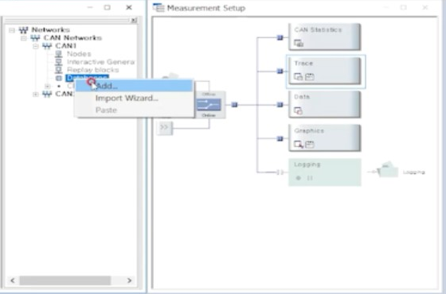

*그림 48. Simulation Setup의 Databases에서 Add로 DBC 파일을 추가하는 메뉴*

다시 Trace 창을 더블 클릭하여 모니터링을 시작하면 같은 프레임에 CAN DB의 정보가 함께 나타난다. 각 프레임의 왼쪽에 펼침(+) 버튼이 생기고, 이를 누르면 해당 식별자의 데이터에 어떤 시그널이 들어 있고 그 값이 무엇을 뜻하는지 표시된다.

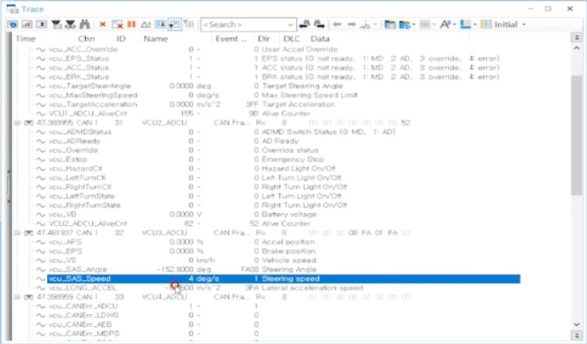

*그림 49. CAN DB를 추가한 뒤 시그널의 이름, 물리값, 원시값, 설명을 표시한 Trace 창*

그림 49에서 메시지는 이름(VCU1_ADCU 등)으로 표시되고, 그 아래에 시그널마다 이름, 물리값과 단위, 원시값(16진수), 설명이 한 줄씩 나타난다. 이 실험 차량의 CAN DB에 정의된 메시지는 다음과 같다. 자율주행용으로 개조한 실험 차량이고 시그널 설명에 "ADMD Switch Status (0: MD, 1: AD)", "AD Ready", "User Steering Override"가 함께 쓰이므로, MD와 AD는 각각 수동 주행 모드와 자율 주행 모드를 나타냄을 알 수 있다.

| 메시지(식별자) | 주요 시그널 | 뜻 |
|:-----|:-----|:-----|
| VCU1_ADCU (0x30) | vcu_EPS_En, vcu_BRK_En, vcu_ACC_En | 조향, 제동, 가속 제어의 응답(feedback) |
| | vcu_EPS_Override, vcu_BRK_Override, vcu_ACC_Override | 운전자가 조향, 제동, 가속에 개입했는지 여부 |
| | vcu_EPS_Status, vcu_ACC_Status, vcu_BRK_Status | 각 제어의 상태(0: 준비 안 됨, 1: MD, 2: AD, 3: 개입, 4: 오류) |
| | vcu_TargetSteerAngle, vcu_MaxSteeringSpeed, vcu_TargetAcceleration | 목표 조향각, 최대 조향 속도, 목표 가속도 |
| VCU2_ADCU (0x31) | vcu_ADMDStatus, vcu_ADReady, vcu_Override, vcu_Estop | 자율 주행과 수동 주행 전환 스위치 상태, 자율 주행 준비, 개입 상태, 비상 정지 |
| | vcu_HazardCtl, vcu_LeftTurnCtl, vcu_RightTurnCtl, vcu_LeftTurnState, vcu_RightTurnState | 비상등과 좌우 방향 지시등의 켜짐과 점멸 상태 |
| | vcu_VB | 배터리 전압 |
| VCU3_ADCU (0x32) | vcu_APS, vcu_BPS, vcu_VS | 가속 페달 위치, 브레이크 페달 위치, 차속 |
| | vcu_SAS_Angle, vcu_SAS_Speed, vcu_LONG_ACCEL | 조향각, 조향 속도, 가속도 |
| VCU4_ADCU (0x33) | vcu_CANErr_ADCU, vcu_CANErr_LDWS, vcu_CANErr_AEB, vcu_CANErr_MDPS 등 | 각 제어기와의 CAN 통신 오류 여부 |

*표 17. 실험 차량의 CAN DB에 정의된 메시지와 시그널*

VCU1_ADCU와 VCU2_ADCU의 마지막 시그널인 AliveCnt(alive counter)는 송신 노드가 메시지를 보낼 때마다 1씩 늘리는 카운터이다. 수신 노드는 이 값이 바뀌지 않으면 송신 노드가 멈추었다고 판단할 수 있다. VCU4_ADCU의 LDWS(차선 이탈 경고), AEB(자동 긴급 제동), MDPS(전동식 조향 장치) 같은 이름은 차량의 다른 제어기를 가리킨다.

식별자 0x32(VCU3_ADCU)의 vcu_SAS_Angle과 vcu_SAS_Speed가 조향에 관련된 데이터이다. 핸들을 오른쪽으로 돌리면 SAS_Angle의 마이너스 값이 계속 커지고, 반대로 왼쪽으로 돌리면 플러스 값이 나온다. SAS_Speed는 핸들을 빠르게 돌릴수록 값이 커진다. 이처럼 CAN 데이터베이스 파일을 가져오면(import) 각 CAN 정보가 무엇을 나타내는지 확인할 수 있다.

Trace 창의 원시값과 물리값을 데이터 바이트와 비교하면 VCU3_ADCU의 시그널 배치를 확인할 수 있다. 예를 들어 그림 49의 VCU3_ADCU 데이터는 00 00 00 08 FA 01 FA 03이고, vcu_SAS_Angle의 원시값은 FA08, 물리값은 -152.8 deg이다. 표 18은 이 프레임과 그림 50의 프레임(00 00 00 D1 11 12 F9 03), 3.10절의 프레임(0F 00 11 84 00 00 02 04)에서 원시값과 물리값을 대응시켜 얻은 배치이다.

| 바이트 | 시그널 | 변환 | 관찰한 예 |
|:-----|:-----|:-----|:-----|
| 0 | vcu_APS | 원시값 × 0.4 % | 0x0F = 15 → 6.0 % |
| 2 | vcu_VS | 원시값 × 1 km/h | 0x11 = 17 → 17 km/h |
| 3\~4 | vcu_SAS_Angle | Intel, 부호 있는 16비트, × 0.1 deg | 08 FA → 0xFA08 = -1528 → -152.8 deg |
| 5 | vcu_SAS_Speed | 원시값 × 4 deg/s | 0x12 = 18 → 72 deg/s |
| 6\~7 | vcu_LONG_ACCEL | Intel, 부호 없는 16비트, × 0.01 - 10.23 m/s² | F9 03 → 0x03F9 = 1017 → -0.06 m/s² |

*표 18. 관찰한 값으로 확인한 VCU3_ADCU의 시그널 배치*

바이트 1은 vcu_BPS(브레이크 페달 위치)이며, 관찰한 값이 모두 0이어서 Factor는 확인할 수 없다. vcu_SAS_Angle처럼 부호 있는 값은 **2의 보수(two's complement)** 로 읽는다. 16비트 값의 최상위 비트가 1이면 음수이며, 그 값은 부호 없는 값에서 $2^{16} = 65536$을 뺀 것이다. 0xFA08은 부호 없는 값으로 64008이므로 $64008 - 65536 = -1528$이고, Factor 0.1을 곱하면 -152.8 deg이다.

같은 해석을 Python으로 쓰면 다음과 같다.

```python
def intel_unsigned(data, start_byte, length_bytes):
    return int.from_bytes(data[start_byte:start_byte + length_bytes], "little")

def intel_signed(data, start_byte, length_bytes):
    return int.from_bytes(data[start_byte:start_byte + length_bytes], "little", signed=True)

def decode_vcu3(data):
    return {
        "vcu_APS [%]": intel_unsigned(data, 0, 1) * 0.4,
        "vcu_VS [km/h]": intel_unsigned(data, 2, 1) * 1,
        "vcu_SAS_Angle [deg]": intel_signed(data, 3, 2) * 0.1,
        "vcu_SAS_Speed [deg/s]": intel_unsigned(data, 5, 1) * 4,
        "vcu_LONG_ACCEL [m/s^2]": intel_unsigned(data, 6, 2) * 0.01 - 10.23,
    }

frame = bytes.fromhex("0F 00 11 84 00 00 02 04")
for name, value in decode_vcu3(frame).items():
    print(f"{name:24s} {value:8.2f}")
```

- `intel_unsigned`는 데이터 `data`의 `start_byte`번째 바이트부터 `length_bytes`개의 바이트를 잘라 리틀 엔디안(`"little"`)의 부호 없는 정수로 읽는다. Intel 바이트 순서가 리틀 엔디안이기 때문이다.
- `intel_signed`는 같은 일을 하되 `signed=True`로 2의 보수 정수로 읽는다.
- `decode_vcu3`는 표 18의 배치대로 각 시그널의 원시값을 읽고 Factor를 곱하고 Offset을 더하여, 시그널 이름과 물리값의 사전을 돌려준다.
- `bytes.fromhex`는 Trace 창에 보이는 16진수 문자열을 8바이트 데이터로 바꾼다. 이 데이터는 3.10절의 주행 중에 받은 VCU3_ADCU 프레임이다.
- 마지막 반복문은 시그널마다 이름을 24칸에 맞추고 값을 소수 둘째 자리까지 출력한다.

실행 결과는 다음과 같으며, 3.10절에서 오른쪽 방향 지시등을 켰을 때의 물리값과 같다.

```text
vcu_APS [%]                  6.00
vcu_VS [km/h]               17.00
vcu_SAS_Angle [deg]         13.20
vcu_SAS_Speed [deg/s]        0.00
vcu_LONG_ACCEL [m/s^2]       0.03
```

### 3.9 실시간 그래프와 데이터 로깅

데이터를 메시지 목록이 아니라 그래프로 실시간 확인하는 방법은 다음과 같다.

1. Measurement Setup 창에서 **Graphics** 블록을 클릭(더블 클릭)하면 새 Graphics 창이 나타난다.
2. 확인하려는 데이터(시그널)를 목록에서 클릭한다.
3. 시그널을 Graphics 창으로 드래그 앤드 드롭한다.
4. 그래프 영역에 현재 값의 그래프가 실시간으로 그려진다.

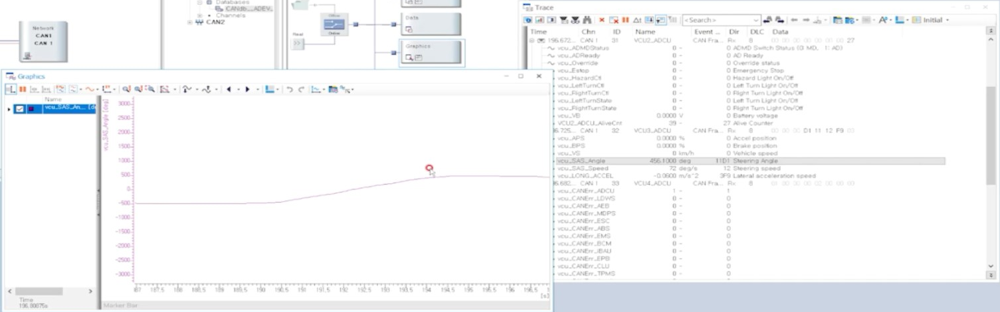

*그림 50. 조향각 시그널 vcu_SAS_Angle의 실시간 그래프와 Trace 창*

그림 50은 핸들 값(vcu_SAS_Angle)을 그래프에 넣은 것이다. 핸들을 오른쪽으로 돌렸을 때는 그래프가 마이너스 값으로 내려갔고, 왼쪽으로 돌리면서 플러스 값으로 올라갔다. 오른쪽 Trace 창에서 같은 순간의 vcu_SAS_Angle은 456.1 deg(원시값 11D1)이다. 같은 방법으로 핸들 스피드(vcu_SAS_Speed)도 추가하면 여러 항목을 동시에 확인할 수 있다.

CANoe는 차량을 실험할 때 데이터를 **기록(log)** 하고, 나중에 **재생(replay)** 하며, 재생한 데이터를 다시 **CAN 버스에 전송**하는 기능을 지원한다. 기록 설정 절차는 다음과 같다.

1. Trace 창을 닫고, Measurement Setup 창 맨 아래의 **Logging** 블록을 찾는다. 처음에는 음영으로 처리되어 연하게 보이는 비활성 상태이다.
2. Logging 블록을 더블 클릭하면 활성화(enable)된다.
3. 다시 더블 클릭하면 기록을 어떤 식으로 할지 정하는 **Trigger Configuration** 창이 열린다. 모드(Mode)를 Entire measurement로 두면 측정의 시작(Start)부터 끝(Stop)까지 전체를 기록한다. 버퍼 크기(Buffer size)는 기록 전에 메모리에 모아 둘 수 있는 메시지 수(여기서는 50000)이다.

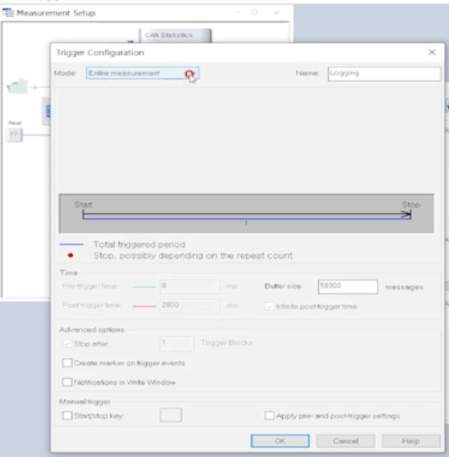

*그림 51. 기록 범위를 정하는 Trigger Configuration 창*

4. Logging 블록 오른쪽의 파일 아이콘을 더블 클릭하여 **Logging File Configuration** 창을 열고, 기록 파일을 설정한다. 저장 폴더(Destination folder)는 바탕 화면으로 하고, 파일 이름(Destination file)은 필드 코드(Field Codes)로 정한다. 필드 코드는 현재 시각(LocalTime), 사용자 이름, 모니터링하는 시스템 같은 정보로 파일 이름을 자동으로 만들어 이전 파일을 덮어쓰지 않게 하며, {LocalTime}을 쓰면 2023-02-05_14-47-29.blf 같은 이름이 된다.
5. 파일 형식(File format)은 **BLF Frame Logging (\*.blf)** 를 고른다. BLF는 CANoe가 특징적으로 쓰는 이진 기록 파일 형식으로, BLF로 저장하면 나중에 CANoe에서 리플레이할 수 있고, 리플레이하면서 실시간으로 다른 CAN 버스에 그 프레임을 전송할 수도 있다. 목록의 PCAP과 PCAPNG는 이더넷 프레임을 기록하는 형식이다.
6. OK 버튼을 누르면 설정이 끝난다.

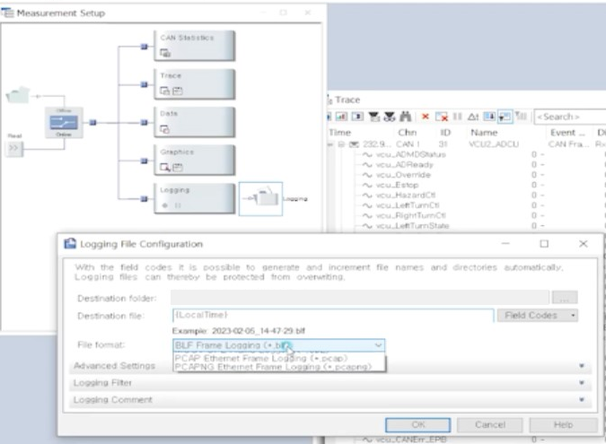

*그림 52. 저장 폴더, 파일 이름, BLF 형식을 정하는 Logging File Configuration 창*

이 상태에서 Start 버튼을 누르면 화면에 보이는 모든 정보가 실시간으로 바탕 화면의 BLF 파일에 기록되고, Stop을 누르면 기록이 끝나 바탕 화면에서 저장된 BLF 파일을 확인할 수 있다.

> **참고:** 기록과 재생은 차량 시험에서 중요한 기능이다. 주행 중에 생긴 문제를 그 자리에서 분석하지 못해도 BLF 파일로 남겨 두면, 사무실에서 같은 데이터를 다시 재생하며 분석하거나, 재생한 프레임을 시험대의 ECU에 보내 같은 상황을 재현할 수 있다.

### 3.10 주행 중 모니터링

마지막으로 기록을 켠 채 차량을 주행하면서 데이터를 확인한다. 그래프에는 차속을, Trace 창에는 여러 CAN 정보를 표시하고, 운전 조작에 따라 화면과 기록되는 데이터가 어떻게 변하는지 실시간으로 비교한다.

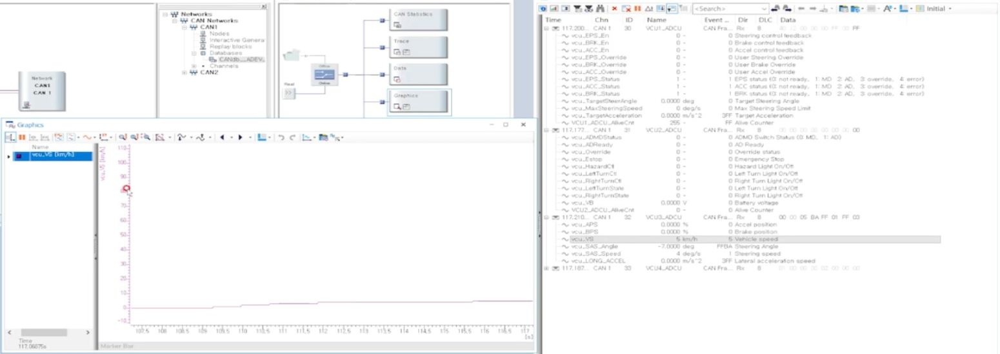

*그림 53. 주행 중 차속 그래프와 차량 동작 상태를 표시한 Trace 창*

| 운전 조작 | 관찰되는 변화 |
|:-----|:-----|
| 천천히 출발한다 | 차속 그래프와 vcu_VS가 약 6 km/h를 나타낸다. 그림 53의 순간에는 5 km/h이다. |
| 비상등을 켠다 | 비상등 시그널(vcu_HazardCtl)의 플래그가 1이 된다. |
| 오른쪽 방향 지시등을 켠다 | 방향 지시등을 켰다는 플래그(vcu_RightTurnCtl)와 깜빡이는 상태(vcu_RightTurnState) 두 가지 플래그 신호에 1이 나타난다. 왼쪽 방향 지시등도 같은 방식으로 나타난다. |
| 가속 페달을 밟아 20 km/h를 넘긴다 | 가속 페달의 퍼센트 값(vcu_APS)이 올라가고 차속이 계속 증가한다. |
| 가속 페달을 놓고 브레이크를 밟는다 | 브레이크 위치(vcu_BPS)가 100% 기준으로 몇 퍼센트 밟았는지 표시된다. |
| 후진 기어를 넣고 후진한 뒤 주행(drive) 모드로 바꾼다 | 기어 상태가 바뀌어 표시된다. |
| 핸들을 왼쪽으로 돌려 진입한다 | 조향각(vcu_SAS_Angle)이 플러스 값으로 바뀐다. |

*표 19. 주행 중 운전 조작과 CAN 데이터의 변화*

예를 들어 오른쪽 방향 지시등을 켰을 때 VCU2_ADCU의 데이터는 00 00 04 00 00 00 00 F8이었다. 바이트 2의 0x04는 2진수로 0000 0100이므로 비트 2만 1이고, 이때 vcu_RightTurnCtl이 1로 표시되었다. 즉 켜고 끄는 상태처럼 0과 1만 필요한 정보는 한 비트짜리 시그널로 바이트 하나에 여러 개를 함께 담는다. 마지막 바이트 F8(248)은 AliveCnt이다. 같은 순간의 VCU3_ADCU 데이터 0F 00 11 84 00 00 02 04는 3.8절의 코드로 해석한 것처럼 가속 페달 6.0%, 차속 17 km/h, 조향각 13.2 deg, 가속도 0.03 m/s²이다.

> **주의:** 이 실험 차량에서 보는 CAN 정보는 교육 목적으로, 실제 차량에서 올라오는 CAN 정보를 중간에 장치를 달아 CAN ID와 CAN 정보를 알아보기 쉽게 변환한 것이다. 따라서 같은 차종에서 CAN 정보를 볼 일이 있더라도 이 CAN DB와는 전혀 다른 정보이므로, 이 DB를 그 차량에 그대로 적용해서는 안 된다. 일반적으로 CAN DB는 제조사와 차종마다 다르고 공개되지 않는다(2.8절).

3.2\~3.4절은 CAN 신호의 전기적 모습을, 3.5\~3.10절은 차량에서 CAN 정보가 실제로 활용되는 모습을 보여 준다.

---

<br>

## 개념 적용

| 상황 | 적용할 개념 |
|:-----|:-----|
| 로그에서 어떤 시그널의 두 바이트가 A1 43으로 보인다. | CAN DB의 바이트 순서가 Intel(리틀 엔디안)이면 0x43A1 = 17313, Motorola(빅 엔디안)이면 0xA143 = 41283으로 읽어야 하므로 먼저 바이트 순서를 확인한다(1.4절, 2.9절). |
| CAN 인터페이스 하나만 버스에 연결하여 프레임을 보냈더니 같은 프레임이 계속 다시 전송된다. | 다른 노드가 ACK 슬롯을 우성으로 덮어쓰지 않아 ACK 오류가 난 것이므로, 받는 노드를 하나 더 연결한다(3.3절). |
| 차량에 모니터링 장비를 연결하자 Trace 창에 오류 프레임만 보인다. | 장비의 비트 전송률이 차량 버스와 다르거나 종단에 문제가 있는지 확인하고, 처음에는 수신 전용 모드로 연결한다(2.7절, 3.6절). |
| 0\~6553.5 km의 주행 거리를 0.1 km 단위로 보내려 한다. | Factor 0.1, Offset 0으로 하면 원시값이 0\~65535이므로 2바이트(16비트)로 충분하다(2.11절). |
| CAN DB가 없는 차량에서 조향각이 들어 있는 바이트를 찾으려 한다. | 핸들을 돌리며 바뀌는 바이트를 찾고, 여러 각도에서 원시값과 실제 각도를 비교하여 바이트 순서, 부호, Factor, Offset을 추정한다(3.7절, 3.8절). |
| 진단 장비로 차량의 엔진 회전수를 읽는다. | OBD-II 커넥터의 6번, 14번 핀에 연결하여 식별자 0x7DF로 서비스 0x01, PID 0x0C를 요청하고 0x7E8의 응답에서 $(256A + B)/4$를 계산한다(2.4절). |

*표 20. 개념 적용 사례*

**T/F 점검:**

| 문장 | 판단과 근거 |
|:-----|:-----|
| 2진수 11111111은 10진수 256이다. | **F.** $11111111_2 = 255$이다. 1바이트는 0\~255의 256가지 상태를 나타낸다. |
| UART는 데이터 비트를 MSB부터 보낸다. | **F.** UART는 LSB부터 보낸다. 0xAB는 1, 1, 0, 1, 0, 1, 0, 1의 순서로 나간다. |
| CAN은 차동 맨체스터 부호로 비트를 싣는다. | **F.** CAN은 NRZ 부호와 비트 스터핑을 쓴다. |
| 같은 기본 식별자를 가진 표준 데이터 프레임과 확장 프레임이 경쟁하면 표준 데이터 프레임이 이긴다. | **T.** 확장 프레임은 RTR 자리에 열성인 SRR을 보내고, 표준 데이터 프레임은 그 자리에 우성을 보낸다. |
| CAN FD는 프레임 전체를 높은 비트 전송률로 보낸다. | **F.** 높은 비트 전송률은 BRS부터 CRC까지의 데이터 단계에만 쓰고, 중재와 ACK는 고전 CAN과 같은 속도로 보낸다. |
| CAN DB는 모든 차량에 공통이므로 한 차종의 DBC 파일을 다른 차종에 써도 된다. | **F.** CAN DB는 제조사와 차종마다 다르며 일반적으로 공개되지 않는다. |

---

<br>

## 요약

| 개념 | 핵심 요약 |
|:-----|:-----|
| CAN의 특징 | 여러 ECU가 꼬임쌍선 버스 하나를 공유하며, 최대 1 Mbit/s, 차동 신호, 식별자 우선순위, ISO 11898 표준을 특징으로 한다. |
| 2진수와 16진수 | 4비트가 16진수 한 자리에 대응하므로 CAN 도구는 바이트를 16진수 두 자리로 표시하며, 1바이트의 최댓값은 0xFF = 255이다. |
| 비트 순서와 바이트 순서 | UART는 LSB부터, CAN은 필드마다 MSB부터 보내며, 여러 바이트 값의 바이트 순서는 Intel(리틀 엔디안)과 Motorola(빅 엔디안)로 나뉜다. |
| UART | 클록 선 없이 시작 비트, 8개의 데이터 비트, 정지 비트로 한 바이트를 보내는 점대점 직렬 통신이다. |
| 보 속도와 비트 전송률 | 비트 전송률은 보 속도에 $\log_2 M$을 곱한 값이며, 두 레벨을 쓰는 UART와 CAN에서는 둘이 같다. |
| 통신 속도와 거리 | 중재와 ACK를 위해 신호가 한 비트 시간 안에 버스를 왕복해야 하므로 버스가 길수록 속도를 낮추어야 한다. |
| 신호 레벨 | 열성은 두 선이 약 2.5 V, 우성은 CAN_H 약 3.5 V와 CAN_L 약 1.5 V이며, 차동 전압 0.9 V 이상이 0, 0.5 V 이하가 1이다. |
| 식별자 우선순위 | 식별자 값이 낮을수록 이기며, 같은 식별자에서는 데이터 프레임이 원격 프레임을, 같은 기본 식별자에서는 표준 프레임이 확장 프레임을 이긴다. |
| CRC | 데이터에 생성 다항식의 차수만큼 0을 붙여 모듈로 2로 나눈 나머지를 보내며, 수신 측은 나머지가 0인지로 오류를 검출한다. |
| 프레임의 종류 | 데이터, 원격, 오류, 과부하 프레임이 있으며, 오류 프레임은 우성 6비트로 스터핑 규칙을 어겨 모든 노드에 오류를 알린다. |
| CAN FD | 데이터를 최대 64바이트로 늘리고 BRS 뒤의 데이터 단계에서만 비트 전송률을 높인다. |
| OBD-II | 16핀 커넥터의 6번, 14번 핀으로 CAN에 연결하며, 0x7DF 요청과 0x7E8 응답의 데이터 프레임으로 차량 정보를 읽는다. |
| 연결과 종단 | DB-9 커넥터의 2번 핀이 CAN_L, 7번 핀이 CAN_H이며, 버스 양 끝에 120 Ω을 두어 합성 저항이 60 Ω이 되게 한다. |
| CAN DB와 DBC | 식별자별 메시지와 시그널의 위치, 길이, 바이트 순서, 부호, Factor, Offset, 단위를 정의한 데이터베이스이며, DBC는 Vector가 만든 텍스트 형식이다. |
| Factor와 Offset | 물리값은 원시값 × Factor + Offset이며, Factor는 범위를 $2^n - 1$로 나눈 분해능, Offset은 최솟값이다. |
| CAN 신호 관찰 | 로직 애널라이저에서 CAN_H와 CAN_L은 2.5 V를 중심으로 대칭으로 움직이며, 프레임의 비트 수와 스터핑 비트로 전송 시간을 계산할 수 있다. |
| CANoe 모니터링 | 500 kbit/s 구성으로 장비를 연결한 뒤 Trace로 원시 데이터를, DBC를 추가하여 시그널의 물리값을 보고, Graphics로 그래프를, Logging으로 BLF 기록을 남긴다. |

---

<br>

## 점검 문제

1. **진법 변환과 비트 순서:** 0xB6을 10진수와 2진수로 바꾸고, UART로 보낼 때 데이터 비트가 나가는 순서를 쓰라.

   <details>
   <summary>정답</summary>

   B = 11, 6 = 6이므로 $0\text{xB}6 = 11 \times 16 + 6 = 182$이다. 2진수는 각 자리를 4비트로 바꾸어 1011 0110이다. UART는 LSB부터 보내므로 데이터 비트는 0, 1, 1, 0, 1, 1, 0, 1의 순서로 나가며, 그 앞에 시작 비트 0, 뒤에 정지 비트 1이 붙는다.

   </details>

2. **바이트 순서와 부호:** 어떤 시그널이 바이트 3\~4에 Intel 바이트 순서, 부호 있는 16비트, Factor 0.1로 정의되어 있다. 바이트 3이 0x38, 바이트 4가 0xFF일 때 물리값을 구하라.

   <details>
   <summary>정답</summary>

   Intel 순서에서는 낮은 바이트가 앞에 오므로 원시값은 0xFF38이다. 부호 없는 값으로 65336이고 최상위 비트가 1이므로 음수이며, 2의 보수로 읽으면 $65336 - 65536 = -200$이다. Factor를 곱하면 $-200 \times 0.1 = -20.0$이다.

   </details>

3. **통신 속도:** 신호 레벨이 네 개인 회선의 보 속도가 1,200 baud이다. 비트 전송률을 구하라. 또 500 kbit/s CAN에서 한 비트의 시간을 구하라.

   <details>
   <summary>정답</summary>

   $M = 4$이므로 비트 전송률은 $1200 \times \log_2 4 = 1200 \times 2 = 2400$ bps이다. CAN은 두 레벨을 쓰므로 보 속도와 비트 전송률이 같고, 500 kbit/s에서 한 비트의 시간은 $1 / 500000 = 2$ µs이다.

   </details>

4. **중재 추적:** 세 노드가 동시에 전송을 시작했다. Node A는 식별자 0x2A4의 데이터 프레임, Node B는 0x2A0의 데이터 프레임, Node C는 0x2A0의 원격 프레임을 보낸다. 각 노드가 지는 위치와 이기는 노드를 쓰라.

   <details>
   <summary>정답</summary>

   11비트 2진수로 0x2A4는 010 1010 0100, 0x2A0은 010 1010 0000이다. ID10\~ID3까지는 세 노드가 같다. ID2에서 Node A는 1, Node B와 C는 0을 보내므로 버스는 0이 되고 Node A가 진다. Node B와 C는 식별자가 같아 ID0까지 승부가 나지 않고, RTR 자리에서 Node B는 데이터 프레임이므로 0, Node C는 원격 프레임이므로 1을 보낸다. 따라서 Node C가 RTR에서 지고 Node B가 이긴다.

   </details>

5. **CRC 계산:** 생성 다항식 $g(x) = x^3 + x + 1$(1011)로 데이터 1101의 CRC를 구하고, 송신할 비트 열을 쓰라.

   <details>
   <summary>정답</summary>

   차수가 3이므로 데이터 뒤에 0을 세 개 붙여 1101000을 1011로 나눈다. 1101 XOR 1011 = 0110이고 다음 비트 0을 내려 1100이 된다. 1100 XOR 1011 = 0111이고 다음 비트 0을 내려 1110이 된다. 1110 XOR 1011 = 0101이고 마지막 비트 0을 내려 1010이 된다. 1010 XOR 1011 = 0001이므로 나머지(CRC)는 001이다. 송신할 비트 열은 1101001이며, 이를 1011로 다시 나누면 나머지가 000이 되어 검산도 성립한다.

   </details>

6. **Factor와 Offset의 설계:** 냉각수 온도를 -40\~215 °C 범위로 1바이트에 담으려 한다. Factor와 Offset을 정하고, 90 °C를 보낼 원시값을 16진수로 쓰라.

   <details>
   <summary>정답</summary>

   1바이트의 원시값 범위는 0\~255이므로 $\text{Factor} = (215 - (-40)) / 255 = 255 / 255 = 1$이고, $\text{Offset} = -40$이다. 90 °C의 원시값은 $(90 - (-40)) / 1 = 130$이며, 16진수로 0x82이다. 받는 쪽은 $130 \times 1 - 40 = 90$ °C로 복원한다.

   </details>

7. **루프백 시험:** CanKing으로 프레임을 보낼 때 Kvaser 장치를 두 대 연결하고 종단 저항을 다는 까닭을 각각 설명하라.

   <details>
   <summary>정답</summary>

   CAN 송신 노드는 다른 노드가 ACK 슬롯을 우성으로 덮어써야 전송이 성공한 것으로 본다. 장치가 하나뿐이면 ACK 오류가 나서 같은 프레임을 계속 다시 보내므로, 받는 노드 역할을 할 장치가 한 대 더 필요하다. 종단 저항은 버스 끝에서 신호가 반사되어 비트를 왜곡하는 것을 막고, 우성에서 열성으로 바뀔 때 두 선을 같은 전압으로 되돌리는 경로가 되므로 CAN 통신에 반드시 필요하다.

   </details>

8. **CAN 신호 관찰:** 로직 애널라이저로 CAN_H와 CAN_L을 접지 기준으로 측정했다. 유휴 상태와 우성 비트에서 각 선의 전압은 대략 얼마이며, 수신기는 무엇으로 비트를 판단하는가?

   <details>
   <summary>정답</summary>

   유휴(열성) 상태에서는 두 선 모두 약 2.5 V이다. 우성 비트에서는 CAN_H가 약 3.5\~3.8 V로 올라가고 CAN_L이 약 1.2\~1.5 V로 내려가 두 선이 2.5 V를 중심으로 대칭으로 움직인다. 수신기는 각 선의 접지 기준 전압이 아니라 두 선의 차 $V_{CAN\_H} - V_{CAN\_L}$로 판단하며, 0.9 V 이상이면 0(우성), 0.5 V 이하이면 1(열성)이다.

   </details>

9. **프레임 길이:** 식별자 0x123, 8바이트 데이터 프레임은 스터핑 비트 3개를 포함하여 SOF부터 EOF까지 111비트였다. 이 프레임을 33.333 kbit/s와 500 kbit/s로 보낼 때 걸리는 시간을 각각 구하라.

   <details>
   <summary>정답</summary>

   33.333 kbit/s의 비트 시간은 약 30 µs이므로 $111 \times 30\ \mu\text{s} = 3.33$ ms이다. 500 kbit/s의 비트 시간은 2 µs이므로 $111 \times 2\ \mu\text{s} = 222$ µs이다. 프레임 사이에는 IFS 3비트가 더 필요하다.

   </details>

10. **OBD-II 응답 해석:** 차속(서비스 0x01, PID 0x0D)을 요청했더니 식별자 0x7E8로 03 41 0D 3C 00 00 00 00을 받았다. 차속은 A km/h로 계산한다. 응답의 각 바이트의 뜻과 차속을 쓰라.

    <details>
    <summary>정답</summary>

    03은 뒤따르는 유효 바이트가 세 개라는 뜻이고, 0x41은 서비스 0x01에 대한 긍정 응답(0x01 + 0x40), 0x0D는 요청한 PID, 0x3C는 데이터 A이다. 차속은 $A = 0\text{x}3\text{C} = 3 \times 16 + 12 = 60$ km/h이다. 남은 바이트는 채움 값이다.

    </details>

11. **CANoe 모니터링:** CAN DB 없이 Trace 창으로 차량 데이터를 볼 때의 한계와, DBC 파일을 추가한 뒤 달라지는 점, 그리고 BLF 기록의 쓰임을 설명하라.

    <details>
    <summary>정답</summary>

    CAN DB가 없으면 식별자와 데이터 바이트가 16진수로만 보이므로, 핸들을 돌려도 어느 바이트가 조향각이고 실제 각도가 얼마인지 알 수 없다. Simulation Setup의 Databases에 DBC 파일을 추가하면 메시지가 이름으로 표시되고, 각 시그널의 물리값, 단위, 원시값, 설명이 함께 나타나며, Graphics로 시그널을 그래프로 볼 수 있다. Logging을 활성화하여 BLF 파일로 기록하면 나중에 데이터를 리플레이하여 분석하거나, 리플레이하면서 다른 CAN 버스로 프레임을 다시 전송하여 같은 상황을 재현할 수 있다.

    </details>

---

<br>

## 참고 문헌

1. Robert Bosch GmbH, *CAN Specification, Version 2.0*, Stuttgart, Germany, 1991.
2. Robert Bosch GmbH, *CAN with Flexible Data-Rate, Specification Version 1.0*, Gerlingen, Germany, 2012.
3. ISO 11898-2:2016, *Road vehicles - Controller area network (CAN) - Part 2: High-speed medium access unit*, International Organization for Standardization, 2016.
4. ISO 11898-1:2015, *Road vehicles - Controller area network (CAN) - Part 1: Data link layer and physical signalling*, International Organization for Standardization, 2015.
5. Vector Informatik GmbH, *Vector E-Learning*. https://elearning.vector.com/
6. CSS Electronics, "OBD2 Explained - A Simple Intro," *CSS Electronics*. https://www.csselectronics.com/pages/obd2-explained-simple-intro
7. SAE International, *SAE J1979: E/E Diagnostic Test Modes*, Warrendale, PA, USA.
8. CAN in Automation, *CiA 303-1: Cabling and connector pin assignment*, version 1.9.0, Nuremberg, Germany, 2017.
9. CSS Electronics, "CAN DBC File Explained - A Simple Intro," *CSS Electronics*. https://www.csselectronics.com/pages/can-dbc-file-database-intro
