# Week 10 Lecture — CAN Communication Practice

[Repository Guide](../../README.md) | [English](Concepts_Lecture.md) | [한국어](Concepts_Lecture.ko.md)

> **Last Updated:** 2026-11-19

> **Learning Objectives:**
> 1. Convert between binary and hexadecimal, and distinguish bit order (MSB first, LSB first) from byte order (little endian, big endian)
> 2. Compare the signal levels, frame structures, and communication speeds of UART and CAN, and trace the outcome of identifier arbitration bit by bit
> 3. Compute a CRC with a generator polynomial and check received data with it
> 4. Explain the CAN frame types, CAN FD, OBD-II, the composition of CAN nodes and monitoring equipment, and the signal wiring and termination resistors
> 5. Convert raw values to physical values with the message and signal definitions of a CAN DB (DBC), and design the factor and offset for a given value range
> 6. Observe and record CAN signals and vehicle data with a logic analyzer, Kvaser CanKing, and Vector CANoe, and interpret the results

---

## Table of Contents

- [1. Review of CAN Communication](#1-review-of-can-communication)
  - [1.1 Features of CAN](#11-features-of-can)
  - [1.2 History of CAN](#12-history-of-can)
  - [1.3 Encoding Information: Binary, Hexadecimal, Bits, and Bytes](#13-encoding-information-binary-hexadecimal-bits-and-bytes)
  - [1.4 Bit Order and Byte Order](#14-bit-order-and-byte-order)
  - [1.5 Serial Communication, Parallel Communication, and Encoding](#15-serial-communication-parallel-communication-and-encoding)
  - [1.6 UART](#16-uart)
  - [1.7 Communication Speed and Communication Distance](#17-communication-speed-and-communication-distance)
  - [1.8 CAN Topology and Signal Levels](#18-can-topology-and-signal-levels)
  - [1.9 CAN Message Frames and the DLC](#19-can-message-frames-and-the-dlc)
  - [1.10 The Arbitration Field and Identifier Priority](#110-the-arbitration-field-and-identifier-priority)
  - [1.11 The CRC Field and the Interframe Space](#111-the-crc-field-and-the-interframe-space)
  - [1.12 Computing and Checking a CRC](#112-computing-and-checking-a-crc)
- [2. Preparing for CAN Communication Practice](#2-preparing-for-can-communication-practice)
  - [2.1 Fields of a CAN Frame](#21-fields-of-a-can-frame)
  - [2.2 Types of CAN Frames](#22-types-of-can-frames)
  - [2.3 CAN FD](#23-can-fd)
  - [2.4 OBD-II](#24-obd-ii)
  - [2.5 Composition of a CAN Node](#25-composition-of-a-can-node)
  - [2.6 CAN Monitoring Equipment and Connection Setup](#26-can-monitoring-equipment-and-connection-setup)
  - [2.7 Signal Wiring and Termination Resistors](#27-signal-wiring-and-termination-resistors)
  - [2.8 CAN Databases and DBC Files](#28-can-databases-and-dbc-files)
  - [2.9 Messages and Signals](#29-messages-and-signals)
  - [2.10 Message Conversion: Factor and Offset](#210-message-conversion-factor-and-offset)
  - [2.11 Designing the Factor and Offset](#211-designing-the-factor-and-offset)
  - [2.12 Data Collection with a CAN Database](#212-data-collection-with-a-can-database)
- [3. CAN Communication Practice](#3-can-communication-practice)
  - [3.1 Practice Setup and Equipment](#31-practice-setup-and-equipment)
  - [3.2 Observing a UART Signal with a Logic Analyzer](#32-observing-a-uart-signal-with-a-logic-analyzer)
  - [3.3 Sending and Receiving CAN Frames with Kvaser CanKing](#33-sending-and-receiving-can-frames-with-kvaser-canking)
  - [3.4 Observing a CAN Signal with a Logic Analyzer](#34-observing-a-can-signal-with-a-logic-analyzer)
  - [3.5 CAN Monitoring Setup of the Test Vehicle](#35-can-monitoring-setup-of-the-test-vehicle)
  - [3.6 Starting CANoe and Configuring the CAN Network](#36-starting-canoe-and-configuring-the-can-network)
  - [3.7 Monitoring without a CAN Database](#37-monitoring-without-a-can-database)
  - [3.8 Monitoring with a CAN Database Added](#38-monitoring-with-a-can-database-added)
  - [3.9 Real-Time Graphs and Data Logging](#39-real-time-graphs-and-data-logging)
  - [3.10 Monitoring while Driving](#310-monitoring-while-driving)
- [Concept Applications](#concept-applications)
- [Summary](#summary)
- [Self-Check Questions](#self-check-questions)
- [References](#references)

---

<br>

## 1. Review of CAN Communication

This part revisits CAN, covered in Week 3 and Week 9, from the viewpoint needed for the practice. Reading the hexadecimal values and signal waveforms on the practice screens requires an understanding of binary and hexadecimal numbers, the order of bits and bytes, serial communication, and communication speed, so these basics are covered as well.

### 1.1 Features of CAN

> **Definition:** **CAN (Controller Area Network)** is a serial bus communication protocol created by Bosch to connect the electronic control units in a vehicle, and it is internationally standardized as ISO 11898.

> **Definition:** An **ECU (electronic control unit)** is a microcontroller-based controller that takes charge of one vehicle function by reading sensor values and controlling actuators (Week 3).

As vehicles became more electronic, an ECU appeared for each function such as the engine, transmission, brakes, steering, and body, and their number grew greatly. Conventional **point-to-point connection** runs a separate wire for every pair of ECUs that must communicate. If $n$ ECUs are all connected to each other, the number of links is $n(n-1)/2$, which is 45 for 10 ECUs and 1,225 for 50 ECUs, so it grows in proportion to the square of the number of ECUs. To solve this problem, a network with a **bus topology**, in which several nodes share one transmission medium, became necessary, and CAN is the representative one.

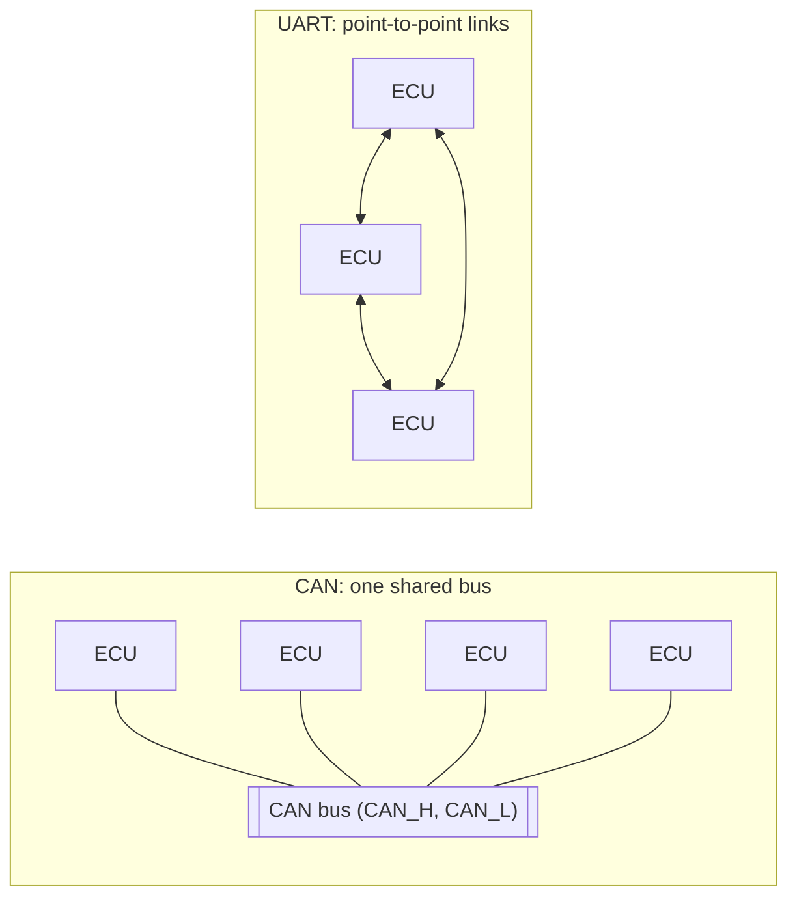

*Figure 1. CAN sharing a bus and UART connecting point to point*

The left side of Figure 1 is a configuration in which every ECU attaches to one pair of CAN wires, and the right side connects three ECUs with UART (Section 1.6), a communication method that links only two devices. In the point-to-point configuration, each additional ECU requires new links and communication ports on the existing ECUs as well, whereas in the bus configuration the new ECU only has to be attached to the bus.

The features of CAN are as follows.

1. **Bus structure:** Several nodes share one transmission medium.
2. **Many nodes:** Because nodes have no addresses, the protocol itself does not limit the number of nodes; the practical number is set by the electrical load the transceivers can drive (see the note below) [1].
3. **Reduced wiring and fault management:** Wiring decreases, and because every message passes through one bus, faults are easy to monitor and trace from a single point on the bus.
4. **Easy design changes and maintenance:** A CAN message carries no address of a receiving node and every node receives every message (broadcast communication in Week 3), so adding or replacing a node seldom requires changes to other nodes.
5. **High-speed real-time communication:** Speeds up to 1 Mbit/s are supported, and messages with higher priority are delivered first (Section 1.10).
6. **Simple physical interface and noise countermeasures:** Communication uses a single twisted pair of two wires, and differential signaling makes it robust against noise (Section 1.8).
7. **International standard:** It is standardized as ISO 11898.

> **Note:** The lecture material states that up to 2032 nodes can be connected in theory, but the number 2032 comes not from a number of nodes but from the number of 11-bit identifiers usable in standard frames. Eleven bits give $2^{11} = 2048$ values, but the Bosch specification forbids the 16 identifiers whose upper 7 bits (ID10-ID4) are all recessive (1), leaving $2048 - 16 = 2032$ [1]. Because an identifier denotes a kind of message, this number is the maximum number of distinct standard messages on one bus. The number of nodes that can actually be attached to one bus is set by the electrical load the transceivers can drive, and it is usually on the order of several dozen (Week 3).

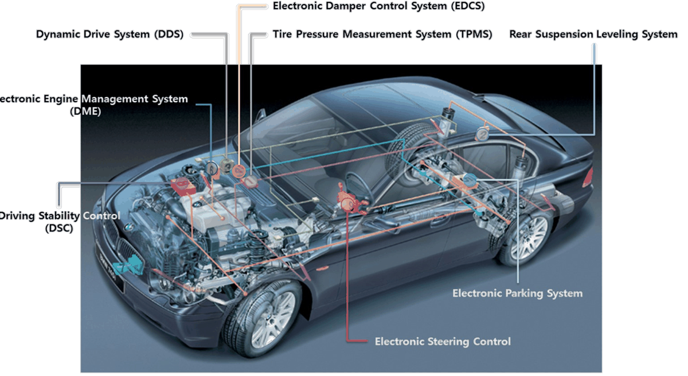

*Figure 2. A passenger car whose chassis and powertrain control systems are connected by CAN*

Figure 2 shows the locations of control systems connected by CAN in a luxury passenger car. The role of each system is as follows.

| System | Role |
|:-----|:-----|
| Tire pressure control system (RDC, TPMS) | Measures tire pressure and warns the driver when it drops. |
| Rear suspension leveling system | Keeps the height of the rear of the body constant even when the weight of cargo or passengers changes. |
| Dynamic Drive (DDS) | Actively reduces body roll, the outward lean of the body when cornering. |
| Electronic damper control system (EDC, EDCS) | Adjusts the damping force of the shock absorbers (dampers) according to the road surface and driving state. |
| Electronic parking system | Applies and releases the parking brake at the push of a button. |
| Electronic engine management system (DME) | Controls engine operation such as fuel injection and ignition timing. |
| Active cruise control (ACC) | Keeps the set speed while automatically adjusting the distance to the vehicle ahead. |
| Dynamic stability control (DSC) | Corrects the vehicle's attitude by controlling individual wheel brakes and engine output when the car skids or slides sideways. |
| Electronic steering control | Electronically adjusts the steering assist or steering ratio according to vehicle speed. |

*Table 1. Control systems in Figure 2 and their roles*

These systems must continuously exchange information such as vehicle speed, engine torque, steering angle, and wheel speeds. For example, DSC judges the vehicle's attitude by using wheel speeds, steering angle, and engine information together, so the ECUs that produce each piece of information must be on the same bus.

### 1.2 History of CAN

| Year | Event |
|:-----|:-----|
| 1983 | Bosch started an internal project to develop an in-vehicle network. |
| 1986 | The CAN protocol was officially introduced. |
| 1987 | Intel and Philips Semiconductors brought the first CAN controller chips to the market. |
| 1991 | Bosch published the CAN specification 2.0. |
| 1992 | CiA (CAN in Automation), an international group of users and manufacturers, was established, and CiA published the application layer protocol CAL (CAN Application Layer). Mercedes-Benz introduced the first production cars using a CAN network. |
| 1993 | The ISO 11898 standard was published. |
| 1994 | CiA organized the first international CAN Conference (iCC). |
| 1995 | Allen-Bradley introduced the DeviceNet protocol. An amendment of ISO 11898 adding the extended frame format was published, and CiA published the CANopen protocol. |
| 2000 | TTCAN (time-triggered communication protocol for CAN), which performs time-triggered communication on top of CAN, was developed. |
| 2012 | Bosch released the CAN FD specification 1.0, which raises the speed and length of the data portion (Section 2.3) [2]. |

*Table 2. Major events in the history of CAN*

The CAN specification defines only the physical layer and the data link layer of the seven OSI layers (Week 3). Application layer protocols that define the meaning of data and how to manage devices were therefore created separately; CAL, CANopen, and DeviceNet are examples, used mainly in industrial automation. TTCAN assigns each message a predetermined time slot, so that message delays remain predictable even when the bus is busy (ISO 11898-4 in Week 3).

> **Note:** Some sources give 2011 as the year CAN FD appeared, but Bosch released the CAN FD specification 1.0 in 2012 [2].

### 1.3 Encoding Information: Binary, Hexadecimal, Bits, and Bytes

> **Definition:** **Binary** represents a number by a sequence of the two digits (states) 0 and 1, and the weight of the $k$-th position from the right (counting from 0) is $2^k$.

> **Definition:** A **bit** is the smallest unit of information, representing one 0 or 1 in binary.

To convert the decimal number 220 to binary, write 220 as a sum of powers of 2. Since $220 = 128 + 64 + 16 + 8 + 4$, the result is as follows.

```math
220 = 1 \times 2^7 + 1 \times 2^6 + 0 \times 2^5 + 1 \times 2^4 + 1 \times 2^3 + 1 \times 2^2 + 0 \times 2^1 + 0 \times 2^0 = 11011100_2
```

> **Definition:** **Hexadecimal** represents a number with the 16 digits 0-9 and a-f (a is 10, f is 15), and the weight of each position is $16^k$.

To convert to hexadecimal, group the binary digits four at a time from the right. A 4-bit group represents 0-15, so it corresponds exactly to one hexadecimal digit. Since $1101_2 = 13 = \text{D}$ and $1100_2 = 12 = \text{C}$, $`220 = 11011100_2 = \text{DC}_{16}`$. Checking in reverse, $13 \times 16 + 12 = 208 + 12 = 220$.

| Binary | Decimal | Hex | Binary | Decimal | Hex |
|:-----|:-----|:-----|:-----|:-----|:-----|
| 0000 | 0 | 0 | 1000 | 8 | 8 |
| 0001 | 1 | 1 | 1001 | 9 | 9 |
| 0010 | 2 | 2 | 1010 | 10 | A |
| 0011 | 3 | 3 | 1011 | 11 | B |
| 0100 | 4 | 4 | 1100 | 12 | C |
| 0101 | 5 | 5 | 1101 | 13 | D |
| 0110 | 6 | 6 | 1110 | 14 | E |
| 0111 | 7 | 7 | 1111 | 15 | F |

*Table 3. Correspondence between 4-bit binary numbers and hexadecimal digits*

> **Definition:** A **byte** is 8 bits and represents $2^8 = 256$ states, that is, values 0-255.

A byte of all 1s is $`11111111_2 = 255 = \text{FF}_{16}`$. A byte represents 256 states, but because counting starts at 0, its largest value is 255, not 256. CAN data is handled in bytes, and one byte fits exactly into two hexadecimal digits, so CAN tools display identifiers and data in hexadecimal. The notation for hexadecimal differs between tools. The C language family uses the `0x` prefix as in `0xDC`, Kvaser CanKing uses the `$` prefix as in `$123`, and CANoe in hexadecimal display mode shows the value without a prefix, as in `DC`. Below, hexadecimal values are written with the 0x prefix.

### 1.4 Bit Order and Byte Order

> **Definition:** The **most significant bit (MSB)** is the leftmost position of a bit string written in binary, the bit with the largest weight.

> **Definition:** The **least significant bit (LSB)** is the rightmost position, the bit with weight $2^0$.

When storing or transmitting a bit string, one must decide which end to handle first. Listing 220 from the MSB gives 1 1 0 1 1 1 0 0, and listing it from the LSB reverses the order to 0 0 1 1 1 0 1 1.

```text
decimal 220 = 0xDC

bit position    7   6   5   4   3   2   1   0
bit value       1   1   0   1   1   1   0   0
               MSB                         LSB

MSB first :  1 1 0 1 1 1 0 0
LSB first :  0 0 1 1 1 0 1 1
```

*Figure 3. Bit positions of 220 and the two bit orders*

In communication, the end from which the bits of a byte are sent is called the **bit order**. UART sends the LSB first (Sections 1.6 and 3.2), and CAN sends the identifier and each data byte MSB first (Section 3.4) [1]. Because the receiver reassembles the bits in the same order, the value itself does not change.

> **Definition:** **Endianness** is the byte order in which a value of two or more bytes is placed in memory or in a message.

> **Definition:** **Little endian** places the least significant byte first (at the lower address or earlier in the message).

> **Definition:** **Big endian** places the most significant byte first.

```text
16-bit value 0x43A1 (= 17313)

                  first byte   second byte
little endian :       A1           43        (least significant byte first)
big endian    :       43           A1        (most significant byte first)
```

*Figure 4. The two byte orders of the 16-bit value 0x43A1*

$0\text{x}43\text{A}1 = 4 \times 4096 + 3 \times 256 + 10 \times 16 + 1 = 16384 + 768 + 160 + 1 = 17313$. Intel-family CPUs use little endian, and Internet protocols such as TCP/IP send multi-byte header fields in big endian (Week 5). In a CAN database, the byte orders are called "Intel" (little endian) and "Motorola" (big endian), and the same data bytes are interpreted as an entirely different value if the byte order is set wrong (Section 2.10).

> **Note:** The lecture material calls storing information from the LSB little endian and storing it from the MSB big endian, and explains them with the example of reversing the bits of 220. In general usage, endianness refers to the byte order of a multi-byte value, and the end from which the bits of a single byte are sent is called the bit order, as above. The two concepts are alike in that both concern which end is handled first, but they differ in whether the unit is a bit or a byte.

### 1.5 Serial Communication, Parallel Communication, and Encoding

Data communication is the exchange of binary digital information over a transmission medium such as a wire. There are two ways to send bits.

- **Serial communication:** Binary information is sent one bit at a time, in order, over one transmission medium.
- **Parallel communication:** Binary information is sent $n$ bits at a time over $n$ transmission media.

```text
Serial (one line)                         Parallel (n lines)

TX  ... b2 b1 b0  ──────────▶  RX         TX   b0 ──────────▶  RX
                                               b1 ──────────▶
                                               b2 ──────────▶
                                               ...
```

*Figure 5. Serial and parallel communication*

Parallel communication sends several bits at once and is therefore faster at the same clock, but it needs many wires, and over longer distances the slight differences in arrival time between wires (skew) grow. Places like vehicles, where wire weight and cost matter and distances exceed a few meters, therefore use serial communication. CAN, LIN, FlexRay, and automotive Ethernet are all serial.

> **Definition:** **Encoding** is the process of converting information of 0 or 1 into an electrical signal. The simplest example represents 1 as 5 V (High) and 0 as 0 V (Low).

The various ways of representing 0 and 1 as voltages (NRZ, Manchester codes, and so on) were covered in Week 4.

### 1.6 UART

> **Definition:** **UART (Universal Asynchronous Receiver/Transmitter)** is a simple serial communication method that sends data one bit at a time between two devices, or the circuit that implements it. It is asynchronous, with no separate clock line, so the transmitter and receiver agree on the same communication speed in advance.

UART represents signal 0 as 0 V and signal 1 as the circuit's supply voltage, 5 V (or 3.3 V). The frame that sends one byte is as follows.

1. **Idle:** When there is nothing to send, the line is held at 1 (High).
2. **Start bit:** A single 0 is sent. The receiver recognizes the start of a byte from the falling edge from 1 to 0, starts its own clock, and then reads each bit at its middle every agreed bit time.
3. **Data bits:** Usually 8 bits are sent **LSB first**.
4. **Parity bit:** Optional; it performs a simple error check based on whether the number of 1s is even or odd.
5. **Stop bit:** One bit (or two bits) of 1 returns the line to High. It ensures that the start bit of the next byte can again create a falling edge.

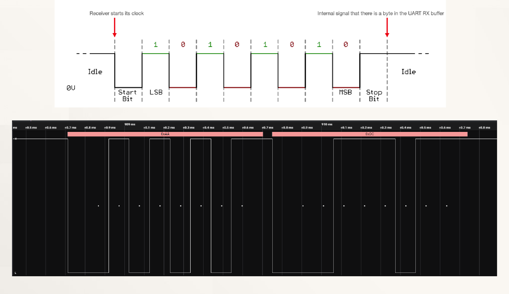

*Figure 6. Structure of a UART frame and a UART waveform measured with a logic analyzer*

In the upper part of Figure 6, the receiver starts its clock at the falling edge of the start bit (Receiver starts its clock), and on reaching the stop bit it generates an internal signal that a byte is in the receive buffer. The data bits are 1, 0, 1, 0, 1, 0, 1, 0 from the LSB, so rewritten from the MSB the byte is $01010101_2 = \text{0x55}$. The lower part is an actual UART waveform measured with a logic analyzer, in which the same structure, starting with a start bit and ending with a stop bit, repeats for each byte. The values 0xAA and 0xDC above the waveform are two consecutive bytes decoded by the logic analyzer. 0xAA (1010 1010) is sent from the LSB in the order 0, 1, 0, 1, 0, 1, 0, 1, so the start bit (0) and the first data bit (0) join to hold Low for two bit times, after which High and Low alternate bit by bit.

| Item | UART | CAN |
|:-----|:-----|:-----|
| Connection | Point to point between two devices | A bus shared by several nodes |
| Signal | Voltage of a single wire relative to ground (0 V and 3.3 V or 5 V) | Differential voltage between CAN_H and CAN_L |
| Synchronization | Falling edge of the start bit of each byte | Falling edge of the SOF and the edges guaranteed by bit stuffing |
| Bit order | LSB first | MSB first in each field |
| Error detection | Optional parity bit | Five mechanisms including a 15-bit CRC (Week 3) |
| Address and priority | None | The identifier indicates the kind of message and its priority |

*Table 4. Comparison of UART and CAN*

### 1.7 Communication Speed and Communication Distance

> **Definition:** The **baud rate** is the number of pulses (signal elements, symbols) that can be sent per second, that is, the number of times per second the signal level can change, in baud.

> **Definition:** The **bit rate** is the number of bits that can be sent per second, in bps (bit/s). The bit rate is the same as the data rate in Week 4.

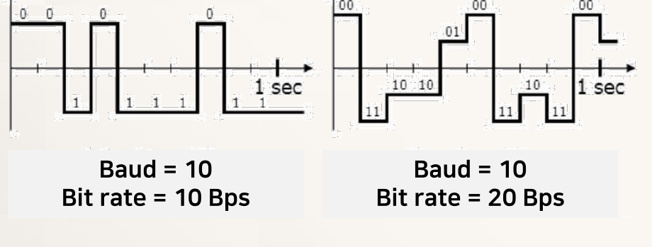

*Figure 7. Bit rates that differ with the number of signal levels at the same baud rate*

Both signals in Figure 7 send 10 pulses per second, so their baud rate is 10 baud. The left signal has two levels (0 and 1), so each pulse carries 1 bit and the bit rate is 10 bps. The right signal has four levels (00, 01, 10, 11), so each pulse carries 2 bits and the bit rate is 20 bps. With $M$ signal levels, the following relation holds (Week 4).

```math
\text{Bit rate (bps)} = \text{Baud rate (baud)} \times \log_2 M
```

UART and CAN use two-level signals ($M = 2$, $`\log_2 2 = 1`$), so their baud rate and bit rate are equal. CAN tools therefore mix the two units for the same speed, as in "500 kBaud" (CANoe) and "500 kbit/s" (CanKing).

> **Note:** Among the explanations quoted in the lecture material, the sentence stating that in systems whose symbols carry several bits "the baud rate is typically much higher than the bit rate" has the relation reversed. When one symbol carries several bits, $\log_2 M > 1$ in the formula above, so the bit rate is higher than the baud rate.

In general, the faster the communication speed, the shorter the possible communication distance.

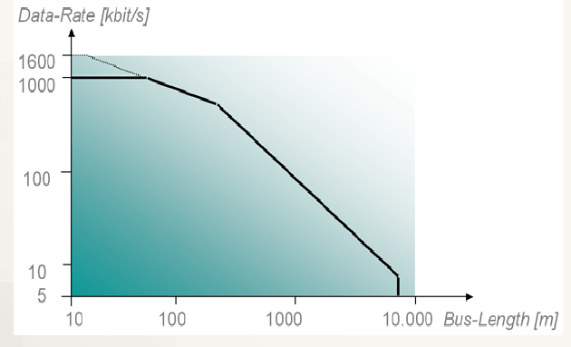

*Figure 8. Maximum data rate versus CAN bus length*

Figure 8 plots the bus length (m) on the horizontal axis and the data rate (kbit/s) on the vertical axis, both on logarithmic scales. A bus of up to a few tens of meters can use 1000 kbit/s (1 Mbit/s), but as the bus gets longer the maximum speed falls, dropping below 10 kbit/s at a few kilometers. The dotted line in the shortest range extends above 1 Mbit/s (to 1600 kbit/s), whereas the maximum speed of the classical CAN specification is 1 Mbit/s. Speed and length are inversely related because of CAN arbitration and acknowledgment. A bit sent by one node must reach the farthest node on the bus and the result must return within one bit time (Week 3), so a longer bus requires a longer bit time, that is, a lower speed. For example, the bit time is 1 µs at 1 Mbit/s and 2 µs at 500 kbit/s.

| Bit rate | Bus length | Nominal bit time |
|:-----|:-----|:-----|
| 1 Mbit/s | 30 m | 1 µs |
| 800 kbit/s | 50 m | 1.25 µs |
| 500 kbit/s | 100 m | 2 µs |
| 250 kbit/s | 250 m | 4 µs |
| 125 kbit/s | 500 m | 8 µs |
| 62.5 kbit/s | 1000 m | 16 µs |
| 20 kbit/s | 2500 m | 50 µs |
| 10 kbit/s | 5000 m | 100 µs |

*Table 5. Maximum bus length and nominal bit time by bit rate*

In Table 5, the nominal bit time is the reciprocal of the bit rate, and the product of the bit rate and the bus length is roughly constant (30-62.5 Mbit/s × m). The same table is also covered in Week 9.

> **Note:** The lecture material gives a bit time of 20 µs in the 1000 m row, but 20 µs is the bit time of 50 kbit/s ($`1 / 50000\ \text{s} = 20\ \mu\text{s}`$). The bit time of 62.5 kbit/s is $`1 / 62500\ \text{s} = 16\ \mu\text{s}`$.

### 1.8 CAN Topology and Signal Levels

A **topology** is the physical shape in which nodes and the transmission medium are connected (bus, star, ring, and so on) (Week 6). A CAN network uses a bus topology and consists of the following elements.

- **Signal lines:** The two lines CAN_H (CAN High) and CAN_L (CAN Low).
- **Termination resistors:** 120 Ω resistors placed between CAN_H and CAN_L at both ends of the bus. They dissipate the signal energy that reaches the end of the transmission medium, preventing reflected waves returning from the end from distorting the original signal.

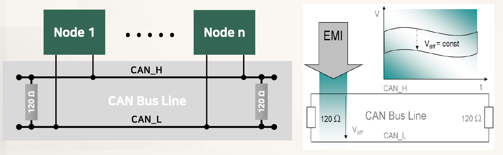

*Figure 9. A CAN bus with termination resistors at both ends and differential signaling robust to electromagnetic interference*

On the left of Figure 9, all nodes from Node 1 to Node n connect to CAN_H and CAN_L, and there is a 120 Ω resistor at each end of the bus. Just as a wave travels back from the far end when one end of a rope is shaken, a signal on a wire reflects at the end; terminating the end with a resistance equal to the characteristic impedance of the line (about 120 Ω) lets the resistor absorb the energy, so no reflection occurs. The right side shows that even when external electromagnetic interference (EMI) enters the two twisted wires equally, the voltage difference $V_{diff}$ between the two wires stays constant. The principle and calculation of termination resistors were covered in detail in Week 3.

The CAN signal levels are defined as follows.

- A twisted pair of two wires is used, and data is expressed by the voltage difference between the two signal lines (**differential signaling**).
- Data 0 is **dominant** and data 1 is **recessive**. When two nodes send different values at the same time, the bus becomes dominant, so dominant has priority over recessive.
- The receiver reads 0 (dominant) when the differential voltage $`V_{diff} = V_{CAN\_H} - V_{CAN\_L}`$ is 0.9 V or more (up to about 5 V) and 1 (recessive) when it is 0.5 V or less. The range between 0.5 V and 0.9 V is a margin in which neither value is guaranteed [3].

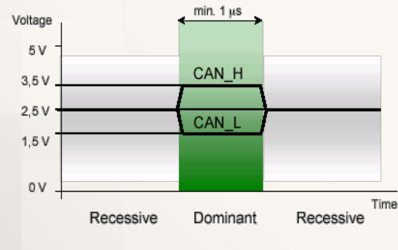

*Figure 10. Voltages of CAN_H and CAN_L in the recessive and dominant states*

In Figure 10, CAN_H and CAN_L are both about 2.5 V in the recessive state, so $V_{diff} \approx 0$ V. In the dominant state, CAN_H rises to about 3.5 V and CAN_L falls to about 1.5 V, so $V_{diff} \approx 2$ V. The "min. 1 µs" at the top is the minimum time one bit occupies at the maximum speed of 1 Mbit/s.

> **Note:** Among the explanations quoted in the lecture material, the statements that CAN uses differential Manchester encoding, that the dominant voltage is close to +5 V and the recessive voltage close to 0 V, and that CAN automatically corrects errors are not correct. CAN uses NRZ coding, which holds the level for a whole bit time, together with bit stuffing [1], and the levels of high-speed CAN are defined by the differential voltage as in Figure 10 [3]. Also, when CAN detects an error it signals it with an error frame and the transmitter resends the frame; it does not correct the error (Week 3). Compared with Manchester coding, which needs two level changes per bit, NRZ changes the signal less often at the same bit rate, and because the dominant or recessive level is held for the whole bit, arbitration and acknowledgment, in which dominant overrides recessive, work over the entire bit.

### 1.9 CAN Message Frames and the DLC

CAN message frames come in two formats according to the length of the identifier.

- **Standard CAN (CAN 2.0A):** Uses an 11-bit identifier.
- **Extended CAN (CAN 2.0B):** Uses a 29-bit identifier.

The data field is at most 8 bytes, and the 4-bit DLC (data length code) in the control field indicates the number of bytes in the data field.

| DLC3 | DLC2 | DLC1 | DLC0 | Number of data bytes |
|:-----|:-----|:-----|:-----|:-----|
| 0 | 0 | 0 | 0 | 0 |
| 0 | 0 | 0 | 1 | 1 |
| 0 | 0 | 1 | 0 | 2 |
| 0 | 0 | 1 | 1 | 3 |
| 0 | 1 | 0 | 0 | 4 |
| 0 | 1 | 0 | 1 | 5 |
| 0 | 1 | 1 | 0 | 6 |
| 0 | 1 | 1 | 1 | 7 |
| 1 | 0 | 0 | 0 | 8 |

*Table 6. DLC values and the number of data bytes*

Four DLC bits can represent 0-15. In classical CAN, 9-15 are interpreted as 8 bytes, and CAN FD uses these values for data lengths longer than 8 bytes (Section 2.3) [4].

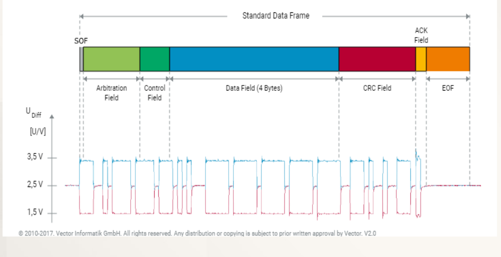

*Figure 11. A standard data frame carrying 4 data bytes and the differential voltage waveform on the bus*

The upper band of Figure 11 divides a standard data frame into the SOF, arbitration field, control field, data field (4 bytes), CRC field, ACK field, and EOF, and the lower part shows the voltages when the same frame is on the bus [5]. The blue line (CAN_H) moves between 2.5 V and 3.5 V and the red line (CAN_L) between 2.5 V and 1.5 V, and the intervals where the two lines separate are dominant bits. After the EOF comes the recessive idle state, in which both lines stay at 2.5 V. The first bit of the ACK field is made dominant not by the transmitter but by the nodes that received the frame, so the waveform height in that interval appears slightly different from the other intervals.

### 1.10 The Arbitration Field and Identifier Priority

| Field | Bits | Role |
|:-----|:-----|:-----|
| Identifier | 11 or 29 | The unique number (ID) of the message, which determines its priority. |
| IDE (identifier extension) | 1 | Indicates whether the frame is in the standard format (dominant) or the extended format (recessive). |
| RTR (remote transmission request) | 1 | Indicates whether the frame is a data frame (dominant) or a remote frame (recessive). |
| SRR (substitute remote request) | 1 | A bit in the extended frame (CAN 2.0B) that takes the place of the RTR of the standard frame (CAN 2.0A); it is always recessive. |

*Table 7. Fields related to arbitration*

```text
Standard (CAN 2.0A) : SOF | ID (11)      | RTR | IDE | r0 | DLC (4) | Data ...
Extended (CAN 2.0B) : SOF | Base ID (11) | SRR | IDE | ID extension (18) | RTR | r1 | r0 | DLC (4) | Data ...
```

*Figure 12. The beginnings of the standard and extended formats*

In the standard format, the arbitration field is the 11-bit identifier and the RTR, and the IDE belongs to the control field. In the extended format, the 11-bit base identifier, SRR, IDE, 18-bit identifier extension, and RTR all belong to the arbitration field. The number of bits in each field of the two formats was covered in detail in Week 3.

A standard identifier is 11 bits, so it can represent 0x000-0x7FF in hexadecimal (0-2047 in decimal). **The lower the identifier value, the higher the priority.** The identifier is sent one bit at a time from the MSB and 0 (dominant) beats 1 (recessive), so at the first position where the bits differ, the node with 0 wins (bit-wise arbitration in Week 3).

**Example 1.** Three nodes start transmitting at the same time. The identifiers are 0x65F (decimal 1631) for Node 1, 0x67F (1663) for Node 2, and 0x659 (1625) for Node 3. The decimal conversion is done as in $0\text{x}65\text{F} = 6 \times 256 + 5 \times 16 + 15 = 1631$. In 11-bit binary, 0x65F is 110 0101 1111, 0x67F is 110 0111 1111, and 0x659 is 110 0101 1001.

```text
ID bit            10  9  8  7  6  5  4  3  2  1  0
Node 1 (0x65F)     1  1  0  0  1  0  1  1  1         -> loses at ID2
Node 2 (0x67F)     1  1  0  0  1  1                  -> loses at ID5
Node 3 (0x659)     1  1  0  0  1  0  1  1  0  0  1   -> wins
Bus                1  1  0  0  1  0  1  1  0  0  1
```

*Figure 13. Arbitration among identifiers 0x65F, 0x67F, and 0x659*

1. **ID10-ID6:** The bits of all three nodes are the same, 1, 1, 0, 0, 1, so the bus takes the same values and all continue transmitting.
2. **ID5:** Only Node 2 sends 1 and the others send 0. The bus becomes 0, so Node 2, which sent 1 and read 0, loses arbitration and switches to receive mode.
3. **ID4, ID3:** Node 1 and Node 3 both send 1 and continue.
4. **ID2:** Node 1 sends 1 and Node 3 sends 0. The bus becomes 0, so Node 1 loses.
5. **From ID1 on:** Only Node 3 remains and sends the rest of the bits and the frame. The result is a win for Node 3, which has the smallest value (1625).

**Example 2.** Node 1 sends a data frame with identifier 0x660 (1632), Node 2 sends a data frame with 0x659, and Node 3 sends the same identifier 0x659 as Node 2 but with 1 (recessive) in the RTR position. 0x660 is 110 0110 0000.

```text
ID bit            10  9  8  7  6  5  4  3  2  1  0  RTR
Node 1 (0x660)     1  1  0  0  1  1                       -> loses at ID5
Node 2 (0x659)     1  1  0  0  1  0  1  1  0  0  1   0    -> wins (data frame)
Node 3 (0x659)     1  1  0  0  1  0  1  1  0  0  1   1    -> loses at RTR
Bus                1  1  0  0  1  0  1  1  0  0  1   0
```

*Figure 14. Arbitration decided by the value in the RTR position for the same identifier*

Node 1 sends 1 at ID5, reads 0, and loses. Node 2 and Node 3 have identical 11-bit identifiers, so there is no decision up to ID0, and at the RTR position Node 2, which sends dominant (0), beats Node 3, which sends recessive (1).

> **Note:** The lecture material explains that a 1 in the RTR position means an extended frame with a larger ID. A recessive bit in the RTR position appears in two cases. One is a remote frame in the standard format (RTR = 1), and the other is the SRR of an extended frame (always 1). Whether a frame is in the extended format is decided by the IDE bit that follows. In either case, a standard data frame with the same base identifier sends 0 in that position and wins. That is, for the same identifier a data frame beats a remote frame, and for the same base identifier a standard frame beats an extended frame [1].

### 1.11 The CRC Field and the Interframe Space

The **CRC field (cyclic redundancy check field)** consists of a 15-bit CRC sequence and a 1-bit CRC delimiter. The transmitter divides the bits from the SOF through the data field (the bits before stuff bits are inserted) by the following generator polynomial and sends the remainder as the CRC sequence [1].

```math
g(x) = x^{15} + x^{14} + x^{10} + x^{8} + x^{7} + x^{4} + x^{3} + 1
```

Listing the coefficients of this polynomial from $x^{15}$ to $x^0$ gives 1100 0101 1001 1001 (16 bits). The CRC delimiter is always recessive and is followed by the ACK field. The principle of computing a CRC by division is examined with a small polynomial in Section 1.12.

The **interframe space (IFS)** is the waiting interval after a data frame or remote frame ends and before the next frame is sent.

```text
... Frame | Intermission (3 bits) | Suspend Transmission (8 bits) | Bus Idle (any length) | Frame ...
          |<------------------------- interframe space ------------------------------->|
```

*Figure 15. Composition of the interframe space*

- **Intermission:** 3 recessive bits. During this time no node may start a data frame or remote frame; only an overload condition may be signaled.
- **Suspend transmission:** If a node in the error passive state (Week 3) has just transmitted a frame, it waits 8 more recessive bits before transmitting again. This prevents an error-prone node from occupying the bus repeatedly.
- **Bus idle:** A recessive interval of arbitrary length. A node with something to send starts transmitting by sending an SOF in this interval.

Error frames and overload frames (Section 2.2) are not preceded by an interframe space [1].

### 1.12 Computing and Checking a CRC

> **Definition:** A **CRC (cyclic redundancy check)** is an error detection method in which the bit string to be sent is divided by a generator polynomial, the remainder is appended and sent, and the receiver divides by the same polynomial and detects an error by whether the remainder is 0.

The division of a CRC uses **modulo-2 arithmetic**. There are no carries or borrows, and both addition and subtraction are exclusive OR (XOR) ($0 \oplus 0 = 0$, $0 \oplus 1 = 1$, $1 \oplus 0 = 1$, $`1 \oplus 1 = 0`$). A bit string is regarded as a polynomial whose coefficients are its bits. For example, 1101 is $x^3 + x^2 + 1$.

**Computing a CRC.** Find the CRC of the data $k(x) = x^3 + 1$ (1001) with the generator polynomial $g(x) = x^3 + x^2 + 1$ (1101).

1. The highest degree of $g(x)$ is 3, so multiply $k(x)$ by $x^3$. $f(x) = x^3 k(x) = x^6 + x^3$, which in binary is 1001000, the data followed by three 0s.
2. Divide $f(x)$ by $g(x)$. If the first bit of the remaining string is 1, align 1101 at that position and XOR; if it is 0, move to the next position. This makes the leading bit 0 at every step.
3. The 3 bits left at the end (as many as the degree of the generator polynomial) are the CRC.

```text
          1111            <- quotient
      ---------
1101 ) 1001000
       1101
       ----
        1000
        1101
        ----
         1010
         1101
         ----
          1110
          1101
          ----
           011            <- remainder = CRC
```

*Figure 16. Modulo-2 division of 1001000 by 1101*

Following each step: 1001 XOR 1101 = 0100, and bringing down the next bit 0 gives 1000. 1000 XOR 1101 = 0101, and bringing down the next bit 0 gives 1010. 1010 XOR 1101 = 0111, and bringing down the last bit 0 gives 1110. 1110 XOR 1101 = 0011, so the remainder is 011. The transmitter appends the CRC 011 to the data 1001 and sends **1001011**.

**Checking a CRC.** The receiver divides the received bit string $1001011$, that is, $x^6 + x^3 + x + 1$, by the same generator polynomial. If the remainder is 0, it judges that there is no error; otherwise, it judges that there is an error.

```text
          1111
      ---------
1101 ) 1001011
       1101
       ----
        1000
        1101
        ----
         1011
         1101
         ----
          1101
          1101
          ----
           000            <- remainder 0: no error detected
```

*Figure 17. Checking 1001011 received without error*

If the third bit from the left is flipped during transmission and 1011011 is received, the remainder is not 0.

```text
          1100
      ---------
1101 ) 1011011
       1101
       ----
        1100
        1101
        ----
         0011
         0000
         ----
          0111
          0000
          ----
           111            <- remainder not 0: error detected
```

*Figure 18. Checking 1011011 with one flipped bit*

The method works for the following reason. Let $q(x)$ be the quotient and $r(x)$ the remainder of dividing $f(x) = x^3 k(x)$ by $g(x)$; then $f(x) = q(x) g(x) + r(x)$. In modulo 2, addition and subtraction are the same, so the transmitted string $f(x) + r(x) = q(x) g(x)$ is divisible by $g(x)$. If an error pattern $e(x)$ is added during transmission, the remainder of the received string becomes the remainder of $e(x)$ divided by $g(x)$. In the example above, $e(x) = x^4$ (0010000), and substituting $x^3 = x^2 + 1$ (modulo $`g(x)`$) into $x^4 = x \cdot x^3$ gives $x^4 = x^3 + x$, and substituting $x^3 = x^2 + 1$ once more gives $x^2 + x + 1$, which matches the remainder 111. Only error patterns divisible by $g(x)$ go undetected, so a 15th-degree polynomial as in CAN detects most errors.

> **[Computer Networks]** The CRC is the error detection method used by Ethernet and most other link layer protocols. If the generator polynomial has degree $r$, the CRC has $r$ bits, and if the constant term of the generator polynomial is 1, every burst error of length $r$ or less is detected. The principle of the CRC was also covered in Week 7.

---

<br>

## 2. Preparing for CAN Communication Practice

This part organizes the knowledge needed to interpret the practice screens. It covers the fields and types of CAN frames, CAN FD and OBD-II, the composition of CAN nodes and monitoring equipment, signal wiring, and the CAN database and the factor and offset that turn CAN data into meaningful values.

### 2.1 Fields of a CAN Frame

| Field | Bits | Role |
|:-----|:-----|:-----|
| SOF (start of frame) | 1 | A dominant bit marking the start of a message. All nodes synchronize to the first falling edge after the idle state. |
| Identifier | 11 | Sets the kind and priority of the message; the lower the binary value, the higher the priority. |
| RTR (remote transmission request) | 1 | Distinguishes a data frame (0) from a remote frame (1). |
| IDE (identifier extension) | 1 | Distinguishes a standard frame (0) from an extended frame (1). |
| r0 | 1 | A reserved bit. |
| DLC (data length code) | 4 | The number of bytes in the data field. |
| Data | 0-64 | 0-8 bytes of data. |
| CRC (cyclic redundancy check) | 15 + 1 | A 15-bit CRC sequence and a 1-bit delimiter, 16 bits in total. |
| ACK (acknowledgement) | 1 + 1 | The acknowledgment slot and its delimiter. A node that received the frame correctly overwrites the slot with dominant to acknowledge reception. |
| EOF (end of frame) | 7 | Seven recessive bits marking the end of the frame. |
| IFS (interframe space) | 3 or more | The waiting interval before the next frame (Section 1.11). |

*Table 8. Fields of a standard CAN data frame*

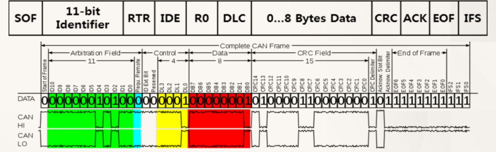

*Figure 19. Bit values of each field of a standard CAN frame and the CAN_H and CAN_L waveforms*

Figure 19 writes the bits of one standard data frame field by field. The SOF is 0, the identifier (green) is 00000010100, that is, 0x014, the RTR (light blue), IDE, and r0 are all 0, the DLC (yellow) is 0001, that is, 1 byte, and the data (red) is 00000001, that is, 0x01. Then follow the 15-bit CRC, the CRC delimiter 1, the ACK slot 0 (the value overwritten with dominant by the receiver), the ACK delimiter 1, the EOF 1111111, and the IFS 111. In the waveform below, the colored intervals are dominant bits in which CAN_H and CAN_L separate, and the other intervals are recessive bits in which the two lines come together.

> **Caution:** Figure 19 shows the bit string before stuff bits are inserted. On the real bus, a stuff bit of the opposite value is inserted whenever five identical values occur in a row (bit stuffing in Week 3), so a stuff bit 1 is inserted three times between the SOF and the end of the data field of this frame: first after the 0 of the SOF and the first four identifier bits 0000, second after the last two identifier bits 00 and the three 0s of RTR, IDE, and r0, and third after the first five 0s of the data byte 00000001. In addition, the CRC cells of the figure (010000110000000) differ from the CRC of this frame; dividing the bits from the SOF to the end of the data field by the generator polynomial of Section 1.11 gives the CRC 111 0111 0101 0011 (0x7753). Section 3.4 computes the CRC and the stuff bit positions of a frame actually sent.

### 2.2 Types of CAN Frames

CAN has four types of frames.

| Type | Role | Composition |
|:-----|:-----|:-----|
| Data frame | A transmitter sends data to one or more receivers. | Consists of the fields in Section 2.1. |
| Remote frame | A receiver asks a transmitter to send the data of a specific identifier. | Same as a data frame except that the RTR is recessive and there is no data field. The DLC indicates the length of the requested data. |
| Error frame | A node that detected an error notifies all nodes that the frame contains an error. | Consists of an error flag (6 dominant bits for an error active node, 6 recessive bits for an error passive node) and an error delimiter (8 recessive bits). |
| Overload frame | When a receiver is not ready to receive the next frame, it extends the waiting time between data frames or remote frames. | Consists of an overload flag (6 dominant bits) and an overload delimiter (8 recessive bits). |

*Table 9. The four types of CAN frames*

The error flag of an error active node sends six dominant bits in a row, deliberately violating the bit stuffing rule (at most five identical values). All other nodes receiving the frame at that moment therefore also detect a stuff error and discard the frame, and the transmitter sends the frame again [1]. A remote frame loses arbitration against a data frame with the same identifier (Example 2 in Section 1.10). In today's vehicles, each ECU mostly sends data frames at fixed periods, and CAN FD has no remote frames [4].

### 2.3 CAN FD

> **Definition:** **CAN FD (CAN with Flexible Data-Rate)** is an extension of CAN that keeps the arbitration of classical CAN, enlarges the data field up to 64 bytes, and raises the bit rate only in the interval that sends the data. Bosch released specification 1.0 in 2012 [2], and it was included in ISO 11898-1:2015 [4].

The features of CAN FD are as follows.

- The amount of data that can be sent was enlarged from at most 8 bytes to 64 bytes.
- The transmission speed is raised only in the region that sends data (the data phase), where speeds above 1 Mbit/s can be used.

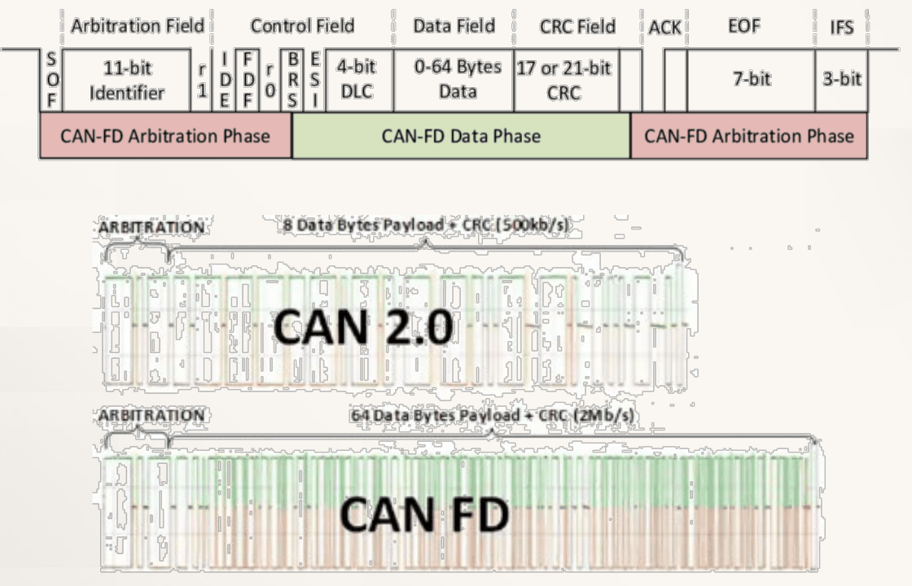

*Figure 20. Structure of a CAN FD frame and comparison with a CAN 2.0 frame*

The upper part of Figure 20 is the structure of a CAN FD frame. The SOF, 11-bit identifier, r1, IDE, EDL, r0, BRS, ESI, 4-bit DLC, 0-64 bytes of data, a 17-bit or 21-bit CRC, ACK, a 7-bit EOF, and a 3-bit IFS come in order. The new bits mean the following.

- **EDL (extended data length):** Recessive indicates a CAN FD frame. The ISO standard calls it FDF (FD format). In a classical CAN frame this position is the reserved bit r0 (dominant).
- **r1:** The position of the RTR in classical CAN. CAN FD has no remote frames, so it is always dominant; the ISO standard calls it RRS (remote request substitution).
- **BRS (bit rate switch):** If recessive, the frame is sent at the higher data bit rate from the sample point of the BRS bit to the sample point of the CRC delimiter (the sample point is explained in Section 3.3).
- **ESI (error state indicator):** Indicates whether the transmitter is error active (dominant) or error passive (recessive).
- **CRC:** 17 bits if the data is 16 bytes or less, 21 bits if it is more than 16 bytes. The longer CRC preserves detection capability for the longer data.

The colored bands in the figure divide the frame into two phases. The arbitration phase (CAN-FD Arbitration Phase) runs from the SOF through the BRS and from the ACK onward, and uses the same bit rate as classical CAN. The data phase (CAN-FD Data Phase) runs from after the BRS through the CRC and uses a higher bit rate. The speed can be raised only in the data phase because of the distance constraint in Section 1.7. In arbitration and acknowledgment, several nodes send the same bit at the same time, so the signal must make a round trip on the bus within the bit time, but in the data phase only the one node that won arbitration is sending, so this constraint does not apply. The lower part of the figure compares a CAN 2.0 frame sending 8 bytes at 500 kbit/s with a 64-byte CAN FD frame whose data phase is sent at 2 Mbit/s, showing that CAN FD sends eight times the data in a time that is not much different.

| DLC | 0-8 | 9 | 10 | 11 | 12 | 13 | 14 | 15 |
|:-----|:-----|:-----|:-----|:-----|:-----|:-----|:-----|:-----|
| Number of data bytes | Same as DLC | 12 | 16 | 20 | 24 | 32 | 48 | 64 |

*Table 10. DLC and number of data bytes in CAN FD*

The detailed frame format of CAN FD was covered in Week 9.

### 2.4 OBD-II

> **Definition:** **OBD-II (On-Board Diagnostics II)** is a standard for diagnosing vehicle faults. Diagnostic equipment is connected to the 16-pin OBD connector on the driver's side of the vehicle to read the vehicle state and fault codes, and repair shops use it to diagnose vehicles. OBD-II communication over CAN is defined by ISO 15765-4.

OBD-II was mandated to monitor emission-related faults: the United States made it mandatory from model-year 1996 passenger cars, and the European Union from 2001 for gasoline cars and from 2003 for diesel cars. In the United States, using CAN (ISO 15765-4) for OBD-II communication has been mandatory since model year 2008 [6]. Vehicle state information readable through OBD-II includes engine speed (RPM), vehicle speed, battery voltage, diagnostic trouble codes (DTCs), and coolant temperature.

OBD-II communication over CAN consists of requests and responses. When the diagnostic equipment sends a request data frame with identifier 0x7DF, the ECU that holds the information sends a response data frame with an identifier in the range 0x7E8-0x7EF. The requested information is specified by a service (mode) number and a PID (parameter identifier) [6], [7].

**Example.** Read the engine speed. Engine speed is PID 0x0C of service 0x01.

```text
request  ID 0x7DF  data: 02 01 0C 00 00 00 00 00   (2 bytes follow: service 0x01, PID 0x0C)
response ID 0x7E8  data: 04 41 0C 1A F8 00 00 00   (4 bytes follow: 0x41 = 0x01 + 0x40, PID 0x0C, A = 0x1A, B = 0xF8)
```

The first byte 04 of the response is the number of valid bytes that follow, 0x41 is the positive response to service 0x01 (0x01 + 0x40), and 0x0C is the requested PID. Engine speed is computed as $(256A + B)/4$, so substituting $A = 0\text{x}1\text{A} = 26$ and $B = 0\text{xF}8 = 248$ gives $(256 \times 26 + 248)/4 = (6656 + 248)/4 = 6904/4 = 1726$ rpm [7]. The remaining bytes of the request frame are padding that fills the length to 8 bytes.

> **Note:** The lecture material explains that OBD-II receives vehicle state information by using CAN remote frames, but OBD-II communication according to ISO 15765-4 uses data frames for both requests and responses, as above. A remote frame cannot carry data, so it cannot convey which service and PID are wanted.

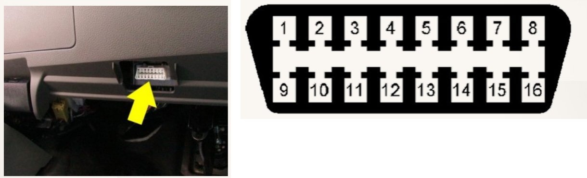

*Figure 21. The OBD-II connector under the driver's side and its 16-pin layout*

| Pin | Description | Pin | Description |
|:-----|:-----|:-----|:-----|
| 1 | Vendor option | 9 | Vendor option |
| 2 | J1850 Bus+ | 10 | J1850 Bus- |
| 3 | Vendor option | 11 | Vendor option |
| 4 | Chassis ground | 12 | Vendor option |
| 5 | Signal ground | 13 | Vendor option |
| 6 | CAN High (J-2284) | 14 | CAN Low (J-2284) |
| 7 | ISO 9141-2 K-Line | 15 | ISO 9141-2 L-Line |
| 8 | Vendor option | 16 | Battery power |

*Table 11. Pin assignment of the OBD-II connector*

Vehicles using CAN communicate with diagnostic equipment over pin 6 (CAN High) and pin 14 (CAN Low). J1850 and ISO 9141-2 are diagnostic communication methods used before CAN (Week 3), and the battery power on pin 16 lets the diagnostic equipment operate without a separate power supply.

### 2.5 Composition of a CAN Node

A CAN node contains the ICs that actually perform CAN communication and consists of three parts.

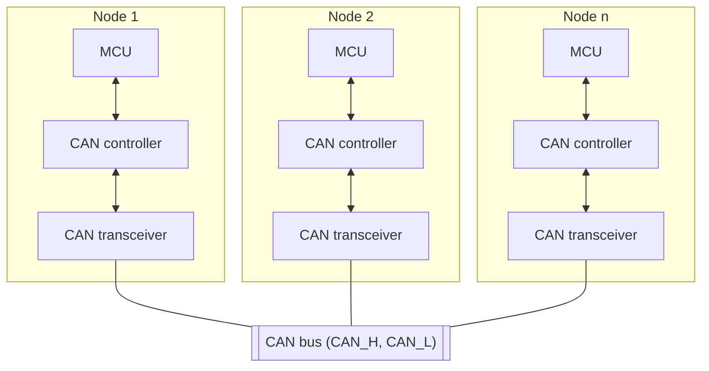

*Figure 22. CAN nodes consisting of an MCU, a CAN controller, and a CAN transceiver*

- **MCU (microcontroller unit):** Runs the application program, producing data to send and processing received data.
- **CAN controller:** Handles the data link layer tasks in hardware, such as building and parsing frames, bit stuffing, CRC computation, arbitration, acknowledgment, and error handling.
- **CAN transceiver:** Converts the controller's logic signals (Tx, Rx) into the differential voltage of CAN_H and CAN_L, and converts the differential voltage of the bus back into logic signals. The electrical characteristics of high-speed CAN transceivers are defined by ISO 11898-2 [3].

The USB CAN interface devices (Kvaser, Vector) used in the practice are also CAN nodes with an internal CAN controller and transceiver, and the role of the MCU is taken by the software on the PC connected over USB. The internal structure of a node was covered in detail in Week 3.

### 2.6 CAN Monitoring Equipment and Connection Setup

Monitoring CAN information requires equipment that receives CAN data and displays it on a PC. The practice uses two kinds of equipment.

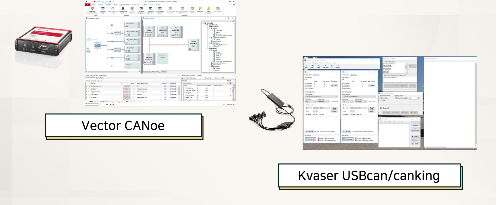

*Figure 23. CAN monitoring equipment and software: Vector CANoe, and Kvaser USBcan with CanKing*

- **Vector CANoe:** Software from Vector Informatik for developing and testing vehicle networks, used with the same company's CAN interface hardware (the red device in Figure 23). It supports real-time monitoring, signal interpretation, graphs, logging and replay, and network simulation, and requires a license.
- **Kvaser USBcan and CanKing:** Kvaser's USB-CAN interface device (the black cable-type device in Figure 23) and its software CanKing. It provides the basic functions of composing and sending CAN frames and displaying received frames.

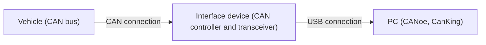

*Figure 24. Connection setup that brings a vehicle's CAN information to a PC*

The interface device joins the vehicle's CAN bus as a node, receives frames, and passes them to the PC over USB. The software on the PC displays or interprets these frames, and conversely it can compose frames and send them onto the bus through the device.

### 2.7 Signal Wiring and Termination Resistors

CAN can be connected with just two wires, and connections between pieces of equipment usually use a **D-sub 9-pin (DB-9) connector**.

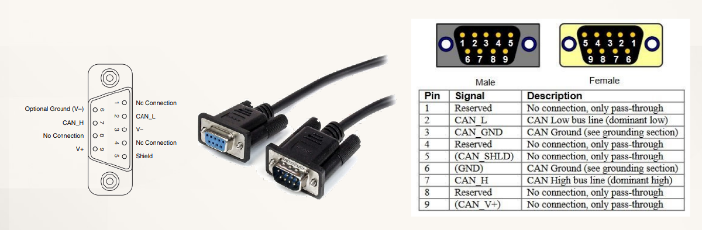

*Figure 25. Pin assignment of a DB-9 connector for CAN and the cable*

| Pin | Signal | Description |
|:-----|:-----|:-----|
| 1, 4, 8 | Reserved | Not connected. |
| 2 | CAN_L | The CAN Low line of the bus (goes low when dominant). |
| 3 | CAN_GND | CAN ground. |
| 5 | (CAN_SHLD) | Optional cable shield. |
| 6 | (GND) | Optional ground. |
| 7 | CAN_H | The CAN High line of the bus (goes high when dominant). |
| 9 | (CAN_V+) | Optional external power supply. |

*Table 12. Pin assignment of a DB-9 connector for CAN*

Table 12 follows the recommendation of CiA 303-1, and the signals in parentheses are optional [8]. The left of Figure 25 shows this assignment as a connector drawing, the middle shows a DB-9 cable, and the right shows the pin numbers of the male and female connectors and the description of each pin. Male and female connectors mate face to face, so their pin numbers are mirrored left to right.

The transmission medium is two ordinary wires twisted together.

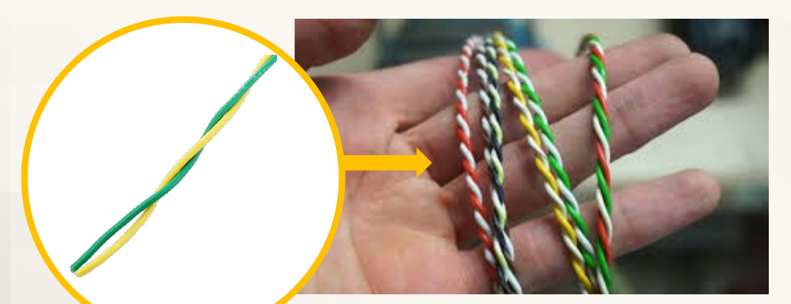

*Figure 26. A CAN transmission medium made by twisting two wires*

Twisting makes the two wires alternate their positions in space, so external interference enters both wires almost equally and cancels in the differential receiver (Figure 9). Also, the magnetic fields made by the currents flowing in opposite directions in the two wires cancel each other, reducing the electromagnetic noise emitted by the CAN wires themselves. This is why vehicle CAN wiring consists of two twisted wires (usually of different colors).

A termination resistor is made by connecting a 120 Ω resistor between the CAN_H and CAN_L signal lines. When connecting with DB-9 connectors, as with the practice equipment, a DB-9 connector with a built-in 120 Ω resistor (a termination adapter) is plugged in at the end of the bus.

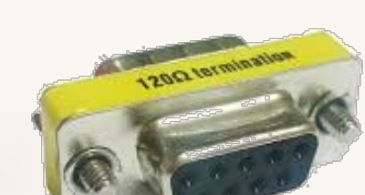

*Figure 27. A DB-9 termination adapter with a built-in 120 Ω resistor*

> **Caution:** Termination resistors are placed only at the two ends of the bus. Measuring the resistance between CAN_H and CAN_L with the power off gives about 60 Ω on a healthy bus, the parallel combination of two 120 Ω resistors. About 120 Ω means one termination resistor is missing; if the resistance is too high, reflections make communication unstable, and if it is too low, the differential voltage becomes insufficient (Week 3).

### 2.8 CAN Databases and DBC Files

Receiving CAN signals as they are shows the identifiers and data bytes only in hexadecimal, so it is hard to tell which byte contains which information. The CAN database solves this.

> **Definition:** A **CAN DB (CAN database)** is a database that organizes, for each identifier, the information a data frame carries (message name, position and length of each signal, conversion method, unit, and so on).

> **Definition:** A **DBC file (CAN dbc file)** is the CAN database file format created by Vector, used as a de facto industry standard.

Each vehicle can have a different CAN database, and because that information is an asset of the manufacturer, it is generally not published.

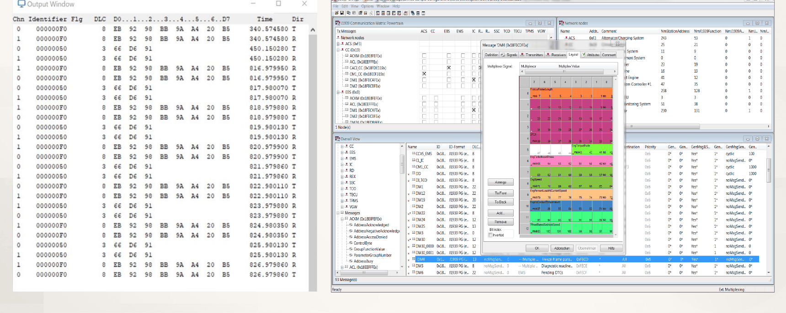

*Figure 28. Raw CAN data displayed in hexadecimal and a CAN database editing screen*

The left of Figure 28 is a list of frames received without a CAN database. The columns are the channel (Chn), identifier (Identifier), flags (Flg), DLC, data bytes D0-D7, time (Time), and direction (Dir, T for transmit and R for receive); frames such as identifiers 0x0F0 and 0x050 repeat periodically, but the meaning of each byte is unknown. The right is the screen of Vector's CAN database editor (CANdb++ Editor), showing lists of messages and signals and a layout screen that shows in color which bits of the data field each signal occupies.

A DBC file is a text file. The message vehicle_status2 (identifier 0x301) of Section 2.10 and its signal longitudinal_acceleration are written in DBC syntax as follows [9].

```text
BO_ 769 vehicle_status2: 8 Vector__XXX
 SG_ longitudinal_acceleration : 0|16@1+ (0.01,-10.23) [-10.23|10.23] "m/s^2" Vector__XXX
```

- `BO_ 769 vehicle_status2: 8 Vector__XXX`: The message definition. The identifier is written in decimal, so 769 is 0x301; the name is vehicle_status2, the data length is 8 bytes, and Vector__XXX means the transmitting node is not specified.
- `SG_ longitudinal_acceleration :`: The name of a signal belonging to this message.
- `0|16`: The start bit is 0 and the length is 16 bits.
- `@1+`: `@1` is the Intel (little endian) byte order (`@0` would be Motorola), and `+` means an unsigned value (`-` would mean signed).
- `(0.01,-10.23)`: The factor is 0.01 and the offset is -10.23 (Section 2.10).
- `[-10.23|10.23]`: The minimum and maximum physical values.
- `"m/s^2"` and the final `Vector__XXX`: The unit and the receiving node.

### 2.9 Messages and Signals

> **Definition:** A **message** is one data frame with a unique identifier in CAN communication.

> **Definition:** A **signal** is an individual piece of information to be sent over CAN (speed, acceleration, switch state, and so on), and one message can contain several signals.

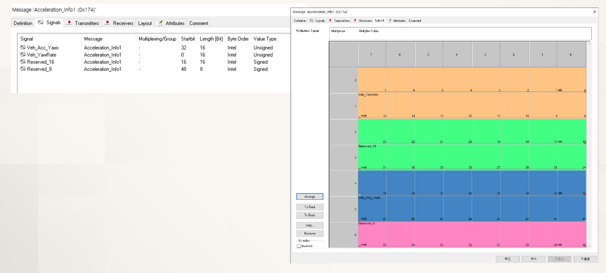

*Figure 29. Signal list and layout of the message Acceleration_Info1 in a CAN database editor*

The left of Figure 29 is the signal list of the message Acceleration_Info1 (identifier 0x174), and the right is the Layout screen that marks in color which bits of the 8-byte data field each signal occupies. The rows of the layout screen are bytes 0-7 and the columns are bits 7-0 within each byte.

| Signal | Start bit | Length (bits) | Byte order | Value type |
|:-----|:-----|:-----|:-----|:-----|
| Veh_YawRate | 0 | 16 | Intel | Unsigned |
| Reserved_16 | 16 | 16 | Intel | Signed |
| Veh_Acc_Yaxis | 32 | 16 | Intel | Unsigned |
| Reserved_8 | 48 | 8 | Intel | Signed |

*Table 13. Signal definitions of the message Acceleration_Info1*

Each item of a signal definition means the following.

- **Start bit and length:** Indicate at which bit of the data field the signal starts and how many bits it occupies. Bits are numbered with bit 0 of byte 0 as 0, so bit 0 of byte 1 is 8, bit 0 of byte 2 is 16, and so on. Veh_YawRate therefore occupies bytes 0-1, Reserved_16 bytes 2-3, Veh_Acc_Yaxis bytes 4-5, and Reserved_8 byte 6.
- **Byte order:** Determines whether a signal spanning several bytes is read in little endian (Intel) or big endian (Motorola) (Section 1.4).
- **Value type:** Determines whether the bit string is read as an unsigned integer or as a signed integer in two's complement.

Signals named Reserved are positions not used now and kept for later functions. The message in Table 13 does not use byte 7, so its four signals fit in 7 of the 8 bytes.

### 2.10 Message Conversion: Factor and Offset

A CAN data frame can send at most 8 bytes, so the data it can carry is limited. Real values are therefore not sent as they are but converted to integers with a **factor** and an **offset**, which lets one frame carry more signals and increases network efficiency.

> **Definition:** The integer carried on the bus is called the **raw value**.

> **Definition:** The value with an actual unit is called the **physical value**. The raw value and the physical value are converted by the following linear function.

```math
\text{Physical value} = \text{Raw value} \times \text{Factor} + \text{Offset}, \qquad \text{Raw value} = \frac{\text{Physical value} - \text{Offset}}{\text{Factor}}
```

For example, acceleration data contains fractions, so in a program it is represented as a double and needs 8 bytes. Converting the value with a factor and offset so that it falls within the range of an unsigned short (0-65535) means only 2 bytes are needed. An 8-byte data field holds only one double, but up to four 2-byte raw values.

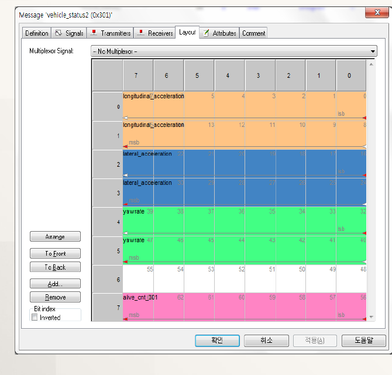

*Figure 30. Signal layout of the message vehicle_status2 and interpretation of its data bytes*

Figure 30 is the layout of the message vehicle_status2 (identifier 0x301). Bytes 0-1 hold longitudinal_acceleration, bytes 2-3 lateral_acceleration, bytes 4-5 yawrate (the angular speed at which the vehicle rotates about its vertical axis), and byte 7 alive_cnt_301, while byte 6 is empty. When the data bytes of this message are A1 43 C3 43 E5 43 A7 43, each signal is in Intel order, so the low byte comes first.

| Signal | Bytes | Raw value (hex) | Raw value (decimal) |
|:-----|:-----|:-----|:-----|
| longitudinal_acceleration | A1 43 | 0x43A1 (0100 0011 1010 0001) | 17313 |
| lateral_acceleration | C3 43 | 0x43C3 (0100 0011 1100 0011) | 17347 |
| yawrate | E5 43 | 0x43E5 (0100 0011 1110 0101) | 17381 |

*Table 14. Raw values read from the data bytes of vehicle_status2*

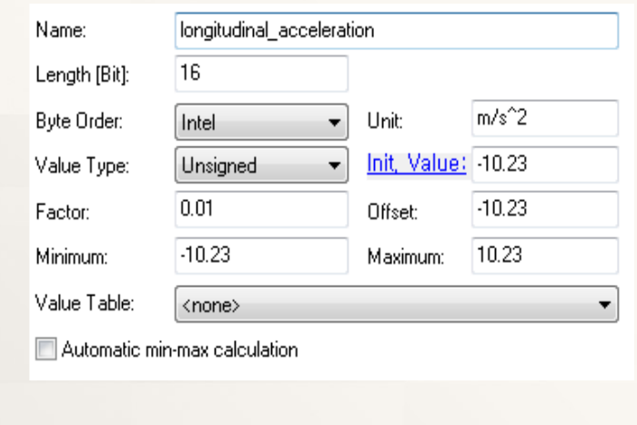

*Figure 31. Definition of the signal longitudinal_acceleration*

According to the definition in Figure 31, longitudinal_acceleration is 16 bits long, in Intel byte order, and unsigned, with factor 0.01, offset -10.23, unit m/s², minimum -10.23, and maximum 10.23. The initial value (Init. Value) is used before the message is first received, and the value table (Value Table) is used to give names to raw values, as in 0: not ready, 1: active. Converting the raw value 17313 with this definition gives the following.

```math
17313 \times 0.01 + (-10.23) = 173.13 - 10.23 = 162.9\ \text{m/s}^2
```

> **Note:** The procedure of this calculation is correct, but the result 162.9 m/s² far exceeds the maximum of 10.23 m/s² defined for this signal. Under this definition, the meaningful raw values run from 0 (-10.23 m/s²) to 2046 (+10.23 m/s²). The raw value 0x43A1 (17313) equals the value obtained by encoding -1.9689668 with factor 0.0001274 and offset -4.174643 in the example of Section 2.11, and interpreted with the definition of Figure 31 it falls outside the defined range, so the data bytes of Figure 30 and the definition of Figure 31 do not match each other. If the receiver uses a definition different from the sender's, out-of-range values like this appear, so it is a good habit to check that an interpreted value lies within the defined range.

### 2.11 Designing the Factor and Offset

The factor and offset are determined in the following order.

1. Find the range (minimum and maximum) of the data to send and place it on the $y$ axis (physical value).
2. Place the number of bytes to use in the CAN data frame, and the range of values those bytes can represent, on the $x$ axis (raw value).
3. Find the linear function $y = ax + b$ connecting the ends of the two ranges. The slope $a$ is the factor and the $y$ intercept $b$ is the offset.

If the raw value has $n$ bits, the general formula is as follows.

```math
\text{Factor} = \frac{y_{max} - y_{min}}{2^n - 1}, \qquad \text{Offset} = y_{min}
```

**Example.** The data to send ranges from -4.174643 to +4.174516, and 2 bytes are used. Two bytes can represent 0-65535.

1. The range of physical values is $\Delta y = 4.174516 - (-4.174643) = 8.349159$.
2. The range of raw values is $\Delta x = 65535 - 0 = 65535$.
3. The factor is $8.349159 / 65535 = 0.0001274$. The raw value 0 must correspond to the minimum -4.174643, so the offset is -4.174643.

```math
y = \frac{4.174516 - (-4.174643)}{65535} x - 4.174643 = 0.0001274 x - 4.174643
```

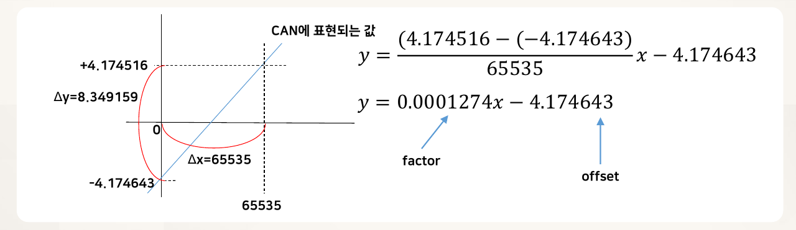

*Figure 32. Factor and offset obtained from the linear function connecting the physical range and the raw range*

As a check, at $x = 65535$, $y = 65535 \times 0.0001274 - 4.174643 = 8.349159 - 4.174643 = 4.174516$, which matches the maximum.

**Encoding and decoding.** When the data to send is -1.9689668, the transmitting node computes the raw value as follows.

```math
\text{Transmitting node: } \frac{-1.9689668 - (-4.174643)}{0.0001274} = \frac{2.2056762}{0.0001274} = 17313 = \text{0x43A1}
```

Converting 17313 to hexadecimal gives 0x43A1 because $17313 = 4 \times 4096 + 3 \times 256 + 10 \times 16 + 1$. Sent in Intel order, the data bytes are A1 43, the same as the first two bytes in Figure 30. The receiving node recovers the original value as follows.

```math
\text{Receiving node: } 17313 \times 0.0001274 - 4.174643 = 2.2056762 - 4.174643 = -1.9689668
```

In this example the raw value comes out exactly as an integer, so the value is recovered exactly, but in general the raw value is rounded to the nearest integer, so the recovered value has an error of up to half the factor (about 0.0000637 here). That is, the factor is the **resolution** of the signal. More bits improve the resolution but take up more room in the frame, so the number of bits is chosen to match the required range and precision.

> **Note:** The lecture material also contains a sentence saying that of the 2-byte range 0-65535 only 0-200 will actually be used, but the calculation above uses the whole range 0-65535 as the raw range. Shrinking the raw range to 0-200 would make $\Delta x = 200$, so the factor would grow to $8.349159 / 200 \approx 0.0417$ and the resolution would worsen accordingly.

### 2.12 Data Collection with a CAN Database

When a CAN database is loaded into a monitoring tool, the tool splits the data bytes of each message into signals, applies the factor and offset, and shows the physical values with units.

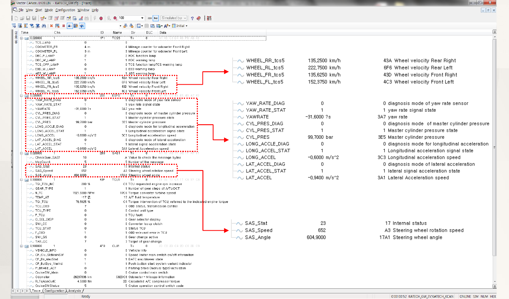

*Figure 33. A trace screen showing the physical values of signals with a CAN database applied*

The left of Figure 33 is a trace screen with a CAN database applied, and the right enlarges the signals of the three messages marked with dotted lines. Each signal is shown as physical value, raw value (hexadecimal), and description, in that order. Comparing raw and physical values shows whether each signal fits the conversion in Table 15. Because one pair of values does not determine both factor and offset, the conversions in Table 15, apart from LONG_ACCEL and LAT_ACCEL whose definition is known, are formulas that satisfy the observed values.

| Signal | Description | Raw value | Physical value | Conversion |
|:-----|:-----|:-----|:-----|:-----|
| WHEEL_RR_tcs5 | Rear right wheel speed | 0x43A = 1082 | 135.25 km/h | $1082 \times 0.125$ |
| WHEEL_RL_tcs5 | Rear left wheel speed | 0x6F6 = 1782 | 222.75 km/h | $1782 \times 0.125$ |
| WHEEL_FR_tcs5 | Front right wheel speed | 0x43D = 1085 | 135.625 km/h | $1085 \times 0.125$ |
| WHEEL_FL_tcs5 | Front left wheel speed | 0x4C3 = 1219 | 152.375 km/h | $1219 \times 0.125$ |
| YAWRATE | Yaw rate | 0x3A7 = 935 | -31.6 °/s | $935 \times 0.01 - 40.95$ |
| CYL_PRES | Brake master cylinder pressure | 0x3E5 = 997 | 99.7 bar | $997 \times 0.1$ |
| LONG_ACCEL | Longitudinal acceleration | 0x3C3 = 963 | -0.60 m/s² | $963 \times 0.01 - 10.23$ |
| LAT_ACCEL | Lateral acceleration | 0x3A1 = 929 | -0.94 m/s² | $929 \times 0.01 - 10.23$ |
| SAS_Speed | Steering wheel rotation speed | 0xA3 = 163 | 652 | $163 \times 4$ |
| SAS_Angle | Steering wheel angle | 0x17A1 = 6049 | 604.9 | $6049 \times 0.1$ |

*Table 15. Relations between raw and physical values found in the signals of Figure 33*

In Table 15, LONG_ACCEL and LAT_ACCEL use the same factor 0.01 and offset -10.23 as Figure 31, and the physical value is near 0 when the raw value is near 1023. The wheel speed signals use a factor of 0.125 (1/8 km/h) without an offset. Signals ending in _DIAG (diagnosis mode) and _STAT (signal state) report with 0 and 1 whether the sensor is in diagnosis mode and whether the value is valid, and the receiver uses the value only when the state is valid.

---

<br>

## 3. CAN Communication Practice

The practice consists of two parts. First, on a bench, the voltage waveforms of UART and CAN are observed with a logic analyzer, and CAN frames are sent and received directly with Kvaser CanKing. Second, Vector CANoe is connected to the CAN bus of a test vehicle to monitor data without and then with a CAN database, display it as graphs, and log it, and the changes in the values are checked while driving.

### 3.1 Practice Setup and Equipment

| Equipment and software | Role |
|:-----|:-----|
| Logic analyzer (Saleae Logic Pro 16) and the Logic 2 software | Measures the voltage of signal lines relative to ground, shows it as waveforms, and decodes protocols such as UART. |
| USB-UART converter module | Converts the PC's USB to UART signals (0 V and 3.3 V). |
| ComMaster | A serial terminal program that sends and receives data over UART on the PC. |
| Two Kvaser Leaf Light v2 units | USB-CAN interface devices; one sends and the other receives. |
| Kvaser CanKing | Software that composes and sends CAN frames with Kvaser devices and displays received frames. |
| CAN distribution box | A device that joins several DB-9 ports into one CAN bus. On every port, pin 2 is CAN_L and pin 7 is CAN_H. |
| DB-9 termination adapter | A connector with a built-in 120 Ω resistor (Figure 27). |
| Vector CAN interface (VN1610) and CANoe | Monitors and logs the vehicle's CAN bus on a PC. |
| CAN database (DBC file) | Definitions of the CAN messages and signals of the test vehicle. |
| Test vehicle | A passenger car modified for autonomous driving, set up so that its internal CAN information can be viewed with external equipment. |

*Table 16. Equipment and software used in the practice*

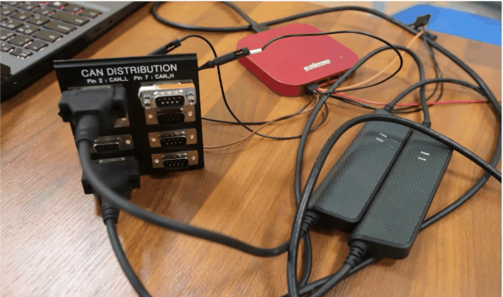

*Figure 34. A CAN distribution box, a logic analyzer, and two Kvaser USB-CAN interfaces*

In Figure 34, the black box on the left is the CAN distribution box (Pin 2: CAN_L, Pin 7: CAN_H), the red box at the upper right is the logic analyzer, and the two black devices below are the Kvaser USB-CAN interfaces.

### 3.2 Observing a UART Signal with a Logic Analyzer

UART sends signals with voltage levels between 3.3 V and 0 V, so a logic analyzer can measure these voltages directly. The procedure is as follows.

1. **Connect the equipment:** Connect the USB-UART converter module to a USB port of the PC. Connect the logic analyzer probes at two points: one to the line on which the UART signal leaves (TX) and the other to the module's ground (GND). A voltage is always a difference relative to some reference point, so the voltage level of the signal line must be measured relative to ground.
2. **Configure and send:** In the serial terminal ComMaster, open the COM port of the converter module at 9600 baud, 8 data bits, 1 stop bit, and no parity, start recording on the logic analyzer, and send AB with the format set to HEX. Because the format is HEX, what is sent is not the characters A and B but the single hexadecimal byte 0xAB.
3. **Zoom in on the waveform:** Stop the measurement and zoom in on the waveform. Because the signal changes very fast, it first appears only as a single line, and zooming in slowly reveals a waveform alternating between High (3.3 V) and 0 V.

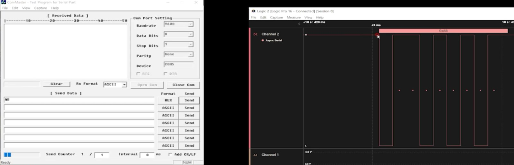

*Figure 35. 0xAB sent with ComMaster and the UART waveform measured and decoded by the logic analyzer*

The left of Figure 35 shows the ComMaster settings and the data sent, and the upper right (Channel 2) is the measured UART waveform. The logic analyzer's UART decoder (Async Serial) reads the waveform and labels it 0xAB above it. Reading the waveform in time order gives the following.

```text
time ->   idle | St | b0 | b1 | b2 | b3 | b4 | b5 | b6 | b7 | Sp | idle
value       1  |  0 |  1 |  1 |  0 |  1 |  0 |  1 |  0 |  1 |  1 |  1

0xAB = 1010 1011 (MSB first) -> sent LSB first: b0 b1 ... b7 = 1 1 0 1 0 1 0 1
```

*Figure 36. Bit order of 0xAB sent over UART*

After the initial idle state (High) comes the start bit (Low), then 1, 1, 0, 1, 0, 1, 0, 1 in turn, and the frame ends with the stop bit (High). 0xAB in binary is 1010 1011, so this bit sequence was sent LSB first. At 9600 baud, one bit lasts $1/9600 \approx 104.2$ µs, and sending the 10 bits of start bit, 8 data bits, and stop bit takes about 1.04 ms.

### 3.3 Sending and Receiving CAN Frames with Kvaser CanKing

Next, the same logic analyzer is used to check the voltage levels of a CAN signal. Two Kvaser USB-CAN interfaces and the CanKing software are used to produce the CAN signal.

1. **Hardware setup:** Connect the two Kvaser devices to the CAN distribution box to form one CAN bus. One device sends and the other receives, a **loopback test**. CAN communication requires termination resistors, so plug the DB-9 connector with a built-in termination resistor into the distribution box. Connect the two logic analyzer channels to CAN_H and CAN_L of the bus.
2. **Set the bus speed and join the bus:** Run CanKing for each device (channels 0 and 1), set the bus speed to 33.333 kbit/s, and have both devices join the bus (Go On Bus). Vehicles usually use 500 kbit/s, but the speed is lowered to the minimum in the list so that the logic analyzer can show the waveform in detail, and all nodes on the same bus must use the same speed, so both CanKing instances are set to the same value.

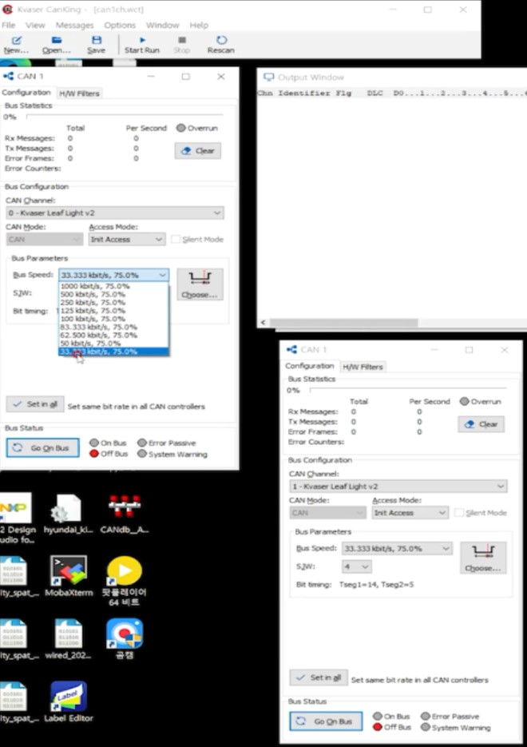

*Figure 37. Channel, bus speed, and bit timing settings in CanKing*

The settings window in Figure 37 contains bus statistics (received and transmitted message counts, error frames, error counters), bus configuration, bus parameters (bus speed, SJW, bit timing), and bus status, and every value in the bus speed list (from 1000 kbit/s down to 33.333 kbit/s) is defined with a sample point position of 75.0%. Silent Mode in the bus configuration only listens to the bus and sends no bit at all, including the ACK; it corresponds to the bus monitoring mode of the standard and is used to observe the bus of a running vehicle without disturbing it [4].

**Bit timing.** At a bus speed of 33.333 kbit/s, one bit lasts $1 / 33333 \approx 30$ µs. A CAN controller handles a bit by dividing it into small units called **time quanta (tq)**. The values Tseg1 = 14 and Tseg2 = 5 on the screen mean that after the synchronization segment (sync segment) of 1 tq at the very start of the bit, the segment before the sample point is 14 tq and the segment after it is 5 tq. One bit is therefore $1 + 14 + 5 = 20$ tq, and 1 tq is $30 / 20 = 1.5$ µs. The sample point lies at $`(1 + 14)/20 = 75\%`$ of the bit from its start, which is the 75.0% shown on the screen. The value is read late in the bit to give the signal time to make the round trip on the bus and settle. SJW (synchronization jump width) = 4 means that the bit segments can be lengthened or shortened by at most 4 tq at a time during resynchronization [1].

Now one CanKing sends a message with identifier 0x123, DLC 8 (8 bytes), and data 82 2A 42 D1 F2 2E 56 23.

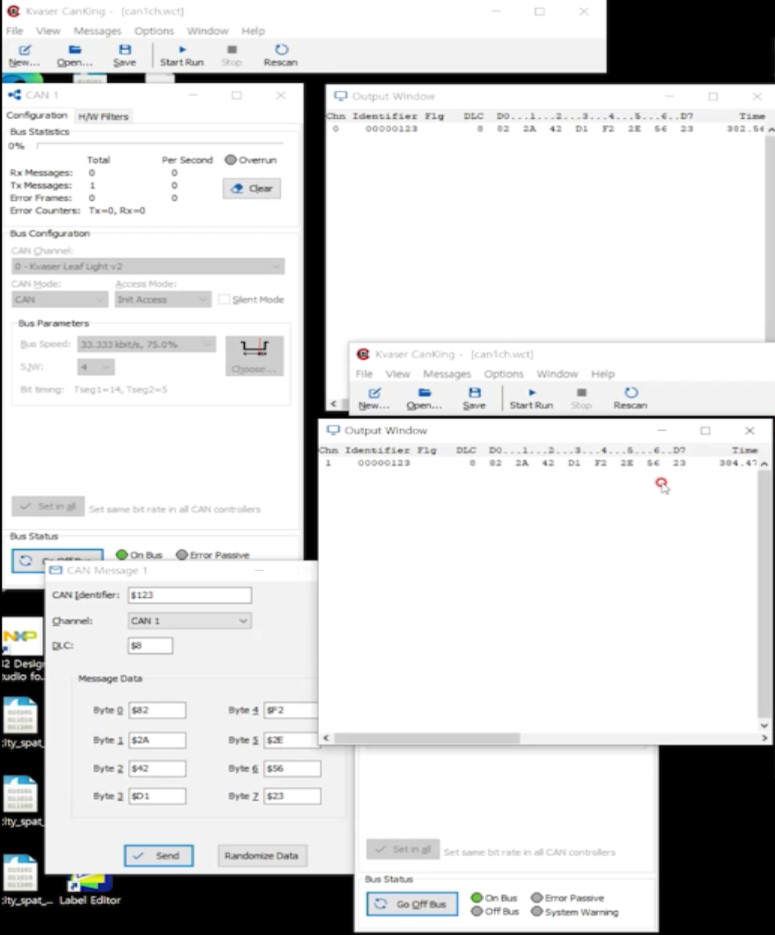

*Figure 38. CanKing screens sending and receiving an 8-byte message with identifier 0x123*

In Figure 38, the upper output window (Output Window) is the record of the sending device and the lower output window is that of the receiving device. Both windows show the same identifier 00000123, DLC 8, and data 82 2A 42 D1 F2 2E 56 23, confirming that the sent frame was received intact. The error counters (Error Counters) in the bus statistics are also Tx = 0, Rx = 0, so there were no errors.

> **Note:** Two devices are used for the loopback test because of the ACK. A CAN transmitter regards a transmission as successful only when another node overwrites the ACK slot with dominant (Week 3). If the transmitter is alone on the bus, the ACK slot stays recessive and an ACK error results, so the transmitter keeps resending the same frame and its transmit error counter rises, possibly putting it in the error passive state [1]. When a receiving device is present, it sends the ACK, so normal transmission and reception can be confirmed.

### 3.4 Observing a CAN Signal with a Logic Analyzer

Pressing the run button of the logic analyzer displays the voltage levels of the two signal lines. Channel 1 at the top is CAN_H and Channel 0 at the bottom is CAN_L. Before a frame is sent, both lines stay at about 2.5 V (the displayed value 2.489 V), because the bus is in the recessive idle state.

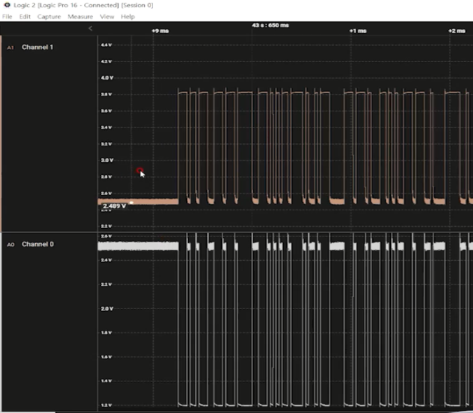

*Figure 39. Waveforms of CAN_H (Channel 1) and CAN_L (Channel 0) measured with a logic analyzer*

After a message is sent from CanKing, stopping the measurement and zooming in shows the waveform in Figure 39. The observations and their meaning are as follows.

- **Symmetric waveforms:** In dominant bits, CAN_H rises to about 3.8 V and CAN_L falls to about 1.2 V, so the two lines move symmetrically about 2.5 V. The differential voltage is about $3.8 - 1.2 = 2.6$ V, which lies within the dominant output range of high-speed CAN transceivers (1.5-3.0 V with a 60 Ω load) [3]. In recessive bits, the two lines come back together at about 2.5 V and the differential voltage is close to 0.
- **Measurement relative to ground:** The logic analyzer measures each line separately relative to ground, so the common voltage of 2.5 V on both lines is visible. The CAN transceiver ignores this common voltage and decides each bit only from the difference between the two lines (Section 1.8).
- **A denser signal than UART:** As with UART, all the data is sent in a short time, so the signal first appears as a single line, and zooming in reveals a waveform much denser than the UART signal. This is because the bit rate of 33.333 kbit/s is about 3.5 times the UART's 9600 bit/s, and one frame contains more than 100 bits.

Professional tools with an oscilloscope or CAN analysis functions can also mark which field each interval on the screen is and which value it represents. Doing the same by hand goes as follows. Write each field of the sent frame in binary from the MSB, and compute the 15-bit CRC from these bits (Section 1.11).

```text
field      bits  value (binary, MSB first)
SOF          1   0
ID          11   001 0010 0011             (0x123)
RTR          1   0                         (data frame)
IDE          1   0                         (standard frame)
r0           1   0
DLC          4   1000                      (8 bytes)
D0..D7      64   82 2A 42 D1 F2 2E 56 23   (each byte MSB first)
CRC         15   011 1100 0001 0111        (0x3C17)
CRC del.     1   1
ACK          2   0 1                       (slot overwritten by the receiver, delimiter)
EOF          7   1111111
```

*Figure 40. Bits of each field of an 8-byte data frame with identifier 0x123*

From the SOF through the CRC there are $1 + 11 + 1 + 1 + 1 + 4 + 64 + 15 = 98$ bits. Applying bit stuffing to this interval, five identical values occur in a row at three places.

1. Where five 0s follow the first bit 1 of D0 = 1000 0010: a 1 is inserted after these five 0s.
2. Where the last bit 1 of D3 = 1101 0001 is followed by the first four bits 1111 of D4 = 1111 0010: a 0 is inserted after the five 1s.
3. The five 0s in the middle of CRC = 011 1100 0001 0111: a 1 is inserted after them.

The bits on the bus from the SOF through the CRC are therefore $98 + 3 = 101$ bits, and adding the 1-bit CRC delimiter, 2 ACK bits, and 7 EOF bits makes the whole frame 111 bits. With a bit time of 30 µs, one frame occupies the bus for $`111 \times 30\ \mu\text{s} = 3.33`$ ms. Sending the same frame at the vehicle's 500 kbit/s takes $`111 \times 2\ \mu\text{s} = 222`$ µs.

### 3.5 CAN Monitoring Setup of the Test Vehicle

Next, how CAN information appears in an actual vehicle is examined. The test vehicle is a passenger car modified for autonomous driving and set up so that its internal CAN information can be viewed with external equipment.

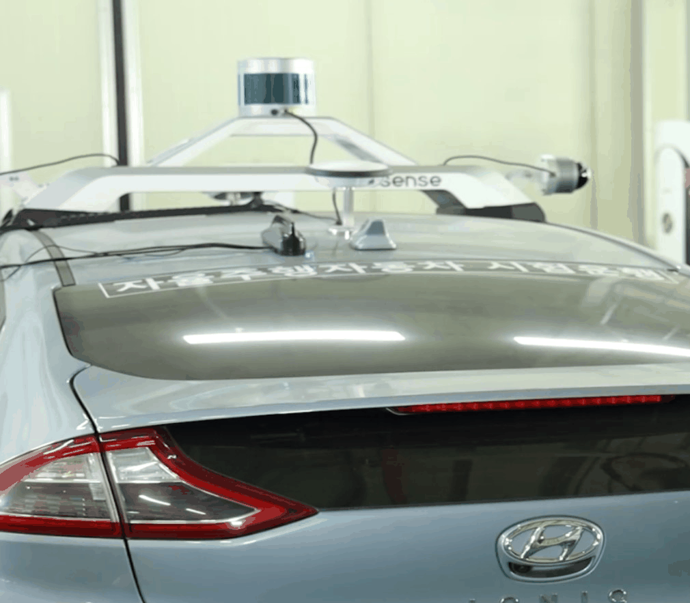

*Figure 41. The test vehicle with a LIDAR, a GPS antenna, and a V2X antenna on the roof*

In Figure 41, the tall cylinder in the middle of the roof is the LIDAR, a sensor that recognizes the surroundings; the round white part in the middle is the GPS antenna, and the black part to its left is the V2X antenna, which receives data from external networks. V2X communication is covered from Week 11.

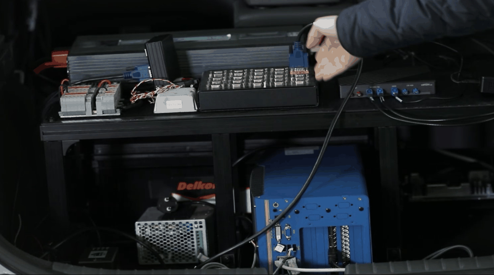

*Figure 42. The power unit, perception PC, and CAN distribution box in the trunk of the test vehicle*

The trunk contains several pieces of equipment. The power unit supplies power to the equipment, and the blue PC below receives information from the LIDAR and surrounding sensors to recognize the situation around the vehicle. The device with many DB-9 ports in the upper middle is an extended version of the CAN distribution box used in Section 3.3. CAN has the advantage that equipment can be plugged into and out of the bus at any time, which makes debugging convenient, so many ports were provided to allow more equipment to be connected. This is possible because, as seen in Section 1.1, a CAN frame carries no address of a receiving node, so attaching new equipment to the bus requires no change to the settings of other nodes.

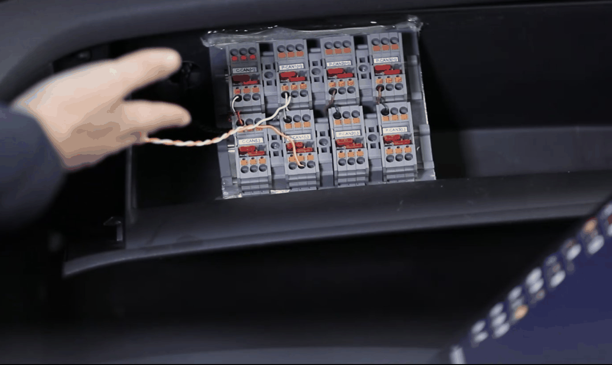

*Figure 43. A CAN terminal block installed in the front storage compartment of the vehicle*

A separate module was built in the trunk so that DB-9 connectors can be used, but at the front of the vehicle (the storage compartment in front of the passenger seat) no connector was built; instead, a port in the form of a terminal block into which wires can be inserted directly was installed.

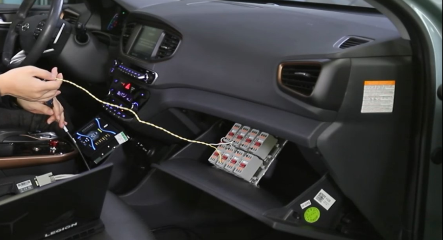

*Figure 44. Connecting a CAN cable made of two twisted wires to the terminal block*

To connect to this terminal block, a cable was made by twisting two CAN wires and attaching a DB-9 connector to the end (the yellow twisted wire in Figure 44). The DB-9 end of the cable connects to the Vector CAN interface, and the USB of the interface connects to the notebook PC. Vector CANoe is a tool widely used to monitor vehicle data in real time during experiments.

### 3.6 Starting CANoe and Configuring the CAN Network

To start monitoring with CANoe, connect the Vector CAN interface to the vehicle's CAN port and to the PC, and in CANoe, which requires a license, create a new configuration from the template **CAN 500kBaud 2ch**. The CAN communication of this vehicle is set to 500 kbit/s, so monitoring also uses a two-channel (2ch) configuration at 500 kbit/s. When the configuration opens, the **Simulation Setup** window appears on the left and the **Measurement Setup** window on the right.

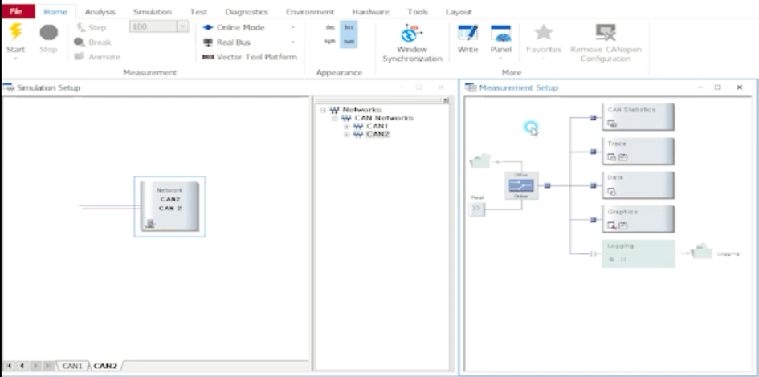

*Figure 45. The Simulation Setup and Measurement Setup windows of CANoe*

Simulation Setup on the left of Figure 45 shows the CAN channels and the CAN nodes attached to them. At this point only the CANoe device connected to the PC is attached, so only one network block appears (Figure 45 shows the Network CAN2 block on the CAN2 tab). The tree in the middle (Networks, CAN Networks, CAN1, CAN2) manages, for each channel, the nodes (Nodes), interactive generator (Interactive Generator), replay blocks (Replay blocks), databases (Databases), and channels (Channels). Measurement Setup on the right shows the measurement items, in which data received from the bus flows from the input on the left (Online) to the analysis blocks on the right. Start (the lightning icon) and Stop on the ribbon at the top start and stop the measurement, and dec/hex under Appearance selects whether values are shown in decimal or hexadecimal.

The hardware settings window of channel CAN1 (Figure 46) lets one check and change the device settings and the communication speed.

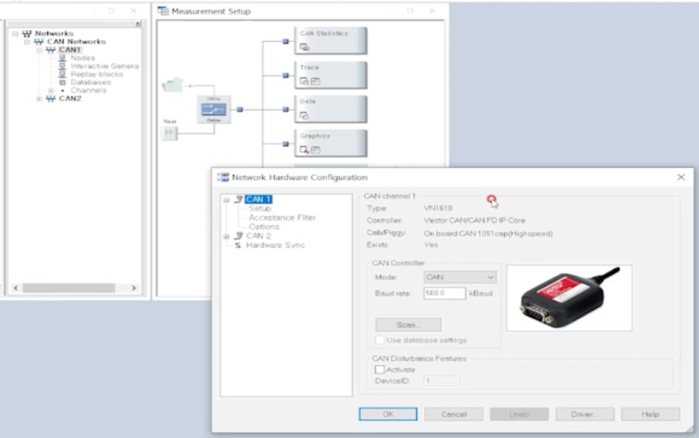

*Figure 46. The Network Hardware Configuration window for channel CAN1*

In Figure 46, channel CAN 1 has device type (Type) VN1610, controller (Controller) Vector CAN/CAN FD IP Core, and transceiver (Cab/Piggy) On board CAN 1051cap (Highspeed); the CAN controller mode (Mode) is CAN and the communication speed (Baud rate) is 500.0 kBaud. Setup, Acceptance Filter, and Options in the tree on the left set the detailed channel settings and the acceptance filter (Week 3).

> **Caution:** The bit rate of the monitoring equipment must exactly match the bit rate of the vehicle bus. If it is set differently, the equipment misreads bits and sends error frames, which can disturb the communication of a running vehicle. When the vehicle's speed is unknown, check it first in a receive-only mode such as Silent Mode (Section 3.3).

The actual CAN data monitoring functions are provided by the blocks in the Measurement Setup window.

| Block | Function |
|:-----|:-----|
| CAN Statistics | Shows bus statistics such as bus load, frames per second, and number of error frames. |
| Trace | Displays received frames in real time as a table of time, channel, identifier, name, direction, DLC, and data. |
| Data | Shows the current values of selected signals as numbers. |
| Graphics | Shows the values of selected signals as graphs over time. |
| Logging | Records received data to a file. |

*Table 17. Main blocks of the CANoe Measurement Setup*

### 3.7 Monitoring without a CAN Database

First, CAN data is monitored directly without a CAN database. Opening the Trace window from the **Trace** block in Measurement Setup and starting the measurement displays the received CAN frames in the Trace window in real time.

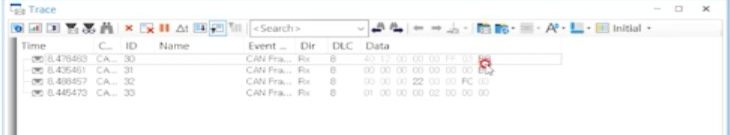

*Figure 47. The Trace window showing frames received without a CAN database in hexadecimal*

The columns of the Trace window are time (Time), channel (Chn), identifier (ID), name (Name), event type (Event Type), direction (Dir), DLC, and data (Data). Figure 47 shows four messages with identifiers 30, 31, 32, and 33 (0x30-0x33, because hexadecimal display mode is on), all received (Rx) 8-byte CAN frames. The name column is empty because CANoe does not know the names of these identifiers. The values toward the end of the data column keep changing, and all values are displayed in hexadecimal.

Viewing the data without a CAN database like this, one cannot tell which byte changes and how when the steering wheel is turned, or what the actual steering angle is. Finding the bytes that change and comparing them with the direction in which the wheel is turned allows a guess at the position, but without the factor, offset, byte order, and sign, exact values cannot be obtained. A CAN database file is therefore needed.

### 3.8 Monitoring with a CAN Database Added

A DBC file describes the information about the CAN to be monitored. Adding the test vehicle's DBC file to the **Databases** item under CAN1 in the Simulation Setup tree (Add; a database in another format is imported with Import Wizard) makes the file appear under Databases.

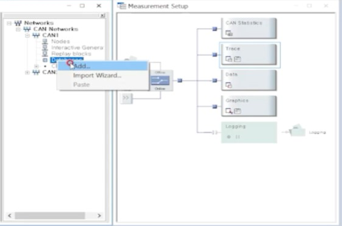

*Figure 48. The menu that adds a DBC file with Add under Databases in Simulation Setup*

Monitoring again shows the same frames together with the information from the CAN database. An expand (+) button appears to the left of each frame, and pressing it shows which signals the data of that identifier contains and what their values mean.

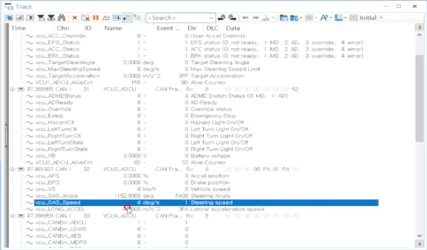

*Figure 49. The Trace window showing signal names, physical values, raw values, and descriptions after the CAN database was added*

In Figure 49, messages are displayed by name (VCU1_ADCU and so on), and below each, one line per signal shows the name, physical value and unit, raw value (hexadecimal), and description. The messages defined in the CAN database of this test vehicle are as follows. Because the test vehicle has been modified for autonomous driving and the signal descriptions include "ADMD Switch Status (0: MD, 1: AD)", "AD Ready", and "User Steering Override", MD and AD can be seen to denote the manual driving mode and the autonomous driving mode.

| Message (identifier) | Main signals | Meaning |
|:-----|:-----|:-----|
| VCU1_ADCU (0x30) | vcu_EPS_En, vcu_BRK_En, vcu_ACC_En | Feedback of steering, braking, and acceleration control |
| | vcu_EPS_Override, vcu_BRK_Override, vcu_ACC_Override | Whether the driver has intervened in steering, braking, or acceleration |
| | vcu_EPS_Status, vcu_ACC_Status, vcu_BRK_Status | State of each control (0: not ready, 1: MD, 2: AD, 3: override, 4: error) |
| | vcu_TargetSteerAngle, vcu_MaxSteeringSpeed, vcu_TargetAcceleration | Target steering angle, maximum steering speed, target acceleration |
| VCU2_ADCU (0x31) | vcu_ADMDStatus, vcu_ADReady, vcu_Override, vcu_Estop | State of the switch between autonomous and manual driving, autonomous driving ready, override state, emergency stop |
| | vcu_HazardCtl, vcu_LeftTurnCtl, vcu_RightTurnCtl, vcu_LeftTurnState, vcu_RightTurnState | On and blinking states of the hazard lights and the left and right turn signals |
| | vcu_VB | Battery voltage |
| VCU3_ADCU (0x32) | vcu_APS, vcu_BPS, vcu_VS | Accelerator pedal position, brake pedal position, vehicle speed |
| | vcu_SAS_Angle, vcu_SAS_Speed, vcu_LONG_ACCEL | Steering angle, steering speed, acceleration (the name vcu_LONG_ACCEL denotes longitudinal acceleration, but its description field in the DB reads "Lateral acceleration speed") |
| VCU4_ADCU (0x33) | vcu_CANErr_ADCU, vcu_CANErr_LDWS, vcu_CANErr_AEB, vcu_CANErr_MDPS, and others | Whether there is a CAN communication error with each controller |

*Table 18. Messages and signals defined in the CAN database of the test vehicle*

AliveCnt (alive counter), the last signal of VCU1_ADCU and VCU2_ADCU, is a counter the transmitting node increments by 1 each time it sends the message. If this value stops changing, the receiving node can conclude that the transmitting node has stopped. Names in VCU4_ADCU such as LDWS (lane departure warning system), AEB (autonomous emergency braking), and MDPS (motor-driven power steering) refer to other controllers of the vehicle.

vcu_SAS_Angle and vcu_SAS_Speed of identifier 0x32 (VCU3_ADCU) are the steering-related data. Turning the wheel to the right makes the negative value of SAS_Angle keep growing, and turning it to the left gives positive values. SAS_Speed grows the faster the wheel is turned. In this way, importing the CAN database file shows what each piece of CAN information represents.

Comparing the raw and physical values in the Trace window with the data bytes reveals the signal layout of VCU3_ADCU. For example, the VCU3_ADCU data in Figure 49 is 00 00 00 08 FA 01 FA 03, and vcu_SAS_Angle has raw value FA08 and physical value -152.8 deg. Table 19 is the layout obtained by matching raw and physical values in this frame, the frame in Figure 50 (00 00 00 D1 11 12 F9 03), and the frame in Section 3.10 (0F 00 11 84 00 00 02 04).

| Byte | Signal | Conversion | Observed example |
|:-----|:-----|:-----|:-----|
| 0 | vcu_APS | Raw value × 0.4 % | 0x0F = 15 → 6.0 % |
| 2 | vcu_VS | Raw value × 1 km/h | 0x11 = 17 → 17 km/h |
| 3-4 | vcu_SAS_Angle | Intel, signed 16 bits, × 0.1 deg | 08 FA → 0xFA08 = -1528 → -152.8 deg |
| 5 | vcu_SAS_Speed | Raw value × 4 deg/s | 0x12 = 18 → 72 deg/s |
| 6-7 | vcu_LONG_ACCEL | Intel, unsigned 16 bits, × 0.01 - 10.23 m/s² | F9 03 → 0x03F9 = 1017 → -0.06 m/s² |

*Table 19. Signal layout of VCU3_ADCU confirmed from observed values*

Byte 1 is vcu_BPS (brake pedal position); all observed values were 0, so its factor cannot be determined. A signed value such as vcu_SAS_Angle is read in **two's complement**. If the most significant bit of a 16-bit value is 1, the value is negative, and it equals the unsigned value minus $2^{16} = 65536$. 0xFA08 is 64008 as an unsigned value, so $64008 - 65536 = -1528$, and multiplying by the factor 0.1 gives -152.8 deg.

The same interpretation written in Python is as follows.

```python
def intel_unsigned(data, start_byte, length_bytes):
    return int.from_bytes(data[start_byte:start_byte + length_bytes], "little")

def intel_signed(data, start_byte, length_bytes):
    return int.from_bytes(data[start_byte:start_byte + length_bytes], "little", signed=True)

def decode_vcu3(data):
    return {
        "vcu_APS [%]": intel_unsigned(data, 0, 1) * 0.4,
        "vcu_VS [km/h]": intel_unsigned(data, 2, 1) * 1,
        "vcu_SAS_Angle [deg]": intel_signed(data, 3, 2) * 0.1,
        "vcu_SAS_Speed [deg/s]": intel_unsigned(data, 5, 1) * 4,
        "vcu_LONG_ACCEL [m/s^2]": intel_unsigned(data, 6, 2) * 0.01 - 10.23,
    }

frame = bytes.fromhex("0F 00 11 84 00 00 02 04")
for name, value in decode_vcu3(frame).items():
    print(f"{name:24s} {value:8.2f}")
```

- `intel_unsigned` takes `length_bytes` bytes of `data` starting at byte `start_byte` and reads them as an unsigned little endian (`"little"`) integer, because the Intel byte order is little endian.
- `intel_signed` does the same but reads a two's complement integer with `signed=True`.
- `decode_vcu3` reads the raw value of each signal according to the layout of Table 19, multiplies by the factor, adds the offset, and returns a dictionary of signal names and physical values.
- `bytes.fromhex` turns the hexadecimal string seen in the Trace window into 8 bytes of data. These data are a VCU3_ADCU frame received while driving in Section 3.10.
- The final loop prints, for each signal, the name padded to 24 characters and the value to two decimal places.

The output is as follows and matches the physical values at the moment the right turn signal was switched on in Section 3.10.

```text
vcu_APS [%]                  6.00
vcu_VS [km/h]               17.00
vcu_SAS_Angle [deg]         13.20
vcu_SAS_Speed [deg/s]        0.00
vcu_LONG_ACCEL [m/s^2]       0.03
```

### 3.9 Real-Time Graphs and Data Logging

To check data in real time as a graph rather than as a list of messages, open a Graphics window from the **Graphics** block in the Measurement Setup window and drag the signal to be checked from the list into it. The current value of that signal is then drawn as a real-time graph.

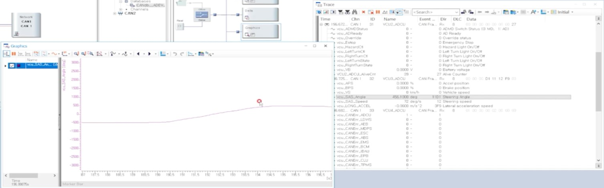

*Figure 50. A real-time graph of the steering angle signal vcu_SAS_Angle and the Trace window*

Figure 50 puts the steering wheel value (vcu_SAS_Angle) into the graph. When the wheel was turned to the right the graph went down to negative values, and while turning to the left it rose to positive values. In the Trace window on the right, vcu_SAS_Angle at the same moment is 456.1 deg (raw value 11D1). Adding the steering wheel speed (vcu_SAS_Speed) in the same way lets several items be checked at once.

CANoe supports **logging** data during vehicle experiments, **replaying** it later, and **sending the replayed data onto a CAN bus** again. Logging is set up in two windows after enabling the **Logging** block at the bottom of the Measurement Setup window (it is inactive at first).

The **Trigger Configuration** window sets the logging range. Leaving the mode (Mode) at Entire measurement records the whole measurement from Start to Stop, and the buffer size (Buffer size) is the number of messages that can be held in memory before being written (50000 here).

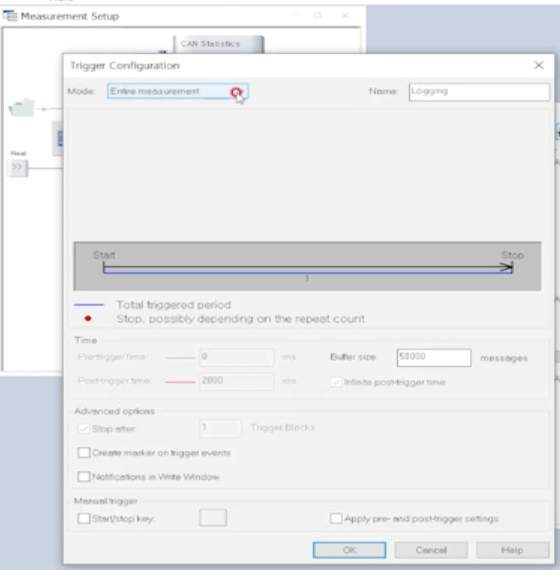

*Figure 51. The Trigger Configuration window that sets the logging range*

The **Logging File Configuration** window sets the destination folder, name, and format of the log file. Setting the file name with field codes (Field Codes) builds the name automatically from information such as the current time (LocalTime), the user name, and the monitored system, so that earlier files are not overwritten; using {LocalTime} gives a name such as 2023-02-05_14-47-29.blf. The format chosen is **BLF Frame Logging (\*.blf)**. BLF is the binary log file format characteristic of CANoe; a file saved as BLF can later be replayed in CANoe, and while replaying, its frames can be sent onto another CAN bus in real time. PCAP and PCAPNG in the list are formats for logging Ethernet frames.

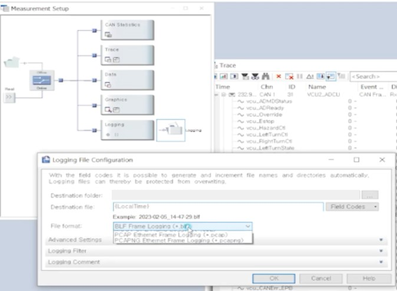

*Figure 52. The Logging File Configuration window that sets the destination folder, file name, and BLF format*

Starting the measurement in this state records all the received information to the BLF file in real time, and stopping the measurement ends the recording.

> **Note:** Logging and replay are important functions in vehicle testing. Even if a problem that occurred while driving cannot be analyzed on the spot, keeping it in a BLF file allows the same data to be replayed and analyzed in the office, or the replayed frames to be sent to ECUs on a test bench to reproduce the same situation.

### 3.10 Monitoring while Driving

Finally, the vehicle is driven with logging on and the data is checked. The graph shows the vehicle speed and the Trace window shows various CAN information, and how the screen and the recorded data change with each driving action is compared in real time.

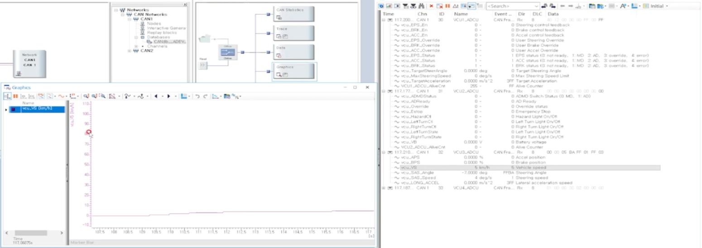

*Figure 53. A vehicle speed graph while driving and the Trace window showing the vehicle's operating state*

| Driving action | Observed change |
|:-----|:-----|
| Start off slowly | The speed graph and vcu_VS show about 6 km/h. At the moment of Figure 53 it is 5 km/h. |
| Turn on the hazard lights | The flag of the hazard light signal (vcu_HazardCtl) becomes 1. |
| Turn on the right turn signal | 1 appears in two flag signals: the flag indicating that the turn signal is switched on (vcu_RightTurnCtl) and the blinking state (vcu_RightTurnState). The left turn signal appears in the same way. |
| Press the accelerator to exceed 20 km/h | The accelerator pedal percentage (vcu_APS) rises and the vehicle speed keeps increasing. |
| Release the accelerator and press the brake | The brake position (vcu_BPS) shows what percentage of full travel (100%) the pedal is pressed. |
| Engage reverse, back up, then switch to drive mode | The changed gear state is displayed. |
| Turn the wheel to the left to pull in | The steering angle (vcu_SAS_Angle) changes to a positive value. |

*Table 20. Driving actions and changes in CAN data while driving*

For example, when the right turn signal was switched on, the VCU2_ADCU data was 00 00 04 00 00 00 00 F8. The 0x04 in byte 2 is 0000 0100 in binary, so only bit 2 is 1, and at this time vcu_RightTurnCtl was displayed as 1. That is, information that needs only 0 and 1, such as an on/off state, is packed as one-bit signals, several to a byte. The last byte F8 (248) is the AliveCnt. The VCU3_ADCU data at the same moment, 0F 00 11 84 00 00 02 04, means accelerator pedal 6.0%, vehicle speed 17 km/h, steering angle 13.2 deg, and acceleration 0.03 m/s², as decoded by the code in Section 3.8.

> **Caution:** The CAN information seen in this test vehicle is, for educational purposes, the CAN information coming from the actual vehicle converted by a device inserted in between so that the CAN IDs and CAN information are easy to understand. Even if one has occasion to look at the CAN information of the same model, it is entirely different from this CAN database, so this database must not be applied to that vehicle as it is. In general, CAN databases differ by manufacturer and model and are not published (Section 2.8).

Sections 3.2-3.4 show the electrical appearance of CAN signals, and Sections 3.5-3.10 show how CAN information is actually used in a vehicle.

---

<br>

## Concept Applications

| Situation | Concept to apply |
|:-----|:-----|
| In a log, the two bytes of a signal appear as A1 43. | If the byte order in the CAN database is Intel (little endian), the value must be read as 0x43A1 = 17313, and if it is Motorola (big endian), as 0xA143 = 41283, so check the byte order first (Sections 1.4 and 2.9). |
| A frame sent with only one CAN interface connected to the bus is retransmitted over and over. | No other node overwrote the ACK slot with dominant, causing an ACK error, so connect one more receiving node (Section 3.3). |
| After monitoring equipment is connected to a vehicle, the Trace window shows only error frames. | Check whether the bit rate of the equipment differs from that of the vehicle bus or whether the termination is faulty, and connect in a receive-only mode at first (Sections 2.7 and 3.6). |
| A mileage of 0-6553.5 km is to be sent in units of 0.1 km. | With factor 0.1 and offset 0, the raw values are 0-65535, so 2 bytes (16 bits) suffice (Section 2.11). |
| On a vehicle without a CAN database, the byte containing the steering angle is to be found. | Find the bytes that change while turning the wheel, and compare raw values with actual angles at several angles to estimate the byte order, sign, factor, and offset (Sections 3.7 and 3.8). |
| The engine speed of a vehicle is read with diagnostic equipment. | Connect to pins 6 and 14 of the OBD-II connector, request service 0x01, PID 0x0C with identifier 0x7DF, and compute $(256A + B)/4$ from the response on 0x7E8 (Section 2.4). |

*Table 21. Concept application cases*

**True/False Check:**

| Statement | Judgment and Reason |
|:-----|:-----|
| The binary number 11111111 is the decimal number 256. | **F.** $11111111_2 = 255$. One byte represents 256 states, 0-255. |
| UART sends the data bits MSB first. | **F.** UART sends the LSB first. 0xAB goes out in the order 1, 1, 0, 1, 0, 1, 0, 1. |
| CAN carries bits with differential Manchester encoding. | **F.** CAN uses NRZ coding and bit stuffing. |
| When a standard data frame and an extended frame with the same base identifier compete, the standard data frame wins. | **T.** The extended frame sends the recessive SRR in the RTR position, where the standard data frame sends dominant. |
| CAN FD sends the whole frame at the higher bit rate. | **F.** The higher bit rate is used only in the data phase from the BRS through the CRC; arbitration and acknowledgment are sent at the same speed as classical CAN. |
| CAN databases are common to all vehicles, so the DBC file of one model can be used for another. | **F.** CAN databases differ by manufacturer and model and are generally not published. |

---

<br>

## Summary

| Concept | Key Summary |
|:-----|:-----|
| Features of CAN | Several ECUs share one twisted-pair bus, characterized by up to 1 Mbit/s, differential signaling, identifier priority, and the ISO 11898 standard. |
| Binary and hexadecimal | Four bits correspond to one hexadecimal digit, so CAN tools display a byte as two hexadecimal digits, and the largest value of one byte is 0xFF = 255. |
| Bit order and byte order | UART sends from the LSB and CAN sends each field from the MSB, and the byte order of multi-byte values is either Intel (little endian) or Motorola (big endian). |
| UART | Point-to-point serial communication that sends one byte with a start bit, 8 data bits, and a stop bit, without a clock line. |
| Baud rate and bit rate | The bit rate is the baud rate multiplied by $\log_2 M$, and the two are equal in UART and CAN, which use two levels. |
| Speed and distance | For arbitration and acknowledgment, the signal must make a round trip on the bus within one bit time, so a longer bus requires a lower speed. |
| Signal levels | In recessive both lines are about 2.5 V, in dominant CAN_H is about 3.5 V and CAN_L about 1.5 V, and a differential voltage of 0.9 V or more is 0 and 0.5 V or less is 1. |
| Identifier priority | The lower identifier value wins; for the same identifier a data frame beats a remote frame, and for the same base identifier a standard frame beats an extended frame. |
| CRC | The remainder of dividing the data, with as many 0s appended as the degree of the generator polynomial, in modulo 2 is sent, and the receiver detects errors by whether the remainder is 0. |
| Frame types | There are data, remote, error, and overload frames, and an error frame violates the stuffing rule with 6 dominant bits to notify all nodes of an error. |
| CAN FD | Enlarges the data to at most 64 bytes and raises the bit rate only in the data phase after the BRS. |
| OBD-II | Connects to CAN through pins 6 and 14 of a 16-pin connector and reads vehicle information with data frames: requests on 0x7DF and responses on 0x7E8. |
| Wiring and termination | Pin 2 of a DB-9 connector is CAN_L and pin 7 is CAN_H, and 120 Ω at both ends of the bus gives a combined resistance of 60 Ω. |
| CAN database and DBC | A database defining, for each identifier, the position, length, byte order, sign, factor, offset, and unit of the message and its signals; DBC is the text format created by Vector. |
| Factor and offset | The physical value is raw value × factor + offset; the factor is the resolution, the range divided by $2^n - 1$, and the offset is the minimum. |
| Observing CAN signals | On a logic analyzer, CAN_H and CAN_L move symmetrically about 2.5 V, and the transmission time can be computed from the number of bits in the frame and its stuff bits. |
| Monitoring with CANoe | After connecting the equipment with a 500 kbit/s configuration, raw data is viewed in Trace, physical values of signals after adding a DBC, graphs in Graphics, and BLF records are kept with Logging. |

---

<br>

## Self-Check Questions

1. **Base conversion and bit order:** Convert 0xB6 to decimal and binary, and write the order in which its data bits go out when sent over UART.

   <details>
   <summary>Answer</summary>

   B = 11 and 6 = 6, so $0\text{xB}6 = 11 \times 16 + 6 = 182$. In binary, converting each digit to 4 bits gives 1011 0110. UART sends the LSB first, so the data bits go out in the order 0, 1, 1, 0, 1, 1, 0, 1, preceded by the start bit 0 and followed by the stop bit 1.

   </details>

2. **Byte order and sign:** A signal is defined in bytes 3-4 with Intel byte order, signed 16 bits, and factor 0.1. When byte 3 is 0x38 and byte 4 is 0xFF, find the physical value.

   <details>
   <summary>Answer</summary>

   In Intel order the low byte comes first, so the raw value is 0xFF38. As an unsigned value it is 65336, and its most significant bit is 1, so it is negative; read in two's complement, it is $65336 - 65536 = -200$. Multiplying by the factor gives $-200 \times 0.1 = -20.0$.

   </details>

3. **Communication speed:** A line with four signal levels has a baud rate of 1,200 baud. Find its bit rate. Also find the duration of one bit on 500 kbit/s CAN.

   <details>
   <summary>Answer</summary>

   With $M = 4$, the bit rate is $1200 \times \log_2 4 = 1200 \times 2 = 2400$ bps. CAN uses two levels, so its baud rate and bit rate are equal, and one bit at 500 kbit/s lasts $1 / 500000 = 2$ µs.

   </details>

4. **Tracing arbitration:** Three nodes start transmitting at the same time. Node A sends a data frame with identifier 0x2A4, Node B a data frame with 0x2A0, and Node C a remote frame with 0x2A0. Write where each node loses and which node wins.

   <details>
   <summary>Answer</summary>

   In 11-bit binary, 0x2A4 is 010 1010 0100 and 0x2A0 is 010 1010 0000. From ID10 to ID3 the three nodes are the same. At ID2, Node A sends 1 and Nodes B and C send 0, so the bus becomes 0 and Node A loses. Nodes B and C have the same identifier, so there is no decision up to ID0, and at the RTR position Node B sends 0 because it is a data frame and Node C sends 1 because it is a remote frame. Node C therefore loses at the RTR and Node B wins.

   </details>

5. **Computing a CRC:** With the generator polynomial $g(x) = x^3 + x + 1$ (1011), find the CRC of the data 1101 and write the bit string to send.

   <details>
   <summary>Answer</summary>

   The degree is 3, so append three 0s to the data and divide 1101000 by 1011. 1101 XOR 1011 = 0110, and bringing down the next bit 0 gives 1100. 1100 XOR 1011 = 0111, and bringing down the next bit 0 gives 1110. 1110 XOR 1011 = 0101, and bringing down the last bit 0 gives 1010. 1010 XOR 1011 = 0001, so the remainder (CRC) is 001. The bit string to send is 1101001, and dividing it by 1011 again leaves 000, so the check also holds.

   </details>

6. **Designing the factor and offset:** Coolant temperature in the range -40 to 215 °C is to fit in 1 byte. Determine the factor and offset, and write the raw value for sending 90 °C in hexadecimal.

   <details>
   <summary>Answer</summary>

   The raw range of 1 byte is 0-255, so $\text{Factor} = (215 - (-40)) / 255 = 255 / 255 = 1$ and $\text{Offset} = -40$. The raw value for 90 °C is $(90 - (-40)) / 1 = 130$, which is 0x82 in hexadecimal. The receiver recovers $130 \times 1 - 40 = 90$ °C.

   </details>

7. **Loopback test:** Explain why two Kvaser devices are connected and why a termination resistor is attached when sending frames with CanKing.

   <details>
   <summary>Answer</summary>

   A CAN transmitter regards a transmission as successful only when another node overwrites the ACK slot with dominant. With only one device, an ACK error occurs and the same frame is resent over and over, so one more device is needed to act as the receiving node. The termination resistor prevents signals from reflecting at the end of the bus and distorting bits, and it provides the path that returns the two lines to the same voltage when the bus changes from dominant to recessive, so it is essential for CAN communication.

   </details>

8. **Observing CAN signals:** CAN_H and CAN_L were measured relative to ground with a logic analyzer. What are the approximate voltages of each line in the idle state and in a dominant bit, and from what does the receiver decide each bit?

   <details>
   <summary>Answer</summary>

   In the idle (recessive) state both lines are about 2.5 V. In a dominant bit, CAN_H rises to about 3.5-3.8 V and CAN_L falls to about 1.2-1.5 V, so the two lines move symmetrically about 2.5 V. The receiver decides not from the voltage of each line relative to ground but from the difference between the two lines, $`V_{CAN\_H} - V_{CAN\_L}`$: 0.9 V or more is 0 (dominant) and 0.5 V or less is 1 (recessive).

   </details>

9. **Frame length:** An 8-byte data frame with identifier 0x123 was 111 bits from the SOF to the EOF, including 3 stuff bits. Find the time it takes to send this frame at 33.333 kbit/s and at 500 kbit/s.

   <details>
   <summary>Answer</summary>

   The bit time at 33.333 kbit/s is about 30 µs, so $`111 \times 30\ \mu\text{s} = 3.33`$ ms. The bit time at 500 kbit/s is 2 µs, so $`111 \times 2\ \mu\text{s} = 222`$ µs. An IFS of 3 more bits is needed between frames.

   </details>

10. **Interpreting an OBD-II response:** Vehicle speed (service 0x01, PID 0x0D) was requested, and 03 41 0D 3C 00 00 00 00 was received with identifier 0x7E8. Vehicle speed is computed as A km/h. Write the meaning of each byte of the response and the vehicle speed.

    <details>
    <summary>Answer</summary>

    03 means three valid bytes follow, 0x41 is the positive response to service 0x01 (0x01 + 0x40), 0x0D is the requested PID, and 0x3C is data A. The vehicle speed is $A = 0\text{x}3\text{C} = 3 \times 16 + 12 = 60$ km/h. The remaining bytes are padding.

    </details>

11. **Monitoring with CANoe:** Explain the limitation of viewing vehicle data in the Trace window without a CAN database, what changes after a DBC file is added, and what BLF logging is used for.

    <details>
    <summary>Answer</summary>

    Without a CAN database, identifiers and data bytes appear only in hexadecimal, so even when the wheel is turned one cannot tell which byte is the steering angle or what the actual angle is. Adding a DBC file under Databases in Simulation Setup displays messages by name, shows each signal's physical value, unit, raw value, and description, and lets signals be viewed as graphs in Graphics. Enabling Logging and recording to a BLF file allows the data to be replayed later for analysis, or the frames to be sent again onto another CAN bus while replaying to reproduce the same situation.

    </details>

---

<br>

## References

1. Robert Bosch GmbH, *CAN Specification, Version 2.0*, Stuttgart, Germany, 1991.
2. Robert Bosch GmbH, *CAN with Flexible Data-Rate, Specification Version 1.0*, Gerlingen, Germany, 2012.
3. ISO 11898-2:2016, *Road vehicles - Controller area network (CAN) - Part 2: High-speed medium access unit*, International Organization for Standardization, 2016.
4. ISO 11898-1:2015, *Road vehicles - Controller area network (CAN) - Part 1: Data link layer and physical signalling*, International Organization for Standardization, 2015.
5. Vector Informatik GmbH, *Vector E-Learning*. https://elearning.vector.com/
6. CSS Electronics, "OBD2 Explained - A Simple Intro," *CSS Electronics*. https://www.csselectronics.com/pages/obd2-explained-simple-intro
7. SAE International, *SAE J1979: E/E Diagnostic Test Modes*, J1979_201702, Warrendale, PA, USA, 2017.
8. CAN in Automation, *CiA 303-1: Cabling and connector pin assignment*, version 1.9.0, Nuremberg, Germany, 2017.
9. CSS Electronics, "CAN DBC File Explained - A Simple Intro," *CSS Electronics*. https://www.csselectronics.com/pages/can-dbc-file-database-intro
