# 11주차 이론 — 커넥티드 자율주행의 개요와 활용, V2X 메시지

[레포지토리 안내](../../README.ko.md) | [English](Concepts_Lecture.md) | [한국어](Concepts_Lecture.ko.md)

> **최종 수정일:** 2026-11-27

> **학습 목표:**
> 1. 스마트카, 커넥티드카, 자율주행차, CAV, ITS, C-ITS의 관계를 설명하고, 유럽 C2C-CC의 Day 단계 분류와 미국 SAE J3216의 협력 등급 분류를 비교할 수 있다
> 2. 한국의 C-ITS 서비스, 트럭 군집주행, 원격 주행 같은 커넥티드 자율주행 응용의 구성과 통신 요구를 설명할 수 있다
> 3. 커넥티드카 서비스의 분류와 HMI, 보안의 쟁점을 설명할 수 있다
> 4. 자차 센서 기반 객체 인식과 V2X 기반 객체 인식의 장단점을 비교하고, 두 방식을 융합하는 이유를 위치 오차 수치로 설명할 수 있다
> 5. V2X 메시지가 프로토콜 스택에서 차지하는 위치와 정보 방송, 지역 데이터 교환, 클라우드 기반 교환의 세 가지 방식을 설명할 수 있다
> 6. SAE J2735의 BSM, SPaT, MAP, PVD 같은 주요 메시지의 목적, 핵심 필드, 전송 시점을 설명하고, 필드의 정수 값을 물리량으로 변환할 수 있다

---

## 목차

- [1. 커넥티드 자율주행 개요 및 기술 분류](#1-커넥티드-자율주행-개요-및-기술-분류)
  - [1.1 커넥티드 자율주행 관련 용어](#11-커넥티드-자율주행-관련-용어)
  - [1.2 유럽 C2C-CC의 기술 분류](#12-유럽-c2c-cc의-기술-분류)
  - [1.3 미국 SAE J3216의 협력 등급 분류](#13-미국-sae-j3216의-협력-등급-분류)
  - [1.4 한국의 C-ITS 서비스](#14-한국의-c-its-서비스)
  - [1.5 자동차 산업과 ITS 산업](#15-자동차-산업과-its-산업)
  - [1.6 ITS의 정의와 전통적 분류](#16-its의-정의와-전통적-분류)
  - [1.7 차세대 지능형 교통체계(C-ITS)](#17-차세대-지능형-교통체계c-its)
  - [1.8 안전 관점에서 본 V2X의 필요성](#18-안전-관점에서-본-v2x의-필요성)
  - [1.9 커넥티드 자율주행의 필요성](#19-커넥티드-자율주행의-필요성)
  - [1.10 ISO 트럭 군집주행 시스템](#110-iso-트럭-군집주행-시스템)
  - [1.11 군집주행 사례](#111-군집주행-사례)
  - [1.12 주요 완성차의 ADAS 패키지](#112-주요-완성차의-adas-패키지)
  - [1.13 자율주행 레벨별 부품 구성](#113-자율주행-레벨별-부품-구성)
  - [1.14 원격 주행](#114-원격-주행)
- [2. 커넥티드 자율주행의 활용과 특성](#2-커넥티드-자율주행의-활용과-특성)
  - [2.1 텔레매틱스](#21-텔레매틱스)
  - [2.2 커넥티드카와 스마트카](#22-커넥티드카와-스마트카)
  - [2.3 커넥티드카 서비스의 분류](#23-커넥티드카-서비스의-분류)
  - [2.4 커넥티드카 HMI](#24-커넥티드카-hmi)
  - [2.5 커넥티드카 보안](#25-커넥티드카-보안)
  - [2.6 차량용 안전 시스템과 자율주행 셔틀의 분류](#26-차량용-안전-시스템과-자율주행-셔틀의-분류)
  - [2.7 자차 센서 기반 자율주행 기술](#27-자차-센서-기반-자율주행-기술)
  - [2.8 커넥티드 자율주행 서비스: 안전과 편의](#28-커넥티드-자율주행-서비스-안전과-편의)
  - [2.9 센서 기반 객체 인식과 V2X 기반 객체 인식](#29-센서-기반-객체-인식과-v2x-기반-객체-인식)
  - [2.10 융합 기반 상대 위치 인지 정확도](#210-융합-기반-상대-위치-인지-정확도)
  - [2.11 미국과 유럽의 V2V, V2I 표준 비교](#211-미국과-유럽의-v2v-v2i-표준-비교)
  - [2.12 유럽 C2C-CC의 협력 주행 단계와 서비스](#212-유럽-c2c-cc의-협력-주행-단계와-서비스)
- [3. 커넥티드 자율주행 차량용 V2X 메시지](#3-커넥티드-자율주행-차량용-v2x-메시지)
  - [3.1 센서 기반 자율주행에서 커넥티드 자동화로](#31-센서-기반-자율주행에서-커넥티드-자동화로)
  - [3.2 SAE J3216 협력 운전 자동화의 기능 사례](#32-sae-j3216-협력-운전-자동화의-기능-사례)
  - [3.3 V2X 메시지의 계층상 위치](#33-v2x-메시지의-계층상-위치)
  - [3.4 커넥티드카 메시지 교환 방식](#34-커넥티드카-메시지-교환-방식)
  - [3.5 커넥티드카 메시지 규격: 미국, 유럽, 한국](#35-커넥티드카-메시지-규격-미국-유럽-한국)
  - [3.6 SAE J2735 메시지 목록](#36-sae-j2735-메시지-목록)
  - [3.7 기본 안전 메시지(BSM)](#37-기본-안전-메시지bsm)
  - [3.8 프로브 차량 데이터(PVD)](#38-프로브-차량-데이터pvd)
  - [3.9 신호 현시와 시간(SPaT)과 지도 데이터(MAP)](#39-신호-현시와-시간spat과-지도-데이터map)
  - [3.10 원격 관리 관련 법령](#310-원격-관리-관련-법령)
- [개념 적용](#개념-적용)
- [요약](#요약)
- [점검 문제](#점검-문제)
- [참고 문헌](#참고-문헌)

---

<br>

## 1. 커넥티드 자율주행 개요 및 기술 분류

### 1.1 커넥티드 자율주행 관련 용어

커넥티드 자율주행을 다루는 문헌에는 비슷해 보이는 용어가 여럿 나온다. 그림 1은 이 용어들이 서로 어떻게 겹치는지를 집합으로 나타낸다.

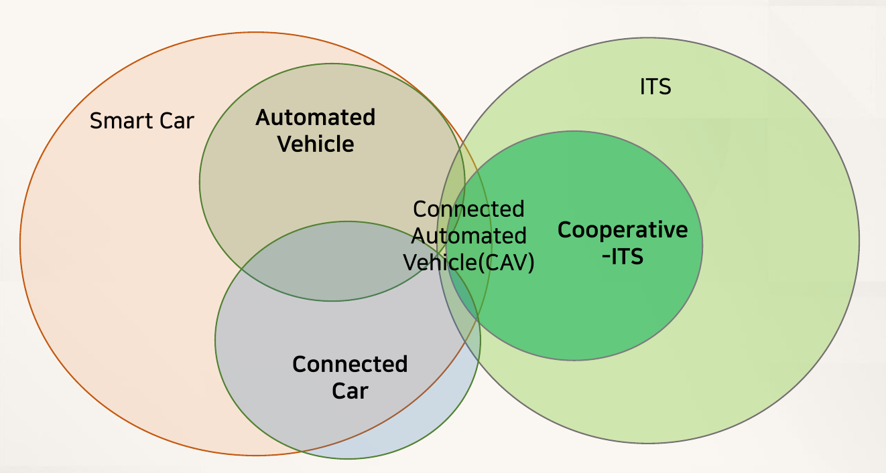

*그림 1. 커넥티드 자율주행 관련 용어의 관계*

> **용어 정의:** **스마트카(smart car)** 는 첨단 센서, 전자 제어, 정보통신 기술을 갖추어 안전성과 편의성을 높인 차량을 아우르는 가장 넓은 개념이다.

> **용어 정의:** **자율주행차(automated vehicle)** 는 운전 작업의 일부나 전부를 시스템이 수행하는 차량이다.

> **용어 정의:** **커넥티드카(connected car)** 는 통신으로 외부 네트워크, 다른 차량, 도로 인프라와 데이터를 주고받는 차량이다.

자율주행 기능과 커넥티드 기능은 서로 독립적이므로 어느 한쪽만 갖춘 차량도 있으며, 두 기능을 함께 갖춘 차량은 따로 이름을 붙여 부른다.

> **용어 정의:** **커넥티드 자율주행차(CAV, connected automated vehicle)** 는 자율주행 기능과 커넥티드 기능을 함께 갖춘 차량이다.

그림 1에서 스마트카 집합은 자율주행차와 커넥티드카의 대부분을 포함하고, CAV는 자율주행차와 커넥티드카가 겹치는 영역에 놓인다. 오른쪽의 ITS 집합은 교통 체계 전체를 지능화하는 사업이며, 그 안의 **C-ITS(Cooperative ITS)** 는 차량과 인프라가 실시간으로 정보를 공유하는 협력형 교통 체계이다. CAV는 C-ITS와도 겹치므로, 커넥티드 자율주행은 차량 기술과 교통 체계 기술이 만나는 지점에 있다. ITS와 C-ITS는 1.6절과 1.7절에서 자세히 정의한다.

> **참고:** 자율주행 레벨(레벨 0\~5)과 운전 작업의 정의는 2주차에서 다룬다. **운전 작업(DDT, dynamic driving task)** 은 차량을 실시간으로 조향, 가속, 감속하고 주변 환경을 감시하여 대응하는 모든 작업을 말한다 [1].

### 1.2 유럽 C2C-CC의 기술 분류

> **용어 정의:** **C2C-CC(CAR 2 CAR Communication Consortium)** 는 유럽의 완성차 업체, 부품 업체, 연구 기관이 차량 간 통신과 C-ITS의 표준화와 보급을 위해 만든 협의체이다.

C2C-CC는 커넥티드 자율주행 기술을 두 가지 기준으로 분류한다. 첫째 기준은 충돌을 기준으로 한 시간의 흐름이다.

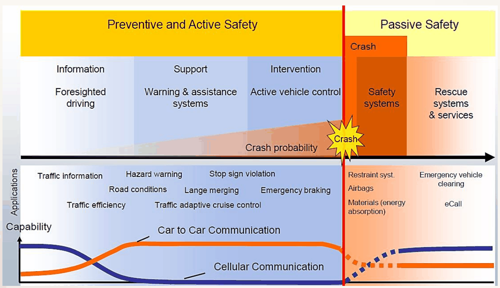

*그림 2. 충돌 전후의 시간 단계별 안전 기술과 통신 방식의 역할*

그림 2의 가로축은 시간이고, 가운데의 별 모양이 충돌 순간이다. 충돌 이전은 **예방 안전과 능동 안전(preventive and active safety)**, 충돌 이후는 **수동 안전(passive safety)** 의 영역이다. 충돌 이전은 다시 세 단계로 나뉘며, 충돌 확률은 오른쪽으로 갈수록 커진다.

| 구간 | 단계 | 내용 | 응용의 예 |
|:-----|:-----|:-----|:-----|
| 충돌 이전 | 정보(information) | 앞을 내다보는 운전(foresighted driving)을 돕는 정보 제공 | 교통 정보, 노면 상태, 교통 효율 |
| 충돌 이전 | 지원(support) | 경고와 보조 시스템 | 위험 경고, 차로 합류, 교통 적응형 크루즈 컨트롤 |
| 충돌 이전 | 개입(intervention) | 능동적 차량 제어 | 정지 신호 위반 대응, 긴급 제동 |
| 충돌 이후 | 안전 시스템 | 탑승자 보호 | 구속 장치, 에어백, 충격 에너지를 흡수하는 소재 |
| 충돌 이후 | 구조 시스템과 서비스 | 사고 뒤의 구조 | 긴급 차량 통로 확보, eCall |

*표 1. 충돌 전후의 단계별 안전 기술*

그림 2의 아래쪽 곡선은 각 단계에서 통신 방식이 얼마나 유용한지를 나타낸다. **차량 간 통신(car-to-car communication)** 은 충돌이 임박한 지원과 개입 단계에서 역할이 가장 크다. 이 단계에서는 가까운 차량끼리 짧은 지연 시간으로 정보를 주고받아야 하기 때문이다. **셀룰러 통신(cellular communication)** 은 넓은 지역의 정보를 모으는 정보 단계와, 사고 뒤 구조 센터에 연락하는 eCall 단계에서 역할이 크다. 즉 충돌까지 남은 시간에 따라 알맞은 통신 방식이 다르다.

둘째 기준은 기술의 성숙 단계이다. 유럽은 C-ITS 서비스를 Day 1, Day 2, Day 3+로 나누어 단계적으로 보급한다 [2].

| 구분 | Day 1: 인지 주행(awareness driving) | Day 2: 감지 주행(sensing driving) | Day 3+: 협력 주행(cooperative driving) |
|:-----|:-----|:-----|:-----|
| 사용 사례 | 경고 응용(예: 충돌 회피), 인프라 정보(예: 도로와 교차로 표지) | 고급 경고, 취약 도로 이용자(VRU) 보호(보행자, 이륜차, 인프라 지원), 부분 자동 주행(협력 긴급 제동 보조, 협력 ACC), 신호 제어기와의 협력 | 협력 자율주행(CACC 대열, 협력 차로 합류), 자율주행을 위한 인프라 협력(교차로 통과, 제어권 전환 지원) |
| 통신 서비스 | CAM, DENM(상태, 동역학, 알림), SPAT/MAP, IVI(정적, 동적 표지) | 확장 CAM과 DENM(이륜차, ASIL 등급 정보), CPM(감지한 객체), RTCMEM(위치 보정), SREM과 SSEM(우선 처리와 선점) | 확장 CAM(지원하는 자율주행 레벨, 계획된 기동과 경로), 확장 IVI(자율주행용 표지), MCM과 확장(계획 궤적과 희망 궤적, 인프라 지원), VAM(VRU 전용 인지) |
| 지원 기능 | 보안 지원(EU CCMS 사용) | 기능 안전 지원(송신 데이터의 ASIL 등급 인증), 오작동 탐지, 위치 정확도 향상(인프라의 GNSS 보정) | 자동화된 조정(목표 일치, 자율주행 조정 규칙) |

*표 2. C2C-CC의 Day 1, Day 2, Day 3+ 단계별 사용 사례, 통신 서비스, 지원 기능*

표 2는 왼쪽에서 오른쪽으로 갈수록 위험 정보의 전파에서 조정된 자동화로 발전한다. 향상되는 항목은 신뢰성(기능 안전), 정확도(위치와 시간), 적시성(갱신 주기)이며, 최종 목표는 사고 없는 도로 교통과 최적의 교통 흐름이다.

> **용어 정의:** **취약 도로 이용자(VRU, vulnerable road user)** 는 보행자, 자전거 이용자, 이륜차(PTW, powered two-wheeler) 운전자처럼 차체의 보호를 받지 못하는 도로 이용자이다.

> **용어 정의:** **CACC(cooperative adaptive cruise control)** 는 앞차와의 거리를 레이더로 유지하는 ACC에 차량 간 통신을 더해 더 짧고 안정적인 간격을 유지하는 기능이다.

표 2의 지원 기능 행은 수신한 메시지를 믿고 쓸 수 있게 하는 장치를 다룬다. 메시지가 위조되지 않았음을 보장하는 보안과, 메시지를 만든 기능의 안전성을 보장하는 기능 안전이 그 두 기둥이다.

> **용어 정의:** **EU CCMS**는 유럽 C-ITS 메시지에 서명하는 인증서를 발급하고 관리하는 유럽연합의 보안 인증 관리 체계이다.

> **용어 정의:** **ASIL(automotive safety integrity level)** 은 자동차 기능 안전 표준 ISO 26262가 정한 안전 무결성 등급(A\~D)이다.

표 2에 나오는 유럽의 메시지는 다음과 같다. 유럽 표준은 메시지 이름 끝에 message의 M을 붙인다(SPAT의 메시지는 SPATEM).

| 메시지 | 이름 | 내용 | 표준 |
|:-----|:-----|:-----|:-----|
| CAM | Cooperative Awareness Message | 차량의 위치, 속도, 방향 같은 상태를 주기적으로 알린다. | ETSI EN 302 637-2 [3] |
| DENM | Decentralized Environmental Notification Message | 사고, 정체, 노면 위험 같은 사건이 생겼을 때 그 사건을 알린다. | ETSI EN 302 637-3 [4] |
| CPM | Collective Perception Message | 자기 센서가 감지한 주변 객체를 공유한다. | ETSI TS 103 324 [5] |
| VAM | VRU Awareness Message | VRU의 위치와 움직임을 알린다. | ETSI TS 103 300-3 [6] |
| SPATEM, MAPEM | Signal Phase and Timing, Map | 신호 현시와 교차로 형상을 알린다. | ETSI TS 103 301 [7] |
| IVIM | In-Vehicle Information | 도로 표지 정보를 차량 안에 표시하도록 전달한다. | ETSI TS 103 301 [7] |
| SREM, SSEM | Signal Request, Signal Status | 신호 우선 처리를 요청하고 그 처리 상태를 회신한다. | ETSI TS 103 301 [7] |
| RTCMEM | RTCM corrections | 위성 항법(GNSS) 위치를 보정하는 정보를 전달한다. | ETSI TS 103 301 [7] |
| MCM | Maneuver Coordination Message | 계획한 궤적을 공유하고 기동을 조정한다. | 표준화 진행 중 |

*표 3. 유럽 C-ITS 메시지의 종류*

> **참고:** CAM은 정해진 주기가 아니라 차량의 움직임에 따라 생성된다. 직전 CAM과 비교해 방향이 4° 넘게, 위치가 4 m 넘게, 속도가 0.5 m/s 넘게 바뀌면 새 CAM을 만들며, 생성 간격은 100 ms 이상 1,000 ms 이하이다 [3]. 따라서 빠르게 달리는 차량은 초당 최대 10회, 정지한 차량은 초당 1회 CAM을 보낸다. 미국의 BSM은 3.7절에서 다룬다.

### 1.3 미국 SAE J3216의 협력 등급 분류

미국 자동차 공학회(SAE)는 SAE J3216에서 **협력 운전 자동화(CDA, cooperative driving automation)** 를 정의하고, 차량이 다른 차량이나 인프라와 협력하는 방식을 네 등급(Class A\~D)으로 나눈다 [8]. 자율주행 레벨(레벨 0\~5)이 차량이 혼자서 운전 작업을 얼마나 맡는지를 나타낸다면, 협력 등급은 다른 주체와 무엇을 주고받는지를 나타낸다. 두 분류는 서로 독립된 축이므로 표 4처럼 행렬로 결합한다.

> **용어 정의:** **ADS(automated driving system)** 는 레벨 3\~5에서 운전 작업 전체를 수행하는 시스템이다.

> **용어 정의:** **C-ADS(cooperative ADS)** 는 CDA 기능을 갖춘 ADS이다.

> **용어 정의:** **TCD(traffic control device)** 는 신호등, 표지판, 노면 표시 같은 교통 안전 시설이다.

| 협력 등급 | 레벨 0(자동화 없음)에서의 예 | 레벨 1 (운전자 보조: 종방향 또는 횡방향 제어) | 레벨 2 (부분 자동화: 종방향과 횡방향 제어) | 레벨 3\~5 (ADS) |
|:-----|:-----|:-----|:-----|:-----|
| 협력 없음 | 표지판, TCD | 운전자가 운전 작업을 완수하고 기능의 수행을 실시간으로 감독한다. | 운전자가 운전 작업을 완수하고 기능의 수행을 실시간으로 감독한다. | ADS가 정해진 조건에서 운전 작업 전체를 수행한다(고장 시 대응 수준은 레벨마다 다르다). |
| Class A: 상태 공유("Here I am and what I see") | 브레이크등, 교통 신호 | 제한된 협력: 사람이 운전하며 CDA 기능을 감독하고 언제든 개입할 수 있다. 감지 능력은 C-ADS보다 제한될 수 있다. | 레벨 1과 같다. | C-ADS가 행동을 결정할 모든 권한을 가진다. 자기 센서의 범위를 넘어 상황 인지가 넓어지고, 주변 도로 이용자와 도로 운영자도 C-ADS의 상태를 더 잘 알게 된다. |
| Class B: 의도 공유("This is what I plan to do") | 방향 지시등, 합류 | 제한된 협력: 종방향이나 횡방향 중 한쪽 의도만 공유하며, 사람이 무시할 수 있다. | 제한된 협력: 종방향과 횡방향 의도를 모두 공유하며, 사람이 무시할 수 있다. | C-ADS가 모든 권한을 가진다. 상대의 계획을 알게 되어 예측의 신뢰도가 높아진다. |
| Class C: 합의 추구("Let's do this together") | 수신호, 합류 | 해당 없음 | 해당 없음 | C-ADS가 모든 권한을 가진다. 행동을 제안하거나 받아들여 주변 이용자, 도로 운영자와 공동의 목표를 달성한다. |
| Class D: 지시("I will do as directed") | 수신호, 경찰의 차로 지정 | 해당 없음 | 해당 없음 | C-ADS가 모든 권한을 가지되, 지시형 통신을 받아들이도록 설계된 매우 특정한 상황에서는 지시를 따른다. |

*표 4. SAE J3216의 협력 등급과 자동화 레벨의 관계*

표 4에서 Class C와 D가 레벨 1과 2에서 "해당 없음"인 이유는, 사람이 운전하는 차량은 합의한 행동이나 지시받은 행동을 시스템이 보장할 수 없기 때문이다. 각 등급의 구체적인 기능 사례는 3.2절에서 다룬다.

> **핵심:** 유럽의 Day 단계는 서비스를 언제 보급하는지에 따른 분류이고, 미국의 Class A\~D는 협력의 깊이에 따른 분류이다. 두 분류 모두 상태 공유(인지)에서 의도 공유(감지, 계획 공유)를 거쳐 합의와 조정(협력 주행)으로 발전한다는 같은 방향을 가리킨다.

### 1.4 한국의 C-ITS 서비스

국토교통부가 C-ITS로 제공하는 기존 서비스는 다음 15가지이다 [9]. 각 서비스는 노변 기지국(RSU)이나 차량 탑재 장치(OBU)가 정보를 전달하고, 차량 안의 단말 화면에 경고를 표시하는 방식이다.

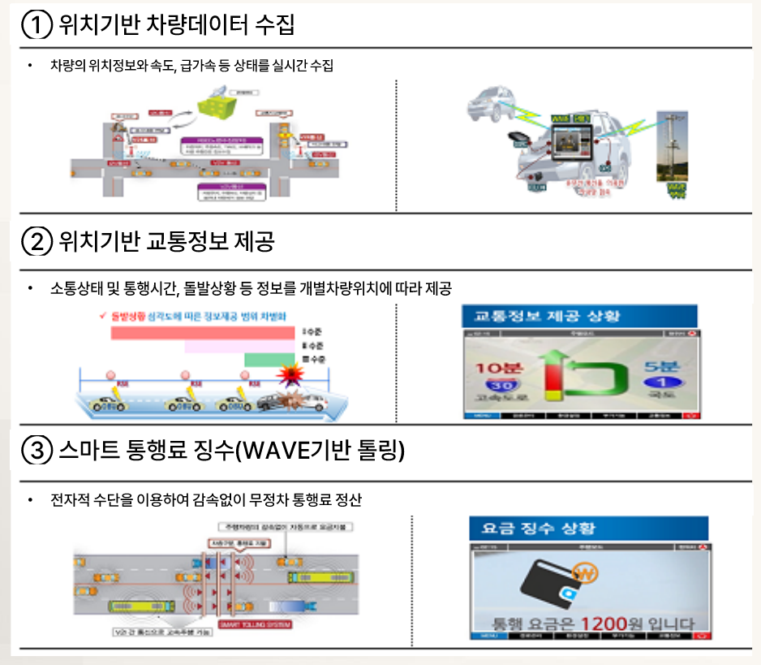

*그림 3. 위치 기반 차량 데이터 수집, 위치 기반 교통 정보 제공, 스마트 톨링 서비스의 개념도와 단말 화면*

| 번호 | 서비스 | 내용 |
|:-----|:-----|:-----|
| 1 | 위치 기반 차량 데이터 수집 | 차량의 위치 정보와 속도, 급가속 같은 상태를 실시간으로 수집한다. |
| 2 | 위치 기반 교통 정보 제공 | 소통 상태, 통행 시간, 돌발 상황 정보를 개별 차량의 위치에 맞추어 제공한다(예: 경로별 소요 시간 10분과 5분 비교). |
| 3 | 스마트 통행료 징수(WAVE 기반 톨링) | 전자적 수단으로 감속 없이 정차하지 않고 통행료를 정산한다. |
| 4 | 도로 위험 구간 정보 제공 | 급커브 같은 위험 구간에서 낙하물, 역주행 차량을 노변 검지기로 검지하여 경고한다. |
| 5 | 노면 상태와 기상 정보 제공 | 국지적 안개, 결빙, 수막 같은 장애 요소를 센서로 검지하여 주의 운전 정보를 제공한다. |
| 6 | 도로 작업 구간 주행 지원 | 공사, 청소 같은 도로 작업으로 인한 사고를 예방한다. |
| 7 | 교차로 신호 위반 위험 경고 | 교차로의 신호 현시 정보를 제공하여 신호 위반 위험을 경고한다. |
| 8 | 우회전 안전 운행 지원 | 우회전할 때 운전자가 인지하지 못한 교차로 접근 차량과의 상충을 경고한다. |
| 9 | 버스 운행 관리 | 버스의 개문 발차 같은 운행 상황을 제공한다. |
| 10 | 옐로 버스 운행 안내 | 통학 버스가 정차하면 위치와 승하차 여부를 뒤따르는 차량에 전달한다. |
| 11 | 스쿨존, 실버존 속도 제어 | 어린이 보호 구역, 노인 보호 구역과 제한 속도 정보를 접근 차량에 제공한다. |
| 12 | 보행자 충돌 방지 경고 | 횡단보도의 보행자와 자전거를 검지하여 진입 차량에 경고한다. |
| 13 | 차량 추돌 방지 지원 | 앞차의 속도와 사고, 급정거, 급감속을 뒤따르는 차량에 전달한다. |
| 14 | 긴급 차량 접근 경고 | 소방차, 구급차 같은 긴급 차량의 주행 상황을 앞쪽 차량에 전달한다. |
| 15 | 차량 긴급 상황 경고 | 차량 고장이나 사고가 나면 운전자가 차 안의 버튼으로 위험 정보를 전달한다. |

*표 5. 국토교통부 C-ITS 서비스 15가지*

> **용어 정의:** **신호 현시(signal phase)** 는 교차로에서 특정 방향의 차량이나 보행자에게 통행권을 주는 신호의 상태(녹색, 황색, 적색 등)와 그 순서를 말한다.

> **용어 정의:** **노변 기지국(RSU, roadside unit)** 은 도로변에 설치되어 차량과 통신하는 장치이다. 노변 장치(RSE, roadside equipment)는 RSU와 같은 뜻으로 쓰인다.

> **용어 정의:** **차량 탑재 장치(OBU, on-board unit)** 는 차량에 설치된 통신 단말이다.

표 5의 서비스 대부분은 단말 화면에 사건까지의 거리(예: 300 m, 200 m), 제한 속도, 현재 속도를 함께 표시한다. 예를 들어 도로 위험 구간 정보 제공 화면은 "돌발상황 발생시"라는 제목 아래 300 m 앞의 위험, 제한 속도 40, 현재 속도 70 km/h를 보여 주고, 스쿨존 화면은 200 m 앞의 어린이 보호 구역과 제한 속도 30을 보여 준다. 서비스를 실제 시범 사업에서 운영한 과정은 12주차에서 다룬다.

### 1.5 자동차 산업과 ITS 산업

커넥티드 자율주행은 자동차 산업과 ITS 산업이 함께 만드는 기술이지만 두 산업의 규모는 크게 다르다. 한국자동차연구원의 자료에 따르면 국내 자동차 산업의 규모는 연 250조 원, ITS 산업은 연 1조 원 수준이다 [10]. 자동차 산업은 규모가 훨씬 크므로 연구 개발, 양산, 생산의 각 단계에 걸쳐 많은 인력이 필요하다. 새로운 기술은 석사, 박사급의 연구 개발 인력이, 성숙한 기술은 학부 이상의 양산과 생산 인력이 주로 맡는다. 한편 커넥티드카 시장은 기대보다 늦게 성숙하고 있으므로, 이 분야의 산업 전망은 그 지연을 고려해 판단해야 한다.

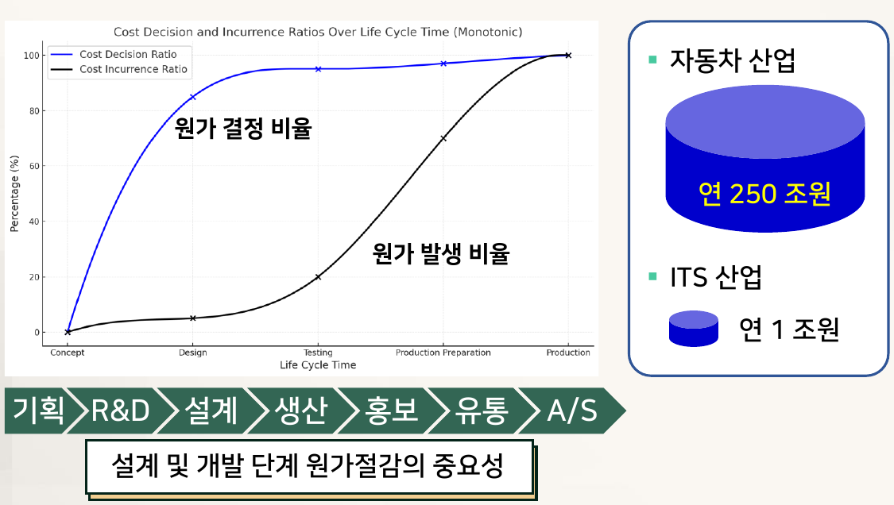

*그림 4. 제품 수명 주기에 따른 원가 결정 비율과 원가 발생 비율, 자동차 산업과 ITS 산업의 연간 규모*

그림 4의 그래프는 자동차 개발의 수명 주기(개념, 설계, 시험, 생산 준비, 생산)에 따라 두 비율이 어떻게 쌓이는지를 보여 준다. **원가 결정 비율(cost decision ratio)** 은 전체 원가 가운데 그 시점까지 결정된 몫이고, **원가 발생 비율(cost incurrence ratio)** 은 실제로 지출된 몫이다. 설계 단계가 끝날 무렵 원가의 약 85%가 이미 결정되지만 실제로 쓴 돈은 약 5%에 불과하다. 시험 단계에서는 약 95%가 결정되고 약 20%가 발생하며, 생산 준비 단계에서야 발생 비율이 약 70%에 이른다. 즉 원가의 대부분은 설계에서 정해지고 나중에 지출되므로, 원가 절감은 기획, 연구 개발, 설계, 생산, 홍보, 유통, 사후 서비스(A/S)로 이어지는 단계 가운데 설계와 개발 단계에서 해야 효과가 크다. 통신 모듈 같은 커넥티드 부품도 설계 단계에서 구조와 사양을 잘 정해야 양산 원가를 낮출 수 있다.

### 1.6 ITS의 정의와 전통적 분류

> **용어 정의:** **ITS(Intelligent Transport Systems, 지능형 교통체계)** 는 도로, 차량, 신호 시스템 같은 기존 교통 체계의 구성 요소에 첨단 전자, 정보, 통신 기술을 적용하여 교통 체계 전체의 효율성을 높이는 교통 부문의 정보화 사업이다.

ITS는 생활 곳곳에 이미 들어와 있다. 고속도로의 하이패스, 도로 전광판의 소통 정보, 버스 정류장의 도착 안내, 과속 단속 카메라가 모두 ITS의 서비스이다. 국내 ITS는 다섯 분야로 나뉜다.

| 분야 | 이름 | 서비스의 예 |
|:-----|:-----|:-----|
| ATMS | Advanced Traffic Management Systems (첨단 교통 관리) | 실시간 교통 제어, 돌발 상황 관리, 자동 교통 단속, 자동 요금 징수, 중차량 관리 |
| ATIS | Advanced Traveler Information Systems (첨단 교통 정보) | 최적 경로 안내, 종합 여행 안내, 교통 정보 제공 |
| APTS | Advanced Public Transportation Systems (첨단 대중교통) | 대중교통 정보 제공, 대중교통 관리 |
| CVO | Commercial Vehicle Operations (첨단 화물 운송) | 위험물 차량 관리, 화물 차량 관리 |
| AVHS | Advanced Vehicle and Highway Systems (첨단 차량 도로) | 첨단 도로 시스템, 첨단 차량 시스템 |

*표 6. 국내 ITS의 다섯 분야와 서비스*

초창기 ITS의 기술 분류는 그림 5와 같다. 이 분류에서 차량 기술은 AVHS 아래의 첨단 차량 시스템에 속하며, ADAS도 그 하위 기술이었다.

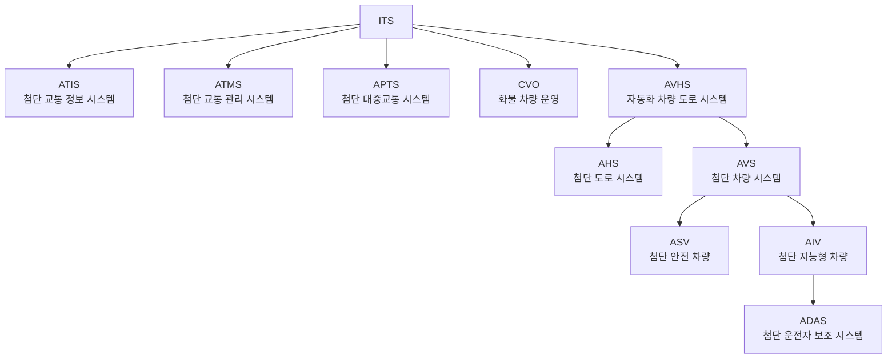

*그림 5. 초창기 ITS 기술 분류*

> **용어 정의:** **ADAS(advanced driver assistance system, 첨단 운전자 보조 시스템)** 는 적응형 크루즈 컨트롤, 차로 이탈 경고, 긴급 제동처럼 운전자의 인지, 판단, 조작을 돕는 시스템이다.

### 1.7 차세대 지능형 교통체계(C-ITS)

2010년대에 들어 ITS는 C-ITS로 발전했다. 그림 6은 두 개념을 비교한다.

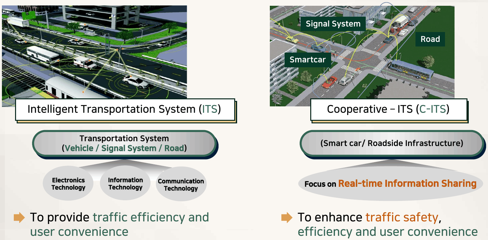

*그림 6. ITS와 C-ITS의 개념 비교*

| 구분 | ITS | C-ITS |
|:-----|:-----|:-----|
| 대상 | 교통 체계(차량, 신호 시스템, 도로) | 스마트카와 노변 인프라 |
| 핵심 기술 | 전자 기술, 정보 기술, 통신 기술 | 실시간 정보 공유 |
| 목표 | 교통 효율과 이용자 편의 | 교통 안전, 효율, 이용자 편의 |
| 정보의 흐름 | 주로 인프라가 수집하여 센터에서 처리한 뒤 전광판이나 내비게이션으로 일방향 제공 | 차량과 차량, 차량과 인프라가 양방향으로 즉시 교환 |

*표 7. ITS와 C-ITS의 비교*

기존 ITS는 검지기와 센터가 교통 정보를 모아 가공한 뒤 몇 분 단위로 제공하므로, 효율과 편의에는 도움이 되지만 몇 초 안에 대응해야 하는 사고 예방에는 쓰기 어렵다. C-ITS는 차량과 인프라가 실시간으로 정보를 주고받으므로 안전 서비스가 가능해진다.

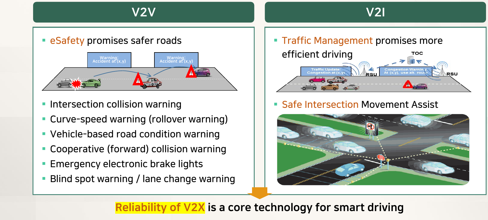

*그림 7. V2V와 V2I 기반 C-ITS 서비스*

그림 7의 왼쪽은 V2V 서비스로, 앞에서 사고가 난 차량이 "Warning: Accident at (x, y)" 메시지를 뒤 차량에 전달하고 그 차량이 다시 다음 차량에 전달하여 도로를 더 안전하게 만든다(eSafety). V2V 서비스의 예는 교차로 충돌 경고, 커브 속도 경고(전복 경고), 차량 기반 노면 상태 경고, 협력 전방 충돌 경고, 긴급 전자 브레이크등, 사각지대 경고와 차로 변경 경고이다. 오른쪽은 V2I 서비스로, RSU가 차량의 정체 정보("Traffic Update: Congestion at (x, y)")를 교통 관제 센터(TOC, traffic operation center)에 올리고, 센터가 다른 RSU를 통해 정체 경고와 우회 경로를 내려보내 효율적인 운전을 돕는다(교통 관리). 교차로에서는 인프라가 접근 차량의 움직임을 모아 충돌 위험을 알리는 안전 교차로 통행 보조(safe intersection movement assist)를 제공한다. 이 모든 서비스는 V2X 통신이 신뢰할 수 있어야 성립하므로, V2X의 신뢰성이 스마트 드라이빙의 핵심 기술이다.

### 1.8 안전 관점에서 본 V2X의 필요성

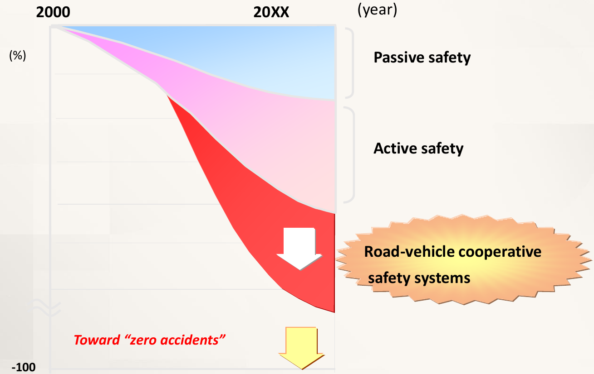

*그림 8. 안전 기술의 발전에 따른 교통사고 감소 효과의 개념*

그림 8은 한 완성차 업체의 자료로, 2000년부터 미래(20XX년)까지 교통사고 감소율(%)을 안전 기술별로 쌓아 보여 준다. 위쪽 띠는 **수동 안전(passive safety)**, 즉 에어백과 안전띠처럼 충돌이 일어난 뒤 피해를 줄이는 기술의 기여이다. 가운데 띠는 **능동 안전(active safety)**, 즉 ABS, 전자식 주행 안정 제어, 긴급 제동처럼 충돌 자체를 막는 차량 단독 기술의 기여이다. 두 기술만으로는 감소율이 -100%에 이르지 못하며, 남은 부분(빨간 띠)을 채우는 것이 **도로와 차량의 협력 안전 시스템(road-vehicle cooperative safety systems)**, 즉 V2X 기반 안전 시스템이다. 그래프 아래의 "Toward zero accidents"라는 목표에 다가가려면 차량 혼자 볼 수 없는 위험을 통신으로 알아야 한다는 것이 이 그림의 교훈이다.

일본은 이러한 관점에서 1991년부터 운수성(2001년 이후 국토교통성) 주도로 **ASV(Advanced Safety Vehicle, 첨단 안전 차량)** 프로젝트를 5년 단위로 진행해 왔다 [11].

| 단계 | 기간 | 내용 |
|:-----|:-----|:-----|
| 1단계 | 1991\~1995년 | 기본적인 안전 기술 개발과 실현 가능성 검증 |
| 2단계 | 1996\~2000년 | 운전자 지원 시스템과 차량 간 통신 기술 개발 |
| 3단계 | 2001\~2005년 | V2V, V2I 협력 기술 기반의 정교한 충돌 방지 시스템 |
| 4단계 | 2006\~2010년 | 고도화된 차량 통신과 실시간 정보 교환 기술 |
| 5단계 | 2011\~2015년 | 자율주행 기술의 초기 실험, 완전 자율주행의 기반 마련 |
| 6단계 | 2016\~2020년 | 자율주행과 고도화된 통신 기술을 상용화 단계로 발전시키는 연구 |
| 7단계 | 2021년\~ | 자율주행 기술의 실용화와 지속 가능한 교통 시스템 개발, 특히 레벨 4 이상의 자율주행과 도로 인프라의 통합 |

*표 8. 일본 ASV 프로젝트의 단계*

각 단계의 홍보 책자는 그 시기의 지향점을 표어로 보여 준다. 4단계는 "ASV, the Bridge to an Accident-free Society"(사고 없는 사회로 가는 다리), 5단계는 "Realization of Secure and Safe Traffic Society by Harmonizing Humans and Vehicles"(사람과 차량의 조화로 실현하는 안심, 안전 교통 사회)를 내세웠다.

### 1.9 커넥티드 자율주행의 필요성

자율주행차에 무선 통신을 결합하면 센서의 가시권과 비가시권 모두에서 신뢰할 수 있는 광역 정보를 얻고, 기존 센서와 상호 보완적인 데이터를 융합하여 객체 인식률을 높이며, 탑승자에게 편의와 안전 서비스를 제공하고, 자동차, 인터넷, 통신, 인프라 같은 연계 산업으로 파급 효과가 커진다. 이 네 가지 효과와 안전 서비스(지연 시간 중심), 편의 서비스(전송 속도 중심)의 구분은 1주차 3.4절에서 다루었으며, 2.8절에서 사례로 다시 확인한다.

### 1.10 ISO 트럭 군집주행 시스템

> **용어 정의:** **군집주행(platooning)** 은 여러 차량이 차량 간 통신으로 연결되어 짧은 간격을 유지하며 한 무리로 주행하는 기술이다. 앞차가 만든 공기 저항의 그늘에 뒤 차량이 들어가 연료를 아끼고, 도로 용량을 늘리며, 운전자의 피로를 줄인다.

국제 표준화 기구의 지능형 교통 체계 기술위원회(ISO TC204) 산하 WG14는 트럭 군집주행 시스템(TPS, truck platooning systems)을 표준화했으며, 그 결과가 ISO 4272이다 [12]. 그림 9는 TPS의 전체 구조이다.

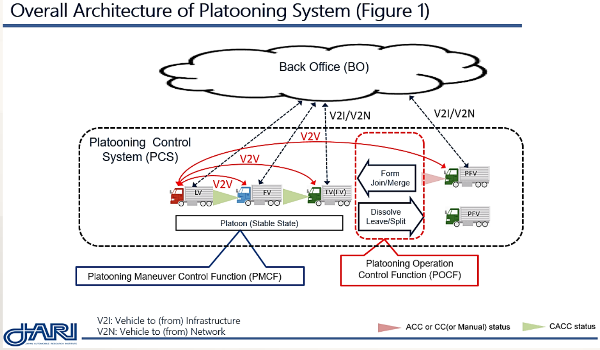

*그림 9. 트럭 군집주행 시스템의 전체 구조*

그림 9의 점선 상자 전체가 **군집주행 제어 시스템(PCS, platooning control system)** 이다. 왼쪽의 안정 상태 군집(platoon in stable state)은 선두 차량(LV), 추종 차량(FV), 후미 차량(TV)으로 이루어지며, 빨간 화살표로 표시된 V2V로 서로 연결된다. 차량 사이의 초록 삼각형은 CACC 상태, 분홍 삼각형은 ACC나 정속 주행(CC) 또는 수동 운전 상태를 뜻한다. 오른쪽의 잠재적 추종 차량(PFV)은 형성, 합류(join/merge)를 통해 군집에 들어오거나 해산, 이탈, 분리(dissolve/leave/split)를 통해 군집에서 나간다. 위쪽의 **백 오피스(BO, back office)** 는 V2I나 V2N으로 차량들과 통신하는 관제 서버이다. 안정 상태의 제어는 **군집 기동 제어 기능(PMCF)**, 상태의 전이는 **군집 운영 제어 기능(POCF)** 이 맡는다.

| 약어 | 용어 | 정의 |
|:-----|:-----|:-----|
| LV | 선두 차량(leading vehicle) | 군집의 맨 앞 차량이다. LV의 운전자는 V2V로 FV와 PFV를 관리, 감독하며, 자기 판단으로 군집을 형성하거나 합류시키고, 이탈, 분리, 해산시킨다. POCF의 통신을 위해 BO와 통신할 수도 있다. |
| FV | 추종 차량(following vehicle) | LV 뒤에서 V2V로 연결되어 달리는 차량이다. 종방향은 CACC로 제어하고, 차로 유지 보조(LKAS)나 부분 자동 차로 변경(PALS) 같은 횡방향 제어를 함께 쓸 수 있다. POCF의 통신을 위해 BO와 통신할 수도 있다. |
| TV | 후미 차량(trailing vehicle) | FV 가운데 맨 뒤의 차량이다. |
| PV | 군집 차량(platoon vehicle) | LV와 FV(TV 포함)를 함께 부르는 말이다. |
| OV | 기타 차량(other vehicle) | 군집에 참여하지 않지만 긴급 제동이나 끼어들기(cut-in)로 군집에 영향을 줄 수 있는 차량이다. |
| PLV | 잠재적 선두 차량(potential leading vehicle) | 지금은 군집을 이끌고 있지 않지만 이끌 수 있는 차량, 또는 LV였다가 이탈이나 해산으로 군집을 떠난 차량이다. 군집에서 LV가 될 수 있다. |
| PFV | 잠재적 추종 차량(potential following vehicle) | 지금은 군집에 속하지 않지만 속할 수 있는 차량, 또는 FV였다가 이탈이나 해산으로 군집을 떠난 차량이다. 합류하거나 군집을 형성하면 FV가 된다. |
| PPV | 잠재적 군집 차량(potential platoon vehicle) | PLV와 PFV를 함께 부르는 말로, 군집에 포함될 수 있는 차량이다. 군집에 들어가면 LV나 FV(TV)가 된다. |

*표 9. 군집주행 관련 차량 용어*

이 용어는 유럽의 SARTRE 프로젝트를 따른 것이며, 유럽의 ENSEMBLE 프로젝트는 "potential" 대신 "candidate"라는 말을 쓴다.

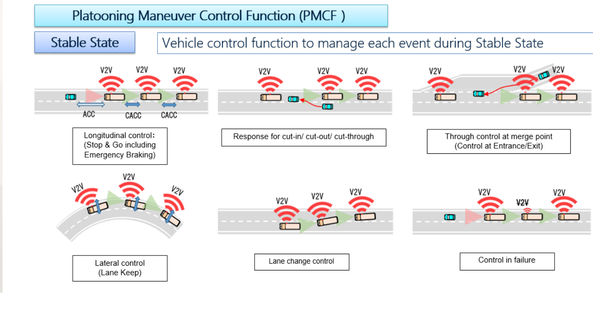

*그림 10. PMCF가 안정 상태에서 다루는 차량 제어 사건*

PMCF는 안정 상태의 군집에서 일어나는 각 사건을 관리하는 차량 제어 기능이다. 그림 10의 여섯 사건은 다음과 같다.

1. **종방향 제어:** 긴급 제동을 포함한 정지와 출발(stop and go)에서 차간 간격을 유지한다. 군집 앞의 일반 차량과는 ACC로, 군집 안에서는 CACC로 간격을 맞춘다.
2. **끼어들기 대응:** 다른 차량이 군집 사이로 끼어들거나(cut-in), 빠져나가거나(cut-out), 가로질러 지나갈 때(cut-through) 간격을 넓히거나 되돌린다.
3. **합류 지점 통과 제어:** 진입로나 진출로처럼 다른 차량이 합류하는 지점을 통과할 때 군집을 제어한다.
4. **횡방향 제어:** 차로를 유지한다.
5. **차로 변경 제어:** 군집이 차로를 바꾼다.
6. **고장 시 제어:** 통신이나 센서가 고장 났을 때 안전한 상태로 전환한다.

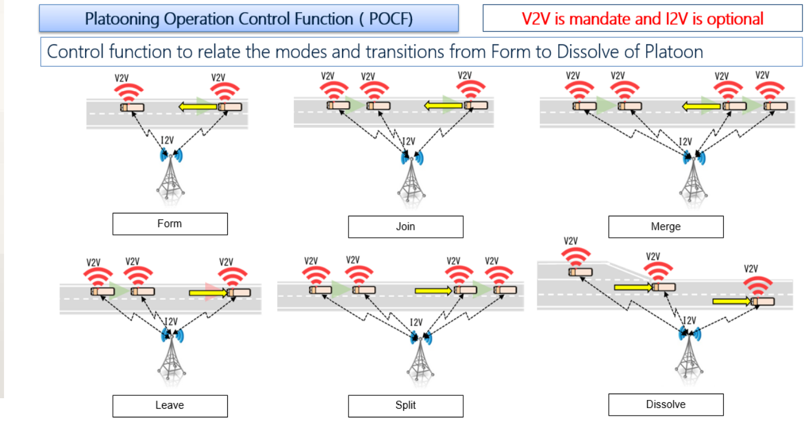

*그림 11. POCF가 다루는 군집의 형성부터 해산까지의 전이*

POCF는 군집의 형성(form)부터 해산(dissolve)까지 모드와 전이를 관리하는 제어 기능이다. 그림 11의 여섯 전이는 군집 형성(form, 두 차량이 새 군집을 만든다), 합류(join, 한 차량이 기존 군집의 뒤에 붙는다), 병합(merge, 두 군집이 하나가 된다), 이탈(leave, 한 차량이 군집에서 나간다), 분리(split, 한 군집이 둘로 나뉜다), 해산(dissolve, 군집 전체가 풀린다)이다. 이 기능에서 **V2V는 필수이고 I2V는 선택**이다. 군집 차량끼리는 반드시 직접 통신해야 하지만, 인프라는 합류 조정 같은 부가 정보를 줄 뿐이기 때문이다.

> **참고:** 군집주행에서 V2V가 필수인 이유는 **열 안정성(string stability)** 에 있다. 레이더만 쓰는 ACC에서는 각 차량이 앞차의 거리 변화를 관측한 뒤에야 반응하므로 반응 지연이 쌓여, 앞차의 작은 속도 변화가 뒤쪽 차량으로 갈수록 커진다. CACC는 앞차의 가속도 정보를 통신으로 직접 받으므로 이 증폭을 억제하고, 같은 안정성에서 더 짧은 차간 시간을 유지할 수 있다 [13].

### 1.11 군집주행 사례

**Volvo SARTRE.** SARTRE(Safe Road Trains for the Environment)는 유럽연합의 연구 프로그램으로 진행된 군집주행 프로젝트로, Volvo가 참여했다 [14]. 전문 운전자가 모는 선두 차량 뒤에 여러 차량이 V2V로 연결되어 조향, 가속, 감속을 자동으로 수행하며, 추종 차량의 운전자는 운전에서 손을 떼고 다른 일을 할 수 있다. 이 프로젝트는 트럭이나 버스처럼 전문 운전자가 모는 대형 차량을 선두로, 승용차와 트럭이 섞인 군집을 별도의 도로 인프라 없이 일반 고속도로에서 운행하는 개념을 연구했다.

**일본의 5G 트럭 군집주행.** 일본은 2018년도(헤이세이 30년도) 5G 종합 실증 시험의 하나로 5G 이동통신을 트럭 군집주행에 적용하는 시험을 수행했다. 군집주행은 차량 사이에 제어 정보를 짧은 지연으로 주고받아야 하므로, 5G의 저지연 특성을 검증하는 대표적인 응용이다.

### 1.12 주요 완성차의 ADAS 패키지

주요 완성차 업체는 센서와 ADAS 기능을 묶어 패키지로 판매한다.

| 구분 | BMW Driver Assistance Plus | Mercedes-Benz Driver Assistance Package | Toyota Safety Sense 3.0 |
|:-----|:-----|:-----|:-----|
| 센서 | 초음파, 장거리 레이더(LRR), 단거리 레이더(SRR), 전방과 후방 카메라 | 초음파, LRR, SRR, 전방과 후방 카메라, V2X | 초음파, LRR, SRR, 전방과 후방 카메라, V2X |
| 기능 | 고속도로 보조, 차로 변경 보조, 능동 사각지대 감지, 전방 충돌 완화, 차로 유지 보조, 상향등 보조, 비상 정지 보조, 후진 보조, 기동 보조, 원격 주차, 능동 주차 거리 제어 | Intelligent Drive Next Level, 능동 제동 보조, 회피 조향 보조, 원격 주차 파일럿, Car-to-X 통신, 디지털 차량 키, PRE-SAFE Impulse Side, PRE-SAFE Sound | 보행자 감지 충돌 방지 시스템, 다이내믹 레이더 크루즈 컨트롤, 조향 보조 차로 이탈 경고, 차로 추적 보조, 도로 표지 보조, 자동 상향등, 능동 운전 보조, Safety Connect |

*표 10. 주요 완성차의 ADAS 패키지*

표 10에서 Mercedes-Benz와 Toyota는 V2X를 센서 구성에 포함한다. Mercedes-Benz의 Car-to-X 통신은 다른 차량과 인프라에서 위험 정보를 받아 운전자에게 알리는 기능이다.

> **참고:** 표 10의 Toyota 열은 강의자료의 구성을 따른 것이다. Toyota의 설명에 따르면 Toyota Safety Sense는 전방 카메라와 전방 레이더로 물체와 차선을 감지하고, TSS 3.0의 능동 운전 보조(Proactive Driving Assist)도 이 전방 카메라와 레이더를 쓴다 [15]. 표의 초음파 센서, 후방 카메라, V2X는 TSS 3.0의 구성 요소로 제시되어 있지 않다.

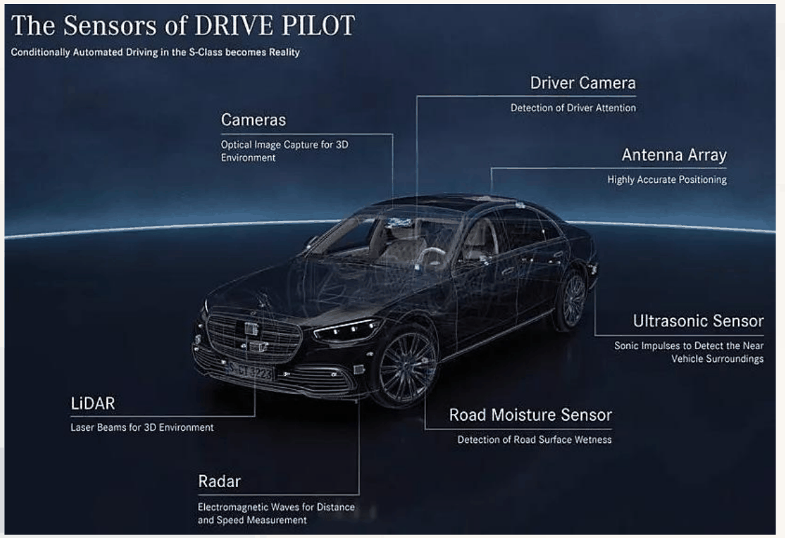

*그림 12. Mercedes-Benz DRIVE PILOT의 센서 구성*

그림 12는 Mercedes-Benz S-Class의 DRIVE PILOT 센서 구성이다. 3차원 환경을 촬영하는 카메라, 레이저로 3차원 환경을 측정하는 라이다, 전자기파로 거리와 속도를 재는 레이더, 음파로 가까운 주변을 감지하는 초음파 센서, 운전자의 주의 상태를 감지하는 운전자 카메라, 고정밀 위치를 측정하는 안테나 배열, 노면의 젖음 상태를 감지하는 노면 습도 센서로 이루어진다. DRIVE PILOT은 2021년 12월 독일에서 UN 규정 R157에 따른 레벨 3 조건부 자동화 시스템 승인을 받았으며, 처음에는 고속도로의 정체 구간에서 최고 60 km/h까지 운전 작업을 맡았다 [16], [17].

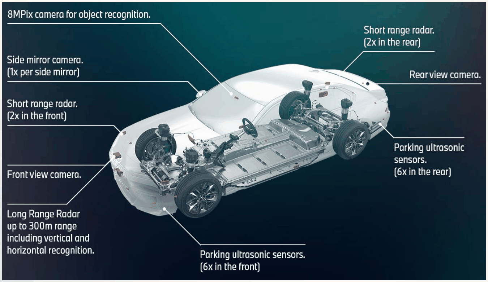

*그림 13. BMW 차량의 ADAS 센서 배치*

그림 13의 BMW 차량은 객체 인식용 8메가픽셀 카메라, 사이드 미러마다 하나씩 있는 카메라, 앞뒤 각 2개의 단거리 레이더, 전방 카메라와 후방 카메라, 수직과 수평 방향까지 인식하는 최대 300 m 범위의 장거리 레이더, 앞뒤 각 6개의 주차용 초음파 센서를 갖춘다.

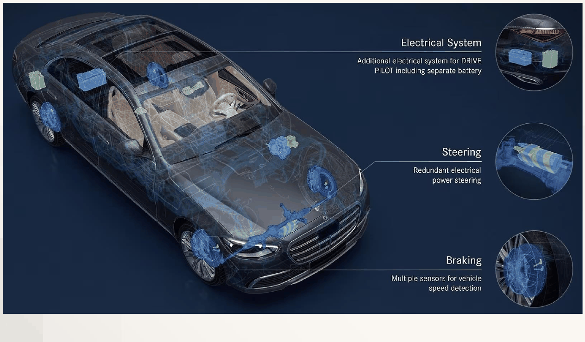

*그림 14. DRIVE PILOT의 이중화된 전기 계통, 조향, 제동 장치*

레벨 3 이상에서는 시스템이 운전 작업을 맡는 동안 부품이 고장 나도 운전자가 제어를 넘겨받을 때까지 차량이 안전하게 동작해야 한다. 그래서 그림 14처럼 DRIVE PILOT은 별도 배터리를 갖춘 추가 전기 계통, 이중화된 전동식 조향 장치, 차량 속도를 감지하는 여러 센서를 갖춘 제동 장치를 둔다. 이처럼 한 부품이 고장 나도 기능을 유지하도록 같은 기능을 두 벌 이상 두는 설계를 **이중화(redundancy)** 라고 한다.

### 1.13 자율주행 레벨별 부품 구성

자율주행 레벨이 높아질수록 차량에 들어가는 센서의 수와 종류가 늘어난다. 한국자동차연구원은 레벨별 부품 구성을 다음과 같이 전망했다 [10].

| 센서 | 레벨 1 | 레벨 2 | 레벨 3 | 레벨 4 | 레벨 5 |
|:-----|--:|--:|--:|--:|--:|
| 초음파 | 4 | 6 | 6 | 6 | 10 |
| 장거리 레이더(LRR) | 1 | 1 | 1 | 2 | 2 |
| 단거리 레이더(SRR) | | 1 | 4 | 4 | 4 |
| 전방 카메라, 전후방 카메라 | 1 (전방) | 2 | 2 | 2 | 2 |
| 서라운드 카메라 | | 4 | 4 | 6 | 6 |
| 운전자 카메라 | | | 1 | 1 | 1 |
| 적외선(IR) 카메라 | | | | | 1 |
| 라이다 | | | 1 | 2 | 4 |
| V2X | | | 1 | 1 | 1 |
| 추측 항법(dead reckoning) | | | 1 | 1 | 1 |
| GNSS(GPS) | | 1 | 1 | 1 | 1 |

*표 11. 자율주행 레벨별 센서 구성 전망*

> **용어 정의:** **추측 항법(dead reckoning)** 은 바퀴 속도와 관성 측정 장치(IMU)의 값으로 이동 거리와 방향을 적분하여 현재 위치를 추정하는 방법이다. GNSS 신호가 끊기는 터널에서도 위치를 이어서 추정할 수 있다.

> **용어 정의:** **GNSS(global navigation satellite system)** 는 GPS를 포함한 위성 항법 시스템의 총칭이다.

V2X는 레벨 3부터 1개씩 들어가며, 레벨이 높아질수록 라이다와 서라운드 카메라가 늘어난다. 레벨별 대표 기능은 다음과 같다.

| 레벨 | 대표 기능 |
|:-----|:-----|
| 레벨 1 | LKAS(차로 유지 보조 시스템), ACC(적응형 크루즈 컨트롤), CACC(협력 적응형 크루즈 컨트롤) |
| 레벨 2 | PALS(부분 자동 차로 변경 시스템), PADS(부분 자동 차로 내 주행 시스템: 교통 정체 보조 TJA, 고속도로 주행 보조 HDA), PAPS(부분 자동 주차 시스템) |
| 레벨 3 | MCS(고속도로 쇼퍼 시스템), 드라이브 파일럿 |
| 레벨 4 | AVPS(자동 발레 주차 시스템), LSAD(저속 자율주행), M-ADS(고속도로용 ADS), AVDS(발레 운전) |
| 레벨 5 | 완전 자동화 |

*표 12. 자율주행 레벨별 대표 기능*

### 1.14 원격 주행

> **용어 정의:** **원격 주행(remote driving)** 은 차량 밖의 원격 운전자가 통신망으로 차량의 영상과 센서 정보를 받아 보고, 조향과 가감속 명령을 보내 차량을 운전하는 기술이다. 자율주행 시스템이 처리하지 못하는 상황을 사람이 원격으로 넘겨받는 수단으로도 쓰인다.

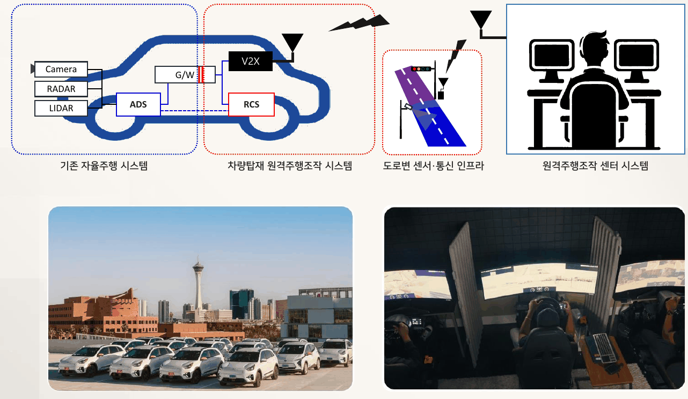

*그림 15. 원격 주행 시스템의 구성과 원격 주행 서비스의 차량, 원격 운전석*

그림 15의 위쪽은 원격 주행 시스템의 네 구성 요소이다.

1. **기존 자율주행 시스템:** 카메라, 레이더, 라이다의 정보를 자율주행 시스템(ADS)이 처리한다.
2. **차량 탑재 원격 주행 조작 시스템:** 게이트웨이(G/W)를 거쳐 ADS와 연결된 원격 제어 시스템(RCS, remote control system)이 V2X 통신 모듈로 차량 밖과 통신한다.
3. **도로변 센서와 통신 인프라:** 도로변의 센서가 차량 주변 상황을 보완하고, 통신 인프라가 차량과 센터를 연결한다.
4. **원격 주행 조작 센터 시스템:** 원격 운전자가 여러 화면으로 차량의 상황을 보고 조작 명령을 보낸다.

아래쪽 사진은 미국 라스베이거스에서 원격 운전으로 차량을 고객에게 전달하는 서비스를 운영한 Halo의 차량들과 원격 운전석이다.

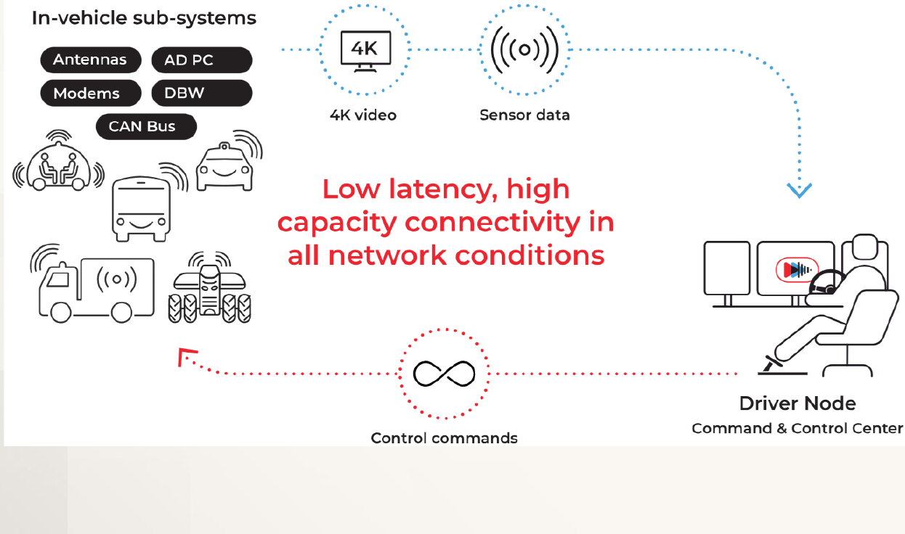

*그림 16. 원격 주행을 위한 차량 하위 시스템과 관제 센터 사이의 데이터 흐름*

그림 16은 원격 주행용 통신 플랫폼 업체 DriveU의 개념도이다. 로봇, 버스, 승용차, 트럭, 배달 로봇 같은 차량에는 안테나, 자율주행 컴퓨터(AD PC), 모뎀, 바이 와이어 구동 장치(DBW, drive-by-wire), CAN 버스가 들어 있다. 차량은 4K 영상과 센서 데이터를 관제 센터의 운전자 노드(driver node)로 올려 보내고, 운전자 노드는 제어 명령을 차량으로 내려보낸다. 상향 링크는 대용량이고 하향 링크는 짧은 지연이 중요하므로, 어떤 네트워크 상황에서도 지연이 짧고 용량이 큰 연결이 필요하다.

> **참고:** 3GPP는 원격 주행에 필요한 통신 성능으로 최대 종단 간 지연 5 ms, 신뢰도 99.999%, 차량에서 서버 방향 25 Mbps, 서버에서 차량 방향 1 Mbps의 전송 속도를 제시한다 [18]. 영상을 올리는 방향의 전송 속도가 큰 것은 그림 16의 데이터 흐름과 일치한다.

원격 주행 서비스는 기술과 인프라의 준비 정도에 따라 단계적으로 구현된다.

| 단계 | 서비스 | 설명 |
|:-----|:-----|:-----|
| 현재 구현 가능 | 근거리 발렛 주차, 발렛 운전 | 건물 입구에서 주차장까지처럼 짧고 통제된 구간을 원격으로 운전한다. |
| 지역별 구현 가능 | 외곽 주차, 기술 감독자 | 도심 외곽의 주차장까지 원격으로 이동시키고, 기술 감독자가 여러 자율주행차를 원격으로 감시한다. |
| 인프라 확산 필요 | 원격 대리운전, 렌터카 이송 | 일반 도로의 긴 구간을 원격으로 운전하므로 넓은 지역의 통신 인프라가 필요하다. |

*표 13. 원격 주행 서비스의 구현 단계*

원격 주행과 원격 감시의 법적 책임은 3.10절에서 다룬다.

---

<br>

## 2. 커넥티드 자율주행의 활용과 특성

### 2.1 텔레매틱스

> **용어 정의:** **텔레매틱스(telematics)** 는 차량 기술에 정보통신 기술을 융합하여 운전자와 탑승자에게 안전 운전, 긴급 구난, 교통 안내, 엔터테인먼트를 제공하는 서비스이다.

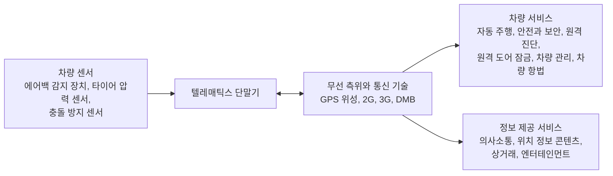

*그림 17. 텔레매틱스 서비스의 구성*

그림 17처럼 텔레매틱스 단말기는 차량의 센서 정보를 모아 무선 측위(GPS)와 이동통신(2G, 3G), 디지털 멀티미디어 방송(DMB)으로 외부와 연결하고, 차량 서비스와 정보 제공 서비스를 제공한다. 예를 들어 에어백이 터지면 단말기가 위치와 함께 사고를 자동으로 신고한다. 대표적인 상용 서비스로 현대자동차의 BlueLink와 Mozen, 기아의 UVO, Ford의 SYNC, GM의 OnStar가 있다.

### 2.2 커넥티드카와 스마트카

커넥티드카와 스마트카는 서로 다른 두 영역이 결합하여 생겨난 개념이다.

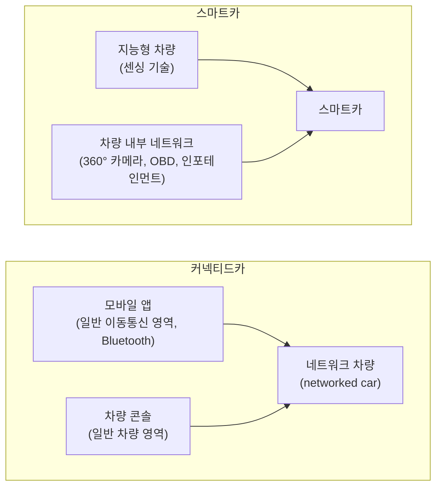

*그림 18. 커넥티드카와 스마트카의 구성*

**커넥티드카**는 스마트폰 같은 일반 이동통신 영역과 일반 차량 영역이 겹치는 곳에서 생겨났다. 모바일 앱과 차량 콘솔이 Bluetooth 등으로 연결되어 네트워크 차량이 된다. 대표적인 연결 표준인 MirrorLink는 Car Connectivity Consortium이 개발했으며, MirrorLink를 지원하는 스마트폰과 차량이라면 제조사와 관계없이 연결할 수 있게 했다. **스마트카**는 센싱 기술을 갖춘 지능형 차량에 360° 카메라, 차량 진단(OBD), 인포테인먼트를 잇는 차량 내부 네트워크가 결합된 것이다. 스마트카의 목표는 안전하고 편리한 운전, 친환경 운전(eco-driving), 자율주행의 세 가지이다.

### 2.3 커넥티드카 서비스의 분류

Frost & Sullivan이 2020년에 정리한 커넥티드카 서비스의 현재와 미래(인포테인먼트, 스마트폰 통합, 전기차 서비스, 내비게이션, 텔레매틱스)는 1주차의 표 2에서 다루었다. Frost & Sullivan은 2019년 자료에서 완성차 업체가 판매할 수 있는 커넥티드 서비스를 일곱 분야로 나누었다 [19].

| 분야 | 서비스의 예 |
|:-----|:-----|
| 인포테인먼트와 텔레매틱스 | 차량 내 Wi-Fi, 미디어 패키지, 업무용 소프트웨어, 컨시어지, 스마트폰 연동과 엔터테인먼트 앱, 개인 디지털 비서, 원격 진단과 예측 정비, 주문형 정비사, 게임 |
| ADAS와 자율주행 | 언덕과 고속도로 보조, 적응형, 예측형 크루즈 컨트롤, 자율 발레 주차, 오토 파일럿, 교통 정체와 교차로 보조, 혹한기 패키지, 운전자와 기사 감시, 원격 차량 조작, 기업용 군집주행 |
| 위치 기반 서비스 | 주유, 통행료 결제, 주차, 충전, 주문형 수리, 지오펜스 기반 관심 지점, 지도 |
| 모빌리티 서비스 | 여정 계획, 라스트 마일 이동, 호출형 승차, 대중교통 시간표와 승차권, 완성차 프로그램의 렌터카와 카셰어링 |
| 파워트레인 성능과 전기차 | 조향, 서스펜션, 변속기를 통한 주행 모드 갱신, 오프로드 패키지, 가속 성능(마력) 향상, 주행 가능 거리 연장, 자동과 수동 변속 전환, 최고 속도 제한 해제(독일), 급속 충전 |
| 부가 가치 | 주문형 보험, 해마다 두 번의 무료 기능 업그레이드 |
| 스마트 인테리어와 익스테리어 | 개인화된 실내(조명, 향기, 공조), 프로젝터와 주문형 화면, 개인 기기 연결 단자, 사용자 인터페이스 스킨, 시트 젖힘과 영화 모드, 고급 오디오, 조명과 와이퍼의 자동 조절, 파노라마 루프, 추가 수납, 트렁크 배송 |

*표 14. 완성차 업체가 판매할 수 있는 커넥티드 서비스의 일곱 분야*

같은 자료는 커넥티드카 서비스를 다시 네 가지로 크게 묶었다 [19].

| 분류 | 서비스의 예 |
|:-----|:-----|
| 커넥티드 서비스 | AI 비서, 안전과 보안, 운전자 감시 시스템(DMS), 원격 진단과 예측 정비, 스마트폰 연동(CarPlay, Android Auto), 인포테인먼트, V2X와 V2I 통신 |
| 자율주행 | 차량 관리(fleet management), 로보택시, ADAS, 지능형 운전석 보조, 자율 주차, 언덕 보조, ACC, 비상 정지 |
| 데이터 수익화 | 운행 기반 보험(UBI), 예측 정비, 사고 최초 통보(FNOL), 차량 내 마켓플레이스, 전동 모빌리티, 맞춤 광고, 익명화된 데이터 공유 |
| 애프터마켓과 공급망 | 부품 진품 인증, 자산과 차량 추적, 시각 기록(time stamping), 스마트 계약, 통합 데이터 수집, 대리점의 예측 정비 |

*표 15. 커넥티드카 서비스의 4대 분류*

> **용어 정의:** **운행 기반 보험(UBI, usage-based insurance)** 은 주행 거리, 급제동 횟수 같은 실제 운행 데이터로 보험료를 정하는 보험이다.

> **용어 정의:** **FNOL(first notice of loss)** 은 사고가 났을 때 보험사에 처음 알리는 절차로, 커넥티드카는 충돌을 감지해 이를 자동으로 수행할 수 있다.

### 2.4 커넥티드카 HMI

> **용어 정의:** **HMI(human-machine interface)** 는 사람과 기계가 정보를 주고받는 접점이다. 차량에서는 디스플레이, 버튼, 터치스크린, 음성 인식, 헤드업 디스플레이 등이 HMI에 해당한다.

Frost & Sullivan은 2020년에 유럽에서 판매되는 15개 완성차 업체(Audi, BMW, DS, Fiat, Honda, Hyundai, JLR, Kia, Mercedes-Benz, Nissan, Porsche, PSA, Renault, Toyota, Volkswagen)의 HMI 채택 현황을 조사했다 [20].

| HMI 요소 | 채택 업체 수 (15개 중) | 채택 업체 또는 미채택 업체 |
|:-----|--:|:-----|
| 3D 지도, 디스플레이, 계기판, 터치스크린, 스티어링 휠 버튼, 차량 내장 음성 인식 | 15 | 모든 업체 |
| 헤드 유닛 버튼 | 14 | Audi를 뺀 모든 업체 |
| 로터리 다이얼 | 13 | Audi와 Mercedes-Benz를 뺀 모든 업체 |
| 서버 기반 음성 인식 | 11 | DS, PSA, Renault, Toyota를 뺀 모든 업체 |
| 디지털 비서 | 11 | Fiat, Nissan, Renault, Toyota를 뺀 모든 업체 |
| 헤드업 디스플레이(HUD) | 9 | Audi, BMW, Hyundai, JLR, Kia, Mercedes-Benz, Renault, Toyota, Volkswagen |
| 중앙 컨트롤러 | 7 | Audi, BMW, Fiat, Mercedes-Benz, Nissan, Renault, Volkswagen |
| 필기 인식 | 6 | Audi, BMW, JLR, Mercedes-Benz, Porsche, Volkswagen |
| 이중 화면 | 4 | Audi, Honda, JLR, Porsche |
| 터치패드 | 2 | BMW, Mercedes-Benz |
| 제스처 인식 | 2 | BMW, Volkswagen |

*표 16. 유럽 15개 완성차 업체의 HMI 채택 현황 (2020년)*

표 16에서 화면, 터치스크린, 음성 인식은 이미 모든 업체의 기본 사양이고, 헤드업 디스플레이(9개 업체)와 디지털 비서(11개 업체)도 절반 이상의 업체가 채택했다. 터치패드와 제스처는 아직 일부 업체만 쓴다.

커넥티드카가 제공하는 정보가 많아질수록 HMI 설계의 중요성이 커진다.

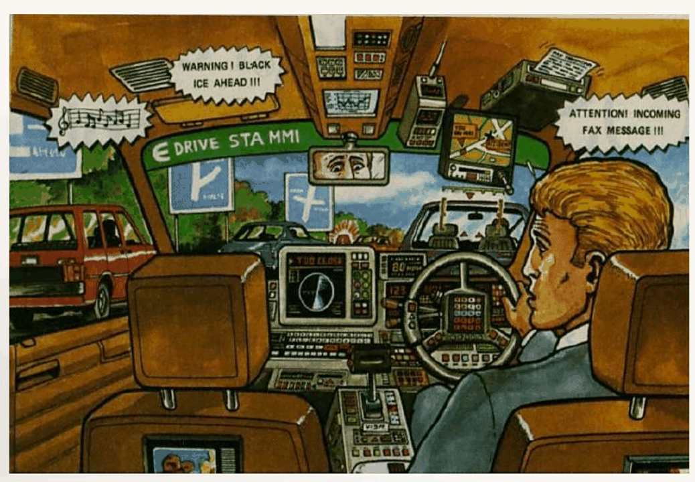

*그림 19. 정보 과잉으로 운전자의 주의가 분산되는 상황을 풍자한 그림*

그림 19는 유럽의 AIDE(Adaptive Integrated Driver-vehicle InterfacE) 프로젝트가 피해야 할 상황으로 제시한 그림이다 [21]. 운전자 앞의 수많은 화면과 장치가 "WARNING! BLACK ICE AHEAD!!!"(전방 블랙아이스 경고)와 "ATTENTION! INCOMING FAX MESSAGE!!!"(팩스 수신)를 동시에 띄우고, 음악까지 흘러나온다. 생명과 직결된 경고와 사소한 알림이 같은 무게로 쏟아지면 운전자는 정작 중요한 경고를 놓친다. AIDE는 이 문제를 **HMI 통합(HMI integration)** 으로 해결하려 했다. ACC와 충돌 경고 같은 능동 안전 응용, 내비게이션과 미디어 플레이어 같은 인포테인먼트 응용, 개인 휴대 기기 같은 차량 밖 장치, 무선 온라인 서비스를 하나의 HMI 관리 체계로 묶고, 운전자의 부하와 상황에 따라 정보의 우선순위와 표시 시점을 조정하는 것이다.

한국 산업 표준 KS C 5077(자동차 디스플레이 장치: 운전자 인터페이스 요구사항)은 주행 중 디스플레이에 제공할 수 있는 정보의 형태를 정보의 특성별로 규정한다 [22].

| 번호 | 특성 | 정보 종류 | 문자, 심벌 | 정지 화상 | 음향 | 동화상 | 비고 |
|:-----|:-----|:-----|:--:|:--:|:--:|:--:|:-----|
| 1 | 긴급성 | 긴급 정보(구난) | ○ | ○ | ○ | X | 병원, 소방서, 경찰서 등 정보 |
| 1 | 긴급성 | 긴급 정보(비상) | ○ | ○ | ○ | ○ | 국가 비상사태, 재난 상황 등 안내 정보 |
| 2 | 긴급성 | 자동차와 주행 위험 경고 | ○ | ○ | ○ | X | 다른 정보와 중복되면 최우선 제시 |
| 3 | 항시성 | 주행 정보 | ○ | ○ | ○ | ○ | 주행 거리, 주행 시간, 주행 속도 등 |
| 4 | 항시성 | 주행 경로 안내 | ○ | ○ | ○ | ○ | 주소와 전화번호 제외 |
| 5 | 적시성 | 교통 정보 | ○ | ○ | ○ | ○ | 긴급 교통 정보는 주행 중 제공 가능 |
| 6 | 적시성 | 날씨 정보(일반) | ○ | ○ | ○ | X | 기호 포함 |
| 6 | 적시성 | 날씨 정보(긴급) | ○ | ○ | ○ | ○ | 긴급 날씨 정보는 주행 중 제공 가능 |
| 7 | 적시성 | 주행 중 디스플레이 장치 조작 경고 | ○ | ○ | ○ | X | |
| 8 | 적시성 | 편의 시설 | ○ | ○ | ○ | X | 식당, 호텔, 주차장, 주유소 등 |
| 9 | 부가성 | 뉴스 | X | X | ○ | X | 긴급 정보 제외 |
| 10 | 부가성 | 오락성 정보 | X | X | X | X | 영화, 드라마 등 |
| 11 | 부가성 | 사진 또는 그림 파일 재생 | ○ | ○ | - | - | |
| 12 | 부가성 | 음악 | ○ | - | ○ | - | |
| 13 | 부가성 | 라디오 | ○ | - | ○ | - | 오락성 정보와 뉴스 포함 |
| 14 | 부가성 | 자동차 외부 동화상 | - | - | - | ○ | 운전할 때 자동차의 좌우나 전후방을 볼 수 있도록 돕는 정보 |
| 15 | 부가성 | 동영상 파일 재생 | ○ | - | - | X | |
| 16 | 부가성 | 광고 정보 | ○ | ○ | ○ | X | |

*표 17. KS C 5077의 주행 중 정보 제공 기준 (○ 가능, X 불가, - 해당 없음)*

표 17의 원칙은 운전자의 시선을 오래 붙잡는 동화상을 엄격히 제한하는 것이다. 동화상은 비상 정보(국가 비상사태, 재난 상황 안내), 주행 정보와 경로 안내, 교통 정보, 긴급 날씨 정보, 주행을 돕는 차량 외부 영상에만 허용되고, 오락성 정보는 어떤 형태로도 주행 중에 제공할 수 없다. 뉴스는 소리로만 들을 수 있다.

### 2.5 커넥티드카 보안

차량이 외부와 연결되면 해커가 접근할 수 있는 통로도 함께 늘어난다.

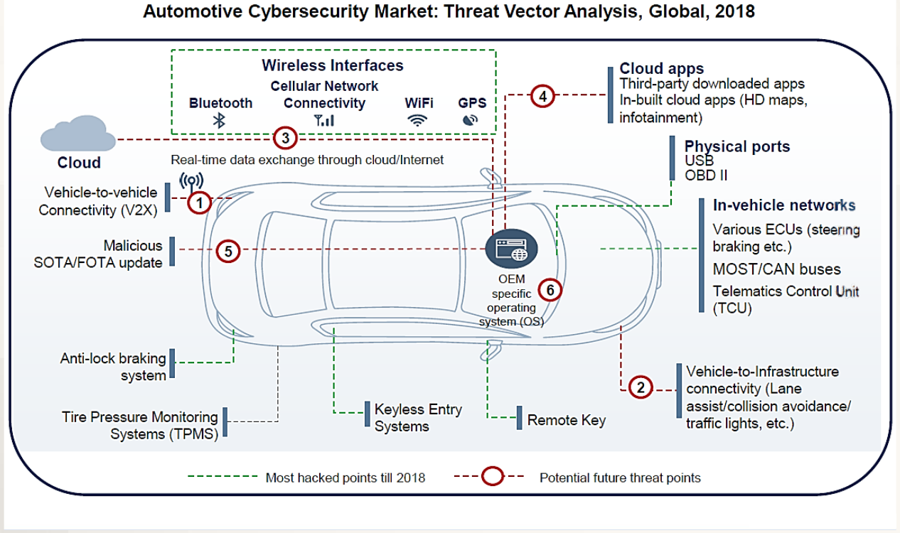

*그림 20. 커넥티드카의 해킹 지점과 미래의 잠재적 위협 지점*

그림 20은 Frost & Sullivan의 2018년 자동차 사이버 보안 위협 분석이다 [19]. 초록 점선은 2018년까지 가장 많이 해킹된 지점이고, 빨간 원의 번호는 앞으로 위협이 될 지점이다.

| 구분 | 지점 |
|:-----|:-----|
| 2018년까지 가장 많이 해킹된 지점 | 무선 인터페이스(Bluetooth, 셀룰러, Wi-Fi, GPS), 물리 포트(USB, OBD-II), 차량 내부 네트워크(조향과 제동 같은 ECU, MOST와 CAN 버스, 텔레매틱스 제어 장치 TCU), ABS, 타이어 공기압 감시 시스템(TPMS), 스마트키 출입 시스템, 원격 키 |
| 미래의 잠재적 위협 지점 | ① V2V(V2X) 연결, ② V2I 연결(차로 보조, 충돌 회피, 신호등), ③ 클라우드와 인터넷을 통한 실시간 데이터 교환, ④ 클라우드 앱(제3자 앱, HD 지도와 인포테인먼트 같은 내장 클라우드 앱), ⑤ 악의적인 무선 소프트웨어, 펌웨어 업데이트(SOTA, FOTA), ⑥ 완성차 업체 고유의 운영 체제 |

*표 18. 커넥티드카의 해킹 지점과 잠재적 위협 지점*

차량 내부 네트워크인 CAN은 메시지에 송신자 인증이 없으므로(3주차, 9주차), 외부에서 한 ECU에 침입하면 다른 ECU를 속이는 메시지를 보낼 수 있다. V2X에서는 가짜 BSM이나 가짜 신호 정보가 사고로 이어질 수 있으므로, 메시지마다 인증서로 전자 서명을 붙이는 보안 체계(IEEE 1609.2)를 쓴다 [23]. IEEE 1609.2가 WAVE 구조에서 차지하는 위치는 13주차 3.2절에서, C-ITS 인증 관리 체계와 차량 사이버 보안 규정은 14주차 3.3절과 3.5절에서 다룬다.

### 2.6 차량용 안전 시스템과 자율주행 셔틀의 분류

Frost & Sullivan은 2014년 유럽 ADAS 시장 분석에서 차량용 안전 시스템을 그림 21처럼 분류했다 [24].

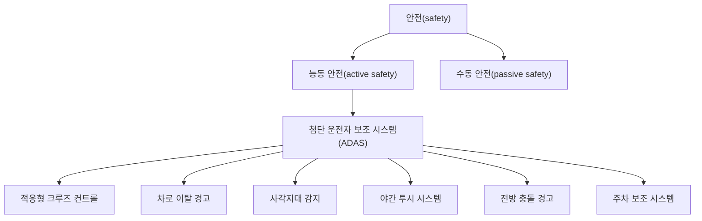

*그림 21. 차량용 안전 시스템의 분류*

자율주행 셔틀은 커넥티드 자율주행이 상용 서비스로 먼저 도입되는 분야이다. Frost & Sullivan은 2019년 자율주행 셔틀 시장을 그림 22처럼 정의했다 [25].

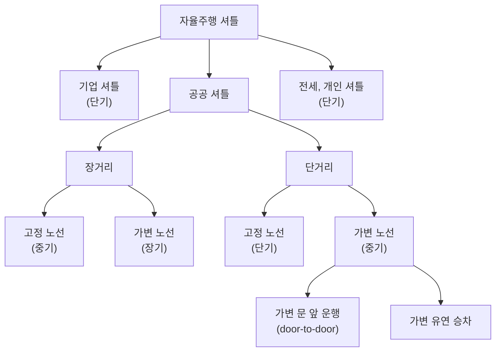

*그림 22. 자율주행 셔틀 시장의 분류*

그림 22에서 괄호 안은 그 유형의 자율주행 셔틀이 등장할 것으로 본 시기이다. 기업 셔틀, 전세 셔틀, 단거리 고정 노선처럼 운행 구간이 짧고 정해진 유형이 단기에, 승객의 요청에 따라 노선을 바꾸는 가변 노선과 장거리 노선은 중장기에 도입될 것으로 보았다. 운행 환경이 단순하고 예측 가능할수록 자율주행을 먼저 적용하기 쉽기 때문이다.

### 2.7 자차 센서 기반 자율주행 기술

통신 없이 차량 자신의 센서만으로 주변을 인식하는 자율주행을 **자차 센서 기반 자율주행**이라 한다. 국내외의 대표 사례는 다음과 같다.

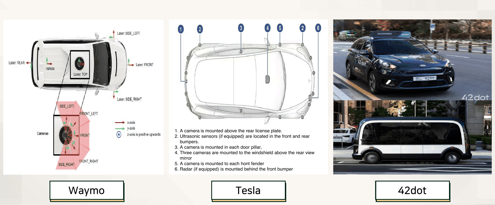

*그림 23. Waymo, Tesla, 42dot의 자차 센서 기반 자율주행차*

| 기업 | 주요 센서 | 서비스 |
|:-----|:-----|:-----|
| Waymo | 라이다, 카메라, 레이더 | 세 센서를 통합한 Waymo Driver로 미국 일부 지역에서 로보택시 서비스를 제공한다. |
| Tesla | 카메라, 초음파 센서 | 카메라와 초음파 센서를 쓰는 FSD Beta 11을 공개하여 반자율주행 서비스를 제공한다. 앞으로 초음파 센서를 대체하여 카메라만 쓰는 FSD를 개발하는 방향이다. |
| 42dot | 카메라, 레이더 | 서울 상암 일대에서 택시 서비스를, 청계천 일대에서 셔틀 서비스를 제공한다. |

*표 19. Waymo, Tesla, 42dot의 센서 구성과 서비스*

그림 23 가운데의 Tesla 센서 배치는 번호로 표시되어 있다. ① 뒤쪽 번호판 위의 카메라, ② 앞뒤 범퍼의 초음파 센서(장착 차량), ③ 양쪽 도어 필러의 카메라, ④ 룸미러 위 앞유리의 카메라 3개, ⑤ 양쪽 앞 펜더의 카메라, ⑥ 앞 범퍼 뒤의 레이더(장착 차량)이다. 이 배치는 레이더와 초음파 센서를 장착한 차량 기준이며, Tesla는 2021년부터 레이더를, 2022년 10월부터 초음파 센서를 신차에서 빼고 카메라만 쓰는 Tesla Vision으로 전환했다 [26]. 오른쪽의 42dot은 현대자동차그룹의 소프트웨어 기업으로, 기아 니로 기반의 택시와 소형 셔틀을 운행했다. Waymo와 Tesla의 센서 구성은 3주차 4절에서 자세히 비교했다.

### 2.8 커넥티드 자율주행 서비스: 안전과 편의

1주차 3.4절에서 커넥티드 자율주행 서비스를 지연 시간이 중요한 안전 서비스(원거리 인지 공유, C-ITS)와 전송 속도가 중요한 편의 서비스(인포테인먼트, 자율주행 서비스 지원)로 나누었다. 안전 서비스는 작은 데이터를 반드시 정해진 시간(예: 10 ms) 안에 전달해야 하고, 편의 서비스는 영상과 인터넷 같은 대용량 데이터를 빠르게 전달해야 한다.

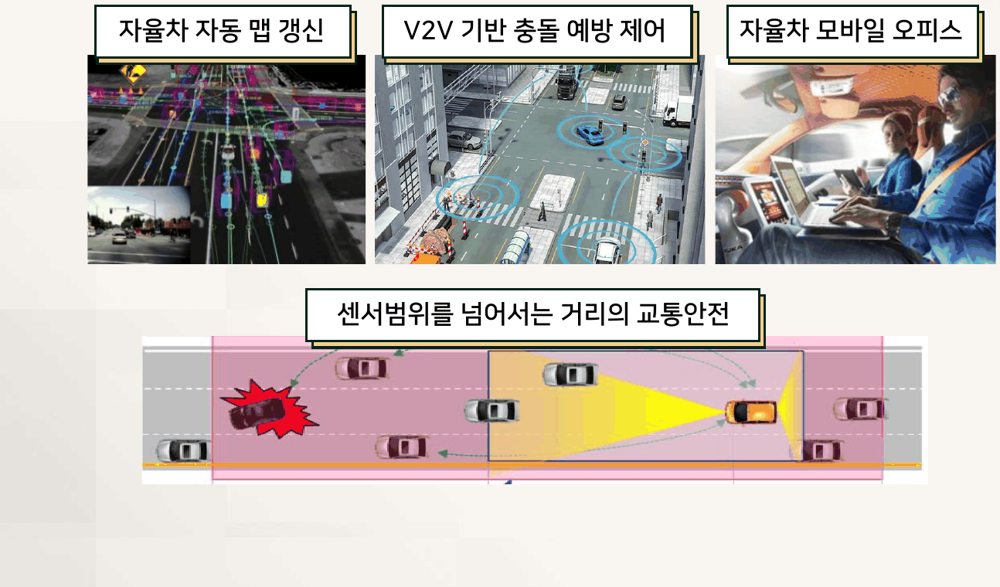

*그림 24. 커넥티드 자율주행 서비스의 사례와 센서 범위를 넘어서는 교통안전*

그림 24의 위쪽 세 사례는 자율주행차의 자동 지도 갱신(편의), V2V 기반 충돌 예방 제어(안전), 자율주행차 안의 모바일 오피스(편의)이다. 아래쪽 그림에서 자차(오른쪽 주황색 차량)의 센서 범위(노란 부채꼴)는 앞의 차량들에 가려 멀리 있는 사고 차량까지 닿지 않는다. 사고 차량이 V2V로 보낸 경고를 받으면 센서 범위를 넘어서는 거리의 위험에도 미리 대비할 수 있다.

### 2.9 센서 기반 객체 인식과 V2X 기반 객체 인식

**센서 기반 객체 인식**은 카메라, 레이더, 라이다, 초음파 센서로 주변 객체를 직접 감지하는 방식이다.

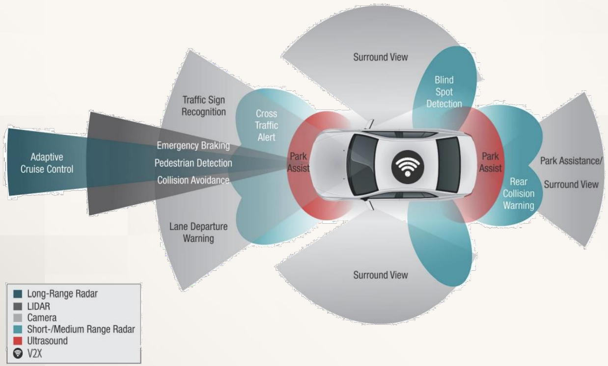

*그림 25. 자차 센서의 종류별 감지 범위와 기능*

그림 25에서 장거리 레이더는 앞쪽 먼 곳을 좁게 보아 적응형 크루즈 컨트롤에 쓰이고, 라이다는 긴급 제동, 보행자 감지, 충돌 회피에 쓰인다. 카메라는 교통 표지 인식, 차로 이탈 경고, 서라운드 뷰에, 단거리와 중거리 레이더는 교차 차량 경고, 사각지대 감지, 후방 충돌 경고에, 초음파 센서는 주차 보조에 쓰인다. 여러 센서의 감지 범위가 겹치도록 배치하여 차량 주변을 빈틈없이 덮는다. 차량 가운데의 V2X 아이콘은 이 감지 범위 밖의 정보를 통신으로 보완한다는 뜻이다.

센서 기반 인식의 장점은 세 가지이다. 첫째, 센서가 직접 측정하므로 통신처럼 데이터가 유실되지 않는다. 둘째, 여러 센서와 센서 융합으로 가까운 객체를 신뢰성 있게 인식한다. 셋째, 인식 주기가 수십 ms로 빠르다. 반면 단점도 있다.

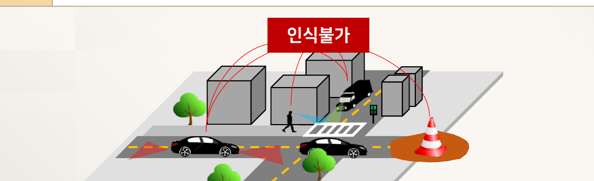

*그림 26. 건물에 가려 자차 센서로 인식할 수 없는 NLOS 영역의 객체*

> **용어 정의:** **LOS(line of sight, 가시선)** 는 센서와 객체 사이에 가로막는 물체가 없어 직접 보이는 상태이다.

> **용어 정의:** **NLOS(non-line of sight, 비가시선)** 는 건물이나 다른 차량에 가려 직접 보이지 않는 상태이다.

센서 기반 인식은 날씨와 조명 같은 환경 요인으로 인식 오차가 생기고, 그림 26처럼 건물 뒤에서 나오는 차량이나 보행자 같은 NLOS 영역의 객체를 인식할 수 없다. 인식 거리가 제한되고, 객체의 종류와 크기 제원을 판별하는 데도 한계가 있다.

**V2X 기반 객체 인식**은 다른 차량, 보행자 단말, 인프라가 보내 주는 메시지로 객체를 아는 방식이다.

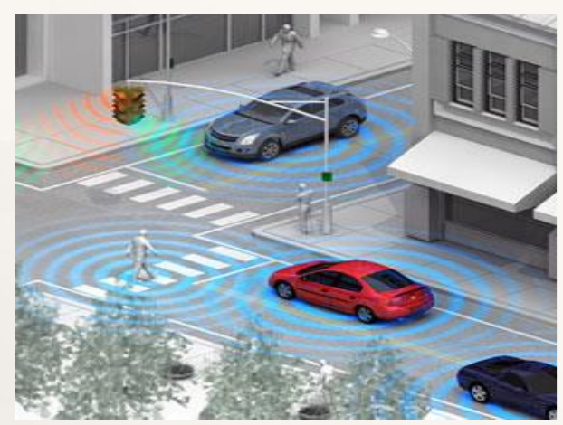

*그림 27. V2X 통신으로 교차로 주변 객체를 인식하는 상황*

그림 27처럼 각 차량과 보행자가 자신의 정보를 동심원 모양의 전파로 알리면, 건물에 가려진 객체도 약 1 km의 넓은 범위에서 인식할 수 있다. 객체가 자신의 차종, 크기 같은 정확한 형태와 제원, 속도와 가속도 같은 동적 데이터를 직접 보내므로 센서로 추정할 때보다 정확하다. 반면 전파 환경에 따라 통신이 혼잡해지거나 데이터가 유실될 수 있고, 메시지 주기가 약 100 ms로 센서보다 느리며, 객체의 위치가 GPS 측위에 기반하므로 전파 환경에 따른 GPS 오차가 그대로 들어간다.

| V2X 기반 객체 인식 | 자차 센서 기반 객체 인식 |
|:-----|:-----|
| (장점) NLOS 영역의 객체 인식 가능 | (단점) NLOS 영역의 객체 인식 불가 |
| (장점) 넓은 인식 영역 | (단점) 제한된 인식 거리 |
| (장점) 정확한 객체 형태 정보 획득 | (단점) 부정확한 객체 형상 인식 |
| (장점) 주야간과 날씨에 무관 | (단점) 주야간과 날씨에 민감 |
| (단점) 전파 환경에 따른 데이터 손실 | (장점) 낮은 데이터 손실 |
| (단점) 느린 인식 주기 | (장점) 빠른 인식 주기 |
| (단점) 전파 환경에 따른 GPS 측위 오차 | (장점) 고정밀 상대 측위 |

*표 20. V2X 기반 객체 인식과 자차 센서 기반 객체 인식의 비교*

표 20의 두 열은 장단점이 정확히 엇갈린다. 따라서 두 방식을 **융합**하면 서로의 단점을 보완할 수 있다. 융합의 효과는 다음과 같다.

- **인식 범위의 확대:** LOS와 NLOS 영역의 객체를 모두 인식한다.
- **객체 식별:** 주변 객체의 형태와 종류를 식별한다.
- **환경 영향의 감소:** 날씨와 조명의 영향을 줄인다.
- **효율적인 동적 측위:** 동적 측위를 위한 시스템을 효율적으로 구현한다.
- **저가의 고성능 인식:** 값싼 센서로도 높은 인식 성능을 얻는다.
- **정밀한 경로 예측:** 주변 객체의 의도와 움직임을 알아 충돌 방지를 위한 경로를 정밀하게 예측한다.

### 2.10 융합 기반 상대 위치 인지 정확도

센서와 V2X를 융합하면 주변 차량의 상대 위치를 얼마나 정확히 알 수 있는지를 측정한 실험 결과가 그림 28이다.

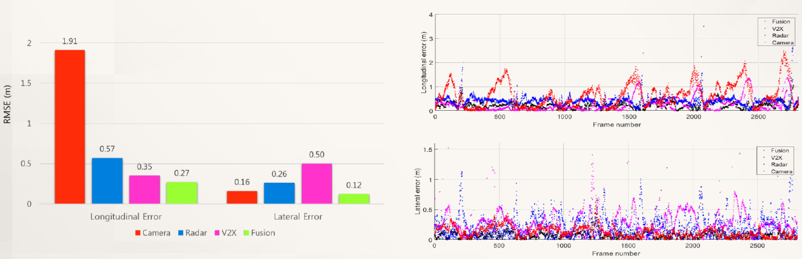

*그림 28. 카메라, 레이더, V2X, 융합 방식의 종방향과 횡방향 위치 오차*

> **용어 정의:** **종방향(longitudinal)** 은 차량의 진행 방향이다.

> **용어 정의:** **횡방향(lateral)** 은 진행 방향에 수직인 좌우 방향이다.

> **용어 정의:** **RMSE(root mean square error, 평균 제곱근 오차)** 는 추정값과 참값의 차이를 제곱하여 평균한 뒤 제곱근을 취한 값으로, 오차의 전형적인 크기를 나타낸다.

$N$개의 프레임에서 추정 위치를 $`\hat{x}_i`$, 참 위치를 $x_i$라 하면 RMSE는 다음과 같다.

```math
\text{RMSE} = \sqrt{\frac{1}{N}\sum_{i=1}^{N}\left(\hat{x}_i - x_i\right)^2}
```

그림 28의 오른쪽 그래프는 약 2,800개 프레임에서 측정한 프레임별 오차이고, 왼쪽 막대그래프는 그 RMSE이다.

| 방식 | 종방향 RMSE (m) | 횡방향 RMSE (m) |
|:-----|--:|--:|
| 카메라 | 1.91 | 0.16 |
| 레이더 | 0.57 | 0.26 |
| V2X | 0.35 | 0.50 |
| 융합 | 0.27 | 0.12 |

*표 21. 방식별 상대 위치 오차(RMSE)*

표 21을 해석하면 다음과 같다. 카메라는 영상에서 거리를 추정하므로 종방향 오차가 1.91 m로 가장 크지만, 차로 안의 좌우 위치는 영상에서 잘 보이므로 횡방향 오차가 0.16 m로 작다. 레이더는 전파의 왕복 시간으로 거리를 직접 재므로 종방향이 0.57 m로 정확하지만 각도 분해능이 낮아 횡방향이 0.26 m이다. V2X는 상대 차량의 GPS 위치를 받으므로 종방향 0.35 m로 좋지만 횡방향은 0.50 m로 가장 나쁘다. 차로 폭이 약 3.5 m이므로 횡방향 0.5 m의 오차는 차로를 잘못 판단하게 할 수 있는 크기이다. 융합은 각 센서가 잘하는 방향을 골라 쓰므로 두 방향 모두에서 가장 작은 오차를 보인다.

개선율은 $(\text{기존 RMSE} - \text{융합 RMSE}) / \text{기존 RMSE}$로 계산한다. 종방향에서 카메라 대비 개선율은 다음과 같다.

```math
\frac{1.91 - 0.27}{1.91} = \frac{1.64}{1.91} \approx 0.859 = 85.9\%
```

같은 방법으로 나머지를 계산하면 표 22와 같다.

| 비교 | 종방향 개선율 | 횡방향 개선율 |
|:-----|--:|--:|
| 카메라 대비 | $`(1.91 - 0.27)/1.91 \approx 86\%`$ | $`(0.16 - 0.12)/0.16 = 25\%`$ |
| 레이더 대비 | $`(0.57 - 0.27)/0.57 \approx 53\%`$ | $`(0.26 - 0.12)/0.26 \approx 54\%`$ |

*표 22. 융합 방식의 위치 오차 개선율*

> **참고:** 이 실험의 결과는 융합 방식의 정확도가 종방향에서 카메라, 레이더 대비 86%, 52%, 횡방향에서 27%, 56% 향상된 것으로 보고되어 있다. 표 22의 값과 조금 다른 것은 그림에 표시된 RMSE가 소수 둘째 자리로 반올림된 값이기 때문이다. 예를 들어 횡방향 카메라 RMSE가 0.164 m, 융합 RMSE가 0.120 m라면 개선율은 약 27%가 된다. 어느 쪽이든 융합이 단일 방식보다 정확하다는 결론은 같다.

### 2.11 미국과 유럽의 V2V, V2I 표준 비교

미국과 유럽은 V2X 표준을 따로 만들었지만 많은 부분이 비슷하다 [27].

- 전체 아키텍처가 비슷하다.
- 보안 프로토콜과 물리 계층 표준은 거의 같다(둘 다 IEEE 802.11p 기반).
- 메시지 집합의 데이터 요소가 비슷하다.
- 그러나 응용 계층, 채널 혼잡 제어, 성능 요구사항은 다르며, 이 차이는 그대로 두어도 된다는 것이 당시의 평가였다.

두 프로토콜 스택의 구조는 3.5절의 그림 44에서, 메시지 수준의 대응은 3.7절에서 비교한다.

### 2.12 유럽 C2C-CC의 협력 주행 단계와 서비스

1.2절의 Day 1, Day 2, Day 3+ 분류는 각각 **인지 주행(awareness driving)**, **감지 주행(sensing driving)**, **협력 주행(cooperative driving)** 의 단계에 대응한다. 인지 주행에서 차량은 서로의 존재와 상태를 알리고, 감지 주행에서는 자기 센서로 감지한 객체까지 공유하며, 협력 주행에서는 앞으로의 궤적과 기동을 공유하고 조정한다. C2C-CC의 V2X 로드맵은 그다음 단계로, 레벨 4, 5의 차량들이 주행 궤적을 서로 교환하고 동기화하여 최적의 주행 패턴을 얻는 동기화 협력 주행(synchronized cooperative driving)을 두고, 최종 목표를 사고 없는 주행으로 제시했다 [28]. 아래 Day 3/4는 협력 주행과 그 이후 단계를 함께 가리킨다.

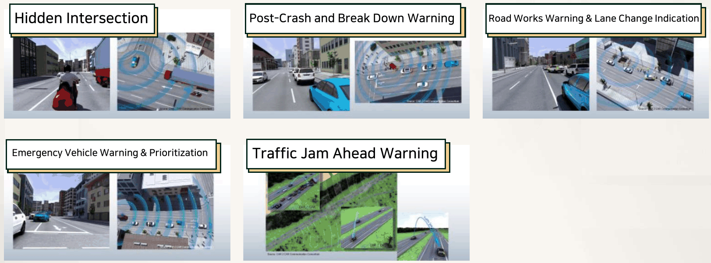

*그림 29. Day 1 인지 주행 서비스의 예*

그림 29의 Day 1 서비스는 다음과 같다.

| 서비스 | 내용 |
|:-----|:-----|
| 보이지 않는 교차로(hidden intersection) | 건물에 가려 보이지 않는 교차로의 접근 차량을 알린다. |
| 사고 후와 고장 차량 경고 | 앞에서 사고가 나거나 고장으로 멈춘 차량을 알린다. |
| 도로 공사 경고와 차로 변경 안내 | 공사 구간을 알리고 어느 차로로 옮겨야 하는지 안내한다. |
| 긴급 차량 경고와 우선 처리 | 다가오는 긴급 차량을 알리고 길을 비켜 주게 한다. |
| 전방 정체 경고 | 앞쪽 정체의 끝을 미리 알린다. |

*표 23. Day 1 인지 주행 서비스*

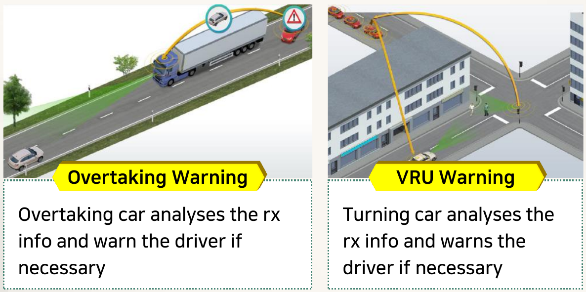

*그림 30. Day 2 집단 인지 서비스의 예*

Day 2의 핵심은 **집단 인지(collective perception)**, 즉 각 차량과 인프라가 센서로 감지한 객체를 CPM으로 공유하는 것이다. 그림 30의 왼쪽 **추월 경고(overtaking warning)** 에서는 추월하려는 차량이 앞의 트럭이 감지하여 보낸 맞은편 차량 정보를 분석하여, 필요하면 운전자에게 경고한다. 오른쪽 **VRU 경고**에서는 회전하려는 차량이 다른 차량이나 인프라가 감지한 보행자, 자전거 정보를 받아 분석하고 필요하면 경고한다. 두 경우 모두 자차 센서로는 볼 수 없는 객체를 다른 주체의 센서로 아는 것이다.

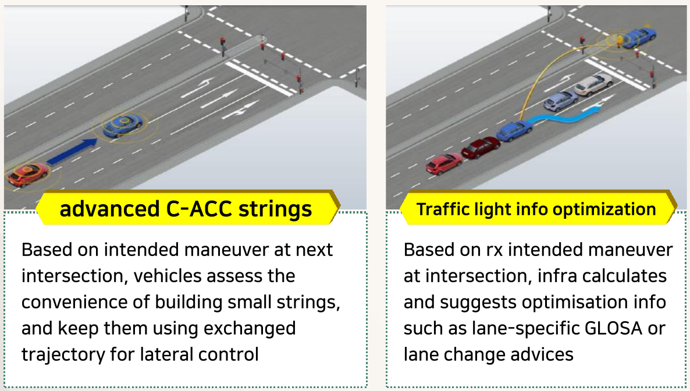

*그림 31. 궤적과 기동 공유에 기반한 협력 주행 서비스*

Day 3/4의 협력 주행은 궤적과 기동의 공유에서 시작한다. 그림 31의 왼쪽 **고급 C-ACC 대열(advanced C-ACC strings)** 에서는 다음 교차로에서 하려는 기동을 서로 알고 있는 차량들이 짧은 대열을 만들지 판단하고, 교환한 궤적으로 횡방향 제어까지 하면서 대열을 유지한다. 오른쪽 **신호 정보 최적화(traffic light info optimization)** 에서는 인프라가 차량들이 보낸 교차로 기동 의도를 받아 차로별 최적 속도 안내(GLOSA)나 차로 변경 권고를 계산해 제안한다.

> **용어 정의:** **GLOSA(green light optimal speed advisory)** 는 신호가 바뀌는 시점을 알고 녹색 신호에 교차로를 통과할 수 있는 속도를 운전자나 차량에 안내하는 서비스이다. 불필요한 정지와 출발을 줄여 연료와 배출가스를 줄인다.

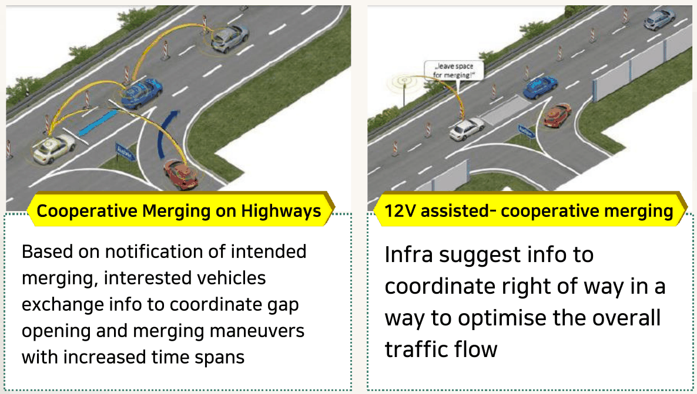

*그림 32. 조정과 협상에 기반한 협력 합류 서비스*

협력 주행의 다음 수준은 조정과 협상이다. 그림 32의 왼쪽 **고속도로 협력 합류(cooperative merging on highways)** 에서는 합류하려는 차량이 의도를 알리면, 관련 차량들이 정보를 교환하여 충분한 시간 여유를 두고 간격을 벌리고 합류 기동을 조정한다. 오른쪽 **I2V 지원 협력 합류(I2V assisted cooperative merging)** 에서는 인프라가 전체 교통 흐름을 최적화하는 방향으로 통행 우선권을 조정하는 정보를 제안한다(그림의 "leave space for merging"은 합류 공간을 비워 두라는 안내이다).

유럽의 C-ITS 실증 플랫폼인 C-Roads는 서비스마다 사용하는 메시지와 표준을 정리했다 [29].

| 약어 | 서비스 | 묶음 | 시기 | 통신 | 분류 | 네트워크 | 메시지 | 표준 |
|:-----|:-----|:-----|:-----|:-----|:-----|:-----|:-----|:-----|
| EBL | 긴급 전자 브레이크등: 앞차의 급제동을 알려 추돌을 예방한다. | 1 | Day 1 | V2V | 안전 | ITS-G5 | DENM | ETSI TS 101 539-1 RHS 6.3.4절 |
| EVA | 긴급 차량 접근: 사이렌이나 경광등이 보이거나 들리기 전에 긴급 차량의 접근을 알린다. | 1 | Day 1 | V2V | 안전 | ITS-G5 | DENM, CAM | ETSI TS 101 539-1 RHS 6.3.1절 |
| HLN | 위험 지점 알림: 급커브, 급경사, 포트홀, 장애물, 미끄러운 노면 같은 위험을 미리 알린다. | 1 | Day 1 | V2V | 안전 | ITS-G5 | DENM | ETSI TS 101 539-1 RHS 6.3.7절 |
| SSV | 저속, 정지 차량 경고: 앞의 느린 차량이나 고장으로 멈춘 차량을 알린다(차량 고장 경고라고도 한다). | 1 | Day 1 | V2V | 안전, 효율 | ITS-G5 | DENM, CAM | ETSI TS 101 539-1 RHS 6.3.2절, 6.3.3절 |
| TJW | 전방 정체 경고: 언덕이나 커브 뒤에 숨은 정체의 끝을 알려 고속도로의 추돌을 예방한다. | 1 | Day 1 | V2V | 안전, 효율 | ITS-G5 | DENM | ETSI TS 101 539-1 RHS 6.3.8절 |
| VSGN | 차량 내 표지: 주변의 도로 표지를 차량 안에 표시하여 놓치거나 보이지 않는 표지를 알린다. | 2 | Day 1 | V2I | 안전 | ITS-G5, 셀룰러 | CAM | 개발 중: CEN TS 17425 In-vehicle signage, CEN TS 19321 IVI 데이터 구조 사전 |

*표 24. C-Roads의 C-ITS 서비스와 메시지, 표준*

> **용어 정의:** **RHS(road hazard signalling, 도로 위험 신호)** 는 ETSI TS 101 539-1이 정한 V2X 응용으로, 도로 위의 위험 상황을 DENM으로 알리는 서비스들의 요구사항을 규정한다 [30].

표 24에서 V2V 안전 서비스는 대부분 사건을 알리는 DENM을 쓰고, 긴급 차량이나 저속 차량처럼 차량 자신의 상태가 정보인 경우에는 CAM도 함께 쓴다. 차량 내 표지(VSGN)는 표에 CAM으로 적혀 있지만, 그 표준 칸의 IVI 데이터 구조는 표 3의 IVIM 메시지로 전달된다 [7].

---

<br>

## 3. 커넥티드 자율주행 차량용 V2X 메시지

### 3.1 센서 기반 자율주행에서 커넥티드 자동화로

미국의 부품 업체 Delphi(현재 Aptive)는 자율주행 레벨별 기능과 기술을 다음과 같이 전망했다 [31].

| 레벨 | 이름 | 기능 | 기술 | 시기 |
|:-----|:-----|:-----|:-----|:-----|
| 레벨 0 | 운전자만 운전 | | | 현재 |
| 레벨 1 | 보조 | 능동 상향등, 충돌 임박 제동, 크루즈 컨트롤 | 레이더, 전방 센서 | 현재 |
| 레벨 2 | 부분 자동화 | 교통 정체 보조, 적응형 크루즈와 차로 유지, 운전자가 탄 자동 주차 | 레이더, 전방 센서, 다중 도메인 제어기, 운전자 상태 센서, V2X | 현재 |
| 레벨 3 | 조건부 자동화 | 충돌 회피, 고속도로 자동 주행, 도심 자동 주행 | 라이다와 360° 레이더, 고정밀 GPS, 다중 도메인 제어기, 전방 HD 카메라와 적외선 카메라, V2X, 관성 측정 장치 | 2020년 |
| 레벨 4 | 완전 자동화 | 자동 발레 주차, 고속도로 지점 간 주행, 도심 지점 간 주행 | 레벨 3과 같음 | 2025년 이후 |

*표 25. Delphi의 자율주행 레벨별 기능과 기술 전망*

> **참고:** Delphi의 전망 자료는 레벨 4를 "Full"로 표기하지만, SAE J3016에서 레벨 4는 고도 자동화(high driving automation)이고 완전 자동화(full driving automation)는 레벨 5이다 [1].

표 25에서 V2X는 레벨 2부터 기술 목록에 들어가 레벨이 높아져도 계속 유지된다. 그림 25의 센서 구성만으로는 NLOS 영역과 먼 거리를 볼 수 없으므로, 자동화가 높아질수록 통신의 역할이 커진다.

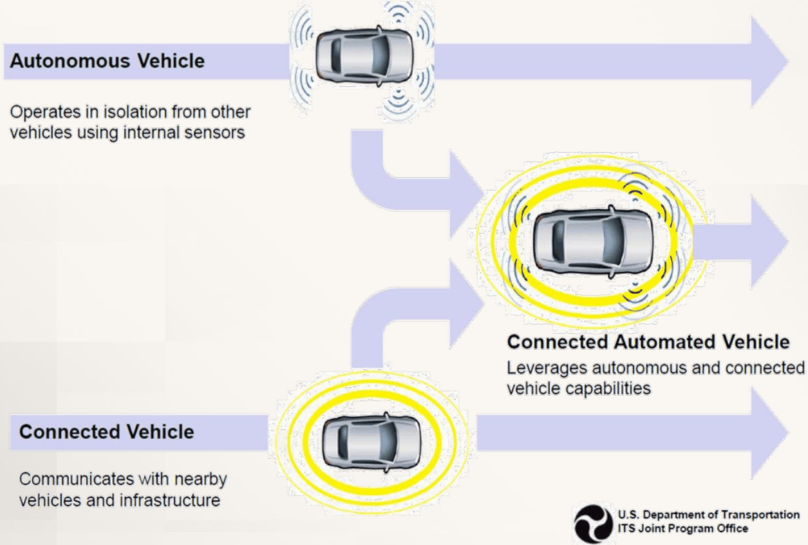

*그림 33. 자율주행차, 커넥티드카, 커넥티드 자율주행차의 관계*

그림 33은 미국 교통부 ITS 합동 프로그램 사무국(ITS JPO)의 개념도이다 [32]. 위쪽의 **자율주행차(autonomous vehicle)** 는 내부 센서만으로 다른 차량과 고립되어 동작하고, 아래쪽의 **커넥티드카(connected vehicle)** 는 가까운 차량과 인프라와 통신한다. 두 흐름이 만나는 가운데의 **커넥티드 자율주행차(connected automated vehicle)** 는 자율주행 능력과 커넥티드 능력을 함께 활용하여 가장 큰 효과를 낸다.

### 3.2 SAE J3216 협력 운전 자동화의 기능 사례

SAE J3216은 1.3절의 협력 등급마다 구체적인 기능 사례를 제시한다 [8]. 각 사례는 기능이 다른 주체의 정보 없이도 동작하되 정보로 더 좋아지는 **지원(supporting)** 과, 정보가 있어야 비로소 가능해지는 **가능화(enabling)** 로 수준을 구분한다. 아래 표의 "C-ADS 1", "RSE 3" 같은 번호는 각 그림의 차량과 노변 기지국에 붙은 번호이다. 단방향 전송은 실제로는 대개 주변의 여러 CDA 장치에 메시지를 동시에 보낸다.

**협력 객체 추적.**

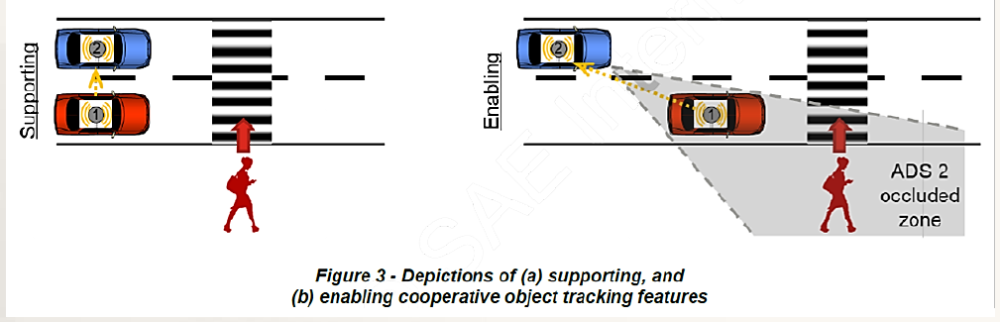

*그림 34. 협력 객체 추적의 지원 기능과 가능화 기능*

| 기능 | 협력 등급 | 전송 방식과 방향 | 교환 정보 | 기능 수준 |
|:-----|:-----|:-----|:-----|:-----|
| 객체 추적: C-ADS 1이 보행자의 위치와 분류를 C-ADS 2와 공유 | A. 상태 공유 | 단방향: C-ADS 1 → C-ADS 2 | 객체의 지리적 위치와 분류(예: 보행자) | 지원: C-ADS 2가 보행자를 감지할 수 있을 때 받은 정보로 위치와 분류의 신뢰도와 정확도를 높인다. 가능화: 보행자가 C-ADS 1 등에 가려 C-ADS 2의 시야 밖에 있었는데 이제 C-ADS 2가 보행자를 안다. |

*표 26. 협력 객체 추적 기능의 예*

**협력 신호 교차로.**

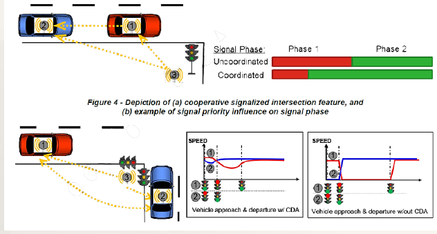

*그림 35. 협력 신호 교차로 기능과 신호 우선 처리가 신호 현시에 미치는 영향*

| 기능 | 협력 등급 | 전송 방식과 방향 | 교환 정보 | 기능 수준 |
|:-----|:-----|:-----|:-----|:-----|
| 친환경 접근과 출발(eco-approach and departure) | A. 상태 공유 | 단방향: RSE 3 → C-ADS 1 | 신호 현시 | 지원: C-ADS 1이 더 먼 앞을 내다보며 움직임을 효과적으로 계획하여 에너지 소비와 배출가스를 줄인다. |
| 신호 우선 처리(signal priority) | A. 상태 공유 | 단방향: C-ADS 1 → RSE 3 | 차량의 위치, 속도, 우선 처리 상태(예: 긴급 차량) | 가능화: 접근하는 차량에 맞추어 신호 시간이 바뀐다. |
| 친환경 접근과 출발 | B. 의도 공유 | 단방향: RSE 3 → C-ADS 1, 2 | SPaT 정보 | 가능화: 다른 방법으로는 알 수 없는 미래의 신호 현시 정보로 C-ADS 1, 2가 움직임을 계획한다. |
| 연속 접근과 출발(tandem approach and departure) | C. 합의 추구 | 양방향: RSE 3 → C-ADS 1, 2, C-ADS 2 → C-ADS 1, C-ADS 1 → C-ADS 2 | SPaT 정보, C-ADS 2가 C-ADS 1에 속도 프로파일을 제안하고 C-ADS 1이 동의 | 가능화: 미래의 신호 현시로 움직임을 계획하여 두 차량 모두의 속도를 최적화한다. |

*표 27. 협력 신호 교차로 기능의 예*

그림 35 위쪽의 신호 현시 막대에서, 협력하지 않을 때(uncoordinated)는 1현시의 적색이 길지만 차량의 우선 처리 요청과 협력할 때(coordinated)는 녹색이 앞당겨진다. 아래쪽 두 속도 그래프는 CDA가 있을 때 차량 1, 2가 교차로에 접근하고 출발하는 속도가 부드럽게 유지되지만, CDA가 없으면 적색에서 멈췄다가 다시 출발하여 속도가 0까지 떨어지는 것을 보여 준다.

**협력 합류.**

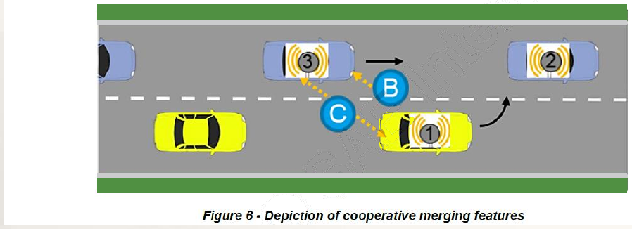

*그림 36. 협력 합류 기능*

| 기능 | 협력 등급 | 전송 방식과 방향 | 교환 정보 | 기능 수준 |
|:-----|:-----|:-----|:-----|:-----|
| 협력 차로 변경, 협력 합류 | B. 의도 공유 | 단방향: C-ADS 1 → C-ADS 3 | 계획한 기동 | 지원: C-ADS 1이 C-ADS 2와 3 사이로 합류하려는 의도를 공유한다. C-ADS 2와 3은 이 정보에 따라 행동할 수도 있고 하지 않을 수도 있다. |
| 협력 차로 변경, 협력 합류 | C. 합의 추구 | 양방향: C-ADS 1 → C-ADS 3, C-ADS 3 → C-ADS 1 | 제안한 기동, C-ADS 3의 동의 | 가능화: C-ADS 1이 C-ADS 3 앞으로 합류하려는 의도를 공유하고, C-ADS 3이 합류를 허용하는 행동을 하기로 동의한다. |

*표 28. 협력 합류 기능의 예*

그림 36에서 B는 의도 공유, C는 합의 추구 메시지이다. 의도 공유만으로는 상대가 양보할지 알 수 없지만, 합의 추구에서는 상대의 동의를 받은 뒤 합류하므로 합류가 확실해진다.

**협력 교통 관리.**

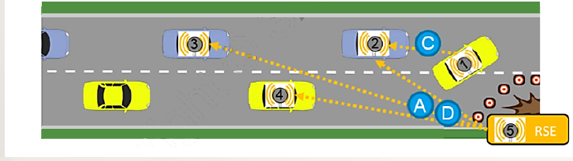

*그림 37. 협력 교통 관리 기능*

| 기능 | 협력 등급 | 전송 방식과 방향 | 교환 정보 | 기능 수준 |
|:-----|:-----|:-----|:-----|:-----|
| 임시 차로 폐쇄: RSU가 지오펜스와 낮춘 제한 속도를 도로 이용자와 공유하고, 도로 이용자는 이 정보로 움직임을 조정 | A. 상태 공유 | 단방향: RSE 4 → C-ADS 1 | 차로가 줄어드는 위치 | 지원: C-ADS가 차로 감소를 더 빠르고 정확하고 신뢰성 있게 감지한다. 가능화: 정보가 없으면 C-ADS가 임시 교통 패턴을 통과할 수 없다. |
| 임시 차로 폐쇄 | C. 합의 추구 | C-ADS 1 → C-ADS 2 | 제안한 기동 | 가능화: C-ADS 1이 C-ADS 2 앞으로 차로를 바꾸려는 의도를 공유하고, C-ADS 2가 차로 변경을 허용하기로 동의한다. |
| 가변 제한 속도: RSU가 지오펜스와 낮춘 제한 속도를 공유 | D. 지시 | 단방향: RSE 5 → C-ADS 1, 2, 3, 4 | 새 제한 속도 | 가능화: C-ADS가 교통 법규를 지키도록 감속을 지시받는다. |

*표 29. 협력 교통 관리 기능의 예*

> **용어 정의:** **지오펜스(geofence)** 는 지도 위에 설정한 가상의 경계로, 차량이 그 안에 들어오면 특정 규칙(예: 낮춘 제한 속도)이 적용된다.

> **참고:** SAE J3216의 표는 표 29의 합의 추구 사례의 전송 방식을 "One-way"(단방향)로 적지만, 합의 추구는 의도를 보내고 동의를 받는 양방향 교환이어야 성립한다. 표 28의 합류 사례처럼 C-ADS 1 → C-ADS 2의 제안과 C-ADS 2 → C-ADS 1의 동의가 함께 오가는 것으로 이해해야 한다.

**협력 차량 추종.**

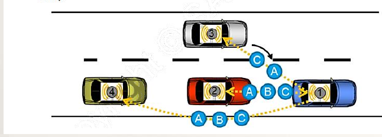

*그림 38. 협력 차량 추종 기능*

| 기능 | 협력 등급 | 전송 방식과 방향 | 교환 정보 | 기능 수준 |
|:-----|:-----|:-----|:-----|:-----|
| 군집주행 인지와 CACC 차량 제어 | A. 상태 공유 | 양방향: CDA 차량 1 ↔ CDA 차량 2, 4, 단방향: CDA 차량 1 → CDA 차량 3 | 군집주행과 CACC 작동 상태, 군집 차량의 속도, 궤적, 위치 | 지원: 추종 차량이 정보 없이 할 때보다 더 가깝고 안정적으로 따라간다. 지원: CDA 차량 3이 차량 1이 다른 차량과 군집주행 중임을 추가로 안다. |
| 제동 기동의 사전 통지 | B. 의도 공유 | 단방향: C-ADS 1 → C-ADS 2, 4 | 계획한 감속 | 지원: C-ADS 1이 군집의 감속이 필요한 전방 위험을 감지하여, 모든 차량이 더 부드럽게 감속한다. |
| 군집 합류 | C. 합의 추구 | 양방향: C-ADS 3 → C-ADS 1, C-ADS 1 → C-ADS 3, C-ADS 1 → C-ADS 2, 4 | 군집 합류 요청, 군집 중간 합류 허용, 다른 군집 차량에 통지 | 가능화: C-ADS 3이 군집 중간에 합류한다(정보가 없으면 맨 뒤에 붙어야 한다). |

*표 30. 협력 차량 추종 기능의 예*

표 30의 상태 공유 사례는 레벨 1\~5의 CDA 차량을 가정하고, 의도 공유와 합의 추구 사례는 레벨 3\~5의 C-ADS를 가정한다.

### 3.3 V2X 메시지의 계층상 위치

V2X 메시지는 프로토콜 스택의 어디에 놓이는가. 미국의 DSRC(WAVE) 스택을 기준으로 보면 그림 39와 같다 [33].

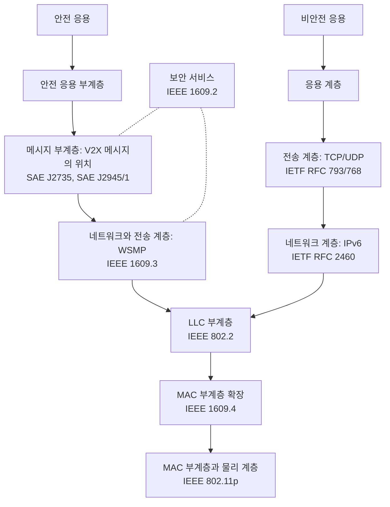

*그림 39. DSRC 프로토콜 스택에서 V2X 메시지의 위치*

그림 39에서 V2X 메시지는 응용 계층의 아래쪽인 **메시지 부계층(message sublayer)** 에 놓인다. SAE J2735가 메시지의 형식(무엇을 어떤 비트로 보내는가)을 정하고, SAE J2945/1이 그 메시지를 언제, 얼마나 자주, 어떤 성능으로 보내야 하는지를 정한다. 안전 메시지는 IP를 거치지 않고 가벼운 **WSMP(WAVE short message protocol)** 로 바로 전달되어 지연과 오버헤드를 줄이고, 인터넷 서비스 같은 비안전 응용은 TCP/UDP와 IPv6를 쓴다. 보안 서비스(IEEE 1609.2)는 여러 계층에 걸쳐 메시지의 서명과 검증을 맡는다.

같은 구조를 IEEE 1609 표준의 관점에서 보면 다음과 같다 [34].

| 계층 | 구성 요소 | 표준 |
|:-----|:-----|:-----|
| 관리와 보안 | WAVE 자원 관리자, 응용과 관리 메시지를 위한 보안 서비스 | IEEE 1609.1, IEEE 1609.2 |
| 네트워크와 전송 | 네트워킹 서비스: WSMP, 관리 메시지, TCP/UDP, IP | IEEE 1609.3 |
| 데이터 링크 | LLC, WAVE MAC 확장(다중 채널 운용) | IEEE 802.2, IEEE 1609.4 |
| MAC과 물리 | WAVE MAC, WAVE PHY | IEEE 802.11p |
| 계층 관리 | 상위 MAC 계층 관리 개체(U_MLME), 하위 MAC 계층 관리 개체(L_MLME), 물리 계층 관리 개체(PLME) | IEEE 1609.4, IEEE 802.11p |

*표 31. WAVE 프로토콜 스택의 계층과 표준*

> **[컴퓨터네트워크]** 계층 구조에서 각 계층은 아래 계층의 서비스를 이용해 위 계층에 서비스를 제공한다. 응용 메시지 형식은 응용 계층에서 정의되고, 전송, 네트워크, 링크 계층은 그 메시지를 내용과 무관하게 실어 나른다. 그래서 같은 SAE J2735 메시지를 IEEE 802.11p 대신 C-V2X로도 보낼 수 있다. 계층 구조는 5주차, LLC는 7주차, WAVE와 WSMP는 13주차에서 다룬다.

### 3.4 커넥티드카 메시지 교환 방식

SAE의 응용과 IEEE 1609의 통신 계층은 그림 40처럼 역할을 나눈다 [35].

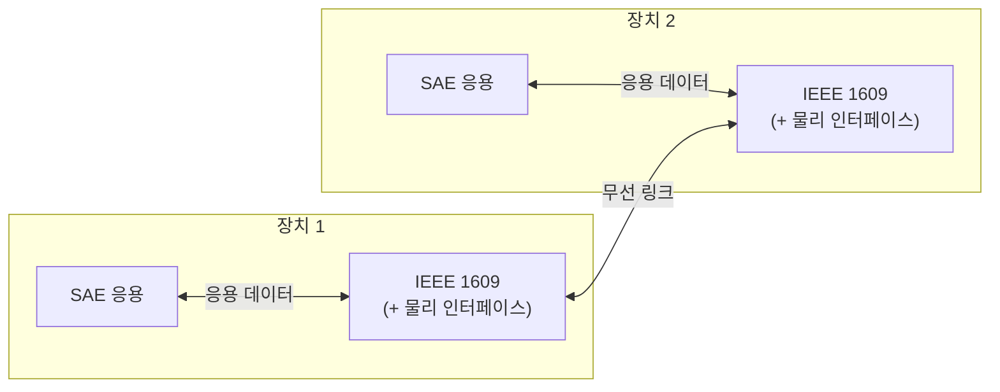

*그림 40. SAE 응용과 IEEE 1609의 관계*

각 장치에서 SAE 응용은 응용 데이터(메시지)를 IEEE 1609 계층에 넘기고, IEEE 1609 계층이 물리 인터페이스를 통해 상대 장치로 보낸다. 2021년 무렵 지원되던 물리 인터페이스는 802.11 기반의 DSRC와 3GPP의 PC5 Mode 4(LTE-V2X 직접 통신)이다. 메시지를 주고받는 방식은 세 가지이다.

**방식 1. 정보 방송(information broadcasts).**

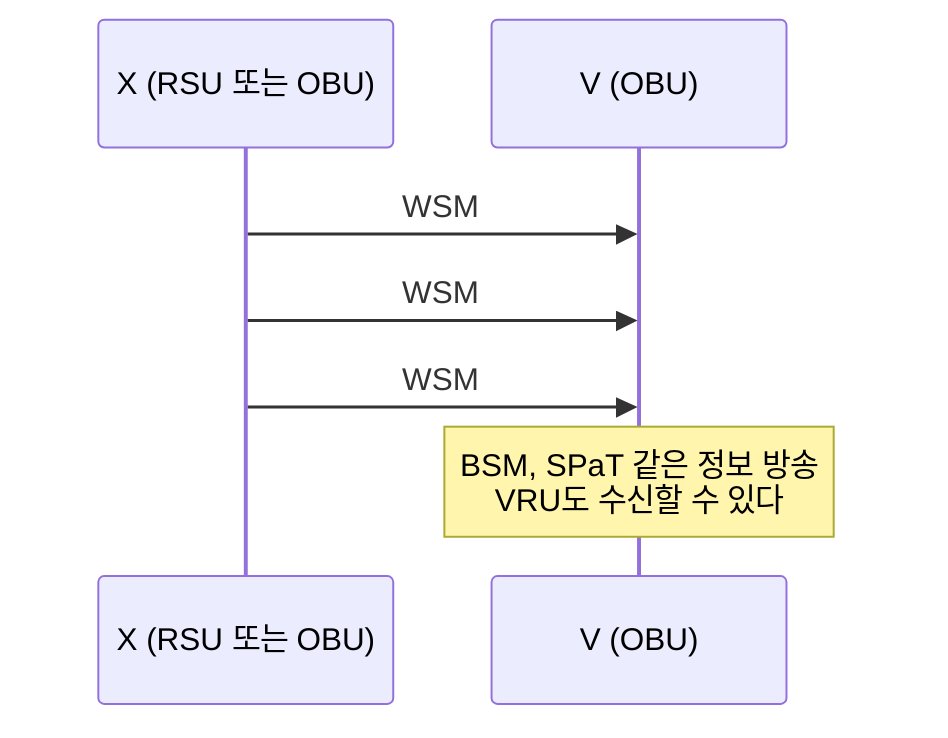

*그림 41. V2X 정보 방송*

RSU나 OBU가 **WSM(WAVE short message)** 을 수신자를 지정하지 않고 계속 방송한다. 연결을 맺는 절차가 없으므로 지연이 가장 짧다. SAE의 BSM과 SPaT가 대표적이며, 앞으로는 센서 데이터 공유 같은 협력 자동화 메시지도 이 방식으로 보낸다. 차량뿐 아니라 VRU의 단말도 이 메시지를 받을 수 있다.

**방식 2. V2I 지역 데이터 교환(localized data exchange).**

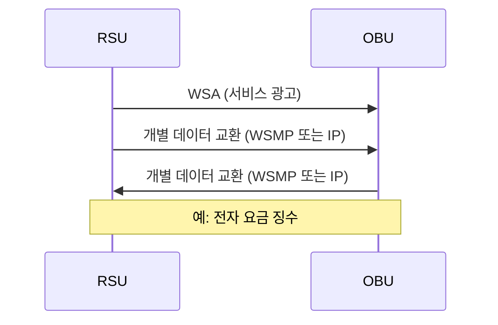

*그림 42. V2I 지역 데이터 교환*

RSU가 먼저 **WSA(WAVE service advertisement)** 를 보내 자신이 제공하는 응용이나 서비스를 알린다. 그 서비스를 쓰려는 OBU는 RSU와 WSMP나 IP로 개별(peer-to-peer) 데이터를 교환한다. 전자 요금 징수가 대표적인 예이다. 데이터 교환은 WSA를 받은 채널과 다른 채널이나 다른 네트워크에서 일어날 수도 있다.

**방식 3. V2I 클라우드 기반(cloud based) 교환.**

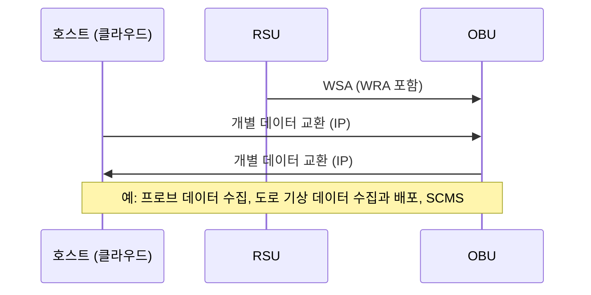

*그림 43. V2I 클라우드 기반 데이터 교환*

RSU가 보내는 WSA에 **WRA(WAVE router advertisement)** 가 들어 있으면, OBU는 RSU를 라우터로 삼아 IP로 클라우드의 호스트와 직접 데이터를 교환한다. 이 교환은 셀룰러 같은 WAVE가 아닌 인터페이스로도 할 수 있다. 프로브 데이터 수집, 도로 기상 데이터의 수집과 배포, 인증서를 발급하는 보안 인증 관리 시스템(SCMS, security credential management system)이 이 방식의 예이다.

### 3.5 커넥티드카 메시지 규격: 미국, 유럽, 한국

| 지역 | 표준 | 내용 |
|:-----|:-----|:-----|
| 미국 | SAE J2735 V2X Communications Message Set Dictionary | V2X 메시지, 데이터 프레임, 데이터 요소의 정의 [36] |
| 미국 | SAE J2945 DSRC Performance Requirements for V2V Safety Awareness | V2V 안전 인지를 위한 성능 요구사항(J2945/1: BSM의 전송 규칙) [37] |
| 미국 | SAE J3224 V2X Sensor-Sharing for Cooperative and Automated Driving | 협력 자율주행을 위한 센서 데이터 공유(SDSM) [38] |
| 유럽 | ETSI TS 102 637-1 | Part 1: 기능 요구사항 [39] |
| 유럽 | ETSI TS 102 637-2 | Part 2: 협력 인지 기본 서비스(CAM)의 명세 [39] |
| 유럽 | ETSI TS 102 637-3 | Part 3: 분산 환경 알림 기본 서비스(DENM)의 명세 [39] |

*표 32. 미국과 유럽의 V2X 메시지 규격*

> **참고:** ETSI TS 102 637-2와 -3은 이후 유럽 표준(EN) 302 637-2(CAM)와 302 637-3(DENM)으로 개정되었다 [3], [4].

SAE J2735는 메시지를 세 단계로 정의한다.

> **용어 정의:** **데이터 요소(data element)** 는 속도, 위도처럼 더 나눌 수 없는 값이다.

> **용어 정의:** **데이터 프레임(data frame)** 은 위치(위도, 경도, 고도)처럼 데이터 요소를 묶은 구조이다.

> **용어 정의:** **메시지(message)** 는 데이터 프레임과 데이터 요소를 모아 하나의 전송 단위로 만든 것이다. 이 정의는 추상 구문 표기법인 ASN.1로 쓰이고, 전송할 때는 비트 단위로 빈틈없이 압축하는 UPER(unaligned packed encoding rules)로 인코딩한다.

한국은 국가기술표준원이 KS R 1600 시리즈로 협력형 자율주행 시스템을 위한 V2X 메시지를 표준화하고 있다 [40].

| 표준 번호 | 표준명 | 주요 내용 | 제정 시기 |
|:-----|:-----|:-----|:-----|
| KS R 1600-1 | 개념적 시나리오 | 협력형 자율주행 시스템에서 구현될 수 있는 대표 시나리오 27종을 열거하고, 시나리오별로 필요한 데이터를 제시 | 2023-06-27 |
| KS R 1600-2 | 차량 안전 기본 메시지 | 차량 위치, 속도, 진행 방향, 브레이크 상태 같은 안전과 관련된 가장 기본적인 정보의 메시지 형식(BSM) | 2023-06-27 |
| KS R 1600-3 | 교통 신호와 지도 메시지 | 신호 현시 상태, 교차로 형상, 차로 연결 관계 같은 정보의 메시지 형식(SPaT, MAP, NMEA, RTCM) | 2025년 상반기 제정 고시 계획 |
| KS R 1600-4 | 관제 메시지 | 관제 차량(프로브 차량)으로부터 수집한 데이터를 다른 차량과 인프라에 공유하기 위한 메시지 형식(PVD, PDM) | 2025년 상반기 제정 고시 계획 |
| KS R 1600-5 | 주행 환경 메시지 | 도로 상황, 교통 정보, 긴급 상황 알림 같은 주행 환경 정보의 메시지 형식(TIM, RSA) | 2025년 상반기 제정 고시 계획 |
| KS R 1600-6 | 보행자 안전 메시지 | 보행자와 보행자 주변 통신 개체 사이에 정보를 전달하기 위한 메시지 형식(PSM) | 2025년 상반기 제정 고시 계획 |
| KS R 1600-7 | 충돌 위험 메시지 | 교통 흐름, 긴급 차량 정보, 충돌 회피 같은 충돌을 피하기 위한 정보의 메시지 형식(CSR, EVA, ICA) | 2025년 상반기 제정 고시 계획 |

*표 33. KS R 1600 협력형 자율주행 시스템을 위한 V2X 메시지 명세 1\~7부*

표 33의 3\~7부는 2024년 말까지 의견 수렴과 심의 절차를 마치고 2025년 상반기에 제정 고시할 계획이었다. 각 부가 다루는 메시지가 SAE J2735의 메시지 이름과 같으므로, 한국 표준이 미국 메시지 체계를 바탕으로 만들어지고 있음을 알 수 있다. 표의 약어는 BSM(Basic Safety Message), SPaT(Signal Phase and Timing), MAP(Map Data), NMEA(National Marine Electronics Association), RTCM(Radio Technical Commission for Maritime Services), PVD(Probe Vehicle Data), PDM(Probe Data Management), TIM(Traveler Information Message), RSA(Road Side Alert), PSM(Pedestrian Safety Message), CSR(Common Safety Request), EVA(Emergency Vehicle Alert), ICA(Intersection Collision Avoidance)이다.

> **참고:** KS R 1600은 PSM을 보행자 안전 메시지(Pedestrian Safety Message)로 부르지만, SAE J2735의 이름은 개인 안전 메시지(Personal Safety Message)이다. 보행자뿐 아니라 자전거 이용자, 휠체어 이용자 같은 VRU 전체를 대상으로 하기 때문이다 [36].

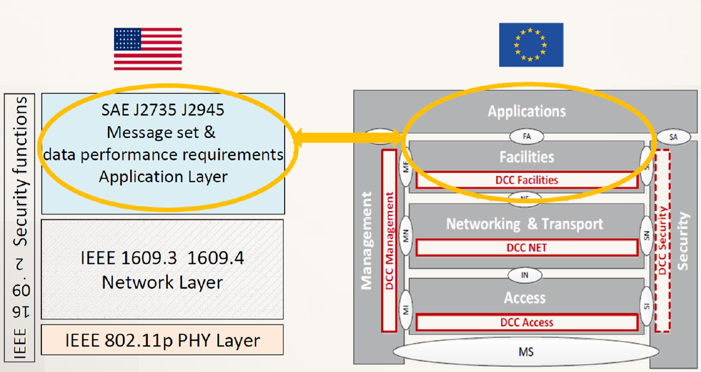

*그림 44. 미국과 유럽의 V2X 프로토콜 스택 비교*

그림 44는 2.11절에서 본 미국과 유럽의 표준을 스택으로 비교한다 [27]. 미국의 응용 계층(SAE J2735 메시지 집합과 J2945의 데이터 성능 요구사항)은 유럽에서 응용(Applications)과 퍼실리티(Facilities) 계층에 해당한다. 유럽의 퍼실리티 계층은 CAM과 DENM 같은 공통 메시지를 생성하고 관리하는 계층이다. 미국의 IEEE 1609.3, 1609.4 네트워크 계층은 유럽의 네트워킹과 전송(Networking & Transport) 계층에, IEEE 802.11p 물리 계층은 유럽의 접속(Access) 계층에 대응한다. 유럽은 계층마다 분산 혼잡 제어(DCC, decentralized congestion control) 기능을 두고(DCC Facilities, DCC NET, DCC Access), 관리(Management)와 보안(Security) 개체가 모든 계층과 서비스 접근점(SAP)으로 연결된다. 미국은 보안 기능을 IEEE 1609.2로 스택 옆에 둔다.

### 3.6 SAE J2735 메시지 목록

SAE J2735가 정의하는 메시지는 다음과 같다 [36]. 통신 열은 메시지가 주로 쓰이는 방향이다.

| 번호 | 약어 | 메시지 이름 | 통신 | 설명 |
|:-----|:-----|:-----|:-----|:-----|
| 1 | BSM | MSG_BasicSafetyMessage | V2V | 안전 응용을 위한 차량 상태 정보를 담는다. |
| 2 | CSR | MSG_CommonSafetyRequest | V2X | 안전 관련 정보를 요청한다. |
| 3 | CCM | MSG_CooperativeControlMessage | V2X | 협력 차량 제어를 관리한다. |
| 4 | EVA | MSG_EmergencyVehicleAlert | V2X | 긴급 차량의 존재와 움직임을 알린다. |
| 5 | ICA | MSG_IntersectionCollisionAvoidance | V2X | 교차로의 충돌을 예방하도록 돕는다. |
| 6 | MSCM | MSG_ManeuverSharingAndCoordinatingMessage | V2X | 차량의 기동을 조정한다. |
| 7 | MAP | MSG_MapData | V2I | 도로와 교차로의 상세 형상을 제공한다. |
| 8 | NMEA | MSG_NMEAcorrections | V2I | 위치 정확도를 높이는 GNSS 보정을 제공한다. |
| 9 | PSM | MSG_PersonalSafetyMessage | V2X | 보행자와 자전거 이용자의 안전 정보를 전달한다. |
| 10 | PSM2 | MSG_PersonalSafetyMessage2 | V2X | 추가 정보를 담도록 PSM을 확장한다. |
| 11 | PDC | MSG_ProbeDataConfigMessage | V2I | 프로브 데이터의 수집을 설정한다. |
| 12 | PDM | MSG_ProbeDataManagement | V2I | 프로브 데이터의 수집과 보고를 관리한다. |
| 13 | PDR | MSG_ProbeDataReportMessage | V2I | 수집한 프로브 데이터를 보고한다. |
| 14 | PVD | MSG_ProbeVehicleData | V2I | 차량 기반 프로브 데이터를 담는다. |
| 15 | RGA | MSG_RoadGeometryAndAttributes | V2I | 도로의 형상과 속성을 기술한다. |
| 16 | RSM | MSG_RoadSafetyMessage | V2X | 도로 안전 정보를 제공한다. |
| 17 | RSA | MSG_RoadSideAlert | V2X | 즉각적인 노변 위험을 알린다. |
| 18 | RWM | MSG_RoadWeatherMessage | V2X | 도로 기상 상태를 보고한다. |
| 19 | RTCM | MSG_RTCMcorrections | V2I | GNSS 보정 데이터를 제공한다. |
| 20 | SDSM | MSG_SensorDataSharingMessage | V2X | 차량 사이에 센서 데이터를 공유한다. |
| 21 | SCPR | MSG_SignalControlAndPrioritizationRequest | V2I | 교통 신호 제어와 우선 처리를 요청한다. |
| 22 | SCPS | MSG_SignalControlAndPrioritizationStatus | V2I | 교통 신호 제어 요청의 상태를 알린다. |
| 23 | SPAT | MSG_SignalPhaseAndTiming | V2I | 교통 신호의 현재 상태와 시간을 알린다. |
| 24 | SRM | MSG_SignalRequestMessage | V2I | 교통 신호의 변경을 요청한다. |
| 25 | SSM | MSG_SignalStatusMessage | V2I | 신호 요청에 대한 응답과 상태를 제공한다. |
| 26 | TAM | MSG_TollAdvertisementMessage | V2I | 통행료 관련 정보를 광고한다. |
| 27 | TUMack | MSG_TollUsageAckMessage | V2I | 통행료 사용을 확인한다. |
| 28 | TUM | MSG_TollUsageMessage | V2I | 통행료 사용 내역을 담는다. |
| 29 | TSPaT | MSG_TrafficSignalPhaseAndTiming | V2I | 상세한 교통 신호 현시와 시간을 담는다. |
| 30 | TIM | MSG_TravelerInformation | V2I | 여행 관련 정보를 배포한다. |
| 31 | TestMessages | MSG_TestMessages | V2X | 시험과 검증에 쓰는 메시지이다. |

*표 34. SAE J2735 정의 메시지 목록*

> **참고:** J2735의 모든 메시지는 전송할 때 **MessageFrame**이라는 공통 틀에 싸인다. MessageFrame은 메시지 종류를 나타내는 번호(messageId)와 메시지 본문(value)으로 이루어지며, 수신기는 이 번호를 보고 본문을 어떤 메시지로 해석할지 정한다. 예를 들어 J2735의 2016년판에서 MAP은 18, SPaT는 19, BSM은 20, TIM은 31, PSM은 32이다 [36].

이 가운데 자주 쓰이는 메시지의 목적, 핵심 내용, 전송 시점을 정리하면 다음과 같다.

| 메시지 | 보내는 주체 | 핵심 내용 | 전송 시점 |
|:-----|:-----|:-----|:-----|
| BSM | 모든 차량 | 위치, 속도, 진행 방향, 가속도, 브레이크 상태, 차량 크기 | 주기적으로 방송(보통 초당 10회, 3.7절) |
| SPaT | 신호 교차로의 RSU | 신호 그룹별 현재 현시와 바뀔 때까지 남은 시간 | 신호 상태가 계속 변하므로 짧은 주기로 반복 방송(3.9절) |
| MAP | RSU | 교차로의 차로 형상, 차로 사이의 연결, 신호 그룹 번호 | 형상이 거의 변하지 않으므로 긴 주기로 반복 방송(3.9절) |
| TIM | RSU 또는 교통 센터 | 도로 표지, 권고 속도, 공사, 사고 같은 여행자 정보와 그 유효 구간, 유효 기간 | 정보가 유효한 동안 반복 방송 |
| RSA | RSU 또는 차량 | 짧게 유지되는 노변 위험(예: 도로 위 장애물)의 종류와 위치 | 위험이 생겼을 때 방송 |
| EVA | 긴급 차량 | 긴급 차량의 종류, 위치, 진행 방향, 사이렌과 경광등 상태 | 긴급 출동 중일 때 반복 방송 |
| PSM | 보행자, 자전거 이용자의 단말 또는 RSU | VRU의 종류, 위치, 속도, 진행 방향 | VRU 단말이 주기적으로 방송하거나, RSU가 VRU를 감지했을 때 대신 방송 |
| SRM, SSM | 긴급 차량과 버스(SRM), 신호 제어기의 RSU(SSM) | 우선 처리나 선점 요청(SRM), 요청의 처리 상태(SSM) | 우선 처리가 필요한 차량이 교차로에 접근할 때 요청하고, 상태가 바뀔 때 회신 |
| PDM, PVD | RSU(PDM), 차량(PVD) | 수집할 데이터와 간격의 지시(PDM), 차량이 수집한 스냅숏(PVD) | 차량이 RSU의 통신 범위에 들어올 때 |
| RTCM | RSU | GNSS 수신기의 위치 오차를 줄이는 보정 정보(RTCM 형식) | 기준국 보정 정보가 갱신될 때마다 방송 |
| SDSM | 차량 또는 RSU | 자기 센서가 감지한 객체의 종류, 위치, 속도 | 주기적으로 방송 |
| CSR | 차량 | 다른 차량에게 BSM의 추가 정보(Part 2)를 보내 달라는 요청 | 추가 정보가 필요할 때 |

*표 35. 주요 메시지의 목적과 전송 시점*

> **용어 정의:** **프로브 차량(probe vehicle)** 은 도로를 달리며 속도, 위치, 노면 상태 같은 데이터를 수집하는 움직이는 센서 역할의 차량이다.

> **용어 정의:** **NMEA**는 원래 해양 전자 장비를 위한 단체의 이름으로, 그 표준은 GNSS 수신기의 출력 문장 형식으로 널리 쓰인다.

> **용어 정의:** **RTCM**은 원래 해양 무선 통신을 위한 단체의 이름으로, 그 표준은 위치 보정 정보의 형식으로 널리 쓰인다.

### 3.7 기본 안전 메시지(BSM)

**BSM(Basic Safety Message)** 은 V2V 안전 응용의 기본 메시지이다. 모든 차량이 자신의 상태를 주변에 계속 알리면, 각 차량은 받은 BSM으로 주변 차량의 위치와 움직임을 추적하여 전방 충돌 경고, 교차로 충돌 경고, 차로 변경 경고 같은 응용을 실행한다. SAE J2945/1은 BSM을 보통 초당 10회(100 ms 간격) 방송하고, 채널이 혼잡하면 전송 간격을 늘려 혼잡을 제어하도록 규정한다 [37].

BSM은 두 부분으로 나뉜다.

| 부분 | 데이터 요소 | 형식 | 비고 |
|:-----|:-----|:-----|:-----|
| Part 1 | coreData | BSMcoreData | 필수, 모든 BSM에 들어간다 |
| Part 2 | VehicleSafetyExtensions | VehicleSafetyExtensions | 선택 |
| Part 2 | SpecialVehicleExtensions | SpecialVehicleExtensions | 선택 |
| Part 2 | SupplementalVehicleExtensions | SupplementalVehicleExtensions | 선택 |
| | regional | Reg-BasicSafetyMessage | 선택, 지역별 확장 |

*표 36. BSM의 구성*

**Part 1(핵심 데이터)** 은 매번 보내는 최소한의 차량 상태이다. 필드와 단위는 다음과 같다 [36].

| 필드 | 형식 | 의미 | 값의 범위와 단위 |
|:-----|:-----|:-----|:-----|
| msgCnt | MsgCount | 메시지 순번. 같은 송신자가 보낸 메시지의 유실과 순서를 확인한다. | 0\~127, 127 다음은 0 |
| id | TemporaryID | 임시 차량 식별자. 사생활 보호를 위해 주기적으로 바뀐다. | 4바이트 |
| secMark | DSecond | 현재 분(minute) 안에서의 생성 시각 | 0\~59,999 ms (65535는 알 수 없음) |
| lat, long | Latitude, Longitude | 위도와 경도 | 단위 $10^{-7}$도(0.1 마이크로도) |
| elev | Elevation | 고도 | 단위 0.1 m |
| accuracy | PositionalAccuracy | 위치 오차 타원(장축, 단축, 방향) | 장축과 단축의 단위 0.05 m |
| transmission | TransmissionState | 변속기 상태 | 중립, 주차, 전진, 후진 등 |
| speed | Speed | 속력 | 단위 0.02 m/s (8191은 알 수 없음) |
| heading | Heading | 진행 방향(북쪽에서 시계 방향) | 단위 0.0125° (28800은 알 수 없음) |
| angle | SteeringWheelAngle | 조향 휠 각도 | 단위 1.5° |
| accelSet | AccelerationSet4Way | 종방향, 횡방향, 수직 가속도와 요 레이트 | 종방향과 횡방향 0.01 m/s², 수직 0.02 G, 요 레이트 0.01°/s |
| brakes | BrakeSystemStatus | 바퀴별 제동, 트랙션 제어, ABS, 주행 안정 제어, 브레이크 부스트, 보조 브레이크 상태 | 비트와 열거형 |
| size | VehicleSize | 차량의 폭과 길이 | 단위 cm |

*표 37. BSM 핵심 데이터의 필드*

J2735는 대역폭을 아끼기 위해 실수 대신 정수와 단위(분해능)로 값을 보낸다. 수신기는 받은 정수에 단위를 곱해 물리량을 얻는다. 다음은 받은 정수 값을 물리량으로 바꾸는 예이다.

| 필드 | 받은 정수 | 계산 | 물리량 |
|:-----|--:|:-----|:-----|
| speed | 1000 | $1000 \times 0.02$ m/s | 20 m/s = 72 km/h |
| heading | 7200 | $7200 \times 0.0125^\circ$ | 90°(동쪽) |
| lat | 366105000 | $366105000 \times 10^{-7}$° | 36.6105° N |
| long | 1272850000 | $1272850000 \times 10^{-7}$° | 127.2850° E |
| elev | 523 | $523 \times 0.1$ m | 52.3 m |
| secMark | 56789 | $56789 \times 1$ ms | 현재 분의 56.789초 |
| accelSet.long | -350 | $-350 \times 0.01$ m/s² | -3.5 m/s²(감속) |

*표 38. BSM 필드 값의 변환 예*

속도 72 km/h를 보내려면 거꾸로 $72 / 3.6 = 20$ m/s를 구하고 $20 / 0.02 = 1000$을 넣는다. 표 38의 차량은 위도 36.6105°, 경도 127.285° 지점에서 72 km/h로 동쪽을 향해 달리며 -3.5 m/s²로 감속하고 있다. 수신 차량은 이 정보로 송신 차량의 0.1초 뒤 위치를 예측할 수 있다. 감속을 무시하면 $20 \times 0.1 = 2$ m 동쪽이고, 감속을 고려하면 $20 \times 0.1 - \frac{1}{2} \times 3.5 \times 0.1^2 = 2 - 0.0175 = 1.9825$ m 동쪽이다.

**Part 2(선택 확장)** 는 필요할 때만 덧붙인다. VehicleSafetyExtensions에는 사건 플래그(events, 예: 급제동이나 비상등), 지나온 경로(pathHistory), 예측 경로(pathPrediction), 외부 등화(lights), 시각(timestamp), 차량 높이(height)가 들어간다. 지나온 경로와 예측 경로는 커브 길에서 앞차가 같은 차로에 있는지를 판단하는 데 쓰인다. SpecialVehicleExtensions는 긴급 차량의 상세 정보(EmergencyDetails), 사건 설명(EventDescription), 트레일러 정보(TrailerData)를 담는다. SupplementalVehicleExtensions는 기본 차량 등급(classification), 상세 분류(classDetails), 차량 데이터(vehicleData), 고장 차량 상태(status), 미국 연방도로청의 차량 등급(fhwaVehicleClass), 트레일러(trailers), 지역 확장(regional, 1\~4개)을 담는다. 이 확장에서 기상 보고(WeatherReport), 기상 탐측(WeatherProbe), 장애물 감지(ObstacleDetection), 속도 이력(SpeedProfile), RTCM 패키지(RTCMpackage)는 deprecated1\~5라는 이름으로 남아 있으며, 더 이상 쓰지 않도록 폐기된 항목이다.

유럽의 CAM과 미국의 BSM은 목적이 같으므로 데이터 요소가 대부분 대응한다. 2013년의 비교 결과는 다음과 같다 [27].

| CAM | BSM | 대응 |
|:-----|:-----|:-----|
| Message ID | Message Type | 같거나 비슷함 |
| Station ID | Vehicle Temp ID | 같거나 비슷함 |
| GenerationDeltaTime | Time(secMark) | 같거나 비슷함 |
| Latitude, Longitude | Latitude, Longitude | 같거나 비슷함 |
| Elevation, PositionConfidence | Elevation, Positional accuracy | 대응하지만 정의가 다름 |
| Speed | Transmission & speed | 같거나 비슷함 |
| DriveDirection | Transmission & speed | 부분적으로 대응 |
| Heading | Heading | 같거나 비슷함 |
| LongitudinalAcceleration | Acceleration 4 way | 같거나 비슷함 |
| AccelerationControl | Brake status | 같거나 비슷함 |
| Curvature | Path prediction | 대응하지만 정의가 다름 |
| VehicleWidth, VehicleLength | Vehicle size | 같거나 비슷함 |
| ExteriorLights | Other vehicle data (선택) | 같거나 비슷함 |
| PathHistory | Path history | 같거나 비슷함 |
| Station Type | Other vehicle data (선택) | 대응하지만 정의가 다름 |
| (없음) | Message Count, RTCM package | BSM에만 있음 |

*표 39. CAM과 BSM의 데이터 요소 대응*

비교 그림에서 BSM의 Steering wheel angle과 Event flags(선택), CAM의 선택 요소(Optional elements)와 LaneCount에는 대응 관계가 표시되어 있지 않다. 가장 중요한 차량 동역학 데이터는 두 메시지에서 같거나 비슷하게 정의된다. 다만 유럽의 CAM은 다양한 차종(대형 차량, 긴급 차량 등)의 요구를 계속 반영해 왔지만, 당시 미국의 BSM은 승용차에 초점을 두었으므로, 대형 차량 관련 DSRC 활동이 진행되면 미국이 유럽에서 배울 점이 있다는 것이 당시의 평가였다.

### 3.8 프로브 차량 데이터(PVD)

**PVD(Probe Vehicle Data)** 는 차량이 달리면서 수집한 데이터를 RSU를 통해 교통 센터로 보내는 메시지이다. 차량은 이동하면서 일정 시점마다 위치, 속도, 차량 상태를 **스냅숏(snapshot)** 으로 저장해 두었다가, RSU의 통신 범위에 들어가면 모아 둔 스냅숏을 PVD로 보낸다. 교통 센터는 많은 차량의 PVD로 구간 통행 시간, 정체, 노면 상태를 파악한다. 어떤 데이터를 얼마나 자주 수집할지는 RSU가 PDM으로 지시한다.

| 데이터 요소 | 형식 | 비고 |
|:-----|:-----|:-----|
| timeStamp | MinuteOfTheYear | 선택. 연초부터 센 분 단위 시각 |
| segNum | ProbeSegmentNumber | 선택. 사생활 보호를 위해 일정 구간마다 바뀌는 구간 번호 |
| probeID | VehicleIdent | 선택. 차량 식별 정보 |
| startVector | FullPositionVector | RSU로 전송하는 시점의 공간과 시간 |
| vehicleType | VehicleClassification | 차량의 종류 |
| snapshots | SEQUENCE (SIZE(1..32)) OF Snapshot | 첫 측정 세트의 공간과 시간을 포함한 이름과 값의 쌍, 1\~32개 |
| regional | SEQUENCE (SIZE(1..4)) OF RegionalExtension | 선택. 지역별 확장 |

*표 40. PVD의 구성*

PVD 안의 주요 데이터 프레임은 다음과 같다.

| 데이터 프레임 | 주요 데이터 요소 | 비고 |
|:-----|:-----|:-----|
| VehicleIdent | name(DescriptiveName), vin(VINstring, 차대 번호), ownerCode(IA5String, 1\~32자), id(VehicleID), vehicleType(VehicleType), vehicleClass(CHOICE) | 모두 선택 |
| FullPositionVector | utcTime(DDateTime), long, lat(단위 $10^{-7}$도), elevation, heading, speed(TransmissionAndSpeed), posAccuracy, timeConfidence, posConfidence, speedConfidence | long, lat만 필수 |
| VehicleClassification | keyType(BasicVehicleClass), role(BasicVehicleRole), iso3883(Iso3833VehicleType), hpmsType(VehicleType), vehicleType(VehicleGroupAffected), responseEquip(IncidentResponseEquipment), responderType(ResponderGroupAffected), fuelType(FuelType), regional | 모두 선택 |
| Snapshot | thePosition(FullPositionVector), safetyExt(VehicleSafetyExtensions), dataSet(VehicleStatus) | thePosition만 필수 |

*표 41. PVD의 차량 식별, 위치, 분류, 스냅숏 정보*

표 41의 VehicleClassification에서 role은 차량의 역할(일반, 대중교통, 긴급, 경찰 등), iso3883은 ISO 3833의 차종 분류, hpmsType은 미국 도로 성능 감시 체계(HPMS)의 차종, fuelType은 연료 종류이다. 데이터 요소 이름이 iso3883이고 형식 이름이 Iso3833VehicleType으로 숫자가 다른 것은 표준 자체의 표기이다. Snapshot의 dataSet(VehicleStatus)에는 등화, 와이퍼, 브레이크, 외기 온도 같은 차량 상태가 들어가므로, 많은 차량에서 와이퍼 작동 정보가 모이면 그 구간에 비가 온다고 추정할 수 있다.

### 3.9 신호 현시와 시간(SPaT)과 지도 데이터(MAP)

신호 교차로의 V2I 서비스는 SPaT와 MAP 두 메시지를 함께 써야 동작한다. **MAP**은 교차로가 어떻게 생겼는지(차로의 위치와 연결)를 알려 주고, **SPaT**는 각 방향의 신호가 지금 무엇이고 언제 바뀌는지를 알려 준다. 차량은 MAP으로 자신이 어느 차로에 있고 그 차로가 어느 신호 그룹에 속하는지 찾은 뒤, SPaT에서 그 신호 그룹의 상태를 읽는다.

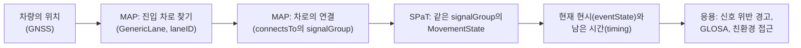

*그림 45. MAP과 SPaT를 결합하여 차로별 신호를 찾는 과정*

**SPaT 메시지의 구성.** SPaT는 하나 이상의 교차로 상태를 담는다 [36].

| 수준 | 데이터 요소 | 형식 | 비고 |
|:-----|:-----|:-----|:-----|
| SPAT | timeStamp | MinuteOfTheYear | 선택 |
| SPAT | name | DescriptiveName | 선택 |
| SPAT | intersections | IntersectionStateList | 교차로마다 하나씩의 SPaT 데이터 집합 |
| SPAT | regional | SEQUENCE (SIZE(1..4)) OF RegionalExtension | 선택 |
| IntersectionState | name | DescriptiveName | 선택 |
| IntersectionState | id | IntersectionReferenceID | 교차로 식별자(MAP과 같은 번호) |
| IntersectionState | revision | MsgCount | 메시지 내용이 바뀔 때마다 증가 |
| IntersectionState | status | IntersectionStatusObject | 신호 제어기의 상태(수동 제어, 고장, 우선 처리 중 등) |
| IntersectionState | moy | MinuteOfTheYear | 선택. 연초부터 센 분 |
| IntersectionState | timeStamp | DSecond | 선택. 분 안의 ms |
| IntersectionState | enabledLanes | EnabledLaneList | 선택. 시간대에 따라 활성화된 가변 차로 |
| IntersectionState | states | MovementList | 신호 그룹별 상태 목록 |
| IntersectionState | maneuverAssistList | ManeuverAssistList | 선택. 대기 행렬 길이 같은 보조 정보 |
| IntersectionState | regional | SEQUENCE (SIZE(1..4)) OF RegionalExtension | 선택 |
| IntersectionState | roadAuthorityID | RoadAuthorityID | 선택. 도로 관리 기관 식별자 |

*표 42. SPaT 메시지와 교차로 상태의 구성*

states의 각 항목(MovementState)은 신호 그룹 번호(signalGroup)와 그 신호 그룹의 현시 목록(MovementEvent)을 담는다. MovementEvent의 **eventState**는 현재 현시이며, 정지 후 진행(stop-then-proceed, 점멸 적색), 정지 유지(stop-and-remain, 적색), 비보호 진행 허용(permissive-movement-allowed), 보호 진행 허용(protected-movement-allowed, 녹색 화살표), 비보호와 보호 정리(clearance, 황색) 같은 값을 가진다. **timing**(TimeChangeDetails)은 현시가 바뀌는 시각으로, 가장 이른 종료 시각(minEndTime, 필수), 가장 늦은 종료 시각(maxEndTime), 가장 가능성 높은 종료 시각(likelyTime)과 그 신뢰도를 담는다. 감응식 신호처럼 종료 시각이 교통량에 따라 바뀔 수 있으므로 하나의 값이 아니라 범위로 알린다.

시각은 **TimeMark** 형식으로, 현재 시(hour)의 시작부터 센 0.1초 단위의 값(0\~35999)이다. 예를 들어 현재 시각이 14시 25분 30.0초이면 현재의 TimeMark는 다음과 같다.

```math
(25 \times 60 + 30) \times 10 = 1530 \times 10 = 15300
```

이때 어떤 신호 그룹의 minEndTime이 15450, likelyTime이 15520이면, 현시는 빨라야 $(15450 - 15300)/10 = 15.0$초 뒤에 끝나고, 가장 가능성 높은 종료는 $(15520 - 15300)/10 = 22.0$초 뒤이다. 이 신호 그룹이 녹색이고 정지선까지 300 m 남은 차량이 녹색 안에 통과하려면 15초 안에 도착해야 하므로, 평균 $300 / 15 = 20$ m/s(72 km/h) 이상이 필요하다. 제한 속도가 그보다 낮으면 GLOSA 응용은 무리하게 가속하지 말고 다음 녹색에 맞추어 감속하도록 안내한다.

**MAP 메시지의 구성.** MAP은 교차로와 도로 구간의 형상을 기술한다 [36].

| 수준 | 데이터 요소 | 내용 |
|:-----|:-----|:-----|
| MapData | timeStamp, msgIssueRevision | 생성 시각과 판 번호. 형상이 바뀌면 판 번호가 바뀐다. |
| MapData | layerType, layerID | 지도 계층의 종류(교차로, 도로 구간 등)와 번호 |
| MapData | intersections | 교차로 형상 목록(IntersectionGeometryList) |
| MapData | roadSegments, dataParameters, restrictionList, regional | 도로 구간 형상, 데이터 출처 정보, 통행 제한 등급, 지역 확장 |
| IntersectionGeometry | id, revision, refPoint | 교차로 식별자, 판 번호, 기준점(위도, 경도, 고도) |
| IntersectionGeometry | laneWidth, speedLimits | 기본 차로 폭, 제한 속도 |
| IntersectionGeometry | laneSet | 차로 목록(LaneList) |
| GenericLane | laneID, ingressApproach, egressApproach | 차로 번호, 이 차로가 속한 진입 방향과 진출 방향 |
| GenericLane | laneAttributes, maneuvers | 차로 종류(차량, 횡단보도, 자전거 등)와 허용된 기동(직진, 좌회전 등) |
| GenericLane | nodeList | 기준점에서의 상대 좌표로 나타낸 차로 중심선의 점 목록 |
| GenericLane | connectsTo | 이 차로에서 진출할 수 있는 차로(connectingLane)와 그 이동을 제어하는 신호 그룹(signalGroup) |

*표 43. MAP 메시지의 구성*

MAP의 차로 중심선은 기준점에서 동쪽과 북쪽으로 몇 cm 떨어져 있는지로 나타내므로, 위도와 경도를 점마다 보내는 것보다 데이터가 훨씬 작다. connectsTo의 signalGroup이 SPaT의 MovementState에 있는 signalGroup과 같은 번호이므로, 이 번호가 그림 45에서 두 메시지를 잇는 열쇠이다.

교차로의 형상은 공사가 없으면 바뀌지 않지만 신호 상태는 매 순간 바뀐다. 그래서 미국의 연결 교차로(connected intersection) 구현 지침인 CTI 4501은 SPaT를 평균 초당 10회, MAP을 평균 초당 1회(각각 10초 동안 ±1개) 방송하도록 규정한다 [41].

### 3.10 원격 관리 관련 법령

운전자가 타지 않는 자율주행차가 도로를 달리려면, 차량을 원격으로 감시하고 문제가 생기면 대응할 책임을 누가 지는지를 법으로 정해야 한다. 1.14절의 원격 주행과 기술 감독자 서비스가 이 법령에 근거한다.

| 구분 | 영국: NUIC 운영자 | 독일: 기술 감독자(Technical Supervisor) |
|:-----|:-----|:-----|
| 근거 법령 | Automated Vehicles Act 2024(NUIC 운영자 면허), Automated and Electric Vehicles Act 2018(보험 책임) | 자율주행법(Autonomous Driving Act, 2021) |
| 역할 | 운전자가 없는 자율주행차의 안전하고 합법적인 운영을 책임지는 조직으로, 운행 중 생기는 법적, 안전 의무를 대신 수행한다. | 자율주행차의 기술 상태와 안전한 운영을 감독하며, 작동 중 생길 수 있는 기술 문제를 미리 식별하고 해결한다. |
| 면허와 자격 | 정부의 면허나 승인을 받아야 하며, 이를 통해 운영의 신뢰성을 보장한다. | 특정 자격 요건을 충족하고 관련 면허를 보유해야 하며, 기술 전문성과 법적 지식이 요구된다. |
| 원격 감시 | 차량이 자율적으로 작동하는 동안 원격으로 상태를 감시하고 기술 문제가 생기면 대응한다. | 차량을 원격으로 감시하고 비정상 상황에서 긴급 조치를 취하며, 필요하면 차량을 원격으로 제어하거나 정지시킨다. |
| 법적 책임 | 사고와 문제에 법적 책임을 지고 보험에 가입할 의무가 있으며, 사용자를 대신해 운영 중의 사고와 손해를 보상한다. | 기술적 안전성과 법규 준수를 보장하고, 운영 중의 기술 문제에 법적 책임을 지며 규제 요건을 충족해야 한다. |
| 데이터와 규정 준수 | 운행 데이터를 기록하고 보존하여 규제 기관과 협력하며 운행이 관련 법규에 맞도록 관리하고, 소프트웨어와 하드웨어를 지속적으로 갱신하고 검토한다. | 기술 상태와 운영 데이터를 기록, 분석하여 규제 기관에 보고하고, 기술적 안전성과 성능을 계속 개선하는 데 데이터를 활용하며, 소프트웨어와 하드웨어를 정기적으로 점검하고 갱신한다. |

*표 44. 영국 NUIC 운영자와 독일 기술 감독자의 비교*

> **용어 정의:** **NUIC(no-user-in-charge)** 는 차량 안에 운전 책임을 지는 사용자가 없는 운행을 뜻한다. 이 경우 운전자 대신 책임을 지는 조직이 NUIC 운영자이다.

> **참고:** 표 44의 영국 근거 법령 가운데 Automated and Electric Vehicles Act 2018은 자율주행 중 사고가 났을 때 보험사가 일차로 배상하는 책임 구조를 정한 법이다 [42]. NUIC 운영자의 면허 제도는 이후 제정된 Automated Vehicles Act 2024에 도입되었다. 이 법에서 자율주행 중 차량의 주행에 대한 책임은 차량의 승인을 받은 자율주행 주체(ASDE, authorised self-driving entity)가 지고, NUIC 운영자는 자기가 감독하는 운전자 없는 운행에서 문제를 감지하고 대응하는 책임을 진다 [43]. 또 독일 법의 기술 감독자는 차량을 원격으로 비활성화하거나 차량이 제안한 대체 주행 기동을 승인할 수 있지만, 조향과 가감속을 원격에서 계속 조작하는 원격 운전자는 아니다 [44]. 표 44의 "원격으로 제어"는 이러한 비활성화와 기동 승인을 뜻하는 것으로 이해해야 한다.

두 제도의 공통점은 운전자가 사라진 자리에 면허를 가진 사람이나 조직을 두어 원격 감시, 사고 책임, 데이터 기록을 맡긴다는 것이다. 이 원격 감시와 개입은 V2N 통신과 1.14절의 원격 주행 기술이 있어야 가능하므로, 법 제도와 통신 기술이 함께 발전해야 한다.

---

<br>

## 개념 적용

| 상황 | 적용할 개념 |
|:-----|:-----|
| 신호 교차로에 접근하는 자율주행차가 녹색 신호가 몇 초 남았는지 알아야 한다. | MAP으로 자기 차로의 signalGroup을 찾고, SPaT에서 그 신호 그룹의 eventState와 minEndTime, likelyTime을 읽는다(3.9절). |
| 건물 뒤에서 나오는 보행자를 자차 카메라가 보지 못한다. | NLOS 영역의 객체이므로 보행자 단말의 PSM이나 다른 차량, 인프라의 센서 공유 메시지(SDSM, CPM)로 인식한다(2.9절, 3.6절). |
| 군집주행 트럭들이 레이더만으로 ACC를 할 때 뒤쪽 트럭일수록 속도가 크게 출렁인다. | 반응 지연이 쌓이는 열 안정성 문제이므로 V2V로 앞차의 가속도를 직접 받는 CACC를 쓴다(1.10절). |
| 합류 차로의 차량이 본선 차량의 양보를 확실히 받고 합류하려 한다. | 의도만 알리는 Class B가 아니라 상대의 동의를 받는 Class C 합의 추구 통신이 필요하다(1.3절, 3.2절). |
| 주행 중인 차량의 디스플레이에 광고 동영상을 띄우려 한다. | KS C 5077에 따라 광고 정보의 동화상은 주행 중 제공할 수 없고, 문자, 정지 화상, 음향만 가능하다(2.4절). |
| 한 차량이 BSM의 speed 필드로 2500을 보냈다. | $2500 \times 0.02 = 50$ m/s, 즉 180 km/h로 해석한다(3.7절). |

*표 45. 개념 적용 사례*

**T/F 점검:**

| 문장 | 판단과 근거 |
|:-----|:-----|
| SAE J3216의 Class C(합의 추구)는 레벨 2 차량에도 적용된다. | **F.** 사람이 운전하는 레벨 1, 2에서는 합의한 행동을 시스템이 보장할 수 없으므로 Class C와 D는 해당 없음이다. |
| V2X 기반 객체 인식은 날씨와 조명의 영향을 받지 않는다. | **T.** 객체가 자신의 정보를 통신으로 보내므로 카메라처럼 날씨와 조명에 따라 인식 성능이 달라지지 않는다. 대신 전파 환경의 영향을 받는다. |
| BSM은 IP 위에서 TCP로 전송된다. | **F.** 안전 메시지는 지연과 오버헤드를 줄이기 위해 IP를 거치지 않고 WSMP로 방송된다. |
| SPaT만 받으면 차량은 자기 차로의 신호를 알 수 있다. | **F.** SPaT는 신호 그룹별 상태만 담으므로, 자기 차로가 어느 신호 그룹인지 알려면 MAP이 필요하다. |
| 유럽의 CAM은 항상 초당 10회 생성된다. | **F.** CAM은 방향, 위치, 속도의 변화에 따라 100 ms\~1,000 ms 간격으로 생성되므로, 정지한 차량은 초당 1회만 보낸다. |
| 군집주행의 POCF에서 V2V는 필수이고 I2V는 선택이다. | **T.** 군집 차량끼리는 반드시 직접 통신해야 하지만 인프라는 부가 정보만 제공한다. |

---

<br>

## 요약

| 개념 | 핵심 요약 |
|:-----|:-----|
| 커넥티드 자율주행차(CAV) | 자율주행 기능과 커넥티드 기능을 함께 갖춘 차량으로, 차량 기술과 C-ITS가 만나는 지점에 있다. |
| C2C-CC의 Day 단계 | Day 1 인지 주행(CAM, DENM), Day 2 감지 주행(CPM), Day 3+ 협력 주행(MCM)으로 서비스를 단계적으로 보급한다. |
| SAE J3216 | 협력 운전 자동화를 상태 공유(A), 의도 공유(B), 합의 추구(C), 지시(D)의 네 등급으로 나누며, C와 D는 레벨 3 이상에만 해당한다. |
| ITS와 C-ITS | ITS는 교통 체계에 전자, 정보, 통신 기술을 적용한 정보화 사업이고, C-ITS는 차량과 인프라의 실시간 정보 공유로 안전까지 다룬다. |
| 트럭 군집주행(ISO TPS) | 안정 상태는 PMCF가, 형성부터 해산까지의 전이는 POCF가 제어하며, V2V가 필수이다. |
| 원격 주행 | 차량 영상과 센서 정보를 올리고 제어 명령을 내리는 기술로, 짧은 지연과 큰 상향 전송 속도가 필요하다. |
| 커넥티드카 HMI | 정보 과잉을 막기 위해 정보의 우선순위를 통합 관리하며, KS C 5077은 주행 중 동화상 제공을 엄격히 제한한다. |
| 커넥티드카 보안 | 무선 인터페이스, 물리 포트, 차량 내부 네트워크가 주된 해킹 지점이며, V2X와 클라우드, 무선 업데이트가 새 위협이 된다. |
| 센서와 V2X의 융합 | 센서는 빠르고 정확한 근거리 인식을, V2X는 NLOS와 원거리 인식을 맡으며, 융합하면 종방향과 횡방향 위치 오차가 모두 가장 작다. |
| V2X 메시지의 위치 | SAE J2735 메시지는 메시지 부계층에 놓이고, 안전 메시지는 IP 대신 WSMP로 방송된다. |
| 메시지 교환 방식 | 정보 방송(WSM), 지역 데이터 교환(WSA 뒤 WSMP나 IP), 클라우드 기반 교환(WRA 뒤 IP)의 세 가지가 있다. |
| SAE J2735 | 미국의 V2X 메시지 집합 사전으로, 메시지를 데이터 요소와 데이터 프레임으로 정의하고 ASN.1 UPER로 인코딩한다. |
| BSM | 모든 차량이 보통 초당 10회 방송하는 기본 안전 메시지로, Part 1에 위치, 속도, 방향, 가속도, 브레이크, 크기를 담는다. |
| PVD | 차량이 수집한 스냅숏을 RSU 범위에서 보내는 프로브 데이터 메시지이다. |
| SPaT와 MAP | MAP은 차로 형상과 신호 그룹을, SPaT는 신호 그룹별 현시와 남은 시간을 알리며, signalGroup 번호로 결합한다. |
| 원격 관리 법령 | 영국은 NUIC 운영자, 독일은 기술 감독자에게 원격 감시, 사고 책임, 데이터 기록을 맡긴다. |

---

<br>

## 점검 문제

1. **용어의 관계:** 스마트카, 커넥티드카, 자율주행차, CAV, C-ITS의 관계를 설명하라.

   <details>
   <summary>정답</summary>

   스마트카는 첨단 센서, 전자 제어, 정보통신 기술을 갖춘 차량을 아우르는 가장 넓은 개념으로, 자율주행차와 커넥티드카의 대부분을 포함한다. 자율주행차는 운전 작업을 시스템이 수행하는 차량이고, 커넥티드카는 통신으로 외부와 데이터를 주고받는 차량이다. CAV는 두 기능을 함께 갖춘 차량으로 두 집합이 겹치는 영역에 있다. C-ITS는 차량과 인프라가 실시간으로 정보를 공유하는 교통 체계이며, CAV는 C-ITS와도 겹치므로 차량 기술과 교통 체계 기술이 만나는 지점에 있다.

   </details>

2. **분류 체계의 비교:** 유럽 C2C-CC의 Day 1, 2, 3+와 미국 SAE J3216의 Class A\~D가 각각 무엇을 기준으로 한 분류인지 쓰고, 두 분류의 공통된 방향을 설명하라.

   <details>
   <summary>정답</summary>

   C2C-CC의 Day 단계는 서비스를 언제 보급하는지, 즉 기술 성숙과 보급 시기를 기준으로 한 분류이다. Day 1은 상태와 사건을 알리는 인지 주행(CAM, DENM), Day 2는 센서로 감지한 객체를 공유하는 감지 주행(CPM), Day 3+는 궤적과 기동을 공유하고 조정하는 협력 주행(MCM)이다. SAE J3216의 Class A\~D는 협력의 깊이, 즉 무엇을 주고받는지를 기준으로 한 분류로, 상태 공유, 의도 공유, 합의 추구, 지시로 나뉜다. 두 분류 모두 상태를 알리는 단계에서 의도를 공유하는 단계를 거쳐 합의와 조정으로 발전한다는 같은 방향을 가리킨다.

   </details>

3. **SAE J3216의 행렬:** 레벨 2 차량이 Class B(의도 공유)에 참여할 때와 레벨 4 C-ADS가 참여할 때의 차이를 쓰고, Class C가 레벨 2에서 해당 없음인 이유를 설명하라.

   <details>
   <summary>정답</summary>

   레벨 2 차량은 종방향과 횡방향 의도를 모두 공유하지만, 사람이 운전 작업을 감독하므로 그 의도를 사람이 무시할 수 있는 제한된 협력이다. 레벨 4 C-ADS는 행동을 결정할 모든 권한을 가지므로 공유한 계획이 실제로 실행되고, 주변 이용자는 그 계획을 믿고 예측의 신뢰도를 높일 수 있다. Class C는 서로 행동에 합의하는 것인데, 사람이 운전하는 레벨 1, 2에서는 시스템이 합의한 행동을 운전자가 실제로 할지 보장할 수 없으므로 해당 없음이다.

   </details>

4. **군집주행:** 군집주행 중인 트럭 대열의 중간에 일반 승용차가 끼어들었다. 이 사건을 처리하는 기능이 PMCF와 POCF 가운데 어느 것인지 쓰고, 그 기능이 하는 일을 설명하라. 또 군집에 새 트럭이 중간으로 들어오는 경우는 어떤 기능과 어떤 협력 등급이 필요한지 쓰라.

   <details>
   <summary>정답</summary>

   끼어들기는 안정 상태의 군집에서 일어나는 사건이므로 PMCF가 처리한다. PMCF는 끼어든 차량(OV)과의 안전한 간격을 확보하도록 뒤쪽 차량의 간격을 넓히고, 차량이 빠져나가면 간격을 원래대로 되돌린다. 새 트럭이 군집에 들어오는 것은 군집 상태의 전이(합류)이므로 POCF가 처리한다. 중간에 들어오려면 들어오려는 차량의 요청, 선두 차량의 허용, 다른 군집 차량에 대한 통지가 오가야 하므로 SAE J3216의 Class C(합의 추구)에 해당한다.

   </details>

5. **원격 주행의 통신:** 원격 주행에서 상향 링크(차량에서 센터)와 하향 링크(센터에서 차량)에 각각 무엇이 전송되며, 어떤 성능이 더 중요한지 설명하라.

   <details>
   <summary>정답</summary>

   상향 링크로는 4K 영상과 센서 데이터가 전송되므로 큰 전송 속도가 중요하다. 3GPP는 이 방향에 25 Mbps를 제시한다. 하향 링크로는 조향과 가감속 같은 제어 명령이 전송되며, 데이터량은 작지만(1 Mbps) 명령이 늦게 도착하면 차량이 위험해지므로 짧은 지연과 높은 신뢰도가 중요하다. 3GPP는 원격 주행에 종단 간 지연 5 ms와 신뢰도 99.999%를 요구한다.

   </details>

6. **융합의 효과:** 표 21에서 V2X의 횡방향 RMSE가 0.50 m로 가장 큰 이유를 쓰고, 레이더 대비 융합 방식의 횡방향 개선율을 계산하라.

   <details>
   <summary>정답</summary>

   V2X는 상대 차량이 GPS로 측정한 자기 위치를 받아 상대 위치를 계산하므로, 두 차량의 GPS 오차가 그대로 더해진다. 차로 안의 좌우 위치는 수십 cm 차이로도 의미가 달라지므로 GPS 오차가 횡방향에서 특히 크게 드러난다. 레이더 대비 개선율은 $(0.26 - 0.12)/0.26 = 0.14/0.26 \approx 0.538$, 즉 약 54%이다.

   </details>

7. **메시지 교환 방식:** 하이패스 같은 전자 요금 징수와 BSM은 각각 어떤 교환 방식을 쓰는지 쓰고, 두 방식의 차이를 설명하라.

   <details>
   <summary>정답</summary>

   BSM은 정보 방송 방식으로, 송신 차량이 수신자를 지정하지 않고 WSM을 계속 방송하며 연결을 맺는 절차가 없어 지연이 가장 짧다. 전자 요금 징수는 V2I 지역 데이터 교환 방식으로, RSU가 먼저 WSA로 요금 징수 서비스를 광고하면 OBU가 RSU와 WSMP나 IP로 개별 데이터를 주고받는다. 방송은 일대다의 단방향 전달이고, 지역 데이터 교환은 서비스 광고 뒤 특정 RSU와 OBU 사이의 양방향 교환이라는 점이 다르다.

   </details>

8. **BSM 해석:** 어떤 BSM의 coreData가 speed = 1250, heading = 14400, accelSet.long = -500, secMark = 12345이다. 각 값을 물리량으로 바꾸고, 이 차량이 어떤 상태인지 설명하라.

   <details>
   <summary>정답</summary>

   속력은 $1250 \times 0.02 = 25$ m/s, 즉 $25 \times 3.6 = 90$ km/h이다. 진행 방향은 $14400 \times 0.0125 = 180^\circ$로, 북쪽에서 시계 방향으로 180°인 남쪽이다. 종방향 가속도는 $-500 \times 0.01 = -5$ m/s²로 강하게 감속하고 있다. secMark는 현재 분의 12.345초에 메시지가 생성되었음을 뜻한다. 이 차량은 90 km/h로 남쪽을 향해 달리면서 -5 m/s²로 급제동하고 있으므로, 뒤따르는 차량은 전방 충돌 경고를 띄워야 한다.

   </details>

9. **SPaT 계산:** 현재 시각이 9시 10분 20.0초이고, 어떤 신호 그룹의 eventState가 적색(stop-and-remain), minEndTime이 6300, likelyTime이 6350이다. 적색이 끝날 때까지 최소 몇 초, 가장 가능성 높게 몇 초 남았는지 계산하라.

   <details>
   <summary>정답</summary>

   현재의 TimeMark는 $(10 \times 60 + 20) \times 10 = 620 \times 10 = 6200$이다. 최소 남은 시간은 $(6300 - 6200)/10 = 10.0$초이고, 가장 가능성 높은 남은 시간은 $(6350 - 6200)/10 = 15.0$초이다. 차량은 이 정보로 정지선에 멈추지 않고 녹색이 시작될 즈음 도착하도록 미리 감속할 수 있다.

   </details>

10. **SPaT와 MAP의 결합:** SPaT와 MAP이 각각 무엇을 알려 주는지 쓰고, 두 메시지를 어떤 필드로 연결하는지 설명하라. 또 두 메시지의 방송 주기가 다른 이유를 쓰라.

    <details>
    <summary>정답</summary>

    MAP은 교차로의 차로 형상(중심선 점 목록), 차로 사이의 연결, 각 연결을 제어하는 신호 그룹 번호를 알려 준다. SPaT는 신호 그룹별 현재 현시(eventState)와 현시가 바뀌는 시각(timing)을 알려 준다. 차량은 MAP에서 자기 차로의 connectsTo에 있는 signalGroup을 찾고, SPaT에서 같은 signalGroup의 MovementState를 읽어 두 메시지를 연결한다. 교차로 형상은 공사가 없으면 바뀌지 않으므로 MAP은 초당 1회 정도로 충분하지만, 신호 상태는 매 순간 바뀌므로 SPaT는 초당 10회 정도로 자주 방송한다.

    </details>

11. **원격 관리 법령:** 영국의 NUIC 운영자와 독일의 기술 감독자가 공통으로 맡는 책임 세 가지를 쓰라.

    <details>
    <summary>정답</summary>

    첫째, 운전자가 없는 차량을 원격으로 감시하고 기술 문제나 비정상 상황이 생기면 대응한다. 둘째, 운영 중 생긴 사고와 기술 문제에 법적 책임을 지며, 이를 위해 면허나 자격 요건을 갖추어야 한다. 셋째, 운행 데이터와 기술 상태를 기록, 보존하여 규제 기관과 협력하고, 소프트웨어와 하드웨어를 정기적으로 점검하고 갱신한다.

    </details>

---

<br>

## 참고 문헌

1. SAE International, *Taxonomy and Definitions for Terms Related to Driving Automation Systems for On-Road Motor Vehicles*, SAE J3016_202104, 2021.
2. CAR 2 CAR Communication Consortium, *Guidance for Day 2 and Beyond Roadmap*, C2CCC_WP_2072, Version 1.2, 2021. https://www.car-2-car.org/fileadmin/documents/General_Documents/C2CCC_WP_2072_RoadmapDay2AndBeyond_V1.2.pdf
3. ETSI EN 302 637-2 V1.4.1, *Intelligent Transport Systems (ITS); Vehicular Communications; Basic Set of Applications; Part 2: Specification of Cooperative Awareness Basic Service*, 2019.
4. ETSI EN 302 637-3 V1.3.1, *Intelligent Transport Systems (ITS); Vehicular Communications; Basic Set of Applications; Part 3: Specifications of Decentralized Environmental Notification Basic Service*, 2019.
5. ETSI TS 103 324 V2.1.1, *Intelligent Transport Systems (ITS); Vehicular Communications; Basic Set of Applications; Collective Perception Service*, 2023.
6. ETSI TS 103 300-3, *Intelligent Transport Systems (ITS); Vulnerable Road Users (VRU) awareness; Part 3: Specification of VRU awareness basic service*.
7. ETSI TS 103 301, *Intelligent Transport Systems (ITS); Vehicular Communications; Basic Set of Applications; Facilities layer protocols and communication requirements for infrastructure services*.
8. SAE International, *Taxonomy and Definitions for Terms Related to Cooperative Driving Automation for On-Road Motor Vehicles*, SAE J3216_202107, 2021.
9. 국토교통부, 차세대 지능형 교통체계(C-ITS) 서비스 소개 자료.
10. 한국자동차연구원, 자동차 산업과 ITS 산업 비교, 자율주행차 레벨별 부품 구성 전망 자료.
11. Ministry of Land, Infrastructure, Transport and Tourism (MLIT), Japan, "ASV (Advanced Safety Vehicle)." https://www.mlit.go.jp/jidosha/anzen/01asv/
12. ISO 4272:2022, *Intelligent transport systems - Truck platooning systems (TPS) - Functional and operational requirements and test procedures*, International Organization for Standardization, 2022.
13. G. J. L. Naus, R. P. A. Vugts, J. Ploeg, M. J. G. van de Molengraft, and M. Steinbuch, "String-stable CACC design and experimental validation: A frequency-domain approach," *IEEE Transactions on Vehicular Technology*, vol. 59, no. 9, pp. 4268-4279, 2010.
14. T. Robinson, E. Chan, and E. Coelingh, "Operating platoons on public motorways: An introduction to the SARTRE platooning programme," in *Proc. 17th ITS World Congress*, Busan, Korea, 2010.
15. Toyota Motor North America, "The Evolution of Safety at Toyota - Part 2: Toyota Safety Sense for All," *Toyota USA Newsroom*, Jun. 24, 2025. https://pressroom.toyota.com/the-evolution-of-safety-at-toyota-part-2-toyota-safety-sense-for-all/
16. Mercedes-Benz Group, "Mercedes-Benz receives world's first internationally valid system approval for conditionally automated driving," press release, Dec. 2021. https://group.mercedes-benz.com/innovation/product-innovation/autonomous-driving/system-approval-for-conditionally-automated-driving.html
17. UNECE, *UN Regulation No. 157: Uniform provisions concerning the approval of vehicles with regard to Automated Lane Keeping Systems*, 2021.
18. 3GPP TS 22.186, *Enhancement of 3GPP support for V2X scenarios; Stage 1*, Release 16.
19. Frost & Sullivan, *Global Connected Car Market Outlook, 2019*, 2019.
20. Frost & Sullivan, *Global Connected Car Market Outlook, 2020*, 2020.
21. J. Engström, J. Arfwidsson, A. Amditis, L. Andreone, K. Bengler, P. C. Cacciabue, W. Janssen, H. Kußmann, and F. Nathan, "Towards the automotive HMI of the future: Mid-term results of the AIDE project," in *Advanced Microsystems for Automotive Applications 2006*, Springer, 2006. https://doi.org/10.1007/3-540-33410-6_28
22. KS C 5077:2014, 자동차 디스플레이 장치: 운전자 인터페이스 요구사항, 국가기술표준원, 2014.
23. IEEE Std 1609.2-2022, *IEEE Standard for Wireless Access in Vehicular Environments - Security Services for Application and Management Messages*, 2022.
24. Frost & Sullivan, *Analysis of ADAS Market in Europe*, 2014.
25. Frost & Sullivan, *Global Shared and Autonomous Mobility Industry Outlook, 2020*, 2020.
26. F. Lambert, "Tesla announces it's moving away from ultrasonic sensors in favor of 'Tesla Vision'," *Electrek*, Oct. 4, 2022. https://electrek.co/2022/10/04/tesla-moving-away-ultrasonic-sensors-in-favor-tesla-vision/
27. Honda R&D Americas, "US-EU V2V/V2I standards compare/contrast" and "CAM-BSM compare & contrast: Overview," 2013.
28. K. Sjöberg, P. Andres, T. Buburuzan, and A. Brakemeier, "Cooperative intelligent transport systems in Europe: Current deployment status and outlook," *IEEE Vehicular Technology Magazine*, vol. 12, no. 2, pp. 89-97, 2017.
29. C-Roads Platform, *C-ITS service list: Messages and standards*.
30. ETSI TS 101 539-1 V1.1.1, *Intelligent Transport Systems (ITS); V2X Applications; Part 1: Road Hazard Signalling (RHS) application requirements specification*, 2013.
31. Delphi Automotive, presentation at the Automated Vehicles Symposium.
32. U.S. Department of Transportation, ITS Joint Program Office, presentation material at the Automated Vehicles Symposium.
33. J. B. Kenney, "Dedicated short-range communications (DSRC) standards in the United States," *Proceedings of the IEEE*, vol. 99, no. 7, pp. 1162-1182, 2011.
34. A. Marroquin et al., "A general overview of vehicle-to-X (V2X) beacon-based cooperative vehicular networks," Sep. 2019. https://www.researchgate.net/publication/335966938_A_General_Overview_of_Vehicle-to-X_V2X_Beacon-Based_Cooperative_Vehicular_Networks
35. JMC Rota, presentation at the SIP-adus Workshop 2021, Breakout Workshop: Connected Vehicles, 2021.
36. SAE International, *V2X Communications Message Set Dictionary*, SAE J2735.
37. SAE International, *On-Board System Requirements for V2V Safety Communications*, SAE J2945/1_201603, 2016.
38. SAE International, *V2X Sensor-Sharing for Cooperative and Automated Driving*, SAE J3224_202208, 2022.
39. ETSI TS 102 637-1, -2, -3, *Intelligent Transport Systems (ITS); Vehicular Communications; Basic Set of Applications; Parts 1-3*, 2010-2011.
40. 국가기술표준원, KS R 1600-1\~7, 협력형 자율주행 시스템을 위한 V2X 메시지 명세.
41. AASHTO, ITE, NEMA, and SAE, *Connected Intersections (CI) Implementation Guide*, CTI 4501 v01.01, Institute of Transportation Engineers, 2022. https://www.ite.org/ITEORG/assets/File/Standards/CTI%204501v0101.pdf
42. *Automated and Electric Vehicles Act 2018*, United Kingdom, 2018. https://www.legislation.gov.uk/ukpga/2018/18
43. *Automated Vehicles Act 2024*, United Kingdom, 2024. https://www.legislation.gov.uk/ukpga/2024/10
44. *Gesetz zur Änderung des Straßenverkehrsgesetzes und des Pflichtversicherungsgesetzes - Gesetz zum autonomen Fahren*, *Bundesgesetzblatt*, Teil I, p. 3108, Germany, 2021.
