# Week 11 Lecture — Overview and Applications of Connected Automated Driving, and V2X Messages

[Repository Guide](../../README.md) | [English](Concepts_Lecture.md) | [한국어](Concepts_Lecture.ko.md)

> **Last Updated:** 2026-11-18

> **Learning Objectives:**
> 1. Explain the relationships among smart cars, connected cars, automated vehicles, CAVs, ITS, and C-ITS, and compare the Day phases of the European C2C-CC with the cooperation classes of the US SAE J3216
> 2. Explain the composition and communication requirements of connected automated driving applications such as Korean C-ITS services, truck platooning, and remote driving
> 3. Explain the classification of connected car services and the issues of HMI and security
> 4. Compare the strengths and weaknesses of onboard sensor-based and V2X-based object recognition, and explain with position error figures why the two are fused
> 5. Explain where V2X messages sit in the protocol stack and the three exchange methods: information broadcast, localized data exchange, and cloud-based exchange
> 6. Explain the purpose, key fields, and transmission timing of major SAE J2735 messages such as BSM, SPaT, MAP, and PVD, and convert integer field values into physical quantities

---

## Table of Contents

- [1. Overview and Technical Classification of Connected Automated Driving](#1-overview-and-technical-classification-of-connected-automated-driving)
  - [1.1 Terminology of Connected Automated Driving](#11-terminology-of-connected-automated-driving)
  - [1.2 Technical Classification by the European C2C-CC](#12-technical-classification-by-the-european-c2c-cc)
  - [1.3 Cooperation Classes of the US SAE J3216](#13-cooperation-classes-of-the-us-sae-j3216)
  - [1.4 C-ITS Services in Korea](#14-c-its-services-in-korea)
  - [1.5 The Automotive Industry and the ITS Industry](#15-the-automotive-industry-and-the-its-industry)
  - [1.6 Definition and Traditional Classification of ITS](#16-definition-and-traditional-classification-of-its)
  - [1.7 Cooperative Intelligent Transport Systems (C-ITS)](#17-cooperative-intelligent-transport-systems-c-its)
  - [1.8 The Need for V2X from a Safety Perspective](#18-the-need-for-v2x-from-a-safety-perspective)
  - [1.9 The Need for Connected Automated Driving](#19-the-need-for-connected-automated-driving)
  - [1.10 ISO Truck Platooning Systems](#110-iso-truck-platooning-systems)
  - [1.11 Platooning Cases](#111-platooning-cases)
  - [1.12 ADAS Packages of Major Automakers](#112-adas-packages-of-major-automakers)
  - [1.13 Component Configuration by Automation Level](#113-component-configuration-by-automation-level)
  - [1.14 Remote Driving](#114-remote-driving)
- [2. Applications and Characteristics of Connected Automated Driving](#2-applications-and-characteristics-of-connected-automated-driving)
  - [2.1 Telematics](#21-telematics)
  - [2.2 Connected Cars and Smart Cars](#22-connected-cars-and-smart-cars)
  - [2.3 Classification of Connected Car Services](#23-classification-of-connected-car-services)
  - [2.4 Connected Car HMI](#24-connected-car-hmi)
  - [2.5 Connected Car Security](#25-connected-car-security)
  - [2.6 Classification of Vehicle Safety Systems and Autonomous Shuttles](#26-classification-of-vehicle-safety-systems-and-autonomous-shuttles)
  - [2.7 Autonomous Driving Based on Onboard Sensors](#27-autonomous-driving-based-on-onboard-sensors)
  - [2.8 Connected Automated Driving Services: Safety and Convenience](#28-connected-automated-driving-services-safety-and-convenience)
  - [2.9 Sensor-Based and V2X-Based Object Recognition](#29-sensor-based-and-v2x-based-object-recognition)
  - [2.10 Accuracy of Fusion-Based Relative Positioning](#210-accuracy-of-fusion-based-relative-positioning)
  - [2.11 Comparison of US and EU V2V and V2I Standards](#211-comparison-of-us-and-eu-v2v-and-v2i-standards)
  - [2.12 Cooperative Driving Phases and Services of the European C2C-CC](#212-cooperative-driving-phases-and-services-of-the-european-c2c-cc)
- [3. V2X Messages for Connected Automated Vehicles](#3-v2x-messages-for-connected-automated-vehicles)
  - [3.1 From Sensor-Based Autonomous Driving to Connected Automation](#31-from-sensor-based-autonomous-driving-to-connected-automation)
  - [3.2 Feature Examples of SAE J3216 Cooperative Driving Automation](#32-feature-examples-of-sae-j3216-cooperative-driving-automation)
  - [3.3 Position of V2X Messages in the Protocol Stack](#33-position-of-v2x-messages-in-the-protocol-stack)
  - [3.4 Message Exchange Methods of Connected Vehicles](#34-message-exchange-methods-of-connected-vehicles)
  - [3.5 Connected Vehicle Message Standards: US, Europe, and Korea](#35-connected-vehicle-message-standards-us-europe-and-korea)
  - [3.6 SAE J2735 Message List](#36-sae-j2735-message-list)
  - [3.7 Basic Safety Message (BSM)](#37-basic-safety-message-bsm)
  - [3.8 Probe Vehicle Data (PVD)](#38-probe-vehicle-data-pvd)
  - [3.9 Signal Phase and Timing (SPaT) and Map Data (MAP)](#39-signal-phase-and-timing-spat-and-map-data-map)
  - [3.10 Laws on Remote Management](#310-laws-on-remote-management)
- [Concept Applications](#concept-applications)
- [Summary](#summary)
- [Self-Check Questions](#self-check-questions)
- [References](#references)

---

<br>

## 1. Overview and Technical Classification of Connected Automated Driving

### 1.1 Terminology of Connected Automated Driving

The literature on connected automated driving uses several terms that look alike. Figure 1 shows as sets how these terms overlap.

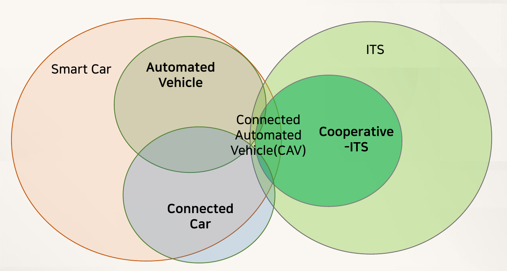

*Figure 1. Relationships among terms related to connected automated driving*

> **Definition:** A **smart car** is the broadest concept, covering vehicles equipped with advanced sensors, electronic control, and information and communication technology to improve safety and convenience.

> **Definition:** An **automated vehicle** is a vehicle in which a system performs part or all of the driving task.

> **Definition:** A **connected car** is a vehicle that exchanges data with external networks, other vehicles, and road infrastructure through communication.

Automated driving and connected functions are independent of each other, so a vehicle may have only one of them, and a vehicle that has both is given a name of its own.

> **Definition:** A **connected automated vehicle (CAV)** is a vehicle that has both automated driving and connected functions.

In Figure 1, the smart car set contains most of the automated vehicle and connected car sets, and the CAV lies where automated vehicles and connected cars overlap. The ITS set on the right is the program of making the whole transportation system intelligent, and **C-ITS (Cooperative ITS)** inside it is a cooperative transportation system in which vehicles and infrastructure share information in real time. Because the CAV also overlaps C-ITS, connected automated driving sits where vehicle technology and transportation system technology meet. ITS and C-ITS are defined in detail in Sections 1.6 and 1.7.

> **Note:** The levels of driving automation (Levels 0-5) and the definition of the driving task are covered in Week 2. The **dynamic driving task (DDT)** means all the real-time operations of steering, accelerating, and decelerating the vehicle and of monitoring and responding to the surrounding environment [1].

### 1.2 Technical Classification by the European C2C-CC

> **Definition:** The **CAR 2 CAR Communication Consortium (C2C-CC)** is a consortium formed by European vehicle manufacturers, suppliers, and research organizations to standardize and deploy vehicle-to-vehicle communication and C-ITS.

The C2C-CC classifies connected automated driving technologies along two axes. The first axis is time measured relative to a crash.

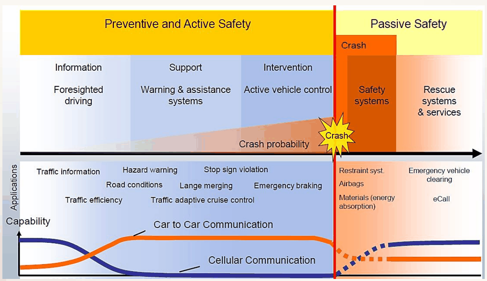

*Figure 2. Roles of safety technologies and communication methods in the time phases before and after a crash*

The horizontal axis of Figure 2 is time, and the star in the middle is the moment of the crash. Before the crash is the domain of **preventive and active safety**, and after the crash is the domain of **passive safety**. The pre-crash period is divided again into three phases, and the crash probability grows toward the right.

| Period | Phase | Content | Example applications |
|:-----|:-----|:-----|:-----|
| Before the crash | Information | Information that supports foresighted driving | Traffic information, road conditions, traffic efficiency |
| Before the crash | Support | Warning and assistance systems | Hazard warning, lane merging, traffic adaptive cruise control |
| Before the crash | Intervention | Active vehicle control | Stop sign violation response, emergency braking |
| After the crash | Safety systems | Occupant protection | Restraint systems, airbags, materials that absorb crash energy |
| After the crash | Rescue systems and services | Rescue after the accident | Clearing the way for emergency vehicles, eCall |

*Table 1. Safety technologies in each phase before and after a crash*

The curves at the bottom of Figure 2 show how useful each communication method is in each phase. **Car-to-car communication** plays its largest role in the support and intervention phases, when a crash is imminent, because nearby vehicles must then exchange information with short latency. **Cellular communication** plays a large role in the information phase, which gathers wide-area information, and in the eCall phase, which contacts a rescue center after the accident. In other words, the suitable communication method depends on the time remaining before a crash.

The second axis is the maturity of the technology. Europe deploys C-ITS services step by step, dividing them into Day 1, Day 2, and Day 3+ [2].

| Item | Day 1: awareness driving | Day 2: sensing driving | Day 3+: cooperative driving |
|:-----|:-----|:-----|:-----|
| Use cases | Warning applications (e.g., collision avoidance), information from infrastructure (e.g., road and intersection signage) | Advanced warnings, protection of vulnerable road users (VRUs) (pedestrians, two-wheelers, infrastructure support), semi-automated driving (cooperative emergency brake assistance, cooperative ACC), cooperation with traffic light controllers | Cooperative automated driving (CACC strings, cooperative lane merging), cooperation with infrastructure for automated driving (intersection crossing, assisted transition of control) |
| Communication services | CAM, DENM (status, dynamics, notifications), SPAT/MAP, IVI (static and dynamic signage) | Extended CAM and DENM (two-wheelers, ASIL qualifiers), CPM (detected objects), RTCMEM (position corrections), SREM and SSEM (priority and preemption) | Extended CAM (supported automation level, planned maneuvers and routes), extended IVI (signage for automated driving), MCM and extensions (planned and desired trajectories, infrastructure support), VAM (dedicated VRU awareness) |
| Supporting functions | Security support (use of the EU CCMS) | Functional safety support (certification of ASIL qualifiers for transmitted data), misbehavior detection, improved positioning (GNSS corrections from infrastructure) | Automated coordination (objective matching, automated driving coordination rules) |

*Table 2. Use cases, communication services, and supporting functions in the C2C-CC Day 1, Day 2, and Day 3+ phases*

From left to right, Table 2 progresses from disseminating risk information to coordinated automation. The axes of progress are trustworthiness (functional safety), accuracy (position and time), and timeliness (update frequency), and the final goals are accident-free road transport and optimal traffic flow.

> **Definition:** A **vulnerable road user (VRU)** is a road user who has no vehicle body for protection, such as a pedestrian, a cyclist, or a rider of a powered two-wheeler (PTW).

> **Definition:** **CACC (cooperative adaptive cruise control)** adds vehicle-to-vehicle communication to ACC, which keeps the gap to the preceding vehicle with radar, so that shorter and more stable gaps can be kept.

The supporting-functions row of Table 2 deals with the means that let a receiver trust the messages it receives. Its two pillars are security, which guarantees that a message has not been forged, and functional safety, which guarantees the safety of the function that produced the message.

> **Definition:** The **EU CCMS** is the European Union's security credential management system that issues and manages the certificates used to sign European C-ITS messages.

> **Definition:** **ASIL (automotive safety integrity level)** is the safety integrity level (A-D) defined by ISO 26262, the functional safety standard for road vehicles.

The European messages in Table 2 are as follows. European standards append M (for message) to the message name (the SPAT message is SPATEM).

| Message | Name | Content | Standard |
|:-----|:-----|:-----|:-----|
| CAM | Cooperative Awareness Message | Periodically announces the vehicle's status such as position, speed, and heading. | ETSI EN 302 637-2 [3] |
| DENM | Decentralized Environmental Notification Message | Announces an event such as an accident, a traffic jam, or a road hazard when it occurs. | ETSI EN 302 637-3 [4] |
| CPM | Collective Perception Message | Shares the surrounding objects detected by the sender's own sensors. | ETSI TS 103 324 [5] |
| VAM | VRU Awareness Message | Announces the position and motion of a VRU. | ETSI TS 103 300-3 [6] |
| SPATEM, MAPEM | Signal Phase and Timing, Map | Announces signal phases and intersection geometry. | ETSI TS 103 301 [7] |
| IVIM | In-Vehicle Information | Delivers road sign information for display inside the vehicle. | ETSI TS 103 301 [7] |
| SREM, SSEM | Signal Request, Signal Status | Requests signal priority and returns the status of that request. | ETSI TS 103 301 [7] |
| RTCMEM | RTCM corrections | Delivers information that corrects satellite navigation (GNSS) positions. | ETSI TS 103 301 [7] |
| MCM | Maneuver Coordination Message | Shares planned trajectories and coordinates maneuvers. | Under standardization |

*Table 3. Types of European C-ITS messages*

> **Note:** A CAM is generated according to the vehicle's motion rather than at a fixed period. A new CAM is generated when, compared with the previous CAM, the heading has changed by more than 4°, the position by more than 4 m, or the speed by more than 0.5 m/s, and the generation interval is at least 100 ms and at most 1,000 ms [3]. A fast-moving vehicle therefore sends up to 10 CAMs per second, and a stationary vehicle sends 1 CAM per second. The US BSM is covered in Section 3.7.

### 1.3 Cooperation Classes of the US SAE J3216

In SAE J3216, SAE International defines **cooperative driving automation (CDA)** and divides the ways in which a vehicle cooperates with other vehicles or infrastructure into four classes (Class A-D) [8]. Whereas the levels of driving automation (Levels 0-5) describe how much of the driving task the vehicle takes on by itself, the cooperation classes describe what it exchanges with other parties. The two classifications are independent axes, so they are combined into a matrix as in Table 4.

> **Definition:** An **automated driving system (ADS)** performs the entire driving task at Levels 3-5.

> **Definition:** A **cooperative ADS (C-ADS)** is an ADS with CDA features.

> **Definition:** A **traffic control device (TCD)** is a traffic safety facility such as a traffic light, a sign, or a road marking.

| Cooperation class | Example at Level 0 (no automation) | Level 1 (driver assistance: longitudinal or lateral control) | Level 2 (partial automation: longitudinal and lateral control) | Levels 3-5 (ADS) |
|:-----|:-----|:-----|:-----|:-----|
| No cooperative automation | Signage, TCD | The driver completes the driving task and supervises the feature's performance in real time. | The driver completes the driving task and supervises the feature's performance in real time. | The ADS performs the complete driving task under defined conditions (fallback performance varies between levels). |
| Class A: status-sharing ("Here I am and what I see") | Brake lights, traffic signal | Limited cooperation: a human drives, supervises the CDA features, and may intervene at any time. Sensing capabilities may be limited compared with a C-ADS. | Same as Level 1. | The C-ADS has full authority to decide actions. Situational awareness extends beyond its onboard sensing, and surrounding road users and road operators become more aware of the C-ADS state. |
| Class B: intent-sharing ("This is what I plan to do") | Turn signal, merge | Limited cooperation: only longitudinal or lateral intent is shared, and the human may override it. | Limited cooperation: both longitudinal and lateral intent are shared, and the human may override them. | The C-ADS has full authority. Knowing others' plans increases the reliability of prediction. |
| Class C: agreement-seeking ("Let's do this together") | Hand signals, merge | Not applicable | Not applicable | The C-ADS has full authority. It suggests or accepts actions to attain mutual goals with surrounding road users and road operators. |
| Class D: prescriptive ("I will do as directed") | Hand signals, lane assignment by police | Not applicable | Not applicable | The C-ADS has full authority, except in very specific circumstances in which it is designed to accept and adhere to prescriptive communication. |

*Table 4. Relationship between the SAE J3216 cooperation classes and the levels of automation*

Classes C and D are "Not applicable" at Levels 1 and 2 in Table 4 because, when a human drives, the system cannot guarantee that an agreed or directed action will be carried out. Concrete feature examples of each class are covered in Section 3.2.

> **Key Point:** The European Day phases classify services by when they are deployed, and the US Classes A-D classify cooperation by its depth. Both classifications point in the same direction: from sharing status (awareness), through sharing intent (sensing and sharing plans), to agreement and coordination (cooperative driving).

### 1.4 C-ITS Services in Korea

The existing services that the Korean Ministry of Land, Infrastructure and Transport (MOLIT) provides through C-ITS are the following 15 [9]. In each service, a roadside unit (RSU) or an on-board unit (OBU) delivers the information, and a warning is shown on the terminal screen in the vehicle.

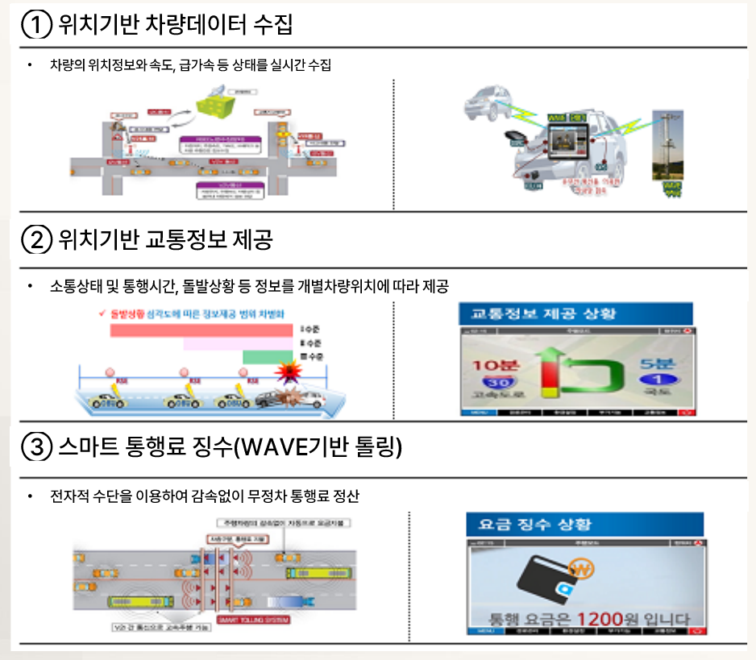

*Figure 3. Concept diagrams and terminal screens of location-based vehicle data collection, location-based traffic information, and smart tolling services*

| No. | Service | Content |
|:-----|:-----|:-----|
| 1 | Location-based vehicle data collection | Collects the vehicle's position and status, such as speed and hard acceleration, in real time. |
| 2 | Location-based traffic information | Provides traffic flow, travel time, and incident information tailored to each vehicle's position (e.g., comparing route travel times of 10 and 5 minutes). |
| 3 | Smart toll collection (WAVE-based tolling) | Settles tolls electronically without slowing down or stopping. |
| 4 | Road hazard section information | Detects fallen objects and wrong-way vehicles in hazardous sections such as sharp curves with roadside detectors and warns drivers. |
| 5 | Road surface and weather information | Detects obstacles such as local fog, icing, and water films with sensors and provides cautionary driving information. |
| 6 | Driving support in road work zones | Prevents accidents caused by road work such as construction and cleaning. |
| 7 | Intersection signal violation warning | Provides the signal phase information of the intersection and warns of the risk of running a red light. |
| 8 | Right-turn safety support | Warns of conflicts with vehicles approaching the intersection that the driver has not noticed while turning right. |
| 9 | Bus operation management | Provides bus operating situations such as departing with doors open. |
| 10 | Yellow bus (school bus) operation guidance | When a school bus stops, sends its position and whether children are boarding or alighting to the vehicles behind. |
| 11 | Speed control in school zones and silver zones | Provides school zone and senior zone information and speed limits to approaching vehicles. |
| 12 | Pedestrian collision warning | Detects pedestrians and cyclists on crosswalks and warns entering vehicles. |
| 13 | Vehicle rear-end collision prevention support | Sends the speed of the vehicle ahead and its accidents, sudden stops, and hard decelerations to the vehicles behind. |
| 14 | Emergency vehicle approach warning | Sends the driving situation of emergency vehicles such as fire trucks and ambulances to the vehicles ahead. |
| 15 | Vehicle emergency warning | When a vehicle breaks down or crashes, the driver sends hazard information with a button in the vehicle. |

*Table 5. The 15 C-ITS services of MOLIT*

> **Definition:** A **signal phase** is the state of a signal that gives the right of way to vehicles or pedestrians in a particular direction at an intersection (green, yellow, red, and so on) and its sequence.

> **Definition:** A **roadside unit (RSU)** is a device installed at the roadside that communicates with vehicles. Roadside equipment (RSE) is used with the same meaning as RSU.

> **Definition:** An **on-board unit (OBU)** is a communication terminal installed in a vehicle.

Most services in Table 5 show on the terminal screen the distance to the event (e.g., 300 m, 200 m), the speed limit, and the current speed together. For example, the road hazard section screen shows, under a title indicating that an incident has occurred, a hazard 300 m ahead, a speed limit of 40, and a current speed of 70 km/h, and the school zone screen shows a school zone 200 m ahead and a speed limit of 30. How the services were operated in actual pilot projects is covered in Week 12.

### 1.5 The Automotive Industry and the ITS Industry

Connected automated driving is a technology built jointly by the automotive industry and the ITS industry, but the two industries differ greatly in size. According to the Korea Automotive Technology Institute (KATECH), the Korean automotive industry is worth about 250 trillion won per year and the ITS industry about 1 trillion won per year [10]. Because the automotive industry is far larger, it needs many workers at every stage of research and development, mass production, and manufacturing. New technologies are handled mainly by R&D staff with master's or doctoral degrees, and mature technologies mainly by mass production and manufacturing staff with a bachelor's degree or higher. Meanwhile, the connected car market is maturing later than expected, so industry prospects in this field must be judged with that delay in mind.

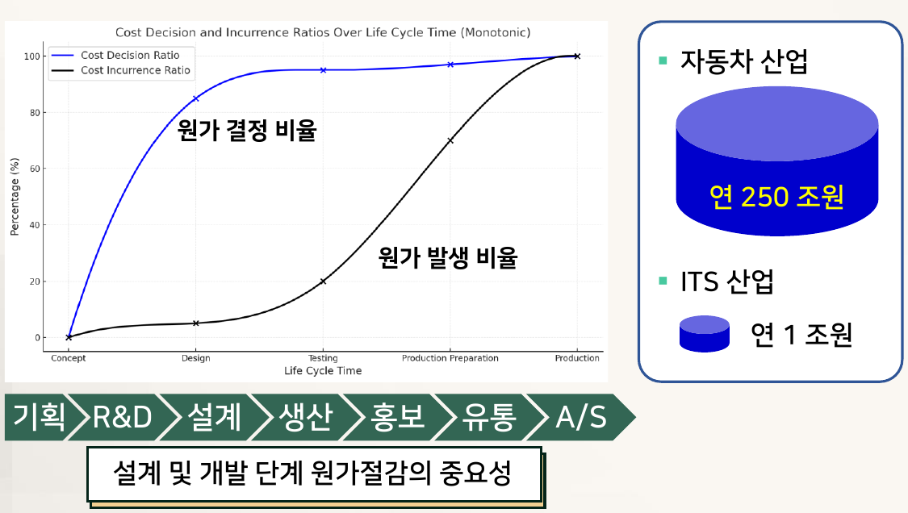

*Figure 4. Cost decision ratio and cost incurrence ratio over the product life cycle, and the annual sizes of the automotive and ITS industries*

The graph in Figure 4 shows how two ratios accumulate over the life cycle of vehicle development (concept, design, testing, production preparation, production). The **cost decision ratio** is the share of the total cost that has been decided by that point, and the **cost incurrence ratio** is the share that has actually been spent. By the end of the design stage, about 85% of the cost is already decided, yet only about 5% has been spent. About 95% is decided and about 20% incurred in the testing stage, and the incurrence ratio reaches about 70% only in the production preparation stage. Since most of the cost is fixed in design and spent later, cost reduction is most effective in the design and development stages among the stages of planning, R&D, design, production, promotion, distribution, and after-sales service. Connected components such as communication modules likewise need their structure and specifications settled well in the design stage to lower mass production costs.

### 1.6 Definition and Traditional Classification of ITS

> **Definition:** **Intelligent Transport Systems (ITS)** are informatization programs in the transportation sector that apply advanced electronics, information, and communication technologies to the components of the existing transportation system, such as roads, vehicles, and signal systems, to raise the efficiency of the whole transportation system.

ITS is already part of everyday life. Electronic toll collection on expressways, traffic information on variable message signs, arrival information at bus stops, and speed enforcement cameras are all ITS services. ITS in Korea is divided into five areas.

| Area | Name | Example services |
|:-----|:-----|:-----|
| ATMS | Advanced Traffic Management Systems | Real-time traffic control, incident management, automated traffic enforcement, automatic toll collection, heavy vehicle management |
| ATIS | Advanced Traveler Information Systems | Optimal route guidance, integrated travel information, traffic information provision |
| APTS | Advanced Public Transportation Systems | Public transportation information, public transportation management |
| CVO | Commercial Vehicle Operations | Hazardous materials vehicle management, freight vehicle management |
| AVHS | Advanced Vehicle and Highway Systems | Advanced highway systems, advanced vehicle systems |

*Table 6. The five areas of ITS in Korea and their services*

The early technical classification of ITS is shown in Figure 5. In this classification, vehicle technology belonged to the advanced vehicle systems under AVHS, and ADAS was one of its subtechnologies.

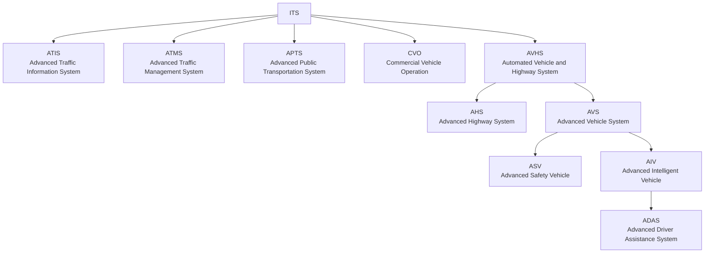

*Figure 5. Early technical classification of ITS*

> **Definition:** An **advanced driver assistance system (ADAS)** is a system that assists the driver's perception, judgment, and operation, such as adaptive cruise control, lane departure warning, and emergency braking.

### 1.7 Cooperative Intelligent Transport Systems (C-ITS)

In the 2010s, ITS evolved into C-ITS. Figure 6 compares the two concepts.

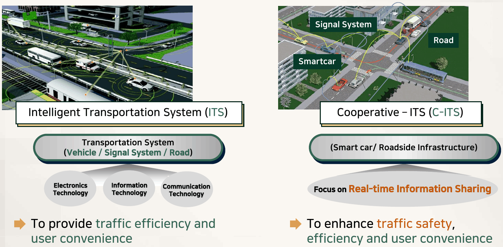

*Figure 6. Comparison of the concepts of ITS and C-ITS*

| Item | ITS | C-ITS |
|:-----|:-----|:-----|
| Target | Transportation system (vehicles, signal systems, roads) | Smart cars and roadside infrastructure |
| Core technology | Electronics, information, and communication technologies | Real-time information sharing |
| Goal | Traffic efficiency and user convenience | Traffic safety, efficiency, and user convenience |
| Information flow | Mostly collected by infrastructure, processed at a center, and provided one way through signs or navigation | Exchanged immediately in both directions between vehicles and between vehicles and infrastructure |

*Table 7. Comparison of ITS and C-ITS*

Conventional ITS collects and processes traffic information with detectors and centers and provides it on a scale of minutes, so it helps efficiency and convenience but is hard to use for accident prevention, which requires a response within seconds. C-ITS makes safety services possible because vehicles and infrastructure exchange information in real time.

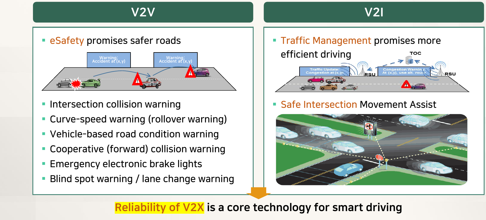

*Figure 7. C-ITS services based on V2V and V2I*

The left side of Figure 7 shows V2V services: a vehicle involved in an accident ahead sends a "Warning: Accident at (x, y)" message to the vehicle behind, which relays it to the next vehicle, making the road safer (eSafety). Examples of V2V services are intersection collision warning, curve speed warning (rollover warning), vehicle-based road condition warning, cooperative forward collision warning, emergency electronic brake lights, and blind spot and lane change warning. The right side shows V2I services: RSUs upload congestion information from vehicles ("Traffic Update: Congestion at (x, y)") to a traffic operation center (TOC), which sends congestion warnings and detours back through other RSUs to support more efficient driving (traffic management). At intersections, the infrastructure gathers the movements of approaching vehicles and announces collision risks, providing safe intersection movement assist. All of these services work only when V2X communication is reliable, so the reliability of V2X is a core technology for smart driving.

### 1.8 The Need for V2X from a Safety Perspective

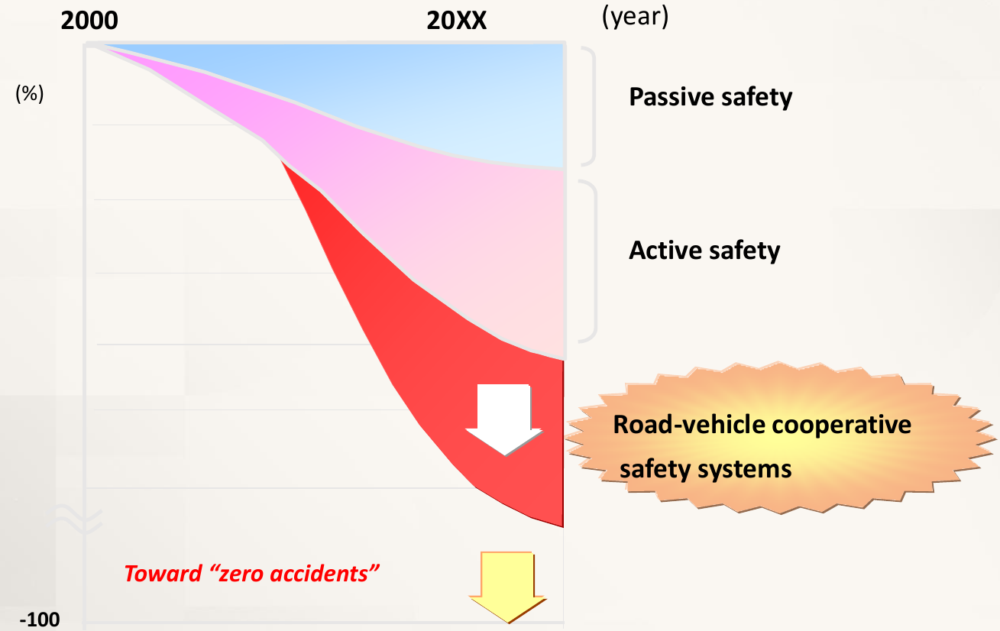

*Figure 8. Concept of the reduction in traffic accidents as safety technologies advance*

Figure 8, taken from an automaker's data, stacks the percentage reduction in traffic accidents by safety technology from 2000 to a future year (20XX). The top band is the contribution of **passive safety**, technologies such as airbags and seat belts that reduce harm after a crash has occurred. The middle band is the contribution of **active safety**, vehicle-only technologies such as ABS, electronic stability control, and emergency braking that prevent the crash itself. These two alone cannot reach a reduction of -100%, and what fills the remainder (the red band) is **road-vehicle cooperative safety systems**, that is, V2X-based safety systems. The lesson of the figure is that approaching the goal of "Toward zero accidents" at the bottom of the graph requires learning through communication about hazards that a vehicle cannot see by itself.

From this perspective, Japan has run the **Advanced Safety Vehicle (ASV)** project in five-year phases since 1991, led by the Ministry of Transport (the Ministry of Land, Infrastructure, Transport and Tourism since 2001) [11].

| Phase | Period | Content |
|:-----|:-----|:-----|
| Phase 1 | 1991-1995 | Development of basic safety technologies and verification of feasibility |
| Phase 2 | 1996-2000 | Development of driver assistance systems and vehicle-to-vehicle communication technology |
| Phase 3 | 2001-2005 | Sophisticated collision prevention systems based on V2V and V2I cooperative technologies |
| Phase 4 | 2006-2010 | Advanced vehicle communication and real-time information exchange technologies |
| Phase 5 | 2011-2015 | Early experiments in automated driving technology and groundwork for full automation |
| Phase 6 | 2016-2020 | Research to bring automated driving and advanced communication technologies to commercialization |
| Phase 7 | 2021- | Practical use of automated driving and development of sustainable transportation systems, with particular emphasis on integrating Level 4 and higher automated driving with road infrastructure |

*Table 8. Phases of the Japanese ASV project*

The brochure of each phase expresses the aim of its period in a slogan. Phase 4 put forward "ASV, the Bridge to an Accident-free Society," and Phase 5 put forward "Realization of Secure and Safe Traffic Society by Harmonizing Humans and Vehicles."

### 1.9 The Need for Connected Automated Driving

Combining wireless communication with automated vehicles yields reliable wide-area information both within and beyond the line of sight of the sensors, raises object recognition rates by fusing data that complement existing sensors, provides convenience and safety services to occupants, and widens the ripple effects into related industries such as automobiles, the Internet, communications, and infrastructure. These four effects and the distinction between safety services (latency-oriented) and convenience services (throughput-oriented) were covered in Week 1, Section 3.4, and are revisited with examples in Section 2.8.

### 1.10 ISO Truck Platooning Systems

> **Definition:** **Platooning** is a technology in which several vehicles, linked by vehicle-to-vehicle communication, drive as one group while keeping short gaps. The following vehicles enter the aerodynamic shadow of the vehicle ahead to save fuel, road capacity increases, and driver fatigue decreases.

WG14 under the ISO technical committee for intelligent transport systems (ISO TC204) standardized truck platooning systems (TPS), and the result is ISO 4272 [12]. Figure 9 shows the overall architecture of a TPS.

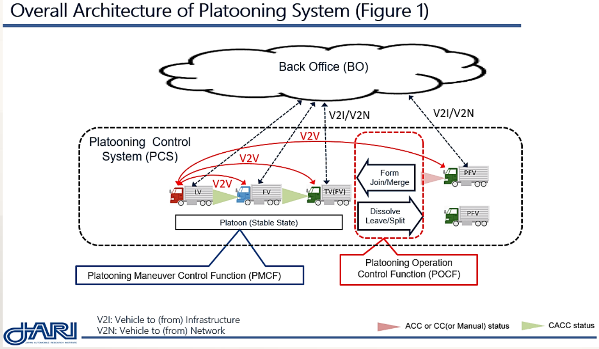

*Figure 9. Overall architecture of a truck platooning system*

The whole dashed box in Figure 9 is the **platooning control system (PCS)**. The platoon in stable state on the left consists of a leading vehicle (LV), following vehicles (FV), and a trailing vehicle (TV), connected to each other by V2V, shown as red arrows. The green triangles between vehicles denote the CACC status, and the pink triangles denote ACC, cruise control (CC), or manual driving. The potential following vehicles (PFV) on the right enter the platoon by forming, joining, or merging (form/join/merge) or leave it by dissolving, leaving, or splitting (dissolve/leave/split). The **back office (BO)** at the top is a control server that communicates with the vehicles over V2I or V2N. Control in the stable state is handled by the **platooning maneuver control function (PMCF)**, and transitions between states by the **platooning operation control function (POCF)**.

| Abbr. | Term | Definition |
|:-----|:-----|:-----|
| LV | Leading vehicle | The head vehicle of the platoon. The LV driver manages and supervises FVs and PFVs through V2V and, by their own judgment, forms the platoon, lets vehicles join or merge, and lets them leave, splits, or dissolves the platoon. The LV may also communicate with the BO to support the communication for POCF. |
| FV | Following vehicle | A vehicle running behind the LV and connected by V2V. Its longitudinal motion is controlled by CACC, and lateral control such as lane keeping assistance (LKAS) or partially automated lane change (PALS) may also be applied. It may also communicate with the BO for POCF communication. |
| TV | Trailing vehicle | The last vehicle among the FVs. |
| PV | Platoon vehicle | The generic term for the LV and FVs (including the TV). |
| OV | Other vehicle | A vehicle that does not participate in the platoon but may affect it, for example by emergency braking or cutting in. |
| PLV | Potential leading vehicle | A vehicle that is not currently leading a platoon but may do so, or one that has left the platoon as the LV by leaving or dissolving. It may become the LV of a platoon. |
| PFV | Potential following vehicle | A vehicle that is not currently in a platoon but may be, or one that has left the platoon as an FV by leaving or dissolving. It becomes an FV when it joins or forms a platoon. |
| PPV | Potential platoon vehicle | The generic term for PLVs and PFVs, that is, a vehicle that may be included in a platoon. Once in a platoon, a PPV becomes either the LV or an FV (TV). |

*Table 9. Vehicle terms related to platooning*

These terms follow the European SARTRE project, and the European ENSEMBLE project uses "candidate" instead of "potential."

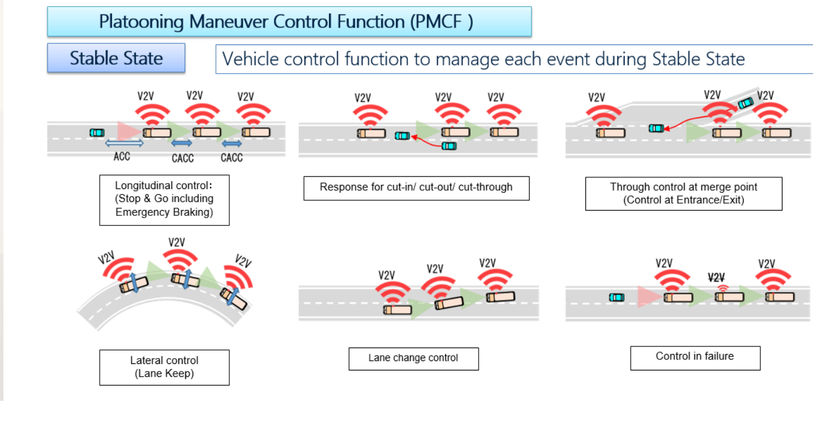

*Figure 10. Vehicle control events handled by the PMCF in the stable state*

The PMCF is the vehicle control function that manages each event occurring in a platoon in the stable state. The six events in Figure 10 are as follows.

1. **Longitudinal control:** Keeps the gaps in stop and go, including emergency braking. The gap to an ordinary vehicle ahead of the platoon is kept with ACC, and gaps within the platoon with CACC.
2. **Response to cut-ins:** Widens or restores gaps when another vehicle cuts into the platoon (cut-in), leaves it (cut-out), or passes across it (cut-through).
3. **Through control at merge points:** Controls the platoon when it passes points where other vehicles merge, such as entrance and exit ramps.
4. **Lateral control:** Keeps the lane.
5. **Lane change control:** The platoon changes lanes.
6. **Control in failure:** Switches to a safe state when communication or sensors fail.

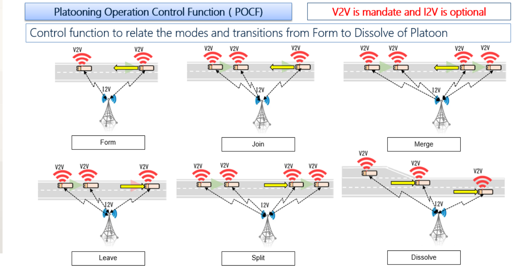

*Figure 11. Transitions from forming to dissolving a platoon handled by the POCF*

The POCF is the control function that manages the modes and transitions of a platoon from forming to dissolving. The six transitions in Figure 11 are form (two vehicles create a new platoon), join (one vehicle attaches to the rear of an existing platoon), merge (two platoons become one), leave (one vehicle exits the platoon), split (one platoon divides into two), and dissolve (the whole platoon is released). In this function, **V2V is mandatory and I2V is optional**, because platoon vehicles must communicate directly with each other, whereas the infrastructure only provides additional information such as merge coordination.

> **Note:** The reason V2V is mandatory in platooning lies in **string stability**. With radar-only ACC, each vehicle reacts only after observing the change in distance to the vehicle ahead, so reaction delays accumulate and a small speed change of the lead vehicle grows toward the rear of the string. CACC receives the acceleration of the vehicle ahead directly through communication, which suppresses this amplification and allows shorter time gaps for the same stability [13].

### 1.11 Platooning Cases

**Volvo SARTRE.** SARTRE (Safe Road Trains for the Environment) was a platooning project carried out as a European Union research program with the participation of Volvo [14]. Behind a lead vehicle driven by a professional driver, several vehicles connected by V2V steer, accelerate, and decelerate automatically, and the drivers of the following vehicles can take their hands off the wheel and do other things. The project studied the concept of operating mixed platoons of cars and trucks on ordinary motorways without dedicated road infrastructure, led by a heavy vehicle such as a truck or bus driven by a professional driver.

**5G truck platooning in Japan.** As one of its fiscal year 2018 (Heisei 30) comprehensive 5G demonstration trials, Japan carried out a trial applying 5G mobile communication to truck platooning. Platooning requires control information to be exchanged between vehicles with short latency, so it is a representative application for verifying the low latency of 5G.

### 1.12 ADAS Packages of Major Automakers

Major automakers sell sensors and ADAS functions bundled as packages.

| Item | BMW Driver Assistance Plus | Mercedes-Benz Driver Assistance Package | Toyota Safety Sense 3.0 |
|:-----|:-----|:-----|:-----|
| Sensors | Ultrasonic, long range radar (LRR), short range radar (SRR), front and rear cameras | Ultrasonic, LRR, SRR, front and rear cameras, V2X | Ultrasonic, LRR, SRR, front and rear cameras, V2X |
| Functions | Highway Assistant, Lane Change Assistant, Active Blind Spot Detection, Forward Collision Mitigation, Lane Keeping Assistant, High Beam Assistant, Emergency Stop Assistant, Backup Assistant, Maneuver Assistant, Remote Control Parking, Active Park Distance Control | Intelligent Drive Next Level, Active Brake Assist, Evasive Steering Assist, Remote Parking Pilot, Car-to-X Communication, Digital Car Key, PRE-SAFE Impulse Side, PRE-SAFE Sound | Pre-Collision System with Pedestrian Detection, Dynamic Radar Cruise Control, Lane Departure Alert with Steering Assist, Lane Tracing Assist, Road Sign Assist, Automatic High Beams, Proactive Driving Assist, Safety Connect |

*Table 10. ADAS packages of major automakers*

In Table 10, Mercedes-Benz and Toyota include V2X in their sensor configurations. Mercedes-Benz Car-to-X Communication receives hazard information from other vehicles and infrastructure and alerts the driver.

> **Note:** The Toyota column of Table 10 follows the lecture material. According to Toyota, Toyota Safety Sense detects objects and lane markers with a forward-facing camera and a forward-facing radar, and the Proactive Driving Assist of TSS 3.0 also uses this front camera and radar [15]. The ultrasonic sensors, rear camera, and V2X in the table are not presented as components of TSS 3.0.

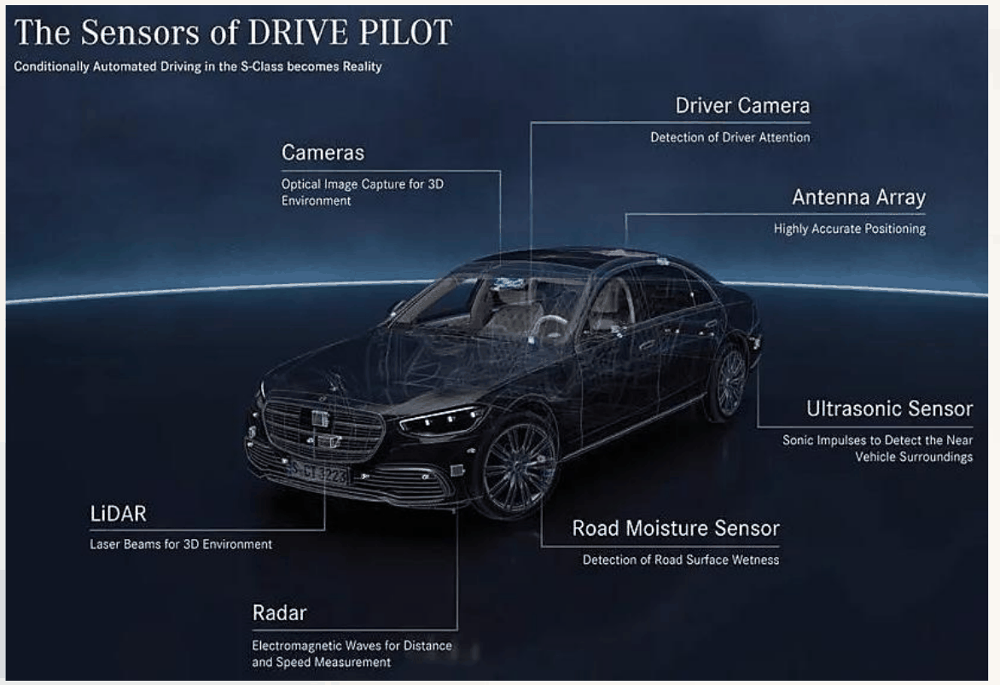

*Figure 12. Sensor configuration of Mercedes-Benz DRIVE PILOT*

Figure 12 shows the DRIVE PILOT sensor configuration of the Mercedes-Benz S-Class. It consists of cameras that capture images for a 3D environment, a lidar that measures the 3D environment with laser beams, radars that measure distance and speed with electromagnetic waves, ultrasonic sensors that detect the near surroundings with sonic impulses, a driver camera that detects driver attention, an antenna array for highly accurate positioning, and a road moisture sensor that detects road surface wetness. In December 2021, DRIVE PILOT received approval in Germany as a Level 3 conditionally automated system under UN Regulation No. 157, and it initially took over the driving task in congested motorway traffic at up to 60 km/h [16], [17].

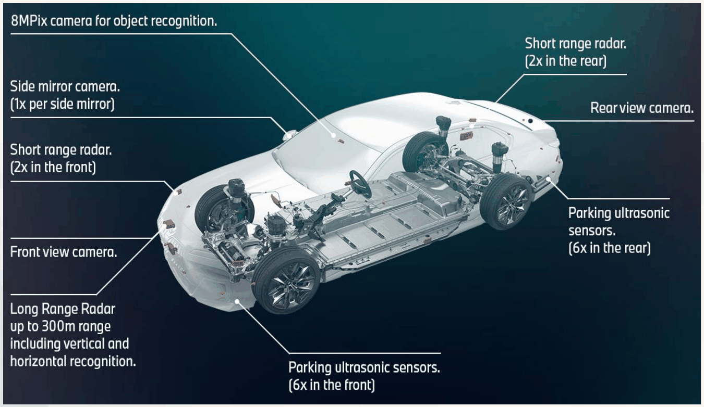

*Figure 13. ADAS sensor layout of a BMW vehicle*

The BMW vehicle in Figure 13 has an 8-megapixel camera for object recognition, one camera per side mirror, two short range radars each at the front and rear, a front view camera and a rear view camera, a long range radar with a range of up to 300 m including vertical and horizontal recognition, and six parking ultrasonic sensors each at the front and rear.

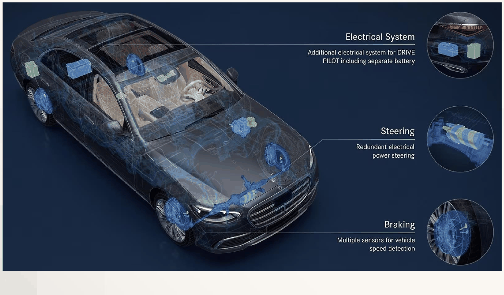

*Figure 14. Redundant electrical system, steering, and braking of DRIVE PILOT*

At Level 3 and above, while the system performs the driving task, the vehicle must keep operating safely until the driver takes over even if a component fails. Therefore, as Figure 14 shows, DRIVE PILOT has an additional electrical system with a separate battery, redundant electric power steering, and a braking system with multiple sensors for vehicle speed detection. A design that provides two or more copies of the same function so that the function is maintained even when one component fails is called **redundancy**.

### 1.13 Component Configuration by Automation Level

The higher the automation level, the more sensors of more kinds a vehicle carries. KATECH forecast the component configuration by level as follows [10].

| Sensor | Level 1 | Level 2 | Level 3 | Level 4 | Level 5 |
|:-----|--:|--:|--:|--:|--:|
| Ultrasonic | 4 | 6 | 6 | 6 | 10 |
| Long range radar (LRR) | 1 | 1 | 1 | 2 | 2 |
| Short range radar (SRR) | | 1 | 4 | 4 | 4 |
| Front camera, front/rear camera | 1 (front) | 2 | 2 | 2 | 2 |
| Surround camera | | 4 | 4 | 6 | 6 |
| Driver camera | | | 1 | 1 | 1 |
| Infrared (IR) camera | | | | | 1 |
| Lidar | | | 1 | 2 | 4 |
| V2X | | | 1 | 1 | 1 |
| Dead reckoning | | | 1 | 1 | 1 |
| GNSS (GPS) | | 1 | 1 | 1 | 1 |

*Table 11. Forecast sensor configuration by automation level*

> **Definition:** **Dead reckoning** estimates the current position by integrating travel distance and direction from wheel speeds and an inertial measurement unit (IMU). It can keep estimating the position in tunnels where GNSS signals are lost.

> **Definition:** **GNSS (global navigation satellite system)** is the general term for satellite navigation systems, including GPS.

One V2X unit is included from Level 3 on, and the numbers of lidars and surround cameras grow with the level. The representative functions by level are as follows.

| Level | Representative functions |
|:-----|:-----|
| Level 1 | LKAS (lane keeping assistance systems), ACC (adaptive cruise control systems), CACC (cooperative ACC) |
| Level 2 | PALS (partially automated lane change systems), PADS (partially automated in-lane driving systems: traffic jam assist TJA, highway driving assist HDA), PAPS (partially automated parking systems) |
| Level 3 | MCS (motorway chauffeur systems), Drive Pilot |
| Level 4 | AVPS (automated valet parking systems), LSAD (low-speed automated driving), M-ADS (ADS for motorways), AVDS (valet driving) |
| Level 5 | Full automation |

*Table 12. Representative functions by automation level*

### 1.14 Remote Driving

> **Definition:** **Remote driving** is a technology in which a remote driver outside the vehicle receives the vehicle's video and sensor information over a communication network and sends steering and acceleration commands to drive the vehicle. It is also used as a means for a human to take over remotely in situations that the automated driving system cannot handle.

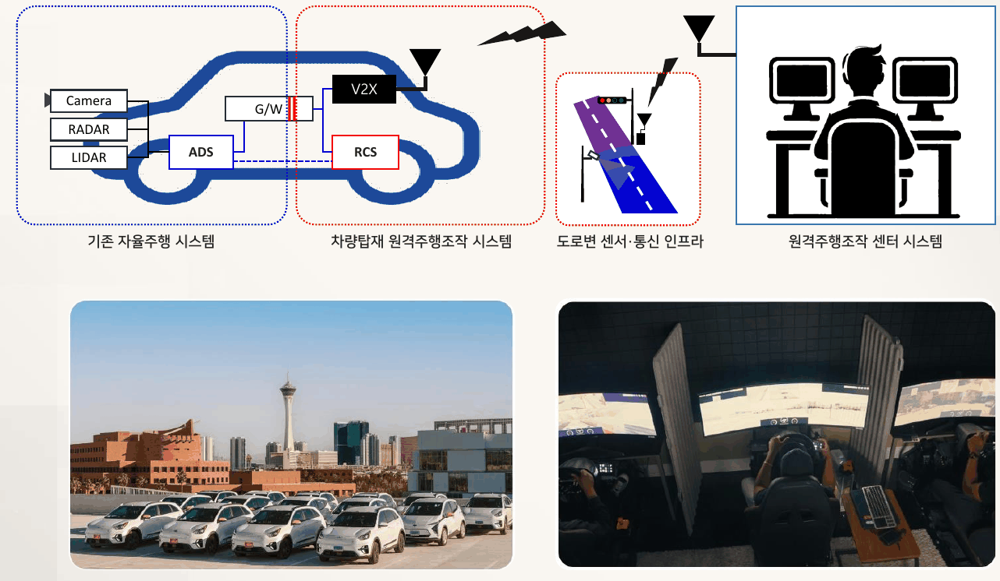

*Figure 15. Composition of a remote driving system, and the vehicles and remote driving station of a remote driving service*

The top of Figure 15 shows the four components of a remote driving system.

1. **Existing automated driving system:** The automated driving system (ADS) processes information from cameras, radars, and lidars.
2. **Vehicle-mounted remote driving control system:** A remote control system (RCS) connected to the ADS through a gateway (G/W) communicates with the outside of the vehicle through a V2X communication module.
3. **Roadside sensors and communication infrastructure:** Roadside sensors complement the view of the vehicle's surroundings, and the communication infrastructure connects the vehicle and the center.
4. **Remote driving control center system:** A remote driver watches the vehicle's situation on multiple screens and sends control commands.

The photos at the bottom show the vehicles and a remote driving station of Halo, which operated a service in Las Vegas, USA, delivering vehicles to customers by remote driving.

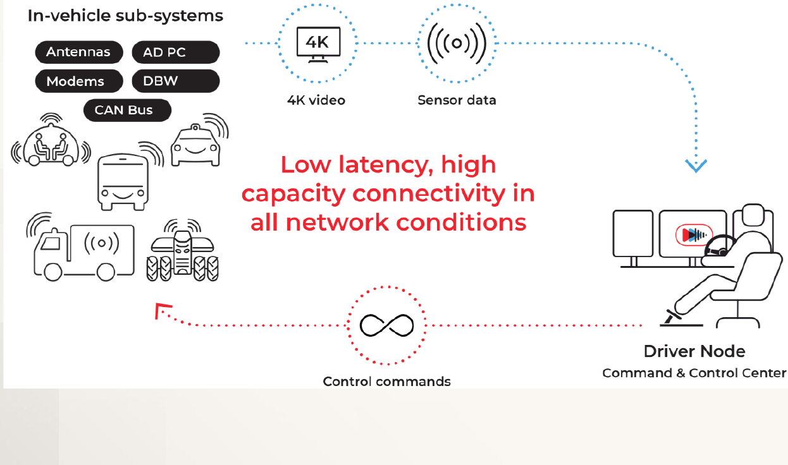

*Figure 16. Data flow between vehicle subsystems and the control center for remote driving*

Figure 16 is a concept diagram from DriveU, a vendor of communication platforms for remote driving. Vehicles such as robots, buses, cars, trucks, and delivery robots contain antennas, an automated driving computer (AD PC), modems, drive-by-wire actuators (DBW), and a CAN bus. The vehicle uploads 4K video and sensor data to the driver node in the command and control center, and the driver node sends control commands down to the vehicle. The uplink carries large volumes and the downlink is latency-critical, so a connection with low latency and high capacity is needed in all network conditions.

> **Note:** 3GPP specifies the communication performance required for remote driving as a maximum end-to-end latency of 5 ms, a reliability of 99.999%, and data rates of 25 Mbps from the vehicle to the server and 1 Mbps from the server to the vehicle [18]. The larger data rate in the direction that uploads video is consistent with the data flow in Figure 16.

Remote driving services are implemented in stages according to the readiness of technology and infrastructure.

| Stage | Service | Description |
|:-----|:-----|:-----|
| Implementable now | Short-range valet parking, valet driving | Remote driving over short, controlled routes such as from a building entrance to a parking lot. |
| Implementable by region | Outskirts parking, technical supervisor | Moving vehicles remotely to parking lots on the outskirts of the city, and a technical supervisor monitoring several automated vehicles remotely. |
| Requires wider infrastructure | Remote chauffeur service, rental car delivery | Remote driving over long stretches of ordinary roads, which requires communication infrastructure over wide areas. |

*Table 13. Implementation stages of remote driving services*

The legal responsibility for remote driving and remote monitoring is covered in Section 3.10.

---

<br>

## 2. Applications and Characteristics of Connected Automated Driving

### 2.1 Telematics

> **Definition:** **Telematics** is a service that combines information and communication technology with vehicle technology to provide drivers and passengers with safe driving, emergency rescue, traffic guidance, and entertainment.

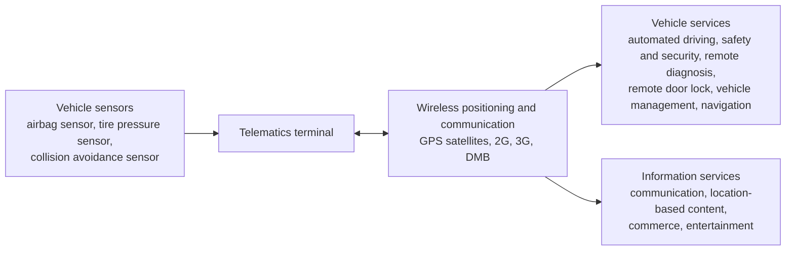

*Figure 17. Composition of telematics services*

As Figure 17 shows, the telematics terminal collects vehicle sensor information, connects to the outside through wireless positioning (GPS), mobile communication (2G, 3G), and digital multimedia broadcasting (DMB), and provides vehicle services and information services. For example, when an airbag deploys, the terminal automatically reports the accident along with the position. Representative commercial services include Hyundai BlueLink and Mozen, Kia UVO, Ford SYNC, and GM OnStar.

### 2.2 Connected Cars and Smart Cars

Connected cars and smart cars are concepts that arose from combining two different domains.

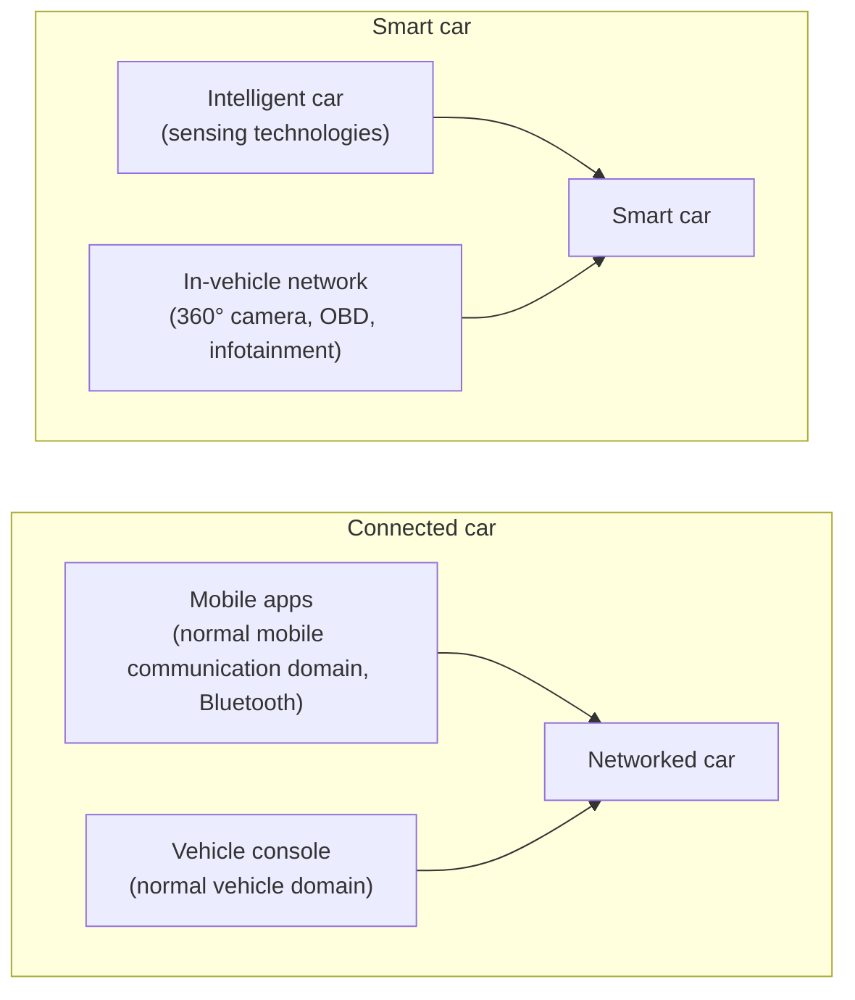

*Figure 18. Composition of connected cars and smart cars*

The **connected car** arose where the normal mobile communication domain, such as smartphones, overlaps the normal vehicle domain. Mobile apps and the vehicle console are linked through Bluetooth or similar means to form a networked car. MirrorLink, a representative connectivity standard, was developed by the Car Connectivity Consortium and allowed any MirrorLink-enabled smartphone to connect to any MirrorLink-enabled vehicle regardless of manufacturer. The **smart car** combines an intelligent car equipped with sensing technologies and an in-vehicle network that links a 360° camera, on-board diagnostics (OBD), and infotainment. The three goals of the smart car are safe and convenient driving, eco-driving, and autonomous driving.

### 2.3 Classification of Connected Car Services

The present and future of connected car services as summarized by Frost & Sullivan in 2020 (infotainment, smartphone integration, electric vehicle services, navigation, telematics) were covered in Week 1, Table 2. In its 2019 report, Frost & Sullivan divided the connected services that automakers can sell into seven areas [19].

| Area | Example services |
|:-----|:-----|
| Infotainment and telematics | In-vehicle Wi-Fi, media packages, productivity suite, concierge, smartphone interfacing and entertainment apps, personal digital assistants, remote diagnostics and prognostics, on-demand mechanic, gaming |
| ADAS and autonomous driving | Hill and highway assist, adaptive and predictive cruise control, autonomous valet parking, autopilot, traffic jam and intersection assist, severe climate package, driver and chauffeur monitoring, remote vehicle operation, platooning for businesses |
| Location-based services | Fueling, tolling, parking, charging, on-demand repair, geofenced points of interest, mapping |
| Mobility services | Journey planning, last-mile mobility, e-hailing, public transport schedules and tickets, car rental and car sharing in OEM programs |
| Powertrain performance and EV | Drive mode updates through steering, suspension, and transmission, off-road package, acceleration (horsepower) boost, range extension, switching between automatic and manual transmission, raising speed limits (Germany), supercharging |
| Value adds | On-demand insurance, two free feature upgrades per year |
| Smart interiors and exteriors | Personalized interiors (lighting, scent, climate), projectors and on-demand screens, bring-your-own-device ports, skins for the user interface, seat recline and movie mode, premium audio, automatic adjustment of lights and wipers, panoramic roof, additional storage, trunk deliveries |

*Table 14. Seven areas of connected services that automakers can sell*

The same report grouped connected car services again into four broad categories [19].

| Category | Example services |
|:-----|:-----|
| Connected services | AI assistants, safety and security, driver monitoring systems (DMS), remote diagnostics and prognostics, smartphone interfacing (CarPlay, Android Auto), infotainment, V2X and V2I communication |
| Autonomous driving | Fleet management, robotaxis, ADAS, intelligent cockpit assistance, autonomous parking, hill assist, ACC, emergency stop |
| Data monetization | Usage-based insurance (UBI), predictive maintenance, first notice of loss (FNOL), in-vehicle marketplace, e-mobility, targeted promotions, anonymized data sharing |
| Aftermarket and supply chain | Part authentication, asset and vehicle tracking, time stamping, smart contracts, unified data aggregation, predictive maintenance by dealerships |

*Table 15. The four major categories of connected car services*

> **Definition:** **Usage-based insurance (UBI)** sets premiums from actual driving data such as distance driven and the number of hard brakings.

> **Definition:** **First notice of loss (FNOL)** is the procedure of first notifying the insurer after an accident, which a connected car can perform automatically by detecting the crash.

### 2.4 Connected Car HMI

> **Definition:** A **human-machine interface (HMI)** is the point of contact through which people and machines exchange information. In a vehicle, displays, buttons, touchscreens, voice recognition, and head-up displays are HMIs.

In 2020, Frost & Sullivan surveyed the HMI adoption of 15 automakers selling in Europe (Audi, BMW, DS, Fiat, Honda, Hyundai, JLR, Kia, Mercedes-Benz, Nissan, Porsche, PSA, Renault, Toyota, Volkswagen) [20].

| HMI element | Number of adopters (out of 15) | Adopters or non-adopters |
|:-----|--:|:-----|
| 3D maps, display, instrument cluster, touchscreen, steering wheel buttons, onboard voice recognition | 15 | All automakers |
| Head unit buttons | 14 | All except Audi |
| Rotary dials | 13 | All except Audi and Mercedes-Benz |
| Offboard (server-based) voice recognition | 11 | All except DS, PSA, Renault, and Toyota |
| Digital assistant | 11 | All except Fiat, Nissan, Renault, and Toyota |
| Head-up display (HUD) | 9 | Audi, BMW, Hyundai, JLR, Kia, Mercedes-Benz, Renault, Toyota, Volkswagen |
| Central controller | 7 | Audi, BMW, Fiat, Mercedes-Benz, Nissan, Renault, Volkswagen |
| Handwriting recognition | 6 | Audi, BMW, JLR, Mercedes-Benz, Porsche, Volkswagen |
| Twin screen | 4 | Audi, Honda, JLR, Porsche |
| Touchpad | 2 | BMW, Mercedes-Benz |
| Gesture recognition | 2 | BMW, Volkswagen |

*Table 16. HMI adoption of 15 automakers in Europe (2020)*

In Table 16, displays, touchscreens, and voice recognition are already standard at every automaker, and head-up displays (9 automakers) and digital assistants (11 automakers) are also adopted by more than half. Touchpads and gestures are still used only by a few automakers.

The more information a connected car provides, the more important HMI design becomes.

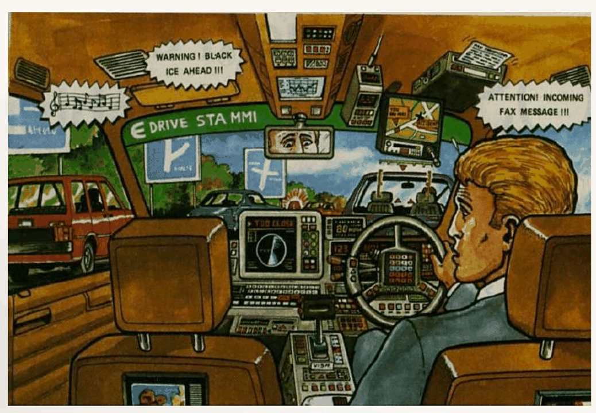

*Figure 19. Satirical illustration of a driver distracted by information overload*

Figure 19 is an illustration that the European AIDE (Adaptive Integrated Driver-vehicle InterfacE) project presented as a situation to avoid [21]. Numerous screens and devices in front of the driver display "WARNING! BLACK ICE AHEAD!!!" and "ATTENTION! INCOMING FAX MESSAGE!!!" at the same time, while music plays as well. When life-critical warnings and trivial notifications pour in with the same weight, the driver misses the warning that matters. AIDE tried to solve this problem through **HMI integration**: active safety applications such as ACC and collision warning, infotainment applications such as navigation and media players, off-board devices such as personal portable devices, and wireless online services are tied into a single HMI management scheme that adjusts the priority and timing of information according to the driver's workload and situation.

The Korean Industrial Standard KS C 5077 (Automotive display devices: Requirements for driver interface) specifies, by characteristic of the information, the forms in which information may be provided on a display while driving [22].

| No. | Characteristic | Information type | Text, symbols | Still images | Sound | Moving images | Remarks |
|:-----|:-----|:-----|:--:|:--:|:--:|:--:|:-----|
| 1 | Urgency | Emergency information (rescue) | ○ | ○ | ○ | X | Hospital, fire station, police station, and similar information |
| 1 | Urgency | Emergency information (emergency) | ○ | ○ | ○ | ○ | National emergencies, disasters, and similar guidance |
| 2 | Urgency | Vehicle and driving hazard warnings | ○ | ○ | ○ | X | Presented with top priority when overlapping other information |
| 3 | Constancy | Driving information | ○ | ○ | ○ | ○ | Distance driven, driving time, driving speed, and similar |
| 4 | Constancy | Route guidance | ○ | ○ | ○ | ○ | Excluding addresses and phone numbers |
| 5 | Timeliness | Traffic information | ○ | ○ | ○ | ○ | Urgent traffic information may be provided while driving |
| 6 | Timeliness | Weather information (general) | ○ | ○ | ○ | X | Including symbols |
| 6 | Timeliness | Weather information (urgent) | ○ | ○ | ○ | ○ | Urgent weather information may be provided while driving |
| 7 | Timeliness | Warning against operating the display while driving | ○ | ○ | ○ | X | |
| 8 | Timeliness | Amenities | ○ | ○ | ○ | X | Restaurants, hotels, parking lots, gas stations, and similar |
| 9 | Supplementary | News | X | X | ○ | X | Excluding emergency information |
| 10 | Supplementary | Entertainment information | X | X | X | X | Movies, dramas, and similar |
| 11 | Supplementary | Playback of photo or picture files | ○ | ○ | - | - | |
| 12 | Supplementary | Music | ○ | - | ○ | - | |
| 13 | Supplementary | Radio | ○ | - | ○ | - | Including entertainment information and news |
| 14 | Supplementary | External vehicle video | - | - | - | ○ | Information that helps the driver see the left, right, front, or rear of the vehicle while driving |
| 15 | Supplementary | Playback of video files | ○ | - | - | X | |
| 16 | Supplementary | Advertising information | ○ | ○ | ○ | X | |

*Table 17. Criteria of KS C 5077 for providing information while driving (○ allowed, X not allowed, - not applicable)*

The principle of Table 17 is to restrict strictly the moving images that hold the driver's gaze for long. Moving images are allowed only for emergency information (national emergencies and disaster guidance), driving information and route guidance, traffic information, urgent weather information, and external vehicle video that helps driving, and entertainment information may not be provided in any form while driving. News may only be heard as sound.

### 2.5 Connected Car Security

When a vehicle is connected to the outside, the paths through which hackers can reach it multiply as well.

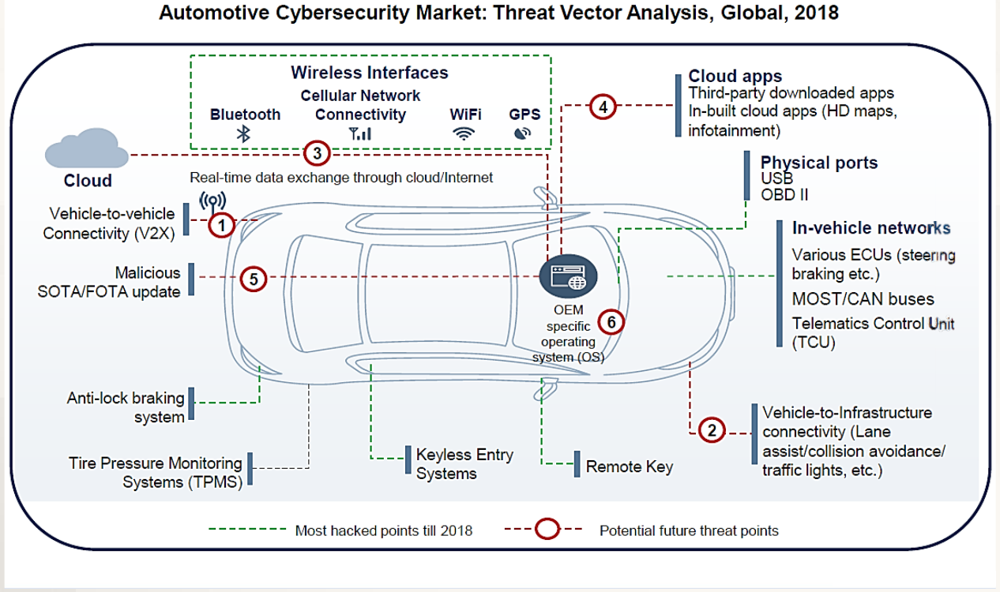

*Figure 20. Hacked points and potential future threat points of a connected car*

Figure 20 is Frost & Sullivan's 2018 analysis of automotive cybersecurity threats [19]. The green dashed lines mark the points hacked most often up to 2018, and the numbered red circles mark points that will become threats.

| Category | Points |
|:-----|:-----|
| Points hacked most often up to 2018 | Wireless interfaces (Bluetooth, cellular, Wi-Fi, GPS), physical ports (USB, OBD-II), in-vehicle networks (ECUs such as steering and braking, MOST and CAN buses, telematics control unit TCU), ABS, tire pressure monitoring systems (TPMS), keyless entry systems, remote key |
| Potential future threat points | ① V2V (V2X) connectivity, ② V2I connectivity (lane assist, collision avoidance, traffic lights), ③ real-time data exchange through the cloud and Internet, ④ cloud apps (third-party apps, built-in cloud apps such as HD maps and infotainment), ⑤ malicious over-the-air software and firmware updates (SOTA, FOTA), ⑥ OEM-specific operating systems |

*Table 18. Hacked points and potential threat points of a connected car*

CAN, the in-vehicle network, has no sender authentication in its messages (Weeks 3 and 9), so an attacker who breaks into one ECU from outside can send messages that deceive other ECUs. In V2X, a fake BSM or fake signal information can lead to accidents, so a security scheme that attaches a certificate-based digital signature to every message (IEEE 1609.2) is used [23]. The place of IEEE 1609.2 in the WAVE architecture is covered in Week 13 Section 3.2, and the C-ITS certificate management system and vehicle cybersecurity regulations in Week 14 Sections 3.3 and 3.5.

### 2.6 Classification of Vehicle Safety Systems and Autonomous Shuttles

In its 2014 analysis of the European ADAS market, Frost & Sullivan classified vehicle safety systems as in Figure 21 [24].

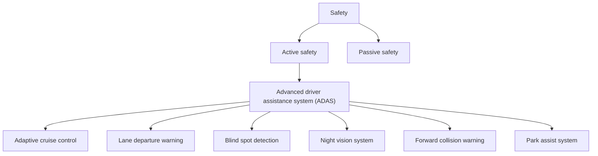

*Figure 21. Classification of vehicle safety systems*

Autonomous shuttles are a field where connected automated driving is introduced early as a commercial service. Frost & Sullivan defined the 2019 autonomous shuttle market as in Figure 22 [25].

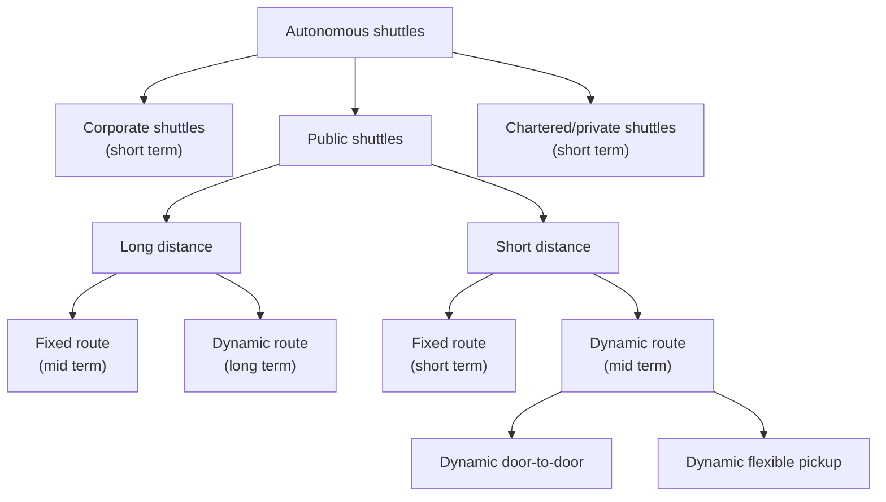

*Figure 22. Classification of the autonomous shuttle market*

The parentheses in Figure 22 give the period in which autonomous shuttles of that type were expected to appear. Types with short, fixed routes, such as corporate shuttles, chartered shuttles, and short-distance fixed routes, were expected in the short term, while dynamic routes that change with passenger requests and long-distance routes were expected in the mid to long term. The simpler and more predictable the operating environment, the easier it is to apply automated driving first.

### 2.7 Autonomous Driving Based on Onboard Sensors

Automated driving that perceives the surroundings with only the vehicle's own sensors, without communication, is called **onboard sensor-based automated driving**. Representative cases in Korea and abroad are as follows.

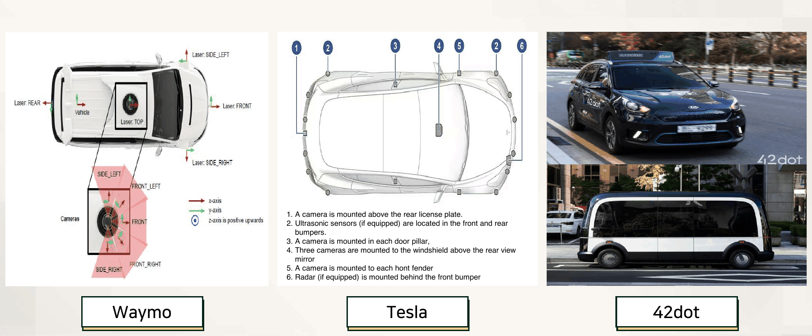

*Figure 23. Onboard sensor-based automated vehicles of Waymo, Tesla, and 42dot*

| Company | Main sensors | Service |
|:-----|:-----|:-----|
| Waymo | Lidar, camera, radar | Provides robotaxi services in parts of the United States with the Waymo Driver, which integrates the three sensors. |
| Tesla | Camera, ultrasonic sensor | Released FSD Beta 11, which uses cameras and ultrasonic sensors, to provide semi-automated driving services. The direction is to develop an FSD that uses only cameras, replacing the ultrasonic sensors. |
| 42dot | Camera, radar | Provides a taxi service around Sangam and a shuttle service around Cheonggyecheon in Seoul. |

*Table 19. Sensor configurations and services of Waymo, Tesla, and 42dot*

The Tesla sensor layout in the middle of Figure 23 is marked with numbers: ① a camera above the rear license plate, ② ultrasonic sensors in the front and rear bumpers (if equipped), ③ a camera in each door pillar, ④ three cameras on the windshield above the rear view mirror, ⑤ a camera on each front fender, and ⑥ a radar behind the front bumper (if equipped). This layout applies to vehicles equipped with radar and ultrasonic sensors; Tesla removed radar from new vehicles from 2021 and ultrasonic sensors from October 2022, moving to camera-only Tesla Vision [26]. 42dot on the right is a software company of Hyundai Motor Group that operated a taxi based on the Kia Niro and a small shuttle. The sensor configurations of Waymo and Tesla were compared in detail in Week 3, Section 4.

### 2.8 Connected Automated Driving Services: Safety and Convenience

Week 1, Section 3.4 divided connected automated driving services into safety services, where latency matters (long-range perception sharing, C-ITS), and convenience services, where throughput matters (infotainment, support for automated driving services). Safety services must deliver small data within a fixed time (e.g., 10 ms), and convenience services must deliver large data such as video and Internet traffic quickly.

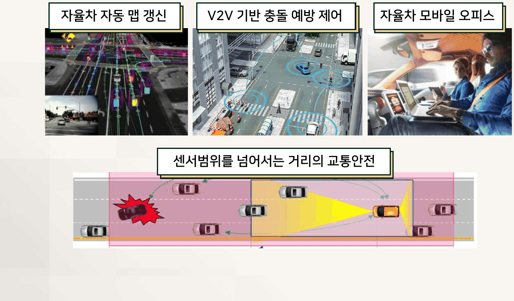

*Figure 24. Examples of connected automated driving services and traffic safety beyond the sensor range*

The three examples at the top of Figure 24 are automatic map updates for automated vehicles (convenience), V2V-based collision prevention control (safety), and a mobile office inside an automated vehicle (convenience). In the bottom figure, the sensor range of the ego vehicle (the orange vehicle on the right, yellow fan) is blocked by the vehicles ahead and does not reach the crashed vehicle far ahead. By receiving the warning that the crashed vehicle sends over V2V, the ego vehicle can prepare in advance for a hazard beyond its sensor range.

### 2.9 Sensor-Based and V2X-Based Object Recognition

**Sensor-based object recognition** detects surrounding objects directly with cameras, radars, lidars, and ultrasonic sensors.

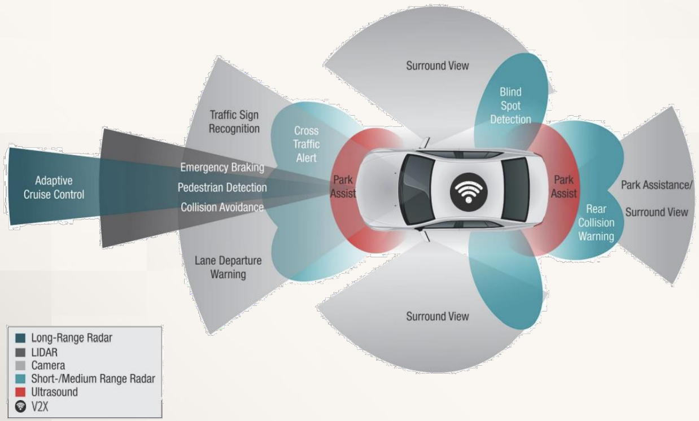

*Figure 25. Detection ranges and functions of each type of onboard sensor*

In Figure 25, the long range radar looks narrowly far ahead and is used for adaptive cruise control, and the lidar is used for emergency braking, pedestrian detection, and collision avoidance. Cameras are used for traffic sign recognition, lane departure warning, and surround view; short and medium range radars for cross traffic alert, blind spot detection, and rear collision warning; and ultrasonic sensors for park assist. The sensors are placed so that their detection ranges overlap and cover the vehicle's surroundings without gaps. The V2X icon in the middle of the vehicle means that information beyond these detection ranges is supplemented through communication.

Sensor-based recognition has three strengths. First, because the sensors measure directly, data are not lost as they can be in communication. Second, multiple sensors and sensor fusion recognize nearby objects reliably. Third, the recognition period is fast, at tens of milliseconds. It also has weaknesses.

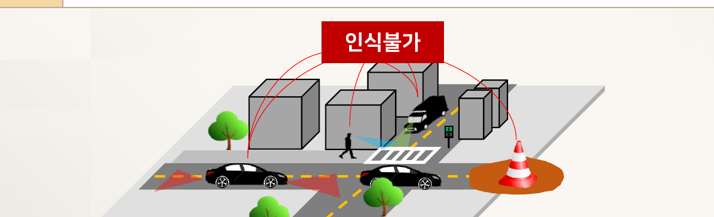

*Figure 26. An object in an NLOS area that the onboard sensors cannot recognize because a building blocks it*

> **Definition:** **Line of sight (LOS)** is the state in which nothing blocks the path between a sensor and an object, so the object is directly visible.

> **Definition:** **Non-line of sight (NLOS)** is the state in which a building or another vehicle blocks the object so it is not directly visible.

Sensor-based recognition suffers recognition errors from environmental factors such as weather and lighting, and, as in Figure 26, it cannot recognize objects in NLOS areas, such as a vehicle or pedestrian emerging from behind a building. Its recognition distance is limited, and it is also limited in determining the type and size of objects.

**V2X-based object recognition** learns about objects from messages sent by other vehicles, pedestrian terminals, and infrastructure.

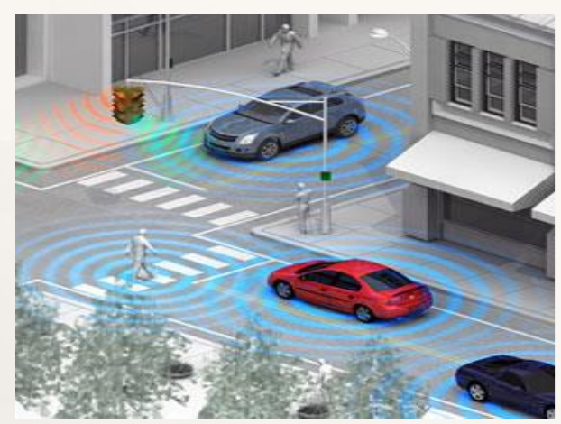

*Figure 27. Recognizing objects around an intersection through V2X communication*

As in Figure 27, when each vehicle and pedestrian announces its own information with radio waves, drawn as concentric circles, even objects hidden by buildings can be recognized over a wide range of about 1 km. Because the objects send their exact shape and specifications, such as vehicle type and size, and their dynamic data, such as speed and acceleration, directly, the information is more accurate than sensor estimates. On the other hand, communication may become congested or data may be lost depending on the radio environment, the message period of about 100 ms is slower than that of sensors, and because the object position is based on GPS positioning, GPS errors that depend on the radio environment enter directly.

| V2X-based object recognition | Onboard sensor-based object recognition |
|:-----|:-----|
| (Strength) Can recognize objects in NLOS areas | (Weakness) Cannot recognize objects in NLOS areas |
| (Strength) Wide recognition area | (Weakness) Limited recognition distance |
| (Strength) Obtains accurate object shape information | (Weakness) Inaccurate recognition of object shape |
| (Strength) Independent of day, night, and weather | (Weakness) Sensitive to day, night, and weather |
| (Weakness) Data loss depending on the radio environment | (Strength) Low data loss |
| (Weakness) Slow recognition period | (Strength) Fast recognition period |
| (Weakness) GPS positioning errors depending on the radio environment | (Strength) High-precision relative positioning |

*Table 20. Comparison of V2X-based and onboard sensor-based object recognition*

The strengths and weaknesses in the two columns of Table 20 cross exactly. Therefore, **fusing** the two methods lets each cover the other's weaknesses. The effects of fusion are as follows.

- **Wider recognition range:** Recognizes objects in both LOS and NLOS areas.
- **Object identification:** Identifies the shape and type of surrounding objects.
- **Reduced environmental effects:** Reduces the effects of weather and lighting.
- **Efficient dynamic positioning:** Implements the system for dynamic positioning efficiently.
- **Low-cost, high-performance recognition:** Achieves high recognition performance even with inexpensive sensors.
- **Precise path prediction:** Knowing the intent and motion of surrounding objects allows precise prediction of paths for collision prevention.

### 2.10 Accuracy of Fusion-Based Relative Positioning

Figure 28 shows experimental results measuring how accurately the relative positions of surrounding vehicles can be known when sensors and V2X are fused.

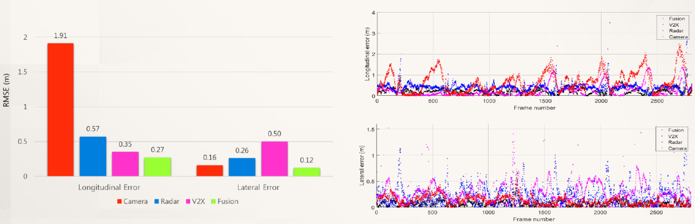

*Figure 28. Longitudinal and lateral position errors of camera, radar, V2X, and fusion*

> **Definition:** **Longitudinal** is the vehicle's direction of travel.

> **Definition:** **Lateral** is the left-right direction perpendicular to the direction of travel.

> **Definition:** The **root mean square error (RMSE)** is obtained by squaring the differences between estimates and true values, averaging them, and taking the square root; it represents the typical size of the error.

With estimated positions $`\hat{x}_i`$ and true positions $x_i$ over $N$ frames, the RMSE is as follows.

```math
\text{RMSE} = \sqrt{\frac{1}{N}\sum_{i=1}^{N}\left(\hat{x}_i - x_i\right)^2}
```

The graphs on the right of Figure 28 are the per-frame errors measured over about 2,800 frames, and the bar chart on the left gives their RMSE.

| Method | Longitudinal RMSE (m) | Lateral RMSE (m) |
|:-----|--:|--:|
| Camera | 1.91 | 0.16 |
| Radar | 0.57 | 0.26 |
| V2X | 0.35 | 0.50 |
| Fusion | 0.27 | 0.12 |

*Table 21. Relative position errors (RMSE) by method*

Table 21 can be interpreted as follows. The camera estimates distance from images, so its longitudinal error is the largest at 1.91 m, but the left-right position within a lane is clearly visible in the image, so its lateral error is small at 0.16 m. The radar measures distance directly from the round-trip time of radio waves, so it is accurate longitudinally at 0.57 m, but its low angular resolution gives 0.26 m laterally. V2X receives the other vehicle's GPS position, so it is good longitudinally at 0.35 m but worst laterally at 0.50 m. Since a lane is about 3.5 m wide, a lateral error of 0.5 m is large enough to cause a wrong lane judgment. Fusion picks the direction in which each sensor performs well, so it shows the smallest error in both directions.

The improvement rate is computed as $(\text{baseline RMSE} - \text{fusion RMSE}) / \text{baseline RMSE}$. The longitudinal improvement over the camera is as follows.

```math
\frac{1.91 - 0.27}{1.91} = \frac{1.64}{1.91} \approx 0.859 = 85.9\%
```

Computing the rest in the same way gives Table 22.

| Comparison | Longitudinal improvement | Lateral improvement |
|:-----|--:|--:|
| Over camera | $`(1.91 - 0.27)/1.91 \approx 86\%`$ | $`(0.16 - 0.12)/0.16 = 25\%`$ |
| Over radar | $`(0.57 - 0.27)/0.57 \approx 53\%`$ | $`(0.26 - 0.12)/0.26 \approx 54\%`$ |

*Table 22. Improvement in position error by fusion*

> **Note:** The result of this experiment is reported as fusion improving accuracy by 86% and 52% over the camera and radar longitudinally and by 27% and 56% laterally. These differ slightly from Table 22 because the RMSE values shown in the figure are rounded to two decimal places. For example, if the lateral camera RMSE were 0.164 m and the fusion RMSE 0.120 m, the improvement would be about 27%. Either way, the conclusion that fusion is more accurate than any single method is the same.

### 2.11 Comparison of US and EU V2V and V2I Standards

The United States and Europe developed V2X standards separately, but many parts are similar [27].

- The overall architectures are similar.
- The security protocol and physical layer standards are nearly identical (both based on IEEE 802.11p).
- The data elements of the message sets are similar.
- However, the application layer, channel congestion control, and performance requirements differ, and the assessment at the time was that it is acceptable for these to remain different.

The structures of the two protocol stacks are compared in Figure 44 of Section 3.5, and the correspondence at the message level in Section 3.7.

### 2.12 Cooperative Driving Phases and Services of the European C2C-CC

The Day 1, Day 2, and Day 3+ classification in Section 1.2 corresponds to the phases of **awareness driving**, **sensing driving**, and **cooperative driving**, respectively. In awareness driving, vehicles announce their presence and status to each other; in sensing driving, they also share the objects detected by their own sensors; and in cooperative driving, they share and coordinate future trajectories and maneuvers. As the next phase, the C2C-CC V2X roadmap placed synchronized cooperative driving, in which Level 4 and 5 vehicles exchange and synchronize their driving trajectories to achieve optimal driving patterns, with accident-free driving as the final goal [28]. Day 3/4 below refers to cooperative driving and the phase after it together.

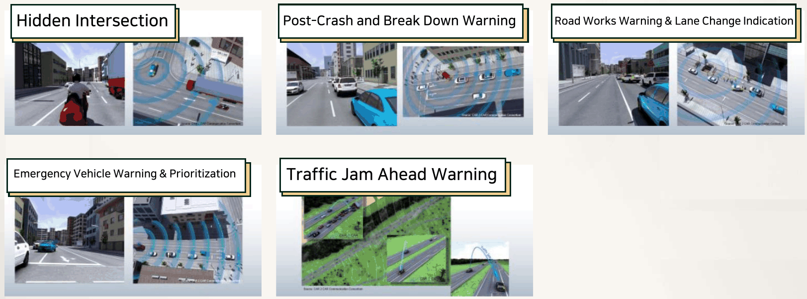

*Figure 29. Examples of Day 1 awareness driving services*

The Day 1 services in Figure 29 are as follows.

| Service | Content |
|:-----|:-----|
| Hidden intersection | Announces vehicles approaching an intersection hidden by buildings. |
| Post-crash and breakdown warning | Announces a vehicle ahead that has crashed or stopped because of a breakdown. |
| Road works warning and lane change indication | Announces a work zone and indicates which lane to move into. |
| Emergency vehicle warning and prioritization | Announces an approaching emergency vehicle and has drivers make way. |
| Traffic jam ahead warning | Announces the tail end of a traffic jam ahead in advance. |

*Table 23. Day 1 awareness driving services*

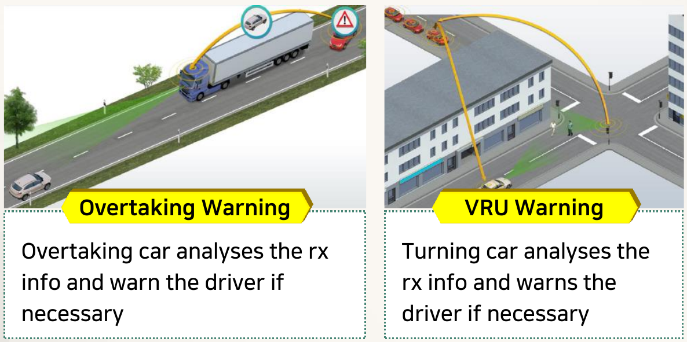

*Figure 30. Examples of Day 2 collective perception services*

The core of Day 2 is **collective perception**, in which each vehicle and the infrastructure share the objects detected by their sensors through CPMs. In the **overtaking warning** on the left of Figure 30, the overtaking car analyzes the received information about an oncoming vehicle detected and sent by the truck ahead and warns the driver if necessary. In the **VRU warning** on the right, a turning car receives and analyzes information about pedestrians and cyclists detected by other vehicles or the infrastructure and warns the driver if necessary. In both cases, the vehicle learns through other parties' sensors about objects that its own sensors cannot see.

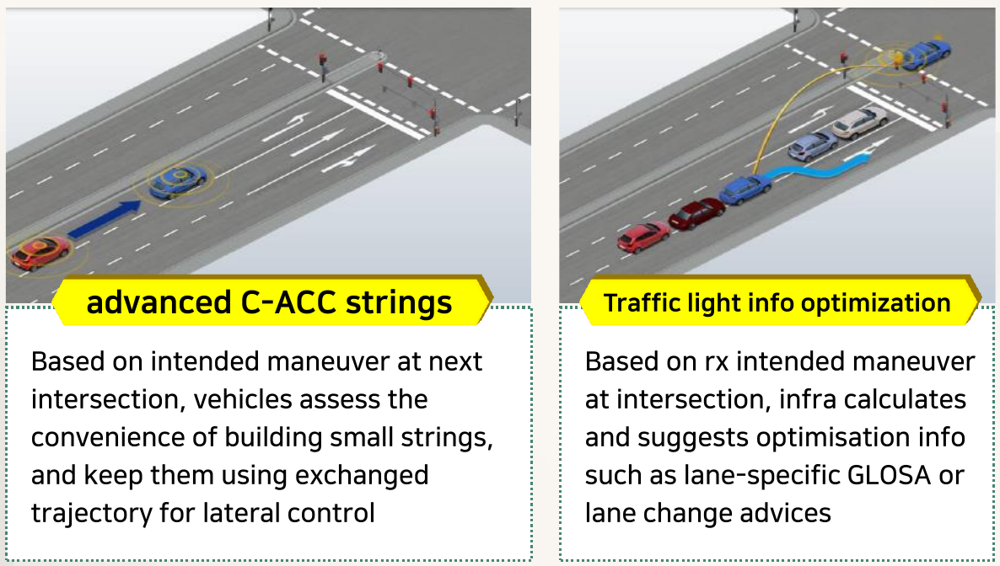

*Figure 31. Cooperative driving services based on trajectory and maneuver sharing*

Cooperative driving in Day 3/4 begins with sharing trajectories and maneuvers. In the **advanced C-ACC strings** on the left of Figure 31, vehicles that know each other's intended maneuver at the next intersection assess whether to build small strings and keep them using the exchanged trajectories, including for lateral control. In **traffic light info optimization** on the right, the infrastructure receives the intended maneuvers at the intersection sent by vehicles and calculates and suggests optimization information such as lane-specific GLOSA or lane change advice.

> **Definition:** **GLOSA (green light optimal speed advisory)** is a service that knows when the signal will change and advises the driver or vehicle of a speed at which the intersection can be passed on green. It reduces unnecessary stops and starts, cutting fuel use and emissions.

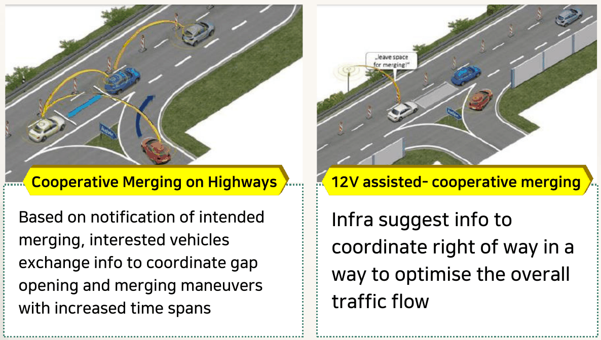

*Figure 32. Cooperative merging services based on coordination and negotiation*

The next level of cooperative driving is coordination and negotiation. In **cooperative merging on highways** on the left of Figure 32, when a vehicle announces its intention to merge, the vehicles concerned exchange information to open a gap and coordinate the merging maneuver with increased time spans. In **I2V assisted cooperative merging** on the right, the infrastructure suggests information that coordinates the right of way so as to optimize the overall traffic flow (the "leave space for merging" in the figure is such advice).

C-Roads, the European C-ITS deployment platform, summarized the messages and standards used by each service [29].

| Abbr. | Service | Bundle | Timeframe | Communication | Category | Network | Message | Standard |
|:-----|:-----|:-----|:-----|:-----|:-----|:-----|:-----|:-----|
| EBL | Emergency electronic brake light: prevents rear-end collisions by announcing hard braking of vehicles ahead. | 1 | Day 1 | V2V | Safety | ITS-G5 | DENM | ETSI TS 101 539-1 RHS clause 6.3.4 |
| EVA | Emergency vehicle approaching: warns of an approaching emergency vehicle before its siren or light bar can be heard or seen. | 1 | Day 1 | V2V | Safety | ITS-G5 | DENM, CAM | ETSI TS 101 539-1 RHS clause 6.3.1 |
| HLN | Hazardous location notification: warns in advance of hazards such as a sharp bend, a steep hill, a pothole, an obstacle, or a slippery road surface. | 1 | Day 1 | V2V | Safety | ITS-G5 | DENM | ETSI TS 101 539-1 RHS clause 6.3.7 |
| SSV | Slow or stationary vehicle(s): warns of slow vehicles or broken-down vehicles ahead (also called car breakdown warning). | 1 | Day 1 | V2V | Safety, efficiency | ITS-G5 | DENM, CAM | ETSI TS 101 539-1 RHS clauses 6.3.2 and 6.3.3 |
| TJW | Traffic jam ahead warning: prevents rear-end collisions on highways by announcing the tail end of a jam hidden behind a hilltop or curve. | 1 | Day 1 | V2V | Safety, efficiency | ITS-G5 | DENM | ETSI TS 101 539-1 RHS clause 6.3.8 |
| VSGN | In-vehicle signage: shows nearby road signs inside the vehicle, alerting drivers to signs they may have missed or cannot see. | 2 | Day 1 | V2I | Safety | ITS-G5, cellular | CAM | Under development: CEN TS 17425 In-vehicle signage, CEN TS 19321 dictionary of IVI data structures |

*Table 24. C-ITS services of C-Roads with their messages and standards*

> **Definition:** **Road hazard signalling (RHS)** is the V2X application specified in ETSI TS 101 539-1, which sets the requirements for services that announce hazardous situations on the road with DENMs [30].

In Table 24, most V2V safety services use the DENM, which announces events, and when the vehicle's own state is the information, as with emergency or slow vehicles, the CAM is used as well. For in-vehicle signage (VSGN) the table lists the CAM, but the IVI data structures in its standards column are carried in the IVIM message of Table 3 [7].

---

<br>

## 3. V2X Messages for Connected Automated Vehicles

### 3.1 From Sensor-Based Autonomous Driving to Connected Automation

The US supplier Delphi (now Aptive) forecast the functions and technologies by automation level as follows [31].

| Level | Name | Functions | Technologies | Timing |
|:-----|:-----|:-----|:-----|:-----|
| Level 0 | Driver only | | | Today |
| Level 1 | Assisted | Active high beam, collision imminent braking, cruise control | Radar, forward sensors | Today |
| Level 2 | Partial | Traffic jam assist, adaptive cruise and lane keeping, self-parking (with driver) | Radar, forward sensors, multi-domain controller, driver state sensor, V2X | Today |
| Level 3 | Conditional | Collision avoidance, automated highway, automated urban | Lidar and 360° radar, high accuracy GPS, multi-domain controller, forward HD and IR cameras, V2X, inertial measurement unit | 2020 |
| Level 4 | Full | Valet self-parking, highway point-to-point, urban point-to-point | Same as Level 3 | 2025+ |

*Table 25. Delphi's forecast of functions and technologies by automation level*

> **Note:** The Delphi outlook labels Level 4 "Full," but in SAE J3016 Level 4 is high driving automation and full driving automation is Level 5 [1].

In Table 25, V2X enters the technology list at Level 2 and remains as the level rises. The sensor configuration in Figure 25 alone cannot see NLOS areas or long distances, so the role of communication grows as automation increases.

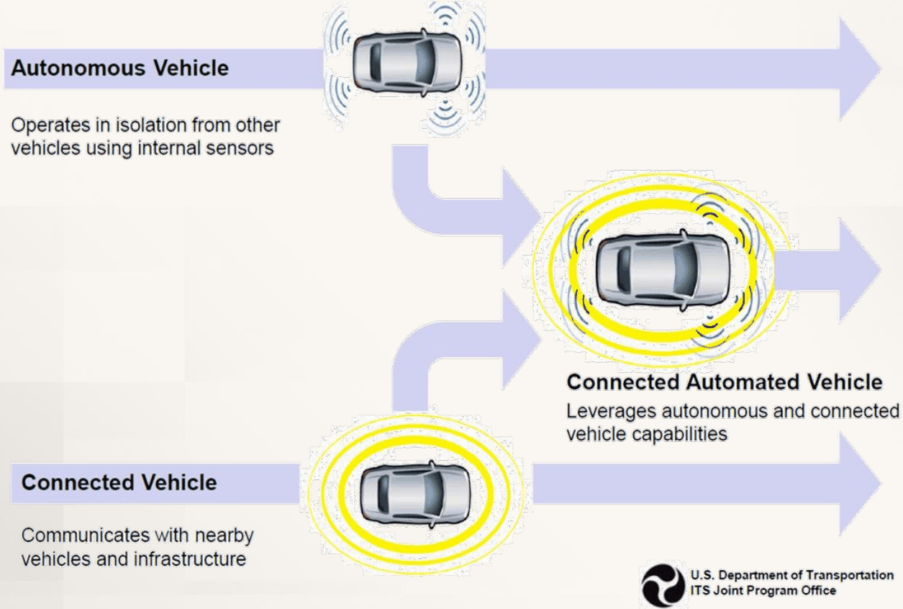

*Figure 33. Relationships among autonomous vehicles, connected vehicles, and connected automated vehicles*

Figure 33 is a concept diagram of the ITS Joint Program Office (ITS JPO) of the US Department of Transportation [32]. The **autonomous vehicle** at the top operates in isolation from other vehicles using internal sensors, and the **connected vehicle** at the bottom communicates with nearby vehicles and infrastructure. The **connected automated vehicle** in the middle, where the two streams meet, leverages both autonomous and connected capabilities for the greatest benefits.

### 3.2 Feature Examples of SAE J3216 Cooperative Driving Automation

SAE J3216 gives concrete feature examples for each cooperation class of Section 1.3 [8]. Each example distinguishes the level of functionality between **supporting**, where the feature works without information from other parties but improves with it, and **enabling**, where the feature becomes possible only with that information. Numbers such as "C-ADS 1" and "RSE 3" in the tables below are the numbers attached to the vehicles and roadside equipment in each figure. In practice, a one-way transmission typically sends the message to multiple CDA devices in the vicinity at once.

**Cooperative object tracking.**

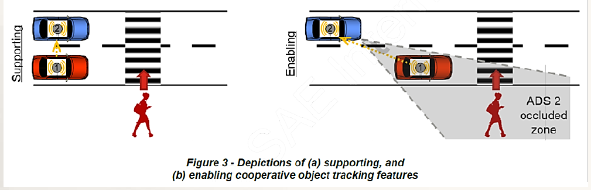

*Figure 34. Supporting and enabling features of cooperative object tracking*

| Feature | Class of CDA | Transmission mode and directionality | Information exchanged | Level of functionality |
|:-----|:-----|:-----|:-----|:-----|
| Object tracking: C-ADS 1 shares a pedestrian's location and classification with C-ADS 2 | A. Status-sharing | One-way: C-ADS 1 → C-ADS 2 | Object geospatial location and classification (e.g., pedestrian) | Supporting: when C-ADS 2 can sense the pedestrian, it uses the information to improve the reliability and accuracy of the pedestrian's location and classification. Enabling: the pedestrian was occluded from the field of view of C-ADS 2 (e.g., by C-ADS 1), and now C-ADS 2 is aware of the pedestrian. |

*Table 26. Example of a cooperative object tracking feature*

**Cooperative signalized intersection.**

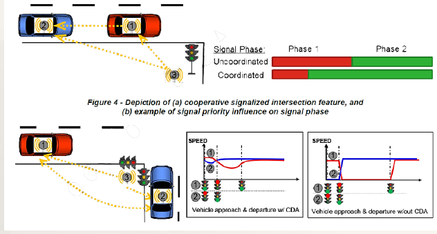

*Figure 35. Cooperative signalized intersection features and the influence of signal priority on signal phases*

| Feature | Class of CDA | Transmission mode and directionality | Information exchanged | Level of functionality |
|:-----|:-----|:-----|:-----|:-----|
| Eco-approach and departure | A. Status-sharing | One-way: RSE 3 → C-ADS 1 | Signal phase | Supporting: C-ADS 1 plans its motion more effectively with a longer look-ahead distance, reducing energy consumption and emissions. |
| Signal priority | A. Status-sharing | One-way: C-ADS 1 → RSE 3 | Vehicle location, speed, and priority status (e.g., emergency vehicles) | Enabling: the signal timing changes based on the approaching vehicle. |
| Eco-approach and departure | B. Intent-sharing | One-way: RSE 3 → C-ADS 1, 2 | SPaT information | Enabling: C-ADS 1 and 2 plan their motion based on future signal phase information that would otherwise be unavailable. |
| Tandem approach and departure | C. Agreement-seeking | Two-way: RSE 3 → C-ADS 1, 2, C-ADS 2 → C-ADS 1, C-ADS 1 → C-ADS 2 | SPaT information, C-ADS 2 proposes a velocity profile to C-ADS 1 and C-ADS 1 agrees | Enabling: the vehicles plan their motion based on future signal phases to optimize the velocity of both vehicles. |

*Table 27. Examples of cooperative signalized intersection features*

In the signal phase bars at the top of Figure 35, red in phase 1 is long when uncoordinated, but green comes earlier when coordinated with the vehicle's priority request. The two speed graphs at the bottom show that with CDA, vehicles 1 and 2 approach and depart the intersection at smoothly maintained speeds, whereas without CDA they stop at the red and start again, so the speed drops to zero.

**Cooperative merging.**

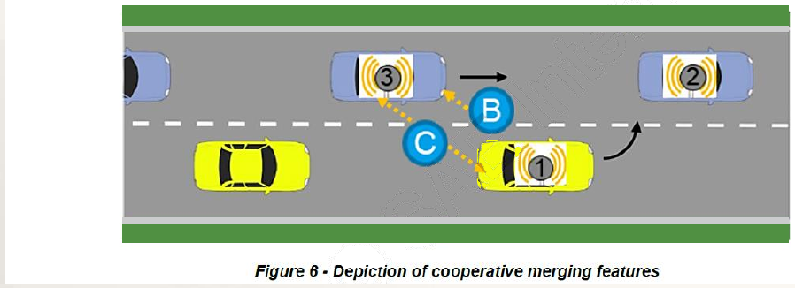

*Figure 36. Cooperative merging features*

| Feature | Class of CDA | Transmission mode and directionality | Information exchanged | Level of functionality |
|:-----|:-----|:-----|:-----|:-----|
| Cooperative lane change, cooperative merge | B. Intent-sharing | One-way: C-ADS 1 → C-ADS 3 | Planned maneuver | Supporting: C-ADS 1 shares its intent to merge between C-ADS 2 and 3. C-ADS 2 and 3 may or may not act on this information. |
| Cooperative lane change, cooperative merge | C. Agreement-seeking | Two-way: C-ADS 1 → C-ADS 3, C-ADS 3 → C-ADS 1 | Proposed maneuver, agreement of C-ADS 3 | Enabling: C-ADS 1 shares its intent to merge in front of C-ADS 3, and C-ADS 3 agrees to take action to allow the merge. |

*Table 28. Examples of cooperative merging features*

In Figure 36, B denotes an intent-sharing message and C an agreement-seeking message. With intent-sharing alone, the merging vehicle cannot know whether the other will yield, but with agreement-seeking it merges after receiving the other's agreement, so the merge becomes certain.

**Cooperative traffic management.**

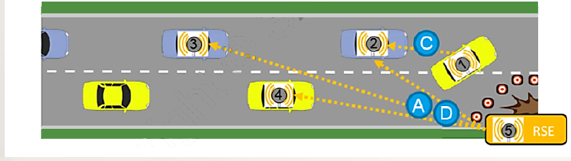

*Figure 37. Cooperative traffic management features*

| Feature | Class of CDA | Transmission mode and directionality | Information exchanged | Level of functionality |
|:-----|:-----|:-----|:-----|:-----|
| Temporary lane closure: the RSU shares a geofence and a lowered speed limit with road users, who may use the information to coordinate their motion | A. Status-sharing | One-way: RSE 4 → C-ADS 1 | Location of the lane drop | Supporting: the C-ADS detects the lane drop more quickly, accurately, and reliably. Enabling: without the information, the C-ADS would be unable to navigate the temporary traffic pattern. |
| Temporary lane closure | C. Agreement-seeking | C-ADS 1 → C-ADS 2 | Proposed maneuver | Enabling: C-ADS 1 shares its intent to change lanes ahead of C-ADS 2, and C-ADS 2 agrees to take action to allow the lane change. |
| Dynamic speed limit: the RSU shares a geofence and a lowered speed limit | D. Prescriptive | One-way: RSE 5 → C-ADS 1, 2, 3, 4 | New speed limit | Enabling: the C-ADS is directed to slow down to obey the traffic law. |

*Table 29. Examples of cooperative traffic management features*

> **Definition:** A **geofence** is a virtual boundary set on a map; when a vehicle enters it, specific rules (e.g., a lowered speed limit) apply.

> **Note:** The SAE J3216 table lists the transmission mode of the agreement-seeking example in Table 29 as "One-way," but agreement-seeking works only as a two-way exchange of sending intent and receiving agreement. As in the merging example of Table 28, it should be understood as the proposal C-ADS 1 → C-ADS 2 and the agreement C-ADS 2 → C-ADS 1 being exchanged together.

**Cooperative vehicle following.**

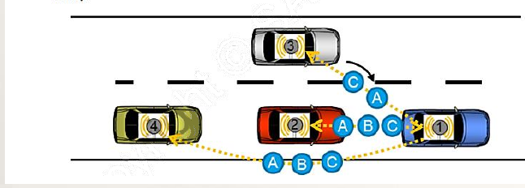

*Figure 38. Cooperative vehicle following features*

| Feature | Class of CDA | Transmission mode and directionality | Information exchanged | Level of functionality |
|:-----|:-----|:-----|:-----|:-----|
| Platooning awareness and CACC vehicle control | A. Status-sharing | Two-way: CDA vehicle 1 ↔ CDA vehicles 2, 4, one-way: CDA vehicle 1 → CDA vehicle 3 | Platooning and CACC activation status, speed, trajectory, and location of vehicles in the platoon | Supporting: follower vehicles follow more closely and stably than they could otherwise. Supporting: CDA vehicle 3 has additional awareness that vehicle 1 is platooning with other vehicles. |
| Advance notice of braking maneuver | B. Intent-sharing | One-way: C-ADS 1 → C-ADS 2, 4 | Planned speed reduction | Supporting: C-ADS 1 detects a forward hazard that may require deceleration of the platoon, enabling smoother deceleration of all vehicles. |
| Platoon joining | C. Agreement-seeking | Two-way: C-ADS 3 → C-ADS 1, C-ADS 1 → C-ADS 3, C-ADS 1 → C-ADS 2, 4 | Seeking to join the platoon, allowing joining in the middle, informing the other platooners | Enabling: C-ADS 3 joins the platoon in the middle (otherwise it would have had to join at the end). |

*Table 30. Examples of cooperative vehicle following features*

The status-sharing example in Table 30 assumes CDA vehicles at Levels 1-5, and the intent-sharing and agreement-seeking examples assume C-ADSs at Levels 3-5.

### 3.3 Position of V2X Messages in the Protocol Stack

Where in the protocol stack do V2X messages sit? Based on the US DSRC (WAVE) stack, the answer is shown in Figure 39 [33].

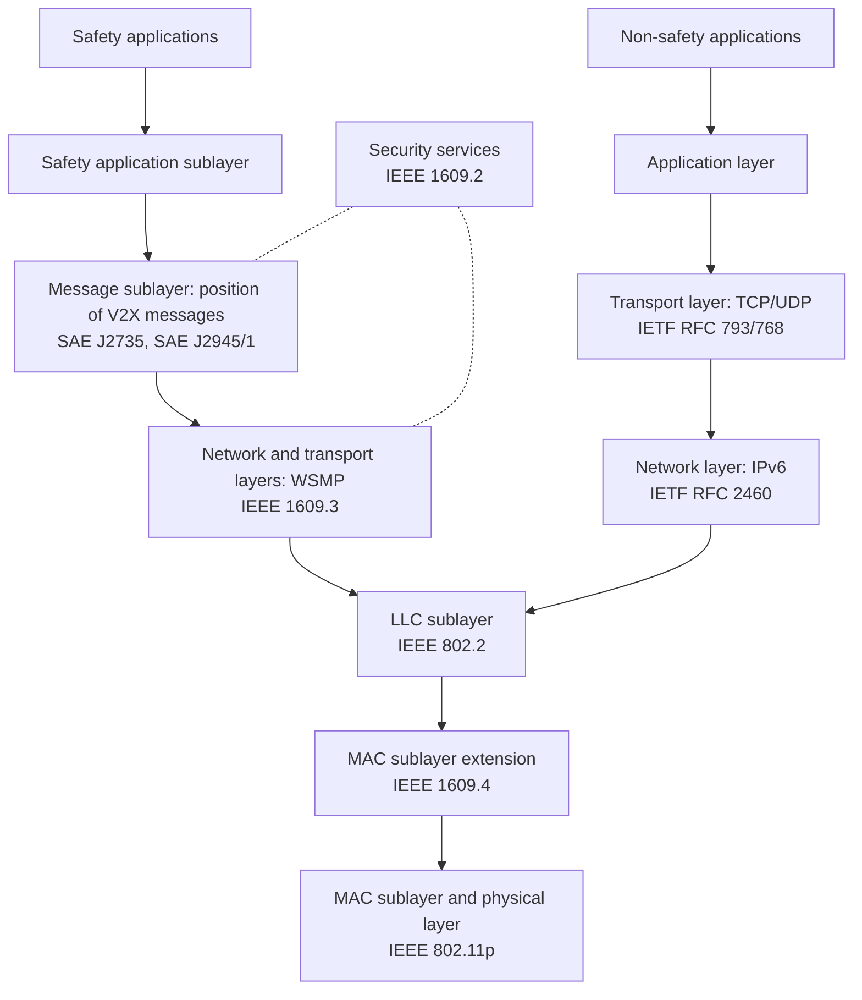

*Figure 39. Position of V2X messages in the DSRC protocol stack*

In Figure 39, V2X messages sit in the **message sublayer**, the lower part of the application layer. SAE J2735 defines the format of the messages (what is sent in which bits), and SAE J2945/1 defines when, how often, and with what performance the messages must be sent. Safety messages are delivered directly over the lightweight **WAVE short message protocol (WSMP)** without going through IP, reducing latency and overhead, while non-safety applications such as Internet services use TCP/UDP and IPv6. The security services (IEEE 1609.2) span several layers and handle the signing and verification of messages.

Viewed from the IEEE 1609 standards, the same structure is as follows [34].

| Layer | Components | Standard |
|:-----|:-----|:-----|
| Management and security | WAVE resource manager, security services for applications and management messages | IEEE 1609.1, IEEE 1609.2 |
| Network and transport | Networking services: WSMP, management messages, TCP/UDP, IP | IEEE 1609.3 |
| Data link | LLC, WAVE MAC extension (multichannel operation) | IEEE 802.2, IEEE 1609.4 |
| MAC and physical | WAVE MAC, WAVE PHY | IEEE 802.11p |
| Layer management | Upper MAC layer management entity (U_MLME), lower MAC layer management entity (L_MLME), physical layer management entity (PLME) | IEEE 1609.4, IEEE 802.11p |

*Table 31. Layers and standards of the WAVE protocol stack*

> **[Computer Networks]** In a layered architecture, each layer uses the services of the layer below to provide services to the layer above. Application message formats are defined at the application layer, and the transport, network, and link layers carry those messages regardless of their content. That is why the same SAE J2735 message can be sent over C-V2X instead of IEEE 802.11p. Layered architecture is covered in Week 5, LLC in Week 7, and WAVE and WSMP in Week 13.

### 3.4 Message Exchange Methods of Connected Vehicles

SAE applications and the IEEE 1609 communication layers divide their roles as in Figure 40 [35].

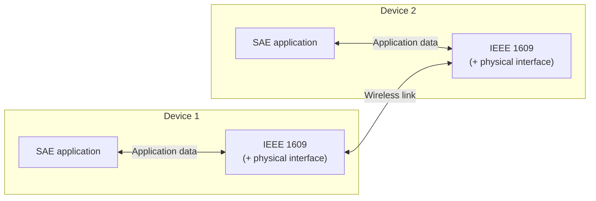

*Figure 40. Relationship between SAE applications and IEEE 1609*

In each device, the SAE application passes application data (messages) to the IEEE 1609 layers, which send them to the other device through a physical interface. Around 2021, the supported physical interfaces were 802.11-based DSRC and 3GPP PC5 Mode 4 (LTE-V2X direct communication). Messages are exchanged in three ways.

**Method 1. Information broadcasts.**

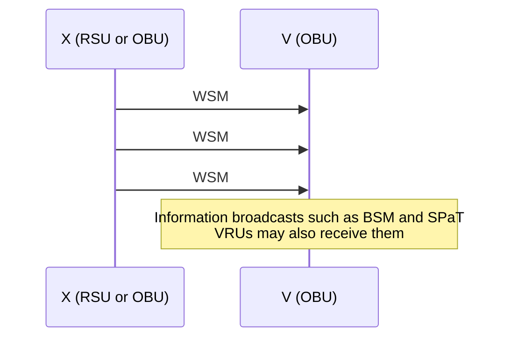

*Figure 41. V2X information broadcasts*

An RSU or OBU continuously broadcasts **WAVE short messages (WSMs)** without designating a receiver. There is no connection setup, so the latency is the shortest. SAE BSM and SPaT are typical examples, and future cooperative automation messages such as sensor data sharing will also be sent this way. Not only vehicles but also the terminals of VRUs can receive these messages.

**Method 2. V2I localized data exchange.**

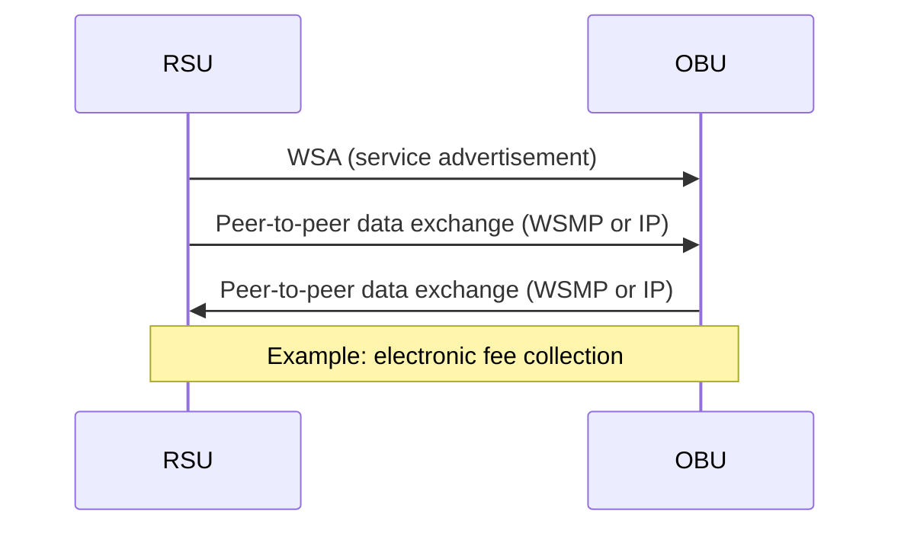

*Figure 42. V2I localized data exchange*

The RSU first sends a **WAVE service advertisement (WSA)** announcing the applications or services it offers. An OBU that wants to use a service exchanges peer-to-peer data with the RSU over WSMP or IP. Electronic fee collection is a typical example. The data exchange may also take place on a different channel or network from the one on which the WSA was received.

**Method 3. V2I cloud-based exchange.**

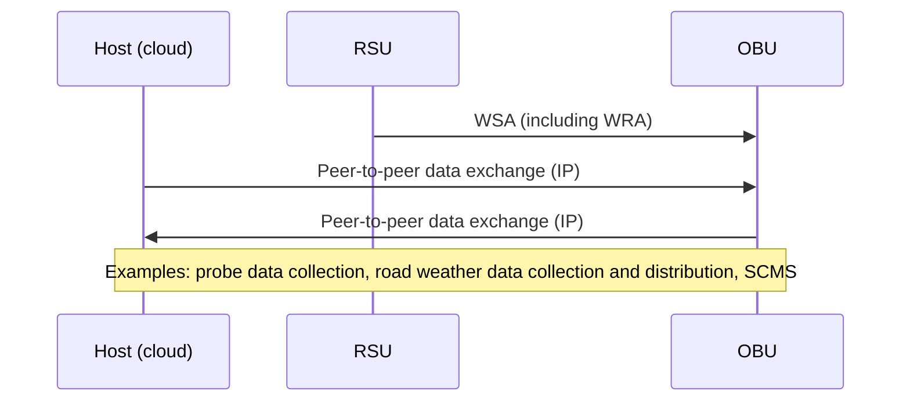

*Figure 43. V2I cloud-based data exchange*

When the WSA from the RSU contains a **WAVE router advertisement (WRA)**, the OBU uses the RSU as a router and exchanges data directly with a host in the cloud over IP. This exchange can also take place over a non-WAVE interface such as cellular. Probe data collection, road weather data collection and distribution, and the security credential management system (SCMS) that issues certificates are examples of this method.

### 3.5 Connected Vehicle Message Standards: US, Europe, and Korea

| Region | Standard | Content |
|:-----|:-----|:-----|
| US | SAE J2735 V2X Communications Message Set Dictionary | Definitions of V2X messages, data frames, and data elements [36] |
| US | SAE J2945 DSRC Performance Requirements for V2V Safety Awareness | Performance requirements for V2V safety awareness (J2945/1: transmission rules for BSM) [37] |
| US | SAE J3224 V2X Sensor-Sharing for Cooperative and Automated Driving | Sensor data sharing for cooperative automated driving (SDSM) [38] |
| Europe | ETSI TS 102 637-1 | Part 1: Functional requirements [39] |
| Europe | ETSI TS 102 637-2 | Part 2: Specification of the cooperative awareness basic service (CAM) [39] |
| Europe | ETSI TS 102 637-3 | Part 3: Specifications of the decentralized environmental notification basic service (DENM) [39] |

*Table 32. V2X message standards of the United States and Europe*

> **Note:** ETSI TS 102 637-2 and -3 were later revised into the European Standards (EN) 302 637-2 (CAM) and 302 637-3 (DENM) [3], [4].

SAE J2735 defines messages at three levels.

> **Definition:** A **data element** is a value that cannot be divided further, such as speed or latitude.

> **Definition:** A **data frame** is a structure that groups data elements, such as a position (latitude, longitude, elevation).

> **Definition:** A **message** gathers data frames and data elements into one transmission unit. These definitions are written in the abstract syntax notation ASN.1 and are encoded for transmission with UPER (unaligned packed encoding rules), which packs them bit by bit without gaps.

In Korea, the Korean Agency for Technology and Standards (KATS) is standardizing V2X messages for cooperative automated driving systems as the KS R 1600 series [40].

| Standard number | Title | Main content | Establishment |
|:-----|:-----|:-----|:-----|
| KS R 1600-1 | Conceptual scenarios | Lists 27 representative scenarios that can be implemented in cooperative automated driving systems and gives the data needed for each scenario | 2023-06-27 |
| KS R 1600-2 | Vehicle basic safety message | Message format for the most basic safety-related information such as vehicle position, speed, heading, and brake status (BSM) | 2023-06-27 |
| KS R 1600-3 | Traffic signal and map messages | Message formats for information such as signal phase status, intersection geometry, and lane connections (SPaT, MAP, NMEA, RTCM) | Planned for establishment in the first half of 2025 |
| KS R 1600-4 | Control messages | Message formats for sharing data collected from control (probe) vehicles with other vehicles and infrastructure (PVD, PDM) | Planned for establishment in the first half of 2025 |
| KS R 1600-5 | Driving environment messages | Message formats for driving environment information such as road conditions, traffic information, and emergency alerts (TIM, RSA) | Planned for establishment in the first half of 2025 |
| KS R 1600-6 | Pedestrian safety message | Message format for delivering information between pedestrians and communication entities around them (PSM) | Planned for establishment in the first half of 2025 |
| KS R 1600-7 | Collision risk messages | Message formats for information that helps avoid collisions, such as traffic flow, emergency vehicle information, and collision avoidance (CSR, EVA, ICA) | Planned for establishment in the first half of 2025 |

*Table 33. KS R 1600 V2X message specifications for cooperative automated driving systems, Parts 1-7*

For Parts 3-7 in Table 33, the plan was to complete the consultation and review procedures by the end of 2024 and to establish and announce them in the first half of 2025. Because the messages covered by each part have the same names as SAE J2735 messages, the Korean standards are evidently being built on the US message system. The abbreviations in the table are BSM (Basic Safety Message), SPaT (Signal Phase and Timing), MAP (Map Data), NMEA (National Marine Electronics Association), RTCM (Radio Technical Commission for Maritime Services), PVD (Probe Vehicle Data), PDM (Probe Data Management), TIM (Traveler Information Message), RSA (Road Side Alert), PSM (Pedestrian Safety Message), CSR (Common Safety Request), EVA (Emergency Vehicle Alert), and ICA (Intersection Collision Avoidance).

> **Note:** KS R 1600 calls the PSM the Pedestrian Safety Message, but its name in SAE J2735 is the Personal Safety Message, because it covers all VRUs, including not only pedestrians but also cyclists and wheelchair users [36].

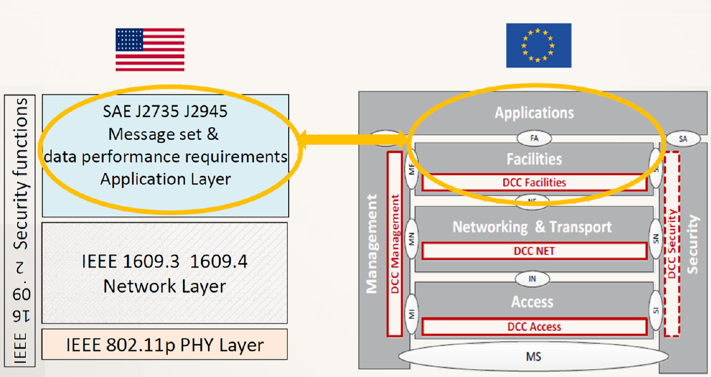

*Figure 44. Comparison of the US and European V2X protocol stacks*

Figure 44 compares as stacks the US and European standards discussed in Section 2.11 [27]. The US application layer (the SAE J2735 message set and the J2945 data performance requirements) corresponds to the Applications and Facilities layers in Europe. The European Facilities layer generates and manages common messages such as CAM and DENM. The US network layer of IEEE 1609.3 and 1609.4 corresponds to the European Networking & Transport layer, and the IEEE 802.11p physical layer to the European Access layer. Europe places a decentralized congestion control (DCC) function in each layer (DCC Facilities, DCC NET, DCC Access), and Management and Security entities connect to all layers through service access points (SAPs). The United States places its security functions beside the stack as IEEE 1609.2.

### 3.6 SAE J2735 Message List

The messages defined by SAE J2735 are as follows [36]. The communication column gives the direction in which the message is mainly used.

| No. | Abbr. | Message name | Communication | Description |
|:-----|:-----|:-----|:-----|:-----|
| 1 | BSM | MSG_BasicSafetyMessage | V2V | Contains vehicle state information for safety applications. |
| 2 | CSR | MSG_CommonSafetyRequest | V2X | Used to request safety-related information. |
| 3 | CCM | MSG_CooperativeControlMessage | V2X | Manages cooperative vehicle control. |
| 4 | EVA | MSG_EmergencyVehicleAlert | V2X | Alerts about the presence and movement of emergency vehicles. |
| 5 | ICA | MSG_IntersectionCollisionAvoidance | V2X | Helps prevent collisions at intersections. |
| 6 | MSCM | MSG_ManeuverSharingAndCoordinatingMessage | V2X | Coordinates vehicle maneuvers. |
| 7 | MAP | MSG_MapData | V2I | Provides detailed road and intersection geometry. |
| 8 | NMEA | MSG_NMEAcorrections | V2I | Supplies GNSS corrections for improved positioning accuracy. |
| 9 | PSM | MSG_PersonalSafetyMessage | V2X | Conveys safety information for pedestrians and cyclists. |
| 10 | PSM2 | MSG_PersonalSafetyMessage2 | V2X | Extends the PSM for additional details. |
| 11 | PDC | MSG_ProbeDataConfigMessage | V2I | Configures the collection of probe data. |
| 12 | PDM | MSG_ProbeDataManagement | V2I | Manages probe data collection and reporting. |
| 13 | PDR | MSG_ProbeDataReportMessage | V2I | Reports collected probe data. |
| 14 | PVD | MSG_ProbeVehicleData | V2I | Contains vehicle-based probe data. |
| 15 | RGA | MSG_RoadGeometryAndAttributes | V2I | Describes road geometry and attributes. |
| 16 | RSM | MSG_RoadSafetyMessage | V2X | Provides road safety information. |
| 17 | RSA | MSG_RoadSideAlert | V2X | Alerts about immediate roadside hazards. |
| 18 | RWM | MSG_RoadWeatherMessage | V2X | Reports road weather conditions. |
| 19 | RTCM | MSG_RTCMcorrections | V2I | Provides GNSS correction data. |
| 20 | SDSM | MSG_SensorDataSharingMessage | V2X | Shares sensor data among vehicles. |
| 21 | SCPR | MSG_SignalControlAndPrioritizationRequest | V2I | Requests traffic signal control and prioritization. |
| 22 | SCPS | MSG_SignalControlAndPrioritizationStatus | V2I | Gives the status of traffic signal control requests. |
| 23 | SPAT | MSG_SignalPhaseAndTiming | V2I | Gives the current state and timing of traffic signals. |
| 24 | SRM | MSG_SignalRequestMessage | V2I | Requests changes to traffic signals. |
| 25 | SSM | MSG_SignalStatusMessage | V2I | Provides responses to and the status of signal requests. |
| 26 | TAM | MSG_TollAdvertisementMessage | V2I | Advertises toll-related information. |
| 27 | TUMack | MSG_TollUsageAckMessage | V2I | Acknowledges toll usage. |
| 28 | TUM | MSG_TollUsageMessage | V2I | Details toll usage. |
| 29 | TSPaT | MSG_TrafficSignalPhaseAndTiming | V2I | Contains detailed traffic signal phase and timing. |
| 30 | TIM | MSG_TravelerInformation | V2I | Disseminates travel-related information. |
| 31 | TestMessages | MSG_TestMessages | V2X | Messages used for testing and validation. |

*Table 34. Messages defined by SAE J2735*

> **Note:** For transmission, every J2735 message is wrapped in a common container called the **MessageFrame**. The MessageFrame consists of a number that indicates the message type (messageId) and the message body (value), and the receiver uses this number to decide which message to decode the body as. For example, in the 2016 edition of J2735, MAP is 18, SPaT is 19, BSM is 20, TIM is 31, and PSM is 32 [36].

The purpose, key content, and transmission timing of frequently used messages are summarized below.

| Message | Sender | Key content | Transmission timing |
|:-----|:-----|:-----|:-----|
| BSM | Every vehicle | Position, speed, heading, acceleration, brake status, vehicle size | Broadcast periodically (typically 10 times per second, Section 3.7) |
| SPaT | RSU at a signalized intersection | Current phase of each signal group and the time remaining until it changes | Broadcast repeatedly at a short period because the signal state keeps changing (Section 3.9) |
| MAP | RSU | Lane geometry of the intersection, connections between lanes, signal group numbers | Broadcast repeatedly at a long period because the geometry rarely changes (Section 3.9) |
| TIM | RSU or traffic center | Traveler information such as road signs, advisory speeds, work zones, and accidents, with its valid area and valid period | Broadcast repeatedly while the information is valid |
| RSA | RSU or vehicle | Type and location of a short-lived roadside hazard (e.g., an obstacle on the road) | Broadcast when the hazard arises |
| EVA | Emergency vehicle | Type, position, and heading of the emergency vehicle and the state of its siren and lights | Broadcast repeatedly during an emergency run |
| PSM | Terminal of a pedestrian or cyclist, or an RSU | Type, position, speed, and heading of the VRU | Broadcast periodically by the VRU terminal, or by an RSU on the VRU's behalf when it detects the VRU |
| SRM, SSM | Emergency vehicles and buses (SRM), RSU of the signal controller (SSM) | Request for priority or preemption (SRM), processing status of the request (SSM) | Requested when a vehicle needing priority approaches the intersection, and answered whenever the status changes |
| PDM, PVD | RSU (PDM), vehicle (PVD) | Instructions on which data to collect and at what intervals (PDM), snapshots collected by the vehicle (PVD) | When the vehicle enters the communication range of the RSU |
| RTCM | RSU | Correction information that reduces the position error of GNSS receivers (RTCM format) | Broadcast whenever the reference station's correction information is updated |
| SDSM | Vehicle or RSU | Type, position, and speed of objects detected by its own sensors | Broadcast periodically |
| CSR | Vehicle | Request to another vehicle to send additional BSM information (Part 2) | When additional information is needed |

*Table 35. Purpose and transmission timing of major messages*

> **Definition:** A **probe vehicle** is a vehicle that acts as a moving sensor, collecting data such as speed, position, and road surface condition as it drives.

> **Definition:** **NMEA** was originally the name of an organization for marine electronic equipment, and its standard is widely used for the output sentence format of GNSS receivers.

> **Definition:** **RTCM** was originally the name of an organization for maritime radio communication, and its standard is widely used for the format of position correction information.

### 3.7 Basic Safety Message (BSM)

The **Basic Safety Message (BSM)** is the basic message of V2V safety applications. When every vehicle keeps announcing its state to its surroundings, each vehicle uses the received BSMs to track the positions and motions of nearby vehicles and runs applications such as forward collision warning, intersection collision warning, and lane change warning. SAE J2945/1 specifies that the BSM is typically broadcast 10 times per second (every 100 ms) and that the transmission interval is lengthened when the channel is congested, to control congestion [37].

The BSM is divided into two parts.

| Part | Data element | Type | Remarks |
|:-----|:-----|:-----|:-----|
| Part 1 | coreData | BSMcoreData | Mandatory, included in every BSM |
| Part 2 | VehicleSafetyExtensions | VehicleSafetyExtensions | Optional |
| Part 2 | SpecialVehicleExtensions | SpecialVehicleExtensions | Optional |
| Part 2 | SupplementalVehicleExtensions | SupplementalVehicleExtensions | Optional |
| | regional | Reg-BasicSafetyMessage | Optional, regional extension |

*Table 36. Structure of the BSM*

**Part 1 (core data)** is the minimal vehicle state sent every time. Its fields and units are as follows [36].

| Field | Type | Meaning | Range and unit |
|:-----|:-----|:-----|:-----|
| msgCnt | MsgCount | Message sequence number, used to detect loss and order of messages from the same sender | 0-127, wrapping to 0 after 127 |
| id | TemporaryID | Temporary vehicle identifier, changed periodically to protect privacy | 4 bytes |
| secMark | DSecond | Generation time within the current minute | 0-59,999 ms (65535 means unknown) |
| lat, long | Latitude, Longitude | Latitude and longitude | Unit $10^{-7}$ degree (0.1 microdegree) |
| elev | Elevation | Elevation | Unit 0.1 m |
| accuracy | PositionalAccuracy | Position error ellipse (semi-major axis, semi-minor axis, orientation) | Semi-major and semi-minor axes in units of 0.05 m |
| transmission | TransmissionState | Transmission state | Neutral, park, forward, reverse, and so on |
| speed | Speed | Speed | Unit 0.02 m/s (8191 means unknown) |
| heading | Heading | Heading (clockwise from north) | Unit 0.0125° (28800 means unknown) |
| angle | SteeringWheelAngle | Steering wheel angle | Unit 1.5° |
| accelSet | AccelerationSet4Way | Longitudinal, lateral, and vertical acceleration and yaw rate | Longitudinal and lateral 0.01 m/s², vertical 0.02 G, yaw rate 0.01°/s |
| brakes | BrakeSystemStatus | Per-wheel braking, traction control, ABS, stability control, brake boost, and auxiliary brake status | Bits and enumerations |
| size | VehicleSize | Vehicle width and length | Unit cm |

*Table 37. Fields of the BSM core data*

To save bandwidth, J2735 sends values as integers with units (resolutions) instead of real numbers. The receiver multiplies the received integer by the unit to obtain the physical quantity. The following is an example of converting received integer values into physical quantities.

| Field | Received integer | Calculation | Physical quantity |
|:-----|--:|:-----|:-----|
| speed | 1000 | $1000 \times 0.02$ m/s | 20 m/s = 72 km/h |
| heading | 7200 | $7200 \times 0.0125^\circ$ | 90° (east) |
| lat | 366105000 | $366105000 \times 10^{-7}$° | 36.6105° N |
| long | 1272850000 | $1272850000 \times 10^{-7}$° | 127.2850° E |
| elev | 523 | $523 \times 0.1$ m | 52.3 m |
| secMark | 56789 | $56789 \times 1$ ms | 56.789 s into the current minute |
| accelSet.long | -350 | $-350 \times 0.01$ m/s² | -3.5 m/s² (deceleration) |

*Table 38. Examples of converting BSM field values*

To send a speed of 72 km/h, the sender works in reverse: $72 / 3.6 = 20$ m/s, and it puts in $20 / 0.02 = 1000$. The vehicle in Table 38 is driving east at 72 km/h at latitude 36.6105° and longitude 127.285° while decelerating at -3.5 m/s². With this information, a receiving vehicle can predict the sender's position 0.1 s later. Ignoring deceleration, it is $20 \times 0.1 = 2$ m east, and taking deceleration into account, it is $20 \times 0.1 - \frac{1}{2} \times 3.5 \times 0.1^2 = 2 - 0.0175 = 1.9825$ m east.

**Part 2 (optional extensions)** is appended only when needed. VehicleSafetyExtensions contains event flags (events, e.g., hard braking or hazard lights), the path traveled (pathHistory), the predicted path (pathPrediction), exterior lights (lights), a time (timestamp), and the vehicle height (height). The path history and path prediction are used on curved roads to judge whether a vehicle ahead is in the same lane. SpecialVehicleExtensions contains details of emergency vehicles (EmergencyDetails), an event description (EventDescription), and trailer information (TrailerData). SupplementalVehicleExtensions contains the basic vehicle class (classification), detailed classification (classDetails), vehicle data (vehicleData), disabled vehicle status (status), the US Federal Highway Administration vehicle class (fhwaVehicleClass), trailers (trailers), and regional extensions (regional, 1-4). In this extension, the weather report (WeatherReport), weather probe (WeatherProbe), obstacle detection (ObstacleDetection), speed profile (SpeedProfile), and RTCM package (RTCMpackage) remain under the names deprecated1-5; they are items that have been withdrawn from use.

Because the European CAM and the US BSM serve the same purpose, most of their data elements correspond. The results of a 2013 comparison are as follows [27].

| CAM | BSM | Correspondence |
|:-----|:-----|:-----|
| Message ID | Message Type | Same or similar |
| Station ID | Vehicle Temp ID | Same or similar |
| GenerationDeltaTime | Time (secMark) | Same or similar |
| Latitude, Longitude | Latitude, Longitude | Same or similar |
| Elevation, PositionConfidence | Elevation, Positional accuracy | Corresponding but defined differently |
| Speed | Transmission & speed | Same or similar |
| DriveDirection | Transmission & speed | Partially corresponding |
| Heading | Heading | Same or similar |
| LongitudinalAcceleration | Acceleration 4 way | Same or similar |
| AccelerationControl | Brake status | Same or similar |
| Curvature | Path prediction | Corresponding but defined differently |
| VehicleWidth, VehicleLength | Vehicle size | Same or similar |
| ExteriorLights | Other vehicle data (optional) | Same or similar |
| PathHistory | Path history | Same or similar |
| Station Type | Other vehicle data (optional) | Corresponding but defined differently |
| (none) | Message Count, RTCM package | Only in the BSM |

*Table 39. Correspondence of the data elements of the CAM and the BSM*

In the comparison figure, no correspondence is drawn for the BSM's Steering wheel angle and Event flags (optional) or for the CAM's Optional elements and LaneCount. The most critical vehicle dynamics data are defined the same or similarly in both messages. However, the European CAM has continued to accommodate the needs of various vehicle types (heavy vehicles, emergency vehicles, and so on), whereas the US BSM at the time focused on light vehicles, so the assessment at the time was that the United States could learn from Europe once heavy-vehicle DSRC activity progressed further.

### 3.8 Probe Vehicle Data (PVD)

**Probe Vehicle Data (PVD)** is the message that sends data collected by a vehicle while driving to a traffic center through an RSU. As it moves, the vehicle stores its position, speed, and status as **snapshots** at certain points, and when it enters the communication range of an RSU, it sends the accumulated snapshots as a PVD. The traffic center uses the PVDs of many vehicles to grasp section travel times, congestion, and road surface conditions. The RSU instructs which data to collect and how often through the PDM.

| Data element | Type | Remarks |
|:-----|:-----|:-----|
| timeStamp | MinuteOfTheYear | Optional. Time in minutes counted from the start of the year |
| segNum | ProbeSegmentNumber | Optional. Segment number that changes periodically to protect privacy |
| probeID | VehicleIdent | Optional. Vehicle identification information |
| startVector | FullPositionVector | The space and time of transmission to the RSU |
| vehicleType | VehicleClassification | Type of vehicle |
| snapshots | SEQUENCE (SIZE(1..32)) OF Snapshot | Name-value pairs, 1-32 of them, along with the space and time of the first measurement set |
| regional | SEQUENCE (SIZE(1..4)) OF RegionalExtension | Optional. Regional extensions |

*Table 40. Structure of the PVD*

The main data frames inside the PVD are as follows.

| Data frame | Main data elements | Remarks |
|:-----|:-----|:-----|
| VehicleIdent | name (DescriptiveName), vin (VINstring, vehicle identification number), ownerCode (IA5String, 1-32 characters), id (VehicleID), vehicleType (VehicleType), vehicleClass (CHOICE) | All optional |
| FullPositionVector | utcTime (DDateTime), long, lat (unit $10^{-7}$ degree), elevation, heading, speed (TransmissionAndSpeed), posAccuracy, timeConfidence, posConfidence, speedConfidence | Only long and lat mandatory |
| VehicleClassification | keyType (BasicVehicleClass), role (BasicVehicleRole), iso3883 (Iso3833VehicleType), hpmsType (VehicleType), vehicleType (VehicleGroupAffected), responseEquip (IncidentResponseEquipment), responderType (ResponderGroupAffected), fuelType (FuelType), regional | All optional |
| Snapshot | thePosition (FullPositionVector), safetyExt (VehicleSafetyExtensions), dataSet (VehicleStatus) | Only thePosition mandatory |

*Table 41. Vehicle identification, position, classification, and snapshot information in the PVD*

In VehicleClassification in Table 41, role is the vehicle's role (ordinary, public transport, emergency, police, and so on), iso3883 is the vehicle type classification of ISO 3833, hpmsType is the vehicle type of the US Highway Performance Monitoring System (HPMS), and fuelType is the fuel type. The data element name iso3883 and the type name Iso3833VehicleType differ in their digits as written in the standard itself. The dataSet (VehicleStatus) of a Snapshot contains vehicle states such as lights, wipers, brakes, and outside temperature, so when wiper activation information is gathered from many vehicles, it can be inferred that it is raining in that section.

### 3.9 Signal Phase and Timing (SPaT) and Map Data (MAP)

V2I services at signalized intersections work only when the two messages SPaT and MAP are used together. **MAP** tells what the intersection looks like (lane positions and connections), and **SPaT** tells what the signal for each movement is now and when it will change. The vehicle uses MAP to find which lane it is in and which signal group that lane belongs to, and then reads the state of that signal group from SPaT.

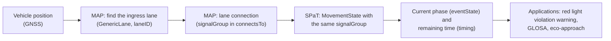

*Figure 45. Process of combining MAP and SPaT to find the signal for a lane*

**Structure of the SPaT message.** A SPaT carries the states of one or more intersections [36].

| Level | Data element | Type | Remarks |
|:-----|:-----|:-----|:-----|
| SPAT | timeStamp | MinuteOfTheYear | Optional |
| SPAT | name | DescriptiveName | Optional |
| SPAT | intersections | IntersectionStateList | Sets of SPaT data, one per intersection |
| SPAT | regional | SEQUENCE (SIZE(1..4)) OF RegionalExtension | Optional |
| IntersectionState | name | DescriptiveName | Optional |
| IntersectionState | id | IntersectionReferenceID | Intersection identifier (the same number as in MAP) |
| IntersectionState | revision | MsgCount | Incremented whenever the message content changes |
| IntersectionState | status | IntersectionStatusObject | State of the signal controller (manual control, failure, priority active, and so on) |
| IntersectionState | moy | MinuteOfTheYear | Optional. Minutes counted from the start of the year |
| IntersectionState | timeStamp | DSecond | Optional. Milliseconds within the minute |
| IntersectionState | enabledLanes | EnabledLaneList | Optional. Reversible lanes enabled by time of day |
| IntersectionState | states | MovementList | List of states by signal group |
| IntersectionState | maneuverAssistList | ManeuverAssistList | Optional. Assisting information such as queue length |
| IntersectionState | regional | SEQUENCE (SIZE(1..4)) OF RegionalExtension | Optional |
| IntersectionState | roadAuthorityID | RoadAuthorityID | Optional. Identifier of the road authority |

*Table 42. Structure of the SPaT message and the intersection state*

Each entry of states (MovementState) carries a signal group number (signalGroup) and the list of phases of that signal group (MovementEvent). The **eventState** of a MovementEvent is the current phase, with values such as stop-then-proceed (flashing red), stop-and-remain (red), permissive-movement-allowed, protected-movement-allowed (green arrow), and permissive and protected clearance (yellow). The **timing** (TimeChangeDetails) gives when the phase changes: the earliest end time (minEndTime, mandatory), the latest end time (maxEndTime), and the most likely end time (likelyTime) with its confidence. Because the end time can change with traffic, as in actuated signals, it is announced as a range rather than a single value.

Times use the **TimeMark** type, a value in units of 0.1 s counted from the start of the current hour (0-35999). For example, if the current time is 14:25:30.0, the current TimeMark is as follows.

```math
(25 \times 60 + 30) \times 10 = 1530 \times 10 = 15300
```

If a signal group then has minEndTime 15450 and likelyTime 15520, the phase ends no earlier than $(15450 - 15300)/10 = 15.0$ s from now, and the most likely end is $(15520 - 15300)/10 = 22.0$ s from now. If this signal group is green and a vehicle is 300 m from the stop line, it must arrive within 15 s to pass on this green, which requires an average of at least $300 / 15 = 20$ m/s (72 km/h). If the speed limit is lower than that, a GLOSA application advises the driver not to accelerate excessively but to decelerate to meet the next green.

**Structure of the MAP message.** MAP describes the geometry of intersections and road segments [36].

| Level | Data element | Content |
|:-----|:-----|:-----|
| MapData | timeStamp, msgIssueRevision | Generation time and revision number. The revision number changes when the geometry changes. |
| MapData | layerType, layerID | Type of map layer (intersection, road segment, and so on) and its number |
| MapData | intersections | List of intersection geometries (IntersectionGeometryList) |
| MapData | roadSegments, dataParameters, restrictionList, regional | Road segment geometry, data source information, restriction classes, regional extensions |
| IntersectionGeometry | id, revision, refPoint | Intersection identifier, revision number, reference point (latitude, longitude, elevation) |
| IntersectionGeometry | laneWidth, speedLimits | Default lane width, speed limits |
| IntersectionGeometry | laneSet | List of lanes (LaneList) |
| GenericLane | laneID, ingressApproach, egressApproach | Lane number, and the ingress and egress approaches to which the lane belongs |
| GenericLane | laneAttributes, maneuvers | Lane type (vehicle, crosswalk, bicycle, and so on) and allowed maneuvers (straight, left turn, and so on) |
| GenericLane | nodeList | List of points on the lane centerline expressed as offsets from the reference point |
| GenericLane | connectsTo | Lanes that can be reached from this lane (connectingLane) and the signal group that controls that movement (signalGroup) |

*Table 43. Structure of the MAP message*

Because the lane centerlines in MAP are expressed as how many centimeters east and north they lie from the reference point, the data are far smaller than sending a latitude and longitude for every point. The signalGroup in connectsTo has the same number as the signalGroup in the SPaT MovementState, so this number is the key that links the two messages in Figure 45.

The geometry of an intersection does not change unless there is construction, but the signal state changes every moment. Therefore, CTI 4501, the US implementation guide for connected intersections, requires SPaT to be broadcast at an average of 10 messages per second and MAP at an average of 1 message per second (each within ±1 message over a 10-second period) [41].

### 3.10 Laws on Remote Management

For automated vehicles without a driver on board to drive on roads, the law must set who is responsible for monitoring the vehicles remotely and responding when problems arise. The remote driving and technical supervisor services of Section 1.14 rest on these laws.

| Item | United Kingdom: NUIC operator | Germany: technical supervisor |
|:-----|:-----|:-----|
| Legal basis | Automated Vehicles Act 2024 (NUIC operator licensing), Automated and Electric Vehicles Act 2018 (insurer liability) | Autonomous Driving Act (2021) |
| Role | An organization responsible for the safe and lawful operation of automated vehicles without a driver; it performs the legal and safety obligations arising during operation on the user's behalf. | Supervises the technical state and safe operation of automated vehicles, identifying and resolving in advance the technical problems that may occur during operation. |
| License and qualification | Must obtain a government license or approval, which ensures the reliability of operation. | Must meet specific qualification requirements and hold the relevant license; technical expertise and legal knowledge are required. |
| Remote monitoring | Monitors the vehicle's state remotely while it operates automatically and responds when technical problems arise. | Monitors the vehicle remotely and takes emergency measures in abnormal situations, controlling or stopping the vehicle remotely if necessary. |
| Legal liability | Bears legal liability for accidents and problems, is obliged to take out insurance, and compensates accidents and damage during operation on the user's behalf. | Ensures technical safety and legal compliance, bears legal liability for technical problems during operation, and must meet regulatory requirements. |
| Data and compliance | Records and retains operating data to cooperate with regulators, manages operation so that it complies with the relevant laws, and continuously updates and reviews software and hardware. | Records, analyzes, and reports technical state and operating data to regulators, uses the data to keep improving technical safety and performance, and regularly inspects and updates software and hardware. |

*Table 44. Comparison of the UK NUIC operator and the German technical supervisor*

> **Definition:** **No-user-in-charge (NUIC)** means operation in which no user inside the vehicle is responsible for driving. In this case, the organization that bears the responsibility in place of a driver is the NUIC operator.

> **Note:** Of the UK legal bases in Table 44, the Automated and Electric Vehicles Act 2018 is the law that set the liability structure in which the insurer compensates first when an accident occurs during automated driving [42]. Licensing of NUIC operators was introduced in the later Automated Vehicles Act 2024. Under that act, responsibility for how the vehicle drives during automated driving lies with the authorised self-driving entity (ASDE) that obtained the vehicle authorisation, while the NUIC operator is responsible for detecting and responding to problems during the driverless journeys it oversees [43]. Also, the technical supervisor under German law can deactivate the vehicle remotely or approve alternative driving maneuvers proposed by the vehicle, but is not a remote driver who continuously operates steering and acceleration from afar [44]. The "controlling or stopping the vehicle remotely" in Table 44 should be understood as such deactivation and maneuver approval.

What the two regimes share is that, where the driver has disappeared, a licensed person or organization is put in charge of remote monitoring, accident liability, and data recording. Such remote monitoring and intervention require V2N communication and the remote driving technology of Section 1.14, so laws and communication technology must develop together.

---

<br>

## Concept Applications

| Situation | Concept to apply |
|:-----|:-----|
| An automated vehicle approaching a signalized intersection needs to know how many seconds of green remain. | Find the signalGroup of its lane from MAP, and read the eventState, minEndTime, and likelyTime of that signal group from SPaT (Section 3.9). |
| The ego vehicle's camera cannot see a pedestrian emerging from behind a building. | The pedestrian is an object in an NLOS area, so recognize it through the PSM from the pedestrian's terminal or through sensor sharing messages (SDSM, CPM) from other vehicles or infrastructure (Sections 2.9 and 3.6). |
| When platooning trucks run ACC with radar only, the speeds of trucks further back fluctuate more. | This is a string stability problem caused by accumulated reaction delays, so use CACC, which receives the acceleration of the vehicle ahead directly through V2V (Section 1.10). |
| A vehicle in a merging lane wants to merge only after a mainline vehicle has surely agreed to yield. | Not Class B, which only announces intent, but Class C agreement-seeking communication, which obtains the other's agreement, is needed (Sections 1.3 and 3.2). |
| Someone wants to show an advertising video on the display of a moving vehicle. | Under KS C 5077, advertising information may not be provided as moving images while driving; only text, still images, and sound are allowed (Section 2.4). |
| A vehicle sends 2500 in the speed field of its BSM. | Interpret it as $2500 \times 0.02 = 50$ m/s, that is, 180 km/h (Section 3.7). |

*Table 45. Concept application cases*

**True/False Check:**

| Statement | Judgment and Reason |
|:-----|:-----|
| Class C (agreement-seeking) of SAE J3216 also applies to Level 2 vehicles. | **F.** At Levels 1 and 2, where a human drives, the system cannot guarantee an agreed action, so Classes C and D are not applicable. |
| V2X-based object recognition is unaffected by weather and lighting. | **T.** Objects send their own information through communication, so recognition performance does not vary with weather and lighting as it does for a camera. It is affected by the radio environment instead. |
| The BSM is transmitted over TCP on top of IP. | **F.** Safety messages are broadcast over WSMP without going through IP, to reduce latency and overhead. |
| A vehicle that receives only SPaT can know the signal for its own lane. | **F.** SPaT carries only the states by signal group, so MAP is needed to know which signal group the vehicle's lane belongs to. |
| A European CAM is always generated 10 times per second. | **F.** CAMs are generated at intervals of 100-1,000 ms depending on changes in heading, position, and speed, so a stationary vehicle sends only one per second. |
| In the POCF of platooning, V2V is mandatory and I2V is optional. | **T.** Platoon vehicles must communicate directly with each other, whereas the infrastructure only provides additional information. |

---

<br>

## Summary

| Concept | Key Summary |
|:-----|:-----|
| Connected automated vehicle (CAV) | A vehicle with both automated driving and connected functions, located where vehicle technology and C-ITS meet. |
| Day phases of the C2C-CC | Services are deployed step by step as Day 1 awareness driving (CAM, DENM), Day 2 sensing driving (CPM), and Day 3+ cooperative driving (MCM). |
| SAE J3216 | Divides cooperative driving automation into four classes: status-sharing (A), intent-sharing (B), agreement-seeking (C), and prescriptive (D); C and D apply only at Level 3 and above. |
| ITS and C-ITS | ITS is an informatization program applying electronics, information, and communication technologies to the transportation system, and C-ITS extends to safety through real-time information sharing between vehicles and infrastructure. |
| Truck platooning (ISO TPS) | The stable state is controlled by the PMCF and the transitions from forming to dissolving by the POCF, with V2V mandatory. |
| Remote driving | A technology that uploads vehicle video and sensor information and sends down control commands, requiring low latency and a high uplink data rate. |
| Connected car HMI | Manages the priority of information in an integrated way to prevent information overload, and KS C 5077 strictly restricts moving images while driving. |
| Connected car security | Wireless interfaces, physical ports, and in-vehicle networks are the main hacked points, and V2X, the cloud, and over-the-air updates become new threats. |
| Fusion of sensors and V2X | Sensors provide fast and accurate short-range recognition and V2X provides NLOS and long-range recognition; fused, both longitudinal and lateral position errors are smallest. |
| Position of V2X messages | SAE J2735 messages sit in the message sublayer, and safety messages are broadcast over WSMP instead of IP. |
| Message exchange methods | There are three: information broadcast (WSM), localized data exchange (WSMP or IP after a WSA), and cloud-based exchange (IP after a WRA). |
| SAE J2735 | The US V2X message set dictionary, which defines messages in terms of data elements and data frames and encodes them with ASN.1 UPER. |
| BSM | The basic safety message that every vehicle typically broadcasts 10 times per second, carrying position, speed, heading, acceleration, brakes, and size in Part 1. |
| PVD | The probe data message that sends snapshots collected by a vehicle within the range of an RSU. |
| SPaT and MAP | MAP announces lane geometry and signal groups, and SPaT announces the phase and remaining time of each signal group; they are combined through the signalGroup number. |
| Laws on remote management | The United Kingdom assigns remote monitoring, accident liability, and data recording to NUIC operators, and Germany to technical supervisors. |

---

<br>

## Self-Check Questions

1. **Relationships among terms:** Explain the relationships among smart cars, connected cars, automated vehicles, CAVs, and C-ITS.

   <details>
   <summary>Answer</summary>

   The smart car is the broadest concept, covering vehicles with advanced sensors, electronic control, and information and communication technology, and it contains most automated vehicles and connected cars. An automated vehicle is one in which a system performs the driving task, and a connected car is one that exchanges data with the outside through communication. A CAV has both functions and lies where the two sets overlap. C-ITS is a transportation system in which vehicles and infrastructure share information in real time, and because the CAV also overlaps C-ITS, it lies where vehicle technology and transportation system technology meet.

   </details>

2. **Comparing classification schemes:** State the basis of the European C2C-CC Day 1, 2, 3+ and of the US SAE J3216 Classes A-D, and explain the direction common to the two classifications.

   <details>
   <summary>Answer</summary>

   The C2C-CC Day phases classify services by when they are deployed, that is, by technological maturity and deployment timing. Day 1 is awareness driving that announces status and events (CAM, DENM), Day 2 is sensing driving that shares objects detected by sensors (CPM), and Day 3+ is cooperative driving that shares and coordinates trajectories and maneuvers (MCM). The SAE J3216 Classes A-D classify by the depth of cooperation, that is, by what is exchanged: status-sharing, intent-sharing, agreement-seeking, and prescriptive. Both classifications point in the same direction, progressing from announcing status, through sharing intent, to agreement and coordination.

   </details>

3. **The SAE J3216 matrix:** State the difference between a Level 2 vehicle and a Level 4 C-ADS participating in Class B (intent-sharing), and explain why Class C is not applicable at Level 2.

   <details>
   <summary>Answer</summary>

   A Level 2 vehicle shares both longitudinal and lateral intent, but because a human supervises the driving task, the human may override that intent, so the cooperation is limited. A Level 4 C-ADS has full authority to decide actions, so the shared plan is actually carried out, and surrounding users can trust the plan to increase the reliability of their predictions. Class C means agreeing on actions with each other, and at Levels 1 and 2, where a human drives, the system cannot guarantee that the driver will actually perform the agreed action, so it is not applicable.

   </details>

4. **Platooning:** An ordinary car cuts into the middle of a platoon of trucks. State whether the PMCF or the POCF handles this event and explain what that function does. Also state which function and which cooperation class are needed when a new truck enters the platoon in the middle.

   <details>
   <summary>Answer</summary>

   A cut-in is an event that occurs in a platoon in the stable state, so the PMCF handles it. The PMCF widens the gaps of the vehicles behind to secure a safe distance from the cutting-in vehicle (OV), and restores the gaps when the vehicle leaves. A new truck entering the platoon is a transition of the platoon state (joining), so the POCF handles it. Entering in the middle requires the joining vehicle's request, the leading vehicle's permission, and notification of the other platoon vehicles to be exchanged, so it corresponds to Class C (agreement-seeking) of SAE J3216.

   </details>

5. **Communication for remote driving:** Explain what is sent on the uplink (vehicle to center) and the downlink (center to vehicle) in remote driving, and which performance matters more in each.

   <details>
   <summary>Answer</summary>

   The uplink carries 4K video and sensor data, so a high data rate matters; 3GPP specifies 25 Mbps in this direction. The downlink carries control commands such as steering and acceleration, so the data volume is small (1 Mbps), but a late command endangers the vehicle, so low latency and high reliability matter. 3GPP requires an end-to-end latency of 5 ms and a reliability of 99.999% for remote driving.

   </details>

6. **Effect of fusion:** State why the lateral RMSE of V2X in Table 21 is the largest at 0.50 m, and compute the lateral improvement of fusion over radar.

   <details>
   <summary>Answer</summary>

   V2X computes the relative position from the position that the other vehicle measured with GPS, so the GPS errors of both vehicles add up. Because a left-right position within a lane changes meaning with differences of tens of centimeters, GPS errors show up especially strongly in the lateral direction. The improvement over radar is $(0.26 - 0.12)/0.26 = 0.14/0.26 \approx 0.538$, that is, about 54%.

   </details>

7. **Message exchange methods:** State which exchange method electronic fee collection such as Hi-pass and the BSM each use, and explain the difference between the two methods.

   <details>
   <summary>Answer</summary>

   The BSM uses the information broadcast method: the sending vehicle keeps broadcasting WSMs without designating a receiver, with no connection setup, so the latency is the shortest. Electronic fee collection uses V2I localized data exchange: the RSU first advertises the toll collection service with a WSA, and the OBU then exchanges peer-to-peer data with the RSU over WSMP or IP. Broadcast is one-to-many, one-way delivery, whereas localized data exchange is a two-way exchange between a particular RSU and OBU after a service advertisement.

   </details>

8. **Interpreting a BSM:** The coreData of a BSM has speed = 1250, heading = 14400, accelSet.long = -500, and secMark = 12345. Convert each value into a physical quantity and describe the state of the vehicle.

   <details>
   <summary>Answer</summary>

   The speed is $1250 \times 0.02 = 25$ m/s, that is, $25 \times 3.6 = 90$ km/h. The heading is $14400 \times 0.0125 = 180^\circ$, which is south, 180° clockwise from north. The longitudinal acceleration is $-500 \times 0.01 = -5$ m/s², a strong deceleration. The secMark means that the message was generated 12.345 s into the current minute. This vehicle is driving south at 90 km/h while braking hard at -5 m/s², so following vehicles should raise a forward collision warning.

   </details>

9. **SPaT calculation:** The current time is 9:10:20.0, and a signal group has eventState red (stop-and-remain), minEndTime 6300, and likelyTime 6350. Compute the minimum and the most likely number of seconds remaining until the red ends.

   <details>
   <summary>Answer</summary>

   The current TimeMark is $(10 \times 60 + 20) \times 10 = 620 \times 10 = 6200$. The minimum remaining time is $(6300 - 6200)/10 = 10.0$ s, and the most likely remaining time is $(6350 - 6200)/10 = 15.0$ s. With this information, the vehicle can decelerate in advance to arrive around the start of green instead of stopping at the stop line.

   </details>

10. **Combining SPaT and MAP:** State what SPaT and MAP each tell, and explain through which field the two messages are linked. Also state why the two messages are broadcast at different periods.

    <details>
    <summary>Answer</summary>

    MAP tells the lane geometry of the intersection (lists of centerline points), the connections between lanes, and the signal group number controlling each connection. SPaT tells the current phase (eventState) of each signal group and when the phase changes (timing). The vehicle links the two messages by finding the signalGroup in the connectsTo of its lane in MAP and reading the MovementState with the same signalGroup in SPaT. The intersection geometry does not change unless there is construction, so about once per second is enough for MAP, whereas the signal state changes every moment, so SPaT is broadcast frequently, about 10 times per second.

    </details>

11. **Laws on remote management:** State three responsibilities shared by the UK NUIC operator and the German technical supervisor.

    <details>
    <summary>Answer</summary>

    First, they monitor driverless vehicles remotely and respond when technical problems or abnormal situations arise. Second, they bear legal liability for accidents and technical problems during operation and, for that purpose, must meet license or qualification requirements. Third, they record and retain operating data and technical state to cooperate with regulators, and regularly inspect and update software and hardware.

    </details>

---

<br>

## References

1. SAE International, *Taxonomy and Definitions for Terms Related to Driving Automation Systems for On-Road Motor Vehicles*, SAE J3016_202104, 2021.
2. CAR 2 CAR Communication Consortium, *Guidance for Day 2 and Beyond Roadmap*, C2CCC_WP_2072, Version 1.2, 2021. https://www.car-2-car.org/fileadmin/documents/General_Documents/C2CCC_WP_2072_RoadmapDay2AndBeyond_V1.2.pdf
3. ETSI EN 302 637-2 V1.4.1, *Intelligent Transport Systems (ITS); Vehicular Communications; Basic Set of Applications; Part 2: Specification of Cooperative Awareness Basic Service*, 2019.
4. ETSI EN 302 637-3 V1.3.1, *Intelligent Transport Systems (ITS); Vehicular Communications; Basic Set of Applications; Part 3: Specifications of Decentralized Environmental Notification Basic Service*, 2019.
5. ETSI TS 103 324 V2.1.1, *Intelligent Transport Systems (ITS); Vehicular Communications; Basic Set of Applications; Collective Perception Service*, 2023.
6. ETSI TS 103 300-3, *Intelligent Transport Systems (ITS); Vulnerable Road Users (VRU) awareness; Part 3: Specification of VRU awareness basic service*.
7. ETSI TS 103 301, *Intelligent Transport Systems (ITS); Vehicular Communications; Basic Set of Applications; Facilities layer protocols and communication requirements for infrastructure services*.
8. SAE International, *Taxonomy and Definitions for Terms Related to Cooperative Driving Automation for On-Road Motor Vehicles*, SAE J3216_202107, 2021.
9. 국토교통부, 차세대 지능형 교통체계(C-ITS) 서비스 소개 자료.
10. 한국자동차연구원, 자동차 산업과 ITS 산업 비교, 자율주행차 레벨별 부품 구성 전망 자료.
11. Ministry of Land, Infrastructure, Transport and Tourism (MLIT), Japan, "ASV (Advanced Safety Vehicle)." https://www.mlit.go.jp/jidosha/anzen/01asv/
12. ISO 4272:2022, *Intelligent transport systems - Truck platooning systems (TPS) - Functional and operational requirements and test procedures*, International Organization for Standardization, 2022.
13. G. J. L. Naus, R. P. A. Vugts, J. Ploeg, M. J. G. van de Molengraft, and M. Steinbuch, "String-stable CACC design and experimental validation: A frequency-domain approach," *IEEE Transactions on Vehicular Technology*, vol. 59, no. 9, pp. 4268-4279, 2010.
14. T. Robinson, E. Chan, and E. Coelingh, "Operating platoons on public motorways: An introduction to the SARTRE platooning programme," in *Proc. 17th ITS World Congress*, Busan, Korea, 2010.
15. Toyota Motor North America, "The Evolution of Safety at Toyota - Part 2: Toyota Safety Sense for All," *Toyota USA Newsroom*, Jun. 24, 2025. https://pressroom.toyota.com/the-evolution-of-safety-at-toyota-part-2-toyota-safety-sense-for-all/
16. Mercedes-Benz Group, "Mercedes-Benz receives world's first internationally valid system approval for conditionally automated driving," press release, Dec. 2021. https://group.mercedes-benz.com/innovation/product-innovation/autonomous-driving/system-approval-for-conditionally-automated-driving.html
17. UNECE, *UN Regulation No. 157: Uniform provisions concerning the approval of vehicles with regard to Automated Lane Keeping Systems*, 2021.
18. 3GPP TS 22.186, *Enhancement of 3GPP support for V2X scenarios; Stage 1*, Release 16.
19. Frost & Sullivan, *Global Connected Car Market Outlook, 2019*, 2019.
20. Frost & Sullivan, *Global Connected Car Market Outlook, 2020*, 2020.
21. J. Engström, J. Arfwidsson, A. Amditis, L. Andreone, K. Bengler, P. C. Cacciabue, W. Janssen, H. Kußmann, and F. Nathan, "Towards the automotive HMI of the future: Mid-term results of the AIDE project," in *Advanced Microsystems for Automotive Applications 2006*, Springer, 2006. https://doi.org/10.1007/3-540-33410-6_28
22. KS C 5077:2014, 자동차 디스플레이 장치: 운전자 인터페이스 요구사항, 국가기술표준원, 2014.
23. IEEE Std 1609.2-2022, *IEEE Standard for Wireless Access in Vehicular Environments - Security Services for Application and Management Messages*, 2022.
24. Frost & Sullivan, *Analysis of ADAS Market in Europe*, 2014.
25. Frost & Sullivan, *Global Shared and Autonomous Mobility Industry Outlook, 2020*, 2020.
26. F. Lambert, "Tesla announces it's moving away from ultrasonic sensors in favor of 'Tesla Vision'," *Electrek*, Oct. 4, 2022. https://electrek.co/2022/10/04/tesla-moving-away-ultrasonic-sensors-in-favor-tesla-vision/
27. Honda R&D Americas, "US-EU V2V/V2I standards compare/contrast" and "CAM-BSM compare & contrast: Overview," 2013.
28. K. Sjöberg, P. Andres, T. Buburuzan, and A. Brakemeier, "Cooperative intelligent transport systems in Europe: Current deployment status and outlook," *IEEE Vehicular Technology Magazine*, vol. 12, no. 2, pp. 89-97, 2017.
29. C-Roads Platform, *C-ITS service list: Messages and standards*.
30. ETSI TS 101 539-1 V1.1.1, *Intelligent Transport Systems (ITS); V2X Applications; Part 1: Road Hazard Signalling (RHS) application requirements specification*, 2013.
31. Delphi Automotive, presentation at the Automated Vehicles Symposium.
32. U.S. Department of Transportation, ITS Joint Program Office, presentation material at the Automated Vehicles Symposium.
33. J. B. Kenney, "Dedicated short-range communications (DSRC) standards in the United States," *Proceedings of the IEEE*, vol. 99, no. 7, pp. 1162-1182, 2011.
34. A. Marroquin et al., "A general overview of vehicle-to-X (V2X) beacon-based cooperative vehicular networks," Sep. 2019. https://www.researchgate.net/publication/335966938_A_General_Overview_of_Vehicle-to-X_V2X_Beacon-Based_Cooperative_Vehicular_Networks
35. JMC Rota, presentation at the SIP-adus Workshop 2021, Breakout Workshop: Connected Vehicles, 2021.
36. SAE International, *V2X Communications Message Set Dictionary*, SAE J2735.
37. SAE International, *On-Board System Requirements for V2V Safety Communications*, SAE J2945/1_201603, 2016.
38. SAE International, *V2X Sensor-Sharing for Cooperative and Automated Driving*, SAE J3224_202208, 2022.
39. ETSI TS 102 637-1, -2, -3, *Intelligent Transport Systems (ITS); Vehicular Communications; Basic Set of Applications; Parts 1-3*, 2010-2011.
40. 국가기술표준원, KS R 1600-1\~7, 협력형 자율주행 시스템을 위한 V2X 메시지 명세.
41. AASHTO, ITE, NEMA, and SAE, *Connected Intersections (CI) Implementation Guide*, CTI 4501 v01.01, Institute of Transportation Engineers, 2022. https://www.ite.org/ITEORG/assets/File/Standards/CTI%204501v0101.pdf
42. *Automated and Electric Vehicles Act 2018*, United Kingdom, 2018. https://www.legislation.gov.uk/ukpga/2018/18
43. *Automated Vehicles Act 2024*, United Kingdom, 2024. https://www.legislation.gov.uk/ukpga/2024/10
44. *Gesetz zur Änderung des Straßenverkehrsgesetzes und des Pflichtversicherungsgesetzes - Gesetz zum autonomen Fahren*, *Bundesgesetzblatt*, Teil I, p. 3108, Germany, 2021.
