# 12주차 이론 — 각국의 커넥티드 자율주행

[레포지토리 안내](../../README.ko.md) | [English](Concepts_Lecture.md) | [한국어](Concepts_Lecture.ko.md)

> **최종 수정일:** 2026-11-18

> **학습 목표:**
> 1. 미국, 유럽, 일본, 한국의 커넥티드 자율주행 개발을 개념 검증, 실도로 시험, 사전 배치, 배치의 단계로 나누어 연도와 대표 과제로 비교할 수 있다
> 2. 미국의 VSC, CAMP, Safety Pilot, Connected Vehicle Pilot Deployment로 이어지는 V2V, V2I 안전 서비스 개발 과정과 세 시범 사업의 목표, 구성, 메시지를 설명할 수 있다
> 3. 유럽의 FP6, FP7, Horizon 2020 과제의 흐름과 C2C-CC의 역할, 단말기 보급률에 따른 서비스 가능성을 설명할 수 있다
> 4. 일본 SIP-adus의 추진 체계, 다이내믹 맵의 계층 구조, 실증 유형의 분류와 군집주행 개념을 설명할 수 있다
> 5. 한국의 자율주행기술개발혁신사업, 한국자동차연구원의 인프라 연계 과제, C-ITS 시범 사업과 실증 사업, K-City의 목적과 구성을 설명할 수 있다
> 6. 각국 사례에서 공통으로 드러나는 교훈을 단계적 실증, 단말기 보급률, 인프라와 차량의 협력의 관점에서 설명할 수 있다

---

## 목차

- [1. 미국의 커넥티드 자율주행](#1-미국의-커넥티드-자율주행)
  - [1.1 C-ITS 표준화와 프로젝트의 지형](#11-c-its-표준화와-프로젝트의-지형)
  - [1.2 주요국의 커넥티드 자율주행 로드맵](#12-주요국의-커넥티드-자율주행-로드맵)
  - [1.3 미국의 Connected Vehicle 개발 로드맵](#13-미국의-connected-vehicle-개발-로드맵)
  - [1.4 제도화와 관련 기관](#14-제도화와-관련-기관)
  - [1.5 초기 로드맵과 전망](#15-초기-로드맵과-전망)
  - [1.6 CAMP 컨소시엄과 VSC 프로젝트](#16-camp-컨소시엄과-vsc-프로젝트)
  - [1.7 VSC-A 응용 시나리오와 EEBL](#17-vsc-a-응용-시나리오와-eebl)
  - [1.8 Safety Pilot Model Deployment](#18-safety-pilot-model-deployment)
  - [1.9 Connected Vehicle 응용 서비스](#19-connected-vehicle-응용-서비스)
  - [1.10 Connected Vehicle Pilot Deployment Program](#110-connected-vehicle-pilot-deployment-program)
  - [1.11 뉴욕시 시범 사업](#111-뉴욕시-시범-사업)
  - [1.12 와이오밍주 시범 사업](#112-와이오밍주-시범-사업)
  - [1.13 탬파 시범 사업](#113-탬파-시범-사업)
  - [1.14 미국의 C-V2X 프로젝트](#114-미국의-c-v2x-프로젝트)
  - [1.15 스마트 시티 챌린지](#115-스마트-시티-챌린지)
- [2. 유럽과 일본의 커넥티드 자율주행](#2-유럽과-일본의-커넥티드-자율주행)
  - [2.1 EU 프로젝트의 흐름](#21-eu-프로젝트의-흐름)
  - [2.2 EU 프로젝트의 구조](#22-eu-프로젝트의-구조)
  - [2.3 EU의 자율주행차 과제 로드맵](#23-eu의-자율주행차-과제-로드맵)
  - [2.4 C2C-CC와 단말기 보급률](#24-c2c-cc와-단말기-보급률)
  - [2.5 Bosch의 자율주행 비전](#25-bosch의-자율주행-비전)
  - [2.6 Horizon 2020 ART](#26-horizon-2020-art)
  - [2.7 EU의 C-V2X 시연, AdaptIVe, 시티 파일럿](#27-eu의-c-v2x-시연-adaptive-시티-파일럿)
  - [2.8 일본의 SIP 자율주행 체계](#28-일본의-sip-자율주행-체계)
  - [2.9 다이내믹 맵과 DMP](#29-다이내믹-맵과-dmp)
  - [2.10 일본의 ITS 주파수](#210-일본의-its-주파수)
  - [2.11 상용화 시나리오와 실증 유형](#211-상용화-시나리오와-실증-유형)
  - [2.12 저밀도 지역과 도시 지역의 모빌리티](#212-저밀도-지역과-도시-지역의-모빌리티)
  - [2.13 저속 자율주행 차량 실증과 군집주행](#213-저속-자율주행-차량-실증과-군집주행)
- [3. 한국의 커넥티드 자율주행](#3-한국의-커넥티드-자율주행)
  - [3.1 자율주행기술개발혁신사업](#31-자율주행기술개발혁신사업)
  - [3.2 한국자동차연구원의 시험 장비와 개발 과제](#32-한국자동차연구원의-시험-장비와-개발-과제)
  - [3.3 인프라 연계 자율주행: 교통안전시설 정보 융합](#33-인프라-연계-자율주행-교통안전시설-정보-융합)
  - [3.4 V2V 기반 협력형 차량 제어](#34-v2v-기반-협력형-차량-제어)
  - [3.5 UTIS 연동 통신 기술](#35-utis-연동-통신-기술)
  - [3.6 스마트 자율협력주행 도로 시스템](#36-스마트-자율협력주행-도로-시스템)
  - [3.7 실도로 시험 구간과 시험장](#37-실도로-시험-구간과-시험장)
  - [3.8 K-City](#38-k-city)
  - [3.9 C-ITS 시범 사업과 실증 사업](#39-c-its-시범-사업과-실증-사업)
  - [3.10 판교 제로시티](#310-판교-제로시티)
  - [3.11 각국 사례의 비교와 교훈](#311-각국-사례의-비교와-교훈)
- [개념 적용](#개념-적용)
- [요약](#요약)
- [점검 문제](#점검-문제)
- [참고 문헌](#참고-문헌)

---

<br>

## 1. 미국의 커넥티드 자율주행

커넥티드 자율주행은 한 나라의 기술만으로 완성되지 않는다. 차량과 인프라가 서로 메시지를 주고받으려면 주파수, 메시지 표준, 보안 체계, 인프라 투자, 법과 제도가 함께 맞아야 하기 때문이다. 미국, 유럽, 일본, 한국은 각각 서로 다른 과제와 시범 사업을 거쳐 커넥티드 자율주행을 준비해 왔으며, 그 과정은 사례별로 비교할 수 있다. 1절은 먼저 여러 나라의 흐름을 한눈에 비교한 뒤 미국의 사례를 다룬다.

> **용어 정의:** **커넥티드 자율주행(connected automated driving)** 은 차량이 자기 센서뿐 아니라 V2X 통신으로 받은 정보까지 활용하여 자율주행하는 것이다.

> **용어 정의:** **C-ITS(Cooperative Intelligent Transport Systems, 차세대 지능형 교통체계)** 는 차량과 차량, 차량과 인프라가 실시간으로 정보를 주고받아 사고를 예방하고 교통 흐름을 개선하는 협력형 교통 체계이다. 두 개념의 배경은 1주차와 11주차에서 다루었다.

### 1.1 C-ITS 표준화와 프로젝트의 지형

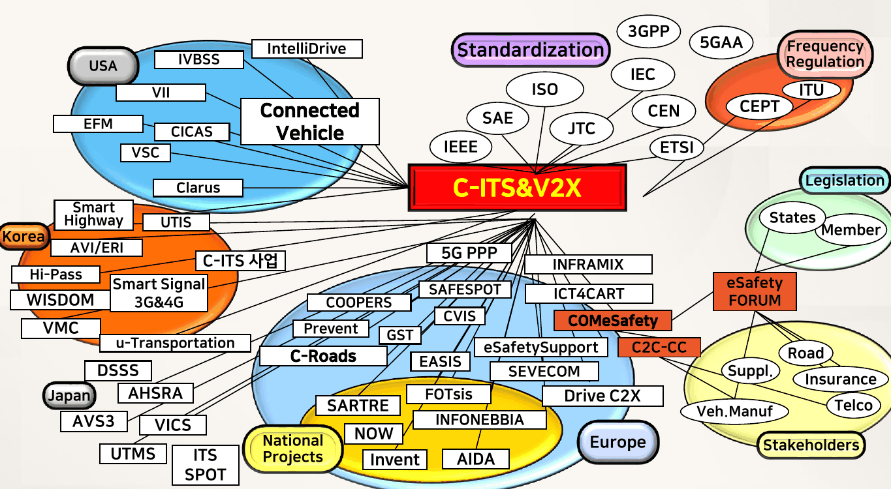

*그림 1. C-ITS와 V2X에 관련된 각국의 프로젝트, 표준화 기구, 규제, 이해관계자*

그림 1은 C-ITS와 V2X를 둘러싼 세계의 활동을 하나의 지도로 묶은 것이다. 가운데의 C-ITS&V2X를 중심으로 네 종류의 묶음이 연결된다.

1. **국가별 프로젝트:** 미국은 VII, IntelliDrive, Connected Vehicle, VSC, CICAS, IVBSS, Clarus, EFM 등, 한국은 Smart Highway, UTIS, C-ITS 사업, Hi-Pass, AVI/ERI, WISDOM, VMC, Smart Signal, 3G&4G, u-Transportation 등, 일본은 VICS, DSSS, AHSRA, AVS3, UTMS, ITS SPOT 등, 유럽은 PReVENT, CVIS, SAFESPOT, COOPERS, C-Roads, Drive C2X, SARTRE, 5G PPP, INFRAMIX, ICT4CART 등을 수행했다.
2. **표준화 기구:** 이동통신 표준의 3GPP와 5GAA, 국제 표준의 ISO, IEC, ITU, JTC, 미국의 SAE와 IEEE, 유럽의 CEN, ETSI, 주파수를 다루는 CEPT가 있다.
3. **법과 제도:** 주파수 규제(frequency regulation), 국가(state)와 회원국(member) 단위의 입법(legislation)이 있다.
4. **이해관계자:** 도로 운영자(road), 보험사, 통신사(telco), 완성차 업체(vehicle manufacturer), 부품 공급사(supplier), 그리고 유럽의 eSafety Forum, C2C-CC, COMeSafety 같은 협의체가 있다.

이 지도에서 알 수 있듯이 V2X는 자동차 산업만의 기술이 아니라 통신, 도로, 보험, 정부가 얽힌 생태계이다. 그래서 각국의 사례도 기술 개발 과제와 표준화, 시범 사업, 제도화가 함께 진행된다.

> **용어 정의:** **3GPP(3rd Generation Partnership Project)** 는 LTE와 5G 같은 이동통신 표준을 만드는 국제 표준화 단체이다.

> **용어 정의:** **5GAA(5G Automotive Association)** 는 자동차, 통신, 반도체 기업이 C-V2X의 보급을 위해 만든 협의체이다.

그림 1의 표준화 기구 가운데 3GPP와 5GAA가 이동통신 쪽의 단체라면, 다음 두 기구는 각각 미국의 자동차 표준과 유럽의 통신 표준을 만드는 지역 단체이다.

> **용어 정의:** **SAE(SAE International)** 는 미국 자동차 기술자 협회로, 자율주행 레벨(J3016)과 V2X 메시지(J2735) 표준을 만들었다.

> **용어 정의:** **ETSI(European Telecommunications Standards Institute)** 는 유럽의 통신 표준화 기구이다.

### 1.2 주요국의 커넥티드 자율주행 로드맵

각국의 커넥티드 자율주행은 대체로 같은 순서를 밟았다. 먼저 실험실과 시험장에서 개념을 검증하고, 다음으로 공공 도로에서 시험하며, 이어서 실제 배치 직전의 대규모 시범 운영을 거쳐 배치 단계로 넘어간다.

> **용어 정의:** **개념 검증(proof of concept)** 은 아이디어가 기술적으로 실현 가능한지를 확인하는 단계이다.

> **용어 정의:** **FOT(Field Operational Test, 실도로 시험)** 는 일반 운전자가 실제 도로에서 시스템을 사용하게 하여 효과와 문제를 측정하는 시험이다.

실도로 시험까지가 기술의 효과를 확인하는 단계라면, 나머지 두 단계는 확인된 기술을 실제 서비스로 옮기는 단계이다.

> **용어 정의:** **사전 배치(pre-deployment)** 는 실제 배치 직전에 일정 지역에서 운영 체계까지 갖추어 시범 운영하는 단계이다.

> **용어 정의:** **배치(deployment)** 는 서비스로 상시 운영하는 단계이다.

| 국가 | 01 개념 검증 | 02 실도로 시험(FOT) | 03 사전 배치 | 배치 |
|:-----|:-----|:-----|:-----|:-----|
| 유럽 | 2006\~2009년 FP6: CVIS, COOPERS, SAFESPOT, COMeSafety (PReVENT 2003\~2007년) | 2010\~2014년 FP7: Drive C2X, FOTsis, COMeSafety2 | 2013\~2015년 Compass4D, Amsterdam Group | 2016년\~현재 C-ITS Platform, C-Roads, CAD 라운드 테이블, Horizon 2020 ART(2016, 2017년 공모) |
| 미국 | 2003\~2009년 VII, VSC, VSC-A, CICAS (1999년 전용 주파수 배정) | 2010\~2011년 IntelliDrive, VSC-3 | 2011\~2015년 Connected Vehicle, Safety Pilot Model Deployment, VSC-3 | 2015년\~현재 CV Pilot Deployment Program |
| 일본 | 1998\~2004년 VICS, ETC | 2004\~2006년 Smartway, DSSS 기초 연구와 요소 기술 시험 | 2007\~2010년 Smartway, DSSS, ITS Safety 2010 실도로 시험 | 2011년\~ ITS Spot(ETC2.0) 1,600개소, DSSS 15개소 |
| 한국 | 2007\~2012년 u-Transportation, Smart Highway | 2008\~2014년 Smart Highway(시험 도로에서의 시범 시험) | 2015\~2017년 C-ITS 시범 사업 | 2018년\~현재 C-ITS 실증 사업 |

*표 1. 주요국의 커넥티드 자율주행 개발 단계*

표 1에서 네 나라는 시기는 다르지만 같은 단계를 거쳤다. 일본은 VICS와 ETC로 가장 먼저 도로와 차량을 연결했고, 미국은 1999년에 전용 주파수를 확보한 뒤 VII에서 출발했으며, 유럽은 EU의 연구 프레임워크 프로그램(FP)으로 다국적 과제를 이어 갔다. 한국은 2007년 무렵부터 u-Transportation과 Smart Highway 같은 국가 연구개발 사업을 거쳐 2014년 7월에 C-ITS 시범 사업에 들어갔다(표 1은 시범 사업의 기간을 2015\~2017년으로 적지만, 사업 자체는 2014년 7월에 시작되었다. 3.9절 참고).

> **용어 정의:** **VICS(Vehicle Information and Communication System)** 는 일본의 도로 교통 정보 제공 시스템이다.

> **용어 정의:** **ETC(Electronic Toll Collection)** 는 한국의 하이패스에 해당하는 무선 통행료 징수 시스템이다.

표 1의 배치 단계에서 일본은 ETC 단말을 통행료 징수 밖의 용도로 넓혀 커넥티드 서비스의 기반으로 삼았다.

> **용어 정의:** **ETC2.0**은 ETC 단말로 통행료 징수뿐 아니라 교통 정보와 안전 정보까지 주고받도록 확장한 일본의 서비스이다.

> **용어 정의:** **ITS Spot**은 ETC2.0의 노변 기지국이다.

> **용어 정의:** **DSSS(Driving Safety Support Systems)** 는 교차로 등에서 운전자에게 위험 정보를 주는 일본 경찰청의 안전 운전 지원 시스템이다.

### 1.3 미국의 Connected Vehicle 개발 로드맵

미국의 커넥티드 차량 개발은 법과 제도의 흐름과 연구 프로젝트의 흐름이 나란히 진행되었다.

> **용어 정의:** **VII(Vehicle Infrastructure Integration)** 는 차량과 도로 인프라를 무선으로 통합하려던 미국 교통부의 초기 프로그램이다. 2009년 무렵 IntelliDrive로 이름을 바꾸었고, 2011년부터는 Connected Vehicle(CV) 프로그램으로 불린다.

> **용어 정의:** **VSC(Vehicle Safety Communications)** 는 V2V, V2I 통신으로 가능해지는 안전 서비스를 정의하고 평가한 완성차 업체 공동 과제이다.

| 구분 | 시기 | 내용 |
|:-----|:-----|:-----|
| 법과 제도 | 1999년 | 연방통신위원회(FCC)가 5.850\~5.925 GHz를 ITS 전용 주파수로 배정 |
| 법과 제도 | 1998\~2005년 | 교통 수권법 TEA-21 |
| 법과 제도 | 2005\~2009년 | 교통 수권법 SAFETEA-LU |
| 법과 제도 | 2010\~2014년 | 교통부의 ITS 전략 연구 계획 |
| 법과 제도 | 2012년 | 교통 수권법 MAP-21 |
| 법과 제도 | 2014년 8월 | V2X 서비스의 효과에 따라 차량 장착의 법제화를 검토한다고 발표 |
| 법과 제도 | 2015\~2019년 | ITS Strategic Plan 2015-2019 |
| 프로젝트 | 2002\~2004년 | VSC (CAMP) |
| 프로젝트 | 2003년\~ | VII |
| 프로젝트 | 2006\~2011년 | VSC-A (CAMP와 교통부) |
| 프로젝트 | 2006\~2012년 | CICAS |
| 프로젝트 | 2009년\~ | IntelliDrive |
| 프로젝트 | 2010\~2014년 | VSC3 (CAMP와 교통부) |
| 프로젝트 | 2011년\~ | Connected Vehicle, Safety Pilot Model Deployment |
| 프로젝트 | 2015년\~ | CV Pilots Deployment Project |

*표 2. 미국의 Connected Vehicle 개발 로드맵*

표 2의 흐름은 개념 검증에서 실증 단지, 시범 사업, 사업화로 이어지는 순서를 따른다. 수권법(authorization act)은 연방 정부가 도로와 교통 사업에 쓸 예산의 틀을 몇 년 단위로 정하는 법이며, ITS 연구 예산도 이 법에 근거한다.

> **참고:** MAP-21(Moving Ahead for Progress in the 21st Century Act)은 2012년 7월에 제정되어 2013, 2014 회계연도의 지상 교통 사업을 지원한 2년 단위의 수권법이다 [1]. 따라서 MAP-21의 기간을 2012\~2022년으로 표시한 로드맵은 법의 적용 기간과 맞지 않는다.

### 1.4 제도화와 관련 기관

미국 교통부는 자율주행 가이드라인인 *Automated Driving Systems 2.0* (2017) [2], *Automated Vehicles 3.0* (2018) [3], *Automated Vehicles 4.0* (2020) [4]을 차례로 발간하여 자율주행의 제도화 방향을 제시했다. 세 문서의 내용은 1주차에서 다루었다.

미국 교통부 안에서 ITS 사업을 총괄하는 곳은 **ITS 공동 프로그램 사무국(ITS JPO, Intelligent Transportation Systems Joint Program Office)** 이다. ITS JPO는 교통부 전체에 걸친 권한으로 다음 산하 기관 사이의 ITS 프로그램과 사업을 조정한다 [5].

| 약어 | 기관 | 주요 소관 |
|:-----|:-----|:-----|
| FHWA | Federal Highway Administration (연방도로청) | 도로와 도로 인프라, V2I |
| FMCSA | Federal Motor Carrier Safety Administration (연방자동차운송안전청) | 트럭과 버스 같은 상업용 차량의 안전 |
| FTA | Federal Transit Administration (연방대중교통청) | 버스와 철도 같은 대중교통 |
| FRA | Federal Railroad Administration (연방철도청) | 철도와 철도 건널목 |
| NHTSA | National Highway Traffic Safety Administration (도로교통안전국) | 자동차 안전 기준과 V2V |
| MARAD | Maritime Administration (해사청) | 해운과 항만 |

*표 3. ITS JPO가 조정하는 미국 교통부 산하 기관*

V2X는 차량(NHTSA), 도로(FHWA), 상업용 차량(FMCSA), 대중교통(FTA), 철도 건널목(FRA)에 모두 걸치므로, 여러 기관을 묶는 조정 조직이 필요하다.

### 1.5 초기 로드맵과 전망

**연구 트랙.** 미국 교통부의 자동화 연구는 다섯 개의 연구 트랙으로 구성되었다 [6].

| 연구 트랙 | 세부 분야 |
|:-----|:-----|
| 기반 기술(Enabling Technologies) | 디지털 인프라, 통신, 기술 연구 |
| 안전 보증(Safety Assurance) | 전자 제어 시스템, 기능 안전과 전자 장치 신뢰성, 사이버 보안, 인적 요인 |
| 교통 시스템 성능(Transportation System Performance) | CACC, 속도 조화, 군집주행, 횡방향 제어, 첫 구간과 마지막 구간, 대중교통 운영 |
| 시험과 평가(Testing and Evaluation) | 상호 운용성, 시험 방법, 편익 평가 |
| 정책과 계획(Policy and Planning) | 표준, 연방 정책 분석, 이해관계자 참여, 교통 계획 |

*표 4. 미국 교통부 자동화 프로그램의 연구 트랙*

> **용어 정의:** **CACC(Cooperative Adaptive Cruise Control, 협력형 적응 순항 제어)** 는 앞차와의 거리를 레이더로만 재는 ACC에 V2V 통신을 더해, 앞차의 가속과 감속 정보를 직접 받아 더 짧고 안정적인 차간 거리를 유지하는 기술이다.

> **용어 정의:** **속도 조화(speed harmonization)** 는 정체 구간 앞의 차량들에 권장 속도를 주어 속도 차이를 줄이는 교통 관리 기법이다.

> **용어 정의:** **군집주행(platooning)** 은 여러 차량이 통신으로 연결되어 짧은 간격으로 줄지어 주행하는 것이다.

**초안 프로그램 계획.** 교통부는 2016\~2023년의 연구 활동을 세 묶음으로 계획했다. 이 계획은 초안(draft)으로 제시되었고, 활동마다 진행 중이거나 확정된 것, 검토 중인 것, 향후 가능성이 있는 것을 구분했다.

| 묶음 | 활동 (수행 기관) |
|:-----|:-----|
| 개념 검증, 시연, 편익 | 커넥티드 자동화(CA) 응용의 운영 전략, 트럭 군집주행 평가 (CA PATH), 자동화 차량 실험 시제품 (Leidos, Volpe, 미 육군 Aberdeen 시험 센터), 속도 조화, CACC, 차로 변경 관리(LCM)를 묶은 관리 차로 시연, 실험 차량을 이용한 초기 CACC 평가, 간선도로에서의 Glidepath 군집 시연 |
| 응용 연구, 개발, 시험 | CACC 소규모 시험, CACC 시스템 아키텍처, 친환경 교차로 접근과 출발(EAD)의 타당성과 아키텍처, 소규모 시험, CA 배치 사례 연구를 위한 이해관계자 참여, 묶음 CA 응용의 아키텍처, 경쟁 이전 단계의 CA 시제품 (CAMP), CA 실도로 시험, CA 시범 시험 |
| 정책, 배치 준비, 지원 | 시험 배치 환경과 시스템 구축 (Honeywell), FHWA 자동화 차량 정책 (Volpe), CA 응용을 위한 AMS 도구, CA 배치 지침 |

*표 5. 미국 교통부의 초기 자동화 프로그램 계획 (2016\~2023년, 초안)*

세 묶음이 끝나는 2022\~2023년에는 CA 응용의 초기 배치(initial deployment)가 계획되었다. 표 5에서 개념 검증, 응용 연구, 정책 준비를 병렬로 진행한 뒤 배치로 수렴시키는 구조를 읽을 수 있다.

> **용어 정의:** **EAD(Eco-Approach and Departure)** 는 신호 정보를 받아 교차로에 도착하는 속도를 조절하여 불필요한 정지와 급가속을 줄이는 친환경 응용이다.

> **용어 정의:** **AMS(Analysis, Modeling, and Simulation)** 는 교통 체계의 효과를 분석, 모델링, 시뮬레이션하는 도구를 말한다.

표 5의 활동은 대학의 연구 프로그램, 연방 정부의 연구 기관, 민간 기업이 나누어 수행했다.

> **용어 정의:** **CA PATH**는 캘리포니아 대학교 버클리의 교통 연구 프로그램(Partners for Advanced Transportation Technology)이다.

> **용어 정의:** **Volpe**는 교통부 산하 국립 교통 시스템 센터이다.

**보급 시나리오.** 텍사스 A&M 교통연구소(TTI)는 자율주행 기능이 보급되는 속도에 대해 두 시나리오를 제시했다 [7].

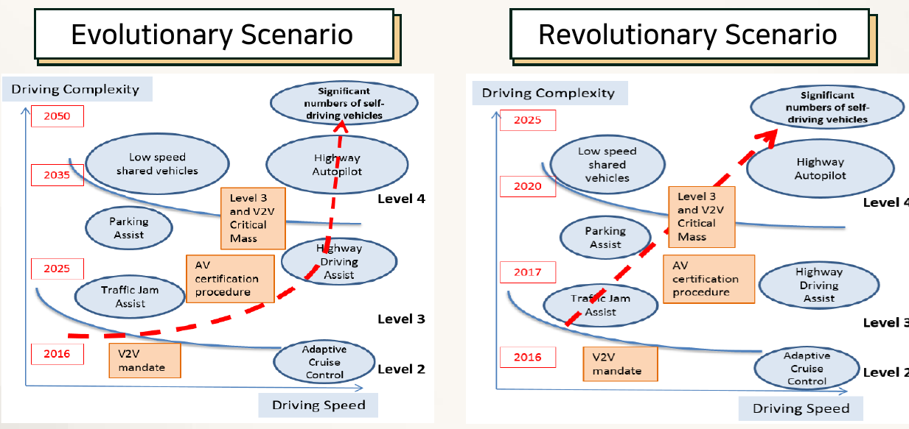

*그림 2. 자율주행 보급의 진화적 시나리오와 혁명적 시나리오*

그림 2의 가로축은 주행 속도, 세로축은 주행의 복잡도이다. 아래쪽의 레벨 2 영역에는 적응 순항 제어(ACC)가, 가운데의 레벨 3 영역에는 정체 구간 보조(Traffic Jam Assist)와 고속도로 주행 보조(Highway Driving Assist)가, 위쪽의 레벨 4 영역에는 주차 보조, 저속 공유 차량, 고속도로 자율주행(Highway Autopilot)이 놓인다. 붉은 점선은 시간에 따라 기능이 보급되는 경로이며, 그 사이에 V2V 의무화, 자율주행차 인증 절차, 레벨 3와 V2V의 임계 보급량(critical mass)이라는 제도적 관문이 있다.

| 이정표 | 진화적 시나리오 | 혁명적 시나리오 |
|:-----|:-----|:-----|
| V2V 의무화 (레벨 2) | 2016년 | 2016년 |
| 자율주행차 인증 절차, 레벨 3 기능 | 2025년 | 2017년 |
| 레벨 3와 V2V 임계 보급량, 레벨 4 기능 | 2035년 | 2020년 |
| 상당수의 자율주행차 운행 | 2050년 | 2025년 |

*표 6. TTI의 두 보급 시나리오가 가정한 시점*

진화적 시나리오는 기존 운전자 보조 기능이 점진적으로 고도화된다고 보았고, 혁명적 시나리오는 제도와 기술이 빠르게 맞물려 10년 안에 자율주행차가 확산된다고 보았다. 두 시나리오 모두 V2V 의무화를 출발점으로 둔 점에 주목할 필요가 있다. 실제로는 1주차에서 본 것처럼 미국의 V2V 의무화 규칙 제정안이 2023년에 철회되었으므로, 커넥티드 기능의 보급은 두 시나리오의 가정보다 더디게 진행되었다.

**다학제적 접근.** 미국의 초기 자율주행 연구는 공학만이 아니라 철학, 윤리, 법학을 아우르는 다학제적 접근을 취했다. Santa Clara 대학교의 Shannon Vallor 교수와 Sonoma State 대학교의 John Sullins 교수 같은 철학자들은 자율주행차가 피할 수 없는 사고 상황에서 어떤 판단을 해야 하는지와 같은 윤리 문제를 연구했고, Stanford 대학교의 자동차 연구 센터(CARS)는 2015년 6월에 자율주행차에 윤리를 프로그래밍하는 문제를 다루는 워크숍을 열어 Vallor 교수 같은 철학자를 공학자와 함께 발표자로 초청했다 [8].

**소비자 선호.** J.D. Power의 2015년 미국 기술 선택 조사(U.S. Tech Choice Study)는 세대에 따라 선호하는 자율주행 기술이 다르다는 것을 보여 주었다 [9]. 이 조사는 정체 구간 보조, 제한적 자율주행, 완전 자율주행의 세 기술에 대한 선호를 MaxDiff 점수(평균 100)로 측정했으며, 그 가운데 정체 구간 보조의 점수는 Y세대 88, X세대 85, 베이비붐 세대 87, 그 이전 세대(pre-boomer) 97로 가장 나이 든 세대에서 가장 높았다. 조사는 이 결과를 Y세대와 X세대가 운전의 전부나 일부를 맡는 복잡하고 진보된 자율주행 기술을 더 선호하는 반면, 나이 든 세대는 정체 구간 보조처럼 단순한 기능부터 단계적으로 완전 자율주행에 다가가는 쪽을 선호한다고 해석했다.

> **용어 정의:** **MaxDiff(최대 차이 척도)** 는 응답자에게 여러 항목 가운데 가장 선호하는 것과 가장 덜 선호하는 것을 반복해서 고르게 하여 항목들의 상대적 선호도를 점수로 매기는 조사 기법이다. 평균을 100으로 맞추면 100보다 큰 값은 평균보다 선호된다는 뜻이다.

### 1.6 CAMP 컨소시엄과 VSC 프로젝트

**CAMP(Crash Avoidance Metrics Partners LLC)** 는 미국의 완성차 업체들이 충돌 회피 기술을 공동으로 연구하기 위해 만든 컨소시엄이다. 경쟁 관계의 업체들이 경쟁 이전 단계(pre-competitive)의 기술, 즉 모든 업체가 함께 써야 하는 메시지 형식, 보안 체계, 시험 방법을 함께 개발하고, 교통부가 이를 지원한다. V2V는 서로 다른 제조사의 차량끼리 통신해야 의미가 있으므로, 이런 공동 개발 구조가 필수적이다. CAMP가 1996년부터 수행한 주요 과제는 표 7과 같다 [10].

| 번호 | 과제 | 기간 | 내용 |
|:-----|:-----|:-----|:-----|
| 1 | Forward Collision Warning (FCW) | 1996-02 ~ 1999-03 | 전방 충돌 경고 시스템의 초기 개발과 시험 |
| 2 | Panic Brake Assist (PBA) | 2001-04 ~ 2004-03 | 비상 제동 보조 시스템 개발 |
| 3 | Forward Collision Warning (FCW) | 2003-04 ~ 2006-03 | 전방 충돌 경고 시스템 개선 연구 |
| 4 | Vehicle Safety Communications (VSC) | 2005-04 ~ 2008-06 | 차량 안전 통신 프로토콜 개발 |
| 5 | Driver Workload Metrics (DWM) | 2006-03 ~ 2008-12 | 운전자 작업 부하 측정 기준 개발 |
| 6 | Enhanced Digital Mapping (EDMap) | 2004-06 ~ 2006-09 | 고정밀 지도 데이터 활용 연구 |
| 7 | Emergency Electronic Brake Light (EEBL) | 2005-07 ~ 2007-03 | 전자식 긴급 제동등 경고 시스템 개발 |
| 8 | Cooperative Intersection Collision Avoidance (CICAS-V) | 2008-01 ~ 2010-06 | 교차로 충돌 회피 시스템 연구 |
| 9 | Advanced Restraint Systems (ARS) | 2010-04 ~ 2012-05 | 고급 탑승자 구속 장치 설계 |
| 10 | Objective Tests for CIB Systems | 2010-05 ~ 2013-08 | 충돌 임박 제동(CIB) 시스템의 시험 방법 개발 |
| 11 | Vehicle Safety Communications Applications (VSC-A) | 2011-06 ~ 2014-09 | 안전 통신 응용 연구 |
| 12 | Objective Tests for PCAM Systems | 2013-05 ~ 2015-08 | 보행자 충돌 회피(PCAM) 시스템의 시험 방법 개발 |
| 13 | V2V Communications Security (V2V-CS) | 2013-06 ~ 2015-12 | 차량 간 통신 보안 연구 |
| 14 | V2V Interoperability | 2014-03 ~ 2016-09 | V2V 시스템의 상호 운용성 평가 |
| 15 | V2V Safety Pilot | 2014-07 ~ 2016-12 | 차량 안전 시스템의 시험 운영 |
| 16 | V2V Safety System Light Vehicle Builds | 2014-08 ~ 2017-02 | 승용차와 소형 트럭용 V2V 시스템 제작 |
| 17 | Vehicle Safety Communications Security Studies (VSCS) | 2014-09 ~ 2017-03 | VSC 보안 연구 |
| 18 | Automated Vehicle Research for Enhanced Safety (AVR) | 2015-01 ~ 2017-12 | 자동화 차량의 안전 연구와 평가 |
| 19 | V2I Program Cooperative Adaptive Cruise Control (CACC) | 2015-05 ~ 2017-06 | 협력형 적응 순항 제어 연구 |
| 20 | SCMS Proof-of-Concept Implementation | 2016-03 ~ 2018-05 | 보안 인증서 관리 시스템(SCMS)의 개념 검증과 구현 |
| 21 | Road Weather Management Program (RWMP) Connected Vehicle-Infrastructure Research | 2016-06 ~ 2018-11 | 도로 기상 관리와 커넥티드 차량 인프라 연구 |
| 22 | Advanced Messaging Concept Development (AMCD) | 2017-02 ~ 2019-03 | 고급 메시징 기술 개발 |
| 23 | CACC Small-Scale Test, Phase 1 (CACC-SST) | 2017-05 ~ 2018-12 | 소규모 협력형 적응 순항 제어 시험 |
| 24 | V2V Communications Research (V2V-CR) | 2018-04 ~ 2020-12 | 차량 간 통신 기술 연구 |
| 25 | V2V Systems Engineering and Integration Research (V2V-SE) | 2018-07 ~ 2021-03 | V2V 시스템 통합과 엔지니어링 연구 |
| 26 | Operation of the SCMS Proof-of-Concept | 2018-09 ~ 2020-08 | SCMS 개념 검증 시스템의 운영과 기술 지원 |
| 27 | Technical Management of Connected Vehicle Safety System SCMS | 2018-11 ~ 2021-05 | 커넥티드 차량 보안 시스템의 기술 관리 |
| 28 | Automated Driving Behaviors (ADB) | 2018-08 ~ 2020-04 | 자동화된 운전 행동과 성능 평가 |
| 29 | Automation and Public Safety Common Solutions (APSCS) | 2018-09 ~ 2020-06 | 공공 안전을 위한 자동화 기술 개발 |
| 30 | Traffic Optimization for Signalized Corridors (TOSCo), Phase 1 | 2019-03 ~ 2021-12 | 신호 교차로가 이어진 도로의 교통 최적화 연구 |
| 31 | V2I Safety Applications (V2I-SA) | 2019-05 ~ 2021-08 | 차량과 인프라를 통합한 안전 응용 개발 |
| 32 | V2V Communications Research, Phase 2 (V2V-CR2) | 2020-02 ~ 2022-06 | V2V 통신 연구 2단계 |
| 33 | Cellular Vehicle-to-Everything (C-V2X) Project | 2019-08 ~ 2021-11 | 셀룰러 기반 V2X 기술 연구와 평가 |
| 34 | Event-Driven Configurable Messaging (EDCM) and Work Zone Queue Advisory/Warning (QA/QW) System | 2020-03 ~ 2022-09 | 이벤트 기반 메시징과 작업 구역 대기열 경고 시스템 개발 |
| 35 | Cooperative Automated Driving Systems (CADS) | 2020-05 ~ 2023-02 | 협력형 자동 운전 시스템의 개발과 시험 |
| 36 | Connected Intersections Program (CIP) | 2021-03 ~ 2024 (예정) | 연결된 교차로 기술의 개발과 성능 평가 |

*표 7. CAMP 컨소시엄의 주요 과제*

표 7을 시간 순서로 읽으면 미국 V2X 연구의 중심이 이동한 흐름이 보인다. 1990년대 후반과 2000년대 초에는 센서 기반의 충돌 경고(FCW, PBA)가 중심이었고, 2005년 무렵부터 통신 기반의 안전 서비스(VSC, EEBL, CICAS-V)가 등장했다. 2013년 이후에는 V2V를 실제로 배치하기 위한 보안(V2V-CS, SCMS)과 상호 운용성 과제가 늘었고, 2015년 이후에는 자동화(AVR, CACC, ADB, CADS)와 C-V2X가 더해졌다.

> **용어 정의:** **SCMS(Security Credential Management System, 보안 인증서 관리 시스템)** 는 V2X 메시지에 전자 서명을 붙일 인증서를 발급하고 폐기하는 공개 키 기반 구조이다. 수신 차량은 서명을 검증하여 메시지가 정상 장치에서 왔고 위조되지 않았음을 확인한다.

> **용어 정의:** **CIB(Crash Imminent Braking)** 는 충돌이 임박했을 때 자동으로 제동하는 기능이다.

**VSC 계열 프로젝트.** VSC는 V2V, V2I 안전 서비스를 정의하고 개발하며 평가한 과제 계열이다. 각 단계에 참여한 완성차 업체는 표 8과 같다.

| 과제 | 기간 | 내용과 참여 업체 |
|:-----|:-----|:-----|
| VSC | 2002\~2004년 | 통신으로 가능해지거나 향상되는 차량 안전 서비스를 평가 (BMW, DaimlerChrysler, Ford, GM, Nissan, Toyota, VW) |
| EEBL | 2005\~2006년 | 전자식 긴급 제동등(EEBL) 서비스 개발과 평가 (BMW, DaimlerChrysler, Ford, GM, Nissan, Toyota) |
| VSC 2 | 2006\~2009년 | CICAS-V 프로젝트, VSC-A 프로젝트 (교통부, DaimlerChrysler, Ford, GM, Honda, Toyota) |

*표 8. 미국의 VSC 계열 프로젝트*

> **참고:** VSC-A의 기간은 자료마다 다르게 제시된다. 표 8은 VSC 2 컨소시엄의 VSC-A를 2006\~2009년으로, 표 2는 2006\~2011년으로, CAMP 과제 목록(표 7)은 같은 이름의 과제를 2011\~2014년으로 적었다. 이름이 같더라도 단계가 다른 과제일 수 있으므로, 기간을 인용할 때는 어느 자료의 어느 단계인지 함께 밝히는 것이 좋다.

VSC 과제는 통신으로 구현할 수 있는 안전 서비스 34종을 정의했다. 차량끼리 주고받는 V2V 서비스가 15종, 차량과 인프라가 주고받는 V2I 서비스가 19종이다.

| V2V 서비스 (15종) | V2I 서비스 (19종) |
|:-----|:-----|
| Approaching Emergency Vehicle Warning (긴급 차량 접근 경고) | Blind Merge Warning (사각 합류 경고) |
| Blind Spot Warning (사각지대 경고) | Curve Speed Warning (곡선 구간 속도 경고) |
| Cooperative Adaptive Cruise Control (협력형 적응 순항 제어) | Emergency Vehicle Signal Preemption (긴급 차량 신호 우선) |
| Cooperative Collision Warning (협력형 충돌 경고) | Highway/Rail Collision Warning (철도 건널목 충돌 경고) |
| Cooperative Forward Collision Warning (협력형 전방 충돌 경고) | Intersection Collision Warning (교차로 충돌 경고) |
| Cooperative Vehicle-Highway Automation System (협력형 차량-도로 자동화) | In-Vehicle Amber Alert (차내 실종 아동 경보) |
| Emergency Electronic Brake Lights (전자식 긴급 제동등) | In-Vehicle Signage (차내 표지 정보) |
| Highway Merge Assistant (고속도로 합류 보조) | Just-In-Time Repair Notification (적시 수리 알림) |
| Lane Change Warning (차로 변경 경고) | Left Turn Assistant (좌회전 보조) |
| Post-Crash Warning (사고 후 경고) | Low Bridge Warning (낮은 교량 경고) |
| Pre-Crash Sensing (충돌 직전 감지) | Low Parking Structure Warning (낮은 주차 구조물 경고) |
| Vehicle-Based Road Condition Warning (차량 기반 노면 상태 경고) | Pedestrian Crossing Information at Intersection (교차로 보행자 횡단 정보) |
| V2V Road Feature Notification (V2V 도로 특징 알림) | Road Condition Warning (노면 상태 경고) |
| Visibility Enhancer (시야 향상) | Safety Recall Notice (안전 리콜 알림) |
| Wrong Way Driver Warning (역주행 경고) | SOS Services (긴급 구조 서비스) |
| | Stop Sign Movement Assistance (정지 표지 통과 보조) |
| | Stop Sign Violation Warning (정지 표지 위반 경고) |
| | Traffic Signal Violation Warning (신호 위반 경고) |
| | Work Zone Warning (작업 구역 경고) |

*표 9. VSC가 정의한 V2V, V2I 안전 서비스 34종*

V2V 서비스는 주로 주변 차량의 위치, 속도, 제동 상태를 알아야 하는 충돌 경고이고, V2I 서비스는 신호, 표지, 노면, 도로 구조처럼 인프라가 알고 있는 정보를 차량에 전달하는 경고와 안내이다.

### 1.7 VSC-A 응용 시나리오와 EEBL

VSC-A(Vehicle Safety Communications-Applications) 과제는 V2V 안전 응용을 실제 충돌 유형에 대응시켜 개발하고 시험했다. 대표 시나리오는 정지한 앞차와 전방 충돌 경고(FCW), 차로 변경과 사각지대 경고(BSW), 감속하는 앞차와 전자식 긴급 제동등(EEBL)이다. 마지막 시나리오에서는 앞의 앞차가 급제동하면 그 차가 보낸 EEBL 메시지를 받아, 바로 앞차에 가려 보이지 않는 제동을 미리 알 수 있다.

> **용어 정의:** **FCW(Forward Collision Warning)** 는 앞차와 충돌할 위험이 있을 때 경고하는 응용이다.

> **용어 정의:** **EEBL(Emergency Electronic Brake Lights)** 은 급제동한 차량이 그 사실을 V2V로 알려, 뒤따르는 차량이 시야가 가려져도 제동을 알 수 있게 하는 응용이다.

> **용어 정의:** **BSW(Blind Spot Warning)** 와 LCW(Lane Change Warning)는 차로를 바꿀 때 옆 차로의 차량을 경고한다.

VSC-A는 대표 시나리오 밖의 충돌 유형에도 각각 대응하는 응용을 마련했다.

> **용어 정의:** **DNPW(Do Not Pass Warning)** 는 추월하려 할 때 맞은편 차로에 차량이 오면 경고한다.

> **용어 정의:** **IMA(Intersection Movement Assist)** 는 교차로에서 교차 방향 차량과의 충돌 위험을 경고한다.

> **용어 정의:** **CLW(Control Loss Warning)** 는 주변 차량이 미끄러지는 등 통제를 잃었음을 경고한다.

| 번호 | 충돌 시나리오 | 대응하는 V2V 응용 |
|:-----|:-----|:-----|
| 1 | 앞차가 정지해 있음 | FCW |
| 2 | 선행 동작 없이 차량이 통제를 잃음 | CLW |
| 3 | 비신호 교차로에서 차량이 회전함 | IMA |
| 4 | 비신호 교차로에서 직진 경로가 교차함 | IMA |
| 5 | 앞차가 감속함 | EEBL, FCW |
| 6 | 맞은편 방향의 차량이 그대로 진행함 (추월 상황) | DNPW |
| 7 | 같은 방향의 차량이 차로를 바꿈 | BSW, LCW |
| 8 | 비신호 교차로에서 좌회전 차량과 맞은편 직진 차량이 충돌함 (LTAP/OD) | IMA |

*표 10. VSC-A가 충돌 시나리오에 대응시킨 V2V 안전 응용*

> **용어 정의:** **LTAP/OD(Left Turn Across Path, Opposite Direction)** 는 좌회전하는 차량이 맞은편에서 직진해 오는 차량의 경로를 가로지르다 충돌하는 유형이다.

표 10은 응용 하나가 여러 충돌 유형을 줄이고, 한 충돌 유형에 여러 응용이 함께 쓰일 수 있음을 보여 준다. 예를 들어 IMA는 비신호 교차로의 세 시나리오(3, 4, 8)에 모두 쓰이고, 감속하는 앞차(5)에는 EEBL과 FCW가 함께 쓰인다.

**Euro NCAP과 EEBL.** EEBL 같은 V2X 안전 기능은 유럽의 신차 안전도 평가에도 반영되기 시작했다. Euro NCAP은 2017년 9월 12일에 발표한 *Euro NCAP 2025 Roadmap*에서 2025년까지의 평가 항목 도입 계획을 제시했다 [11].

> **용어 정의:** **Euro NCAP(European New Car Assessment Programme)** 은 유럽에서 판매되는 신차의 충돌 안전성과 능동 안전 기능을 평가하여 별점으로 공개하는 프로그램이다. 법적 의무는 아니지만 소비자의 구매에 큰 영향을 주므로, 완성차 업체는 높은 별점을 받기 위해 평가 항목의 기능을 적극적으로 탑재한다.

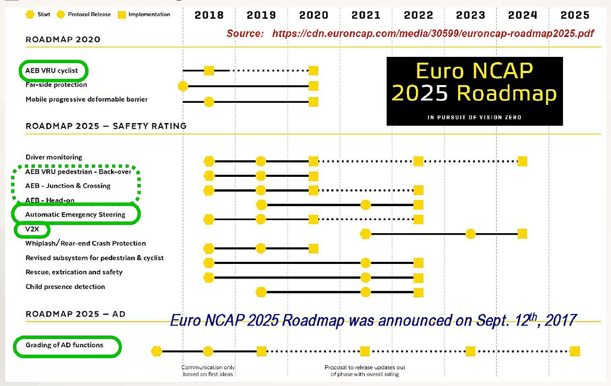

*그림 3. Euro NCAP 2025 로드맵의 평가 항목 도입 계획*

그림 3은 2018\~2025년의 평가 항목을 세 묶음으로 보여 준다. Roadmap 2020에는 자전거 이용자를 위한 자동 긴급 제동(AEB VRU cyclist), 원측(far-side) 충돌 보호, 이동형 변형 장벽 시험이 있다. Roadmap 2025의 안전 등급(safety rating)에는 운전자 모니터링, 보행자 후진 AEB, 교차로와 횡단 AEB, 정면 AEB, 자동 긴급 조향(AES), V2X, 후방 추돌 보호, 보행자와 자전거 이용자 보호 개정, 구조와 탈출 안전, 아동 방치 감지가 있다. Roadmap 2025의 자율주행(AD) 항목에는 자율주행 기능의 등급 평가가 있다. 녹색 동그라미로 강조된 것처럼 Euro NCAP은 자동 긴급 조향, V2X, 자율주행 기능의 등급 평가를 새로 포함하기로 했다.

로드맵의 V2X 항목(2024년 도입 예정)은 V2X 통신이 교통 안전과 효율을 높일 잠재력이 있다고 설명하고, 안전 관련 기능의 예로 "Emergency electronic brake lights", "Motorcycle is approaching", "Roadwork ahead"를 들었다. 그리고 V2X가 차량 센서의 이점을 넘어서려면 주변 센서가 위험을 보기 전에 위험을 먼저 식별해야 한다고 강조했다. 자율주행 기능에 대해서는 주차, 도심 주행, 도시 간 주행, 정체 구간, 고속도로 주행을 평가 대상 기능으로 꼽고, 고속도로 보조와 정체 구간 보조 같은 지속 보조(continued assistance) 시스템부터 단계적으로 평가하겠다고 밝혔으며, 이 평가는 이르면 2018\~2019년에 시작될 수 있다고 보았다. 자동 긴급 조향(2020, 2022년)은 단일 차량 사고, 작은 겹침(small overlap) 충돌, 취약 도로 이용자 사고를 AEB보다 더 줄일 수 있는 기술로 소개되었으며, UNECE 규정 79의 개정이 2020년 무렵 비상 조향 기능을 허용할 것으로 예상되었다. 그 첫 단계로 Euro NCAP은 운전자가 시작하는 차로 내 조향 지원(driver-initiated within-lane steering support)을 2020년부터 종합 등급에 포함할 계획이었다.

> **용어 정의:** **AEB(Autonomous Emergency Braking)** 는 충돌 위험을 감지하면 자동으로 제동하는 기능이다.

> **용어 정의:** **AES(Automatic Emergency Steering)** 는 충돌을 피하기 위해 자동으로 조향하는 기능이다.

> **용어 정의:** **VRU(Vulnerable Road User, 취약 도로 이용자)** 는 보행자, 자전거 이용자, 이륜차 운전자처럼 사고가 나면 크게 다치기 쉬운 도로 이용자이다.

### 1.8 Safety Pilot Model Deployment

**SPMD(Safety Pilot Model Deployment)** 는 미국이 V2V 안전 응용의 효과를 실제 도로에서 확인하기 위해 수행한 대규모 실증이다.

| 항목 | 내용 |
|:-----|:-----|
| 기간 | 2011\~2014년 |
| 개요 | 미시간주 앤아버의 70마일 이상 도로에서 장비를 장착한 차량 약 3,000대로 5.9 GHz DSRC 통신 기반의 V2V 안전 응용을 구현하고 데이터를 수집 |
| 목적 1 | 실제 도로 조건에서 커넥티드 차량의 운영을 시험한다 |
| 목적 2 | 일반 운전자가 커넥티드 차량 기술을 어떻게 사용하는지 이해한다 |
| 목적 3 | 커넥티드 차량의 안전 편익을 측정한다 |

*표 11. Safety Pilot Model Deployment의 개요*

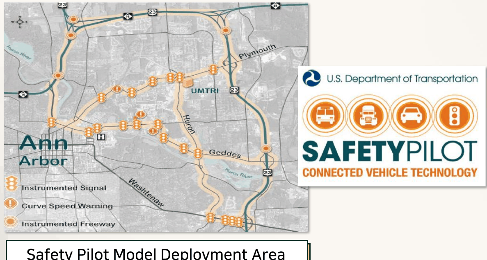

*그림 4. 미시간주 앤아버의 Safety Pilot Model Deployment 지역*

그림 4는 앤아버 시내와 주변 고속도로에 설치된 장비의 위치를 보여 준다. 신호등 모양은 노변 기지국이 연결된 신호 교차로(instrumented signal), 경고 표시는 곡선 구간 속도 경고 지점, 원형 표시는 장비를 갖춘 고속도로 구간(instrumented freeway)이다. 지도 가운데의 UMTRI는 실증을 수행한 미시간 대학교 교통연구소이다.

SPMD는 네 단계로 진행되었다.

| 단계 | 내용 | 시작 | 종료 |
|:-----|:-----|:-----|:-----|
| 1. 장치 개발 | 차량 인지 장치(VAD), 애프터마켓 안전 장치(ASD), 노변 기지국(RSU)의 개발 | 2010-07 | 2012-10 |
| 2. 모델 배치 이전의 계획과 시험 | 장치들을 실행 단계에 적용하기 위한 여러 문제의 해결 | 2011-08 | 2012-08 |
| 3. 모델 배치 실행 | 장착된 장비의 유지와 소프트웨어 업데이트 | 2012-08 | 2013-08 |
| 4. 모델 배치 이후의 평가 | 3단계에서 수집한 데이터의 분석 | 2013-08 | 2014-08 |

*표 12. SPMD의 단계와 일정*

> **용어 정의:** **VAD(Vehicle Awareness Device, 차량 인지 장치)** 는 자기 차량의 위치와 속도를 담은 메시지를 보내기만 하고 경고는 하지 않는 단순 장치이다.

> **용어 정의:** **ASD(Aftermarket Safety Device, 애프터마켓 안전 장치)** 는 이미 판매된 차량에 나중에 다는 장치로, 메시지를 주고받으며 운전자에게 경고까지 한다.

> **용어 정의:** **RSU(Roadside Unit, 노변 기지국)** 는 도로변에 설치되어 차량과 통신하는 장치이다.

SPMD에서 수집된 데이터는 미국 교통부의 공개 데이터 포털에서 누구나 내려받을 수 있다 [12]. 이 데이터는 이후 V2V 의무화 규칙 제정을 검토할 때 안전 편익을 추정하는 근거로 쓰였다.

### 1.9 Connected Vehicle 응용 서비스

미국 교통부는 커넥티드 차량으로 구현할 응용 서비스를 목적에 따라 일곱 묶음으로 분류했다 [13].

| 분류 | 대표 응용 |
|:-----|:-----|
| V2I 안전 | 신호 위반 경고, 곡선 구간 속도 경고, 정지 표지 간격 보조, 국지 기상 영향 경고, 감속과 작업 구역 경고, 신호 횡단보도의 보행자 경고(대중교통) |
| V2V 안전 | EEBL, FCW, IMA, 좌회전 보조(LTA), 사각지대와 차로 변경 경고(BSW/LCW), DNPW, 버스 앞 우회전 차량 경고(대중교통) |
| 기관 데이터 | 프로브 기반 포장 유지 관리, 프로브 기반 교통 모니터링, 차종 분류 기반 교통 조사, 회전 교통량과 교차로 분석, 기종점(O-D) 조사, 작업 구역 여행자 정보 |
| 환경 | 신호 교차로의 친환경 접근과 출발, 친환경 신호 시간 조정과 신호 우선, 커넥티드 에코 드라이빙, 무선 유도 충전, 친환경 차로 관리, 친환경 속도 조화, 친환경 CACC, 친환경 여행자 정보, 친환경 램프 미터링, 저배출 구역 관리, 대체 연료 충전 정보, 친환경 스마트 주차, 동적 친환경 경로 안내, 친환경 통합 교통 관리 의사 결정 지원 |
| 도로 기상 | 운전자 기상 권고와 경고(MAW), 강화된 유지 관리 의사 결정 지원(Enhanced MDSS), 차량 데이터 변환기(VDT), 기상 대응 교통 정보(WxTINFO) |
| 이동성 | 첨단 여행자 정보 시스템, 지능형 신호 시스템(I-SIG), 신호 우선(대중교통, 화물), 이동형 보행자 신호(PED-SIG), 긴급 차량 신호 선점(PREEMPT), 동적 속도 조화(SPD-HARM), 대기열 경고(Q-WARN), CACC, 사고 현장 긴급 대응자 안내(RESP-STG), 사고 현장 작업 구역 경고(INC-ZONE), 긴급 통신과 대피(EVAC), 환승 연계 보호(T-CONNECT), 동적 대중교통 운영(T-DISP), 동적 승차 공유(D-RIDE), 화물 동적 경로 계획, 항만 화물 운송(drayage) 최적화 |
| 스마트 노변 | 무선 검사, 스마트 트럭 주차 |

*표 13. 미국 교통부의 커넥티드 차량 응용 서비스 분류*

표 13에서 커넥티드 차량은 안전만을 위한 기술이 아니라는 점이 드러난다. 차량이 보내는 위치와 속도 정보(프로브 데이터)는 도로 기관의 교통 조사와 포장 관리에 쓰이고, 신호 정보는 연료 절감과 배출 감소에 쓰이며, 대중교통과 화물 운송의 효율도 높인다.

> **용어 정의:** **프로브 데이터(probe data)** 는 도로를 달리는 차량이 측정해 보내는 위치, 속도, 상태 정보이다. 차량을 움직이는 탐침(probe)처럼 써서 도로 전체의 교통 상황을 파악한다는 뜻이다.

### 1.10 Connected Vehicle Pilot Deployment Program

SPMD가 V2V 안전 응용의 효과를 검증했다면, **CV Pilot Deployment Program**은 커넥티드 차량 기술을 실제 지역의 교통 문제 해결에 적용하는 시범 배치 사업이다. 프로그램의 목표는 커넥티드 차량과 모바일 기기의 기술을 결합하여 안전을 높이고, 이동성(mobility)과 시스템 생산성(productivity)을 개선하며, 환경 영향을 줄이는 것이다 [14].

| 단계 | 기간 | 내용 |
|:-----|:-----|:-----|
| 1단계 개념 개발 | 최대 12개월 | 운영 개념(ConOps), 시스템 요구사항, 예비 현장 계획을 작성 (2016년 10월 완료) |
| 2단계 설계, 구축, 시험 | 최대 20개월 | 응용을 개발하여 기존 시스템과 통합하고, 개선된 시스템을 시험 |
| 3단계 운영과 유지 | 최소 18개월 | 개선된 시스템을 운영하고 목표 대비 성능을 평가 |

*표 14. CV Pilot Deployment Program의 단계*

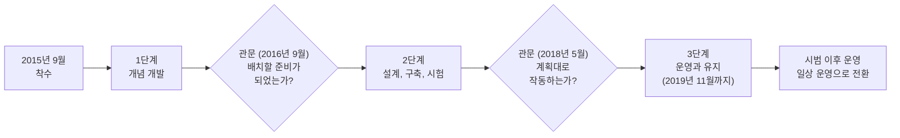

*그림 5. CV Pilot Deployment Program의 일정과 진행 관문*

그림 5처럼 각 단계 사이에는 진행 관문(progress gate)이 있다. 1단계가 끝나면 개념이 배치할 준비가 되었는지를, 2단계가 끝나면 시스템이 계획대로 작동하는지를 확인한 뒤에야 다음 단계로 넘어간다. 3단계를 마친 뒤에는 커넥티드 차량 기술을 일상적인 교통 운영 업무에 통합하는 시범 이후 운영으로 전환한다. 2015년 9월에 선정된 시범 지역은 뉴욕시, 와이오밍주, 플로리다주 탬파의 세 곳이다.

> **용어 정의:** **운영 개념(ConOps, Concept of Operations)** 은 시스템을 누가, 어떤 상황에서, 어떻게 쓰는지를 사용자 관점에서 기술한 문서이다. 요구사항을 정하기 전에 이해관계자가 같은 그림을 공유하도록 만든다.

### 1.11 뉴욕시 시범 사업

뉴욕시 교통국(NYCDOT)의 시범 사업은 다음을 평가했다 [14].

1. 충돌 사고를 줄인다.
2. 보행자 부상을 줄인다.
3. 커넥티드 차량 기술로 시각 장애인을 돕는다.

뉴욕시는 차량이 매우 많고 차종이 다양한 고밀도 도심 환경이므로, 이런 환경에서 커넥티드 차량을 배치할 때의 문제를 해결하는 것도 과제였다.

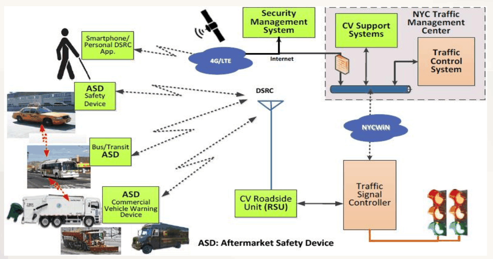

*그림 6. 뉴욕시 시범 사업의 전체 구성*

그림 6에서 택시, 버스, 청소차와 배송 트럭 같은 차량에는 애프터마켓 안전 장치(ASD)가 장착되어 DSRC로 서로 통신한다. 교차로의 CV 노변 기지국(RSU)은 교통 신호 제어기와 연결되어 신호 정보를 차량에 보낸다. 노변 기지국은 시의 무선망(NYCWiN)을 거쳐 뉴욕시 교통 관리 센터의 교통 제어 시스템, CV 지원 시스템, 보안 관리 시스템과 연결된다. 보행자는 스마트폰의 개인용 DSRC 앱이나 4G/LTE로 연결되어, 시각 장애인이 횡단보도의 신호 정보를 받을 수 있게 한다.

노변 기지국과 차량은 SAE J2735 표준의 메시지를 주고받는다. 메시지의 형식은 11주차에서 자세히 다루며, 여기서는 시범 사업에서 각 메시지가 맡은 역할을 정리한다.

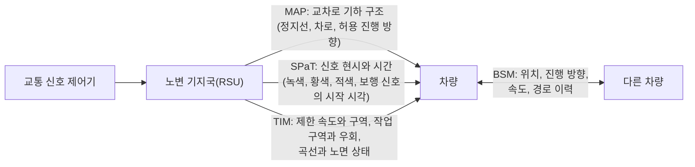

*그림 7. 뉴욕시 시범 사업에서 쓰인 V2I, V2V 메시지*

> **용어 정의:** **BSM(Basic Safety Message)** 은 차량이 초당 약 10회 주변에 방송하는 자기 상태 메시지로, V2V 안전 응용의 바탕이 된다.

BSM이 차량끼리 주고받는 V2V 메시지라면, 나머지 세 메시지는 노변 기지국이 차량에 보내는 V2I 메시지이다.

> **용어 정의:** **SPaT(Signal Phase and Timing)** 는 신호등의 현재 현시와 남은 시간을 담은 메시지이다.

> **용어 정의:** **MAP**은 교차로의 차로 구성과 정지선 위치 같은 기하 정보를 담은 메시지이다.

> **용어 정의:** **TIM(Traveler Information Message)** 은 제한 속도, 작업 구역, 우회로, 노면 상태 같은 여행자 정보를 담는다. MAP, SPaT, TIM은 V2I 안전 응용을, BSM은 V2V 안전 응용을 지원한다.

### 1.12 와이오밍주 시범 사업

와이오밍주 교통국(WYDOT)의 시범 사업은 겨울철 폭설과 강풍으로 사고가 잦은 주간 고속도로(I-80) 화물 수송로를 대상으로 했다. 목표는 표 15와 같다 [14].

| 영역 | 목표 |
|:-----|:-----|
| 도로 기상 정보 입력 | 교통 관리 센터(TMC)가 받는 도로 기상 보고를 개선한다 |
| TMC 정보 전파 | 광역 경보와 권고를 생성하는 능력을 높이고, 도로 폐쇄, 통행 제한, 제한 속도를 효율적으로 관리하며, 주행 중인 차량과 메시지를 주고받고, 상업용 차량 운영 관리자에게 주는 정보를 개선한다 |
| 차량과 노변의 경보와 권고 | V2V 메시지를 주고받아 사고와 그 심각도를 줄이고, 충돌 사고의 긴급 알림을 강화한다 |
| 기대 결과 | 제한 속도 준수율을 높이고 차량 간 속도 차이를 줄이며, 충돌 사고를 줄인다 |

*표 15. 와이오밍주 시범 사업의 목표*

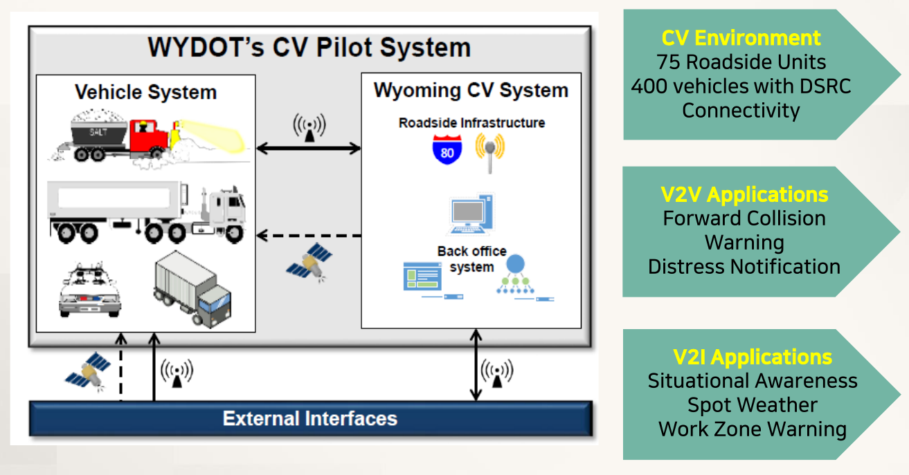

*그림 8. 와이오밍주 교통국의 CV 시범 시스템*

그림 8의 왼쪽 차량 시스템에는 제설차, 대형 트럭, 순찰차, 화물차가 있고, 오른쪽의 와이오밍 CV 시스템은 노변 인프라와 백오피스 시스템으로 이루어진다. 두 시스템은 노변 기지국과 위성 통신으로 연결되고, 아래의 외부 인터페이스로 다른 기관의 시스템과 이어진다. 시범 환경은 노변 기지국 75대와 DSRC를 장착한 차량 400대로 구성되었다. V2V 응용은 전방 충돌 경고와 조난 알림(distress notification), V2I 응용은 상황 인지(situational awareness), 국지 기상 경고(spot weather), 작업 구역 경고이다.

> **용어 정의:** **TMC(Traffic Management Center, 교통 관리 센터)** 는 도로의 교통 상황을 감시하고 신호, 전광판, 통제 정보를 관리하는 운영 센터이다.

> **용어 정의:** **조난 알림(distress notification)** 은 사고나 고장으로 멈춘 차량이 그 사실을 주변 차량과 센터에 알리는 응용이다.

### 1.13 탬파 시범 사업

플로리다주 탬파의 시범 사업은 탬파-힐스버러 고속도로공단(THEA)이 주관했다. 출퇴근 시간에 방향을 바꾸어 운영하는 도심의 가변 급행 차로(Selmon Reversible Express Lanes)와 그 주변 도심 도로가 대상이다 [15].

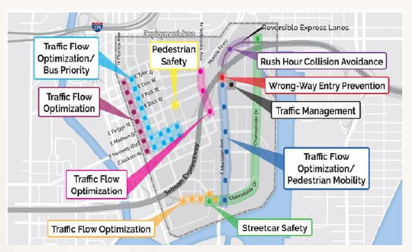

*그림 9. 탬파 시범 사업의 배치 지역과 응용*

그림 9는 도심의 각 위치에 배치한 응용을 보여 준다. 가변 급행 차로의 출구에서는 출퇴근 시간 충돌 회피와 역주행 진입 방지를, 도심의 교차로에서는 교통 흐름 최적화, 버스 우선 신호, 보행자 안전과 보행자 이동성을, 노면 전차(streetcar) 노선에서는 노면 전차 안전을 다룬다. 탬파의 응용은 네 묶음으로 구성되었다.

| 묶음 | 응용 |
|:-----|:-----|
| V2I 안전 | 램프 끝 감속 경고(ERDW), 신호 횡단보도의 보행자 경고(PED-X), 보행자 충돌 경고(PCW, PED-X를 보완하는 차량 탑재 장치 응용), 보행자와 대중교통 이동 경고(PTMW), 역주행 진입 경고(WWE) |
| V2V 안전 | EEBL, FCW, IMA, 대중교통 차량 앞 우회전 차량 경고(VTRFTV) |
| V2I 이동성 | 지능형 신호 시스템(I-SIG), 대중교통 신호 우선(TSP), 이동형 보행자 신호(PED-SIG) |
| 기관 데이터 | 프로브 데이터 기반 교통 모니터링(PDETM) |

*표 16. 탬파 시범 사업의 응용*

> **용어 정의:** **I-SIG(Intelligent Traffic Signal System)** 는 차량이 보낸 위치와 속도 정보로 신호 시간을 실시간 최적화하는 응용이다.

> **용어 정의:** **TSP(Transit Signal Priority)** 는 버스가 접근하면 녹색 신호를 연장하거나 앞당기는 응용이다.

> **용어 정의:** **PED-SIG**는 시각 장애인 같은 보행자가 스마트폰으로 횡단 의사를 신호 제어기에 알려 충분한 횡단 시간을 받는 응용이다.

탬파의 구성은 교통 관리 센터(교통 운영자, 교통 서버, 마스터 서버, 대중교통 서버, 연구 인력), 노변 장비(신호 제어기, RSU, DSRC 안테나), 차량 탑재 장치(OBU)를 단 승용차, 버스, 노면 전차, 보행자의 휴대 단말, 위치를 알려 주는 위성 측위(GPS), 그리고 수집한 데이터를 보관하는 운영 데이터 환경(ODE) 데이터 센터로 이루어진다.

세 시범 사업은 같은 기술을 서로 다른 지역 문제에 적용했다는 점에서 비교할 가치가 있다.

| 항목 | 뉴욕시 | 와이오밍주 | 탬파 |
|:-----|:-----|:-----|:-----|
| 환경 | 고밀도 도심 | 지방 주간 고속도로 (I-80 화물 수송로) | 도심 가변 급행 차로와 도심 도로 |
| 주된 문제 | 충돌 사고, 보행자 부상 | 겨울철 기상 악화로 인한 사고와 도로 폐쇄 | 출퇴근 시간 정체와 충돌, 보행자 안전, 대중교통 지연 |
| 주요 차량 | 택시, 버스, 시 소유 차량, 배송 트럭 | 제설차, 순찰차, 대형 트럭 | 승용차, 버스, 노면 전차 |
| 대표 응용 | V2V 안전, 신호 기반 V2I 안전, 시각 장애인 보행 지원 | 도로 기상 경고, 조난 알림, 작업 구역 경고 | 역주행 방지, 램프 끝 감속 경고, 신호 최적화, 대중교통 신호 우선 |

*표 17. 미국의 세 CV 시범 사업 비교*

### 1.14 미국의 C-V2X 프로젝트

미국의 초기 커넥티드 차량 사업은 모두 DSRC를 썼지만, 2018년부터는 이동통신 기반의 C-V2X 시범도 시작되었다. Panasonic, Qualcomm, Ford는 2018년 6월에 콜로라도주에서 미국 최초의 C-V2X 배치를 함께 추진한다고 발표했다 [16]. 이 프로젝트의 특징은 다음과 같다.

1. 5G와 호환되며, 카메라, 레이더, 라이다 같은 ADAS 센서를 보완하도록 설계되었다.
2. 기지국을 거치지 않는 C-V2X 단말 간 직접(D2D) 통신 모드를 제공하도록 설계되었다.
3. 덴버에 있는 Panasonic의 CityNOW 본부 주변에서 평가를 시작하여 같은 해 안에 I-70 고속도로 축의 일부 구간으로 확대할 계획이었으며, 노변 기지국과 차량 탑재 장치에 Qualcomm 9150 C-V2X 칩셋을 썼다.

Qualcomm은 C-V2X의 장점을 다음과 같이 정리했다 [17]. 네트워크의 도움 없이 직접 통신할 때 통신 거리와 신뢰성이 높고, 상대 속도 최대 500 km/h까지 지원하며, 다른 기술보다 비용 효율적이고, 5G NR로 이어지는 진화 경로가 있다. 또한 별도 관리로 비용과 복잡도를 줄이고, 셀룰러 모뎀과 시너지를 내며, 셀룰러 생태계를 활용하고, SAE와 ETSI가 정의한 상위 계층을 재사용할 수 있다. C-V2X의 통신 모드와 DSRC와의 비교는 14주차에서 다룬다.

> **용어 정의:** **C-V2X(Cellular V2X)** 는 3GPP가 LTE와 5G를 바탕으로 정의한 V2X 기술이다. 단말끼리 직접 통신하는 PC5 인터페이스와 기지국을 거치는 Uu 인터페이스를 모두 쓸 수 있다.

> **용어 정의:** **D2D(Device-to-Device)** 통신은 기지국을 거치지 않고 단말끼리 직접 주고받는 통신으로, PC5 직접 통신과 같은 뜻으로 쓰였다.

### 1.15 스마트 시티 챌린지

미국 교통부는 자율주행과 커넥티드 차량 산업의 발전을 이끌기 위해 2015년 말에 **스마트 시티 챌린지(Smart City Challenge)** 를 시행했다. 중소 도시들이 첨단 교통 기술로 도시 문제를 푸는 계획을 제안하면, 그중 한 도시를 선정하여 집중 지원하는 경쟁 방식의 사업이다.

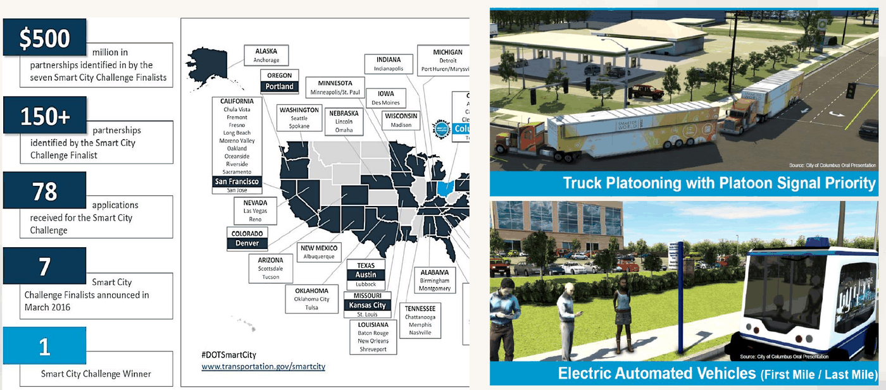

*그림 10. 스마트 시티 챌린지의 경과와 콜럼버스시의 제안*

그림 10의 왼쪽 숫자는 사업의 경과를 요약한다. 78개 도시가 신청했고, 2016년 3월에 7개 도시(오스틴, 콜럼버스, 덴버, 캔자스시티, 피츠버그, 포틀랜드, 샌프란시스코)가 결선에 올랐으며, 결선 도시들이 150개가 넘는 협력 기관과 함께 약 5억 달러 규모의 협력을 끌어냈고, 최종 1개 도시로 오하이오주 콜럼버스가 선정되었다. 오른쪽 사진은 콜럼버스가 제안한 서비스로, 위는 신호 우선권을 받는 트럭 군집주행, 아래는 첫 구간과 마지막 구간을 잇는 전기 자율주행 셔틀이다. 콜럼버스는 자율주행 대중교통과 대형 유통 업체 등과 연계한 트럭 군집주행을 제안했다.

> **참고:** 5억 달러는 우승 도시에게 준 예산이 아니라 7개 결선 도시가 협력 기관에게서 확보한 지원 약속의 합계이다. 우승한 콜럼버스는 교통부에서 최대 4,000만 달러, 민간 후원사 Vulcan에서 1,000만 달러를 지원받았다 [18].

미국의 사례에서 드러나는 교훈은 다음과 같다. 첫째, 경쟁 업체들이 경쟁 이전 단계의 공통 기술(메시지, 보안, 시험 방법)을 함께 개발했기에 서로 다른 제조사 차량 사이의 V2V가 가능해졌다. 둘째, SPMD와 CV 시범 사업처럼 실제 운전자와 지역 교통 기관이 참여하는 단계적 실증으로 효과와 운영 문제를 확인했다. 셋째, 기술이 준비되어도 V2V 의무화와 주파수 정책이 바뀌면 보급 경로가 달라지므로, 기술 로드맵과 제도 로드맵을 함께 보아야 한다.

---

<br>

## 2. 유럽과 일본의 커넥티드 자율주행

유럽은 여러 나라가 함께 쓰는 도로와 주파수를 다루어야 하므로, EU가 연구 프레임워크 프로그램으로 다국적 과제를 지원하고 완성차 업체들이 컨소시엄으로 표준을 만드는 방식을 택했다. 일본은 내각부 산하의 범부처 체계(SIP-adus)가 지도, 통신, 실증을 묶어 추진했다. 이 절은 두 지역의 과제, 조직, 실증 사례를 정리한다.

### 2.1 EU 프로젝트의 흐름

> **용어 정의:** **FP(Framework Programme)** 는 EU가 회원국의 대학, 연구소, 기업이 함께 수행하는 연구개발 과제를 몇 년 단위로 지원하는 연구 프레임워크 프로그램이다. 6차 FP(FP6, 2002\~2006년), 7차 FP(FP7, 2007\~2013년)에 이어 Horizon 2020(2014\~2020년)이 시행되었다.

| 구분 | 시기 | 내용 |
|:-----|:-----|:-----|
| 법과 제도 | 2002\~2006년 | 6차 FP, eSafety Initiative |
| 법과 제도 | 2006년 | 지능형 자동차 이니셔티브(Intelligent Car Initiative, COM 59) |
| 법과 제도 | 2007\~2013년 | 7차 FP |
| 법과 제도 | 2008년 | 5.875\~5.925 GHz(확장 포함)를 안전용 ITS 주파수로 배정 |
| 법과 제도 | 2008년\~ | EU 집행위원회의 ITS 실행 계획(ITS Action Plan) |
| 법과 제도 | 2014\~2020년 | Horizon 2020 |
| 프로젝트 | 2006-01 ~ 2009-12 | COMeSafety (이후 COMeSafety2) |
| 프로젝트 | 2006-01 ~ 2010-02 | CVIS, SAFESPOT, COOPERS |
| 프로젝트 | 2008-09 ~ 2012-09 | simTD (독일) |
| 프로젝트 | 2011-01 ~ 2014-06 | Drive C2X |
| 프로젝트 | 2011-04 ~ 2014-09 | FOTsis |
| 프로젝트 | 2013-01 ~ 2015-01 | Compass4D |
| 프로젝트 | 2010년대 중반 | C-ITS Corridor (네덜란드, 독일, 오스트리아) |
| 프로젝트 | 2016\~2017년 | Horizon 2020 ART 공모 |

*표 18. EU의 C-ITS 관련 제도와 프로젝트*

EU의 과제도 개념 검증, 실증 단지, 시범 사업, 사업화의 순서를 밟았다 [19]. FP6에서는 CVIS, SAFESPOT, COOPERS, COMeSafety가, FP7에서는 Drive C2X, FOTsis, COMeSafety2가, Horizon 2020에서는 C-ITS Platform과 C-Roads, GEAR 2030, 자율주행 라운드 테이블(RT-CAD), Horizon 2020 ART 공모가 수행되었다. 그리고 이 흐름 전체에서 완성차 업체들의 컨소시엄인 C2C-CC가 차량 쪽의 표준을 주도했다.

> **용어 정의:** **CVIS(Cooperative Vehicle-Infrastructure Systems)** 는 차량과 인프라의 협력 통신 플랫폼을 연구한 과제이다.

> **용어 정의:** **SAFESPOT**은 차량과 도로가 정보를 공유하여 안전 여유를 넓히는 협력 안전 시스템을 연구한 과제이다.

> **용어 정의:** **COOPERS(Co-operative Systems for Intelligent Road Safety)** 는 도로 운영자가 차량에 실시간 교통 정보를 주는 협력 교통 관리를 연구한 과제이다.

FP6의 세 연구 과제가 협력 시스템의 기술을 개발했다면, 그 뒤의 과제들은 결과를 공통 아키텍처로 묶고, 실제 도로에서 시험하고, 회원국의 배치로 이어 갔다.

> **용어 정의:** **COMeSafety**는 이 과제들의 결과를 모아 유럽 공통의 ITS 통신 아키텍처를 정리한 지원 과제이다.

> **용어 정의:** **Drive C2X**와 FOTsis는 협력 시스템을 여러 나라의 실제 도로에서 시험한 FOT이다.

> **용어 정의:** **C-Roads**는 회원국들이 C-ITS 서비스를 서로 호환되게 배치하기 위한 플랫폼이다.

### 2.2 EU 프로젝트의 구조

FP6 시기의 EU 자동차 안전 과제는 운전자, 응용, 통신 채널, 서비스 제공의 계층과 시간 축에 따라 역할을 나누어 구성되었다.

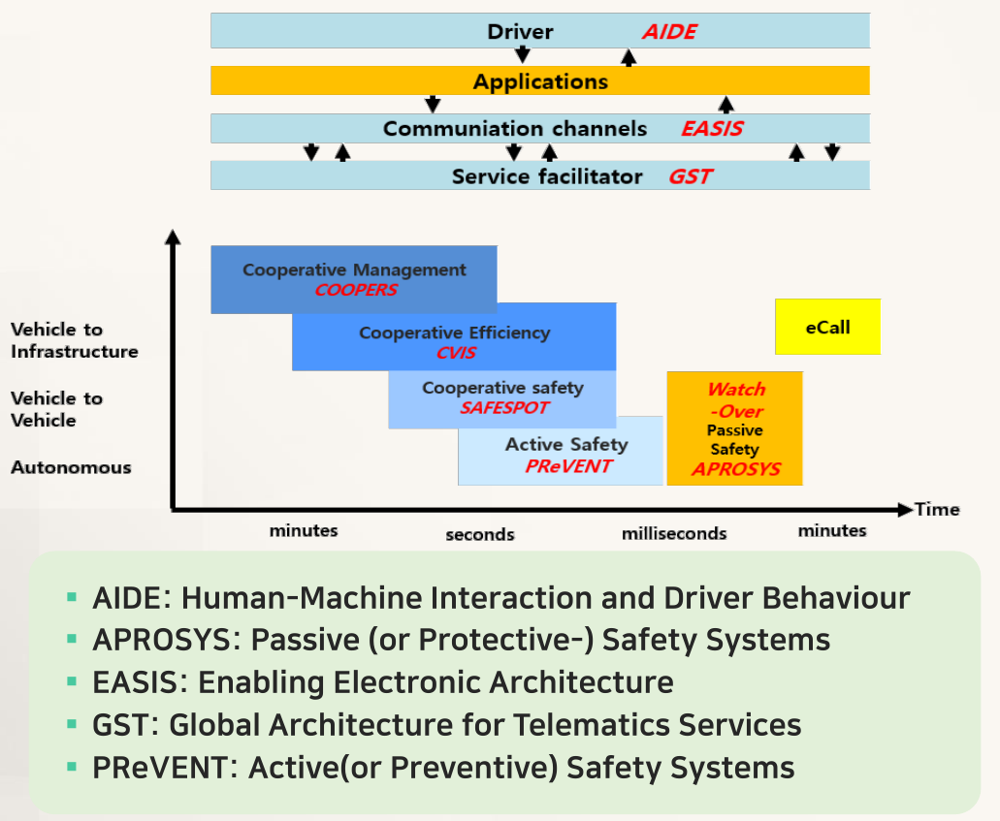

*그림 11. FP6 시기 EU 자동차 안전 과제의 구조*

그림 11의 위쪽은 계층 구조이다. 운전자와 차량의 상호작용은 AIDE가, 차량 전자 아키텍처는 EASIS가, 텔레매틱스 서비스 제공 구조는 GST가 맡는다. 아래쪽 그래프는 세로축에 통신 범위(차량과 인프라, 차량과 차량, 자율), 가로축에 충돌까지 남은 시간(분, 초, 밀리초, 충돌 후 분)을 두고 과제를 배치했다. 분 단위의 협력 교통 관리는 COOPERS, 협력 효율은 CVIS, 초 단위의 협력 안전은 SAFESPOT, 밀리초 단위의 능동 안전은 PReVENT, 충돌 순간과 그 이후의 수동 안전은 APROSYS, 충돌 후 분 단위의 긴급 호출은 eCall이 담당한다.

| 과제 | 정식 명칭 | 분야 |
|:-----|:-----|:-----|
| AIDE | Adaptive Integrated Driver-vehicle InterfacE | 인간과 기계의 상호작용, 운전자 행동 |
| APROSYS | Advanced PROtective SYStems | 수동(보호) 안전 시스템 |
| EASIS | Electronic Architecture and System Engineering for Integrated Safety Systems | 안전 시스템을 위한 전자 아키텍처 |
| GST | Global System for Telematics | 텔레매틱스 서비스의 공통 아키텍처 |
| PReVENT | Preventive and Active Safety Applications | 능동(예방) 안전 시스템 |

*표 19. FP6 시기 EU 자동차 안전 과제의 분야*

이 구조는 사고를 시간 순서로 나누어 대응하는 사고 대응 기술 분류(충돌 이전의 인지와 예방, 충돌 순간의 보호, 충돌 이후의 구조)와 연결된다. 통신 기반의 협력 시스템은 운전자나 차량 센서가 위험을 알기 전, 즉 가장 이른 시간대에 개입할 수 있다는 점에서 의미가 있다.

### 2.3 EU의 자율주행차 과제 로드맵

유럽 도로교통 연구 자문 기구인 ERTRAC은 EU가 2005\~2020년에 수행한 자율주행 관련 과제를 네 분야로 정리했다 [20].

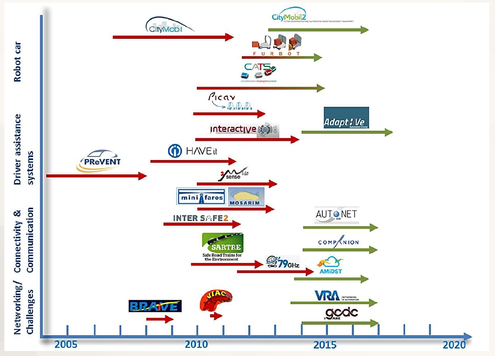

*그림 12. EU의 자율주행차 관련 과제 로드맵*

그림 12에서 각 화살표는 과제의 기간이다.

1. **로봇카(robot car):** 도심 무인 셔틀을 다룬 CityMobil과 CityMobil2, 화물 운송 로봇 FURBOT, 자동화 도심 교통 CATS, 개인 무인 이동 수단 PICAV가 있다.
2. **운전자 보조 시스템:** 능동 안전의 PReVENT, 고도 자동화의 HAVEit, 통합 안전의 interactIVe, 자율주행 기능을 시연한 AdaptIVe가 있다.
3. **연결성과 통신:** 센서 소형화의 MiniFaros, 레이더 간섭의 MOSARIM, 교차로 안전의 INTERSAFE-2, 고속도로 군집주행의 SARTRE, 79 GHz 레이더, 협력 자율주행의 AutoNet2030, 트럭 군집 운영의 COMPANION, 대용량 데이터 스트림 분석으로 차로 변경 예측 같은 응용을 다룬 AMIDST가 있다.
4. **네트워킹과 챌린지:** 이탈리아 VisLab의 자율주행 차량 BRAiVE와 대륙 횡단 자율주행 시험 VIAC, 다양한 차량의 협력 주행을 겨룬 GCDC(Grand Cooperative Driving Challenge), 차량과 도로 자동화 분야의 네트워킹을 지원한 VRA(Vehicle and Road Automation)가 있다.

ERTRAC은 도심의 자동화 도로 수송(automated urban road transport)에 대해서도 기술 성숙도에 따른 단계별 계획을 제시했다.

> **용어 정의:** **TRL(Technology Readiness Level, 기술 성숙도)** 은 기술이 기초 원리 단계(1)에서 실제 운영 환경에서 검증된 단계(9)까지 어디에 있는지를 나타내는 척도이다. 2\~4는 기술 연구, 5\~7은 시제품과 실증, 8\~9는 상용화 단계에 해당한다.

| 활동 | TRL | 시기 | 내용 |
|:-----|:-----|:-----|:-----|
| 기술 연구 | 2\~4 | 2014\~2016년 | CityMobil2, MG3.6, ECSEL 과제: 설계 지침, 법적 틀 제안, 쇼케이스, 센서 (이정표 1) |
| 기술 연구 | 2\~4 | 2016\~2018년 | 도심 자동화 수송의 안전과 수용성을 위한 인지와 연결성 기술 해법 (2016\~2017년 작업 계획에 대한 ERTRAC 권고) |
| 시범과 대규모 실증 | 5\~7 | 2018\~2021년 | 기존 대중교통과 통합한 도심 도로 수송 자동화의 대규모 실증 (이정표 3) |
| 규제와 표준 | 해당 없음 | 2021\~2022년 | 레벨 4, 5를 위한 규제 정비 |
| 산업화 | 8\~9 | 2023\~2025년 | 레벨 4, 5의 도심 자동화 도로 수송 |

*표 20. ERTRAC의 도심 자동화 도로 수송 로드맵*

표 20은 기술 연구에서 대규모 실증을 거쳐 규제를 정비하고 산업화로 가는 순서를 보여 준다. 규제 정비가 실증 이후에 오는 것은 실증에서 얻은 자료가 규제의 근거가 되기 때문이다.

### 2.4 C2C-CC와 단말기 보급률

**C2C-CC(CAR 2 CAR Communication Consortium)** 는 유럽의 완성차 업체, 부품 업체, 연구 기관이 모여 V2V, V2I 통신의 표준을 만든 컨소시엄으로, 2002년에 설립되어 지금도 활동하고 있다 [21]. 그 가운데 2006\~2011년에는 다음 일을 수행했다 [22].

1. V2V, V2I의 인터페이스와 프로토콜을 표준화했다.
2. 유럽의 산업 표준을 개발하고 확립했다.
3. 서로 다른 제조사 차량 사이의 상호 운용성을 보장했다.
4. 서비스를 개발하고 시연했다.
5. 유럽에서 무료로 쓸 수 있는 주파수 대역의 할당을 추진했다.

참여 기관에는 Audi, Daimler, Honda, Renault, Volkswagen, Volvo 같은 완성차 업체와 Bosch, Continental, Delphi, Hitachi, NEC, Siemens 같은 부품 업체가 있었다.

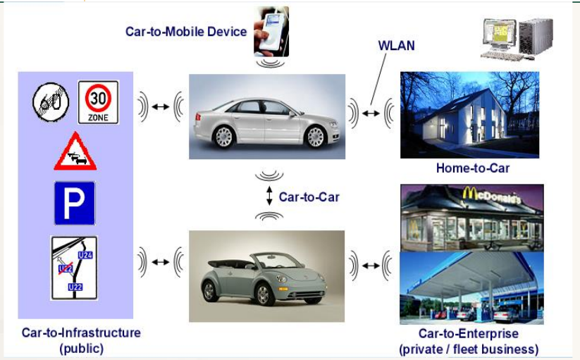

*그림 13. C2C-CC가 정의한 차량 통신의 형태*

그림 13은 C2C-CC가 구상한 통신의 형태이다. 가운데의 두 차량은 차량 간 통신(car-to-car)을 하고, 왼쪽의 제한 속도 표지, 위험 표지, 주차 표지 같은 공공 인프라와는 차량과 인프라 간 통신(car-to-infrastructure)을 한다. 오른쪽 위는 무선 LAN으로 집과 차량을 잇는 통신(home-to-car), 오른쪽 아래는 패스트푸드점이나 주유소 같은 기업과 차량을 잇는 통신(car-to-enterprise)이며, 위쪽은 휴대 기기와 차량을 잇는 통신(car-to-mobile device)이다.

**보급률과 서비스.** V2V는 통신할 상대가 있어야 효과가 있으므로, 서비스의 종류에 따라 필요한 단말기 보급률이 다르다. C2C 통신을 이용한 서비스는 다음 보급률을 확보해야 한다 [20].

| 서비스 | 필요한 시장 보급률 |
|:-----|-----:|
| 교통 정보 공유 | 5% 이상 |
| 최소한의 안전 경고 | 10% 이상 |
| 능동 안전 기능 | 90% 이상 |

*표 21. C2C 통신 서비스에 필요한 시장 보급률*

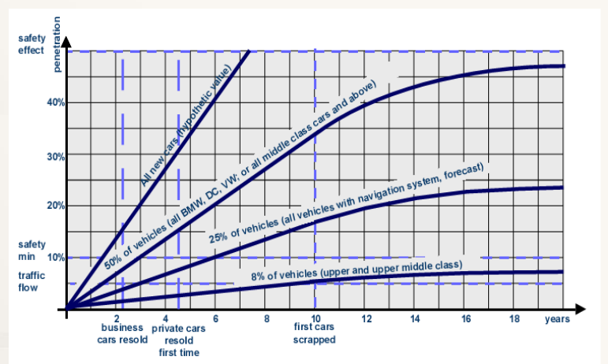

*그림 14. 차종 범위에 따른 V2X 단말기 보급률의 증가 곡선*

그림 14의 가로축은 신차에 단말기를 달기 시작한 뒤의 연수, 세로축은 전체 차량 가운데 단말기를 단 차량의 비율이다. 가로 점선은 교통 흐름 서비스(약 5%), 최소 안전 서비스(10%), 안전 효과 서비스에 필요한 보급률이다. 네 곡선은 단말기를 다는 차종의 범위에 따라 다르다.

1. 모든 완성차 업체의 모든 신차에 장착하는 낙관적인 경우(가상)가 가장 가파르다.
2. 전체 차량의 50%에 해당하는 차종(예: BMW, DaimlerChrysler, VW의 전 차종이나 모든 중형 이상 차종)에 장착하는 경우가 다음이다.
3. 전체 차량의 25%에 해당하는 차종(내비게이션을 단 모든 차량)에 장착하는 경우가 그다음이다.
4. 전체 차량의 8%에 해당하는 차종(대형과 준대형 차종)에만 장착하는 경우는 20년이 지나도 10% 근처에 머문다.

가로축 아래의 표시처럼 업무용 차량은 약 2년, 개인 차량은 약 4년 뒤에 처음 되팔리고, 약 10년 뒤부터 폐차되므로 차량이 교체되는 속도에는 한계가 있다. 따라서 모든 신차에 장착하더라도 기존 차량이 교체되기까지 시간이 걸리므로, 능동 안전에 필요한 90%에 가까운 보급률에 이르려면 차량의 사용 기간에 해당하는 10년 이상이 필요하다. 이것이 V2V 의무화 논의가 중요한 이유이며, 차량 교체를 기다리지 않도록 애프터마켓 장치와 인프라(V2I)를 함께 보급하는 이유이기도 하다.

**Day 1, 2, 3 분류.** C2C-CC는 C-ITS 서비스를 도입 시기에 따라 Day 1(인지 주행), Day 2(감지 주행), Day 3+(협력 주행)로 나눈 로드맵도 제시했다 [21].

| 단계 | 성격 | 서비스 | 메시지 |
|:-----|:-----|:-----|:-----|
| Day 1 | 인지 주행(awareness driving) | 충돌 회피 같은 경고 응용, 도로와 교차로 표지 같은 인프라 정보 | CAM, DENM, SPaT, MAP, IVI |
| Day 2 | 감지 주행(sensing driving) | 고급 경고, 보행자와 이륜차 같은 취약 도로 이용자 보호, 협력형 긴급 제동 보조와 협력형 ACC 같은 반자동 주행, 신호 제어기와의 협력 | 확장 CAM, DENM, CPM(감지 물체), RTCM(위치 보정), SREM, SSEM(신호 우선, 선점) |
| Day 3+ | 협력 주행(cooperative driving) | CACC 차량 행렬과 협력 차로 합류 같은 협력 자율주행, 교차로 통과와 제어권 전환 같은 인프라와의 협력 | 확장 CAM, MCM(계획 궤적), VAM(취약 도로 이용자 인지), 확장 IVI |

*표 22. C2C-CC의 Day 1, Day 2, Day 3+ 서비스 분류*

단계가 올라갈수록 보안 지원(EU의 인증서 관리 체계)에서 부정 행위 탐지, 위치 보정, 기능 안전 지원을 거쳐 자율주행 조정 규칙 같은 자동 조정 기능이 더해지며, 최종 목표는 사고 없는 도로 교통과 최적의 교통 흐름이다. 각 메시지의 정의와 Day 분류의 자세한 내용은 11주차에서 다룬다.

### 2.5 Bosch의 자율주행 비전

부품 업체 Bosch는 운전자 보조 기능에서 고도, 완전 자동화로 나아가는 단계를 다음과 같이 제시했다.

| 시기 | 기능 |
|:-----|:-----|
| 2010년부터 | 자동 긴급 제동(automatic emergency braking) |
| 2015년 | 회피 조향 보조(evasive steering support), 정체 구간 보조(traffic jam assist) |
| 2016년 이후 | 정체 구간 파일럿(traffic jam pilot) |
| 2017년 | 통합 순항 보조(integrated cruise assist) |
| 2018년 | 고속도로 보조(highway assist) |
| 2020년 | 고속도로 파일럿(highway pilot) |
| 2025년 이후 | 오토 파일럿(auto pilot), 주차 |

*표 23. Bosch가 제시한 자동화 기능의 도입 단계*

표 23에서 보조(assist)는 운전자가 주행을 감독하는 기능이고, 파일럿(pilot)은 특정 조건에서 시스템이 주행을 맡는 기능이다. 정체 구간(저속)에서 고속도로(고속)로, 다시 모든 상황으로 운행 범위를 넓혀 가는 순서이다.

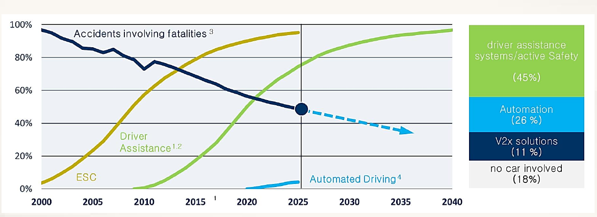

*그림 15. Bosch의 사망 사고 감소 비전과 회피 가능한 사고의 비중*

Bosch의 비전은 부상 없는 주행(injury-free driving)이다. 그림 15의 왼쪽 그래프에서 남색 선은 사망 사고의 상대 건수로, 2000년을 100%로 하여 2025년 무렵 약 50%까지 줄고 이후에도 계속 줄어들 것으로 보았다. 같은 기간 차체 자세 제어(ESC), 운전자 보조 기능, 자율주행의 보급률이 S자 곡선을 그리며 차례로 늘어난다. 오른쪽 막대는 기술별로 피할 수 있는 사고의 비중으로, 운전자 보조와 능동 안전이 45%, 자동화가 26%, V2X 솔루션이 11%이며, 차량이 관련되지 않은 사고가 18%이다. 즉 V2X는 차량 센서만으로 피하기 어려운 사고의 일부를 추가로 줄이는 역할을 한다.

### 2.6 Horizon 2020 ART

Horizon 2020은 2016\~2019년에 **자동화 도로 수송(ART, Automated Road Transport)** 분야의 과제를 해마다 공모했다 [23].

| 공모 | 주제 | 선정 과제의 예 |
|:-----|:-----|:-----|
| 2016년 | 승용차 자율주행 파일럿 | AUTOPILOT, L3Pilot |
| 2016년 | 안전과 최종 사용자의 수용성 | interACT, BRAVE |
| 2016년 | 자동화를 지원하는 도로 인프라 | TransAID, INFRAMIX, CoEXist |
| 2017년 | 도로 수송 자동화를 가능하게 하는 ICT 인프라 | |
| 2017년 | 실제 교통 조건에서의 여러 제조사 차량의 군집주행 | |
| 2017년 | 도심 자동화 수송 시스템 | |
| 2018년 | 고도 자동화 기능의 시험, 검증, 인증 절차 | |
| 2018년 | 도로 자동화를 위한 네트워킹 활동과 영향 평가 지원 | |
| 2019년 | 고도 자동화 차량에서 운전자의 새 역할을 위한 인간 중심 설계 | |
| 2019년 | 모두의 이동을 위한 도심의 공유, 커넥티드, 협력 자율주행 차량 군의 개발과 시험 | |

*표 24. Horizon 2020 ART의 연도별 공모 주제*

공모 주제의 변화를 보면 초기에는 차량 기술과 실도로 파일럿이, 이후에는 인프라, 군집주행, 인증 절차, 인간 요인, 공유 서비스가 차례로 추가되었다. 자율주행을 차량 하나의 기술이 아니라 인프라, 제도, 사용자, 서비스를 포함한 수송 체계로 보게 된 흐름이다.

### 2.7 EU의 C-V2X 시연, AdaptIVe, 시티 파일럿

**C-V2X 시연.** Qualcomm, 5GAA, BMW Group, Groupe PSA, Ford Motor Company는 2018년 7월에 프랑스 파리 근교에서 여러 제조사 차량 사이의 C-V2X 직접 통신을 유럽 최초로 공동 시연했다 [24]. 시연은 UTAC의 몽레리 시험장에서 열렸으며(UTAC는 13주차 부록에서 다룬다), 승용차, 이륜차, 노변 인프라 사이에서 다음 여섯 가지 서비스를 시험했다.

1. Emergency Electronic Brake Light (전자식 긴급 제동등)
2. Intersection Collision Warning (교차로 충돌 경고)
3. Across Traffic Turn Collision Risk Warning (교차 차로 회전 충돌 위험 경고)
4. Slow Vehicle Warning, Stationary Vehicle Warning (저속 차량 경고, 정지 차량 경고)
5. Signal Phase and Timing, Signal Violation Warning (신호 현시와 시간 안내, 신호 위반 경고)
6. Vulnerable Road User (pedestrian) Warning (취약 도로 이용자 경고)

시연에는 Qualcomm 9150 C-V2X 칩셋이 쓰였고, 참여 업체들은 2020년 초에 업계 배포를 위한 상용 준비를 마치는 것을 목표로 했다.

**AdaptIVe.** AdaptIVe는 자율주행 기능을 여러 운행 환경에서 개발하고 시연한 범유럽 대형 과제이다 [25].

| 항목 | 내용 |
|:-----|:-----|
| 참여 기관 | Mercedes-Benz, Ford, BMW, Renault, Bosch 등 (Volkswagen 그룹 연구소가 총괄) |
| 참여 국가 | 프랑스, 독일, 그리스, 이탈리아, 스페인, 스웨덴, 네덜란드, 영국 |
| 예산 | 2,500만 유로 (EU 지원 1,430만 유로) |
| 기간 | 2014년 1월\~2017년 6월 (42개월) |
| 시연 범위 | 고도화된 ADAS부터 자율주행 레벨 3까지 |

*표 25. AdaptIVe 과제의 개요*

> **참고:** 참여 국가는 여덟 나라가 나열되어 있으며, 과제의 공식 자료도 8개국 28개 기관이 참여했다고 밝힌다 [25]. 따라서 참여 국가를 6개국으로 세는 것은 목록과 맞지 않는다.

AdaptIVe의 응용은 운행 환경에 따라 세 갈래로 나뉜다. 주차장과 차고 같은 특수 구역에서는 주차 보조, 다층 주차장, 저속 정지와 출발(stop and go)을, 도심에서는 도심 순항, 도심 운전 대행(city chauffeur), 감독형 도심 제어를, 고속도로에서는 고속도로 진입과 진출, 차로 추종, 차로 변경, 합류, 추월, 위험 지점 개입, 정지와 출발을 다룬다. 그리고 세 환경 모두에서 시스템이 더 이상 주행할 수 없으면 차량을 안전하게 세우는 안전 정지(safe stop)를 공통 기능으로 두었다. 시연 차량에는 여러 제조사의 승용차와 대형 트럭이 포함되었다.

**시티 파일럿.** Mercedes-Benz는 자율주행 버스를 네덜란드에서 운영하는 계획을 추진했다.

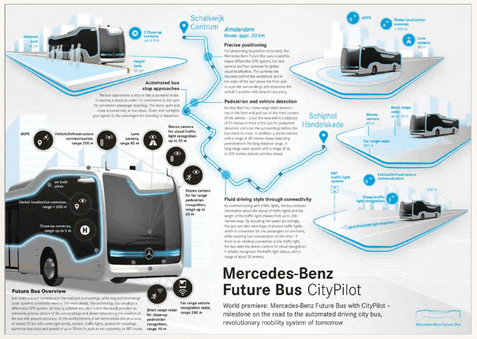

*그림 16. Mercedes-Benz Future Bus의 CityPilot 기능*

그림 16은 Future Bus의 노선과 기능을 보여 준다. 노선은 암스테르담 스히폴 공항에서 하를럼까지 약 20 km의 간선급행버스(BRT) 노선이다. 버스는 위성 측위와 카메라를 결합한 정밀 측위, 스테레오 카메라와 레이더를 이용한 보행자와 차량 검출, 정류장 자동 접근(연석에서 10 cm 이내까지 붙여 정차), 최대 200 m 앞의 신호등과 통신하여 신호에 맞춰 부드럽게 달리는 연결성 기반 주행을 갖추었다. 노선에는 급한 굽은 길, 터널, 신호등, 보행자 횡단보도가 있으며, 버스는 BRT 노선의 통상 속도인 최고 70 km/h로 달린다. 이 버스는 2016년 7월에 이 노선에서 자율주행 시연 운행을 했으며, 상용 운행은 이후 준비 과정을 거치는 것으로 계획되었다 [26].

> **용어 정의:** **BRT(Bus Rapid Transit, 간선급행버스)** 는 버스 전용 도로나 전용 차로, 우선 신호를 갖추어 지하철처럼 빠르고 정시성 있게 운행하는 버스 체계이다. 다른 차량과 분리된 전용 공간이므로 자율주행 버스를 먼저 도입하기 좋은 환경이다.

### 2.8 일본의 SIP 자율주행 체계

일본의 SIP 자율주행(SIP-adus, Automated Driving for Universal Services)은 1주차에서 소개한 것처럼 총리실(내각부) 산하의 범부처 거버넌스 체계로, 1기(2014\~2018년)와 2기(2018\~2022년)로 추진되었다. 총무성, 경제산업성, 경찰청, 국토교통성 등이 참여하고, 총괄 프로그램 디렉터(PD)는 민간 기업 출신이다 [27].

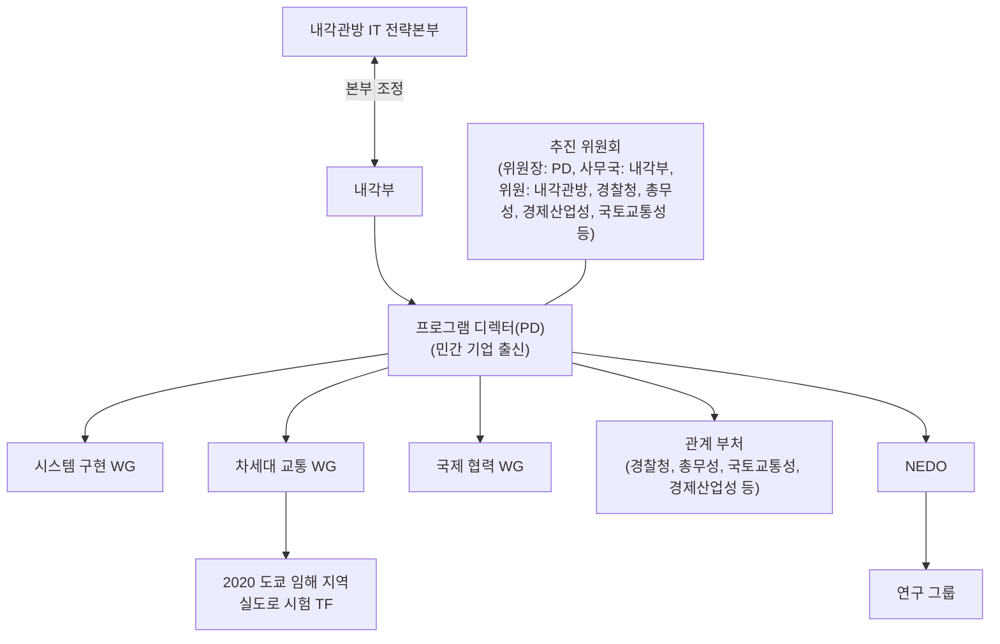

*그림 17. SIP-adus의 추진 조직*

그림 17에서 PD는 추진 위원회를 이끌고 세 실무 그룹(WG)을 둔다. 연구 과제는 관계 부처와 **NEDO(New Energy and Industrial Technology Development Organization, 신에너지산업기술종합개발기구)** 를 거쳐 연구 그룹에 맡겨진다. 추진 위원회는 1기가 끝난 뒤 재검토하여 2019년에 새 추진 조직을 세우기로 했다. 정부 기구이지만 산업계 전문가가 총괄하므로, 산업계가 주도하여 사회적 합의를 만들어 가는 구조이다.

**SIP 2기의 방향.** SIP 2기는 모빌리티 서비스용 차량과 개인용 차량을 나누어 추진했다.

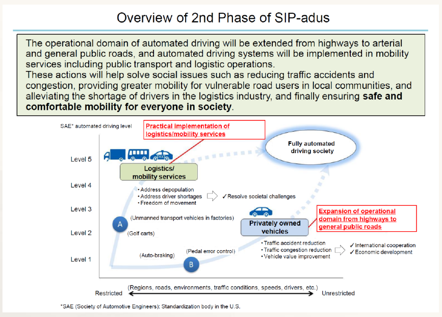

*그림 18. SIP-adus 2기의 개요*

그림 18의 위쪽 글상자는 2기의 목표를 요약한다. 자율주행의 운행 영역을 고속도로에서 간선도로와 일반도로로 넓히고, 대중교통과 물류를 포함한 모빌리티 서비스에 자율주행 시스템을 구현한다. 이를 통해 교통사고와 정체를 줄이고, 지역 사회의 교통 약자에게 이동 수단을 제공하고, 물류 산업의 운전자 부족을 덜어, 모두가 안전하고 편안하게 이동하는 사회를 만든다는 것이다. 아래 그래프는 세로축이 SAE 자율주행 레벨, 가로축이 운행 조건(지역, 도로, 환경, 교통 조건, 속도, 운전자)의 제한 정도이다.

1. **경로 A(물류와 모빌리티 서비스):** 골프 카트나 공장 안 무인 운송 차량처럼 제한된 조건의 높은 레벨에서 출발하여, 레벨 4의 물류와 모빌리티 서비스를 실현한다. 인구 감소 지역의 이동, 운전자 부족, 이동의 자유 같은 사회 문제를 해결하는 것이 목적이다.
2. **경로 B(개인 소유 차량):** 자동 제동과 페달 오조작 제어처럼 제한이 적은 조건의 낮은 레벨에서 출발하여, 운행 영역을 고속도로에서 일반도로로 넓힌다. 교통사고와 정체 감소, 차량 가치 향상을 거쳐 국제 협력과 경제 발전에 이바지하는 것이 목적이다.

두 경로는 모두 완전 자율주행 사회를 지향하지만, 서비스 차량은 운행 조건을 좁히는 대신 레벨을 먼저 높이고, 개인 차량은 레벨을 단계적으로 높이면서 운행 조건을 넓힌다는 점이 다르다.

**SIP 1, 2기 로드맵.** SIP는 도로 교통 환경 정보의 체계를 단계적으로 구축했다.

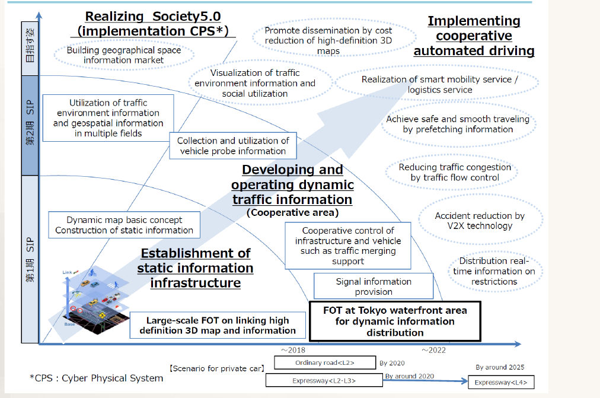

*그림 19. SIP 1, 2기의 도로 교통 환경 정보 체계 구축 로드맵*

그림 19의 아래에서 위로 단계가 올라간다.

1. **1기(\~2018년), 정적 정보 인프라의 구축:** 다이내믹 맵의 기본 개념을 정하고 정적 정보를 구축했으며, 고정밀 3D 지도와 정보 연계에 관한 대규모 실도로 시험을 수행했다.
2. **2기(\~2022년), 동적 교통 정보의 개발과 운영(협조 영역):** 차량 프로브 정보의 수집과 활용, 신호 정보 제공, 합류 지원 같은 인프라와 차량의 협조 제어, 도쿄 임해 지역에서의 동적 정보 배포 실도로 시험을 수행했다. 이를 통해 V2X로 사고를 줄이고, 통행 제한 정보를 실시간으로 배포하고, 교통 흐름 제어로 정체를 줄인다.
3. **목표 형태:** Society 5.0의 구현(사이버 물리 시스템, CPS)으로 지리 공간 정보 시장을 만들고, 고정밀 3D 지도의 비용을 낮추어 보급하며, 교통 환경 정보를 시각화하여 사회적으로 활용한다. 동시에 협조형 자율주행을 구현하여 스마트 모빌리티와 물류 서비스, 정보 선행 취득을 통한 안전하고 원활한 주행을 실현한다.

그림 19의 아래쪽은 개인 차량의 시나리오이다. 2020년까지 일반도로 레벨 2, 2020년 무렵 고속도로 레벨 2\~3, 2025년 무렵 고속도로 레벨 4를 목표로 했다.

> **용어 정의:** **CPS(Cyber Physical System, 사이버 물리 시스템)** 는 현실 세계의 정보를 센서로 모아 사이버 공간에서 분석하고, 그 결과로 현실 세계를 제어하는 시스템이다.

> **용어 정의:** **Society 5.0**은 1주차에서 정의한 일본의 국가 비전이다.

**8개 전략 분야와 10개 기술 분야.** SIP-adus는 Society 5.0의 참조 아키텍처를 따라 전략 수립, 법규제, 운영 체계, 비즈니스, 기능, 데이터, 데이터 수집, 기술(자산)의 8개 계층으로 자율주행 추진 전략의 아키텍처를 구축했다. 이 참조 아키텍처는 사람과 물건을 운송하는 모빌리티 시스템에 적용되며, 모든 계층에 보안과 인증이 걸쳐 있고 시간 축과 공간 축으로 확장된다. 또한 지도(고정밀 3D 맵, 다이내믹 맵), 통신 인프라, 인지 기술, 판단 기술, 인간공학, 기능 안전, 사이버 보안, 소프트웨어 인력, 사회적 수용성, 안전성 평가의 10개 기술 분야별 로드맵을 따로 만들어 추진했다 [27]. 각 분야의 내용은 1주차에서 다루었다.

### 2.9 다이내믹 맵과 DMP

자율주행차는 센서가 보는 범위 밖의 도로 구조와 상황을 알기 위해 정밀 지도를 쓴다. 일본은 지도의 기반 부분을 업계가 함께 만드는 공공과 민간의 역할 분담 체계를 택했다.

**DMP.** 일본은 상대 정밀도 25 cm(지도 정보 레벨 500에 해당)의 고정밀 3차원 지도를 만들고 유지하며 제공하는 회사로 **다이내믹맵기반주식회사(DMP, Dynamic Map Platform)** 를 설립했다 [28]. 이 회사는 2016년 6월에 기획 회사로 설립되었다가 2017년 6월에 사업 회사로 사업 내용을 바꾸었으며, 대표이사는 이나하타 히로유키(稲畑 廣行)이다. 주주는 투자 펀드(INCJ 등), 지도와 측량 회사(미쓰비시전기, ZENRIN, PASCO, 아이산테크놀로지, 도요타맵마스터, 인크리먼트P), 자동차 회사(도요타, 닛산, 혼다, 스바루, 미쓰비시자동차, 마쓰다, 스즈키, 이스즈, 히노, 다이하쓰)로 구성되었다.

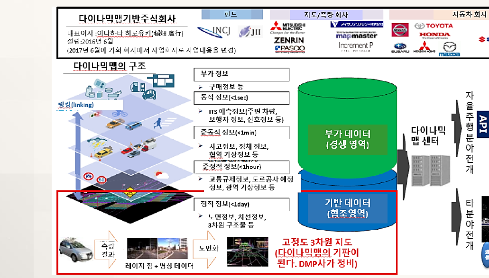

*그림 20. 일본의 다이내믹 맵 주식회사의 역할*

그림 20의 아래쪽은 기반 지도를 만드는 과정이다. 측량 차량이 레이저 점군과 영상 데이터를 수집하고(측량 결과), 이를 도면화하여 고정밀 3차원 지도를 만든다. 이 고정밀 3차원 지도가 다이내믹 맵의 기반이 되며, DMP가 정비한다. 가운데의 원통은 데이터의 성격을 나눈다. 아래의 기반 데이터(정적 정보)는 업계가 함께 쓰는 **협조 영역**이고, 위의 부가 데이터(동적, 준동적, 준정적 정보)는 각 회사가 서비스로 경쟁하는 **경쟁 영역**이다. 오른쪽의 다이내믹 맵 센터는 API로 자율주행 분야에 데이터를 제공하며, 도로 관리 같은 사회 인프라 유지와 다른 분야로도 전개한다.

> **핵심:** 정밀 지도의 기반 데이터는 모든 회사가 똑같이 필요로 하지만 만드는 비용이 크다. 그래서 기반 데이터는 공동으로 만들고(협조 영역), 그 위의 부가 서비스로 경쟁(경쟁 영역)하는 구조가 중복 투자를 줄이고 지도의 표준화를 돕는다.

**다이내믹 맵의 계층.** 다이내믹 맵은 정보가 바뀌는 주기에 따라 네 계층으로 나뉜 디지털 지도이다.

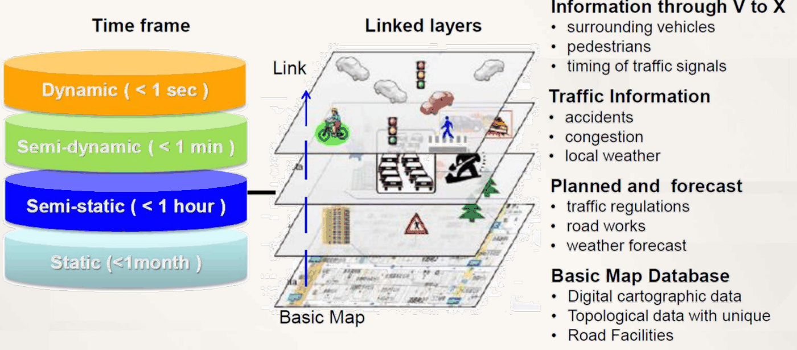

*그림 21. 시간 주기에 따라 계층화된 다이내믹 맵*

| 계층 | 갱신 주기 | 정보 | 예 |
|:-----|:-----|:-----|:-----|
| 동적(dynamic) | 1초 미만 | V2X로 받는 정보 | 주변 차량, 보행자, 신호 시간 |
| 준동적(semi-dynamic) | 1분 미만 | 교통 정보 | 사고, 정체, 국지 기상 |
| 준정적(semi-static) | 1시간 미만 | 계획되거나 예보된 정보 | 교통 규제, 도로 공사, 기상 예보 |
| 정적(static) | 1개월 미만 (1일 단위로 제시되기도 함) | 기본 지도 데이터베이스 | 디지털 지도 데이터, 노면과 차선 정보, 3차원 구조물, 도로 시설 |

*표 26. 다이내믹 맵의 네 계층*

각 계층의 정보는 위치를 기준으로 서로 연결(link)되어, 정적 지도 위에 준정적, 준동적, 동적 정보가 겹쳐진다. 이 구조는 유럽 ETSI가 정의한 **LDM(Local Dynamic Map)** 의 네 계층(영구 정적, 일시 정적, 일시 동적, 고동적 정보)과 같은 생각이다 [29].

> **용어 정의:** **LDM(Local Dynamic Map, 로컬 다이내믹 맵)** 은 차량이나 노변 기지국이 자기 주변의 정적 지도 정보와 V2X 및 센서로 받은 동적 정보를 위치 기준으로 모아 둔 데이터 저장소이다. 3.6절의 C-AHS 과제도 이 개념을 쓴다.

### 2.10 일본의 ITS 주파수

일본은 5.8 GHz 주변을 주로 ETC(한국의 하이패스에 해당)에 배정했다. 5.9 GHz 대역을 V2X에 쓰는 미국, 유럽과 달리, 일본의 차량 안전 통신은 700 MHz 대역을 쓴다는 점이 특징이다.

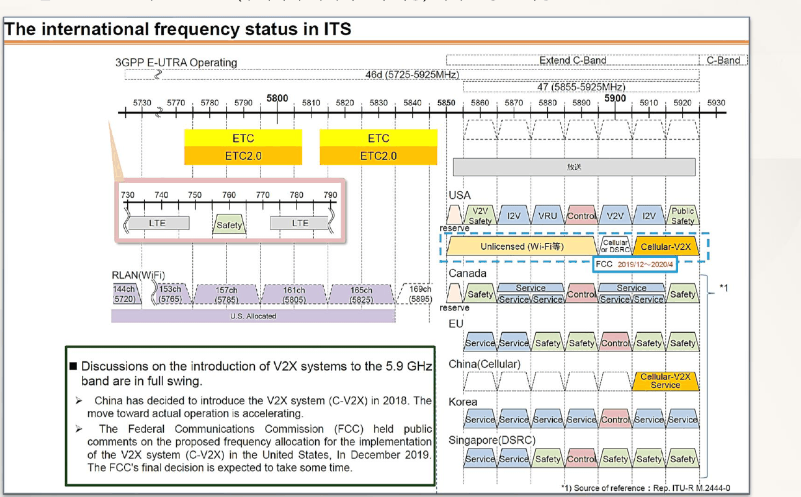

*그림 22. ITS 주파수의 국제 현황*

그림 22는 일본 총무성이 정리한 각국의 ITS 주파수 배치이다 [30]. 위쪽 눈금은 5,730\~5,930 MHz이며, 그 위에 3GPP E-UTRA 운용 대역 46d(5,725\~5,925 MHz)와 47(5,855\~5,925 MHz)이 표시되어 있다.

1. **일본:** 5.8 GHz 대역에 ETC와 ETC2.0이 두 블록으로 배치되어 있고, 왼쪽 확대 그림처럼 700 MHz 대역(730\~790 MHz)의 LTE 사이에 안전(safety)용 대역이 있다. 무선 LAN(RLAN) 채널도 5.8 GHz 대역 일부를 쓴다.
2. **미국:** 5.9 GHz 대역에 V2V 안전, I2V, VRU, 제어 채널, 공공 안전 채널이 배치되었다가, FCC의 2019년 12월\~2020년 4월 논의로 하위 대역은 비면허(와이파이) 용도로, 상위 대역은 셀룰러 V2X 용도로 바뀌는 방향이 표시되어 있다.
3. **캐나다, 유럽, 한국, 싱가포르(DSRC):** 5.9 GHz 대역에 서비스, 안전, 제어 채널이 배치되어 있다.
4. **중국:** 5.9 GHz 대역 상위 부분을 셀룰러 V2X 서비스에 배정했다.

그림 22의 글상자는 5.9 GHz 대역에 V2X 시스템을 도입하는 논의가 한창이라고 설명한다. 중국은 2018년에 C-V2X 도입을 결정하여 실제 운영을 향한 움직임이 빨라졌고, 미국 FCC는 2019년 12월에 C-V2X 도입을 위한 주파수 배분안에 대해 의견을 수렴했으며, 최종 결정에는 시간이 걸릴 것으로 보았다. 이후 미국의 결정은 1주차에서 정리했다.

### 2.11 상용화 시나리오와 실증 유형

일본 정부의 관민 ITS 구상과 로드맵(Public-Private ITS Initiative/Roadmaps 2020)은 개인 차량, 물류 서비스, 이동 서비스(대중교통)의 세 갈래로 자율주행의 상용화 시나리오를 단기, 중기, 장기로 나누어 제시했다 [31].

| 갈래 | 2020 회계연도까지 | 단기 (2021\~2022 회계연도) | 중기 (2023\~2025 회계연도) |
|:-----|:-----|:-----|:-----|
| 개인 차량 | 일반도로의 운전자 보조(레벨 2), 대규모 시험을 거친 고속도로의 운전자 보조와 자율주행(레벨 2, 3) | 운전자 보조 시스템의 고도화(레벨 1, 2), 보급 확대 | 고속도로 자율주행(레벨 4), 보급 촉진 |
| 물류 서비스 | 개발과 시험 | 고속도로 트럭 군집주행, 지정 구역의 무인 자율 배송 서비스 | 고속도로 자율주행 트럭(레벨 4) |
| 이동 서비스 | 외딴 지역과 인구 과소 지역의 공공 도로 시험을 거친 지정 구역의 무인 자율 운송 서비스(레벨 4) | 원격 감시만 하는 무인 자율 운송 서비스, 고속도로 버스의 운전자 보조와 자율주행(레벨 2 이상) | 지정 구역 무인 운송 서비스(레벨 4)의 대상 지역, 운행 설계 영역, 서비스 범위 확대 |

*표 27. 일본의 자율주행 상용화와 서비스 구현 시나리오*

표 27에서 개인 차량은 레벨을 단계적으로 높이고, 물류와 이동 서비스는 제한된 구역의 레벨 4에서 출발하여 구역을 넓히는 전략이다. 2.8절의 SIP 2기 경로 A, B와 같은 생각이다. 장기(2026 회계연도 이후) 목표는 개인 차량의 경우 교통사고 감소, 정체 완화, 산업 경쟁력 강화이고, 물류 서비스의 경우 인구 감소 시대에 대응한 물류의 혁신적 효율화이며, 이동 서비스의 경우 고령자도 전국 어디서나 자유롭게 이동할 수 있는 사회이다.

**전국적인 실증.** 일본은 고속도로 휴게소를 거점으로 한 자율주행 서비스, 라스트마일 자율주행, 스마트 모빌리티 챌린지, 공항 구내 도로, 스마트 시티, 지자체별 실증처럼 다양한 형태의 실증을 전국에서 추진했다 [31]. 2020년 3월 기준(계획 포함)의 실증 지도에는 고속도로 휴게소 등을 거점으로 한 자율주행 서비스(국토교통성, 내각부: 아키타현 가미코아니, 홋카이도 다이키, 이바라키현 히타치오타, 시가현 히가시오미), 라스트마일 자율주행(국토교통성, 경제산업성: 후쿠이현 에이헤이지, 오키나와현 차탄), 고속도로 트럭 군집주행(신토메이 고속도로의 후속 차량 무인 군집주행, 조신에쓰 고속도로의 유인 군집주행), 스마트 모빌리티 챌린지(시가현 오쓰, 오이타현 오이타), 중형 자율주행 버스의 타당성 조사, SIP의 도쿄 임해 지역 일반도로 실증, 공항 제한 구역의 자율주행(나리타, 하네다, 주부, 간사이, 사가 공항), 스마트 시티(도치기현 우쓰노미야, 지바현 가시와, 시즈오카현 시모다, 아이치현 가스가이, 도쿄 지요다구와 고토구), 지자체와 민간 기업, 대학의 개별 실증(군마현 기류, 미에현 구와나 등 17곳)이 표시되어 있다.

**실증 유형의 분류.** 실증 지역마다 필요한 차량 플랫폼이 다르므로, 한국자동차연구원은 운행 공간의 성격에 따라 실증 유형을 다섯 가지로 나누는 판별 절차를 제시했다.

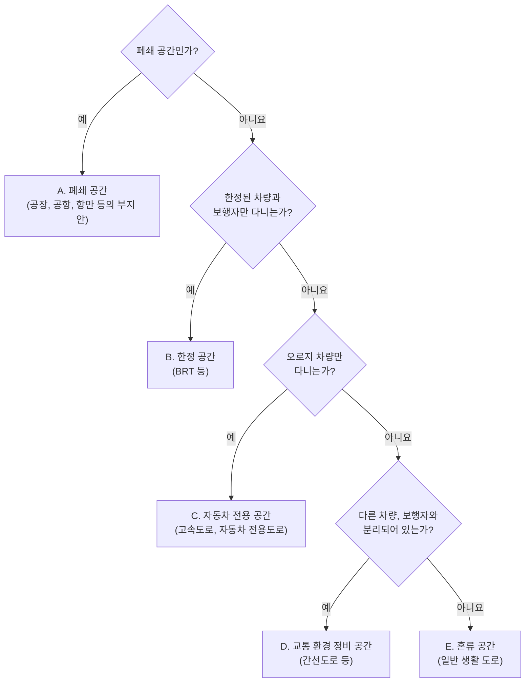

*그림 23. 운행 공간에 따른 자율주행 실증 유형의 판별*

| 유형 | 사람 이동용 차량 플랫폼 | 물건 수송용 차량 플랫폼 |
|:-----|:-----|:-----|
| A. 폐쇄 공간 | 셔틀, 휠체어, 소형 버스(15인승), 중형 버스(25인승) | 소형 트럭, 대형 트럭, 배송 로봇 |
| B. 한정 공간 | 대형 버스, 중형 버스(25인승) | 해당 없음 |
| C. 자동차 전용 공간 | 승용차, 대형 버스, 소형 버스(15인승), 중형 버스(25인승) | 대형 트럭 |
| D. 교통 환경 정비 공간 | 승용차, 셔틀, 개인형 이동 수단(PM), 소형 버스(15인승), 중형 버스(25인승) | 소형 트럭, 배송 로봇 |
| E. 혼류 공간 | 승용차, 소형 버스(15인승) | 소형 트럭 |

*표 28. 실증 유형별로 필요한 차량 플랫폼*

같은 유형이라도 실제 주행 환경의 조건과 사람 이동인지 물건 수송인지에 따라 필요한 차량 플랫폼이 달라진다. 고려할 조건은 표 29와 같다.

| 조건 | 내용 |
|:-----|:-----|
| 차속 | 자율주행 속도(저속, 중속, 고속) |
| 지형 | 도시부와 산간부, 곡선 반경, 오르막과 내리막 |
| 도로 | 차로 수, 보도의 유무, 노면 표시, 노면 상태(적설 등) |
| 환경 | 날씨(순광과 역광 포함), 재해 상황 |
| 교통 상황 | 교통량, 정체 상황(노상 주차), 장애물의 유무 |
| 시간대 | 주간, 야간 |

*표 29. 차량 플랫폼 선정에 영향을 주는 실제 주행 환경 조건*

### 2.12 저밀도 지역과 도시 지역의 모빌리티

일본은 고령화와 농촌 인구 감소로 생기는 사회 문제를 자율주행 모빌리티로 해결하려 한다. ITS Japan은 인구 분포를 두 유형으로 보고 각각의 운영 방안을 제시했다.

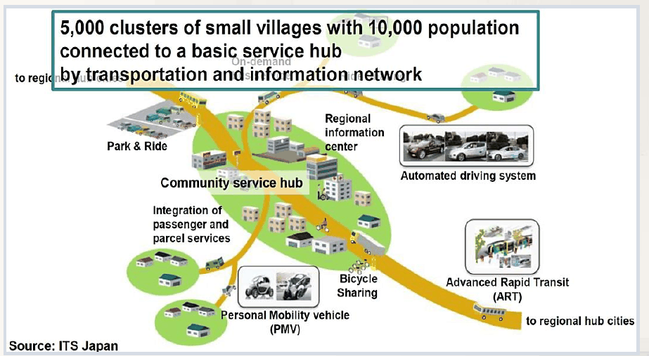

*그림 24. 인구 저밀도 지역의 모빌리티 구상*

**저밀도 지역.** 인구 1만 명 이하의 저밀도 마을이 약 5,000개 형성될 것으로 전망된다. 이런 지역에서는 기존의 상업 노선버스를 수익성 문제로 운영할 수 없다. 그래서 그림 24처럼 작은 마을들을 교통과 정보 네트워크로 기본 서비스 거점(community service hub)에 연결한다.

1. 무인 셔틀버스(ART, Advanced Rapid Transit)로 거점과 중심지 사이를 연결한다.
2. 자율주행 택시(로봇 택시)로 흩어진 저밀도 거주지를 연결한다.
3. 승객 운송과 택배 서비스를 통합하여 운영 효율을 높인다.
4. 개인형 이동 수단(PMV, personal mobility vehicle), 자전거 공유, 환승 주차(park and ride)를 함께 활용한다.

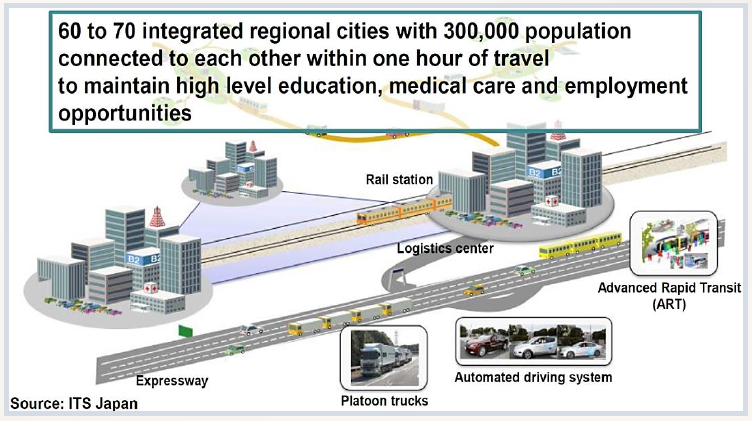

*그림 25. 도시 지역의 모빌리티 구상*

**도시 지역.** 인구 30만 명 이상의 통합 도시 지역 60\~70개가 형성될 것으로 전망된다. 1시간 이내 거리의 밀집 지역들을 연결하여 30만 명 이상의 통합 도시로 관리하면, 높은 교육과 의료 서비스, 고용 기회를 유지할 수 있다. 그림 25처럼 밀집 지역 사이는 철도와 고속도로(트럭 군집주행 포함)로, 밀집 지역 안은 자율주행 택시와 ART로 연결하고, 물류 센터가 화물을 나눈다.

### 2.13 저속 자율주행 차량 실증과 군집주행

**저속 자율주행 차량(LSV) 실증.** 일본은 전국 여러 지역에서 저속 자율주행 차량(LSV, low-speed vehicle)의 시험과 시연을 수행했다.

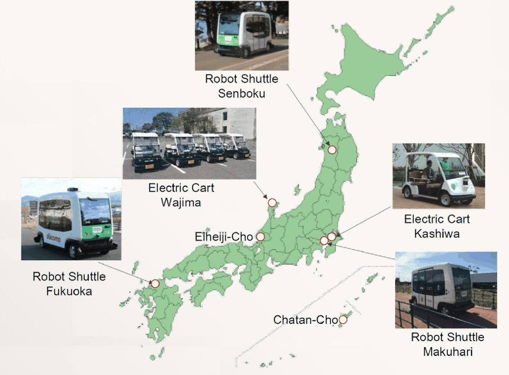

*그림 26. 일본의 저속 자율주행 차량 시험과 시연 지역*

그림 26의 지도에는 센보쿠(아키타현)와 마쿠하리(지바현), 후쿠오카의 로봇 셔틀, 와지마(이시카와현)와 가시와(지바현)의 전동 카트, 에이헤이지초(후쿠이현), 차탄초(오키나와현)의 실증 지역이 표시되어 있다. 대부분 셔틀이나 카트가 저속으로 정해진 경로를 운행하는 형태이다.

**군집주행의 분류.** 일본은 트럭 군집주행을 세 가지 구성 요소의 조합으로 분류했다.

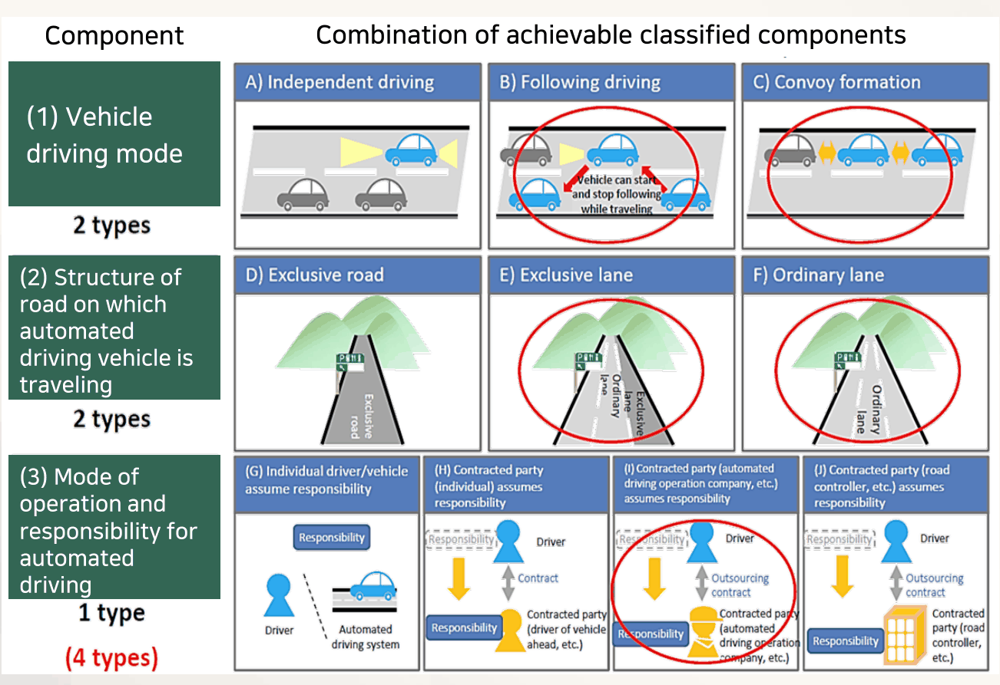

*그림 27. 군집주행을 구성하는 요소의 조합*

| 구성 요소 | 선택지 | 채택 |
|:-----|:-----|:-----|
| (1) 차량의 주행 방식 | A 독립 주행, B 추종 주행(주행 중에 추종을 시작하고 끝낼 수 있음), C 대열 형성(convoy) | B, C (2가지) |
| (2) 자율주행 차량이 달리는 도로 구조 | D 전용 도로, E 전용 차로, F 일반 차로 | E, F (2가지) |
| (3) 운영 방식과 자율주행의 책임 | G 개별 운전자나 차량이 책임, H 계약 당사자(앞차 운전자 개인)가 책임, I 계약 당사자(자율주행 운영 회사 등)가 책임, J 계약 당사자(도로 관리자 등)가 책임 | I (1가지) |

*표 30. 일본의 군집주행 분류 요소*

세 요소에서 채택한 선택지를 곱하면 $2 \times 2 \times 1 = 4$가지 초안 개념이 나온다.

| 초안 개념 | 주행 방식 | 차로 | 내용 |
|:-----|:-----|:-----|:-----|
| 1 | 추종 주행 | 전용 차로 | 전용 차로에서 차량들이 자율주행 운영 회사 등이 운행하는 차량을 따라간다 |
| 2 | 추종 주행 | 일반 차로 | 일반 차로에서 차량들이 자율주행 운영 회사 등이 운행하는 차량을 따라간다 |
| 3 | 대열 형성 | 전용 차로 | 전용 차로에서 운영 회사 등이 운행하는 차량과 다른 여러 차량이 대열을 이루어 함께 달린다 |
| 4 | 대열 형성 | 일반 차로 | 일반 차로에서 운영 회사 등이 운행하는 차량과 다른 여러 차량이 대열을 이루어 함께 달린다 |

*표 31. 일본의 군집주행 초안 개념 4가지*

추종 주행과 대열 형성의 차이는 차량 사이의 결합 정도에 있다. 추종 주행은 뒤차가 앞차를 따라가다 주행 중에 대열에서 빠지거나 합류할 수 있고, 대열 형성은 여러 차량이 하나의 대열로 묶여 함께 움직인다. 책임 주체로 자율주행 운영 회사를 택한 것은 선두 차량을 운행하는 사업자가 대열 전체의 운행을 책임지는 사업 모델을 가정했기 때문이다.

**NEDO의 트럭 군집주행 차량.** NEDO의 에너지 ITS 과제는 대형 트럭 군집주행 차량을 개발했다.

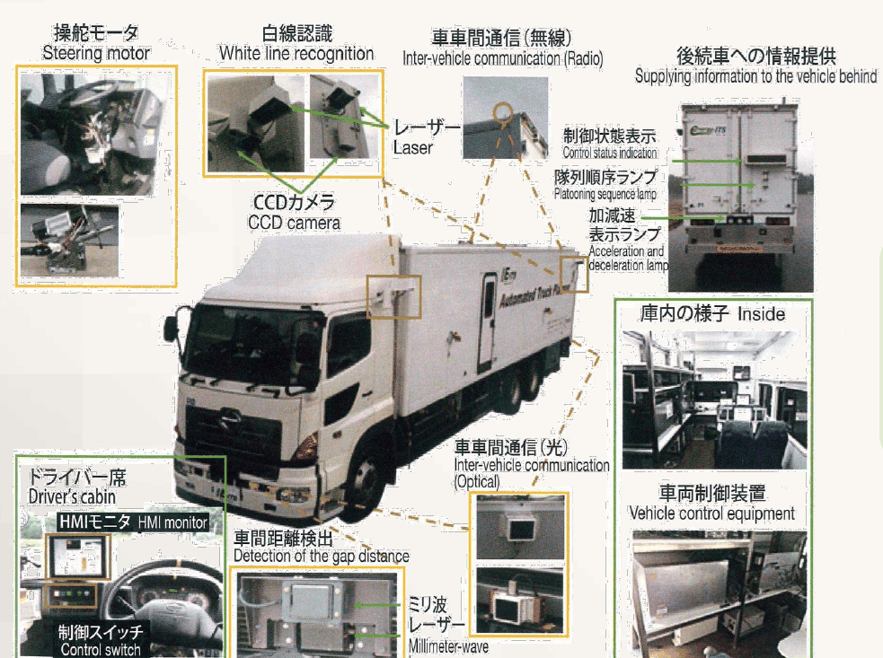

*그림 28. NEDO 트럭 군집주행 차량의 구성*

그림 28의 트럭에는 조향 모터, 흰 차선을 인식하는 CCD 카메라, 레이저 레이더, 밀리미터파 레이더, 차간 거리 검출 장치, 무선과 광 방식의 차량 간 통신 장치, 뒤차에 정보를 주는 표시등(제어 상태 표시, 대열 순서 램프, 가감속 표시 램프), 운전석의 HMI 모니터와 제어 스위치, 차량 제어 장치가 장착되어 있다. 이 차량은 CACC로 운행한다.

1. 차량 사이의 거리는 속도와 가속도 정보를 차량 간 통신으로 공유하여 조정한다.
2. 차량의 횡방향 운동(조향)을 제어하여, 여러 대의 트럭이 이어져 있어도 조향의 안전성을 보장한다.

차량 간 통신을 무선과 광의 두 방식으로 이중화한 것은 짧은 차간 거리에서 통신이 끊기면 추돌로 이어질 수 있기 때문이다.

유럽과 일본의 사례에서 드러나는 교훈은 다음과 같다. 첫째, 유럽은 여러 나라와 기업이 함께 쓰는 표준과 주파수를 먼저 확보하기 위해 다국적 과제와 컨소시엄을 활용했다. 둘째, V2V는 보급률이 일정 수준에 이르러야 효과가 나므로, 보급 속도의 한계를 인프라와 애프터마켓 장치로 보완해야 한다. 셋째, 일본은 지도의 기반 데이터처럼 모두가 필요한 부분을 협조 영역으로 공동 구축하고, 서비스 차량과 개인 차량의 경로를 나누어 사회 문제 해결과 산업 경쟁력을 함께 추구했다.

---

<br>

## 3. 한국의 커넥티드 자율주행

한국은 1.2절에서 본 것처럼 u-Transportation과 Smart Highway 같은 국가 연구개발 사업을 거쳐 C-ITS 시범 사업과 실증 사업으로 나아갔다. 이 절은 범부처 자율주행 연구개발 사업, 연구 기관의 개발 과제, 도로 인프라 연계 과제, 시험장과 실증 사업을 차례로 정리한다.

### 3.1 자율주행기술개발혁신사업

**자율주행기술개발혁신사업**은 산업통상자원부, 과학기술정보통신부, 국토교통부, 경찰청의 4개 부처가 2021\~2027년의 7년 동안 약 1.1조 원(1조 974억 원)을 투입하는 범부처 연구개발 사업이다. 84개 내외의 세부 과제로 구성되며, 2021년 3월에 출범한 **자율주행기술개발혁신사업단(KADIF)** 이 사업을 총괄한다 [32]. 목표는 2027년까지 융합형 레벨 4+ 자율주행의 상용화 기반을 완성하는 것이다.

| 분야 | 주요 산출물 | 세부 기술과 연차 목표 |
|:-----|:-----|:-----|
| 차량 융합 신기술 | 센서, 차량 플랫폼 | 4대 인지 예측 센서(2022년 설계, 2023년 1차 시제품, 2024년 2차 시제품, 2025년 열화상 카메라, 가변 초점 카메라, 라이다, 레이더 제작), AI 컴퓨팅 플랫폼(설계, 시스템 통합, 시험 차량 통합, 실차 적용 검증), 자율주행 차량 플랫폼(2022년 밴과 버스 설계, 2023년 승용차와 트럭 설계, 2024년 시제품, 2025년 밴, 2026년 중형 버스, 2027년 승용차와 트럭), 자율주행 안전 설계(사고 위험 분석, 위험 요인 검증, SOTIF 준수 안전 기준) |
| ICT 융합 신기술 | AI 소프트웨어, 차량 통신과 보안 | 초고속 자율주행 통신(2023년 V2X 통신 인프라 협력 주행 기술, 2024년 고도화, 2026년 실차 V2X 통신 실증), 자율주행 시뮬레이션, 자율주행 AI 소프트웨어(커넥티드 소프트웨어 설계, AI 협력 자율주행, 실차 AI 소프트웨어 실증), 자율주행 네트워크 보안(V2X 통신 보안 기술, 고도화, 2027년 실차 플랫폼 보안 실증), 가상 소프트웨어 구조 검증 |
| 도로 교통 융합 신기술 | 디지털 인프라, 통합 관제 센터, 교통 안전 시설 | 디지털 교통 인프라(2023년 인프라 정보 연계 표준, 2024년 디지털 교통 인프라 플랫폼, 2025년 인프라 플랫폼 표준 적용), 통합 관제 센터(관제 센터 데이터 표준, 관제 시스템 플랫폼, 통합 관제 협력 표준), 자율주행 테스트베드(2023년 리빙랩 대상 도시 선정, 2024년 개방형 리빙랩 설계, 2025년 현장 구축, 2026년 운영, 2027년 고도화), 통합 모빌리티 센터(교통 관리 플랫폼, 모빌리티 센터 시제품, 통합 운영 매뉴얼, 모빌리티 센터 국제 표준) |
| 자율주행 서비스 | 7대 공공 서비스 | 교통 약자 지원, 긴급 상황 관리, 실시간 교통 관리, 공유 차량, 긴급 차량 지원, 도시 환경 관리, 교통 순찰 (서비스마다 서비스 기술 개발, 서비스 시스템 개발, 서비스 실증의 순서로 진행) |
| 자율주행 생태계 | 국제 표준, 법과 제도, 면허 제도 | 국제 표준과 법 제도(2022년 표준 1건과 법 제도 5건, 2023년 표준 3건과 법 제도 8건, 2024년 표준 5건과 법 제도 15건), 주행과 충돌 안전성 평가(2023년 안전 시험 시나리오, 2024년 안전 시험 평가 체계, 2025년 동적 안전 시험 평가 기준, 2026년 도시 도로 인프라 안전 기준 초안), 보안 안정성 평가(2023년 보안 수준 체계, 2024년 사이버 보안 평가 기준, 2026년 자율주행 법령 정비), 자율주행 소프트웨어의 운전 능력 평가(2024년 운전 능력 평가 지침, 2025년 운전자 대처 능력 시나리오, 2027년 운전 능력 평가 체계 구축) |

*표 32. 자율주행기술개발혁신사업의 5대 분야*

> **용어 정의:** **SOTIF(Safety Of The Intended Functionality, 의도된 기능의 안전성)** 는 고장이 없더라도 센서의 인식 한계나 예상하지 못한 상황 때문에 생길 수 있는 위험을 다루는 안전 개념으로, ISO 21448로 표준화되었다. 부품 고장으로 인한 위험을 다루는 기능 안전(ISO 26262)을 보완한다.

사업은 두 단계로 진행된다. 1단계(2021\~2024년)는 자율주행의 핵심 부품 기술을 확보하는 기술 개발 단계이고, 2단계(2025\~2027년)는 리빙랩 실증과 인프라 검증으로 기술을 고도화하고 상용화하는 단계이다. 사업은 2020년 4월에 예비타당성 조사를 통과했고, 과제는 2021년 3월 출범식 이후 2021년 6월 53개, 2022년 5월 12개, 2023년 18개, 2024년 3개, 2025년 2개가 차례로 착수되었으며, 개발 결과는 시뮬레이션, 테스트베드(2025\~2026년), 리빙랩(2026\~2027년)의 순서로 검증한다. 또한 2021년부터 전문가 위원회를 운영한다.

> **용어 정의:** **리빙랩(living lab)** 은 실제 생활 공간을 실험실로 삼아, 일반 시민이 사용하는 환경에서 기술과 서비스를 시험하고 개선하는 방식이다. 시험장(테스트베드)보다 실제 운영 조건에 가깝다.

### 3.2 한국자동차연구원의 시험 장비와 개발 과제

한국자동차연구원(KATECH)은 자율주행과 커넥티드카의 부품과 시스템을 개발하고 평가하는 연구 기관이다. 기관 소개는 2주차 부록에서 다루었다.

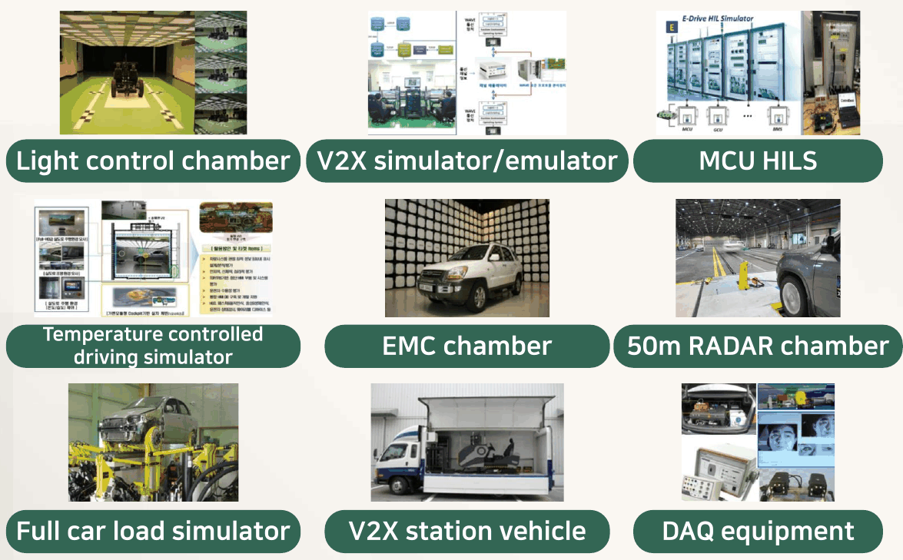

*그림 29. 한국자동차연구원의 자율주행 시험 장비*

그림 29의 장비는 다음 용도로 쓰인다.

1. **조도 제어 챔버(light control chamber):** 빛의 세기와 방향을 바꾸어 카메라 센서의 인식 성능을 시험한다.
2. **V2X 시뮬레이터와 에뮬레이터:** 많은 차량과 노변 기지국이 보내는 V2X 메시지를 실험실에서 만들어 통신 장치를 시험한다.
3. **MCU HILS:** 제어기(MCU)를 실제 하드웨어로 두고 차량과 환경은 시뮬레이션으로 대신하여 제어 로직을 시험한다.
4. **온도 제어 주행 시뮬레이터:** 다양한 온도 조건에서 주행 상황을 재현한다.
5. **EMC 챔버:** 전자 장치가 내는 전자파와 외부 전자파에 대한 내성을 시험한다.
6. **50 m 레이더 챔버:** 전파 반사를 막은 공간에서 레이더의 탐지 거리와 정확도를 시험한다.
7. **실차 부하 시뮬레이터(full car load simulator):** 차량 전체에 걸리는 부하를 실험실에서 모사하여 차량과 부품을 시험한다.
8. **V2X 스테이션 차량, 데이터 수집(DAQ) 장비:** 실제 도로에서 V2X 통신과 차량 데이터를 기록한다.

> **용어 정의:** **HILS(Hardware-In-the-Loop Simulation)** 는 시험할 하드웨어를 실제로 연결하고 나머지 시스템은 실시간 시뮬레이션으로 대신하는 시험 방법이다. 실차 시험보다 안전하고 반복하기 쉽다.

> **용어 정의:** **EMC(Electromagnetic Compatibility, 전자파 적합성)** 는 장치가 다른 장치에 전자파 간섭을 주지 않고, 외부 간섭에도 정상 동작하는 성질이다.

한국자동차연구원이 수행하거나 참여한 자율주행 관련 국가 과제는 표 33과 같다.

| 과제 | 예산 | 기간 | 수행 기관 |
|:-----|-----:|:-----|:-----|
| AI 기반 자율주행 컴퓨팅 모듈 개발과 서비스 실증 | 280억 원 | 2019\~2021년 | 현대모비스, 한국자동차연구원, 서울대, 국민대, 인하대, 한양대 등 20여 개 기관 |
| 대형 버스용 자율주행 부품과 시스템 개발, 친환경 수소 자율 버스 시범 운행 | 286억 원 | 2019\~2021년 | 솔루션링크 외 12개 기관, 한국자동차연구원과 a2z 외 7개 기관, 오비고와 서울대 외 1개 기관 |
| 자율주행 부품 성능 검증을 위한 자율 셔틀 실증 기반 기술 개발 | 96억 원 | 2018\~2021년 | 한국자동차연구원, 마루이엔지, 스프링클라우드, 뉴텍, 퓨전소프트, 차세대융합기술연구원 |
| 혼합현실(가상현실) 기반 자율주행 부품과 시스템 평가 기술 개발 | 112억 원 | 2022\~2027년 | 한국자동차연구원, 현대모비스 외 4개 중소기업, 한국교통연구원, 한양대, 서울대, 국민대, KIAPI, KAAMI |
| 미래 모빌리티를 위한 차세대 네트워크 프로세서와 통합 제어기 개발 | 280억 원 | 2021\~2024년 | 현대모비스(총괄), 텔레칩스 외 2개 기관, 한국자동차연구원 외 3개 기관 |
| T-Car 기반 자율주행 인지 예측, 지능 제어 차량 부품과 시스템 통합 평가 기술 개발 | 258억 원 | 2022\~2027년 | 한국자동차연구원(주관), 현대모비스 외 4개 중소기업, 한국교통연구원, 한양대, 서울대, 국민대, KIAPI, KAAMI |
| 실시간 교통안전시설 운용을 위한 인프라 정보 융합과 관리 기술 개발 | 75억 원 | 2021\~2026년 | 한국자동차연구원, 서울대, 국민대, LG U+, 카네비모빌리티, 파인C&I, 씨엔비스 |
| 거점 기반 레벨 4 자율주행 대형 트럭 차량 플랫폼 개발 | 130억 원 | 2022\~2027년 | 우진산전(주관), 한국자동차연구원, 오토노머스에이투지, 한양대 등 |
| 주변 환경 정보 융합 기반 협력형 차량 제어 기술 개발 | 120억 원 | 2023\~2027년 | 아이나비시스템즈, 한국자동차연구원, 케이스랩, 아이티텔레콤, 오토노머스에이투지, 롯데이노베이트, KAIST, 공주대 등 |
| 레벨 4 자율주행 차량의 커넥티드 기반 인지 증강과 협력 자율주행 기술 개발 | 50억 원 | 2023\~2027년 | 아이티텔레콤(주관), 케이스랩, 한국자동차연구원, 아이나비시스템즈, KAIST, 롯데이노베이트 |

*표 33. 한국자동차연구원의 자율주행 관련 개발 과제*

표 33의 과제들은 차량 쪽의 핵심 부품(컴퓨팅 모듈, 네트워크 프로세서, 센서 평가)부터 버스, 셔틀, 대형 트럭 같은 서비스 차량, 그리고 인프라와 차량의 협력(교통안전시설 정보 융합, 협력형 차량 제어, 인지 증강)까지 걸쳐 있다. 뒤의 세 과제는 커넥티드 자율주행과 직접 관련되므로 3.3절과 3.4절에서 자세히 다룬다.

> **용어 정의:** **T-Car**는 자율주행 부품과 시스템을 통합하여 평가하기 위한 시험용 차량 플랫폼이다.

### 3.3 인프라 연계 자율주행: 교통안전시설 정보 융합

자율주행차는 신호기, 안전 표지, 노면 표시 같은 교통안전시설을 카메라로 인식한다. 그러나 표지가 가려지거나 노면 표시가 지워지면 인식에 실패할 수 있으므로, 인프라가 교통안전시설의 정보를 직접 디지털로 전달하면 자율주행의 안전성이 높아진다. 경찰청은 자율주행기술개발혁신사업 안에서 레벨 4 자율주행에 대응하는 교통안전 인프라 기술 과제 세 개를 추진했다.

| 과제 | 주관 기관 | 기간 | 예산 | 참여 기관 |
|:-----|:-----|:-----|-----:|:-----|
| (경1) 레벨 4 대응 교통안전 인프라 표준과 평가 기술 개발 | 도로교통공단 | 2021-04 ~ 2026-12 (5년 9개월) | 약 98억 원 | KCL, 한국자동차연구원, ITS Korea, KAIST, HNTech, Neighbor System |
| (경2) 레벨 4 자율협력주행 대응 교통 객체 인지 고도화와 악조건 해소 기술 개발 | 한국건설기술연구원 | 2021-04 ~ 2025-12 (4년 9개월) | 약 78억 원 | LEDO, Novacos, 서울기술연구원, Forum8, 서울시립대, BBMC |
| (경3) 실시간 교통안전시설 운용을 위한 인프라 정보 융합과 관리 기술 개발 | 한국자동차연구원 | 2021-04 ~ 2026-12 (5년 9개월) | 약 74억 원 | 파인C&I, 국민대, 서울대, 카네비모빌리티, 씨엔비스, LG U+ |

*표 34. 경찰청의 레벨 4 자율주행 대응 교통안전 인프라 과제*

(경3)의 예산은 75억 원(표 33)으로도, 약 73.74억 원(정부 출연금 70억 원과 민간 부담금 3.74억 원)으로도 제시된다. 세 과제에는 경찰청, 과학치안진흥센터(KIPoT), 자율주행기술개발혁신사업단(KADIF)이 관여한다. 세 과제 가운데 (경3)은 교통안전시설의 정보를 실시간으로 모으고 가공하여 자율주행차에 전달하는 체계를 만든다.

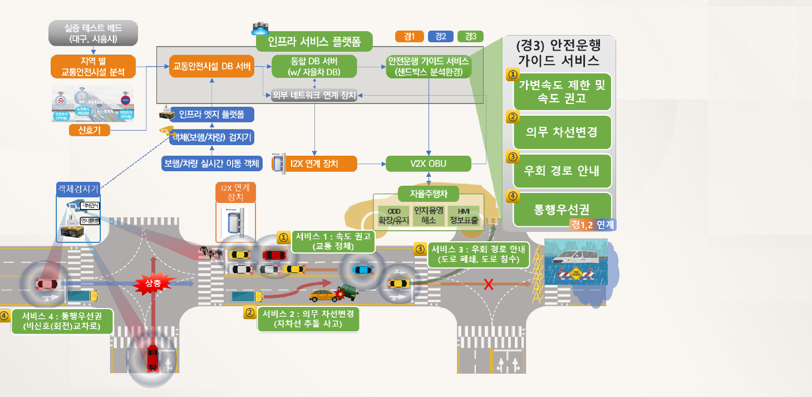

*그림 30. (경3) 과제의 인프라 연계 안전 운행 가이드 서비스 구성*

그림 30의 정보 흐름은 다음과 같다.

1. 테스트베드 지역(대구, 시흥시)의 교통안전시설을 분석하여 교통안전시설 데이터베이스 서버에 저장한다.
2. 신호기와 객체 검지기가 보행자와 차량의 실시간 이동 정보를 인프라 엣지 플랫폼으로 보낸다.
3. 인프라 서비스 플랫폼의 통합 데이터베이스 서버(자율주행차 데이터베이스 포함)가 정보를 융합하고, 샌드박스 분석 환경에서 안전 운행 가이드 서비스를 만든다.
4. 서비스 정보는 I2X 연계 장치와 V2X 노변 기지국을 거쳐 자율주행차의 V2X OBU로 전달된다.
5. 자율주행차는 이 정보로 운행 설계 영역(ODD)을 넓히거나 유지하고, 센서가 보지 못하는 인지 음영을 해소하며, 운전자에게 HMI로 정보를 표출한다.

> **용어 정의:** **엣지 플랫폼(edge platform)** 은 중앙 서버로 보내기 전에 현장 가까이에서 데이터를 먼저 처리하여 지연 시간을 줄이는 컴퓨팅 장치이다.

> **용어 정의:** **ODD(Operational Design Domain, 운행 설계 영역)** 는 자율주행 시스템이 정상 작동하도록 설계된 조건의 범위이다(1주차, 2주차).

> **용어 정의:** **HMI(Human-Machine Interface)** 는 사람과 기계가 정보를 주고받는 화면, 소리, 조작 장치를 말한다.

안전 운행 가이드 서비스는 네 가지이다.

| 번호 | 서비스 | 적용 상황 |
|:-----|:-----|:-----|
| 1 | 가변 속도 제한과 속도 권고 | 교통 정체 |
| 2 | 의무 차로 변경 | 자기 차로의 추돌 사고 |
| 3 | 우회 경로 안내 | 도로 폐쇄, 도로 침수 |
| 4 | 통행 우선권 | 비신호(회전) 교차로 (경1, 경2 과제와 연계) |

*표 35. (경3) 과제의 안전 운행 가이드 서비스*

> **용어 정의:** **DDT(Dynamic Driving Task, 동적 운전 작업)** 는 조향, 가감속, 주변 감시처럼 실시간으로 수행하는 운전 작업이다.

**세 가지 세부 개발 내용.** (경3) 과제는 다음 세 가지를 개발한다.

1. **실시간 교통안전시설 정보 관리와 운영 서버:** 교통안전시설(매설형 노면 표시, 부착형 안전 표지, 신호기)과 교통안전 보조 시설의 정보를 I2X 연계 장치(이동통신, 유선, RSU)와 인프라 엣지 플랫폼(정보 수신, 빅데이터 재가공, 배포)으로 모은다. 서비스 플랫폼은 교통안전시설 데이터베이스, 인프라 엣지의 동적 객체 정보 데이터베이스, 일반차와 자율차의 차량 상태 정보(PVD) 데이터베이스를 두고, 안전 속도 권고, 경로 추천, 차로 변경 권고, 속도 제한의 안전 운행 가이드 서비스를 제공한다.
2. **교통안전시설과 자율차의 연계 평가 플랫폼:** 차량과 도로 관점의 주행 안전 시나리오 10종(곡선로 주행, 돌발 상황에서 차량의 반응 시간, 통과량, 속도와 차간 간격의 편차), 교통안전시설과 차량 정보를 연계한 평가 시나리오 50종(유즈케이스 정의, ODD와 DDT 반영)을 개발하고, 영상 센서, 라이다, 레이더, V2X 통신 모듈, 정밀 측위 모듈, 자율주행 제어기, 인프라 정보 표출 장치를 갖춘 연계 평가용 차량 플랫폼 2종(1호차 IONIQ Electric, 2호차 IONIQ 5)을 만든다.
3. **교통안전시설 정보의 유효성 분석과 활용 지침:** 자율차와 인프라 관점에서 교통안전센터가 주고받을 최적의 정보를 정의하고, 정보의 종류, 우선순위, 시간 지연, 정확도를 분석하며, 정보의 형식과 주기를 개선한다. 또한 V2X 단말기와 정보 표출 HMI를 개발하여 대구 테스트베드에서 실도로 실증을 하고, 일반차와 자율차의 안정성을 높이는 정보 활용 지침을 만든다.

> **용어 정의:** **PVD(Probe Vehicle Data)** 는 차량이 주기적으로 보내는 위치, 속도, 상태 같은 프로브 정보 메시지이다.

> **용어 정의:** **I2X 연계 장치**는 인프라(I)의 정보를 차량과 다른 장치(X)에 보내기 위해 교통안전시설과 통신망을 잇는 장치이다.

(경3) 과제는 6년에 걸쳐 단계적으로 진행된다. 연차별 계획의 요점은 표 36과 같다.

| 항목 | 1\~2차년도 | 3\~4차년도 | 5\~6차년도 |
|:-----|:-----|:-----|:-----|
| 자율주행 시험 차량 | 설계, 1호차(IONIQ Electric)와 인프라 연계 차량 시스템 통합 | 1호차 임시 운행 허가 취득, 2호차(IONIQ 5) 구매와 개발 | 인프라와 차량 사이(I2V) 정보 활용의 유효성 검증, 테스트베드 실증 |
| 인프라와 차량 연계 서버 | 인프라와 차량 사이의 정보 체계, 서비스 플랫폼 서버 개발 | 교통안전시설 연동 서버 구축(경1, 경2, 경3 통합 인터페이스), 통합 테스트베드 현장 구축 | 플랫폼 서비스 고도화, 안전 운행 가이드 서비스 적용, 실시간 연동 체계 지침서 개발 |
| 인프라 연계 시나리오 | 정보 융합 평가 시나리오(연차별 10종), 도로 관점 안전 주행 시나리오 10종, 인프라 기반 차량 제어 개념 | 서비스 기반 자율차 평가 시나리오, 안전 주행 가이드 서비스 정의 | I2V 연동 제어(레벨 4 대응 서비스, 통행 우선권, 통합 실증) |
| 실증 테스트베드 | 교통안전시설 실증과 정보 유효성 분석 방안 연구 | 연계 인프라와 구축 위치 선정, 연계 실증 시나리오 고도화(대구 등) | 레벨 4 대응 서비스 실증, 교통안전시설 통합 실증 |
| 가이드라인 | V2I 연계 상황을 구현한 오프라인 디지털 트윈, 정보 요구사항과 고정밀 지도 연동 방안 | 수집 정보의 우선순위 정의, 데이터 유효성 검증, 교통 이상 상태 진단, I2V 연동 기술 | 고정밀 지도와 V2X 연동 검증, 최적 수집 정보 정의, 활용 전략과 가이드라인 도출 |
| V2X 단말기 | WAVE와 LTE 하이브리드 단말기 설계와 시제품 | 하이브리드 단말기 최적화, WAVE와 5G 하이브리드 시제품 | WAVE와 LTE, WAVE와 5G 단말기 최적화 |
| 운전자 HMI | 탑승자 인터페이스 설계(안) | 정보 표출 디스플레이 시작품과 표출 시험 | 레벨 4 자율주행과 운전자 연계 통합, 안전 운행 가이드 서비스 연동 |

*표 36. (경3) 과제의 연차별 추진 계획*

1단계(3차년도)의 핵심 성과는 시험용 차량 2대, 인프라 서비스 플랫폼(ISF), 현장 장치와 ISF의 연동 체계, 누적 평가 시나리오 30종, 오프라인 디지털 트윈과 교통안전센터의 연동 시연, WAVE와 LTE 하이브리드 단말기 시제품, HMI 디스플레이 등이다. 최종 성과로는 교통안전시설 인프라 정보 시험용 차량 2종, 교통안전시설 인프라 정보 서비스 플랫폼, 실시간 연동 체계 지침서, 안전 운행 가이드 서비스 정의서, 평가 시나리오 50종, 안전 주행 시나리오 10종, 교통안전시설 정보의 차량 적용성과 유효성 평가 보고서, 최적 정보 제공과 수집 정의서, 정보 활용 가이드라인, WAVE와 이동통신 하이브리드 단말기 시제품, 교통안전시설 정보 제공 HMI 디스플레이가 계획되었다.

> **용어 정의:** **디지털 트윈(digital twin)** 은 실제 도로와 시설을 가상 공간에 똑같이 재현한 모델이다. 실제 도로를 막지 않고도 정보의 흐름과 서비스의 효과를 미리 시험할 수 있다.

### 3.4 V2V 기반 협력형 차량 제어

산업통상자원부 소관의 (산25) 주변 환경 정보 융합 기반 협력형 차량 제어 기술 개발 과제는 V2V로 주변 차량의 센서 정보를 공유하여 자기 센서의 한계를 넘어서는 협력형 자율주행을 목표로 한다.

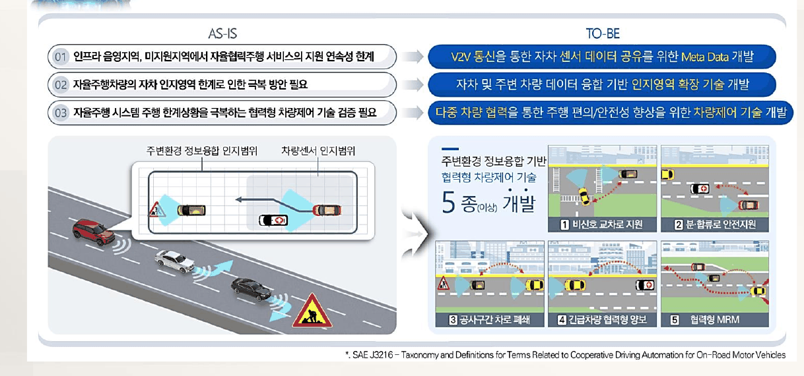

*그림 31. 협력형 차량 제어 과제의 현재와 목표*

그림 31의 위쪽은 현재의 한계(AS-IS)와 목표(TO-BE)를 대응시킨다.

| 현재의 한계 (AS-IS) | 목표 (TO-BE) |
|:-----|:-----|
| 인프라 음영 지역과 미지원 지역에서는 자율협력주행 서비스를 연속으로 지원하기 어렵다 | V2V 통신으로 자기 차량의 센서 데이터를 공유하기 위한 메타데이터를 개발한다 |
| 자율주행차는 자기 센서의 인지 영역에 한계가 있어 극복 방안이 필요하다 | 자기 차량과 주변 차량의 데이터를 융합하여 인지 영역을 확장한다 |
| 자율주행 시스템의 주행 한계 상황을 극복하는 협력형 차량 제어 기술의 검증이 필요하다 | 여러 차량의 협력으로 주행 편의와 안전성을 높이는 차량 제어 기술을 개발한다 |

*표 37. 협력형 차량 제어 과제의 현재 한계와 목표*

그림 31의 아래 왼쪽은 인지 영역의 확장을 보여 준다. 자기 차량의 센서 인지 범위(작은 영역)로는 앞차에 가린 공사 구간을 볼 수 없지만, 주변 차량과 정보를 융합한 인지 범위(큰 영역)로는 볼 수 있다. 아래 오른쪽은 5종 이상의 협력형 차량 제어 기술이다.

1. 비신호 교차로 통과 지원
2. 분기로와 합류로의 안전 지원
3. 공사 구간의 차로 폐쇄 대응
4. 긴급 차량을 위한 협력형 양보
5. 협력형 MRM

> **용어 정의:** **MRM(Minimal Risk Maneuver, 위험 최소화 조작)** 은 자율주행 시스템이 고장이나 한계 상황에서 차량을 위험 최소화 상태(MRC)로 만들기 위해 수행하는 조작이다.

> **용어 정의:** **협력형 MRM(C-MRM)** 은 고장 난 차량이 갓길로 비켜 설 때 주변 차량이 속도를 줄이거나 공간을 내주는 것처럼, 주변 차량과 협력하여 MRM을 더 안전하게 수행하는 것이다.

이 과제는 협력 주행 자동화(CDA, cooperative driving automation)의 용어와 분류로 SAE J3216을 참조한다 [33]. J3216은 협력의 수준을 상태 공유(class A), 의도 공유(class B), 합의 추구(class C), 지시(class D)의 네 등급으로 나누며, 자세한 내용은 11주차에서 다룬다.

과제의 최종 목표는 세 가지이다.

1. V2V 기반 자율주행 시스템의 N2N(차량 다수 대 다수) 제어 모듈을 중심으로 N2N 협력형 제어 모듈을 개발한다.
2. 과학기술정보통신부 과제의 인지 증강(CRE, Cognition Range Expansion) 모듈에 V2V 기반의 자기 차량과 주변 차량 데이터 융합 소프트웨어를 탑재하고 연계한다.
3. V2V-CRE 모듈, RTK/INS 측위 모듈, LLM 모듈 같은 주변 모듈로 성능을 높이고, 시험장(PG), 실도로, 리빙랩에서 실차로 검증한다.

| 기술 영역 | 내용 | 참여 기관 |
|:-----|:-----|:-----|
| 인지 영역 확장 | 인지 한계 거리를 늘리기 위한 임베디드 최적화, 주변 차량 정보를 활용한 음영 지역 객체 추적 | 아이나비시스템즈, 케이스랩 |
| 협력 측위와 경로 최적화 | 주변 차량 센서 정보를 활용한 고정밀 협력 측위, 음영 지역 객체 추적에 따른 경로 최적화 | 아이나비시스템즈, 케이스랩, 공주대, MBC |
| V2V 기반 N2N 협력 자율주행 제어 | 주변 차량의 거동과 주행 의도에 따른 최적 주행 조작, 고장 대응 C-MRM 최적화 | 케이스랩, KAIST, 공주대 |
| 협력형 자율주행 실차 검증 | 실차 검증 환경과 절차서(TDP), 테스트 도로와 리빙랩에서의 협력 주행 검증 | 아이나비시스템즈, 케이스랩, 한국자동차연구원, 아이티텔레콤 |
| 협력형 자율주행 차량 플랫폼 | 자기 차량과 주변 차량 데이터의 시간차(time gap) 보상 동기화, 사이드링크 V2V 통신형 차량 플랫폼 3종 | 아이나비시스템즈, 케이스랩, 아이티텔레콤, 롯데이노베이트, 한국자동차연구원 |
| 협력형 자율주행 요구 사양 | 협력형 자율주행 유즈케이스와 시나리오, V2V 메시지 교환을 위한 메타데이터 12종 이상 | 한국자동차연구원, KAIST, 공주대 |

*표 38. 협력형 차량 제어 과제의 기술 영역*

> **용어 정의:** **RTK(Real-Time Kinematic)** 는 기준국의 보정 정보로 위성 측위 오차를 수 cm 수준으로 줄이는 기술이다.

> **용어 정의:** **INS(Inertial Navigation System, 관성 항법 장치)** 는 가속도계와 자이로로 위치 변화를 추정하는 장치이다.

> **용어 정의:** **사이드링크(sidelink)** 는 C-V2X에서 기지국을 거치지 않는 단말 간 직접 통신 링크(PC5)를 말한다.

**1차년도의 차량 플랫폼 설계.** 한국자동차연구원은 협력형 자율주행 차량 플랫폼을 설계하면서 다음을 수행했다.

1. **시험 차량과 부품 확보:** 전기 구동 시험 차량 2대를 확보하고, 참여 기관과 협력하여 라이다 10세트와 레이더 8세트를 확보했으며, 카메라 10세트는 확보를 진행했다.
2. **자율주행 시스템 아키텍처 설계:** 참여 기관과 함께 센서 배치(layout)를 정하고, 차량용 CAN, 이더넷(UDP, TCP/IP), 시리얼 통신의 네트워크 토폴로지를 설계했으며, 전력 공급과 배선을 설계했다. 전력 배분도는 고전압 배터리에서 LDC(저전압 직류 변환기)로 만든 12 V 전원을 DC 아이솔레이터로 두 개의 보조 12 V 배터리에 나누어, 한쪽은 라이다 5개, 레이더 5개, 카메라 7개, GNSS/INS, V2X OBU에, 다른 쪽은 제어기(CADM, 12 V/500 W)와 인버터(노트북 300 W, 기타 장치 100 W)에 전력을 공급하도록 구성했다. 센서 묶음으로 가는 선에는 라이다 75 W, 레이더 27 W, 카메라 16 W가 표시되어 있다.
3. **개조 사양서 작성:** 센서 성능을 확보하는 배치, 차량 외관 변경의 최소화, 장착 시스템의 유지와 보수, 개별 요구사항의 검증 방법을 담은 차량 통합 관리 개조 사양서를 만들었다.

표시된 값을 각 센서 묶음의 전력으로 읽으면 센서의 총 소비 전력은 다음과 같다.

```math
75 + 27 + 16 = 118\ \text{W}
```

표시된 값을 센서 하나의 전력으로 읽으면 $5 \times 75 + 5 \times 27 + 7 \times 16 = 375 + 135 + 112 = 622$ W가 되므로, 실제 설계에서는 장치의 사양서로 어느 쪽인지 확인해야 한다. 묶음별로 읽은 118 W는 12 V에서 약 $118 / 12 \approx 9.8$ A이고, 제어기와 인버터 부하까지 더한 전체 표시 전력 $118 + 500 + 300 + 100 = 1018$ W는 약 $1018 / 12 \approx 85$ A에 해당한다. 이처럼 전류가 크므로 개조 차량에는 별도의 보조 배터리와 전력 분배 설계가 필요하다. CAN과 이더넷 같은 네트워크 토폴로지는 3주차, 6주차, 9주차에서 다루었다.

### 3.5 UTIS 연동 통신 기술

한국자동차연구원은 **UTIS 연동 통신 기술과 도심형 교통안전 지원 서비스**도 개발했다. UTIS를 이용하여 도심에서 교통안전을 지원하는 서비스 체계를 만드는 과제이다.

> **용어 정의:** **UTIS(Urban Traffic Information System, 도시교통정보시스템)** 는 경찰청이 도시 도로에 구축한 교통 정보 시스템이다. 도로변의 노변 장치(RSE, roadside equipment, RSU와 같은 뜻)와 차량의 단말기(OBE, on-board equipment)가 무선으로 통신하여, 차량이 측정한 주행 속도와 위치 정보를 센터로 모으고, 센터가 가공한 교통 정보를 다시 차량에 내려 준다.

UTIS는 이미 도시 곳곳에 설치된 노변 기지국과 통신망을 갖고 있으므로, 이를 V2X 서비스에 연동하면 새 인프라를 모두 새로 깔지 않고도 도심 교통안전 서비스를 제공할 수 있다.

### 3.6 스마트 자율협력주행 도로 시스템

국토교통부의 **스마트 자율협력주행 도로 시스템 개발(C-AHS, Development of Advanced Infra Systems for Automated Driving)** 은 도로 인프라가 자율주행차를 지원하는 체계를 개발한 과제이다.

| 항목 | 내용 |
|:-----|:-----|
| 예산 | 2,750만 달러 (민간 부담 포함) |
| 기간 | 5년 (2015\~2020년) |
| 실증 | 공공 고속도로에서 2회 (차량 4대) |
| 개발 내용 | 정밀 디지털 지도 기반 LDM, 끊김 없는 V2X 통신 모듈, 실시간 도로 교통 정보 수집 시스템, 정밀 측위와 센서 인지 향상을 위한 도로 구조 개선, 자율주행을 위한 도로 구조 시공 매뉴얼 |

*표 39. 스마트 자율협력주행 도로 시스템 개발 과제의 개요*

> **참고:** 이 과제를 주관한 MLIT는 한국의 국토교통부(Ministry of Land, Infrastructure and Transport, MOLIT)이다. 같은 약어 MLIT는 일본 국토교통성(Ministry of Land, Infrastructure, Transport and Tourism)을 가리키기도 하므로, 두 기관을 혼동하지 않아야 한다.

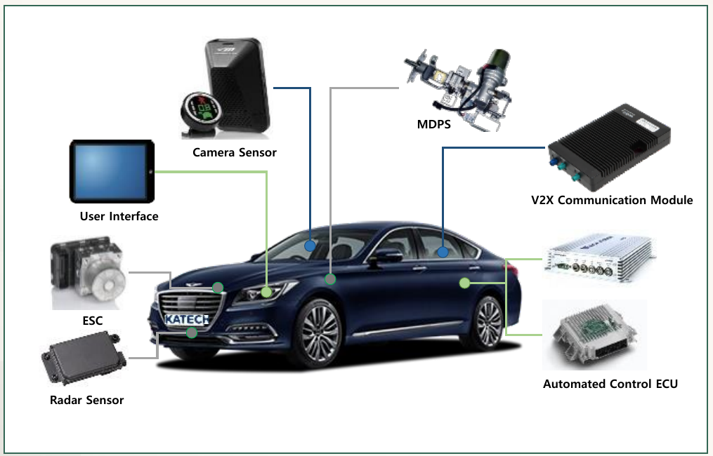

*그림 32. 한국자동차연구원의 자율협력주행 시험 차량 구성*

그림 32의 시험 차량에는 카메라 센서, 레이더 센서, V2X 통신 모듈, 자율주행 제어 ECU, 사용자 인터페이스가 장착되고, 자율주행 제어 ECU가 전동식 조향 장치(MDPS)와 차체 자세 제어 장치(ESC)를 제어한다. 같은 과제에서 다른 참여 기업들도 각자의 시험 차량(R사, H사, S사)을 만들었으며, 전방 카메라, 어라운드 뷰 카메라, 측방 카메라, 전방과 후측방 레이더, 라이다, 산업용 PC 같은 구성 요소를 갖추었다.

> **용어 정의:** **MDPS(Motor Driven Power Steering)** 는 전기 모터로 조향을 돕는 장치로, 전기 신호로 조향 각을 제어할 수 있어 자율주행의 횡방향 제어에 쓰인다.

> **용어 정의:** **ESC(Electronic Stability Control)** 는 바퀴마다 제동력을 따로 조절하여 차체의 미끄러짐을 막는 장치로, 자율주행에서는 감속 명령을 수행하는 데 쓰인다.

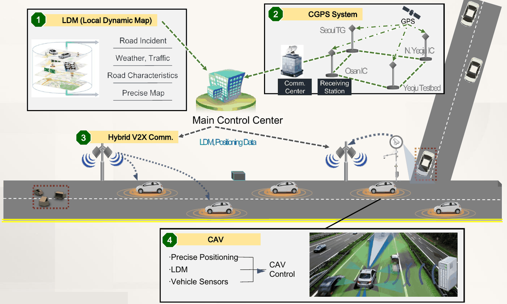

*그림 33. 스마트 자율협력주행 도로 시스템의 구성*

그림 33의 시스템은 네 요소로 이루어진다.

1. **LDM(로컬 다이내믹 맵):** 정밀 지도 위에 돌발 상황, 기상과 교통, 도로 특성 정보를 겹쳐 관리한다.
2. **CGPS 시스템:** 서울 요금소, 오산 IC, 북여주 IC, 여주 시험 도로의 기준국이 위성 측위 보정 정보를 만들어 통신 센터와 수신국을 거쳐 배포한다.
3. **하이브리드 V2X 통신:** 주 관제 센터의 LDM 정보와 측위 보정 정보를 노변 기지국과 차량 사이의 하이브리드 V2X 통신으로 전달한다.
4. **CAV(커넥티드 자율주행 차량):** 정밀 측위, LDM, 차량 센서를 결합하여 차량을 제어한다.

> **용어 정의:** **CGPS 시스템**은 위치를 정확히 아는 기준국들이 위성 신호의 오차를 계산하여 보정 정보를 만들고 배포하는 체계이다. 차량은 이 보정 정보를 적용하여 측위 정밀도를 높인다.

> **용어 정의:** **CDGPS(Carrier-phase Differential GPS)** 는 위성 신호의 반송파 위상까지 써서 보정하는 방식으로, 수 cm 수준의 정밀도를 얻을 수 있다.

> **용어 정의:** **CAV(Connected and Automated Vehicle)** 는 커넥티드 자율주행 차량이다.

차량 안의 시스템 아키텍처는 그림 34와 같다.

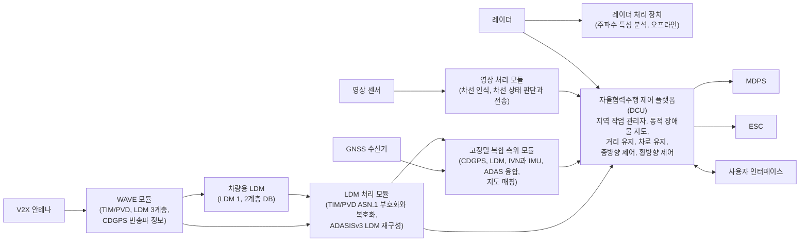

*그림 34. 자율협력주행 차량의 시스템 아키텍처*

그림 34에서 V2X로 받은 정보는 WAVE 모듈을 거쳐 LDM으로 정리되고, 고정밀 측위 모듈이 위성 측위, 보정 정보, 차량 센서를 융합하여 차량의 정확한 위치를 지도 위에 맞춘다. 제어 플랫폼(DCU)은 지역 작업 관리자가 서비스 상황에 맞는 작업을 정하면, 동적 장애물 지도를 바탕으로 거리 유지와 차로 유지 기능이 목표를 만들고, 종방향과 횡방향 제어 로직이 ESC와 MDPS에 명령을 보낸다.

> **용어 정의:** **TIM**은 1.11절에서 정의한 여행자 정보 메시지이다.

> **용어 정의:** **ASN.1(Abstract Syntax Notation One)** 은 메시지의 구조를 기계와 무관하게 정의하고 이진 데이터로 부호화하는 표준 표기법으로, SAE J2735 같은 V2X 메시지가 이 방식을 쓴다.

LDM 처리 모듈은 복호화한 정보를 지도 형태로 다시 구성하여 측위 모듈과 제어 플랫폼에 넘기고, 측위 모듈은 여기에 차량의 관성 센서 값을 더해 위치를 계산한다.

> **용어 정의:** **ADASIS(ADAS Interface Specification)** 는 지도의 전방 도로 정보를 ADAS 제어기에 전달하는 표준 인터페이스이다.

> **용어 정의:** **IMU(Inertial Measurement Unit)** 는 가속도와 각속도를 재는 관성 측정 장치이다.

**종합 성능 평가.** 과제는 자율협력주행 서비스가 실제로 성공하는지를 확인하는 종합 성능 평가를 수행했다.

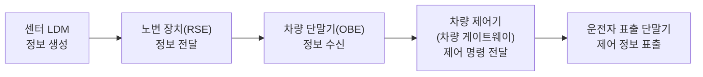

*그림 35. 종합 성능 평가에서 서비스 성공 여부를 확인하는 단계*

평가 개념은 다음과 같다. 센터 LDM이 만든 TIM과 RSA 같은 정보를 노변 장치가 차량 단말기로 보내면, 먼저 차량이 정보를 받았는지 확인하고, 이어서 제어기와 표출 단말이 그 정보를 활용했는지 확인한 뒤, 제어 구간에서 차량이 실제로 정보에 맞게 움직여 서비스가 성공했는지 확인한다. 각 단계의 결과는 차량 쪽의 로그를 수집하고 분석하여 판단한다.

> **용어 정의:** **RSA(Roadside Alert)** 는 도로변에서 위험 상황(공사, 사고, 노면 위험 등)을 짧게 알리는 SAE J2735 메시지이다.

1차 종합 성능 평가 구간은 양지 IC에서 덕평 IC까지 약 7 km이다. 10개 서비스로 구성한 종합 성능 평가 구간(1회 왕복)을 22번 왕복 주행하여, 전력, 통신 속도, 진동 같은 차량 수준의 고려 사항을 적용한 뒤 LDM, V2X, 차량을 통합한 시험을 수행했다. 결과는 표 40과 같다.

| 기호 | 판단 기준 | 판단 결과 (회) | 비율 (%) |
|:-----|:-----|-----:|-----:|
| O | 혼선 없이 예상한 메시지를 수신함 (같은 메시지의 중복 수신은 허용) | 196 | 89.1 |
| △ | 예상한 메시지와 함께 잘못된 메시지를 수신함 | 13 | 5.9 |
| X | 예상한 메시지를 수신하지 못함 | 11 | 5.0 |
| 합계 | | 220 | 100.0 |

*표 40. 스마트 자율협력주행 도로 시스템의 종합 성능 평가 결과*

총 시험 횟수는 10개 서비스를 22번 왕복하므로 $10 \times 22 = 220$회이다. 비율은 각 결과 횟수를 220으로 나눈 값으로, 예를 들어 O는 $196 / 220 \approx 0.891$, 즉 89.1%이다. 세 결과를 더하면 $196 + 13 + 11 = 220$회가 된다. 메시지를 받지 못하거나 잘못된 메시지가 섞인 경우가 합쳐 약 10.9%이므로, 실제 도로 환경에서 V2X 정보만으로 차량을 제어하려면 수신 실패와 오류에 대비한 판단 로직(예: 센서 정보와의 교차 확인)이 필요하다는 점을 알 수 있다.

### 3.7 실도로 시험 구간과 시험장

한국에는 자율주행과 V2X를 시험할 수 있는 실도로 구간과 시험장(PG, proving ground)이 여러 곳 있다.

| 실도로 시험 구간 | 규모 |
|:-----|-----:|
| 판교 제로시티 | 19 km |
| 대구 지역 고속도로 | 15 km |
| 대구 알파시티 | 980,000 m² |
| 경부고속도로 | 7 km |
| 경부고속도로 | 40 km |
| 대전과 세종의 C-ITS 테스트베드 | 87.8 km |

*표 41. 한국의 자율주행 실도로 시험 구간*

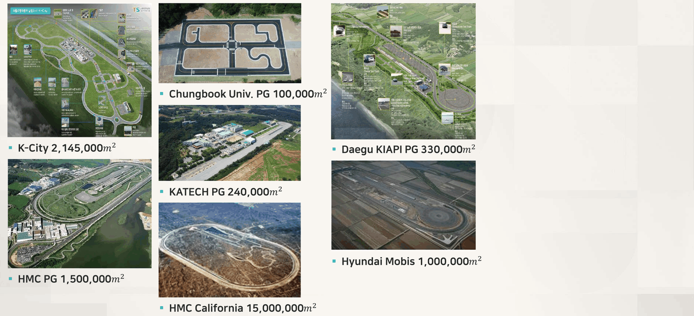

*그림 36. 한국의 자율주행 시험장*

| 시험장 | 면적 |
|:-----|-----:|
| K-City (한국교통안전공단 자동차안전연구원) | 2,145,000 m² |
| 현대자동차 시험장 | 1,500,000 m² |
| 충북대학교 시험장 | 100,000 m² |
| 한국자동차연구원 시험장 | 240,000 m² |
| 현대자동차 캘리포니아 시험장 | 15,000,000 m² |
| 대구 한국지능형자동차부품진흥원(KIAPI) 시험장 | 330,000 m² |
| 현대모비스 시험장 | 1,000,000 m² |

*표 42. 한국 기관과 기업의 자율주행 시험장*

> **참고:** K-City 자체의 면적은 약 32만 m²로 보도되었으므로 [34], 표 42의 2,145,000 m²는 K-City가 들어선 자동차안전연구원 시험장 단지 전체의 규모로 읽는 것이 적절하다.

시험장은 일반 차량이 없는 통제된 환경에서 위험한 시나리오를 반복해서 시험할 수 있고, 실도로 구간은 실제 교통과 인프라 속에서 시스템을 검증할 수 있다. 두 환경은 서로를 보완한다.

### 3.8 K-City

**K-City(자율주행 실험도시)** 는 경기도 화성시의 한국교통안전공단 자동차안전연구원(KATRI)에 조성된 자율주행 전용 시험장이다.

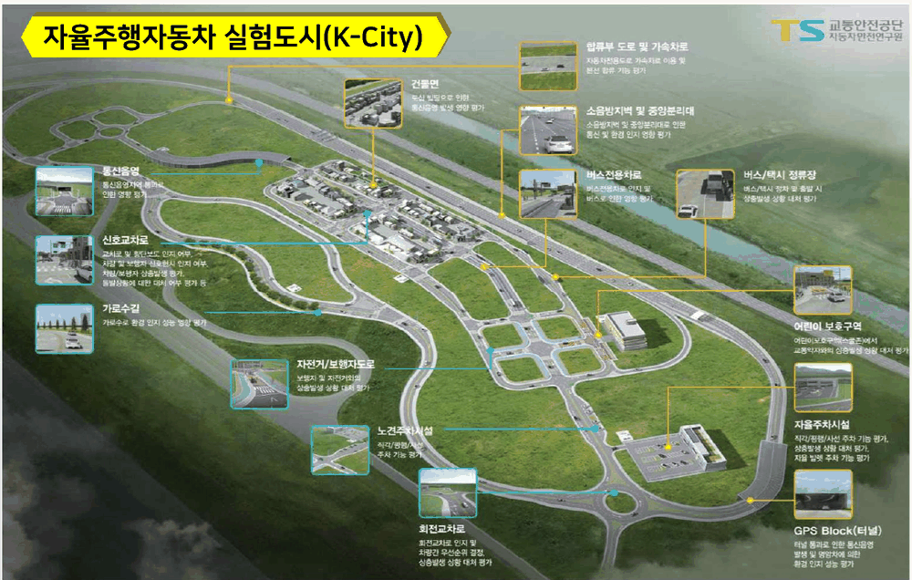

*그림 37. 자율주행 실험도시 K-City의 전경*

K-City는 실제 도로 환경을 다섯 구역으로 재현했다.

| 구역 | 시설 |
|:-----|:-----|
| 도심부 도로 | 신호 교차로 7, 버스 전용 차로 1, 빌딩면 4, 버스와 택시 정류장 2 |
| 커뮤니티부 도로 | 신호 교차로 2, 비신호 교차로 5, 스쿨존 1, 회전 교차로 1, 자전거 도로 1, 보행자 도로 1, 노견 주차 시설 1 |
| 자동차 전용 도로 | 주행 차로 1, 게이트 3, 중앙 분리대 1, 소음 방지벽 1, 분기와 합류부 2 |
| 교외 도로 | 신호 교차로 2, 비신호 교차로 4, 통신 음영 1, GPS 차단(터널) 1, 가로수길 1, 공사 도로 1, 회전 교차로 1, 철도 건널목 1 |
| 자율 주차 시설 | 자율 주차 시설 1 |

*표 43. K-City의 구역과 시설*

통신 음영과 GPS 차단 구역을 일부러 만든 점이 중요하다. 커넥티드 자율주행은 통신과 위성 측위에 의존하므로, 이들이 끊기는 상황에서 시스템이 어떻게 대응하는지를 시험해야 하기 때문이다.

K-City의 기본 설계 평면도는 구역별 검토 방향을 다음과 같이 제시했다. 도심부 도로에는 4차로 신호 교차로(120 m), 2차로에서 4차로로 확장한 버스 전용 차로(260 m), 건물 블록 4동으로 만든 빌딩면, 2차로의 버스와 택시 주정차 시설(170 m)을 둔다. 커뮤니티부 도로에는 보도와 자전거 도로를 더한 신호 교차로(400 m), 도로 폭을 2차로에서 4차로로 넓힌 노견 주차 시설(70 m), 학교 부지와 스쿨존을 둔다. 교외 도로에는 2차로 신호 교차로(75 m), 회전 교차로, 터널 구간(100 m), 비신호 교차로의 연결 구간(60 m), 녹지를 조성한 가로수길, 골목길 같은 좁은 길을 둔다. 고속 주행 도로에는 연결로 안의 합류부(170 m), 스마트 톨링 시스템 2개소, 방음벽과 가드레일, 중앙 분리대, 본선 5차로와 연결로 4차로의 톨게이트 2개소를 둔다. 자율 주차 시설은 기존 주차 시설을 바꾸고 2층 주차 시설을 더하며, 도로 교통 시설로 신호 제어 시스템, CCTV 시스템, 노변 기지국(RSU) 같은 현장 시스템과 센터의 하드웨어, 소프트웨어를 갖춘다.

**화성 자율주행 실험도시 구축 사업.** K-City 구축 사업의 개요는 다음과 같다.

1. **기간:** 2016년 6월\~2019년 6월
2. **목적:** 다양한 자율주행 시나리오에서 자율주행 성능을 시연하고 고장 시의 안전성을 평가한다.
3. **범위:** 자율주행차 상용화 예측 시점인 2020년에 맞추어 고속도로 기반의 자율주행 기술과 자율 주차 기술을 포함한다.
4. **협력:** SK텔레콤과 협력하여 3D 고정밀 지도, 양자 암호, 5G, AI 기능을 갖춘 시험장을 구축한다. SK텔레콤은 2018년 2월 초에 5G 자율주행차 2대의 협력 운행을 시연했고 [35], 한국교통안전공단은 K-City 인프라를 구축했다.

K-City는 2018년 12월에 준공되어 자율주행차를 개발하는 기업, 대학, 연구 기관에 개방되었다.

### 3.9 C-ITS 시범 사업과 실증 사업

**C-ITS 시범 사업.** 국토교통부는 2014년 7월부터 2017년 7월까지 대전과 세종 인근에서 C-ITS 시범 사업을 수행했다. 우선 도입이 필요한 15개 서비스를 정의하여 고속국도, 국도, 시가지 도로 등 87.8 km 구간에 적용했다.

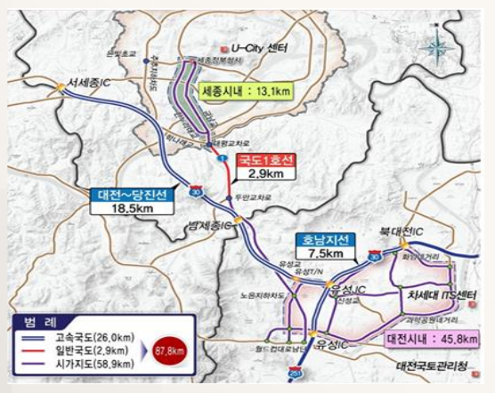

*그림 38. C-ITS 시범 사업의 구축 지역*

그림 38의 구간 길이를 더하면 전체 길이가 나온다. 고속국도는 대전\~당진선 18.5 km와 호남지선 7.5 km를 합한 26.0 km, 일반 국도는 국도 1호선 2.9 km, 시가지 도로는 세종 시내 13.1 km와 대전 시내 45.8 km를 합한 58.9 km이다.

```math
26.0 + 2.9 + 58.9 = 87.8\ \text{km}
```

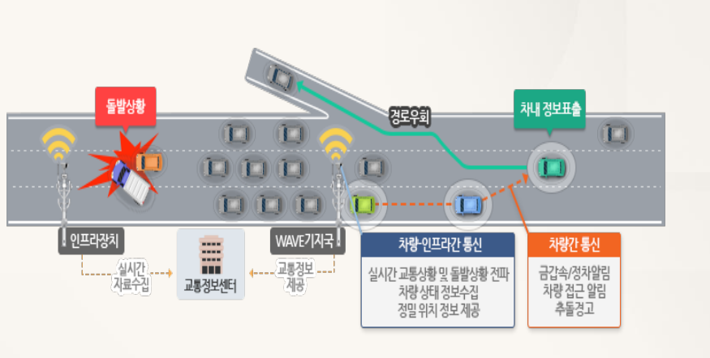

*그림 39. C-ITS 시범 사업의 서비스 개념*

그림 39는 C-ITS의 동작 개념이다. 도로의 인프라 장치가 실시간 자료를 수집하여 교통정보센터로 보내고, 교통정보센터는 교통 정보를 WAVE 기지국으로 보낸다. 앞쪽에서 돌발 상황이 생기면 차량과 인프라 사이의 통신으로 실시간 교통 상황과 돌발 상황을 전파하고, 차량 상태 정보를 수집하며, 정밀 위치 정보를 제공한다. 차량 사이의 통신으로는 급감속과 정차 알림, 차량 접근 알림, 추돌 경고를 주고받는다. 정보를 받은 차량은 차내에 정보를 표출하고 경로를 우회할 수 있다.

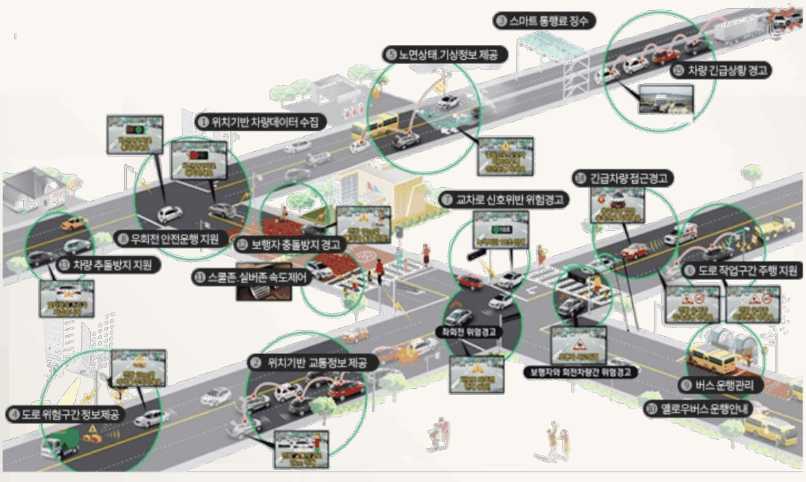

*그림 40. 국토교통부 C-ITS 서비스 15종*

| 번호 | 서비스 | 번호 | 서비스 |
|:-----|:-----|:-----|:-----|
| 1 | 위치 기반 차량 데이터 수집 | 9 | 버스 운행 관리 |
| 2 | 위치 기반 교통 정보 제공 | 10 | 옐로 버스(어린이 통학 버스) 운행 안내 |
| 3 | 스마트 통행료 징수 | 11 | 스쿨존, 실버존 속도 제어 |
| 4 | 도로 위험 구간 정보 제공 | 12 | 보행자 충돌 방지 경고 |
| 5 | 노면 상태, 기상 정보 제공 | 13 | 차량 추돌 방지 지원 |
| 6 | 도로 작업 구간 주행 지원 | 14 | 긴급 차량 접근 경고 |
| 7 | 교차로 신호 위반 위험 경고 | 15 | 차량 긴급 상황 경고 |
| 8 | 우회전 안전 운행 지원 | | |

*표 44. 국토교통부 C-ITS 서비스 15종*

그림 40에는 번호가 없는 좌회전 위험 경고와 보행자와 회전 차량 사이의 위험 경고도 함께 표시되어 있다. 15종의 서비스는 1.6절에서 본 미국 VSC의 V2V, V2I 서비스와 많이 겹치지만, 옐로 버스 운행 안내나 스쿨존과 실버존 속도 제어처럼 한국의 교통 환경에 맞춘 서비스가 포함되어 있다.

**C-ITS 실증 사업.** 시범 사업에 이어 2018년부터는 지역별 실증 사업이 진행되었다.

| 항목 | 서울 C-ITS 실증 사업 (국토교통부와 서울시) | 제주특별자치도 C-ITS 실증 사업 | 고속도로 C-ITS 실증 사업 |
|:-----|:-----|:-----|:-----|
| 기간 | 2018-01 ~ 2020-12 | 2018-01 ~ 2020-12 | 2018-05 ~ 2019-09 |
| 개요 | 상암 DMC 지역에 자율협력주행 시범 지구 구축 | 주요 도로 300 km에 C-ITS 기본 서비스 15종과 제주 특화 서비스 4종을 개발하고 구현 | 총 85 km 구간에 C-ITS 인프라를 구축하고 사업용 차량(버스, 화물차) 500대에 C-ITS 단말기 배포 |
| 목표 | WAVE, C-V2X, 5G 등 다양한 통신 기반 시설을 융합하여 서울의 미래 교통을 준비 | LTE와 WAVE를 결합한 LTE-WAVE V2X를 구축하고 LTE 기반 정밀 측위 솔루션을 개발 | 고속도로 실제 환경에 적합한 C-ITS 서비스 17종의 개발과 검증 |

*표 45. 한국의 C-ITS 실증 사업*

세 실증 사업은 서로 다른 환경(대도시 도심, 관광 지역의 광역 도로망, 고속도로)과 서로 다른 통신 방식을 시험했다. 서울은 여러 통신 방식의 융합을, 제주는 LTE와 WAVE의 결합을, 고속도로는 사업용 차량을 중심으로 한 단말기 보급을 다룬 것이 특징이다. 이 경험은 1주차에서 본 것처럼 2023년 12월에 C-ITS의 단일 통신 방식을 LTE-V2X로 정하는 과정의 배경이 되었다.

### 3.10 판교 제로시티

**판교 제로시티 자율주행 실증 단지 구축 사업**은 경기도 성남시 판교 제2테크노밸리(제로시티)에 자율주행 실증 단지를 만든 사업이다.

1. **기간:** 2015년 11월\~2019년 12월
2. **목표:** 5G 시범 네트워크와 인프라를 조성하여, 세계 최초로 거주 지역을 대상으로 하는 5G 자율주행 실증 단지를 만든다.
3. **통신:** 보안성을 강화한 전용 LTE와 WAVE를 동시에 쓸 수 있는 하이브리드 V2X 네트워크 서비스를 제공한다.
4. **참여 기업:** KT는 하이브리드 V2X 네트워크 서비스와 5G 시범 네트워크를 구축하고, 켐트로닉스는 LTE와 WAVE를 모두 쓸 수 있는 하이브리드 V2X 단말기를 제공한다.

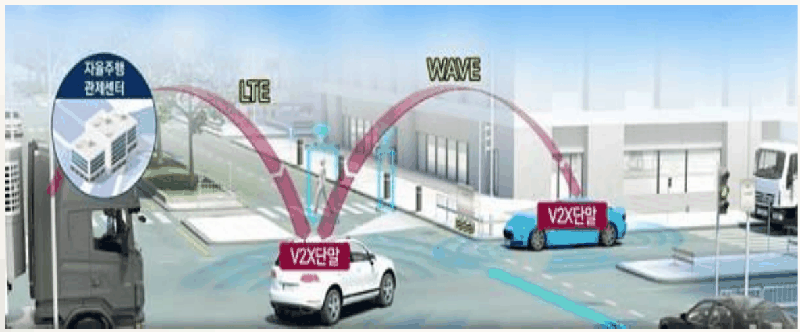

*그림 41. 판교 제로시티의 LTE-WAVE 하이브리드 V2X 네트워크*

그림 41에서 자율주행 관제 센터는 LTE로 차량의 V2X 단말과 통신하고, 차량끼리는 WAVE로 직접 통신한다. LTE는 넓은 범위의 관제와 정보 제공에, WAVE는 짧은 지연이 필요한 직접 통신에 쓰는 것으로, 두 방식의 장점을 함께 쓰는 구성이다. WAVE와 LTE-V2X의 기술적 차이는 13주차와 14주차에서 다룬다.

### 3.11 각국 사례의 비교와 교훈

네 지역의 사례를 같은 기준으로 비교하면 표 46과 같다.

| 항목 | 미국 | 유럽 | 일본 | 한국 |
|:-----|:-----|:-----|:-----|:-----|
| 추진 주체 | 교통부(ITS JPO)와 완성차 컨소시엄(CAMP) | EU 연구 프레임워크(FP, Horizon 2020)와 완성차 컨소시엄(C2C-CC) | 내각부 산하 범부처 체계(SIP-adus), 산업계 출신 PD | 범부처 사업(KADIF), 국토교통부와 경찰청, 연구 기관(KATECH, KATRI) |
| 대표 실증 | SPMD(앤아버), CV 시범 사업(뉴욕시, 와이오밍주, 탬파) | Drive C2X, FOTsis, C-Roads, AdaptIVe | 도쿄 임해 지역 실도로 시험, 지역별 셔틀과 군집주행 실증 | C-ITS 시범 사업(대전, 세종), 실증 사업(서울, 제주, 고속도로), K-City, 판교 제로시티 |
| 특징적 접근 | 경쟁 이전 단계의 공통 기술을 업계가 공동 개발, 지역 문제 해결형 시범 사업 | 다국적 표준과 주파수의 확보, Day 1, 2, 3의 단계적 서비스 | 다이내믹 맵의 협조 영역 공동 구축, 서비스 차량과 개인 차량의 경로 분리 | 전국 단위 인프라 구축, 인프라 정보(교통안전시설, LDM)와 차량의 연계 |
| 통신 방식의 흐름 | DSRC에서 C-V2X로 전환 | ITS-G5(IEEE 802.11p 기반)와 C-V2X 병행 논의 | 760 MHz 대역 안전 통신, 5.8 GHz ETC2.0 | WAVE와 LTE의 하이브리드 실증 뒤 LTE-V2X로 단일화 |

*표 46. 각국의 커넥티드 자율주행 추진 방식 비교*

표 46에서 공통으로 드러나는 교훈은 다음과 같다.

1. **단계적 실증:** 모든 나라가 개념 검증, 실도로 시험, 사전 배치, 배치의 순서를 밟았다. 각 단계에서 얻은 자료가 다음 단계의 설계와 제도의 근거가 된다.
2. **단말기 보급률:** V2V는 통신 상대가 있어야 효과가 있으므로, 보급률이 서비스의 성패를 좌우한다. 차량 교체 속도의 한계 때문에 의무화, 애프터마켓 장치, 사업용 차량 우선 보급, 인프라(V2I) 서비스가 함께 필요하다.
3. **인프라와 차량의 협력:** 정밀 지도(LDM, 다이내믹 맵), 신호와 교통안전시설 정보, 측위 보정 정보처럼 인프라가 제공하는 정보가 차량 센서의 한계를 보완한다. 일본과 한국은 이 부분을 공공이 주도하여 구축했다.
4. **공동 개발과 표준:** 서로 다른 제조사의 차량이 통신하려면 메시지, 보안, 시험 방법을 함께 정해야 하므로, 미국의 CAMP와 유럽의 C2C-CC처럼 경쟁 업체들이 협력하는 구조가 필요하다.
5. **정책의 영향:** 기술이 준비되어도 주파수 배분, 의무화 여부, 통신 방식의 선택 같은 정책 결정이 보급 경로를 바꾼다. 미국의 DSRC에서 C-V2X로의 전환과 한국의 LTE-V2X 단일화가 그 예이다.

---

<br>

## 개념 적용

다음 상황에서 어떤 개념이 판단의 근거가 되는지 연결한다.

| 상황 | 연결할 개념과 이유 |
|:-----|:-----|
| 한 도시가 V2V 충돌 경고 서비스를 도입했지만, 단말기를 단 차량이 3%뿐이라 효과가 거의 없다. | **보급률과 서비스 가능성.** 최소한의 안전 경고에도 10% 이상, 능동 안전에는 90% 이상의 보급률이 필요하므로, 사업용 차량 우선 보급이나 V2I 서비스로 보완해야 한다. |
| 여러 완성차 업체가 각자 다른 메시지 형식으로 V2V를 개발하려 한다. | **경쟁 이전 단계의 공동 개발.** CAMP와 C2C-CC처럼 메시지, 보안, 시험 방법을 함께 정해야 서로 다른 제조사의 차량이 통신할 수 있다. |
| 폭설이 잦은 산간 고속도로에서 사고와 도로 폐쇄를 줄이려 한다. | **와이오밍주 CV 시범 사업.** 도로 기상 정보를 TMC로 모으고, 노변 기지국과 V2V로 기상 경고, 조난 알림, 작업 구역 경고를 보낸다. |
| 시각 장애인이 신호 교차로를 안전하게 건너도록 돕고 싶다. | **PED-SIG와 SPaT.** 스마트폰으로 횡단 의사를 신호 제어기에 알리고, 노변 기지국이 보낸 신호 현시와 시간 정보를 받아 안내한다. |
| 자율주행 셔틀을 공장 부지 안과 일반 생활 도로에 각각 도입하려 한다. | **실증 유형의 판별.** 공장 부지는 폐쇄 공간(A), 생활 도로는 혼류 공간(E)이므로 필요한 차량 플랫폼과 검증 조건이 다르다. |
| 정밀 지도를 회사마다 따로 만들어 비용이 중복된다. | **다이내믹 맵의 협조 영역.** 정적 기반 데이터는 공동으로 구축하고, 동적 정보 위의 부가 서비스로 경쟁한다. |
| 앞차에 가린 공사 구간을 자기 차량의 센서로 볼 수 없다. | **V2V 기반 인지 영역 확장.** 주변 차량의 센서 정보를 메타데이터로 공유하고 융합하여 인지 범위를 넓힌다. |

*표 47. 상황별로 연결할 개념과 그 이유*

**T/F 점검:**

| 문장 | 판단과 근거 |
|:-----|:-----|
| 미국의 Safety Pilot Model Deployment는 C-V2X로 수행되었다. | **F.** 2011\~2014년 앤아버에서 약 3,000대의 차량으로 5.9 GHz DSRC 기반 V2V 안전 응용을 시험했다. |
| CV Pilot Deployment Program은 각 단계가 끝날 때 진행 관문을 통과해야 다음 단계로 넘어간다. | **T.** 1단계 뒤에는 배치 준비 여부를, 2단계 뒤에는 계획대로 작동하는지를 확인한다. |
| C2C-CC에 따르면 교통 정보 공유 서비스는 능동 안전 기능보다 높은 보급률이 필요하다. | **F.** 교통 정보 공유는 5% 이상, 능동 안전 기능은 90% 이상의 보급률이 필요하다. |
| 일본의 다이내믹 맵에서 신호 시간 정보는 동적 계층에 속한다. | **T.** 1초 미만으로 바뀌는 V2X 정보(주변 차량, 보행자, 신호 시간)는 동적 계층이다. |
| 스마트 시티 챌린지의 우승 도시는 교통부에서 5억 달러를 받았다. | **F.** 5억 달러는 결선 도시들이 확보한 협력 약속의 합계이고, 우승한 콜럼버스는 교통부에서 최대 4,000만 달러를 지원받았다. |
| 국토교통부의 C-ITS 시범 사업은 대전과 세종 인근 87.8 km 구간에서 15개 서비스를 시험했다. | **T.** 고속국도 26.0 km, 일반 국도 2.9 km, 시가지 도로 58.9 km를 합한 구간에서 2014\~2017년에 수행했다. |

---

<br>

## 요약

| 개념 | 핵심 요약 |
|:--------|:------------|
| 개발 단계 | 미국, 유럽, 일본, 한국은 모두 개념 검증, 실도로 시험, 사전 배치, 배치의 순서로 커넥티드 자율주행을 준비했다. |
| 미국의 추진 체계 | 교통부의 ITS JPO가 여러 산하 기관을 조정하고, VII, IntelliDrive를 거쳐 Connected Vehicle 프로그램으로 이어졌다. |
| CAMP와 VSC | 완성차 업체 컨소시엄이 경쟁 이전 단계의 V2V 기술, 보안, 시험 방법을 공동 개발했고, VSC는 V2V 15종, V2I 19종의 안전 서비스를 정의했다. |
| VSC-A와 EEBL | V2V 응용을 충돌 시나리오에 대응시켰고, EEBL 같은 V2X 기능은 Euro NCAP 2025 로드맵의 평가 항목에도 포함되었다. |
| SPMD | 2011\~2014년 앤아버에서 약 3,000대의 DSRC 차량으로 V2V 안전 응용의 효과를 실도로에서 측정했다. |
| CV 시범 사업 | 뉴욕시(도심 안전과 보행자), 와이오밍주(겨울철 고속도로 기상), 탬파(도심 급행 차로와 대중교통)에서 진행 관문을 둔 3단계로 수행되었다. |
| EU 프로젝트 | FP6, FP7, Horizon 2020으로 이어진 다국적 과제가 협력 시스템과 자율주행을 개발했고, C2C-CC가 차량 쪽 표준을 주도했다. |
| 보급률 | V2V 서비스는 교통 정보 5%, 최소 안전 경고 10%, 능동 안전 90% 이상의 보급률이 필요하며, 차량 교체 속도 때문에 보급에 10년 이상이 걸린다. |
| SIP-adus | 내각부 산하 범부처 체계가 산업계 출신 PD의 총괄로 서비스 차량과 개인 차량의 경로를 나누어 자율주행을 추진했다. |
| 다이내믹 맵 | 정적, 준정적, 준동적, 동적의 네 계층으로 정보를 겹쳐 관리하며, 기반 데이터는 DMP가 협조 영역으로 공동 구축한다. |
| 실증 유형 | 운행 공간을 폐쇄, 한정, 자동차 전용, 교통 환경 정비, 혼류 공간으로 나누어 필요한 차량 플랫폼을 정한다. |
| 군집주행 | 일본은 주행 방식, 도로 구조, 책임 주체의 조합으로 군집주행을 분류하여 4가지 초안 개념을 만들었다. |
| 한국의 연구개발 | 4개 부처의 자율주행기술개발혁신사업(2021\~2027년, 약 1.1조 원)과 한국자동차연구원의 인프라 연계, 협력형 제어 과제가 진행되었다. |
| 인프라 연계 | 교통안전시설 정보, LDM, 측위 보정 정보를 V2X로 차량에 전달하여 센서의 한계를 보완한다. |
| 한국의 실증 | C-ITS 시범 사업(대전, 세종 87.8 km, 15종)에 이어 서울, 제주, 고속도로 실증 사업과 K-City, 판교 제로시티가 운영되었다. |

---

<br>

## 점검 문제

1. **개발 단계:** 커넥티드 자율주행의 개발 단계를 네 가지로 나누어 쓰고, 미국과 한국에서 각 단계에 해당하는 대표 사업을 하나씩 쓰라.

   <details>
   <summary>정답</summary>

   개념 검증, 실도로 시험(FOT), 사전 배치, 배치이다. 미국은 개념 검증에 VII와 VSC, 실도로 시험에 IntelliDrive와 VSC-3, 사전 배치에 Connected Vehicle과 Safety Pilot Model Deployment, 배치에 CV Pilot Deployment Program이 해당한다. 한국은 개념 검증에 u-Transportation과 Smart Highway, 실도로 시험에 시험 도로에서의 Smart Highway 시험, 사전 배치에 C-ITS 시범 사업(2014\~2017년), 배치에 C-ITS 실증 사업(2018년\~)이 해당한다.

   </details>

2. **CAMP의 역할:** 경쟁 관계의 완성차 업체들이 CAMP 같은 컨소시엄으로 V2V 기술을 함께 개발하는 이유를 설명하고, 이런 공동 개발이 필요한 기술의 예를 세 가지 쓰라.

   <details>
   <summary>정답</summary>

   V2V는 서로 다른 제조사의 차량끼리 메시지를 주고받아야 효과가 있으므로, 한 업체만의 독자 방식으로는 쓸모가 없다. 그래서 모든 업체가 똑같이 따라야 하는 경쟁 이전 단계의 기술을 함께 정한다. 예로는 메시지 형식과 통신 프로토콜(VSC), 메시지의 위조를 막는 보안 인증서 관리 체계(SCMS), 서로 다른 장치의 상호 운용성 시험과 성능 시험 방법이 있다.

   </details>

3. **충돌 시나리오:** 감속하는 앞차 시나리오에서 EEBL과 FCW가 함께 쓰이는 이유를 설명하고, IMA가 대응하는 충돌 시나리오를 모두 쓰라.

   <details>
   <summary>정답</summary>

   앞차가 감속할 때 FCW는 바로 앞차와의 거리와 상대 속도로 충돌 위험을 경고하고, EEBL은 시야가 가려진 더 앞쪽 차량의 급제동을 V2V로 알려 준다. 두 응용이 서로 다른 거리의 위험을 보완하므로 함께 쓰인다. IMA는 비신호 교차로에서 차량이 회전하는 경우, 비신호 교차로에서 직진 경로가 교차하는 경우, 비신호 교차로에서 좌회전 차량과 맞은편 직진 차량이 충돌하는 경우(LTAP/OD)에 대응한다.

   </details>

4. **SPMD와 CV 시범 사업:** Safety Pilot Model Deployment와 CV Pilot Deployment Program의 목적을 비교하라.

   <details>
   <summary>정답</summary>

   SPMD는 2011\~2014년 앤아버에서 약 3,000대의 차량으로 V2V 안전 응용이 실제 도로에서 작동하는지, 일반 운전자가 어떻게 쓰는지, 안전 편익이 얼마인지를 측정한 실증이다. CV Pilot Deployment Program은 커넥티드 차량 기술을 뉴욕시, 와이오밍주, 탬파의 지역 교통 문제(도심 안전, 겨울철 기상, 도심 급행 차로와 대중교통) 해결에 적용하여, 안전뿐 아니라 이동성, 생산성, 환경 개선까지 확인하고 일상 운영으로 전환하는 것을 목표로 한 시범 배치 사업이다.

   </details>

5. **뉴욕시의 메시지:** 뉴욕시 시범 사업에서 노변 기지국이 보내는 메시지 세 가지와 차량끼리 주고받는 메시지 한 가지를 쓰고, 각 메시지에 담기는 정보를 설명하라.

   <details>
   <summary>정답</summary>

   노변 기지국은 MAP(정지선, 차로, 허용 진행 방향 같은 교차로 기하 구조), SPaT(녹색, 황색, 적색과 보행 신호의 시작 시각 같은 신호 현시와 시간), TIM(제한 속도와 구역, 작업 구역과 우회, 곡선과 노면 상태)을 보내며, 이들은 V2I 안전 응용을 지원한다. 차량끼리는 BSM(위치, 진행 방향, 속도, 경로 이력)을 주고받으며, 이는 V2V 안전 응용을 지원한다.

   </details>

6. **보급률:** 단말기를 전체 차량의 8%에 해당하는 차종에만 장착하면 어떤 서비스까지 가능한지 판단하고, 보급률을 빨리 높이기 위한 방법을 두 가지 쓰라.

   <details>
   <summary>정답</summary>

   그 차종에만 장착하면 20년이 지나도 보급률이 10% 근처에 머물므로, 5% 이상이 필요한 교통 정보 공유는 가능하지만 10% 이상이 필요한 최소한의 안전 경고는 겨우 경계에 이르고, 90% 이상이 필요한 능동 안전 기능은 불가능하다. 보급률을 빨리 높이려면 모든 신차에 단말기 장착을 의무화하거나, 이미 판매된 차량에 애프터마켓 장치를 보급하거나, 버스와 화물차 같은 사업용 차량에 먼저 보급하는 방법이 있다. 또한 보급률과 관계없이 효과가 있는 V2I 서비스를 함께 제공한다.

   </details>

7. **SIP-adus의 두 경로:** SIP 2기가 서비스 차량(경로 A)과 개인 차량(경로 B)의 경로를 나눈 이유를 자율주행 레벨과 운행 조건의 관점에서 설명하라.

   <details>
   <summary>정답</summary>

   서비스 차량은 운행 조건(지역, 도로, 속도)을 좁게 제한하면 높은 레벨(레벨 4)을 일찍 실현할 수 있으므로, 제한된 구역의 무인 물류와 이동 서비스로 출발하여 인구 감소 지역의 이동과 운전자 부족 같은 사회 문제를 해결한다. 개인 차량은 어디서나 달려야 하므로 운행 조건을 제한하기 어렵고, 자동 제동 같은 낮은 레벨에서 출발하여 고속도로에서 일반도로로 운행 영역을 넓히며 레벨을 단계적으로 높인다. 두 경로는 출발점과 접근 방식이 다르지만 모두 완전 자율주행 사회를 목표로 한다.

   </details>

8. **다이내믹 맵:** 다이내믹 맵의 네 계층을 갱신 주기와 함께 쓰고, 기반 데이터를 협조 영역으로 공동 구축하는 이유를 설명하라.

   <details>
   <summary>정답</summary>

   정적 정보(1개월 미만 또는 1일 단위, 노면, 차선, 3차원 구조물), 준정적 정보(1시간 미만, 교통 규제, 도로 공사, 기상 예보), 준동적 정보(1분 미만, 사고, 정체, 국지 기상), 동적 정보(1초 미만, 주변 차량, 보행자, 신호 시간)이다. 고정밀 3차원 지도 같은 기반 데이터는 모든 회사가 똑같이 필요하지만 측량과 유지에 큰 비용이 드므로, 공동으로 구축하면 중복 투자를 줄이고 지도의 형식을 표준화할 수 있다. 각 회사는 그 위의 부가 데이터와 서비스로 경쟁한다.

   </details>

9. **실증 유형:** BRT 전용 도로와 일반 생활 도로는 각각 어떤 실증 유형에 해당하는지 판별 절차에 따라 설명하고, 두 유형에서 사람 이동용 차량 플랫폼이 어떻게 다른지 쓰라.

   <details>
   <summary>정답</summary>

   BRT 전용 도로는 폐쇄 공간이 아니지만 한정된 차량과 보행자만 다니므로 B(한정 공간)에 해당하고, 대형 버스와 중형 버스(25인승)가 쓰인다. 일반 생활 도로는 폐쇄 공간도, 한정 공간도, 자동차 전용 공간도 아니며 다른 차량, 보행자와 분리되어 있지도 않으므로 E(혼류 공간)에 해당하고, 승용차와 소형 버스(15인승)가 쓰인다. 혼류 공간은 다양한 도로 이용자가 섞여 가장 복잡하므로 작은 차량부터 적용한다.

   </details>

10. **협력형 차량 제어:** 한국자동차연구원의 협력형 차량 제어 과제가 해결하려는 문제를 쓰고, 시험 차량의 전력 배분도에 표시된 센서 묶음별 전력(라이다 75 W, 레이더 27 W, 카메라 16 W)을 묶음 전체의 전력으로 보고 센서의 총 전력과 12 V에서의 전류를 구하라.

    <details>
    <summary>정답</summary>

    인프라가 없는 지역에서 자율협력주행 서비스가 끊기는 문제, 자기 센서의 인지 영역 한계, 주행 한계 상황에서 협력형 제어 기술의 검증이 부족한 문제를 해결하려 한다. 이를 위해 V2V로 센서 데이터를 공유하는 메타데이터, 주변 차량 데이터 융합을 통한 인지 영역 확장, 다중 차량 협력 제어(비신호 교차로, 분기와 합류, 공사 구간, 긴급 차량 양보, 협력형 MRM)를 개발한다. 센서의 총 전력은 $75 + 27 + 16 = 118$ W이고, 12 V에서의 전류는 $118 / 12 \approx 9.8$ A이다.

    </details>

11. **종합 성능 평가:** 스마트 자율협력주행 도로 시스템의 종합 성능 평가에서 총 시험 횟수가 220회인 이유를 설명하고, 예상한 메시지를 정상 수신하지 못한 경우(△와 X)의 비율을 구하라.

    <details>
    <summary>정답</summary>

    10개 서비스로 구성한 평가 구간을 22번 왕복 주행했으므로 $10 \times 22 = 220$회이다. 잘못된 메시지가 섞인 경우가 13회, 메시지를 받지 못한 경우가 11회이므로 합은 24회이고, 비율은 $24 / 220 \approx 0.109$, 즉 약 10.9%이다. 이는 각각의 비율 5.9%와 5.0%를 더한 값과 같다.

    </details>

12. **C-ITS 시범 사업과 실증 사업:** 대전과 세종의 C-ITS 시범 사업 구간 87.8 km를 도로 종류별로 나누어 쓰고, 이후의 세 실증 사업이 각각 무엇을 시험했는지 설명하라.

    <details>
    <summary>정답</summary>

    고속국도 26.0 km(대전\~당진선 18.5 km와 호남지선 7.5 km), 일반 국도 2.9 km(국도 1호선), 시가지 도로 58.9 km(세종 시내 13.1 km와 대전 시내 45.8 km)이며, 합은 $26.0 + 2.9 + 58.9 = 87.8$ km이다. 서울 실증 사업은 상암 DMC 지역에서 WAVE, C-V2X, 5G 등 여러 통신 기반 시설의 융합을, 제주 실증 사업은 주요 도로 300 km에서 LTE와 WAVE를 결합한 V2X와 LTE 기반 정밀 측위를, 고속도로 실증 사업은 85 km 구간에서 사업용 차량 500대에 단말기를 배포하고 C-ITS 서비스 17종을 시험했다.

    </details>

---

<br>

## 참고 문헌

1. Federal Highway Administration, "Moving Ahead for Progress in the 21st Century Act (MAP-21): A summary of highway provisions," 2012. https://www.fhwa.dot.gov/map21/summaryinfo.cfm
2. U.S. Department of Transportation and NHTSA, *Automated Driving Systems 2.0: A Vision for Safety*, Washington, DC, USA, 2017.
3. U.S. Department of Transportation, *Preparing for the Future of Transportation: Automated Vehicles 3.0*, Washington, DC, USA, 2018.
4. National Science and Technology Council and U.S. Department of Transportation, *Ensuring American Leadership in Automated Vehicle Technologies: Automated Vehicles 4.0*, Washington, DC, USA, Jan. 2020. https://www.transportation.gov/av/4
5. U.S. Department of Transportation, ITS Joint Program Office, "About the ITS JPO." https://www.its.dot.gov
6. U.S. Department of Transportation, ITS Joint Program Office, "Automated Vehicle Research," ITS Research Fact Sheets, 2016. https://webarchive.library.unt.edu/web/20161031210410/http://www.its.dot.gov/factsheets/AutomationUSDOT.htm
7. J. Zmud *et al.*, *Paths of Automated and Connected Vehicle Deployment: Strategic Roadmap for State and Local Transportation Agencies*, Texas A&M Transportation Institute, College Station, TX, USA, Sep. 2015. https://tti.tamu.edu/tti-publication/paths-of-automated-and-connected-vehicle-deployment-strategic-roadmap-for-state-and-local-transportation-agencies
8. Center for Automotive Research at Stanford (CARS), "June 5 Towards Programming Ethics in Automated Vehicles Workshop Video Available," 2015. https://cars.stanford.edu/events/june-5-towards-programming-ethics-automated-vehicles-workshop-video-available
9. J.D. Power, *2015 U.S. Tech Choice Study*, 2015.
10. Crash Avoidance Metrics Partners LLC (CAMP), project list. https://www.campllc.org
11. Euro NCAP, *Euro NCAP 2025 Roadmap: In Pursuit of Vision Zero*, Sep. 2017.
12. U.S. Department of Transportation, "Safety Pilot Model Deployment Data," data.transportation.gov. https://data.transportation.gov/Automobiles/Safety-Pilot-Model-Deployment-Data/deww-aa3r
13. U.S. Department of Transportation, ITS Joint Program Office, "Connected Vehicle Pilot Deployment Program: Connected Vehicle Applications," 2016. https://www.its.dot.gov/pilots/cv_pilot_apps.htm
14. U.S. Department of Transportation, ITS Joint Program Office, and Tampa Hillsborough Expressway Authority, "How to Bring Connected Vehicles (CVs) to Your Town," presented at SXSW 2018, Austin, TX, USA, Mar. 2018. https://schedule.sxsw.com/2018/events/PP76150
15. Tampa Hillsborough Expressway Authority, *Connected Vehicle Pilot Deployment Program: Data Management Plan, Tampa (THEA)*, U.S. Department of Transportation, Rep. FHWA-JPO-17-462, Oct. 2017.
16. Qualcomm Technologies, "Panasonic, Qualcomm and Ford Join Forces on First U.S. Deployment for C-V2X Vehicle Communications in Colorado," press release, Jun. 2018. https://www.qualcomm.com/news/releases/2018/06/panasonic-qualcomm-and-ford-join-forces-first-us-deployment-c-v2x-vehicle
17. Qualcomm Technologies, "5G NR based C-V2X," presentation. https://www.qualcomm.com/media/documents/files/5g-nr-based-c-v2x-presentation.pdf
18. The White House, "FACT SHEET: Obama Administration Announces Columbus, OH Winner of the \$40 Million Smart City Challenge to Pioneer the Future of Transportation," Jun. 23, 2016. https://obamawhitehouse.archives.gov/the-press-office/2016/06/23/fact-sheet-obama-administration-announces-columbus-oh-winner-40-million
19. 조순기, "국외 C-ITS 정책 및 기술개발 동향," *교통 기술과 정책*, vol. 12, no. 2, 2015. https://koreascience.kr/article/JAKO201515964635984.pdf
20. ERTRAC Task Force Connectivity and Automated Driving, *Automated Driving Roadmap*, version 5.0, Brussels, Belgium, Jul. 2015.
21. CAR 2 CAR Communication Consortium, *Guidance for Day 2 and Beyond Roadmap*, C2CCC_WP_2072, Jul. 2021. https://www.car-2-car.org/fileadmin/documents/General_Documents/C2CCC_WP_2072_RoadmapDay2AndBeyond_V1.2.pdf
22. CAR 2 CAR Communication Consortium, *C2C-CC Manifesto: Overview of the C2C-CC System*, version 1.1, Aug. 2007.
23. European Commission, *Horizon 2020 Work Programme 2016-2017* and *Horizon 2020 Work Programme 2018-2020*, Smart, green and integrated transport: Automated Road Transport calls.
24. 5GAA, "5GAA C-V2X Workshop and Demonstration, 10 July 2018, Paris, France." https://5gaa.org/5gaa-c-v2x-workshop-and-demonstration-10-july-2018-paris-france/
25. AdaptIVe Consortium, *AdaptIVe Final Report*, Deliverable D1.0, 2017. https://www.adaptive-ip.eu/files/adaptive/content/downloads/AdaptIVe-SP1-v1-0-DL-D1-0-Final_Report.pdf
26. Daimler AG, "World premiere: Mercedes-Benz Future Bus with CityPilot," press release, Jul. 2016.
27. Cabinet Office, Government of Japan, *SIP Automated Driving for Universal Services (SIP-adus) R&D Plan*, 2018.
28. 自動走行ビジネス検討会, "自動走行の実現に向けた取組報告と方針 Version 4.0," 経済産業省, 国土交通省, May 2020.
29. ETSI, *Intelligent Transport Systems (ITS); Vehicular Communications; Basic Set of Applications; Local Dynamic Map (LDM); Rationale for and guidance on standardization*, ETSI TR 102 863 V1.1.1, Jun. 2011.
30. ITU-R, *Examples of arrangements for Intelligent Transport Systems deployments under the mobile service*, Report ITU-R M.2444-0, 2018.
31. IT Strategic Headquarters, Government of Japan, *Public-Private ITS Initiative/Roadmaps 2020*, 2020.
32. 자율주행기술개발혁신사업단(KADIF), "자율주행기술개발 혁신사업." https://www.kadif.kr/business/selfDrivingTech.php
33. SAE International, *Taxonomy and Definitions for Terms Related to Cooperative Driving Automation for On-Road Motor Vehicles*, SAE J3216, 2020.
34. The Korea Herald, "Korea partially opens test bed road for autonomous vehicles," Nov. 6, 2017. https://www.koreaherald.com/article/1493812
35. 데일리안, "SKT-한국교통안전공단, 5G자율주행차 협력 운행 성공," Feb. 5, 2018. https://www.dailian.co.kr/news/view/691494/
