# Week 12 Lecture — Connected Automated Driving by Country

[Repository Guide](../../README.md) | [English](Concepts_Lecture.md) | [한국어](Concepts_Lecture.ko.md)

> **Last Updated:** 2026-11-26

> **Learning Objectives:**
> 1. Compare the development of connected automated driving in the United States, Europe, Japan, and Korea by dividing it into the stages of proof of concept, field operational tests, pre-deployment, and deployment, with years and representative projects
> 2. Explain how V2V and V2I safety services were developed in the United States through VSC, CAMP, Safety Pilot, and the Connected Vehicle Pilot Deployment, and describe the goals, components, and messages of the three pilot deployments
> 3. Explain the progression of European FP6, FP7, and Horizon 2020 projects, the role of C2C-CC, and how service feasibility depends on the penetration rate of on-board units
> 4. Explain the governance of Japan's SIP-adus, the layered structure of the dynamic map, the classification of demonstration types, and the concepts of platooning
> 5. Explain the purpose and components of Korea's Autonomous Driving Technology Development Innovation Program, the infrastructure-linked projects of KATECH, the C-ITS pilot and demonstration projects, and K-City
> 6. Explain the lessons common to the cases of all countries from the viewpoints of staged demonstration, penetration rate, and cooperation between infrastructure and vehicles

---

## Table of Contents

- [1. Connected Automated Driving in the United States](#1-connected-automated-driving-in-the-united-states)
  - [1.1 The Landscape of C-ITS Standardization and Projects](#11-the-landscape-of-c-its-standardization-and-projects)
  - [1.2 Connected Automated Driving Roadmaps of Major Countries](#12-connected-automated-driving-roadmaps-of-major-countries)
  - [1.3 The U.S. Connected Vehicle Development Roadmap](#13-the-us-connected-vehicle-development-roadmap)
  - [1.4 Institutionalization and Related Agencies](#14-institutionalization-and-related-agencies)
  - [1.5 Early Roadmaps and Outlooks](#15-early-roadmaps-and-outlooks)
  - [1.6 The CAMP Consortium and the VSC Projects](#16-the-camp-consortium-and-the-vsc-projects)
  - [1.7 VSC-A Application Scenarios and EEBL](#17-vsc-a-application-scenarios-and-eebl)
  - [1.8 Safety Pilot Model Deployment](#18-safety-pilot-model-deployment)
  - [1.9 Connected Vehicle Applications](#19-connected-vehicle-applications)
  - [1.10 Connected Vehicle Pilot Deployment Program](#110-connected-vehicle-pilot-deployment-program)
  - [1.11 The New York City Pilot](#111-the-new-york-city-pilot)
  - [1.12 The Wyoming Pilot](#112-the-wyoming-pilot)
  - [1.13 The Tampa Pilot](#113-the-tampa-pilot)
  - [1.14 C-V2X Projects in the United States](#114-c-v2x-projects-in-the-united-states)
  - [1.15 The Smart City Challenge](#115-the-smart-city-challenge)
- [2. Connected Automated Driving in Europe and Japan](#2-connected-automated-driving-in-europe-and-japan)
  - [2.1 The Progression of EU Projects](#21-the-progression-of-eu-projects)
  - [2.2 The Structure of EU Projects](#22-the-structure-of-eu-projects)
  - [2.3 The EU Automated Vehicle Project Roadmap](#23-the-eu-automated-vehicle-project-roadmap)
  - [2.4 C2C-CC and Penetration Rate](#24-c2c-cc-and-penetration-rate)
  - [2.5 Bosch's Vision of Automated Driving](#25-boschs-vision-of-automated-driving)
  - [2.6 Horizon 2020 ART](#26-horizon-2020-art)
  - [2.7 The EU C-V2X Demonstration, AdaptIVe, and City Pilot](#27-the-eu-c-v2x-demonstration-adaptive-and-city-pilot)
  - [2.8 Japan's SIP Automated Driving Framework](#28-japans-sip-automated-driving-framework)
  - [2.9 The Dynamic Map and DMP](#29-the-dynamic-map-and-dmp)
  - [2.10 ITS Frequencies in Japan](#210-its-frequencies-in-japan)
  - [2.11 Commercialization Scenarios and Demonstration Types](#211-commercialization-scenarios-and-demonstration-types)
  - [2.12 Mobility for Low-Density and Urban Areas](#212-mobility-for-low-density-and-urban-areas)
  - [2.13 Low-Speed Vehicle Demonstrations and Platooning](#213-low-speed-vehicle-demonstrations-and-platooning)
- [3. Connected Automated Driving in Korea](#3-connected-automated-driving-in-korea)
  - [3.1 The Autonomous Driving Technology Development Innovation Program](#31-the-autonomous-driving-technology-development-innovation-program)
  - [3.2 KATECH's Test Equipment and Development Projects](#32-katechs-test-equipment-and-development-projects)
  - [3.3 Infrastructure-Linked Automated Driving: Fusing Traffic Safety Facility Information](#33-infrastructure-linked-automated-driving-fusing-traffic-safety-facility-information)
  - [3.4 V2V-Based Cooperative Vehicle Control](#34-v2v-based-cooperative-vehicle-control)
  - [3.5 UTIS-Linked Communication Technology](#35-utis-linked-communication-technology)
  - [3.6 The Smart Road System for Cooperative Automated Driving](#36-the-smart-road-system-for-cooperative-automated-driving)
  - [3.7 Public Road Test Sections and Proving Grounds](#37-public-road-test-sections-and-proving-grounds)
  - [3.8 K-City](#38-k-city)
  - [3.9 C-ITS Pilot and Demonstration Projects](#39-c-its-pilot-and-demonstration-projects)
  - [3.10 Pangyo Zero City](#310-pangyo-zero-city)
  - [3.11 Comparison and Lessons from the Cases of Each Country](#311-comparison-and-lessons-from-the-cases-of-each-country)
- [Concept Applications](#concept-applications)
- [Summary](#summary)
- [Self-Check Questions](#self-check-questions)
- [References](#references)

---

<br>

## 1. Connected Automated Driving in the United States

Connected automated driving cannot be completed with the technology of a single country. For vehicles and infrastructure to exchange messages, spectrum, message standards, security systems, infrastructure investment, and laws and institutions must all fit together. The United States, Europe, Japan, and Korea have each prepared for connected automated driving through different projects and pilot deployments, and these processes can be compared case by case. Section 1 first compares the trajectories of several countries at a glance and then covers the United States. The background of connected automated driving and C-ITS was covered in Weeks 1 and 11.

> **Definition:** **Connected automated driving** is automated driving that uses not only the vehicle's own sensors but also information received through V2X communication.

> **Definition:** **C-ITS (Cooperative Intelligent Transport Systems)** is a cooperative transport system in which vehicles exchange information with each other and with infrastructure in real time to prevent accidents and improve traffic flow.

### 1.1 The Landscape of C-ITS Standardization and Projects

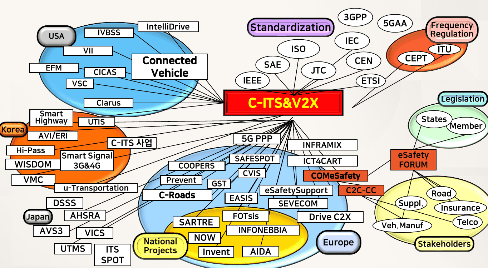

*Figure 1. Projects, standards bodies, regulation, and stakeholders related to C-ITS and V2X in each country*

Figure 1 gathers the worldwide activities surrounding C-ITS and V2X into a single map. Four kinds of groups are connected around C-ITS&V2X in the center.

1. **National projects:** The United States carried out VII, IntelliDrive, Connected Vehicle, VSC, CICAS, IVBSS, Clarus, EFM, and others; Korea carried out Smart Highway, UTIS, the C-ITS project, Hi-Pass, AVI/ERI, WISDOM, VMC, Smart Signal, 3G&4G, u-Transportation, and others; Japan carried out VICS, DSSS, AHSRA, AVS3, UTMS, ITS SPOT, and others; and Europe carried out PReVENT, CVIS, SAFESPOT, COOPERS, C-Roads, Drive C2X, SARTRE, 5G PPP, INFRAMIX, ICT4CART, and others.
2. **Standards bodies:** There are 3GPP and 5GAA for cellular standards, ISO, IEC, ITU, and JTC for international standards, SAE and IEEE in the United States, CEN and ETSI in Europe, and CEPT, which deals with spectrum.
3. **Laws and institutions:** There is frequency regulation and legislation at the level of states and member states.
4. **Stakeholders:** There are road operators, insurers, telecom operators, vehicle manufacturers, suppliers, and European bodies such as the eSafety Forum, C2C-CC, and COMeSafety.

As the map shows, V2X is not a technology of the automotive industry alone but an ecosystem in which telecommunications, roads, insurance, and government are intertwined. Therefore, in each country technology development projects proceed together with standardization, pilot deployments, and institutionalization.

The standards bodies in Figure 1 that recur in this note are as follows.

> **Definition:** **3GPP (3rd Generation Partnership Project)** is the international standards body that develops mobile communication standards such as LTE and 5G.

> **Definition:** **5GAA (5G Automotive Association)** is an association formed by automotive, telecommunication, and semiconductor companies to promote the deployment of cellular-based vehicle communication.

> **Definition:** **SAE (SAE International)** is the U.S. society of automotive engineers that developed the standards for automation levels (J3016) and V2X messages (J2735).

> **Definition:** **ETSI (European Telecommunications Standards Institute)** is the European standards body for telecommunications.

### 1.2 Connected Automated Driving Roadmaps of Major Countries

Connected automated driving followed roughly the same sequence in each country. First the concept is verified in laboratories and proving grounds, then it is tested on public roads, and then it moves to deployment through a large-scale pilot operation just before actual deployment.

> **Definition:** **Proof of concept** is the stage of checking, in laboratories or proving grounds, whether an idea is technically feasible.

> **Definition:** An **FOT (Field Operational Test)** is a test in which ordinary drivers use a system on real roads so that its effects and problems can be measured.

Whereas the stages up to the field operational test confirm the effects of a technology, the remaining two stages carry the confirmed technology into actual service.

> **Definition:** **Pre-deployment** is the stage of pilot operation in a certain area, including the operating organization, just before actual deployment.

> **Definition:** **Deployment** is the stage of permanent operation as a service.

| Country | 01 Proof of Concept | 02 FOT (Public Roads) | 03 Pre-Deployment | Deployment |
|:-----|:-----|:-----|:-----|:-----|
| Europe | 2006-2009 FP6: CVIS, COOPERS, SAFESPOT, COMeSafety (PReVENT 2003-2007) | 2010-2014 FP7: Drive C2X, FOTsis, COMeSafety2 | 2013-2015 Compass4D, Amsterdam Group | 2016-present C-ITS Platform, C-Roads, Round Table on CAD, Horizon 2020 ART (2016 and 2017 calls) |
| United States | 2003-2009 VII, VSC, VSC-A, CICAS (dedicated spectrum allocated in 1999) | 2010-2011 IntelliDrive, VSC-3 | 2011-2015 Connected Vehicle, Safety Pilot Model Deployment, VSC-3 | 2015-present CV Pilot Deployment Program |
| Japan | 1998-2004 VICS, ETC | 2004-2006 Smartway, DSSS basic research and component tests | 2007-2010 Smartway, DSSS, ITS Safety 2010 public road tests | 2011- ITS Spot (ETC2.0) at 1,600 sites, DSSS at 15 sites |
| Korea | 2007-2012 u-Transportation, Smart Highway | 2008-2014 Smart Highway (pilot tests on the test road) | 2015-2017 C-ITS pilot project | 2018-present C-ITS demonstration project |

*Table 1. Development stages of connected automated driving in major countries*

> **Definition:** **VICS (Vehicle Information and Communication System)** is the Japanese road traffic information system that sends congestion, accident, and restriction information to vehicles through FM multiplex broadcasting and roadside beacons.

> **Definition:** **DSSS (Driving Safety Support Systems)** is the safe driving support system of the Japanese National Police Agency that alerts drivers to hazards detected by roadside equipment at intersections and similar places.

In Table 1 the four countries went through the same stages at different times. Japan connected roads and vehicles first with VICS and ETC, the United States started from VII after securing dedicated spectrum in 1999, and Europe carried on multinational projects through the EU research framework programmes (FP). Korea went through national R&D programs such as u-Transportation and Smart Highway from around 2007 and entered the C-ITS pilot project in July 2014 (Table 1 shows the pilot project as 2015-2017, but the project itself began in July 2014; see Section 3.9).

> **Definition:** An **FP (Framework Programme)** is the EU's research framework programme that funds, over several years at a time, R&D projects carried out jointly by universities, research institutes, and companies of member states. The 6th FP (FP6, 2002-2006) and the 7th FP (FP7, 2007-2013) were followed by Horizon 2020 (2014-2020).

In the deployment stage of Table 1, Japan extended the ETC unit beyond toll collection and made it the basis of connected services.

> **Definition:** **ETC (Electronic Toll Collection)** is the wireless toll collection system corresponding to Korea's Hi-pass.

> **Definition:** **ETC2.0** is a Japanese service that extends ETC units to exchange not only tolls but also traffic and safety information.

> **Definition:** **ITS Spot** is the roadside communication unit installed on expressways for the ETC2.0 service; it communicates with the ETC2.0 units of vehicles to exchange traffic and safety information.

### 1.3 The U.S. Connected Vehicle Development Roadmap

Connected vehicle development in the United States proceeded with two parallel streams, one of laws and institutions and one of research projects.

> **Definition:** **VII (Vehicle Infrastructure Integration)** was an early program of the U.S. Department of Transportation to integrate vehicles and road infrastructure wirelessly. It was renamed IntelliDrive around 2009 and has been called the Connected Vehicle (CV) program since 2011.

> **Definition:** **VSC (Vehicle Safety Communications)** is a joint project of automakers that defined and evaluated the safety services made possible by V2V and V2I communication.

| Category | Period | Content |
|:-----|:-----|:-----|
| Laws and institutions | 1999 | The Federal Communications Commission (FCC) allocates 5.850-5.925 GHz as dedicated ITS spectrum |
| Laws and institutions | 1998-2005 | Transportation authorization act TEA-21 |
| Laws and institutions | 2005-2009 | Transportation authorization act SAFETEA-LU |
| Laws and institutions | 2010-2014 | ITS strategic research plan of the DOT |
| Laws and institutions | 2012 | Transportation authorization act MAP-21 |
| Laws and institutions | August 2014 | Announcement that mandatory installation in vehicles would be considered according to the effects of V2X services |
| Laws and institutions | 2015-2019 | ITS Strategic Plan 2015-2019 |
| Projects | 2002-2004 | VSC (CAMP) |
| Projects | 2003- | VII |
| Projects | 2006-2011 | VSC-A (CAMP and DOT) |
| Projects | 2006-2012 | CICAS |
| Projects | 2009- | IntelliDrive |
| Projects | 2010-2014 | VSC3 (CAMP and DOT) |
| Projects | 2011- | Connected Vehicle, Safety Pilot Model Deployment |
| Projects | 2015- | CV Pilots Deployment Project |

*Table 2. The U.S. Connected Vehicle development roadmap*

> **Definition:** **CAMP (Crash Avoidance Metrics Partners LLC)** is a consortium formed by U.S. automakers to research crash avoidance technology jointly.

The flow in Table 2 follows the sequence from proof of concept through demonstration sites and pilot projects to commercialization. An authorization act is a law that sets, for a span of several years, the framework of the budget the federal government spends on road and transportation programs, and ITS research funding is also based on these acts.

> **Note:** MAP-21 (Moving Ahead for Progress in the 21st Century Act) is a two-year authorization act enacted in July 2012 that funded surface transportation programs for fiscal years 2013 and 2014 [1]. A roadmap that shows the period of MAP-21 as 2012-2022 therefore does not match the period in which the law applied.

### 1.4 Institutionalization and Related Agencies

The U.S. Department of Transportation published the automated driving guidelines *Automated Driving Systems 2.0* (2017) [2], *Automated Vehicles 3.0* (2018) [3], and *Automated Vehicles 4.0* (2020) [4] in turn, setting the direction for institutionalizing automated driving. The content of the three documents was covered in Week 1.

Within the U.S. Department of Transportation, ITS programs are coordinated by the **ITS JPO (Intelligent Transportation Systems Joint Program Office)**. The ITS JPO has department-wide authority to coordinate ITS programs and initiatives among the following DOT operating administrations [5].

| Abbreviation | Agency | Main Responsibility |
|:-----|:-----|:-----|
| FHWA | Federal Highway Administration | Roads and road infrastructure, V2I |
| FMCSA | Federal Motor Carrier Safety Administration | Safety of commercial vehicles such as trucks and buses |
| FTA | Federal Transit Administration | Public transit such as buses and rail |
| FRA | Federal Railroad Administration | Railroads and highway-rail crossings |
| NHTSA | National Highway Traffic Safety Administration | Motor vehicle safety standards and V2V |
| MARAD | Maritime Administration | Shipping and ports |

*Table 3. DOT operating administrations coordinated by the ITS JPO*

V2X spans vehicles (NHTSA), roads (FHWA), commercial vehicles (FMCSA), transit (FTA), and highway-rail crossings (FRA), so a coordinating organization that ties several agencies together is needed.

### 1.5 Early Roadmaps and Outlooks

**Research tracks.** Automation research at the U.S. Department of Transportation was organized into five research tracks [6].

| Research Track | Areas |
|:-----|:-----|
| Enabling Technologies | Digital infrastructure, communications, technology research |
| Safety Assurance | Electronic control systems, functional safety and electronics reliability, cybersecurity, human factors |
| Transportation System Performance | CACC, speed harmonization, platooning, lateral control, first and last mile, transit operations |
| Testing and Evaluation | Interoperability, testing methods, benefits assessment |
| Policy and Planning | Standards, federal policy analysis, stakeholder engagement, transportation planning |

*Table 4. Research tracks of the U.S. DOT automation program*

> **Definition:** **ACC (adaptive cruise control)** is cruise control that measures the distance to the vehicle ahead with a sensor such as radar and adjusts the speed automatically.

> **Definition:** **CACC (Cooperative Adaptive Cruise Control)** adds V2V communication to ACC, which measures the distance to the vehicle ahead only by radar, so that the acceleration and deceleration of the vehicle ahead are received directly and a shorter, more stable gap can be kept.

> **Definition:** **Speed harmonization** is a traffic management technique that gives recommended speeds to vehicles approaching a congested section to reduce the speed differences among them.

> **Definition:** **Platooning** is driving in which several vehicles, linked by communication, travel in a line with short gaps between them (Week 4).

**Draft program plan.** The DOT planned research activities for 2016-2023 in three groups. The plan was presented as a draft, and each activity was marked as ongoing or committed, under consideration, or a future possibility.

| Group | Activities (Performers) |
|:-----|:-----|
| Proof of concept, demonstration, and benefits | Operating strategies for connected automation (CA) applications, truck platooning assessment (CA PATH), automated vehicle lab prototypes (Leidos, Volpe, U.S. Army Aberdeen Test Center), managed lane demonstration bundling speed harmonization, CACC, and lane change management (LCM), early CACC assessment with lab vehicles, demonstration of Glidepath platoons on arterials |
| Applied research, development, and testing | CACC small-scale test, CACC system architecture, feasibility and architecture of eco-approach and departure (EAD), small-scale test, stakeholder engagement for case studies of CA deployments, architecture of bundled CA applications, precompetitive CA prototypes (CAMP), CA field operational test, CA pilot test |
| Policy, deployment preparation, and support | Building the test deployment environment and systems (Honeywell), FHWA automated vehicle policy (Volpe), AMS tools for CA applications, guidelines for CA deployment |

*Table 5. Early U.S. DOT automation program plan (2016-2023, draft)*

For 2022-2023, when the three groups end, the initial deployment of CA applications was planned. Table 5 shows a structure in which proof of concept, applied research, and policy preparation proceed in parallel and then converge into deployment.

> **Definition:** **EAD (Eco-Approach and Departure)** is an environmental application in which a vehicle receives signal information and adjusts its approach speed to an intersection to avoid unnecessary stops and hard acceleration.

> **Definition:** **AMS (Analysis, Modeling, and Simulation)** tools analyze, model, and simulate the effects of transportation systems and applications.

The activities in Table 5 were divided among university research programs, federal research centers, and private companies. Among university research programs, **CA PATH (California Partners for Advanced Transportation Technology)**, the transportation research program of the University of California, Berkeley, took part, and among federal research centers, **Volpe**, the National Transportation Systems Center under the DOT.

**Deployment scenarios.** The Texas A&M Transportation Institute (TTI) presented two scenarios for how fast automated driving functions would spread [7].

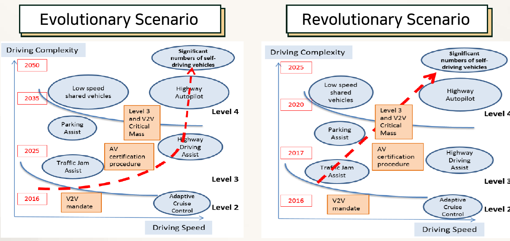

*Figure 2. Evolutionary and revolutionary scenarios for the spread of automated driving*

In Figure 2 the horizontal axis is driving speed and the vertical axis is driving complexity. Adaptive cruise control (ACC) lies in the Level 2 area at the bottom, traffic jam assist and highway driving assist lie in the Level 3 area in the middle, and parking assist, low-speed shared vehicles, and highway autopilot lie in the Level 4 area at the top. The red dashed line is the path along which functions spread over time, and along it lie institutional gates: the V2V mandate, the AV certification procedure, and the critical mass of Level 3 and V2V.

| Milestone | Evolutionary Scenario | Revolutionary Scenario |
|:-----|:-----|:-----|
| V2V mandate (Level 2) | 2016 | 2016 |
| AV certification procedure, Level 3 functions | 2025 | 2017 |
| Critical mass of Level 3 and V2V, Level 4 functions | 2035 | 2020 |
| Significant numbers of self-driving vehicles | 2050 | 2025 |

*Table 6. Years assumed in the two TTI deployment scenarios*

The evolutionary scenario assumed that existing driver assistance functions would be upgraded gradually, and the revolutionary scenario assumed that institutions and technology would mesh quickly so that self-driving vehicles would spread within ten years. It is worth noting that both scenarios take the V2V mandate as their starting point. In reality, as seen in Week 1, the proposed U.S. rule mandating V2V was withdrawn in 2023, so the spread of connected functions has been slower than either scenario assumed.

**Multidisciplinary approach.** Early U.S. research on automated driving took a multidisciplinary approach that covered not only engineering but also philosophy, ethics, and law. Philosophers such as Professor Shannon Vallor of Santa Clara University and Professor John Sullins of Sonoma State University studied ethical problems such as what an automated vehicle should decide in an unavoidable crash, and the Center for Automotive Research at Stanford (CARS) held a workshop on programming ethics into automated vehicles in June 2015 that invited philosophers such as Professor Vallor as speakers together with engineers [8].

**Consumer preferences.** The J.D. Power 2015 U.S. Tech Choice Study showed that preferred automated driving technologies differ by generation [9]. The study measured preferences for three technologies, traffic jam assist, limited self-driving, and full self-driving, with MaxDiff scores (average 100), and the scores for traffic jam assist were 88 for Generation Y, 85 for Generation X, 87 for Boomers, and 97 for Pre-Boomers, highest in the oldest generation. The study interpreted this result to mean that Generation Y and Generation X prefer the more complex and advanced self-driving technologies that handle all or part of the driving, while the older generations prefer to ease into full self-driving step by step, starting from simpler functions such as traffic jam assist.

> **Definition:** **MaxDiff (maximum difference scaling)** is a survey technique that repeatedly asks respondents to choose the most and least preferred items from a set, and scores the relative preference of the items. When the average is scaled to 100, a value above 100 means the item is preferred more than average.

### 1.6 The CAMP Consortium and the VSC Projects

In CAMP (Section 1.3), competing companies jointly develop pre-competitive technology, that is, the message formats, security systems, and test methods that all companies must use in common, with support from the DOT. V2V is meaningful only when vehicles of different manufacturers communicate with each other, so this structure of joint development is essential. The main projects carried out by CAMP since 1996 are shown in Table 7 [10].

| No. | Project | Period | Content |
|:-----|:-----|:-----|:-----|
| 1 | Forward Collision Warning (FCW) | 1996-02 ~ 1999-03 | Initial development and testing of forward collision warning systems |
| 2 | Panic Brake Assist (PBA) | 2001-04 ~ 2004-03 | Development of emergency brake assist systems |
| 3 | Forward Collision Warning (FCW) | 2003-04 ~ 2006-03 | Research on improving forward collision warning systems |
| 4 | Vehicle Safety Communications (VSC) | 2005-04 ~ 2008-06 | Development of vehicle safety communication protocols |
| 5 | Driver Workload Metrics (DWM) | 2006-03 ~ 2008-12 | Development of metrics for driver workload |
| 6 | Enhanced Digital Mapping (EDMap) | 2004-06 ~ 2006-09 | Research on using high-precision map data |
| 7 | Emergency Electronic Brake Light (EEBL) | 2005-07 ~ 2007-03 | Development of an electronic emergency brake light warning system |
| 8 | Cooperative Intersection Collision Avoidance (CICAS-V) | 2008-01 ~ 2010-06 | Research on intersection collision avoidance systems |
| 9 | Advanced Restraint Systems (ARS) | 2010-04 ~ 2012-05 | Design of advanced occupant restraint systems |
| 10 | Objective Tests for CIB Systems | 2010-05 ~ 2013-08 | Development of test methods for crash imminent braking (CIB) systems |
| 11 | Vehicle Safety Communications Applications (VSC-A) | 2011-06 ~ 2014-09 | Research on safety communication applications |
| 12 | Objective Tests for PCAM Systems | 2013-05 ~ 2015-08 | Development of test methods for pedestrian crash avoidance and mitigation (PCAM) systems |
| 13 | V2V Communications Security (V2V-CS) | 2013-06 ~ 2015-12 | Research on V2V communication security |
| 14 | V2V Interoperability | 2014-03 ~ 2016-09 | Evaluation of the interoperability of V2V systems |
| 15 | V2V Safety Pilot | 2014-07 ~ 2016-12 | Pilot operation of vehicle safety systems |
| 16 | V2V Safety System Light Vehicle Builds | 2014-08 ~ 2017-02 | Building V2V systems for light vehicles |
| 17 | Vehicle Safety Communications Security Studies (VSCS) | 2014-09 ~ 2017-03 | Security studies for VSC |
| 18 | Automated Vehicle Research for Enhanced Safety (AVR) | 2015-01 ~ 2017-12 | Safety research and evaluation of automated vehicles |
| 19 | V2I Program Cooperative Adaptive Cruise Control (CACC) | 2015-05 ~ 2017-06 | Research on cooperative adaptive cruise control |
| 20 | SCMS Proof-of-Concept Implementation | 2016-03 ~ 2018-05 | Proof of concept and implementation of the security credential management system (SCMS) |
| 21 | Road Weather Management Program (RWMP) Connected Vehicle-Infrastructure Research | 2016-06 ~ 2018-11 | Research on road weather management and connected vehicle infrastructure |
| 22 | Advanced Messaging Concept Development (AMCD) | 2017-02 ~ 2019-03 | Development of advanced messaging technology |
| 23 | CACC Small-Scale Test, Phase 1 (CACC-SST) | 2017-05 ~ 2018-12 | Small-scale test of cooperative adaptive cruise control |
| 24 | V2V Communications Research (V2V-CR) | 2018-04 ~ 2020-12 | Research on V2V communication technology |
| 25 | V2V Systems Engineering and Integration Research (V2V-SE) | 2018-07 ~ 2021-03 | Research on V2V system integration and engineering |
| 26 | Operation of the SCMS Proof-of-Concept | 2018-09 ~ 2020-08 | Operation of and technical support for the SCMS proof of concept |
| 27 | Technical Management of Connected Vehicle Safety System SCMS | 2018-11 ~ 2021-05 | Technical management of the connected vehicle security system |
| 28 | Automated Driving Behaviors (ADB) | 2018-08 ~ 2020-04 | Evaluation of automated driving behaviors and performance |
| 29 | Automation and Public Safety Common Solutions (APSCS) | 2018-09 ~ 2020-06 | Development of automation technology for public safety |
| 30 | Traffic Optimization for Signalized Corridors (TOSCo), Phase 1 | 2019-03 ~ 2021-12 | Research on traffic optimization along corridors of signalized intersections |
| 31 | V2I Safety Applications (V2I-SA) | 2019-05 ~ 2021-08 | Development of integrated vehicle-infrastructure safety applications |
| 32 | V2V Communications Research, Phase 2 (V2V-CR2) | 2020-02 ~ 2022-06 | Phase 2 of V2V communication research |
| 33 | Cellular Vehicle-to-Everything (C-V2X) Project | 2019-08 ~ 2021-11 | Research and evaluation of cellular V2X technology |
| 34 | Event-Driven Configurable Messaging (EDCM) and Work Zone Queue Advisory/Warning (QA/QW) System | 2020-03 ~ 2022-09 | Development of event-driven messaging and work zone queue warning systems |
| 35 | Cooperative Automated Driving Systems (CADS) | 2020-05 ~ 2023-02 | Development and testing of cooperative automated driving systems |
| 36 | Connected Intersections Program (CIP) | 2021-03 ~ 2024 (planned) | Development and performance evaluation of connected intersection technology |

*Table 7. Main projects of the CAMP consortium*

> **Definition:** **FCW (Forward Collision Warning)** is an application that warns the driver when there is a risk of colliding with the vehicle ahead.

> **Definition:** **CIB (Crash Imminent Braking)** is a function in which the vehicle brakes automatically when a crash is imminent.

Reading Table 7 in chronological order shows how the center of U.S. V2X research moved. In the late 1990s and early 2000s, sensor-based collision warning (FCW, PBA) was central; communication-based safety services (VSC, EEBL, CICAS-V) appeared around 2005. After 2013, projects on security (V2V-CS, SCMS) and interoperability needed to actually deploy V2V increased, and after 2015 automation (AVR, CACC, ADB, CADS) and C-V2X were added.

> **Definition:** **SCMS (Security Credential Management System)** is a public key infrastructure that issues and revokes the certificates used to attach digital signatures to V2X messages. A receiving vehicle verifies the signature to confirm that the message came from a legitimate device and was not forged.

**VSC series projects.** VSC is a series of projects that defined, developed, and evaluated V2V and V2I safety services. The automakers that took part in each stage are shown in Table 8.

| Project | Period | Content and Participating Companies |
|:-----|:-----|:-----|
| VSC | 2002-2004 | Evaluated vehicle safety services made possible or enhanced by communication (BMW, DaimlerChrysler, Ford, GM, Nissan, Toyota, VW) |
| EEBL | 2005-2006 | Developed and evaluated the emergency electronic brake light (EEBL) service (BMW, DaimlerChrysler, Ford, GM, Nissan, Toyota) |
| VSC 2 | 2006-2009 | CICAS-V project, VSC-A project (DOT, DaimlerChrysler, Ford, GM, Honda, Toyota) |

*Table 8. VSC series projects in the United States*

> **Note:** The period of VSC-A is given differently by different materials. Table 8 gives the VSC-A of the VSC 2 consortium as 2006-2009, Table 2 gives 2006-2011, and the CAMP project list (Table 7) gives a project of the same name as 2011-2014. Projects with the same name may belong to different stages, so when citing a period it is good to state which stage in which material it refers to.

The VSC project defined 34 safety services that can be implemented with communication: 15 V2V services exchanged between vehicles and 19 V2I services exchanged between vehicles and infrastructure.

| V2V Services (15) | V2I Services (19) |
|:-----|:-----|
| Approaching Emergency Vehicle Warning | Blind Merge Warning |
| Blind Spot Warning | Curve Speed Warning |
| Cooperative Adaptive Cruise Control | Emergency Vehicle Signal Preemption |
| Cooperative Collision Warning | Highway/Rail Collision Warning |
| Cooperative Forward Collision Warning | Intersection Collision Warning |
| Cooperative Vehicle-Highway Automation System | In-Vehicle Amber Alert (missing child alert) |
| Emergency Electronic Brake Lights | In-Vehicle Signage |
| Highway Merge Assistant | Just-In-Time Repair Notification |
| Lane Change Warning | Left Turn Assistant |
| Post-Crash Warning | Low Bridge Warning |
| Pre-Crash Sensing | Low Parking Structure Warning |
| Vehicle-Based Road Condition Warning | Pedestrian Crossing Information at Intersection |
| V2V Road Feature Notification | Road Condition Warning |
| Visibility Enhancer | Safety Recall Notice |
| Wrong Way Driver Warning | SOS Services |
| | Stop Sign Movement Assistance |
| | Stop Sign Violation Warning |
| | Traffic Signal Violation Warning |
| | Work Zone Warning |

*Table 9. The 34 V2V and V2I safety services defined by VSC*

The V2V services are mainly collision warnings that require knowledge of the position, speed, and braking state of surrounding vehicles, and the V2I services are warnings and guidance that deliver to vehicles the information that infrastructure knows, such as signals, signs, road surface, and road geometry.

### 1.7 VSC-A Application Scenarios and EEBL

The VSC-A (Vehicle Safety Communications-Applications) project developed and tested V2V safety applications by mapping them to actual crash types. Representative scenarios are a stopped lead vehicle with forward collision warning (FCW), a lane change with blind spot warning (BSW), and a decelerating lead vehicle with emergency electronic brake lights (EEBL). In the last scenario, when the vehicle two cars ahead brakes hard, the EEBL message it sends lets a driver know in advance about braking that is hidden behind the car directly ahead.

> **Definition:** **BSW (Blind Spot Warning)** is an application that warns of a vehicle in the blind spot of the adjacent lane when changing lanes.

> **Definition:** **LCW (Lane Change Warning)** is an application that warns of a vehicle approaching in the adjacent lane when changing lanes.

> **Definition:** **EEBL (Emergency Electronic Brake Lights)** is an application in which a vehicle that brakes hard announces it over V2V so that following vehicles know about the braking even when their view is blocked.

VSC-A also prepared an application for each crash type outside the representative scenarios. Examples are DNPW, IMA, and CLW.

> **Definition:** **DNPW (Do Not Pass Warning)** is an application that warns of a vehicle in the opposite lane while trying to pass.

> **Definition:** **IMA (Intersection Movement Assist)** is an application that warns of the risk of collision with crossing vehicles at intersections.

> **Definition:** **CLW (Control Loss Warning)** is an application that warns that a nearby vehicle has lost control, for example by skidding.

| No. | Crash Scenario | Corresponding V2V Application |
|:-----|:-----|:-----|
| 1 | Lead vehicle stopped | FCW |
| 2 | Control loss without prior vehicle action | CLW |
| 3 | Vehicle(s) turning at non-signalized junctions | IMA |
| 4 | Straight crossing paths at non-signalized junctions | IMA |
| 5 | Lead vehicle decelerating | EEBL, FCW |
| 6 | Vehicle(s) not making a maneuver, opposite direction (passing situation) | DNPW |
| 7 | Vehicle(s) changing lanes, same direction | BSW, LCW |
| 8 | Left turn across path, opposite direction (LTAP/OD) at non-signalized junctions | IMA |

*Table 10. V2V safety applications that VSC-A mapped to crash scenarios*

> **Definition:** **LTAP/OD (Left Turn Across Path, Opposite Direction)** is the crash type in which a left-turning vehicle crosses the path of a vehicle coming straight from the opposite direction and collides with it.

Table 10 shows that one application can reduce several crash types and that several applications can be used together for one crash type. For example, IMA is used in all three scenarios at non-signalized junctions (3, 4, 8), and EEBL and FCW are used together for a decelerating lead vehicle (5).

**Euro NCAP and EEBL.** V2X safety functions such as EEBL also began to be reflected in Europe's new car safety assessment. In the *Euro NCAP 2025 Roadmap* announced on September 12, 2017, Euro NCAP presented its plan for introducing assessment items up to 2025 [11].

> **Definition:** **Euro NCAP (European New Car Assessment Programme)** is a program that assesses the crash safety and active safety functions of new cars sold in Europe and publishes the results as star ratings. It is not a legal requirement, but because it strongly influences consumer purchases, automakers actively equip their cars with the functions that are assessed in order to obtain high ratings.

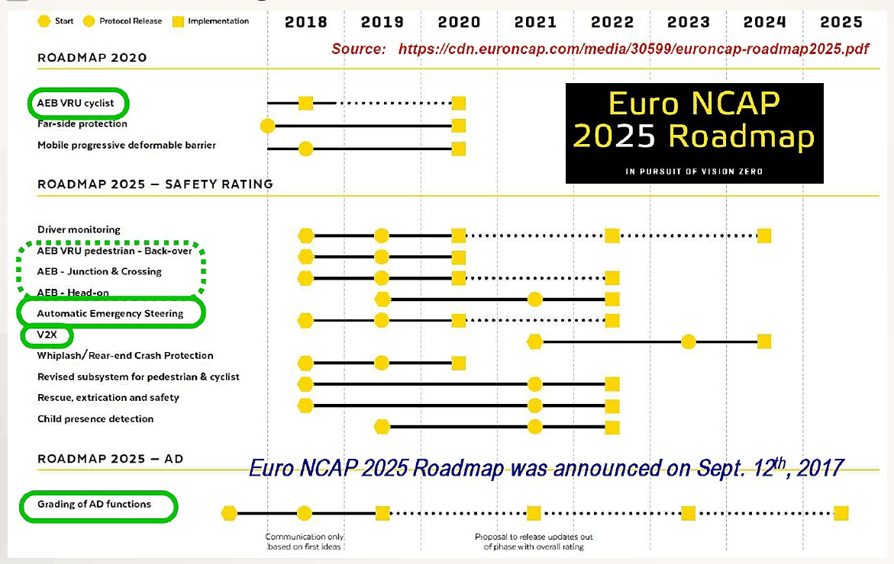

*Figure 3. Plan for introducing assessment items in the Euro NCAP 2025 Roadmap*

Figure 3 shows the assessment items for 2018-2025 in three groups. Roadmap 2020 includes autonomous emergency braking for cyclists (AEB VRU cyclist), far-side protection, and the mobile progressive deformable barrier test. The safety rating of Roadmap 2025 includes driver monitoring, AEB for pedestrians when backing over, AEB at junctions and crossings, head-on AEB, automatic emergency steering (AES), V2X, whiplash and rear-end crash protection, a revised subsystem for pedestrians and cyclists, rescue, extrication and safety, and child presence detection. The automated driving (AD) part of Roadmap 2025 includes the grading of AD functions. As highlighted by the green circles, Euro NCAP decided to newly include automatic emergency steering, V2X, and the grading of automated driving functions.

> **Definition:** **AEB (Autonomous Emergency Braking)** is a function that brakes automatically, without driver input, when it detects a risk of collision.

> **Definition:** A **VRU (Vulnerable Road User)** is a road user, such as a pedestrian, cyclist, or motorcyclist, who is easily seriously injured in a crash.

> **Definition:** **AES (Automatic Emergency Steering)** is a function in which the vehicle steers automatically to avoid a collision.

The V2X item of the roadmap (planned for 2024) explains that V2X communication has the potential to improve traffic safety and efficiency, and gives as examples of safety-related functions "Emergency electronic brake lights", "Motorcycle is approaching", and "Roadwork ahead". It stresses that to provide a benefit beyond on-board sensors, V2X must identify a potential risk earlier than any of the surrounding sensors can see the danger. For automated driving functions, it names parking, city driving, inter-urban driving, traffic jam, and highway driving as the functions to be assessed, and states that assessment will be phased in, starting with continued assistance systems such as highway assist and traffic jam assist, possibly as early as 2018-2019. Automatic emergency steering (2020, 2022) was introduced as a technology that can reduce single-vehicle crashes, small overlap crashes, and crashes involving vulnerable road users beyond what AEB achieves, and a revision of UNECE Regulation 79 was expected to permit emergency steering functions around 2020. As a first step, Euro NCAP planned to include driver-initiated within-lane steering support in the overall rating from 2020.

### 1.8 Safety Pilot Model Deployment

**SPMD (Safety Pilot Model Deployment)** is a large-scale demonstration that the United States carried out to confirm the effects of V2V safety applications on real roads.

| Item | Content |
|:-----|:-----|
| Period | 2011-2014 |
| Overview | About 3,000 equipped vehicles on more than 70 miles of roads in Ann Arbor, Michigan implemented V2V safety applications based on 5.9 GHz DSRC communication and collected data |
| Goal 1 | Test connected vehicle operations in real-world conditions |
| Goal 2 | Understand how regular drivers use connected vehicle technologies |
| Goal 3 | Determine the safety benefits of connected vehicles |

*Table 11. Overview of the Safety Pilot Model Deployment*

> **Definition:** **DSRC (Dedicated Short Range Communications)** is short-range wireless communication that operates in a frequency band dedicated to vehicle communication (5.9 GHz in the United States).

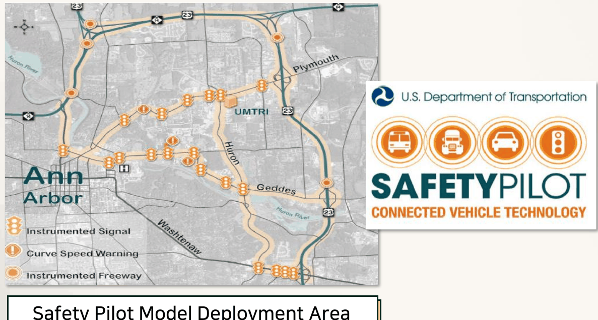

*Figure 4. The Safety Pilot Model Deployment area in Ann Arbor, Michigan*

Figure 4 shows the locations of the equipment installed in Ann Arbor and on the surrounding freeways. The traffic light symbols are signalized intersections connected to roadside units (instrumented signals), the warning symbols are curve speed warning sites, and the circles mark equipped freeway sections (instrumented freeway). UMTRI in the middle of the map is the University of Michigan Transportation Research Institute, which conducted the demonstration.

The SPMD proceeded in four stages.

| Stage | Content | Start | End |
|:-----|:-----|:-----|:-----|
| 1. Device development | Development of vehicle awareness devices (VAD), aftermarket safety devices (ASD), and roadside units (RSU) | 2010-07 | 2012-10 |
| 2. Pre-model deployment planning and testing | Resolving the issues of applying the devices in the execution stage | 2011-08 | 2012-08 |
| 3. Model deployment execution | Maintenance of the installed equipment and software updates | 2012-08 | 2013-08 |
| 4. Post-model deployment evaluation | Analysis of the data collected in stage 3 | 2013-08 | 2014-08 |

*Table 12. Stages and schedule of the SPMD*

> **Definition:** A **VAD (Vehicle Awareness Device)** is a simple device that only sends messages containing its own vehicle's position and speed and gives no warnings.

> **Definition:** An **ASD (Aftermarket Safety Device)** is a device installed later in vehicles already sold; it exchanges messages and also warns the driver.

> **Definition:** An **RSU (Roadside Unit)** is a device installed at the roadside that communicates wirelessly with vehicles.

> **Definition:** An **on-board unit (OBU)** is the device mounted in a vehicle that handles V2X communication.

The data collected in the SPMD can be downloaded by anyone from the open data portal of the U.S. Department of Transportation [12]. These data were later used as the basis for estimating safety benefits when the V2V mandate rulemaking was considered.

### 1.9 Connected Vehicle Applications

The U.S. Department of Transportation classified the applications to be implemented with connected vehicles into seven groups by purpose [13].

| Group | Representative Applications |
|:-----|:-----|
| V2I safety | Red light violation warning, curve speed warning, stop sign gap assist, spot weather impact warning, reduced speed and work zone warning, pedestrian in signalized crosswalk warning (transit) |
| V2V safety | EEBL, FCW, IMA, left turn assist (LTA), blind spot and lane change warning (BSW/LCW), DNPW, vehicle turning right in front of bus warning (transit) |
| Agency data | Probe-based pavement maintenance, probe-enabled traffic monitoring, vehicle classification-based traffic studies, turning movement and intersection analysis, origin-destination (O-D) studies, work zone traveler information |
| Environment | Eco-approach and departure at signalized intersections, eco-traffic signal timing and priority, connected eco-driving, wireless inductive charging, eco-lanes management, eco-speed harmonization, eco-CACC, eco-traveler information, eco-ramp metering, low emissions zone management, alternative fuel charging information, eco-smart parking, dynamic eco-routing, eco-integrated corridor management decision support |
| Road weather | Motorist advisories and warnings (MAW), enhanced maintenance decision support (Enhanced MDSS), vehicle data translator (VDT), weather response traffic information (WxTINFO) |
| Mobility | Advanced traveler information system, intelligent traffic signal system (I-SIG), signal priority (transit, freight), mobile accessible pedestrian signal (PED-SIG), emergency vehicle preemption (PREEMPT), dynamic speed harmonization (SPD-HARM), queue warning (Q-WARN), CACC, incident scene pre-arrival staging guidance for emergency responders (RESP-STG), incident scene work zone alerts (INC-ZONE), emergency communications and evacuation (EVAC), connection protection (T-CONNECT), dynamic transit operations (T-DISP), dynamic ridesharing (D-RIDE), freight-specific dynamic travel planning, drayage optimization |
| Smart roadside | Wireless inspection, smart truck parking |

*Table 13. Classification of connected vehicle applications by the U.S. DOT*

Table 13 makes it clear that connected vehicles are not a technology for safety alone. The position and speed information that vehicles send (probe data) is used by road agencies for traffic studies and pavement management, signal information is used to save fuel and reduce emissions, and the efficiency of transit and freight transport is also improved.

> **Definition:** **Probe data** are the position, speed, and status information measured and sent by vehicles traveling on the road. The name means that vehicles are used like moving probes to grasp the traffic conditions of the whole road network.

> **Definition:** **PED-SIG** is the mobile pedestrian signal application in which a pedestrian, such as a visually impaired person, tells the signal controller by smartphone of the intention to cross and receives enough crossing time.

### 1.10 Connected Vehicle Pilot Deployment Program

If the SPMD verified the effects of V2V safety applications, the **CV Pilot Deployment Program** is a pilot deployment program that applies connected vehicle technology to solving the traffic problems of real regions. The goals of the program are to combine connected vehicle and mobile device technologies to improve safety, to advance mobility and system productivity, and to reduce environmental impacts [14].

| Phase | Duration | Content |
|:-----|:-----|:-----|
| Phase 1 Concept development | Up to 12 months | Prepare the concept of operations (ConOps), system requirements, and preliminary site plans (completed October 2016) |
| Phase 2 Design, build, test | Up to 20 months | Develop applications, integrate them with legacy systems, and test the enhanced system |
| Phase 3 Operate and maintain | At least 18 months | Operate the enhanced system and assess performance against targets |

*Table 14. Phases of the CV Pilot Deployment Program*

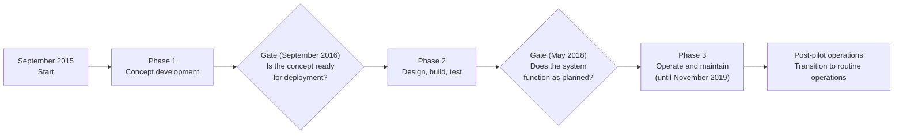

*Figure 5. Schedule and progress gates of the CV Pilot Deployment Program*

As Figure 5 shows, there is a progress gate between phases. After Phase 1, the program checks whether the concept is ready for deployment, and after Phase 2, whether the system functions as planned, before moving to the next phase. After Phase 3, it transitions to post-pilot operations that integrate connected vehicle technology into routine traffic operations. The pilot sites selected in September 2015 are New York City, Wyoming, and Tampa, Florida.

> **Definition:** A **ConOps (Concept of Operations)** is a document that describes, from the user's point of view, who uses the system, in what situations, and how. It makes stakeholders share the same picture before the requirements are fixed.

### 1.11 The New York City Pilot

The New York City Department of Transportation (NYCDOT) pilot evaluated the following [14].

1. Reduce crashes.
2. Reduce pedestrian injuries.
3. Use connected vehicle technology to assist the visually impaired.

New York City is a dense urban environment with a very large number of vehicles of many types, so solving the problems of deploying connected vehicles in such an environment was also a task.

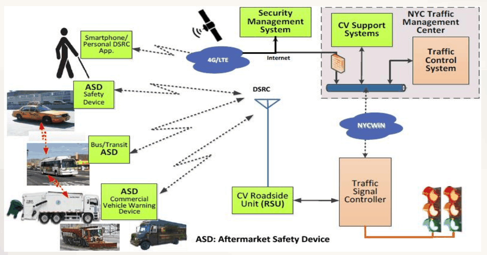

*Figure 6. Overall concept of the New York City pilot*

In Figure 6, vehicles such as taxis, buses, sanitation trucks, and delivery trucks are equipped with aftermarket safety devices (ASD) and communicate with each other over DSRC. The CV roadside units (RSU) at intersections are connected to the traffic signal controllers and send signal information to vehicles. The roadside units are connected through the city's wireless network (NYCWiN) to the traffic control system, CV support systems, and security management system of the New York City Traffic Management Center. Pedestrians connect through a personal DSRC app on a smartphone or through 4G/LTE, so that visually impaired people can receive the signal information of crosswalks.

Roadside units and vehicles exchange messages of the SAE J2735 standard. The formats of the messages are covered in detail in Week 11; here the roles that each message played in the pilot are summarized.

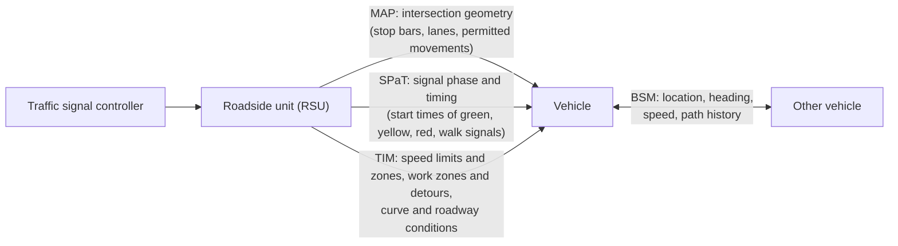

*Figure 7. V2I and V2V messages used in the New York City pilot*

> **Definition:** The **BSM (Basic Safety Message)** is a status message that a vehicle broadcasts to its surroundings about 10 times per second, and it underlies V2V safety applications.

Whereas the BSM is a V2V message exchanged between vehicles, the other three messages, SPaT, MAP, and TIM, are V2I messages that the roadside unit sends to vehicles. MAP, SPaT, and TIM support V2I safety applications, and BSM supports V2V safety applications.

> **Definition:** **SPaT (Signal Phase and Timing)** is the message that contains the current phase of a traffic signal and the remaining time.

> **Definition:** **MAP** is the message that contains geometric information such as the lane layout and stop bar positions of an intersection.

> **Definition:** **TIM (Traveler Information Message)** is the message that contains traveler information such as speed limits, work zones, detours, and road surface conditions.

### 1.12 The Wyoming Pilot

The pilot of the Wyoming Department of Transportation (WYDOT) targeted the freight corridor of the interstate highway (I-80), where heavy snow and strong winds in winter cause frequent crashes. Its objectives are shown in Table 15 [14].

| Area | Objectives |
|:-----|:-----|
| Road weather condition input | Improve the road weather condition reports received by the traffic management center (TMC) |
| TMC information dissemination | Improve the TMC's ability to generate wide-area alerts and advisories, manage closures, restrictions, and speed limits efficiently, exchange messages with en-route vehicles, and improve information to commercial vehicle fleet managers |
| Vehicle and roadside alerts and advisories | Exchange V2V messages to reduce incidents and their severity, and enhance emergency notifications of crashes |
| Expected outcomes | Improve speed adherence and reduce speed variation between vehicles, and reduce crashes |

*Table 15. Objectives of the Wyoming pilot*

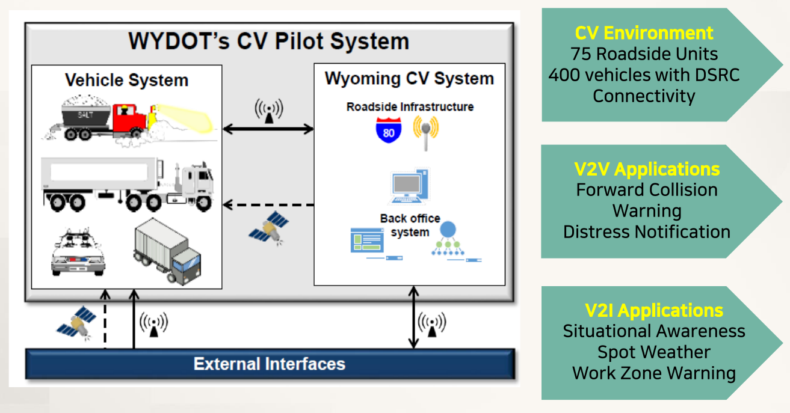

*Figure 8. The CV pilot system of the Wyoming Department of Transportation*

The vehicle system on the left of Figure 8 includes snowplows, heavy trucks, patrol cars, and freight trucks, and the Wyoming CV system on the right consists of roadside infrastructure and a back office system. The two systems are connected by roadside units and satellite communication, and the external interfaces at the bottom connect them with the systems of other agencies. The pilot environment consisted of 75 roadside units and 400 vehicles equipped with DSRC. The V2V applications are forward collision warning and distress notification, and the V2I applications are situational awareness, spot weather warning, and work zone warning.

> **Definition:** A **TMC (Traffic Management Center)** is an operations center that monitors traffic conditions on roads and manages signals, message signs, and control information.

> **Definition:** **Distress notification** is an application in which a vehicle stopped by a crash or breakdown announces this to nearby vehicles and the center.

### 1.13 The Tampa Pilot

The pilot in Tampa, Florida was led by the Tampa-Hillsborough Expressway Authority (THEA). It targeted the downtown reversible express lanes (Selmon Reversible Express Lanes), whose direction is switched during rush hours, and the surrounding downtown streets [15].

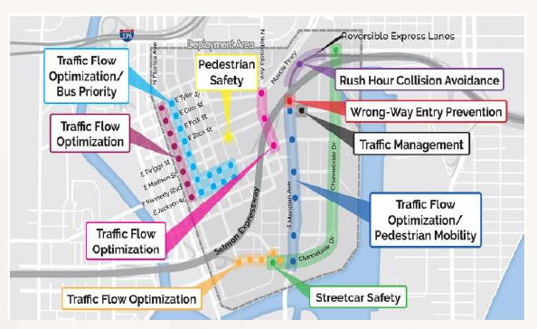

*Figure 9. Deployment area and applications of the Tampa pilot*

Figure 9 shows the applications deployed at each location downtown. The exit of the reversible express lanes deals with rush hour collision avoidance and wrong-way entry prevention, the downtown intersections deal with traffic flow optimization, bus priority, pedestrian safety, and pedestrian mobility, and the streetcar line deals with streetcar safety. The Tampa applications were organized in four groups.

| Group | Applications |
|:-----|:-----|
| V2I safety | End of ramp deceleration warning (ERDW), pedestrian in signalized crosswalk warning (PED-X), pedestrian collision warning (PCW, an on-board unit application complementing PED-X), pedestrian transit movement warning (PTMW), wrong way entry warning (WWE) |
| V2V safety | EEBL, FCW, IMA, vehicle turning right in front of a transit vehicle warning (VTRFTV) |
| V2I mobility | Intelligent traffic signal system (I-SIG), transit signal priority (TSP), mobile accessible pedestrian signal (PED-SIG) |
| Agency data | Probe data enabled traffic monitoring (PDETM) |

*Table 16. Applications of the Tampa pilot*

> **Definition:** **I-SIG (Intelligent Traffic Signal System)** is an application that optimizes signal timing in real time with the position and speed information sent by vehicles.

> **Definition:** **TSP (Transit Signal Priority)** is an application that extends or advances the green signal when a bus approaches.

The Tampa system consists of the traffic management center (traffic operators, traffic server, master server, transit server, research staff), roadside equipment (signal controllers, RSUs, DSRC antennas), passenger cars, buses, and streetcars with on-board units (OBU), pedestrians' handheld devices, satellite positioning (GPS) that provides location, and an operational data environment (ODE) data center that stores the collected data.

The three pilots are worth comparing because they applied the same technology to different regional problems.

| Item | New York City | Wyoming | Tampa |
|:-----|:-----|:-----|:-----|
| Environment | Dense urban area | Rural interstate highway (I-80 freight corridor) | Downtown reversible express lanes and downtown streets |
| Main problems | Crashes, pedestrian injuries | Crashes and road closures due to severe winter weather | Rush hour congestion and crashes, pedestrian safety, transit delays |
| Main vehicles | Taxis, buses, city-owned vehicles, delivery trucks | Snowplows, patrol cars, heavy trucks | Passenger cars, buses, streetcars |
| Representative applications | V2V safety, signal-based V2I safety, walking support for the visually impaired | Road weather warnings, distress notification, work zone warning | Wrong-way prevention, end of ramp deceleration warning, signal optimization, transit signal priority |

*Table 17. Comparison of the three U.S. CV pilots*

### 1.14 C-V2X Projects in the United States

> **Definition:** **C-V2X (Cellular V2X)** is the V2X technology defined by 3GPP on the basis of LTE and 5G. It can use both the PC5 interface for direct communication between devices and the Uu interface through a base station.

Early U.S. connected vehicle programs all used DSRC, but from 2018 pilots of cellular-based C-V2X also began. In June 2018, Panasonic, Qualcomm, and Ford announced that they would jointly pursue the first U.S. deployment of C-V2X in Colorado [16]. The characteristics of this project are as follows.

1. It was designed to be compatible with 5G and to complement ADAS sensors such as cameras, radar, and lidar.
2. It was designed to provide the C-V2X direct device-to-device (D2D) communication mode that does not go through a base station.
3. Evaluation was to start around Panasonic's CityNOW headquarters in Denver and expand to selected sections of the I-70 corridor later the same year, and the roadside and vehicle units used the Qualcomm 9150 C-V2X chipset.

Qualcomm summarized the advantages of C-V2X as follows [17]. Range and reliability are enhanced for direct communication without network assistance, relative speeds of up to 500 km/h are supported, it is more cost-efficient than other technologies, and it has an evolution path to 5G NR. It is also self-managed for reduced cost and complexity, synergistic with the cellular modem, able to leverage the cellular ecosystem, and able to reuse the upper layers defined by SAE and ETSI. The communication modes of C-V2X and its comparison with DSRC are covered in Week 14.

> **Definition:** **D2D (Device-to-Device)** communication is communication exchanged directly between devices without going through a base station, and was used with the same meaning as PC5 direct communication.

### 1.15 The Smart City Challenge

To drive the development of the automated and connected vehicle industry, the U.S. Department of Transportation launched the **Smart City Challenge** at the end of 2015. It was a competition in which mid-sized cities proposed plans to solve urban problems with advanced transportation technology, and one city was selected for concentrated support.

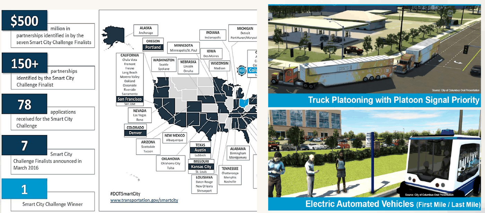

*Figure 10. Progress of the Smart City Challenge and the proposals of Columbus*

The numbers on the left of Figure 10 summarize the progress of the program. 78 cities applied, 7 cities (Austin, Columbus, Denver, Kansas City, Pittsburgh, Portland, San Francisco) became finalists in March 2016, the finalists secured about USD 500 million in partnerships with more than 150 partner organizations, and Columbus, Ohio was finally selected as the one winning city. The photographs on the right are services proposed by Columbus: truck platooning with platoon signal priority at the top and electric automated shuttles connecting the first and last mile at the bottom. Columbus proposed automated public transit and truck platooning linked with large retailers and others.

> **Note:** The USD 500 million was not a budget given to the winning city but the total of support pledged to the seven finalists by partner organizations. The winner, Columbus, received up to USD 40 million from the DOT and USD 10 million from the private sponsor Vulcan [18].

The lessons from the U.S. cases are as follows. First, V2V between vehicles of different manufacturers became possible because competing companies jointly developed pre-competitive common technology (messages, security, test methods). Second, staged demonstrations involving real drivers and regional transportation agencies, such as the SPMD and the CV pilots, confirmed the effects and operational problems. Third, even when the technology is ready, a change in the V2V mandate or spectrum policy changes the path of deployment, so the technology roadmap and the institutional roadmap must be viewed together.

---

<br>

## 2. Connected Automated Driving in Europe and Japan

Because Europe must deal with roads and spectrum shared by many countries, it chose an approach in which the EU supports multinational projects through research framework programmes and automakers create standards through consortia. In Japan, a cross-ministry framework under the Cabinet Office (SIP-adus) pursued maps, communication, and demonstrations together. This section summarizes the projects, organizations, and demonstration cases of the two regions.

### 2.1 The Progression of EU Projects

| Category | Period | Content |
|:-----|:-----|:-----|
| Laws and institutions | 2002-2006 | 6th FP, eSafety Initiative |
| Laws and institutions | 2006 | Intelligent Car Initiative (COM 59) |
| Laws and institutions | 2007-2013 | 7th FP |
| Laws and institutions | 2008 | 5.875-5.925 GHz (including extension) allocated as ITS spectrum for safety |
| Laws and institutions | 2008- | ITS Action Plan of the European Commission |
| Laws and institutions | 2014-2020 | Horizon 2020 |
| Projects | 2006-01 ~ 2009-12 | COMeSafety (later COMeSafety2) |
| Projects | 2006-01 ~ 2010-02 | CVIS, SAFESPOT, COOPERS |
| Projects | 2008-09 ~ 2012-09 | simTD (Germany) |
| Projects | 2011-01 ~ 2014-06 | Drive C2X |
| Projects | 2011-04 ~ 2014-09 | FOTsis |
| Projects | 2013-01 ~ 2015-01 | Compass4D |
| Projects | Mid-2010s | C-ITS Corridor (Netherlands, Germany, Austria) |
| Projects | 2016-2017 | Horizon 2020 ART calls |

*Table 18. EU institutions and projects related to C-ITS*

EU projects also followed the sequence of proof of concept, demonstration sites, pilot projects, and commercialization [19]. CVIS, SAFESPOT, COOPERS, and COMeSafety were carried out under FP6, Drive C2X, FOTsis, and COMeSafety2 under FP7, and C-ITS Platform and C-Roads, GEAR 2030, the Round Table on Connected and Automated Driving (RT-CAD), and the Horizon 2020 ART calls under Horizon 2020. Throughout this flow, C2C-CC, a consortium of automakers, led the standards on the vehicle side.

> **Definition:** **C2C-CC (CAR 2 CAR Communication Consortium)** is a consortium of European automakers, suppliers, and research institutes that created standards for V2V and V2I communication.

Whereas the three FP6 research projects (CVIS, SAFESPOT, and COOPERS) developed the technology of cooperative systems, the projects that followed gathered the results into a common architecture (COMeSafety), tested them on real roads (Drive C2X and FOTsis), and carried them into deployment in the member states (C-Roads).

> **Definition:** **CVIS (Cooperative Vehicle-Infrastructure Systems)** was an FP6 project that researched a cooperative communication platform through which vehicles and infrastructure communicate with each other.

> **Definition:** **SAFESPOT** was an FP6 project that researched cooperative safety systems in which vehicles and the road share information to widen the safety margin.

> **Definition:** **COOPERS (Co-operative Systems for Intelligent Road Safety)** was an FP6 project that researched cooperative traffic management in which road operators give vehicles real-time traffic information.

> **Definition:** **COMeSafety** was a support project that gathered the results of the cooperative-system projects into a common European ITS communication architecture.

> **Definition:** **Drive C2X** was an FP7 field operational test (FOT) project that tested cooperative systems on real roads in several countries.

> **Definition:** **C-Roads** is a platform for member states to deploy C-ITS services interoperably.

### 2.2 The Structure of EU Projects

EU vehicle safety projects of the FP6 period were organized by dividing roles along layers (driver, applications, communication channels, service facilitator) and along the time axis.

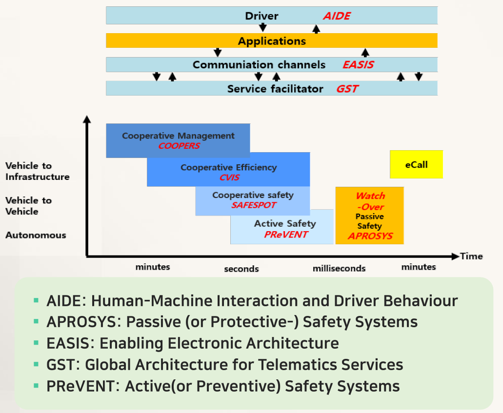

*Figure 11. Structure of EU vehicle safety projects in the FP6 period*

The top of Figure 11 is the layered structure. AIDE covers the interaction between driver and vehicle, EASIS the vehicle electronic architecture, and GST the architecture for providing telematics services. The graph at the bottom places the projects with the communication range (vehicle to infrastructure, vehicle to vehicle, autonomous) on the vertical axis and the time remaining until the crash (minutes, seconds, milliseconds, minutes after the crash) on the horizontal axis. COOPERS covers cooperative traffic management on the scale of minutes, CVIS cooperative efficiency, SAFESPOT cooperative safety on the scale of seconds, PReVENT active safety on the scale of milliseconds, APROSYS passive safety at the moment of the crash and after it, and eCall emergency calls on the scale of minutes after the crash.

| Project | Full Name | Area |
|:-----|:-----|:-----|
| AIDE | Adaptive Integrated Driver-vehicle InterfacE | Human-machine interaction, driver behavior |
| APROSYS | Advanced PROtective SYStems | Passive (protective) safety systems |
| EASIS | Electronic Architecture and System Engineering for Integrated Safety Systems | Electronic architecture for safety systems |
| GST | Global System for Telematics | Common architecture for telematics services |
| PReVENT | Preventive and Active Safety Applications | Active (preventive) safety systems |

*Table 19. Areas of EU vehicle safety projects in the FP6 period*

This structure is linked to the classification of crash response technologies that divides a crash in time order (perception and prevention before the crash, protection at the moment of the crash, rescue after the crash). Communication-based cooperative systems matter because they can intervene earliest, before the driver or vehicle sensors know about the hazard.

### 2.3 The EU Automated Vehicle Project Roadmap

ERTRAC, the European road transport research advisory council, organized the projects related to automated driving carried out by the EU in 2005-2020 into four areas [20].

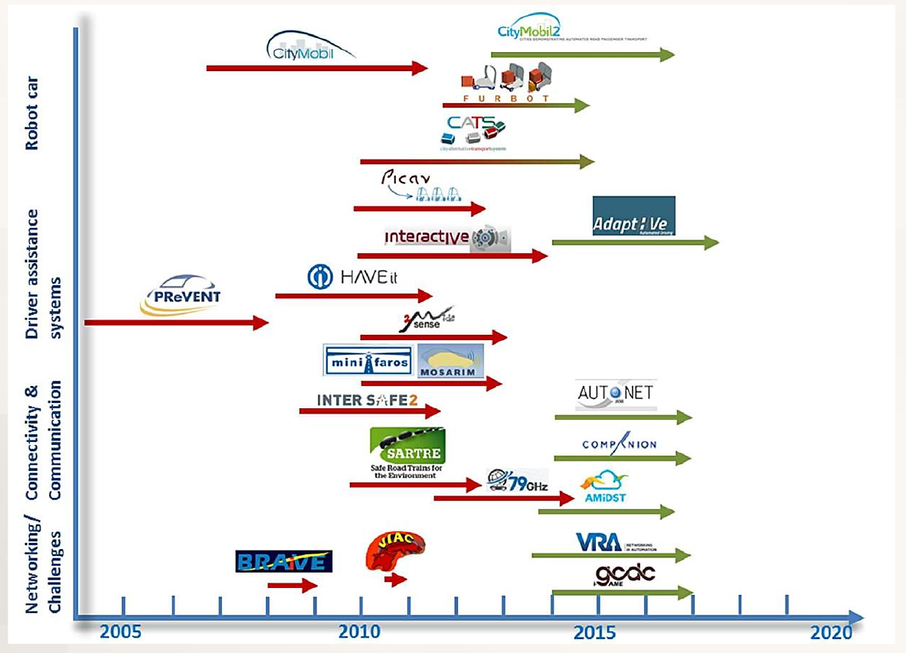

*Figure 12. Roadmap of EU projects related to automated vehicles*

In Figure 12 each arrow is the duration of a project.

1. **Robot car:** There are CityMobil and CityMobil2 on urban driverless shuttles, the freight transport robot FURBOT, automated urban transport CATS, and the personal driverless vehicle PICAV.
2. **Driver assistance systems:** There are PReVENT on active safety, HAVEit on high automation, interactIVe on integrated safety, and AdaptIVe, which demonstrated automated driving functions.
3. **Connectivity and communication:** There are MiniFaros on sensor miniaturization, MOSARIM on radar interference, INTERSAFE-2 on intersection safety, SARTRE on highway platooning, 79 GHz radar, AutoNet2030 on cooperative automated driving, COMPANION on truck platoon operation, and AMIDST, which analyzed massive data streams for applications such as lane change prediction.
4. **Networking and challenges:** There are BRAiVE, an automated vehicle of VisLab in Italy, and VIAC, its intercontinental automated driving test, GCDC (Grand Cooperative Driving Challenge), in which various vehicles competed in cooperative driving, and VRA (Vehicle and Road Automation), which supported networking in the field of vehicle and road automation.

ERTRAC also presented a staged plan, by technology maturity, for automated urban road transport.

| Activity | TRL | Period | Content |
|:-----|:-----|:-----|:-----|
| Technological research | 2-4 | 2014-2016 | CityMobil2, MG3.6, ECSEL projects: design guidelines, legal framework proposal, showcases, sensors (milestone 1) |
| Technological research | 2-4 | 2016-2018 | Technical solutions for perception and connectivity enabling safety and acceptance of automated urban road transport (ERTRAC recommendation for the 2016-2017 work programme) |
| Pilot and large-scale demonstrator | 5-7 | 2018-2021 | Large-scale demonstration of urban road transport automation integrated with existing public transport (milestone 3) |
| Regulation and standards | Not applicable | 2021-2022 | Adapting regulation for Levels 4 and 5 |
| Industrialisation | 8-9 | 2023-2025 | Automated urban road transport at Levels 4 and 5 |

*Table 20. ERTRAC roadmap for automated urban road transport*

> **Definition:** **TRL (Technology Readiness Level)** is a scale that indicates where a technology stands, from the basic principle stage (1) to the stage proven in the actual operating environment (9). Levels 2-4 correspond to technology research, 5-7 to prototypes and demonstration, and 8-9 to commercialization.

Table 20 shows the sequence from technological research through large-scale demonstration to adapting regulation and then industrialization. Regulation is adapted after demonstration because the data obtained in demonstrations become the basis for the regulation.

### 2.4 C2C-CC and Penetration Rate

C2C-CC was founded in 2002 and is still active [21]. In 2006-2011 it did the following [22].

1. It standardized the interfaces and protocols of V2V and V2I.
2. It developed and established a European industry standard.
3. It ensured interoperability between vehicles of different manufacturers.
4. It developed and demonstrated services.
5. It pursued the allocation of a frequency band that can be used free of charge in Europe.

The participants included automakers such as Audi, Daimler, Honda, Renault, Volkswagen, and Volvo and suppliers such as Bosch, Continental, Delphi, Hitachi, NEC, and Siemens.

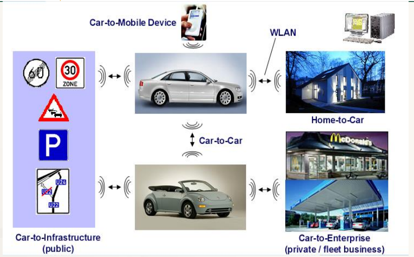

*Figure 13. Forms of vehicle communication defined by C2C-CC*

Figure 13 shows the forms of communication envisioned by C2C-CC. The two vehicles in the middle communicate car to car, and they communicate car to infrastructure with public infrastructure on the left such as speed limit signs, hazard signs, and parking signs. The upper right is home-to-car communication that connects a home and a vehicle by wireless LAN, the lower right is car-to-enterprise communication that connects a vehicle with businesses such as fast food restaurants and gas stations, and the top is car-to-mobile device communication that connects a handheld device and a vehicle.

**Penetration rate and services.** V2V is effective only when there are partners to communicate with, so the required penetration rate of on-board units differs by type of service. Services using C2C communication must secure the following penetration rates [20].

| Service | Required Market Penetration |
|:-----|-----:|
| Sharing traffic information | 5% or more |
| Minimal safety warnings | 10% or more |
| Active safety functions | 90% or more |

*Table 21. Market penetration required for C2C communication services*

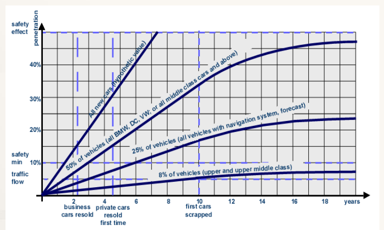

*Figure 14. Growth curves of V2X unit penetration by range of vehicle models*

In Figure 14 the horizontal axis is the number of years since units began to be installed in new cars, and the vertical axis is the share of all vehicles that carry a unit. The horizontal dashed lines are the penetration rates required for traffic flow services (about 5%), minimal safety services (10%), and services with a safety effect. The four curves differ according to the range of vehicle models in which units are installed.

1. The optimistic (hypothetical) case of installing units in all new cars of all automakers is the steepest.
2. Next is the case of installing them in models that account for 50% of all vehicles (for example, all models of BMW, DaimlerChrysler, and VW, or all middle-class and larger models).
3. Next is the case of installing them in models that account for 25% of all vehicles (all vehicles with navigation systems).
4. The case of installing them only in models that account for 8% of all vehicles (upper and upper-middle class models) stays near 10% even after 20 years.

As the labels below the horizontal axis indicate, business cars are first resold after about 2 years and private cars after about 4 years, and the first cars are scrapped after about 10 years, so there is a limit to how fast the vehicle fleet is replaced. Therefore, even if all new cars are equipped, it takes time for existing vehicles to be replaced, and reaching a penetration rate close to the 90% needed for active safety requires 10 years or more, corresponding to the service life of vehicles. This is why the discussion of a V2V mandate matters, and also why aftermarket devices and infrastructure (V2I) are deployed together so as not to wait for fleet replacement.

**Day 1, 2, 3 classification.** C2C-CC also presented a roadmap that divides C-ITS services by introduction time into Day 1 (awareness driving), Day 2 (sensing driving), and Day 3+ (cooperative driving) [21].

| Stage | Character | Services | Messages |
|:-----|:-----|:-----|:-----|
| Day 1 | Awareness driving | Warning applications such as collision avoidance, information from infrastructure such as road and intersection signage | CAM, DENM, SPaT, MAP, IVI |
| Day 2 | Sensing driving | Advanced warnings, protection of vulnerable road users such as pedestrians and powered two-wheelers, semi-automated driving such as cooperative emergency brake assistance and cooperative ACC, cooperation with traffic light controllers | Extended CAM, DENM, CPM (detected objects), RTCM (position corrections), SREM, SSEM (priority, preemption) |
| Day 3+ | Cooperative driving | Cooperative automated driving such as CACC strings and cooperative lane merging, cooperation with infrastructure such as intersection crossing and transition of control | Extended CAM, MCM (planned trajectories), VAM (VRU awareness), extended IVI |

*Table 22. C2C-CC classification of Day 1, Day 2, and Day 3+ services*

As the stage rises, support grows from security (the EU certificate management system) through misbehavior detection, position correction, and functional safety support to automated coordination such as automated driving coordination rules, and the final goals are accident-free road transport and optimal traffic flow. The definitions of each message and the details of the Day classification are covered in Week 11.

### 2.5 Bosch's Vision of Automated Driving

The supplier Bosch presented the stages from driver assistance functions to high and full automation as follows.

| Period | Function |
|:-----|:-----|
| Since 2010 | Automatic emergency braking |
| 2015 | Evasive steering support, traffic jam assist |
| After 2016 | Traffic jam pilot |
| 2017 | Integrated cruise assist |
| 2018 | Highway assist |
| 2020 | Highway pilot |
| After 2025 | Auto pilot, parking |

*Table 23. Introduction stages of automated functions presented by Bosch*

In Table 23, an assist is a function in which the driver supervises driving, and a pilot is a function in which the system takes over driving under specific conditions. The sequence widens the operating range from traffic jams (low speed) to highways (high speed) and then to all situations.

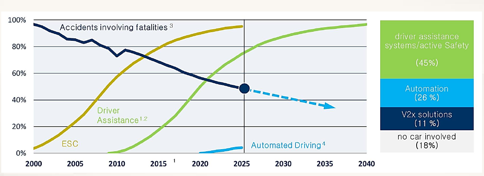

*Figure 15. Bosch's vision of reducing fatal accidents and the share of avoidable accidents*

Bosch's vision is injury-free driving. In the graph on the left of Figure 15, the dark blue line is the relative number of accidents involving fatalities; taking 2000 as 100%, it is expected to fall to about 50% around 2025 and keep falling afterward. Over the same period, the penetration of electronic stability control (ESC), driver assistance functions, and automated driving rises one after another along S-shaped curves. The bar on the right is the share of accidents that each technology can avoid: driver assistance and active safety 45%, automation 26%, V2X solutions 11%, and accidents with no car involved 18%. In other words, V2X plays the role of additionally reducing part of the accidents that are hard to avoid with vehicle sensors alone.

> **Definition:** **ESC (Electronic Stability Control)** is a device that prevents the body from skidding by adjusting the braking force of each wheel separately; in automated vehicles it is also used to carry out the controller's deceleration commands.

### 2.6 Horizon 2020 ART

Horizon 2020 issued calls for projects in the area of **ART (Automated Road Transport)** every year from 2016 to 2019 [23].

| Call | Topic | Examples of Selected Projects |
|:-----|:-----|:-----|
| 2016 | Automation pilots for passenger cars | AUTOPILOT, L3Pilot |
| 2016 | Safety and end-user acceptance | interACT, BRAVE |
| 2016 | Road infrastructure to support automation | TransAID, INFRAMIX, CoEXist |
| 2017 | ICT infrastructure to enable road transport automation | |
| 2017 | Multi-brand platooning in real traffic conditions | |
| 2017 | Automated urban transport systems | |
| 2018 | Testing, validation, and certification procedures for highly automated driving functions | |
| 2018 | Support for networking activities and impact assessment for road automation | |
| 2019 | Human-centred design for the new driver role in highly automated vehicles | |
| 2019 | Developing and testing shared, connected, and cooperative automated vehicle fleets in urban areas for the mobility of all | |

*Table 24. Call topics of Horizon 2020 ART by year*

The change in call topics shows that vehicle technology and public road pilots came first, and infrastructure, platooning, certification procedures, human factors, and shared services were added later. This reflects a shift toward viewing automated driving not as the technology of a single vehicle but as a transport system that includes infrastructure, institutions, users, and services.

### 2.7 The EU C-V2X Demonstration, AdaptIVe, and City Pilot

**C-V2X demonstration.** In July 2018, Qualcomm, 5GAA, BMW Group, Groupe PSA, and Ford Motor Company jointly held near Paris, France, Europe's first demonstration of C-V2X direct communication between vehicles of multiple manufacturers [24]. The demonstration took place at the UTAC Montlhéry proving ground (UTAC is covered in the Week 13 appendix), and the following six services were tested among passenger cars, motorcycles, and roadside infrastructure.

1. Emergency Electronic Brake Light
2. Intersection Collision Warning
3. Across Traffic Turn Collision Risk Warning
4. Slow Vehicle Warning, Stationary Vehicle Warning
5. Signal Phase and Timing, Signal Violation Warning
6. Vulnerable Road User (pedestrian) Warning

The demonstration used the Qualcomm 9150 C-V2X chipset, and the participating companies aimed to be commercially ready for industry deployment in early 2020.

**AdaptIVe.** AdaptIVe is a large pan-European project that developed and demonstrated automated driving functions in several operating environments [25].

| Item | Content |
|:-----|:-----|
| Participants | Mercedes-Benz, Ford, BMW, Renault, Bosch, and others (coordinated by Volkswagen Group Research) |
| Countries | France, Germany, Greece, Italy, Spain, Sweden, the Netherlands, the United Kingdom |
| Budget | 25 million euros (EU funding 14.3 million euros) |
| Period | January 2014-June 2017 (42 months) |
| Scope of demonstrations | From advanced ADAS up to Level 3 automated driving |

*Table 25. Overview of the AdaptIVe project*

> **Note:** Eight countries are listed as participants, and the official project materials also state that 28 partners from 8 countries took part [25]. Counting the participating countries as six therefore does not match the list.

The applications of AdaptIVe fall into three branches by operating environment. In special areas such as parking lots and garages they cover parking assistance, multi-level garages, and low-speed stop and go; in cities, city cruise, city chauffeur, and supervised city control; and on highways, entering and exiting the highway, lane following, lane changes, filtering in, overtaking, danger spot intervention, and stop and go. As a common function in all three environments, a safe stop brings the vehicle to a safe halt when the system can no longer drive. The demonstration vehicles included passenger cars of several manufacturers and a heavy truck.

**City Pilot.** Mercedes-Benz pursued a plan to operate an automated bus in the Netherlands.

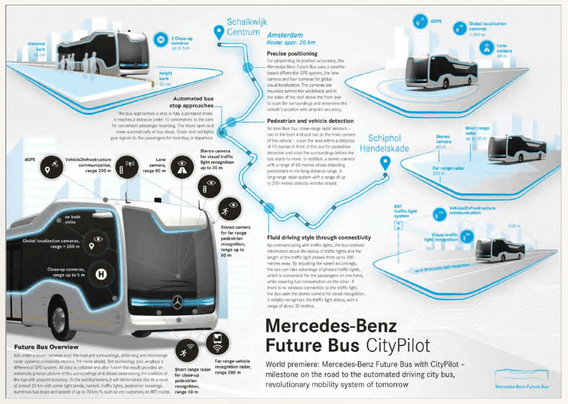

*Figure 16. The CityPilot functions of the Mercedes-Benz Future Bus*

Figure 16 shows the route and functions of the Future Bus. The route is a bus rapid transit (BRT) line of about 20 km from Amsterdam Schiphol Airport to Haarlem. The bus has precise positioning that combines satellite positioning and cameras, detection of pedestrians and vehicles with stereo cameras and radar, automatic approach to bus stops (stopping within 10 cm of the kerb), and connectivity-based driving that communicates with traffic lights up to 200 m ahead to drive smoothly in step with the signals. The route has tight bends, tunnels, traffic lights, and pedestrian crossings, and the bus drives at up to 70 km/h, the usual speed on BRT routes. The bus made an automated demonstration run on this route in July 2016, and commercial operation was planned to follow after further preparation [26].

> **Definition:** **BRT (Bus Rapid Transit)** is a bus system with dedicated roads or lanes and signal priority that runs as fast and punctually as a subway. Because it is a dedicated space separated from other vehicles, it is a good environment in which to introduce automated buses first.

### 2.8 Japan's SIP Automated Driving Framework

As introduced in Week 1, Japan's SIP Automated Driving (SIP-adus, Automated Driving for Universal Services) is a cross-ministry governance framework under the Prime Minister's office (Cabinet Office), pursued in phase 1 (2014-2018) and phase 2 (2018-2022). The Ministry of Internal Affairs and Communications, the Ministry of Economy, Trade and Industry, the National Police Agency, the Ministry of Land, Infrastructure, Transport and Tourism, and others participate, and the program director (PD) comes from a private company [27].

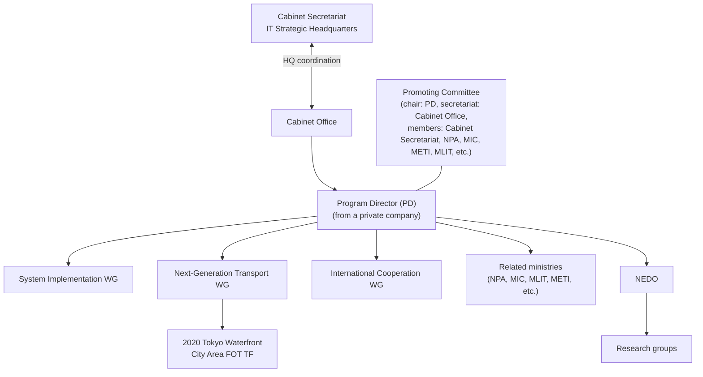

*Figure 17. The implementation organization of SIP-adus*

In Figure 17 the PD leads the promoting committee and has three working groups (WG). Research projects are entrusted to research groups through the related ministries and **NEDO (New Energy and Industrial Technology Development Organization)**. It was decided that the promoting committee would be reviewed after the end of phase 1 and that a new promoting organization would be established in 2019. Although it is a government body, an industry expert leads it, so it is a structure in which industry takes the lead in building social consensus.

**Direction of SIP phase 2.** SIP phase 2 pursued vehicles for mobility services and privately owned vehicles separately.

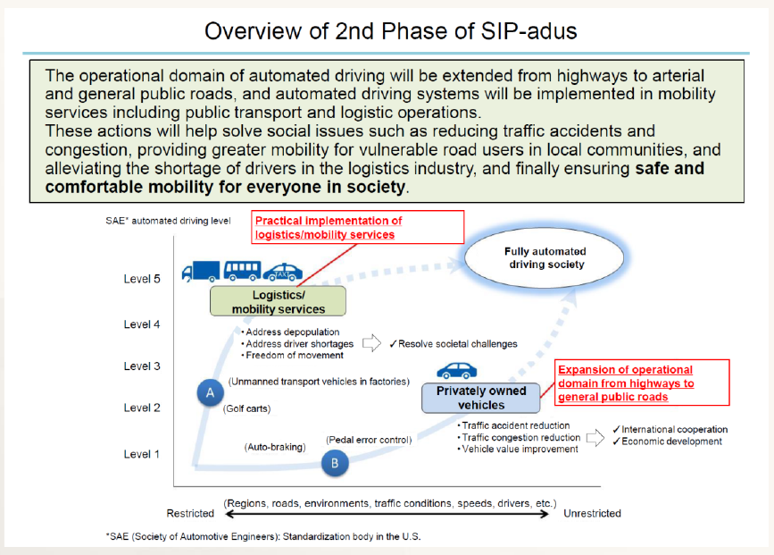

*Figure 18. Overview of phase 2 of SIP-adus*

The text box at the top of Figure 18 summarizes the goals of phase 2. The operational domain of automated driving will be extended from highways to arterial and general public roads, and automated driving systems will be implemented in mobility services including public transport and logistics. These actions will help reduce traffic accidents and congestion, provide mobility for vulnerable road users in local communities, alleviate the driver shortage in the logistics industry, and create a society in which everyone travels safely and comfortably. In the graph below, the vertical axis is the SAE automation level and the horizontal axis is the degree of restriction of operating conditions (region, roads, environment, traffic conditions, speed, driver).

1. **Path A (logistics and mobility services):** It starts at high levels under restricted conditions, such as golf carts or unmanned transport vehicles in factories, and realizes Level 4 logistics and mobility services. The purpose is to solve social problems such as mobility in depopulated areas, driver shortages, and freedom of movement.
2. **Path B (privately owned vehicles):** It starts at low levels under less restricted conditions, such as automatic braking and pedal error control, and expands the operational domain from highways to general roads. The purpose is to contribute to international cooperation and economic development through fewer traffic accidents and less congestion and higher vehicle value.

Both paths aim at a fully automated driving society, but service vehicles raise the level first while narrowing operating conditions, whereas private vehicles widen operating conditions while raising the level step by step.

**SIP phase 1 and 2 roadmap.** SIP built the framework of road traffic environment information in stages.

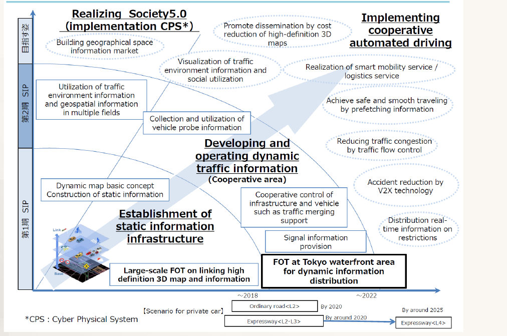

*Figure 19. Roadmap for building the road traffic environment information framework in SIP phases 1 and 2*

The stages in Figure 19 rise from bottom to top.

1. **Phase 1 (until 2018), establishing static information infrastructure:** It set the basic concept of the dynamic map, constructed static information, and carried out a large-scale field operational test on linking high-definition 3D maps and information.
2. **Phase 2 (until 2022), developing and operating dynamic traffic information (cooperative area):** It carried out the collection and use of vehicle probe information, signal information provision, cooperative control of infrastructure and vehicles such as merging support, and an FOT of dynamic information distribution in the Tokyo waterfront area. Through these, it aims to reduce accidents with V2X, distribute information on traffic restrictions in real time, and reduce congestion with traffic flow control.
3. **Target state:** Realizing Society 5.0 (a cyber-physical system, CPS) creates a geospatial information market, promotes the dissemination of high-definition 3D maps by reducing their cost, and visualizes traffic environment information for social use. At the same time, implementing cooperative automated driving realizes smart mobility and logistics services and safe and smooth travel by prefetching information.

> **Definition:** **Society 5.0** is the national vision of the Japanese government for a society that highly integrates cyberspace and physical space (Week 1).

> **Definition:** A **CPS (Cyber-Physical System)** is a system that gathers information about the real world with sensors, analyzes it in cyberspace, and controls the real world with the results.

The bottom of Figure 19 is the scenario for private cars. The targets were Level 2 on ordinary roads by 2020, Level 2-3 on expressways around 2020, and Level 4 on expressways around 2025.

**Eight strategic fields and ten technology fields.** Following the reference architecture of Society 5.0, SIP-adus built the architecture of its automated driving strategy in eight layers: strategy, rules, organization, business, functions, data, data collection, and technology (assets). This reference architecture is applied to mobility systems that transport people and things; security and authentication span all layers, and the architecture extends in the time and space dimensions. SIP-adus also created and pursued separate roadmaps for ten technology fields: maps (high-definition 3D maps, dynamic maps), communication infrastructure, perception technology, decision technology, human factors, functional safety, cybersecurity, software talent, social acceptance, and safety assessment [27]. The content of each field was covered in Week 1.

### 2.9 The Dynamic Map and DMP

Automated vehicles use high-definition maps to know the road structure and conditions beyond the range their sensors see. Japan chose a public-private division of roles in which industry builds the base part of the map jointly.

**DMP.** Japan established **Dynamic Map Platform (DMP)** as a company that creates, maintains, and provides high-definition 3D maps with a relative accuracy of 25 cm (equivalent to map information level 500) [28]. The company was founded in June 2016 as a planning company and changed its business to an operating company in June 2017, and its president is Hiroyuki Inahata (稲畑 廣行). Its shareholders consist of an investment fund (INCJ and others), map and surveying companies (Mitsubishi Electric, ZENRIN, PASCO, Aisan Technology, Toyota Mapmaster, Increment P), and automakers (Toyota, Nissan, Honda, Subaru, Mitsubishi Motors, Mazda, Suzuki, Isuzu, Hino, Daihatsu).

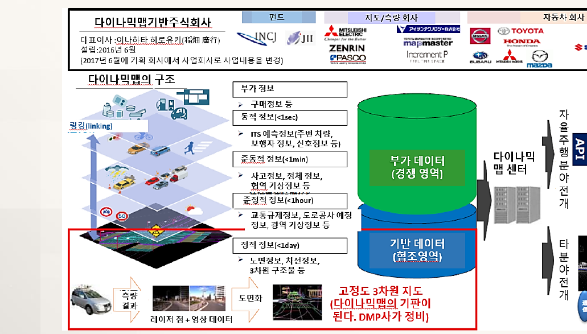

*Figure 20. Role of the dynamic map company in Japan*

The bottom of Figure 20 is the process of creating the base map. A survey vehicle collects laser point clouds and video data (measurement results), which are drawn into a high-definition 3D map. This high-definition 3D map becomes the base of the dynamic map, and DMP maintains it. The cylinder in the middle divides the data by character. The base data (static information) at the bottom are the **cooperative area** shared by the industry, and the additional data (dynamic, semi-dynamic, and semi-static information) at the top are the **competitive area** in which each company competes with services. The dynamic map center on the right provides data to the automated driving field through an API and also expands to other fields such as maintaining social infrastructure like road management.

> **Key Point:** Every company needs the base data of high-definition maps equally, but creating them is expensive. Therefore, the structure of creating the base data jointly (cooperative area) and competing with additional services on top of it (competitive area) reduces duplicate investment and helps standardize maps.

**Layers of the dynamic map.** The dynamic map is a digital map divided into four layers according to how often the information changes.

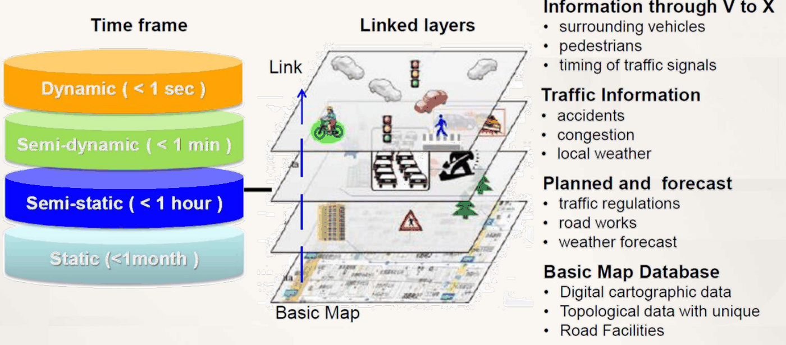

*Figure 21. The dynamic map layered by time frame*

| Layer | Update Period | Information | Examples |
|:-----|:-----|:-----|:-----|
| Dynamic | Less than 1 second | Information received through V2X | Surrounding vehicles, pedestrians, signal timing |
| Semi-dynamic | Less than 1 minute | Traffic information | Accidents, congestion, local weather |
| Semi-static | Less than 1 hour | Planned and forecast information | Traffic regulations, road works, weather forecasts |
| Static | Less than 1 month (sometimes given as 1 day) | Basic map database | Digital cartographic data, road surface and lane information, 3D structures, road facilities |

*Table 26. The four layers of the dynamic map*

The information of each layer is linked by location, so that semi-static, semi-dynamic, and dynamic information are overlaid on the static map. This structure follows the same idea as the four layers (permanent static, transient static, transient dynamic, and highly dynamic information) of the LDM defined by the European ETSI [29]. The LDM appears again in Section 3.6.

> **Definition:** An **LDM (Local Dynamic Map)** is a data store in which a vehicle or roadside unit gathers static map information about its surroundings and dynamic information received through V2X and sensors, referenced by location.

### 2.10 ITS Frequencies in Japan

Japan has allocated the area around 5.8 GHz mainly to ETC (corresponding to Korea's Hi-pass). Unlike the United States and Europe, which use the 5.9 GHz band for V2X, Japan's vehicle safety communication is characterized by using the 700 MHz band.

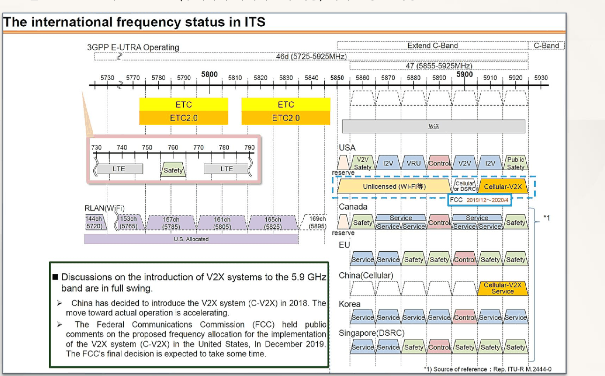

*Figure 22. International status of ITS frequencies*

Figure 22 is the arrangement of ITS frequencies in each country compiled by Japan's Ministry of Internal Affairs and Communications [30]. The scale at the top is 5,730-5,930 MHz, and above it the 3GPP E-UTRA operating bands 46d (5,725-5,925 MHz) and 47 (5,855-5,925 MHz) are marked.

1. **Japan:** ETC and ETC2.0 are placed in two blocks in the 5.8 GHz band, and as in the enlarged view on the left, a band for safety lies between LTE bands in the 700 MHz band (730-790 MHz). Wireless LAN (RLAN) channels also use part of the 5.8 GHz band.
2. **United States:** V2V safety, I2V, VRU, control, and public safety channels were placed in the 5.9 GHz band, and the figure marks the direction, discussed by the FCC from December 2019 to April 2020, of turning the lower band into unlicensed (Wi-Fi) use and the upper band into cellular V2X use.
3. **Canada, Europe, Korea, Singapore (DSRC):** Service, safety, and control channels are placed in the 5.9 GHz band.
4. **China:** The upper part of the 5.9 GHz band is allocated to cellular V2X services.

The text box in Figure 22 explains that discussions on introducing V2X systems into the 5.9 GHz band are in full swing. China decided to introduce C-V2X in 2018, accelerating the move toward actual operation, and the U.S. FCC held public comments in December 2019 on the proposed frequency allocation for introducing C-V2X, with the final decision expected to take some time. The later U.S. decision was summarized in Week 1.

### 2.11 Commercialization Scenarios and Demonstration Types

The Japanese government's Public-Private ITS Initiative/Roadmaps 2020 presented scenarios for commercializing automated driving in three branches, private vehicles, logistics services, and transport services (public transport), divided into short, medium, and long term [31].

| Branch | By FY2020 | Short Term (FY2021-2022) | Medium Term (FY2023-2025) |
|:-----|:-----|:-----|:-----|
| Private vehicles | Driver assistance on ordinary roads (Level 2), driver assistance and automated driving on expressways after large-scale testing (Levels 2, 3) | Sophistication of driver assistance systems (Levels 1, 2), promotion and expansion | Automated driving on expressways (Level 4), promotion |
| Logistics services | Development and testing | Truck platooning on expressways, driverless automated delivery services in specified areas | Automated driving trucks on expressways (Level 4) |
| Transport services | Driverless automated transport services in specified areas (Level 4) after public road testing in remote and underpopulated areas | Driverless automated transport services with remote monitoring only, driver assistance and automated driving of buses on expressways (Level 2 and above) | Expansion of target areas, operational design domains, and service scope of driverless transport services in specified areas (Level 4) |

*Table 27. Japan's scenarios for commercialization and service implementation of automated driving*

In Table 27, private vehicles raise the level step by step, while logistics and transport services start from Level 4 in restricted areas and widen the areas. This is the same idea as paths A and B of SIP phase 2 in Section 2.8. The long-term (FY2026 and later) goals are the reduction of traffic accidents, alleviation of congestion, and strengthening of industrial competitiveness for private vehicles, innovative streamlining of logistics responding to the era of population decrease for logistics services, and a society in which elderly people can move freely around the country for transport services.

**Nationwide demonstrations.** Japan pursued demonstrations nationwide in many forms, such as automated driving services based at expressway rest areas, last-mile automated driving, the Smart Mobility Challenge, roads within airports, smart cities, and demonstrations by individual local governments [31]. The demonstration map as of March 2020 (including plans) shows automated driving services based at roadside rest areas and similar hubs (MLIT and Cabinet Office: Kamikoani in Akita, Taiki in Hokkaido, Hitachiota in Ibaraki, Higashiomi in Shiga), last-mile automated driving (MLIT and METI: Eiheiji in Fukui, Chatan in Okinawa), truck platooning on expressways (platooning with driverless following vehicles on the Shin-Tomei Expressway and platooning with drivers on the Joshin-etsu Expressway), the Smart Mobility Challenge (Otsu in Shiga, Oita in Oita), a feasibility study of medium-sized automated buses, the SIP demonstration on general roads in the Tokyo waterfront area, automated driving in restricted airport zones (Narita, Haneda, Chubu, Kansai, and Saga airports), smart cities (Utsunomiya in Tochigi, Kashiwa in Chiba, Shimoda in Shizuoka, Kasugai in Aichi, Chiyoda and Koto in Tokyo), and individual demonstrations by local governments, private companies, and universities (17 sites, such as Kiryu in Gunma and Kuwana in Mie).

**Classification of demonstration types.** Because the vehicle platform needed differs by demonstration area, KATECH presented a decision procedure that divides demonstrations into five types according to the character of the operating space.

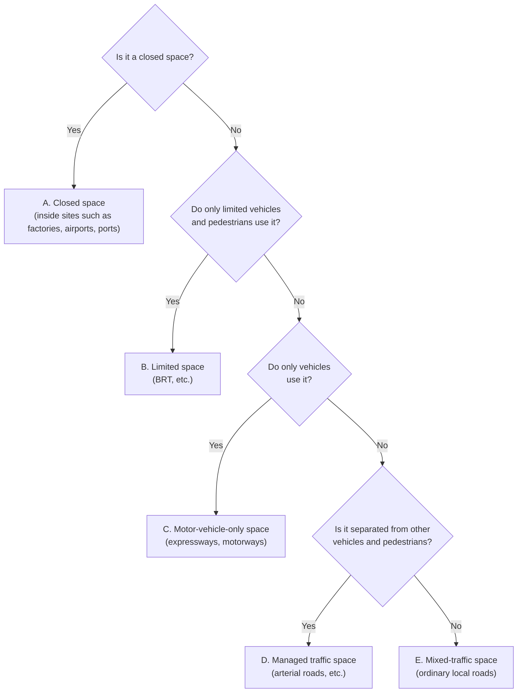

*Figure 23. Decision of automated driving demonstration types by operating space*

| Type | Vehicle Platforms for Moving People | Vehicle Platforms for Transporting Goods |
|:-----|:-----|:-----|
| A. Closed space | Shuttle, wheelchair, small bus (15 seats), medium bus (25 seats) | Small truck, large truck, delivery robot |
| B. Limited space | Large bus, medium bus (25 seats) | Not applicable |
| C. Motor-vehicle-only space | Passenger car, large bus, small bus (15 seats), medium bus (25 seats) | Large truck |
| D. Managed traffic space | Passenger car, shuttle, personal mobility (PM), small bus (15 seats), medium bus (25 seats) | Small truck, delivery robot |
| E. Mixed-traffic space | Passenger car, small bus (15 seats) | Small truck |

*Table 28. Vehicle platforms required by demonstration type*

Even for the same type, the required vehicle platform differs depending on the conditions of the actual driving environment and on whether people or goods are carried. The conditions to consider are shown in Table 29.

| Condition | Content |
|:-----|:-----|
| Vehicle speed | Automated driving speed (low, medium, high) |
| Terrain | Urban or mountainous, curve radius, uphill and downhill |
| Road | Number of lanes, presence of sidewalks, road markings, road surface condition (snow, etc.) |
| Environment | Weather (including front and back light), disaster situations |
| Traffic conditions | Traffic volume, congestion (on-street parking), presence of obstacles |
| Time of day | Day, night |

*Table 29. Conditions of the actual driving environment that affect the choice of vehicle platform*

### 2.12 Mobility for Low-Density and Urban Areas

Japan seeks to solve the social problems caused by aging and rural depopulation with automated mobility. ITS Japan viewed population distribution in two types and presented an operating plan for each.

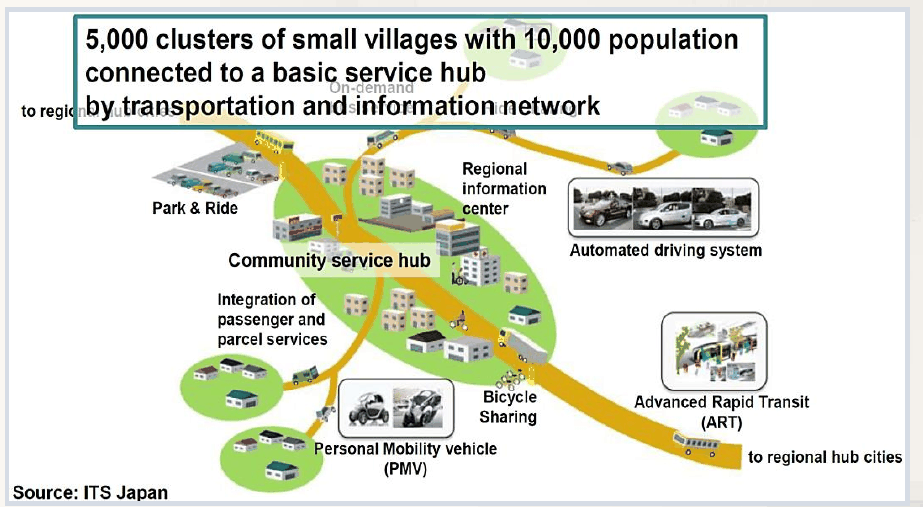

*Figure 24. Mobility concept for low-density areas*

**Low-density areas.** About 5,000 low-density villages with populations of 10,000 or fewer are expected to form. In such areas, existing commercial route buses cannot be operated because they are unprofitable. Therefore, as in Figure 24, small villages are connected to a basic service hub (community service hub) by transportation and information networks.

1. Driverless shuttle buses (ART, Advanced Rapid Transit, not the ART of Section 2.6) connect the hub and regional centers.
2. Automated taxis (robotaxis) connect scattered low-density residential areas.
3. Passenger transport and parcel delivery services are integrated to improve operating efficiency.
4. Personal mobility vehicles (PMV), bicycle sharing, and park and ride are used together.

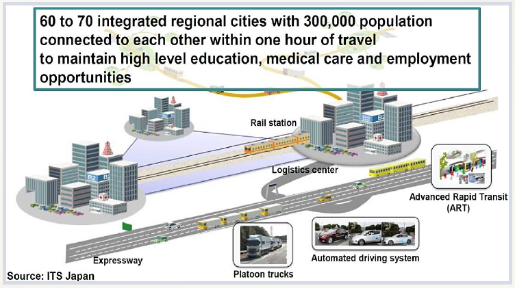

*Figure 25. Mobility concept for urban areas*

**Urban areas.** About 60-70 integrated regional cities with populations of 300,000 or more are expected to form. If dense areas within one hour of each other are connected and managed as integrated cities of 300,000 or more, high levels of education, medical care, and employment opportunities can be maintained. As in Figure 25, dense areas are connected with each other by rail and expressways (including truck platooning) and internally by automated taxis and ART, and logistics centers distribute freight.

### 2.13 Low-Speed Vehicle Demonstrations and Platooning

**Low-speed vehicle (LSV) demonstrations.** Japan carried out tests and demonstrations of low-speed automated vehicles (LSV, low-speed vehicles) in many regions across the country.

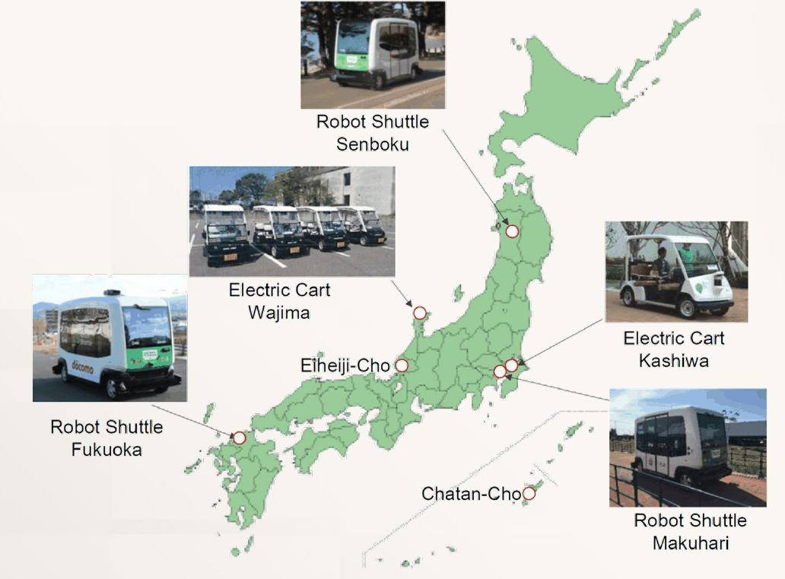

*Figure 26. Regions of tests and demonstrations of low-speed automated vehicles in Japan*

The map in Figure 26 marks demonstration sites: robot shuttles in Senboku (Akita Prefecture), Makuhari (Chiba Prefecture), and Fukuoka, electric carts in Wajima (Ishikawa Prefecture) and Kashiwa (Chiba Prefecture), Eiheiji-cho (Fukui Prefecture), and Chatan-cho (Okinawa Prefecture). Most take the form of shuttles or carts running along fixed routes at low speed.

**Classification of platooning.** Japan classified truck platooning as a combination of three components.

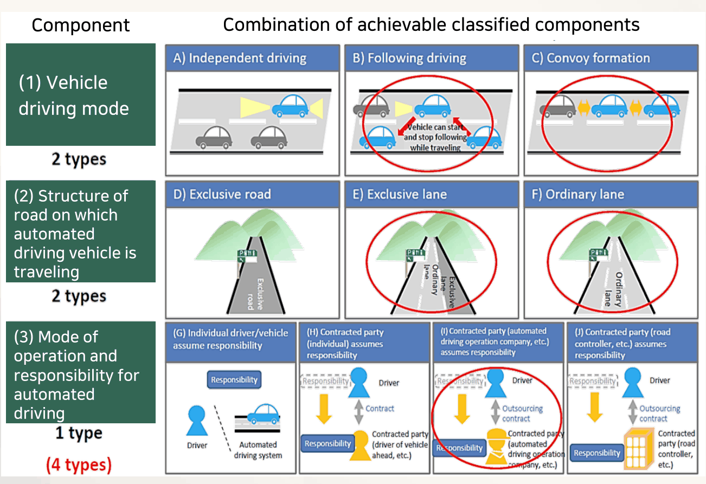

*Figure 27. Combinations of the components of platooning*

| Component | Options | Adopted |
|:-----|:-----|:-----|
| (1) Vehicle driving mode | A independent driving, B following driving (following can start and stop while traveling), C convoy formation | B, C (2 types) |
| (2) Structure of the road on which the automated vehicle travels | D exclusive road, E exclusive lane, F ordinary lane | E, F (2 types) |
| (3) Mode of operation and responsibility for automated driving | G individual driver or vehicle assumes responsibility, H contracted party (individual driver of the vehicle ahead) assumes responsibility, I contracted party (automated driving operation company, etc.) assumes responsibility, J contracted party (road controller, etc.) assumes responsibility | I (1 type) |

*Table 30. Components of Japan's classification of platooning*

Multiplying the options adopted for the three components gives $2 \times 2 \times 1 = 4$ draft concepts.

| Draft Concept | Driving Mode | Lane | Content |
|:-----|:-----|:-----|:-----|
| 1 | Following driving | Exclusive lane | In exclusive lanes, vehicles follow the vehicle operated by an automated driving operation company or the like |
| 2 | Following driving | Ordinary lane | In ordinary lanes, vehicles follow the vehicle operated by an automated driving operation company or the like |
| 3 | Convoy formation | Exclusive lane | In exclusive lanes, the vehicle operated by the operation company and multiple other vehicles form a convoy and travel together |
| 4 | Convoy formation | Ordinary lane | In ordinary lanes, the vehicle operated by the operation company and multiple other vehicles form a convoy and travel together |

*Table 31. Japan's four draft concepts of platooning*

The difference between following driving and convoy formation lies in how tightly the vehicles are coupled. In following driving, a following vehicle tracks the vehicle ahead and can leave or join the line while traveling, whereas in convoy formation several vehicles are bound into a single line and move together. The automated driving operation company was chosen as the responsible party because a business model was assumed in which the operator of the lead vehicle takes responsibility for the operation of the whole line.

**NEDO's truck platooning vehicle.** NEDO's Energy ITS project developed a heavy truck platooning vehicle.

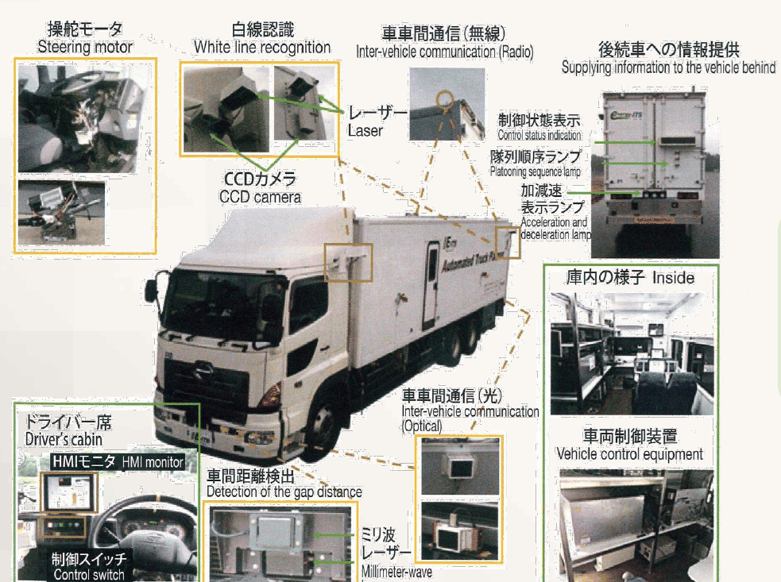

*Figure 28. Configuration of NEDO's truck platooning vehicle*

The truck in Figure 28 is equipped with a steering motor, a CCD camera that recognizes white lane lines, laser radar, millimeter-wave radar, a gap distance detector, radio and optical inter-vehicle communication devices, lamps that give information to the vehicle behind (control status indication, platooning sequence lamps, acceleration and deceleration indicator lamps), an HMI monitor and control switch at the driver's seat, and vehicle control equipment. This vehicle runs with CACC.

1. The distance between vehicles is adjusted by sharing speed and acceleration information through inter-vehicle communication.
2. The lateral motion (steering) of each vehicle is controlled so that steering safety is ensured even when several trucks are linked.

Inter-vehicle communication is duplicated in two forms, radio and optical, because a loss of communication at short gaps can lead to a rear-end collision.

> **Definition:** An **HMI (Human-Machine Interface)** consists of the displays, sounds, and controls through which people and machines exchange information.

The lessons from the European and Japanese cases are as follows. First, Europe used multinational projects and consortia to secure standards and spectrum shared by many countries and companies. Second, V2V is effective only when penetration reaches a certain level, so the limited speed of penetration must be compensated with infrastructure and aftermarket devices. Third, Japan built parts that everyone needs, such as the base data of maps, jointly as a cooperative area, and separated the paths of service vehicles and private vehicles to pursue both social problem solving and industrial competitiveness.

---

<br>

## 3. Connected Automated Driving in Korea

As seen in Section 1.2, Korea moved through national R&D programs such as u-Transportation and Smart Highway to the C-ITS pilot and demonstration projects. This section covers, in turn, the cross-ministry automated driving R&D program, the development projects of research institutes, projects linking road infrastructure, and proving grounds and demonstration projects.

### 3.1 The Autonomous Driving Technology Development Innovation Program

The **Autonomous Driving Technology Development Innovation Program** is a cross-ministry R&D program in which four ministries, the Ministry of Trade, Industry and Energy, the Ministry of Science and ICT, the Ministry of Land, Infrastructure and Transport, and the Korean National Police Agency, invest about KRW 1.1 trillion (KRW 1.0974 trillion) over seven years from 2021 to 2027. It consists of about 84 subprojects, and the **Korea Autonomous Driving Development Innovation Foundation (KADIF)**, launched in March 2021, manages the program [32]. The goal is to complete the foundation for commercializing converged Level 4+ automated driving by 2027.

| Field | Main Outputs | Technologies and Yearly Targets |
|:-----|:-----|:-----|
| Vehicle-converged new technology | Sensors, vehicle platforms | Four major perception and prediction sensors (2022 design, 2023 first prototype, 2024 second prototype, 2025 production of thermal imaging cameras, vari-focal cameras, lidar, and radar), AI computing platform (design, system integration, integration in a test vehicle, verification in an actual vehicle), automated vehicle platforms (2022 design of vans and buses, 2023 design of sedans and trucks, 2024 prototypes, 2025 van, 2026 medium bus, 2027 sedan and truck), automated driving safety design (accident risk analysis, verification of risk factors, safety standards compliant with SOTIF) |
| ICT-converged new technology | AI software, vehicle communication and security | Ultra-high-speed automated driving communication (2023 V2X infrastructure cooperative driving technology, 2024 advancement, 2026 V2X communication demonstration in actual vehicles), automated driving simulation, automated driving AI software (connected software design, AI cooperative automated driving, AI software demonstration in actual vehicles), automated driving network security (V2X communication security technology, advancement, 2027 security demonstration on actual vehicle platforms), verification of virtual software architecture |
| Road-traffic-converged new technology | Digital infrastructure, integrated control center, traffic safety facilities | Digital transportation infrastructure (2023 infrastructure information linkage standard, 2024 digital transportation infrastructure platform, 2025 application of the infrastructure platform standard), integrated control center (control center data standard, control system platform, integrated control cooperation standard), automated driving test beds (2023 selection of living lab target cities, 2024 open living lab design, 2025 site construction, 2026 operation, 2027 advanced operation), integrated mobility center (transportation management platform, mobility center prototype, integrated operation manual, mobility center international standard) |
| Automated driving services | Seven major public services | Support for the transportation-disadvantaged, emergency management, real-time traffic management, shared vehicles, emergency vehicle support, urban environment management, traffic patrol (each service proceeds through service technology development, service system development, and service demonstration) |
| Automated driving ecosystem | International standards, legal system, licensing system | International standards and legal system (2022 one standard and five legal items, 2023 three standards and eight legal items, 2024 five standards and fifteen legal items), driving and collision safety assessment (2023 safety test scenarios, 2024 safety test evaluation system, 2025 dynamic safety test evaluation criteria, 2026 draft urban road infrastructure safety standards), security stability assessment (2023 security level system, 2024 cybersecurity evaluation criteria, 2026 reorganization of legislation for automated driving), assessment of the driving ability of automated driving software (2024 driving ability evaluation guideline, 2025 driver coping ability scenarios, 2027 construction of a driving ability evaluation system) |

*Table 32. The five fields of the Autonomous Driving Technology Development Innovation Program*

> **Definition:** **SOTIF (Safety Of The Intended Functionality)** is a safety concept that deals with hazards that can arise even without a failure, because of the perception limits of sensors or unforeseen situations, and it is standardized as ISO 21448. It complements functional safety (ISO 26262), which deals with hazards caused by component failures.

The program proceeds in two steps. Step 1 (2021-2024) is a technology development step that secures the core component technologies of automated driving, and step 2 (2025-2027) is a step that advances and commercializes the technology through living lab demonstrations and infrastructure verification. The program passed its preliminary feasibility study in April 2020, and after the launch ceremony in March 2021, subprojects were started in turn: 53 in June 2021, 12 in May 2022, 18 in 2023, 3 in 2024, and 2 in 2025, and the results are verified in the order of simulation, test beds (2025-2026), and living labs (2026-2027). An expert council has also been operated since 2021.

> **Definition:** A **living lab** is an approach that uses real living spaces as laboratories to test and improve technologies and services in the environment in which ordinary citizens use them. It is closer to actual operating conditions than a test bed.

### 3.2 KATECH's Test Equipment and Development Projects

The Korea Automotive Technology Institute (KATECH) is a research institute that develops and evaluates components and systems for automated vehicles and connected cars. The institute was introduced in the Week 2 appendix.

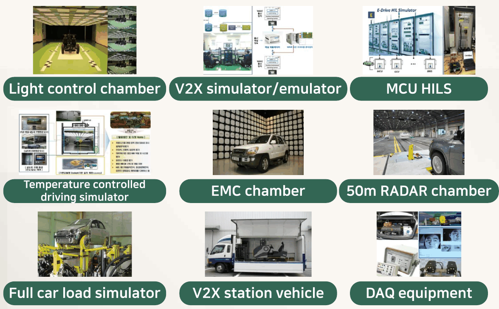

*Figure 29. KATECH's test equipment for automated driving*

The equipment in Figure 29 is used for the following purposes.

1. **Light control chamber:** It tests the recognition performance of camera sensors by changing the intensity and direction of light.
2. **V2X simulator and emulator:** It generates in the laboratory the V2X messages sent by many vehicles and roadside units to test communication devices.
3. **MCU HILS:** It tests control logic with the controller (MCU) as real hardware while the vehicle and environment are replaced by simulation.
4. **Temperature-controlled driving simulator:** It reproduces driving situations under various temperature conditions.
5. **EMC chamber:** It tests the electromagnetic emissions of electronic devices and their immunity to external electromagnetic waves.
6. **50 m radar chamber:** It tests the detection range and accuracy of radar in a space that prevents radio reflections.
7. **Full car load simulator:** It tests the vehicle and its components by emulating in the laboratory the loads acting on the whole vehicle.
8. **V2X station vehicle, data acquisition (DAQ) equipment:** They record V2X communication and vehicle data on real roads.

> **Definition:** **HILS (Hardware-In-the-Loop Simulation)** is a test method in which the hardware under test is actually connected while the rest of the system is replaced by real-time simulation. It is safer and easier to repeat than tests in actual vehicles.

> **Definition:** **EMC (Electromagnetic Compatibility)** is the property of a device not to cause electromagnetic interference to other devices and to operate normally under external interference.

The national projects related to automated driving that KATECH carried out or took part in are shown in Table 33.

| Project | Budget | Period | Performers |
|:-----|-----:|:-----|:-----|
| Development and service demonstration of an AI-based automated driving computing module | KRW 28.0 billion | 2019-2021 | About 20 institutions including Hyundai Mobis, KATECH, Seoul National University, Kookmin University, Inha University, and Hanyang University |
| Development of automated driving components and systems for large buses, pilot operation of eco-friendly hydrogen automated buses | KRW 28.6 billion | 2019-2021 | Solution Link and 12 other institutions, KATECH and a2z and 7 other institutions, Obigo and Seoul National University and 1 other institution |
| Development of base technology for automated shuttle demonstration to verify automated driving component performance | KRW 9.6 billion | 2018-2021 | KATECH, Maru ENG, Spring Cloud, Newtech, Fusion Soft, Advanced Institute of Convergence Technology |
| Development of mixed reality (virtual reality) based evaluation technology for automated driving components and systems | KRW 11.2 billion | 2022-2027 | KATECH, Hyundai Mobis and 4 SMEs, Korea Transport Institute, Hanyang University, Seoul National University, Kookmin University, KIAPI, KAAMI |
| Development of a next-generation network processor and integrated controller for future mobility | KRW 28.0 billion | 2021-2024 | Hyundai Mobis (lead), Telechips and 2 other institutions, KATECH and 3 other institutions |
| Development of integrated evaluation technology for T-Car-based automated driving perception and prediction and intelligent control vehicle components and systems | KRW 25.8 billion | 2022-2027 | KATECH (lead), Hyundai Mobis and 4 SMEs, Korea Transport Institute, Hanyang University, Seoul National University, Kookmin University, KIAPI, KAAMI |
| Development of infrastructure information fusion and management technology for real-time operation of traffic safety facilities | KRW 7.5 billion | 2021-2026 | KATECH, Seoul National University, Kookmin University, LG U+, Kanavi Mobility, Pine C&I, CNBIS |
| Development of a vehicle platform for hub-based Level 4 automated heavy trucks | KRW 13.0 billion | 2022-2027 | Woojin Industrial Systems (lead), KATECH, Autonomous a2z, Hanyang University, and others |
| Development of cooperative vehicle control technology based on fusion of surrounding environment information | KRW 12.0 billion | 2023-2027 | Inavi Systems, KATECH, CASELAB, ITTelecom, Autonomous a2z, Lotte Innovate, KAIST, Kongju National University, and others |
| Development of connected perception enhancement and cooperative automated driving technology for Level 4 automated vehicles | KRW 5.0 billion | 2023-2027 | ITTelecom (lead), CASELAB, KATECH, Inavi Systems, KAIST, Lotte Innovate |

*Table 33. KATECH's development projects related to automated driving*

> **Definition:** **T-Car** is a test vehicle platform for integrating autonomous driving parts and systems into one vehicle and evaluating them.

The projects in Table 33 range from core vehicle components (computing modules, network processors, sensor evaluation) through service vehicles such as buses, shuttles, and heavy trucks to the cooperation of infrastructure and vehicles (fusion of traffic safety facility information, cooperative vehicle control, perception enhancement). The last three projects are directly related to connected automated driving and are covered in detail in Sections 3.3 and 3.4.

### 3.3 Infrastructure-Linked Automated Driving: Fusing Traffic Safety Facility Information

Automated vehicles recognize traffic safety facilities such as traffic signals, safety signs, and road markings with cameras. However, recognition can fail when signs are hidden or road markings are worn, so automated driving becomes safer if infrastructure delivers the information of traffic safety facilities digitally and directly. Within the Autonomous Driving Technology Development Innovation Program, the Korean National Police Agency pursued three projects on traffic safety infrastructure technology for Level 4 automated driving.

| Project | Lead Institution | Period | Budget | Participants |
|:-----|:-----|:-----|-----:|:-----|
| (KNPA 1) Development of standards and evaluation technology for traffic safety infrastructure for Level 4 | Korea Road Traffic Authority | 2021-04 ~ 2026-12 (5 years 9 months) | About KRW 9.8 billion | KCL, KATECH, ITS Korea, KAIST, HNTech, Neighbor System |
| (KNPA 2) Development of enhanced traffic object perception and adverse condition resolution technology for Level 4 cooperative automated driving | Korea Institute of Civil Engineering and Building Technology | 2021-04 ~ 2025-12 (4 years 9 months) | About KRW 7.8 billion | LEDO, Novacos, Seoul Institute of Technology, Forum8, University of Seoul, BBMC |
| (KNPA 3) Development of infrastructure information fusion and management technology for real-time operation of traffic safety facilities | KATECH | 2021-04 ~ 2026-12 (5 years 9 months) | About KRW 7.4 billion | Pine C&I, Kookmin University, Seoul National University, Kanavi Mobility, CNBIS, LG U+ |

*Table 34. Projects of the Korean National Police Agency on traffic safety infrastructure for Level 4 automated driving*

The budget of (KNPA 3) is given both as KRW 7.5 billion (Table 33) and as about KRW 7.374 billion (KRW 7.0 billion of government funding and KRW 0.374 billion of private funding). The Korean National Police Agency, the Korea Institute of Police Technology (KIPoT), and KADIF are involved in the three projects. Of the three projects, (KNPA 3) builds a system that collects and processes the information of traffic safety facilities in real time and delivers it to automated vehicles.

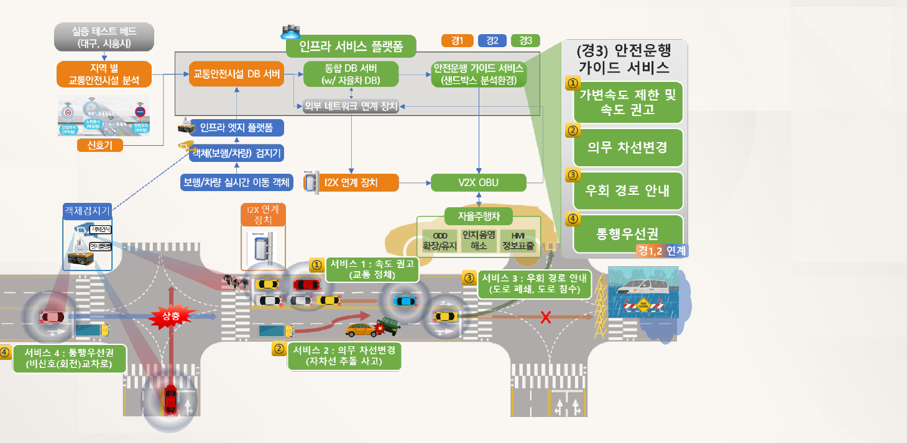

*Figure 30. Configuration of the infrastructure-linked safe driving guide service of the (KNPA 3) project*

The information flow in Figure 30 is as follows.

1. The traffic safety facilities of the test bed regions (Daegu, Siheung) are analyzed and stored in the traffic safety facility database server.
2. Traffic signals and object detectors send real-time movement information of pedestrians and vehicles to the infrastructure edge platform.
3. The integrated database server of the infrastructure service platform (including the automated vehicle database) fuses the information and creates the safe driving guide service in a sandbox analysis environment.
4. The service information is delivered to the V2X OBU of automated vehicles through the I2X interface device and V2X roadside units.
5. With this information, automated vehicles expand or maintain their operational design domain (ODD), resolve perception blind spots that the sensors cannot see, and present information to the driver through the HMI.

> **Definition:** An **edge platform** is a computing device that processes data first near the site before sending it to the central server, reducing latency.

> **Definition:** The **ODD (Operational Design Domain)** is the range of conditions, such as roads, weather, and speeds, under which an automated driving system is designed to operate properly.

There are four safe driving guide services.

| No. | Service | Applicable Situation |
|:-----|:-----|:-----|
| 1 | Variable speed limit and speed advice | Traffic congestion |
| 2 | Mandatory lane change | Rear-end crash in the own lane |
| 3 | Detour route guidance | Road closure, road flooding |
| 4 | Right of way | Non-signalized (roundabout) intersections (linked with the KNPA 1 and KNPA 2 projects) |

*Table 35. Safe driving guide services of the (KNPA 3) project*

**Three development items.** The (KNPA 3) project develops the following three items.

1. **Real-time traffic safety facility information management and operation server:** It collects the information of traffic safety facilities (embedded road markings, attached safety signs, traffic signals) and auxiliary traffic safety facilities through the I2X interface device (cellular, wired, RSU) and the infrastructure edge platform (receiving information, reprocessing big data, distributing). The service platform keeps a traffic safety facility database, a database of dynamic object information from the infrastructure edge, and a database of vehicle status information (PVD) of ordinary and automated vehicles, and provides the safe driving guide services of safe speed advice, route recommendation, lane change advice, and speed limits.
2. **Evaluation platform linking traffic safety facilities and automated vehicles:** It develops 10 driving safety scenarios from the vehicle and road viewpoints (driving on curves, vehicle reaction time in unexpected situations, throughput, deviations of speed and headway) and 50 evaluation scenarios linking traffic safety facility and vehicle information (use case definitions, reflecting the ODD and DDT), and builds two vehicle platforms for linked evaluation (vehicle 1 IONIQ Electric, vehicle 2 IONIQ 5) equipped with video sensors, lidar, radar, V2X communication modules, precise positioning modules, automated driving controllers, and infrastructure information display devices.
3. **Validity analysis and usage guidelines for traffic safety facility information:** From the viewpoints of automated vehicles and infrastructure, it defines the optimal information to be exchanged with the traffic safety center, analyzes the type, priority, time delay, and accuracy of information, and improves the format and period of information. It also develops V2X terminals and an information display HMI, carries out public road demonstrations on the Daegu test bed, and creates usage guidelines that improve the stability of ordinary and automated vehicles.

> **Definition:** The **I2X interface device** is a device that connects traffic safety facilities and communication networks in order to send infrastructure (I) information to vehicles and other devices (X).

> **Definition:** **PVD (Probe Vehicle Data)** is the probe information message, such as position, speed, and status, that a vehicle sends periodically.

> **Definition:** The **DDT (Dynamic Driving Task)** is the set of real-time tasks of driving a vehicle, such as steering, acceleration and deceleration, and monitoring the surroundings.

The (KNPA 3) project proceeds in stages over six years. The key points of the yearly plan are shown in Table 36.

| Item | Years 1-2 | Years 3-4 | Years 5-6 |
|:-----|:-----|:-----|:-----|
| Automated test vehicles | Design, integration of vehicle 1 (IONIQ Electric) with the infrastructure-linked vehicle system | Temporary operation permit for vehicle 1, purchase and development of vehicle 2 (IONIQ 5) | Validation of infrastructure-to-vehicle (I2V) information use, test bed demonstration |
| Infrastructure-vehicle linking server | Development of the information system between infrastructure and vehicles and the service platform server | Building the traffic safety facility linking server (integrated interface of KNPA 1, 2, 3), building the integrated test bed on site | Advancement of platform services, application of the safe driving guide service, guidelines for the real-time linking system |
| Infrastructure-linked scenarios | Information fusion evaluation scenarios (10 per year), 10 safe driving scenarios from the road viewpoint, concept of infrastructure-based vehicle control | Service-based automated vehicle evaluation scenarios, definition of the safe driving guide service | I2V linked control (services for Level 4, right of way, integrated demonstration) |
| Demonstration test bed | Study of methods for demonstrating traffic safety facilities and analyzing information validity | Selection of linked infrastructure and installation sites, advancement of linked demonstration scenarios (Daegu, etc.) | Demonstration of services for Level 4, integrated demonstration of traffic safety facilities |
| Guidelines | Offline digital twin implementing V2I linked situations, information requirements and linking with high-definition maps | Defining the priority of collected information, data validation, diagnosis of abnormal traffic states, I2V linking technology | Verification of linking with high-definition maps and V2X, definition of optimal collected information, deriving usage strategies and guidelines |
| V2X terminal | Design and prototype of a WAVE and LTE hybrid terminal | Optimization of the hybrid terminal, WAVE and 5G hybrid prototype | Optimization of WAVE and LTE and WAVE and 5G terminals |
| Driver HMI | Draft design of the occupant interface | Prototype of the information display and display tests | Integration of Level 4 automated driving with the driver, linking and advancing the safe driving guide service |

*Table 36. Yearly plan of the (KNPA 3) project*

> **Definition:** **WAVE (Wireless Access in Vehicular Environments)** is the vehicle communication method that uses IEEE 802.11p, an adaptation of the wireless LAN standard IEEE 802.11 to the vehicular environment; it is a form of DSRC in the broad sense.

> **Definition:** A **digital twin** is a model that reproduces real roads and facilities exactly in virtual space. It allows the flow of information and the effect of services to be tested in advance without closing real roads.

The key results of step 1 (year 3) include two test vehicles, the infrastructure service platform (ISF), the linking system between field devices and the ISF, 30 cumulative evaluation scenarios, a demonstration linking the offline digital twin with the traffic safety center, a prototype of the WAVE and LTE hybrid terminal, and an HMI display. As final results, two test vehicle platforms for traffic safety facility infrastructure information, the traffic safety facility infrastructure information service platform, guidelines for the real-time linking system, a definition document for the safe driving guide service, 50 evaluation scenarios, 10 safe driving scenarios, definition documents for optimal information provision and collection, an evaluation report on the applicability and validity of traffic safety facility information for vehicles, information usage guidelines, a prototype of the WAVE and cellular hybrid terminal, and an HMI display providing traffic safety facility information were planned.

### 3.4 V2V-Based Cooperative Vehicle Control

The (MOTIE 25) project of the Ministry of Trade, Industry and Energy, development of cooperative vehicle control technology based on fusion of surrounding environment information, aims at cooperative automated driving that goes beyond the limits of the vehicle's own sensors by sharing the sensor information of surrounding vehicles over V2V.

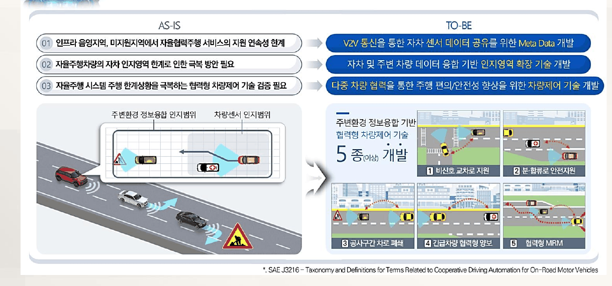

*Figure 31. Current state and goals of the cooperative vehicle control project*

The top of Figure 31 matches the current limits (AS-IS) with the goals (TO-BE).

| Current Limits (AS-IS) | Goals (TO-BE) |
|:-----|:-----|
| In infrastructure shadow areas and unsupported areas, it is difficult to support cooperative automated driving services continuously | Develop metadata for sharing the vehicle's own sensor data over V2V communication |
| Automated vehicles have limits in the perception area of their own sensors, and ways to overcome them are needed | Expand the perception area by fusing the data of the own vehicle and surrounding vehicles |
| Cooperative vehicle control technology that overcomes the driving limit situations of automated driving systems needs to be verified | Develop vehicle control technology that improves driving convenience and safety through the cooperation of multiple vehicles |

*Table 37. Current limits and goals of the cooperative vehicle control project*

The lower left of Figure 31 shows the expansion of the perception area. With the perception range of the own vehicle's sensors (small area), the work zone hidden behind the vehicle ahead cannot be seen, but with the perception range fused with surrounding vehicles (large area), it can. The lower right shows five or more cooperative vehicle control technologies.

1. Support for passing non-signalized intersections
2. Safety support at diverging and merging sections
3. Response to lane closures in work zones
4. Cooperative yielding for emergency vehicles
5. Cooperative MRM

> **Definition:** An **MRM (Minimal Risk Maneuver)** is the maneuver that an automated driving system performs in a failure or limit situation to bring the vehicle to the minimal risk condition (MRC).

> **Definition:** A **cooperative MRM (C-MRM)** performs the MRM more safely in cooperation with surrounding vehicles, for example when surrounding vehicles slow down or make room while a failed vehicle pulls over to the shoulder.

This project refers to SAE J3216 for the terms and classification of cooperative driving automation (CDA) [33]. J3216 divides the level of cooperation into four classes: status-sharing (class A), intent-sharing (class B), agreement-seeking (class C), and prescriptive (class D), and the details are covered in Week 11.

The final goals of the project are threefold.

1. Develop an N2N cooperative control module centered on the N2N (many vehicles to many vehicles) control module of the V2V-based automated driving system.
2. Install and link V2V-based data fusion software for the own and surrounding vehicles on the cognition range expansion (CRE) module of a Ministry of Science and ICT project.
3. Improve performance with peripheral modules such as the V2V-CRE module, the RTK/INS positioning module, and the LLM module, and verify with actual vehicles on proving grounds (PG), public roads, and living labs.

> **Definition:** **RTK (Real-Time Kinematic)** is a technique that reduces satellite positioning errors to a few centimeters using correction information from a reference station at a known position.

> **Definition:** An **INS (Inertial Navigation System)** is an inertial navigation device that estimates changes in position and attitude from accelerometer and gyroscope measurements.

| Technology Area | Content | Participants |
|:-----|:-----|:-----|
| Perception area expansion | Embedded optimization to extend the perception limit distance, tracking objects in shadow areas using surrounding vehicle information | Inavi Systems, CASELAB |
| Cooperative positioning and path optimization | High-precision cooperative positioning using surrounding vehicle sensor information, path optimization based on tracking objects in shadow areas | Inavi Systems, CASELAB, Kongju National University, MBC |
| V2V-based N2N cooperative automated driving control | Optimal driving maneuvers according to the behavior and driving intent of surrounding vehicles, optimization of C-MRM in response to failures | CASELAB, KAIST, Kongju National University |
| Verification of cooperative automated driving in actual vehicles | Verification environment and test procedure (TDP) for actual vehicles, verification of cooperative driving on test roads and living labs | Inavi Systems, CASELAB, KATECH, ITTelecom |
| Cooperative automated driving vehicle platform | Time gap compensation and synchronization of own and surrounding vehicle data, three sidelink V2V communication vehicle platforms | Inavi Systems, CASELAB, ITTelecom, Lotte Innovate, KATECH |
| Requirements for cooperative automated driving | Use cases and scenarios of cooperative automated driving, 12 or more metadata types for exchanging V2V messages | KATECH, KAIST, Kongju National University |

*Table 38. Technology areas of the cooperative vehicle control project*

> **Definition:** A **sidelink** is the link in C-V2X over which devices communicate directly without going through a base station; it uses the PC5 interface.

**Design of the vehicle platform in year 1.** In designing the cooperative automated driving vehicle platform, KATECH carried out the following.

1. **Securing test vehicles and components:** It secured two electrically driven test vehicles and, together with the participating institutions, secured 10 sets of lidar and 8 sets of radar, while the procurement of 10 sets of cameras was in progress.
2. **Designing the automated driving system architecture:** Together with the participating institutions it fixed the sensor layout, designed the network topology of in-vehicle CAN, Ethernet (UDP, TCP/IP), and serial communication, and designed the power supply and wiring. The power distribution diagram takes the 12 V supply that the LDC (low-voltage DC-DC converter) produces from the high-voltage battery and splits it through a DC isolator into two auxiliary 12 V batteries: one feeds 5 lidars, 5 radars, 7 cameras, the GNSS/INS, and the V2X OBU, and the other feeds the controller (CADM, 12 V/500 W) and an inverter (laptop 300 W, other devices 100 W). The lines to the sensor groups are labeled 75 W for the lidars, 27 W for the radars, and 16 W for the cameras.
3. **Writing the modification specification:** It created a vehicle integrated management modification specification covering a layout that secures sensor performance, minimal changes to the vehicle exterior, maintenance and repair of the installed systems, and verification methods for individual requirements.

Reading each labeled value as the power of the whole sensor group, the total power consumption of the sensors is as follows.

```math
75 + 27 + 16 = 118\ \text{W}
```

If each labeled value is instead read as the power of a single sensor, the total becomes $5 \times 75 + 5 \times 27 + 7 \times 16 = 375 + 135 + 112 = 622$ W, so an actual design must confirm which reading is correct from the device specifications. The 118 W of the group reading corresponds to about $118 / 12 \approx 9.8$ A at 12 V, and the total labeled power including the controller and inverter loads, $118 + 500 + 300 + 100 = 1018$ W, corresponds to about $1018 / 12 \approx 85$ A. Because the currents are this large, a modified vehicle needs a separate auxiliary battery and power distribution design. Network topologies such as CAN and Ethernet were covered in Weeks 3, 6, and 9.

### 3.5 UTIS-Linked Communication Technology

KATECH also developed **UTIS-linked communication technology and an urban traffic safety support service**. The project builds a service system that supports traffic safety in cities using UTIS.

> **Definition:** **UTIS (Urban Traffic Information System)** is the traffic information system that the Korean National Police Agency built on urban roads. Roadside equipment (RSE, the same as an RSU) at the roadside and on-board equipment (OBE) in vehicles communicate wirelessly, so that the driving speed and position measured by vehicles are collected at the center and the traffic information processed by the center is sent back down to vehicles.

UTIS already has roadside equipment and communication networks installed throughout cities, so linking it with V2X services makes it possible to provide urban traffic safety services without laying all new infrastructure.

### 3.6 The Smart Road System for Cooperative Automated Driving

The **Development of Advanced Infra Systems for Automated Driving (C-AHS)** of the Ministry of Land, Infrastructure and Transport (written MLIT in the source material) is a project that developed a system in which road infrastructure supports automated vehicles.

| Item | Content |
|:-----|:-----|
| Budget | USD 27.5 million (including private funding) |
| Period | 5 years (2015-2020) |
| Demonstrations | 2 on public interstate highways (4 cars) |
| Development content | LDM based on a precise digital map, seamless V2X communication module, real-time road traffic information collection systems, improvement of road structure for precise positioning and sensor perception, road structure construction manual for automated driving |

*Table 39. Overview of the smart road system for cooperative automated driving project*

> **Note:** The MLIT that led this project is Korea's Ministry of Land, Infrastructure and Transport (MOLIT). The same abbreviation MLIT also refers to Japan's Ministry of Land, Infrastructure, Transport and Tourism, so the two institutions should not be confused.

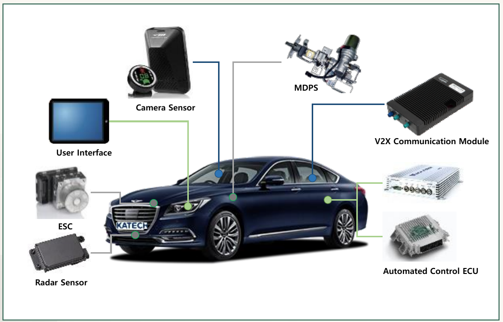

*Figure 32. Configuration of KATECH's cooperative automated driving test vehicle*

The test vehicle in Figure 32 is equipped with a camera sensor, a radar sensor, a V2X communication module, an automated control ECU, and a user interface, and the automated control ECU controls the motor driven power steering (MDPS) and electronic stability control (ESC). In the same project, other participating companies also built their own test vehicles (company R, company H, company S), equipped with components such as front cameras, around view cameras, side cameras, front and rear-side radars, lidar, and industrial PCs.

> **Definition:** **MDPS (Motor Driven Power Steering)** is a device that assists steering with an electric motor; because the steering angle can be controlled by electrical signals, it is used for lateral control in automated driving.

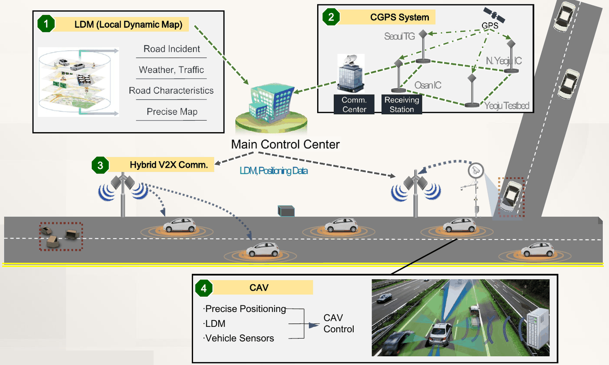

*Figure 33. Configuration of the smart road system for cooperative automated driving*

The system in Figure 33 consists of four elements.

1. **LDM (Local Dynamic Map):** It manages road incident, weather and traffic, and road characteristic information overlaid on a precise map.
2. **CGPS system:** Reference stations at the Seoul tollgate, Osan IC, North Yeoju IC, and the Yeoju test road generate correction information for satellite positioning and distribute it through the communication center and receiving stations.
3. **Hybrid V2X communication:** It delivers the LDM information and positioning correction information of the main control center by hybrid V2X communication between roadside units and vehicles.
4. **CAV (connected and automated vehicle):** It controls the vehicle by combining precise positioning, the LDM, and vehicle sensors.

> **Definition:** A **CGPS system** is a system in which reference stations whose positions are precisely known compute the errors of satellite signals and generate and distribute correction information. Vehicles apply this correction information to improve positioning accuracy. The source material does not spell out the abbreviation.

> **Definition:** A **CAV (Connected and Automated Vehicle)** is an automated vehicle that exchanges information with nearby vehicles and infrastructure through V2X communication.

The system architecture inside the vehicle is shown in Figure 34.

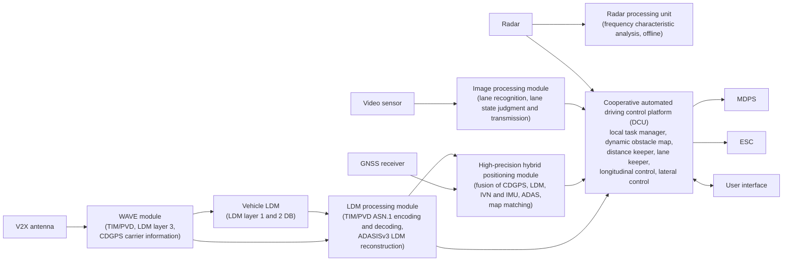

*Figure 34. System architecture of the cooperative automated driving vehicle*

In Figure 34, information received through V2X passes through the WAVE module and is organized into the LDM, and the high-precision positioning module fuses satellite positioning, correction information, and vehicle sensors to fit the vehicle's exact position onto the map. In the control platform (DCU), the local task manager decides the task suited to the service situation, the distance keeper and lane keeper functions produce targets based on the dynamic obstacle map, and the longitudinal and lateral control logic send commands to the ESC and MDPS.

The LDM processing module reconstructs the decoded information into map form and passes it to the positioning module and the control platform, and the positioning module adds the values of the vehicle's inertial sensor to compute the position.

> **Definition:** **CDGPS (Carrier-phase Differential GPS)** is a correction method that also uses the carrier phase of satellite signals relative to a reference station, achieving positioning accuracy of a few centimeters.

> **Definition:** **ASN.1 (Abstract Syntax Notation One)** is a standard notation that defines the structure of messages independently of the machine and encodes them as binary data; V2X messages such as SAE J2735 use it.

> **Definition:** **ADASIS (ADAS Interface Specification)** is the standard interface that delivers the road-ahead information of a map to ADAS controllers.

> **Definition:** An **IMU (Inertial Measurement Unit)** is an inertial measurement device that measures acceleration and angular velocity.

**Comprehensive performance evaluation.** The project carried out a comprehensive performance evaluation to check whether cooperative automated driving services actually succeed.

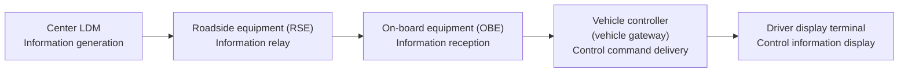

*Figure 35. Steps for checking service success in the comprehensive performance evaluation*

The evaluation concept is as follows. When the roadside equipment sends information such as TIM and RSA generated by the center LDM to the on-board equipment, the evaluation first checks whether the vehicle received the information, then whether the controller and display terminal used the information, and then whether the vehicle actually moved in accordance with the information in the control section so that the service succeeded. The result of each step is judged by collecting and analyzing logs on the vehicle side.

> **Definition:** **RSA (Roadside Alert)** is an SAE J2735 message that briefly reports roadside hazards such as construction, accidents, and road surface dangers.

The first comprehensive performance evaluation section is about 7 km from Yangji IC to Deokpyeong IC. The comprehensive performance evaluation section, made up of 10 services (one round trip), was driven 22 round trips, and after vehicle-level considerations such as power, communication speed, and vibration were applied, an integrated test of the LDM, V2X, and vehicles was carried out. The results are shown in Table 40.

| Symbol | Judgment Criterion | Result (Times) | Ratio (%) |
|:-----|:-----|-----:|-----:|
| O | The expected message was received without confusion (duplicate reception of the same message allowed) | 196 | 89.1 |
| △ | A wrong message was received together with the expected message | 13 | 5.9 |
| X | The expected message was not received | 11 | 5.0 |
| Total | | 220 | 100.0 |

*Table 40. Results of the comprehensive performance evaluation of the smart road system for cooperative automated driving*

The total number of trials is $10 \times 22 = 220$ because 10 services were driven 22 round trips. Each ratio is the number of results divided by 220; for example, O is $196 / 220 \approx 0.891$, that is, 89.1%. Adding the three results gives $196 + 13 + 11 = 220$ trials. Because the cases in which the message was not received or a wrong message was mixed in add up to about 10.9%, it can be seen that controlling vehicles with V2X information alone in a real road environment requires decision logic that prepares for reception failures and errors (for example, cross-checking with sensor information).

### 3.7 Public Road Test Sections and Proving Grounds

Korea has several public road sections and proving grounds (PG) where automated driving and V2X can be tested.

| Public Road Test Section | Size |
|:-----|-----:|
| Pangyo Zero City | 19 km |
| Daegu area highway | 15 km |
| Daegu Alpha City | 980,000 m² |
| Gyeongbu Expressway | 7 km |
| Gyeongbu Expressway | 40 km |
| Daejeon and Sejong C-ITS test bed | 87.8 km |

*Table 41. Public road test sections for automated driving in Korea*

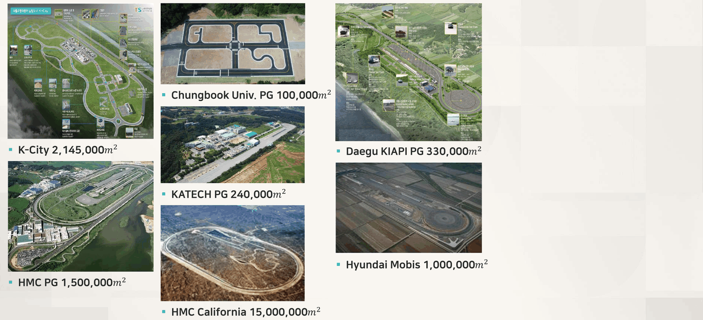

*Figure 36. Proving grounds for automated driving in Korea*

| Proving Ground | Area |
|:-----|-----:|
| K-City (KATRI of the Korea Transportation Safety Authority) | 2,145,000 m² |
| Hyundai Motor proving ground | 1,500,000 m² |
| Chungbuk National University proving ground | 100,000 m² |
| KATECH proving ground | 240,000 m² |
| Hyundai Motor California proving ground | 15,000,000 m² |
| Korea Intelligent Automotive Parts Promotion Institute (KIAPI) proving ground, Daegu | 330,000 m² |
| Hyundai Mobis proving ground | 1,000,000 m² |

*Table 42. Proving grounds for automated driving of Korean institutions and companies*

> **Note:** The area of K-City itself was reported to be about 320,000 m² [34], so the 2,145,000 m² in Table 42 is best read as the size of the whole KATRI proving ground complex in which K-City is located.

Proving grounds allow dangerous scenarios to be tested repeatedly in a controlled environment without ordinary vehicles, and public road sections allow systems to be verified amid real traffic and infrastructure. The two environments complement each other.

### 3.8 K-City

**K-City (an experimental city for automated driving)** is a dedicated proving ground for automated driving built at the Korea Automobile Testing and Research Institute (KATRI) of the Korea Transportation Safety Authority in Hwaseong, Gyeonggi Province.

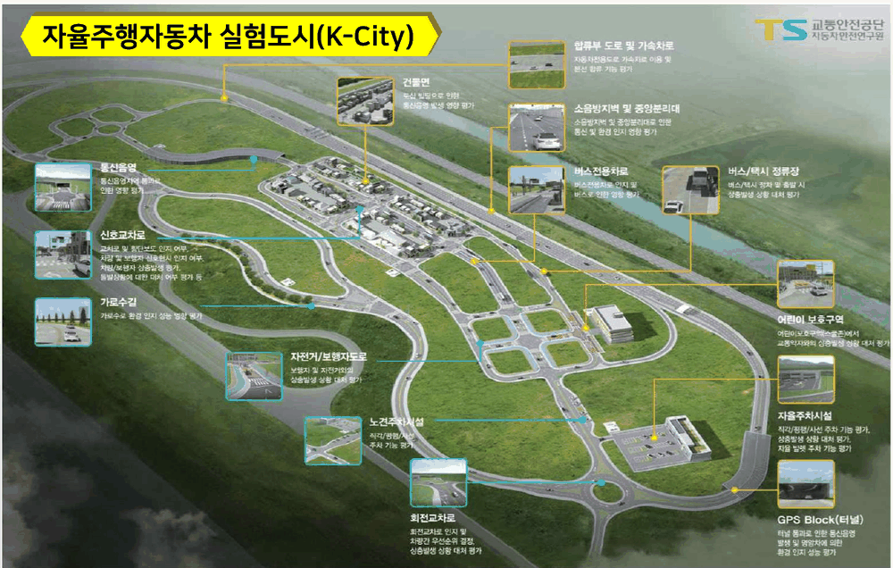

*Figure 37. Overall view of K-City, the experimental city for automated driving*

K-City reproduces real road environments in five zones.

| Zone | Facilities |
|:-----|:-----|
| Urban roads | 7 signalized intersections, 1 bus-only lane, 4 building facades, 2 bus and taxi stops |
| Community roads | 2 signalized intersections, 5 non-signalized intersections, 1 school zone, 1 roundabout, 1 bicycle road, 1 pedestrian road, 1 shoulder parking facility |
| Motorway | 1 driving lane, 3 gates, 1 median barrier, 1 noise barrier, 2 diverging and merging sections |
| Suburban roads | 2 signalized intersections, 4 non-signalized intersections, 1 communication shadow area, 1 GPS blockage (tunnel), 1 tree-lined road, 1 construction road, 1 roundabout, 1 railroad crossing |
| Automated parking facility | 1 automated parking facility |

*Table 43. Zones and facilities of K-City*

It is important that communication shadow and GPS blockage zones were built on purpose. Connected automated driving depends on communication and satellite positioning, so how the system responds when these are cut off must be tested.

The basic design plan of K-City set out the review items for each zone as follows. The urban road zone has a new four-lane signalized intersection (120 m), a bus-only lane widened from two to four lanes (260 m), building facades formed by four building blocks, and a new two-lane bus and taxi stopping facility (170 m). The community road zone has a signalized intersection with added sidewalks and bicycle paths (400 m), a roadside parking facility on a road widened from two to four lanes (70 m), and a school site with a school zone. The suburban road zone has a new two-lane signalized intersection (75 m), a roundabout, a new tunnel section (100 m), a new connecting section at a non-signalized intersection (60 m), a tree-lined road with green space, and narrow alleys. The high-speed road zone has a merge within a connecting ramp (170 m), smart tolling systems at two sites, noise barriers, guardrails, and a median, and tollgates at two sites (five main lanes plus four ramp lanes). The automated parking facility converts the existing parking facility and adds a two-story parking structure, and the road traffic facilities include field systems such as the signal control system, the CCTV system, and roadside units (RSU), together with the center hardware and software.

**The Hwaseong experimental city for automated driving project.** The K-City construction project is outlined as follows.

1. **Period:** June 2016-June 2019
2. **Purpose:** Demonstrate automated driving performance in various automated driving scenarios and evaluate safety in case of failures.
3. **Scope:** In line with 2020, the expected time of automated vehicle commercialization, it includes highway-based automated driving technology and automated parking technology.
4. **Cooperation:** In cooperation with SK Telecom, it builds a proving ground with 3D high-definition maps, quantum cryptography, 5G, and AI functions. SK Telecom demonstrated cooperative driving of two 5G automated vehicles in early February 2018 [35], and the Korea Transportation Safety Authority built the K-City infrastructure.

K-City was completed in December 2018 and opened to companies, universities, and research institutes developing automated vehicles.

### 3.9 C-ITS Pilot and Demonstration Projects

**C-ITS pilot project.** The Ministry of Land, Infrastructure and Transport carried out the C-ITS pilot project around Daejeon and Sejong from July 2014 to July 2017. It defined 15 services that needed to be introduced first and applied them to an 87.8 km section of expressways, national roads, urban roads, and so on.

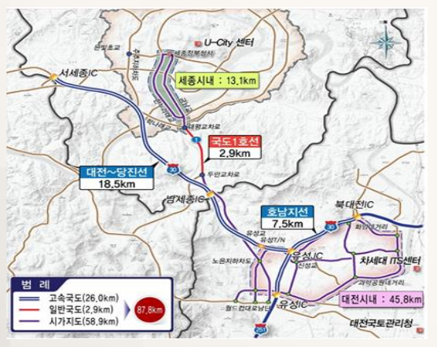

*Figure 38. Construction area of the C-ITS pilot project*

Adding the section lengths in Figure 38 gives the total length. Expressways total 26.0 km, the Daejeon-Dangjin line (18.5 km) plus the Honam branch line (7.5 km); national roads total 2.9 km on National Route 1; and urban roads total 58.9 km, downtown Sejong (13.1 km) plus downtown Daejeon (45.8 km).

```math
26.0 + 2.9 + 58.9 = 87.8\ \text{km}
```

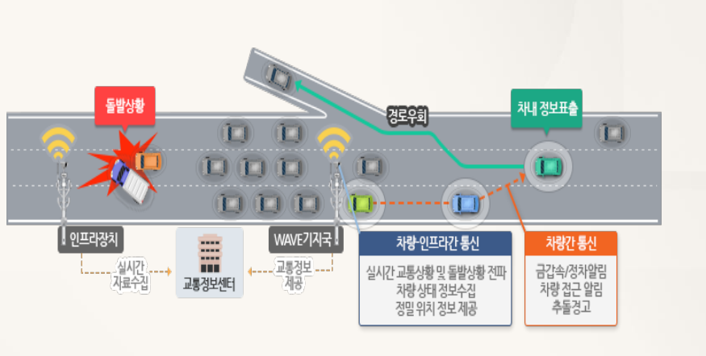

*Figure 39. Service concept of the C-ITS pilot project*

Figure 39 is the operating concept of C-ITS. Infrastructure devices on the road collect real-time data and send them to the traffic information center, and the traffic information center sends traffic information to WAVE base stations. When an unexpected incident occurs ahead, vehicle-to-infrastructure communication spreads real-time traffic conditions and incident information, collects vehicle status information, and provides precise position information. Vehicle-to-vehicle communication exchanges notifications of hard deceleration and stops, approaching vehicle notifications, and rear-end collision warnings. A vehicle that receives the information can display it inside the vehicle and take a detour.

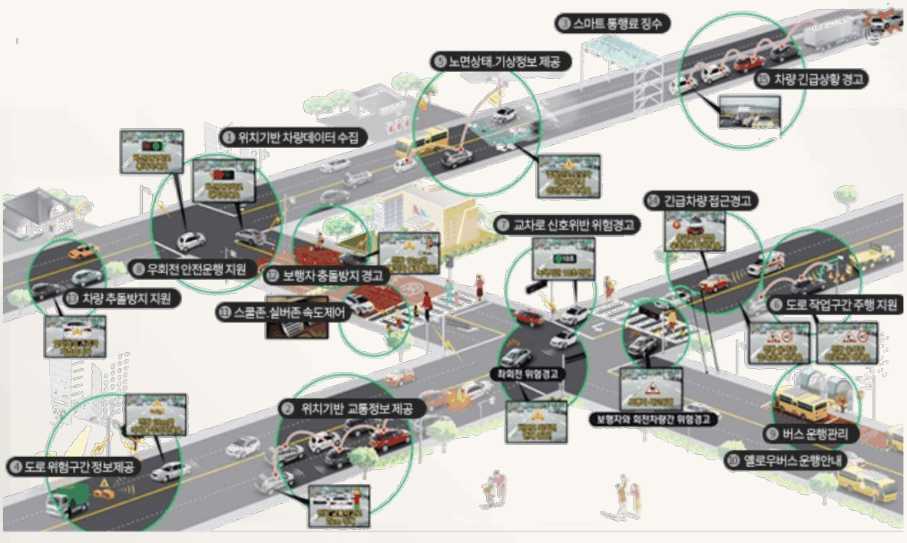

*Figure 40. The 15 C-ITS services of the Ministry of Land, Infrastructure and Transport*

| No. | Service | No. | Service |
|:-----|:-----|:-----|:-----|
| 1 | Location-based vehicle data collection | 9 | Bus operation management |
| 2 | Location-based traffic information provision | 10 | Yellow bus (school bus) operation guidance |
| 3 | Smart toll collection | 11 | Speed control in school zones and silver zones |
| 4 | Road hazard section information provision | 12 | Pedestrian collision prevention warning |
| 5 | Road surface condition and weather information provision | 13 | Vehicle rear-end collision prevention support |
| 6 | Driving support in road work zones | 14 | Emergency vehicle approach warning |
| 7 | Intersection signal violation hazard warning | 15 | Vehicle emergency warning |
| 8 | Right turn safe driving support | | |

*Table 44. The 15 C-ITS services of the Ministry of Land, Infrastructure and Transport*

Figure 40 also marks, without numbers, the left turn hazard warning and the hazard warning between pedestrians and turning vehicles. The 15 services overlap considerably with the V2V and V2I services of the U.S. VSC seen in Section 1.6, but they include services tailored to Korea's traffic environment, such as yellow bus operation guidance and speed control in school and silver zones.

**C-ITS demonstration projects.** Following the pilot project, regional demonstration projects were carried out from 2018.

| Item | Seoul C-ITS Demonstration (MOLIT and Seoul Metropolitan Government) | Jeju Special Self-Governing Province C-ITS Demonstration | Expressway C-ITS Demonstration |
|:-----|:-----|:-----|:-----|
| Period | 2018-01 ~ 2020-12 | 2018-01 ~ 2020-12 | 2018-05 ~ 2019-09 |
| Overview | Building a cooperative automated driving pilot zone in the Sangam DMC area | Developing and implementing 15 basic C-ITS services and 4 Jeju-specific services on 300 km of main roads | Building C-ITS infrastructure on a total 85 km section and distributing C-ITS terminals to 500 commercial vehicles (buses, freight trucks) |
| Goal | Preparing Seoul's future transportation by converging various communication infrastructures such as WAVE, C-V2X, and 5G | Building LTE-WAVE V2X that combines LTE and WAVE and developing an LTE-based precise positioning solution | Developing and verifying 17 C-ITS services suited to the actual expressway environment |

*Table 45. C-ITS demonstration projects in Korea*

The three demonstration projects tested different environments (dense downtown, the wide-area road network of a tourist region, expressways) and different communication methods. Seoul is characterized by the convergence of several communication methods, Jeju by the combination of LTE and WAVE, and the expressway project by the deployment of terminals centered on commercial vehicles. As seen in Week 1, this experience became the background of the process in which LTE-V2X was chosen as the single communication method for C-ITS in December 2023.

### 3.10 Pangyo Zero City

The **Pangyo Zero City automated driving demonstration complex project** built an automated driving demonstration complex in the second Pangyo Techno Valley (Zero City) in Seongnam, Gyeonggi Province.

1. **Period:** November 2015-December 2019
2. **Goal:** Create a 5G pilot network and infrastructure to make the world's first 5G automated driving demonstration complex targeting a residential area.
3. **Communication:** Provide a hybrid V2X network service that can use dedicated LTE with enhanced security and WAVE at the same time.
4. **Participating companies:** KT builds the hybrid V2X network service and the 5G pilot network, and Chemtronics provides hybrid V2X terminals that can use both LTE and WAVE.

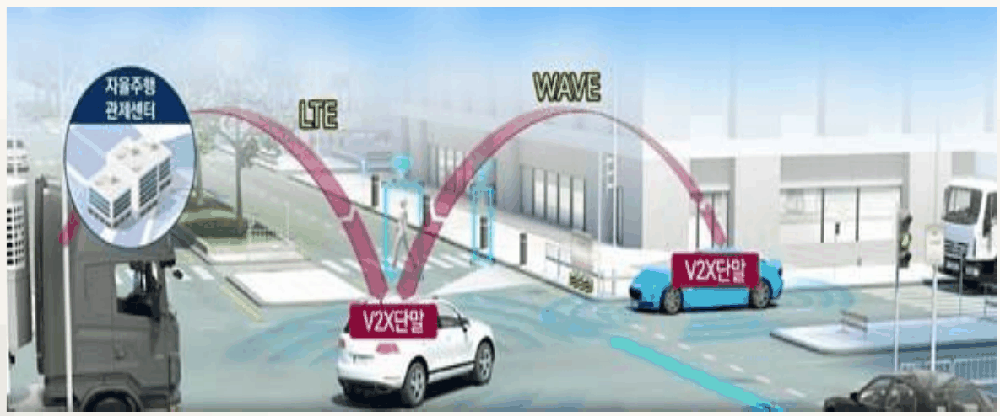

*Figure 41. The LTE-WAVE hybrid V2X network of Pangyo Zero City*

In Figure 41, the automated driving control center communicates with the V2X terminals of vehicles over LTE, and vehicles communicate with each other directly over WAVE. LTE is used for wide-area control and information provision and WAVE for direct communication that requires low latency, a configuration that uses the strengths of both methods together. The technical differences between WAVE and LTE-V2X are covered in Weeks 13 and 14.

### 3.11 Comparison and Lessons from the Cases of Each Country

Comparing the cases of the four regions by the same criteria gives Table 46.

| Item | United States | Europe | Japan | Korea |
|:-----|:-----|:-----|:-----|:-----|
| Driving bodies | DOT (ITS JPO) and an automaker consortium (CAMP) | EU research frameworks (FP, Horizon 2020) and an automaker consortium (C2C-CC) | Cross-ministry framework under the Cabinet Office (SIP-adus), PD from industry | Cross-ministry program (KADIF), MOLIT and the National Police Agency, research institutes (KATECH, KATRI) |
| Representative demonstrations | SPMD (Ann Arbor), CV pilots (New York City, Wyoming, Tampa) | Drive C2X, FOTsis, C-Roads, AdaptIVe | Tokyo waterfront FOT, regional shuttle and platooning demonstrations | C-ITS pilot (Daejeon, Sejong), demonstrations (Seoul, Jeju, expressways), K-City, Pangyo Zero City |
| Distinctive approach | Joint industry development of pre-competitive common technology, pilots that solve regional problems | Securing multinational standards and spectrum, staged services of Day 1, 2, 3 | Joint construction of the cooperative area of the dynamic map, separate paths for service and private vehicles | Building nationwide infrastructure, linking infrastructure information (traffic safety facilities, LDM) with vehicles |
| Trend of communication methods | Transition from DSRC to C-V2X | Parallel discussion of ITS-G5 (based on IEEE 802.11p) and C-V2X | Safety communication in the 760 MHz band, ETC2.0 at 5.8 GHz | Hybrid WAVE and LTE demonstrations, then unification on LTE-V2X |

*Table 46. Comparison of how each country pursues connected automated driving*

The lessons common to Table 46 are as follows.

1. **Staged demonstration:** Every country went through proof of concept, field operational tests, pre-deployment, and deployment in order. The data obtained at each stage become the basis for the design and institutions of the next stage.
2. **Penetration rate:** V2V is effective only when there are partners to communicate with, so the penetration rate determines the success of services. Because of the limited speed of fleet replacement, mandates, aftermarket devices, priority deployment in commercial vehicles, and infrastructure (V2I) services are needed together.
3. **Cooperation between infrastructure and vehicles:** Information provided by infrastructure, such as precise maps (LDM, dynamic map), signal and traffic safety facility information, and positioning correction information, complements the limits of vehicle sensors. Japan and Korea built this part under public leadership.
4. **Joint development and standards:** For vehicles of different manufacturers to communicate, messages, security, and test methods must be fixed together, so a structure in which competing companies cooperate, such as CAMP in the United States and C2C-CC in Europe, is needed.
5. **Influence of policy:** Even when the technology is ready, policy decisions such as spectrum allocation, mandates, and the choice of communication method change the path of deployment. The U.S. transition from DSRC to C-V2X and Korea's unification on LTE-V2X are examples.

---

<br>

## Concept Applications

Connect each situation with the concept that serves as the basis for judgment.

| Situation | Concept to Connect and Reason |
|:-----|:-----|
| A city introduced a V2V collision warning service, but only 3% of vehicles carry units, so it has almost no effect. | **Penetration rate and service feasibility.** Even minimal safety warnings need 10% or more and active safety needs 90% or more, so the gap must be filled with priority deployment in commercial vehicles or V2I services. |
| Several automakers are about to develop V2V with their own different message formats. | **Pre-competitive joint development.** As with CAMP and C2C-CC, messages, security, and test methods must be fixed together so that vehicles of different manufacturers can communicate. |
| A mountain expressway with frequent heavy snow wants to reduce crashes and road closures. | **The Wyoming CV pilot.** Road weather information is gathered at the TMC, and weather warnings, distress notifications, and work zone warnings are sent through roadside units and V2V. |
| A city wants to help visually impaired people cross signalized intersections safely. | **PED-SIG and SPaT.** A smartphone tells the signal controller of the intention to cross, and guidance is given with the signal phase and timing information sent by roadside units. |
| Automated shuttles are to be introduced both inside a factory site and on ordinary local roads. | **Decision of demonstration types.** The factory site is a closed space (A) and the local roads are a mixed-traffic space (E), so the required vehicle platforms and verification conditions differ. |
| Each company builds its own high-definition map, duplicating costs. | **The cooperative area of the dynamic map.** The static base data are built jointly, and companies compete with additional services on top of the dynamic information. |
| A work zone hidden behind the vehicle ahead cannot be seen by the own vehicle's sensors. | **V2V-based perception area expansion.** The sensor information of surrounding vehicles is shared as metadata and fused to widen the perception range. |

*Table 47. Concepts to connect to each situation and the reasons*

**True/False Check:**

| Statement | Judgment and Reason |
|:-----|:-----|
| The U.S. Safety Pilot Model Deployment was carried out with C-V2X. | **F.** In 2011-2014 it tested V2V safety applications based on 5.9 GHz DSRC with about 3,000 vehicles in Ann Arbor. |
| In the CV Pilot Deployment Program, a progress gate must be passed at the end of each phase before moving to the next. | **T.** After Phase 1 it checks readiness for deployment, and after Phase 2 whether the system functions as planned. |
| According to C2C-CC, traffic information sharing services need a higher penetration rate than active safety functions. | **F.** Traffic information sharing needs 5% or more, while active safety functions need 90% or more. |
| In Japan's dynamic map, signal timing information belongs to the dynamic layer. | **T.** V2X information that changes in less than 1 second (surrounding vehicles, pedestrians, signal timing) is the dynamic layer. |
| The winning city of the Smart City Challenge received USD 500 million from the DOT. | **F.** USD 500 million is the total of partnership pledges secured by the finalists, and the winner, Columbus, received up to USD 40 million from the DOT. |
| The C-ITS pilot project of the Ministry of Land, Infrastructure and Transport tested 15 services on an 87.8 km section around Daejeon and Sejong. | **T.** It was carried out in 2014-2017 on a section combining 26.0 km of expressways, 2.9 km of national roads, and 58.9 km of urban roads. |

---

<br>

## Summary

| Concept | Key Summary |
|:--------|:------------|
| Development stages | The United States, Europe, Japan, and Korea all prepared for connected automated driving in the order of proof of concept, field operational tests, pre-deployment, and deployment. |
| U.S. framework | The DOT's ITS JPO coordinates several operating administrations, and the program progressed from VII and IntelliDrive to the Connected Vehicle program. |
| CAMP and VSC | An automaker consortium jointly developed pre-competitive V2V technology, security, and test methods, and VSC defined 15 V2V and 19 V2I safety services. |
| VSC-A and EEBL | V2V applications were mapped to crash scenarios, and V2X functions such as EEBL were also included as assessment items in the Euro NCAP 2025 Roadmap. |
| SPMD | In 2011-2014, about 3,000 DSRC vehicles in Ann Arbor measured the effects of V2V safety applications on real roads. |
| CV pilots | They were carried out in New York City (urban safety and pedestrians), Wyoming (winter highway weather), and Tampa (downtown express lanes and transit) in three phases with progress gates. |
| EU projects | Multinational projects running through FP6, FP7, and Horizon 2020 developed cooperative systems and automated driving, and C2C-CC led the standards on the vehicle side. |
| Penetration rate | V2V services need penetration of 5% for traffic information, 10% for minimal safety warnings, and 90% or more for active safety, and because of the speed of fleet replacement, deployment takes 10 years or more. |
| SIP-adus | A cross-ministry framework under the Cabinet Office, led by a PD from industry, pursued automated driving on separate paths for service vehicles and private vehicles. |
| Dynamic map | It manages information overlaid in four layers, static, semi-static, semi-dynamic, and dynamic, and DMP builds the base data jointly as a cooperative area. |
| Demonstration types | The operating space is divided into closed, limited, motor-vehicle-only, managed traffic, and mixed-traffic spaces to decide the required vehicle platforms. |
| Platooning | Japan classified platooning by combinations of driving mode, road structure, and responsible party and created four draft concepts. |
| Korean R&D | The four-ministry Autonomous Driving Technology Development Innovation Program (2021-2027, about KRW 1.1 trillion) and KATECH's projects on infrastructure linking and cooperative control were carried out. |
| Infrastructure linking | Traffic safety facility information, the LDM, and positioning correction information are delivered to vehicles over V2X to complement the limits of sensors. |
| Korean demonstrations | Following the C-ITS pilot project (Daejeon and Sejong, 87.8 km, 15 services), demonstration projects in Seoul, Jeju, and on expressways, as well as K-City and Pangyo Zero City, were operated. |

---

<br>

## Self-Check Questions

1. **Development stages:** Write the four stages of connected automated driving development, and for each stage name one representative program in the United States and in Korea.

   <details>
   <summary>Answer</summary>

   They are proof of concept, field operational tests (FOT), pre-deployment, and deployment. In the United States, VII and VSC correspond to proof of concept, IntelliDrive and VSC-3 to field operational tests, Connected Vehicle and the Safety Pilot Model Deployment to pre-deployment, and the CV Pilot Deployment Program to deployment. In Korea, u-Transportation and Smart Highway correspond to proof of concept, Smart Highway tests on the test road to field operational tests, the C-ITS pilot project (2014-2017) to pre-deployment, and the C-ITS demonstration projects (2018-) to deployment.

   </details>

2. **Role of CAMP:** Explain why competing automakers jointly develop V2V technology through a consortium such as CAMP, and give three examples of technology that requires such joint development.

   <details>
   <summary>Answer</summary>

   V2V is effective only when vehicles of different manufacturers exchange messages with each other, so a proprietary method of a single company is useless. Therefore, the pre-competitive technology that all companies must follow in the same way is fixed together. Examples are message formats and communication protocols (VSC), the security credential management system that prevents the forgery of messages (SCMS), and interoperability and performance test methods for different devices.

   </details>

3. **Crash scenarios:** Explain why EEBL and FCW are used together in the decelerating lead vehicle scenario, and list all crash scenarios to which IMA corresponds.

   <details>
   <summary>Answer</summary>

   When the lead vehicle decelerates, FCW warns of the collision risk from the distance and relative speed to the vehicle directly ahead, and EEBL announces over V2V the hard braking of a vehicle farther ahead whose view is blocked. The two applications complement each other for hazards at different distances, so they are used together. IMA corresponds to vehicles turning at non-signalized junctions, straight crossing paths at non-signalized junctions, and a left-turning vehicle colliding with a vehicle coming straight from the opposite direction at non-signalized junctions (LTAP/OD).

   </details>

4. **SPMD and the CV pilots:** Compare the purposes of the Safety Pilot Model Deployment and the CV Pilot Deployment Program.

   <details>
   <summary>Answer</summary>

   The SPMD was a demonstration in Ann Arbor in 2011-2014 with about 3,000 vehicles that measured whether V2V safety applications work on real roads, how ordinary drivers use them, and how large the safety benefits are. The CV Pilot Deployment Program was a pilot deployment program that applied connected vehicle technology to regional traffic problems in New York City, Wyoming, and Tampa (urban safety, winter weather, downtown express lanes and transit), aiming to confirm improvements not only in safety but also in mobility, productivity, and the environment, and to transition to routine operations.

   </details>

5. **New York City messages:** Name the three messages sent by roadside units and the one message exchanged between vehicles in the New York City pilot, and explain the information contained in each.

   <details>
   <summary>Answer</summary>

   Roadside units send MAP (intersection geometry such as stop bars, lanes, and permitted movements), SPaT (signal phase and timing such as the start times of green, yellow, red, and walk signals), and TIM (speed limits and zones, work zones and detours, curve and roadway conditions), and these support V2I safety applications. Vehicles exchange the BSM (location, heading, speed, path history), which supports V2V safety applications.

   </details>

6. **Penetration rate:** Judge which services are possible if units are installed only in models that account for 8% of all vehicles, and give two ways to raise the penetration rate quickly.

   <details>
   <summary>Answer</summary>

   If units are installed only in those models, penetration stays near 10% even after 20 years, so traffic information sharing, which needs 5% or more, is possible, minimal safety warnings, which need 10% or more, barely reach the threshold, and active safety functions, which need 90% or more, are impossible. To raise penetration quickly, units can be mandated in all new cars, aftermarket devices can be deployed in vehicles already sold, or units can be deployed first in commercial vehicles such as buses and freight trucks. V2I services that are effective regardless of penetration are also provided together.

   </details>

7. **The two paths of SIP-adus:** Explain, from the viewpoints of automation level and operating conditions, why SIP phase 2 separated the paths of service vehicles (path A) and private vehicles (path B).

   <details>
   <summary>Answer</summary>

   Service vehicles can realize a high level (Level 4) early if their operating conditions (region, road, speed) are narrowly restricted, so they start with driverless logistics and transport services in restricted areas and solve social problems such as mobility in depopulated areas and driver shortages. Private vehicles must be able to drive anywhere, so restricting their operating conditions is difficult; they start from low levels such as automatic braking and raise the level step by step while widening the operational domain from highways to general roads. The two paths differ in starting point and approach, but both aim at a fully automated driving society.

   </details>

8. **Dynamic map:** Write the four layers of the dynamic map with their update periods, and explain why the base data are built jointly as a cooperative area.

   <details>
   <summary>Answer</summary>

   They are static information (less than 1 month or on a daily basis; road surface, lanes, 3D structures), semi-static information (less than 1 hour; traffic regulations, road works, weather forecasts), semi-dynamic information (less than 1 minute; accidents, congestion, local weather), and dynamic information (less than 1 second; surrounding vehicles, pedestrians, signal timing). Every company equally needs base data such as high-definition 3D maps, but surveying and maintaining them costs a great deal, so building them jointly reduces duplicate investment and standardizes the map format. Each company competes with the additional data and services on top.

   </details>

9. **Demonstration types:** Explain, following the decision procedure, which demonstration type a BRT-only road and an ordinary local road each belong to, and state how the vehicle platforms for moving people differ between the two types.

   <details>
   <summary>Answer</summary>

   A BRT-only road is not a closed space, but only limited vehicles and pedestrians use it, so it belongs to B (limited space), and large buses and medium buses (25 seats) are used. An ordinary local road is neither a closed space, a limited space, nor a motor-vehicle-only space, and it is not separated from other vehicles and pedestrians, so it belongs to E (mixed-traffic space), and passenger cars and small buses (15 seats) are used. A mixed-traffic space is the most complex because various road users are mixed, so smaller vehicles are applied first.

   </details>

10. **Cooperative vehicle control:** State the problems that KATECH's cooperative vehicle control project aims to solve, and, taking the labeled powers of the sensor groups in the test vehicle's power distribution diagram (lidars 75 W, radars 27 W, cameras 16 W) as the power of each whole group, calculate the total sensor power and the current at 12 V.

    <details>
    <summary>Answer</summary>

    It aims to solve the problem that cooperative automated driving services are cut off in areas without infrastructure, the limited perception area of the vehicle's own sensors, and the lack of verification of cooperative control technology in driving limit situations. To this end it develops metadata for sharing sensor data over V2V, perception area expansion through fusion of surrounding vehicle data, and multi-vehicle cooperative control (non-signalized intersections, diverging and merging, work zones, yielding to emergency vehicles, cooperative MRM). The total sensor power is $75 + 27 + 16 = 118$ W, and the current at 12 V is $118 / 12 \approx 9.8$ A.

    </details>

11. **Comprehensive performance evaluation:** Explain why the total number of trials in the comprehensive performance evaluation of the smart road system for cooperative automated driving is 220, and find the ratio of cases in which the expected message was not received normally (△ and X).

    <details>
    <summary>Answer</summary>

    The evaluation section made up of 10 services was driven 22 round trips, so there are $10 \times 22 = 220$ trials. A wrong message was mixed in 13 times and the message was not received 11 times, so the sum is 24, and the ratio is $24 / 220 \approx 0.109$, that is, about 10.9%. This equals the sum of the individual ratios 5.9% and 5.0%.

    </details>

12. **C-ITS pilot and demonstration projects:** Break down the 87.8 km section of the Daejeon and Sejong C-ITS pilot project by road type, and explain what each of the three later demonstration projects tested.

    <details>
    <summary>Answer</summary>

    Expressways are 26.0 km (Daejeon-Dangjin line 18.5 km and Honam branch line 7.5 km), national roads 2.9 km (National Route 1), and urban roads 58.9 km (downtown Sejong 13.1 km and downtown Daejeon 45.8 km), and the sum is $26.0 + 2.9 + 58.9 = 87.8$ km. The Seoul demonstration tested the convergence of several communication infrastructures such as WAVE, C-V2X, and 5G in the Sangam DMC area, the Jeju demonstration tested V2X combining LTE and WAVE and LTE-based precise positioning on 300 km of main roads, and the expressway demonstration distributed terminals to 500 commercial vehicles on an 85 km section and tested 17 C-ITS services.

    </details>

---

<br>

## References

1. Federal Highway Administration, "Moving Ahead for Progress in the 21st Century Act (MAP-21): A summary of highway provisions," 2012. https://www.fhwa.dot.gov/map21/summaryinfo.cfm
2. U.S. Department of Transportation and NHTSA, *Automated Driving Systems 2.0: A Vision for Safety*, Washington, DC, USA, 2017.
3. U.S. Department of Transportation, *Preparing for the Future of Transportation: Automated Vehicles 3.0*, Washington, DC, USA, 2018.
4. National Science and Technology Council and U.S. Department of Transportation, *Ensuring American Leadership in Automated Vehicle Technologies: Automated Vehicles 4.0*, Washington, DC, USA, Jan. 2020. https://www.transportation.gov/av/4
5. U.S. Department of Transportation, ITS Joint Program Office, "About the ITS JPO." https://www.its.dot.gov
6. U.S. Department of Transportation, ITS Joint Program Office, "Automated Vehicle Research," ITS Research Fact Sheets, 2016. https://webarchive.library.unt.edu/web/20161031210410/http://www.its.dot.gov/factsheets/AutomationUSDOT.htm
7. J. Zmud *et al.*, *Paths of Automated and Connected Vehicle Deployment: Strategic Roadmap for State and Local Transportation Agencies*, Texas A&M Transportation Institute, College Station, TX, USA, Sep. 2015. https://tti.tamu.edu/tti-publication/paths-of-automated-and-connected-vehicle-deployment-strategic-roadmap-for-state-and-local-transportation-agencies
8. Center for Automotive Research at Stanford (CARS), "June 5 Towards Programming Ethics in Automated Vehicles Workshop Video Available," 2015. https://cars.stanford.edu/events/june-5-towards-programming-ethics-automated-vehicles-workshop-video-available
9. J.D. Power, *2015 U.S. Tech Choice Study*, 2015.
10. Crash Avoidance Metrics Partners LLC (CAMP), project list. https://www.campllc.org
11. Euro NCAP, *Euro NCAP 2025 Roadmap: In Pursuit of Vision Zero*, Sep. 2017.
12. U.S. Department of Transportation, "Safety Pilot Model Deployment Data," data.transportation.gov. https://data.transportation.gov/Automobiles/Safety-Pilot-Model-Deployment-Data/deww-aa3r
13. U.S. Department of Transportation, ITS Joint Program Office, "Connected Vehicle Pilot Deployment Program: Connected Vehicle Applications," 2016. https://www.its.dot.gov/pilots/cv_pilot_apps.htm
14. U.S. Department of Transportation, ITS Joint Program Office, and Tampa Hillsborough Expressway Authority, "How to Bring Connected Vehicles (CVs) to Your Town," presented at SXSW 2018, Austin, TX, USA, Mar. 2018. https://schedule.sxsw.com/2018/events/PP76150
15. Tampa Hillsborough Expressway Authority, *Connected Vehicle Pilot Deployment Program: Data Management Plan, Tampa (THEA)*, U.S. Department of Transportation, Rep. FHWA-JPO-17-462, Oct. 2017.
16. Qualcomm Technologies, "Panasonic, Qualcomm and Ford Join Forces on First U.S. Deployment for C-V2X Vehicle Communications in Colorado," press release, Jun. 2018. https://www.qualcomm.com/news/releases/2018/06/panasonic-qualcomm-and-ford-join-forces-first-us-deployment-c-v2x-vehicle
17. Qualcomm Technologies, "5G NR based C-V2X," presentation. https://www.qualcomm.com/media/documents/files/5g-nr-based-c-v2x-presentation.pdf
18. The White House, "FACT SHEET: Obama Administration Announces Columbus, OH Winner of the \$40 Million Smart City Challenge to Pioneer the Future of Transportation," Jun. 23, 2016. https://obamawhitehouse.archives.gov/the-press-office/2016/06/23/fact-sheet-obama-administration-announces-columbus-oh-winner-40-million
19. 조순기, "국외 C-ITS 정책 및 기술개발 동향," *교통 기술과 정책*, vol. 12, no. 2, 2015. https://koreascience.kr/article/JAKO201515964635984.pdf
20. ERTRAC Task Force Connectivity and Automated Driving, *Automated Driving Roadmap*, version 5.0, Brussels, Belgium, Jul. 2015.
21. CAR 2 CAR Communication Consortium, *Guidance for Day 2 and Beyond Roadmap*, C2CCC_WP_2072, Jul. 2021. https://www.car-2-car.org/fileadmin/documents/General_Documents/C2CCC_WP_2072_RoadmapDay2AndBeyond_V1.2.pdf
22. CAR 2 CAR Communication Consortium, *C2C-CC Manifesto: Overview of the C2C-CC System*, version 1.1, Aug. 2007.
23. European Commission, *Horizon 2020 Work Programme 2016-2017* and *Horizon 2020 Work Programme 2018-2020*, Smart, green and integrated transport: Automated Road Transport calls.
24. 5GAA, "5GAA C-V2X Workshop and Demonstration, 10 July 2018, Paris, France." https://5gaa.org/5gaa-c-v2x-workshop-and-demonstration-10-july-2018-paris-france/
25. AdaptIVe Consortium, *AdaptIVe Final Report*, Deliverable D1.0, 2017. https://www.adaptive-ip.eu/files/adaptive/content/downloads/AdaptIVe-SP1-v1-0-DL-D1-0-Final_Report.pdf
26. Daimler AG, "World premiere: Mercedes-Benz Future Bus with CityPilot," press release, Jul. 2016.
27. Cabinet Office, Government of Japan, *SIP Automated Driving for Universal Services (SIP-adus) R&D Plan*, 2018.
28. 自動走行ビジネス検討会, "自動走行の実現に向けた取組報告と方針 Version 4.0," 経済産業省, 国土交通省, May 2020.
29. ETSI, *Intelligent Transport Systems (ITS); Vehicular Communications; Basic Set of Applications; Local Dynamic Map (LDM); Rationale for and guidance on standardization*, ETSI TR 102 863 V1.1.1, Jun. 2011.
30. ITU-R, *Examples of arrangements for Intelligent Transport Systems deployments under the mobile service*, Report ITU-R M.2444-0, 2018.
31. IT Strategic Headquarters, Government of Japan, *Public-Private ITS Initiative/Roadmaps 2020*, 2020.
32. 자율주행기술개발혁신사업단(KADIF), "자율주행기술개발 혁신사업." https://www.kadif.kr/business/selfDrivingTech.php
33. SAE International, *Taxonomy and Definitions for Terms Related to Cooperative Driving Automation for On-Road Motor Vehicles*, SAE J3216, 2020.
34. The Korea Herald, "Korea partially opens test bed road for autonomous vehicles," Nov. 6, 2017. https://www.koreaherald.com/article/1493812
35. 데일리안, "SKT-한국교통안전공단, 5G자율주행차 협력 운행 성공," Feb. 5, 2018. https://www.dailian.co.kr/news/view/691494/
