# 13주차 이론 — 무선 통신, DSRC, WAVE

[레포지토리 안내](../../README.ko.md) | [English](Concepts_Lecture.md) | [한국어](Concepts_Lecture.ko.md)

> **최종 수정일:** 2026-11-18

> **학습 목표:**
> 1. OSI 참조 모델에 비추어 IEEE 802.11, DSRC, WAVE, ETSI와 ISO의 ITS 스테이션, 3GPP V2X의 프로토콜 스택을 비교할 수 있다
> 2. 무선 채널의 전파 손실과 페이딩, 디지털 변조(BPSK, QPSK, QAM), 부호화율, OFDM의 원리를 설명하고 OFDM의 전송 속도를 계산할 수 있다
> 3. 무선 데이터 링크 계층의 매체 접근 제어(ALOHA, CSMA, CSMA/CA, RTS/CTS)와 네트워크 계층의 포워딩, 라우팅, IPv4, IPv6를 설명할 수 있다
> 4. 5.8 GHz DSRC의 계층 구조와 TDMA 슬롯 프레임, 하이패스의 요금 징수 절차를 설명할 수 있다
> 5. IEEE 802.11 무선 LAN의 구성 요소, DCF와 EDCA의 채널 접근, MAC 프레임과 OFDM 물리 계층을 설명할 수 있다
> 6. IEEE 802.11p와 IEEE 1609 표준군으로 이루어진 WAVE의 구조, 다중 채널 동작, WSA와 WSM, PSID, 전자 결제 서비스를 설명하고, 프랑스 UTAC의 시험 인프라를 소개할 수 있다

---

## 목차

- [1. 자율주행 무선 통신 기술 개요](#1-자율주행-무선-통신-기술-개요)
  - [1.1 OSI 참조 모델](#11-osi-참조-모델)
  - [1.2 무선 통신에서 하위 세 계층의 역할](#12-무선-통신에서-하위-세-계층의-역할)
  - [1.3 무선 통신 기술별 계층 구조](#13-무선-통신-기술별-계층-구조)
  - [1.4 물리 계층의 특성](#14-물리-계층의-특성)
  - [1.5 무선 전파의 기초](#15-무선-전파의-기초)
  - [1.6 디지털 변조](#16-디지털-변조)
  - [1.7 부호화와 부호화율](#17-부호화와-부호화율)
  - [1.8 다중화와 OFDM](#18-다중화와-ofdm)
  - [1.9 데이터 링크 계층의 특성과 프레임](#19-데이터-링크-계층의-특성과-프레임)
  - [1.10 매체 접근 제어 프로토콜](#110-매체-접근-제어-프로토콜)
  - [1.11 흐름 제어: 링크 적응, RTS/CTS, 비지 톤](#111-흐름-제어-링크-적응-rtscts-비지-톤)
  - [1.12 오류 검출과 정정](#112-오류-검출과-정정)
  - [1.13 네트워크 계층: 포워딩과 라우팅](#113-네트워크-계층-포워딩과-라우팅)
  - [1.14 가상 회선과 데이터그램](#114-가상-회선과-데이터그램)
  - [1.15 IPv4](#115-ipv4)
  - [1.16 IPv6와 IPv4의 공존](#116-ipv6와-ipv4의-공존)
- [2. DSRC와 무선 LAN](#2-dsrc와-무선-lan)
  - [2.1 DSRC의 특징](#21-dsrc의-특징)
  - [2.2 DSRC의 계층 구조](#22-dsrc의-계층-구조)
  - [2.3 국내외 DSRC 통신 규격](#23-국내외-dsrc-통신-규격)
  - [2.4 DSRC 프로토콜 스택](#24-dsrc-프로토콜-스택)
  - [2.5 RF-DSRC MAC 프레임과 통신 절차](#25-rf-dsrc-mac-프레임과-통신-절차)
  - [2.6 ETCS와 하이패스](#26-etcs와-하이패스)
  - [2.7 IEEE 802.11 작업 그룹과 무선 LAN 표준](#27-ieee-80211-작업-그룹과-무선-lan-표준)
  - [2.8 무선 LAN의 구성 요소와 구조](#28-무선-lan의-구성-요소와-구조)
  - [2.9 DCF와 CSMA/CA](#29-dcf와-csmaca)
  - [2.10 QoS 지원: EDCA](#210-qos-지원-edca)
  - [2.11 무선 LAN의 통신 절차](#211-무선-lan의-통신-절차)
  - [2.12 MAC 프레임의 종류와 단편화](#212-mac-프레임의-종류와-단편화)
  - [2.13 OFDM 물리 계층](#213-ofdm-물리-계층)
- [3. WAVE](#3-wave)
  - [3.1 WAVE 시스템의 개요와 특징](#31-wave-시스템의-개요와-특징)
  - [3.2 WAVE의 구조와 표준](#32-wave의-구조와-표준)
  - [3.3 BSS 밖의 통신](#33-bss-밖의-통신)
  - [3.4 WAVE 물리 계층과 미국의 채널 배치](#34-wave-물리-계층과-미국의-채널-배치)
  - [3.5 IEEE 802.11p MAC과 EDCA 매개변수](#35-ieee-80211p-mac과-edca-매개변수)
  - [3.6 IEEE 1609.4 다중 채널 동작](#36-ieee-16094-다중-채널-동작)
  - [3.7 시각 동기](#37-시각-동기)
  - [3.8 WAVE 네트워킹 서비스: WSA와 WSM](#38-wave-네트워킹-서비스-wsa와-wsm)
  - [3.9 WSM과 WSMP의 형식](#39-wsm과-wsmp의-형식)
  - [3.10 WSA와 WSM의 캡슐화](#310-wsa와-wsm의-캡슐화)
  - [3.11 WAVE의 통신 절차](#311-wave의-통신-절차)
  - [3.12 PSID](#312-psid)
  - [3.13 WAVE 전자 결제 서비스](#313-wave-전자-결제-서비스)
- [4. 부록: 프랑스의 UTAC](#4-부록-프랑스의-utac)
  - [4.1 UTAC의 개요](#41-utac의-개요)
  - [4.2 UTAC의 현황과 위치](#42-utac의-현황과-위치)
  - [4.3 UTAC의 업무](#43-utac의-업무)
  - [4.4 시험장과 TEQMO](#44-시험장과-teqmo)
  - [4.5 시험 시설](#45-시험-시설)
- [개념 적용](#개념-적용)
- [요약](#요약)
- [점검 문제](#점검-문제)
- [참고 문헌](#참고-문헌)

---

<br>

## 1. 자율주행 무선 통신 기술 개요

자율주행차가 다른 차량, 도로의 노변 기지국, 원격의 서버와 정보를 주고받는 V2X 통신은 모두 무선으로 이루어진다. 무선 통신 기술은 OSI 참조 모델의 하위 계층, 즉 물리 계층, 데이터 링크 계층, 네트워크 계층을 어떻게 설계하느냐에 따라 성격이 정해진다. 1절은 이 세 계층에서 무선 통신이 해결해야 하는 문제와 그 해결 기법을 정리한다. 2절은 노변과 차량 사이의 근거리 통신인 DSRC와 그 바탕이 되는 IEEE 802.11 무선 LAN을, 3절은 차량 환경용 무선 접속 기술인 WAVE를 다룬다. 4절은 프랑스의 자동차 시험 인증 기관 UTAC를 소개한다.

### 1.1 OSI 참조 모델

> **용어 정의:** **OSI 참조 모델(Open Systems Interconnection Reference Model)** 은 제조사와 구조가 서로 다른 이기종 시스템이 네트워크 구조에 상관없이 통신할 수 있도록 국제 표준화 기구(ISO)가 정한 7계층의 국제 표준 모델이다 [1]. 목적은 기본적인 하드웨어와 소프트웨어의 논리를 바꾸지 않고도 시스템 사이의 통신을 개방하는 것이다.

개방형(open)이라는 말은 특정 회사의 규격에 묶이지 않고, 표준만 따르면 누구의 시스템이든 서로 연결할 수 있다는 뜻이다. OSI 모델 자체는 5주차에서 자세히 다루었으므로, 여기서는 무선 통신을 이해하는 데 필요한 부분을 다시 정리한다.

OSI의 계층 개념은 서울의 학교와 로마의 학교 학생들이 편지를 주고받는 과정에 비유할 수 있다.

| 계층 | 서울의 학교와 로마의 학교 사이에서 일어나는 일 | 대응하는 통신 기능 |
|:-----|:-----|:-----|
| 7. 응용(application) | 서울의 학생이 "안녕"이라고 편지를 쓰고, 로마의 학생은 "Ciao"라고 답장한다. | 사용자가 원하는 서비스(편지 교환) |
| 6. 표현(presentation) | 두 학교가 함께 쓰는 언어인 영어("Hello")로 편지를 번역한다. | 데이터 표현 형식의 변환 |
| 5. 세션(session) | 선생님이 학생들의 편지를 모아 로마의 주소를 쓰고, 도착한 편지를 학생들에게 나누어 준다. | 양쪽 사이의 대화 관리 |
| 4. 전송(transport) | 두 학교의 선생님이 서로 소포를 주고받는다. | 종단 사이의 전달 |
| 3. 네트워크(network) | 출발지 우체국과 도착지 우체국 사이에서 행낭이 전달된다. | 경로 결정 |
| 2. 데이터 링크(data link) | 직통편이 있는 인근 우체국끼리 행낭을 넘긴다. | 이웃한 노드 사이의 전달 |
| 1. 물리(physical) | 비행기 같은 수송편이 정해진 행낭 규격과 전달 방식에 따라 실어 나른다. | 매체를 통한 신호 전송 |

*표 1. 서울과 로마의 학교 사이 편지 교환에 비유한 OSI 7계층*

각 계층은 바로 아래 계층의 서비스를 이용하고 바로 위 계층에 서비스를 제공한다. 상대편의 같은 계층과는 프로토콜이라는 약속에 따라 대화한다. 송신 측에서는 데이터가 위에서 아래로 내려가며 계층마다 제어 정보(헤더)가 덧붙고, 수신 측에서는 아래에서 위로 올라가며 헤더가 하나씩 벗겨진다. 편지가 봉투, 소포, 행낭에 차례로 담겼다가 도착지에서 역순으로 꺼내지는 것과 같다.

| 구분 | 계층 | 데이터 단위 | 주요 기능 |
|:-----|:-----|:-----|:-----|
| 호스트 계층 | 7. 응용 | 데이터 | 응용 프로세스에 네트워크 서비스 제공 |
| 호스트 계층 | 6. 표현 | 데이터 | 데이터 표현과 암호화 |
| 호스트 계층 | 5. 세션 | 데이터 | 호스트 사이의 통신(대화) 관리 |
| 호스트 계층 | 4. 전송 | 세그먼트 | 종단 간 연결과 신뢰성 |
| 미디어 계층 | 3. 네트워크 | 데이터그램 | 경로 결정과 IP(논리 주소) |
| 미디어 계층 | 2. 데이터 링크 | 프레임 | MAC과 LLC(물리 주소) |
| 미디어 계층 | 1. 물리 | 비트 | 매체, 주파수, 변조, 송신과 수신 |

*표 2. OSI 7계층의 구분, 데이터 단위, 주요 기능*

상위 네 계층은 통신하는 두 호스트(종단 컴퓨터)에서만 동작하므로 **호스트 계층(host layers)**, 하위 세 계층은 중간의 라우터와 스위치까지 포함한 전달 경로에서 동작하므로 **미디어 계층(media layers)** 이라 부른다.

### 1.2 무선 통신에서 하위 세 계층의 역할

무선 통신 기술의 차이는 대부분 미디어 계층에서 생긴다. 세 계층이 맡는 일은 다음과 같다.

| 계층 | 맡는 일 |
|:-----|:-----|
| 물리 계층 | 네트워크 통신을 위한 물리적인 표준을 정의한다. 두 시스템 사이의 전기적, 기계적, 절차적 연결을 정의하며, 매체, 주파수, 변조, 송신과 수신, 데이터 전송 속도를 다룬다. |
| 데이터 링크 계층 | 물리 주소(MAC 주소)로 이웃한 노드(호스트와 라우터)와 링크(통신 채널)를 설정한다. 네트워크 계층의 패킷을 프레임으로 감싸고(framing), 매체에서 물리적 충돌을 막는 흐름 제어와 링크 수준의 오류 검출과 정정을 맡는다. |
| 네트워크 계층 | 논리 주소(IP 주소)를 담당하고 데이터그램의 이동 경로를 결정한다(데이터 포워딩). 라우팅 프로토콜로 최적 경로를 선택하며, 가상 회선과 패킷 교환 같은 네트워크 서비스를 지원한다. 대표 프로토콜은 IP(Internet Protocol)이다. |

*표 3. 물리 계층, 데이터 링크 계층, 네트워크 계층의 역할*

유선 통신과 달리 무선 통신에서는 공기라는 하나의 매체를 주변의 모든 단말이 함께 쓰고, 신호가 거리와 장애물 때문에 크게 약해지며, 차량처럼 단말이 빠르게 움직이면 연결 상대가 자주 바뀐다. 그래서 무선 통신 기술마다 이 세 계층을 서로 다르게 설계한다.

### 1.3 무선 통신 기술별 계층 구조

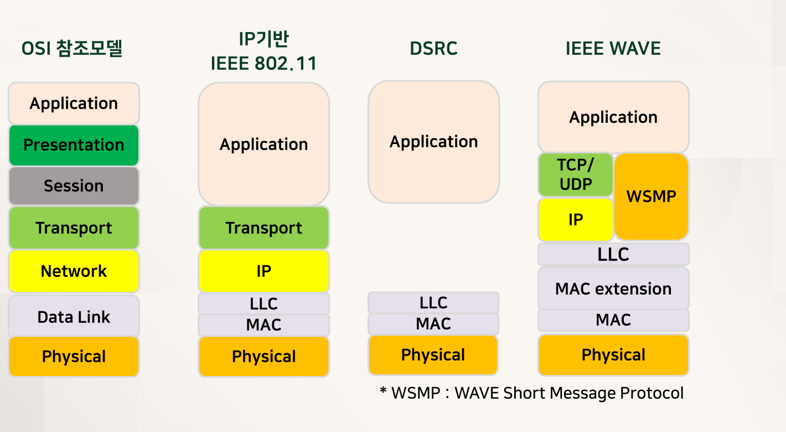

*그림 1. OSI 참조 모델과 IP 기반 IEEE 802.11, DSRC, IEEE WAVE의 계층 구조*

그림 1은 세 무선 통신 기술의 계층을 OSI 참조 모델과 나란히 놓은 것이다.

- **IP 기반 IEEE 802.11(무선 LAN):** 응용 계층 하나가 OSI의 5\~7계층을 맡고, 그 아래에 전송 계층(TCP 또는 UDP), IP, LLC와 MAC으로 나뉜 데이터 링크 계층, 물리 계층이 온다. 인터넷과 같은 구조이다.
- **DSRC:** 응용, LLC, MAC, 물리 계층만 있고 전송 계층과 네트워크 계층이 없다. 노변 기지국과 차량이 한 번의 무선 구간으로 직접 연결되므로 경로를 찾을 필요가 없기 때문이다(2.2절).
- **IEEE WAVE:** 물리 계층과 MAC 위에 다중 채널 동작을 위한 MAC 확장(MAC extension)과 LLC를 두고, 그 위에 두 갈래의 네트워크 계층을 둔다. 하나는 인터넷과 같은 IP와 TCP/UDP이고, 다른 하나는 짧은 안전 메시지를 빠르게 보내기 위한 **WSMP(WAVE Short Message Protocol)** 이다(3절).

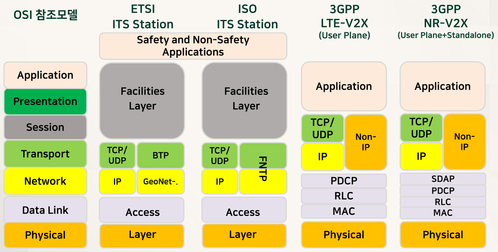

*그림 2. ETSI와 ISO의 ITS 스테이션, 3GPP LTE-V2X와 NR-V2X의 계층 구조*

그림 2는 다른 표준화 기구의 구조이다.

- **ETSI ITS 스테이션(유럽):** OSI의 5\~7계층에 해당하는 **시설 계층(facilities layer)** 이 안전 응용과 비안전 응용에 공통 기능을 제공한다. 전송 계층에는 TCP/UDP와 **BTP(Basic Transport Protocol)** 가, 네트워크 계층에는 IP와 위치 정보로 패킷을 전달하는 **GeoNetworking**이 나란히 있다. 데이터 링크 계층과 물리 계층은 **접근 계층(access layer)** 으로 묶는다.
- **ISO ITS 스테이션:** 시설 계층과 접근 계층의 구성은 ETSI와 비슷하고, IP와 TCP/UDP 옆에 전송 계층과 네트워크 계층을 한꺼번에 맡는 경량 프로토콜 **FNTP(Fast Networking and Transport layer Protocol)** 를 둔다. ISO의 ITS 스테이션 구조(CALM)는 14주차에서 다룬다.
- **3GPP LTE-V2X(사용자 평면):** 이동통신의 무선 프로토콜 스택을 그대로 쓴다. 물리 계층 위에 MAC, **RLC(Radio Link Control)**, **PDCP(Packet Data Convergence Protocol)** 가 데이터 링크 계층을 이루고, 그 위에 IP와 TCP/UDP 또는 IP를 쓰지 않는 Non-IP 경로가 온다.
- **3GPP NR-V2X:** LTE-V2X의 구조에 서비스 품질에 따라 데이터 흐름을 나누는 **SDAP(Service Data Adaptation Protocol)** 를 PDCP 위에 더한다. C-V2X는 14주차에서 다룬다.

> **핵심:** 무선 통신 기술, 지역, 표준화 기구에 따라 OSI 계층별 구성이 다르다. 그러나 공통점도 있다. 차량 안전 메시지처럼 짧고 급한 메시지를 위해 IP를 거치지 않는 가벼운 전용 경로(WSMP, BTP와 GeoNetworking, FNTP, Non-IP)를 IP 경로와 나란히 둔다. IP 헤더와 주소 설정에 드는 시간과 오버헤드를 줄이기 위해서이다.

### 1.4 물리 계층의 특성

물리 계층은 비트를 실제 신호로 바꾸어 매체로 보내는 계층이며, 다음 세 가지를 다룬다.

1. **전송 매체:** 매체는 유선 매체와 무선 매체로 나뉜다. 무선 매체의 주파수는 국가가 규제한다. 국가가 특정 사업자나 용도에 독점적으로 할당하는 **면허 대역(licensed spectrum)** 이 있고, 정해진 기술 기준만 지키면 면허 없이 여러 사용자가 함께 쓸 수 있는 **비면허 대역(unlicensed spectrum)** 과 개방 대역(open spectrum)이 있다.
2. **송신기와 수신기:** 신호가 얼마나 멀리 도달하는지가 핵심이다. 전송 거리는 자유 공간 전파, 감쇠, 페이딩, 섀도잉, 간섭, SIR과 SINR, 간섭 범위, 경로 손실 모델, 송신 전력과 수신 감도로 정해진다.
3. **데이터 전송의 효율:** 같은 주파수 대역폭으로 더 많은 데이터를 보내기 위한 변조와 부호화, 이중화와 다중화를 다룬다.

> **용어 정의:** **SIR(signal-to-interference ratio)** 은 원하는 신호의 전력 $S$와 다른 송신기에서 온 간섭 전력 $I$의 비 $S/I$이다.

> **용어 정의:** **SINR(signal-to-interference-plus-noise ratio)** 은 잡음 전력 $N$까지 포함한 $S/(I+N)$이다. SIR과 SINR은 값이 클수록 수신기가 신호를 정확히 해석할 수 있다.

> **용어 정의:** **수신 감도(receiver sensitivity)** 는 수신기가 정해진 오류율 이하로 신호를 받을 수 있는 최소 수신 전력이다.

> **용어 정의:** **이중화(duplexing)** 는 한 링크에서 양방향 통신을 하는 방법으로, 시간을 나누는 TDD와 주파수를 나누는 FDD가 있다.

### 1.5 무선 전파의 기초

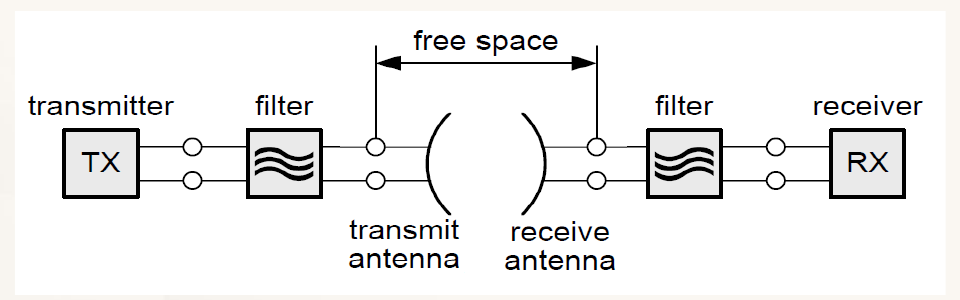

*그림 3. 송신기에서 수신기까지 자유 공간을 통한 무선 전송 경로*

그림 3에서 송신기(TX)가 만든 신호는 필터를 거쳐 불필요한 주파수 성분이 제거된 뒤 송신 안테나에서 전자기파로 방사된다. 전자기파는 자유 공간(free space)을 지나 수신 안테나에 도달하고, 다시 필터를 거쳐 수신기(RX)로 들어간다.

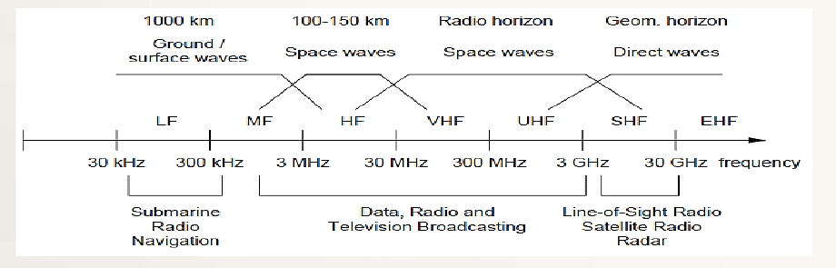

*그림 4. 주파수 대역별 전자기파의 전파 방식과 도달 거리, 주요 응용*

| 대역 | 주파수 범위 | 주된 전파 방식 | 응용 예 |
|:-----|:-----|:-----|:-----|
| LF, MF | 30 kHz\~3 MHz | 지표를 따라 휘어 가는 지표파, 약 1,000 km까지 | 잠수함 통신, 무선 항법, 방송 |
| HF | 3\~30 MHz | 공간파(space wave), 약 100\~150 km | 데이터 무선, 라디오 방송 |
| VHF, UHF | 30 MHz\~3 GHz | 공간파, 전파 수평선(radio horizon)까지 | 데이터 무선, 라디오와 텔레비전 방송 |
| SHF, EHF | 3\~300 GHz | 직접파, 기하학적 수평선(가시거리)까지 | 가시거리 무선, 위성 통신, 레이더 |

*표 4. 주파수 대역별 전파 방식과 응용*

주파수가 높을수록 전파는 빛처럼 직진하여 장애물을 돌아가지 못하고 가시거리(LOS, line of sight) 안에서만 잘 전달된다. 대신 넓은 대역폭을 쓸 수 있어 전송 속도를 높이기 쉽다. 5.8 GHz DSRC와 5.9 GHz WAVE는 SHF 대역에 속하므로, 노변 기지국은 차량을 내려다볼 수 있는 높은 곳에 설치한다.

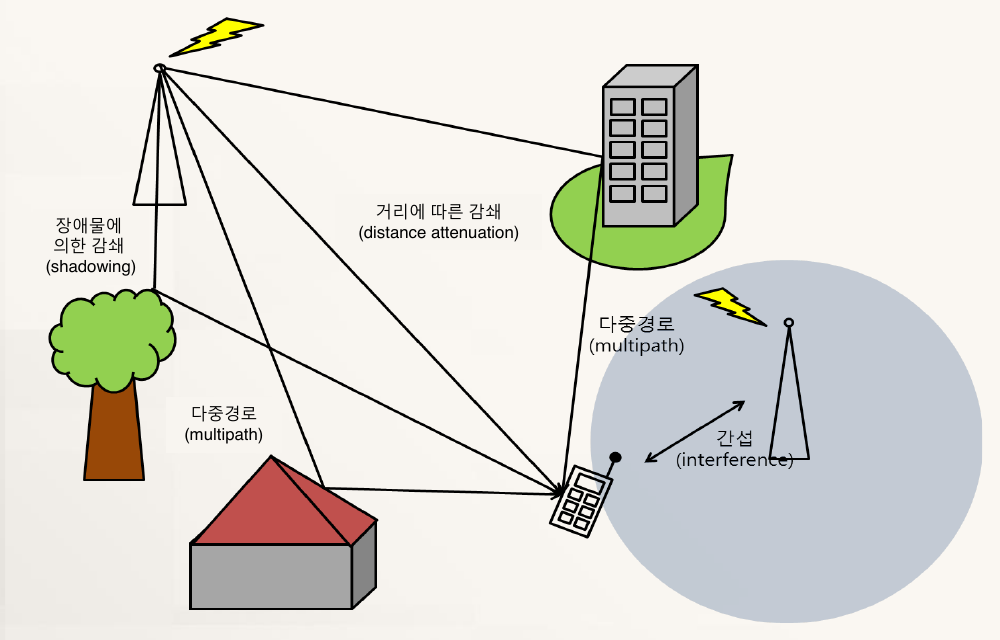

*그림 5. 무선 통신의 감쇠, 섀도잉, 다중 경로, 간섭*

그림 5는 기지국과 단말 사이에서 일어나는 무선 통신의 대표적인 문제를 보여 준다.

> **용어 정의:** **거리에 따른 감쇠(distance attenuation)** 는 전파가 퍼져 나가면서 단위 면적당 에너지가 줄어 수신 전력이 거리에 따라 작아지는 현상이다.

> **용어 정의:** **섀도잉(shadowing)** 은 나무나 건물 같은 장애물이 전파를 가려 생기는 감쇠이다.

> **용어 정의:** **다중 경로(multipath)** 는 직접파와 건물, 지면에서 반사된 파가 서로 다른 경로와 지연으로 수신기에 도착하는 현상이다.

> **용어 정의:** 다중 경로로 도착한 파들이 위상에 따라 서로 보강되거나 상쇄되어 수신 세기가 빠르게 요동치는 것을 **페이딩(fading)** 이라 한다.

> **용어 정의:** **간섭(interference)** 은 같거나 가까운 주파수를 쓰는 다른 송신기의 신호가 원하는 신호에 섞이는 현상이다.

차량은 빠르게 움직이므로 다중 경로의 보강과 상쇄가 짧은 시간 안에 바뀌고, 도플러 효과로 주파수도 조금씩 어긋난다. 차량 통신의 물리 계층이 실내 무선 LAN보다 더 견고해야 하는 이유이다.

**경로 손실 모델.** 송신 전력 $P_T$ 가운데 수신기에 도달하는 전력 $P_R$의 비율을 거리의 함수로 나타낸 것이 경로 손실 모델(path loss model)이다. 가장 단순한 경우는 장애물이 전혀 없는 자유 공간이며, 프리스(Friis)의 공식으로 나타낸다 [2].

```math
\frac{P_R}{P_T} = G_T G_R \left( \frac{\lambda}{4 \pi d} \right)^2
```

$G_T$와 $G_R$은 송신 안테나와 수신 안테나의 이득, $\lambda$는 파장, $d$는 거리이다. 수신 전력은 거리의 제곱에 반비례하므로 거리가 두 배가 되면 수신 전력은 1/4, 즉 $10 \log_{10} 4 \approx 6$ dB 줄어든다. 예를 들어 5.9 GHz의 파장은 $\lambda = c/f = (3 \times 10^8)/(5.9 \times 10^9) \approx 0.0508$ m이다. 안테나 이득이 1일 때 100 m에서 자유 공간 경로 손실은 $20 \log_{10}(4 \pi \times 100 / 0.0508) \approx 87.9$ dB이고, 200 m에서는 약 93.9 dB이다.

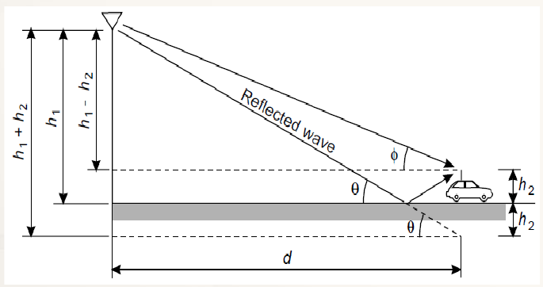

*그림 6. 직접파와 지면 반사파로 이루어진 2파 모델*

실제 도로에는 반사면이 반드시 있다. 그림 6의 **2파 모델(two-ray model)** 은 높이 $h_1$인 송신 안테나에서 거리 $d$만큼 떨어진 높이 $h_2$의 차량 안테나로 오는 직접파와 지면에서 반사된 반사파 두 개만 고려한다. 반사파는 지면 아래 $h_1$ 깊이에 있는 거울상 안테나에서 출발한 것처럼 보이므로, 두 파의 경로 차이는 높이 $h_1 + h_2$와 $h_1 - h_2$로 계산된다. 거리가 충분히 멀면 두 파가 거의 반대 위상으로 만나 서로 상쇄되고, 수신 전력은 다음과 같이 근사된다.

```math
L_F = \frac{P_R}{P_T} = G_T \cdot G_R \cdot \left( \frac{h_1 h_2}{d^2} \right)^2
```

이를 데시벨로 바꾸면 로그의 성질 $\log(ab) = \log a + \log b$와 $\log x^n = n \log x$에 따라 다음과 같다.

```math
L_F[\text{dB}] = 10 \log \left( G_T \cdot G_R \cdot \frac{(h_1 h_2)^2}{d^4} \right) = 10 \log G_T + 10 \log G_R + 20 \log h_1 + 20 \log h_2 - 40 \log d
```

이 식에서 세 가지를 읽을 수 있다. 첫째, 수신 전력은 거리의 네제곱에 반비례하므로 거리가 두 배가 되면 $40 \log 2 \approx 12$ dB 줄어, 자유 공간(6 dB)보다 훨씬 빨리 약해진다. 둘째, 안테나 높이 $h_1$이나 $h_2$를 두 배로 하면 $20 \log 2 \approx 6$ dB 좋아진다. 노변 기지국을 높이 세우는 또 다른 이유이다. 셋째, 이 근사에는 파장이 들어 있지 않다.

예를 들어 $h_1 = 10$ m, $h_2 = 1.5$ m, $G_T = G_R = 1$일 때 $d = 2{,}000$ m이면 $20 \log_{10}(10 \times 1.5 / 2000^2) = 20 \log_{10}(3.75 \times 10^{-6}) \approx -108.5$ dB이고, $d = 4{,}000$ m이면 약 $-120.6$ dB로 12 dB 더 작다.

> **주의:** 2파 모델의 네제곱 법칙은 거리가 임계 거리 $d_c \approx 4 h_1 h_2 / \lambda$보다 멀 때 성립한다 [3]. 위 예에서 5.9 GHz의 임계 거리는 $4 \times 10 \times 1.5 / 0.0508 \approx 1{,}181$ m이므로 예의 거리를 그보다 멀게 잡았다. 임계 거리보다 가까운 곳에서는 직접파와 반사파가 보강과 상쇄를 되풀이하여 수신 전력이 크게 요동치며, 평균적으로는 자유 공간과 비슷하게 줄어든다.

### 1.6 디지털 변조

**변조(modulation)** 는 디지털 비트를 반송파(carrier)의 진폭, 주파수, 위상에 실어 전송하는 일이다. ASK, FSK, PSK의 기본 원리는 4주차에서 다루었다. 무선 통신에서는 위상과 진폭을 함께 쓰는 방식으로 한 번에 더 많은 비트를 보낸다. 신호의 한 단위를 **심볼(symbol)** 이라 하고, 가능한 심볼들을 진폭과 위상의 평면에 점으로 찍은 그림을 **성상도(constellation diagram)** 라 한다.

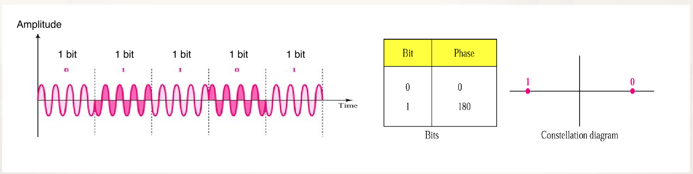

*그림 7. BPSK의 파형, 비트와 위상의 대응, 성상도*

**BPSK(Binary Phase Shift Keying).** 비트 0과 1에 위상이 180°(π) 다른 반송파를 대응시킨다. 그림 7에서 비트열 0, 1, 1, 0, 1을 보낼 때 0인 구간은 위상 0°, 1인 구간은 위상 180°의 파형이며, 성상도에는 원점을 사이에 두고 마주 보는 두 점이 있다. 한 심볼에 1비트를 보낸다.

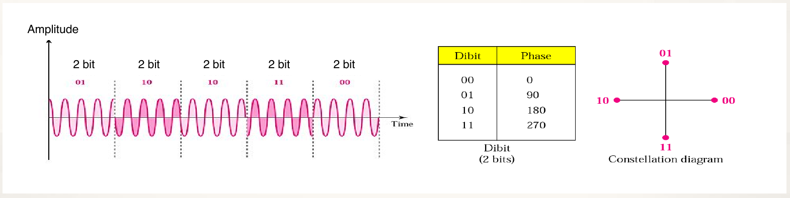

*그림 8. QPSK의 파형, 2비트와 위상의 대응, 성상도*

**QPSK(Quadrature Phase Shift Keying).** 2비트 묶음(dibit) 네 가지에 위상이 90°(π/2)씩 다른 반송파를 대응시킨다. 그림 8의 표에서 00은 0°, 01은 90°, 10은 180°, 11은 270°이며, 비트열 01, 10, 10, 11, 00을 그 위상의 파형으로 보낸다. 한 심볼에 2비트를 보내므로, 같은 심볼 속도에서 BPSK의 두 배 속도로 데이터를 보낸다.

> **참고:** IEEE 802.11을 비롯한 대부분의 디지털 통신 시스템은 성상도에서 이웃한 두 점의 비트 묶음이 한 비트만 다르도록 위상을 00, 01, 11, 10의 순서로 배정하는 **그레이 부호(Gray code)** 매핑을 쓴다 [4]. 잡음 때문에 수신기가 이웃한 점으로 잘못 판정하더라도 비트 오류가 하나만 생기도록 하기 위해서이다.

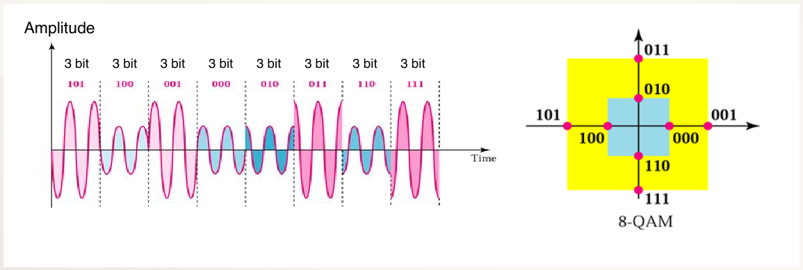

*그림 9. 8-QAM의 파형과 성상도*

**QAM(Quadrature Amplitude Modulation).** PSK와 달리 위상뿐 아니라 진폭(크기)도 변수로 쓴다. 그림 9의 8-QAM은 진폭 두 가지와 위상 네 가지를 조합한 여덟 점을 써서 한 번에 3비트($`2^3 = 8`$)를 보낸다. 성상도에서 안쪽 네 점(000, 010, 100, 110)은 작은 진폭, 바깥쪽 네 점(001, 011, 101, 111)은 큰 진폭이며, 같은 방향의 두 점은 위상이 같다. 같은 원리로 16-QAM은 한 번에 4비트($`2^4 = 16`$), 64-QAM은 6비트($`2^6 = 64`$)를 보낸다. 일반적으로 $M$개의 점을 쓰는 변조는 한 심볼에 다음 비트 수를 싣는다.

```math
b = \log_2 M
```

| 변조 방식 | 성상도의 점 수 $M$ | 심볼당 비트 수 $b$ |
|:-----|:-----|:-----|
| BPSK | 2 | 1 |
| QPSK | 4 | 2 |
| 8-QAM | 8 | 3 |
| 16-QAM | 16 | 4 |
| 64-QAM | 64 | 6 |

*표 5. 변조 방식별 성상도의 점 수와 심볼당 비트 수*

> **핵심:** 성상도의 점이 많을수록 한 심볼에 더 많은 비트를 실어 전송 속도가 높아지지만, 같은 송신 전력에서 점 사이의 거리가 좁아져 잡음에 약해진다. 그래서 신호가 강하고 깨끗할 때는 64-QAM을, 약하거나 잡음이 많을 때는 BPSK를 쓴다(1.11절의 링크 적응).

### 1.7 부호화와 부호화율

> **용어 정의:** **부호화(channel coding)** 는 데이터의 오류를 검출하고 정정할 수 있도록 원래 데이터에 여분의 비트(중복, redundancy)를 더해 변환하는 기술이다. 대표적으로 선형 블록 부호(linear block code)와 길쌈 부호(convolutional code)가 있다.

모든 채널 부호는 실제로 보내려는 정보 비트 $k$개를 $n$비트의 부호어(codeword)로 바꾼다($`n > k`$). 정보 비트 수와 부호어 길이의 비를 **부호화율(code rate)** 이라 한다.

```math
R = \frac{\text{정보 비트 길이}}{\text{부호화된 부호어 길이}} = \frac{k}{n}
```

- 부호어 길이 $n$이 클수록 복호기(decoder)의 처리량이 늘어 시스템이 복잡해진다.
- 부호화율 $R$은 통신 시스템이 차지하는 주파수 대역폭과 부호의 오류 정정 능력에 관련된다. $R$이 작을수록 중복이 많아 오류를 더 잘 정정하지만, 같은 대역폭으로 보낼 수 있는 정보량은 줄어든다.

가장 단순한 예는 각 비트를 세 번 반복하는 반복 부호이다. 0은 000, 1은 111로 보내므로 $k = 1$, $n = 3$, $R = 1/3$이다. 수신한 세 비트 가운데 다수결로 원래 비트를 정하면, 세 비트 중 한 비트가 틀려도 바르게 복원된다. IEEE 802.11a/g/p는 부호화율 1/2, 2/3, 3/4의 길쌈 부호를 쓴다. 부호화율이 1/2이면 정보 비트 24개가 부호화된 비트 48개가 되고, 3/4이면 정보 비트 36개가 48개가 된다(2.13절).

### 1.8 다중화와 OFDM

**다중화(multiplexing)** 는 하나의 전송 매체를 여러 사용자나 데이터 흐름이 나누어 쓰게 하는 기법이다. FDM의 원리는 4주차에서 다루었다.

1. **시분할 다중화(TDM, time division multiplexing):** 시간을 나누어 사용자마다 다른 시간 구간을 준다.
2. **주파수 분할 다중화(FDM, frequency division multiplexing):** 주파수 대역을 나누어 사용자마다 다른 주파수를 준다.
3. **코드 분할 다중화(CDM, code division multiplexing):** 모든 사용자가 같은 시간과 주파수를 쓰되, 서로 다른 부호를 곱해 보내고 수신기가 자기 부호로 골라낸다.
4. **공간 분할 다중화(SDM, space division multiplexing):** 두 개 이상의 안테나로 같은 시간과 주파수에 서로 다른 데이터 흐름을 보낸다. 다중 안테나(MIMO) 기술이 이를 이용한다.
5. **직교 주파수 분할 다중화(OFDM, orthogonal frequency division multiplexing):** 아래에서 설명한다.

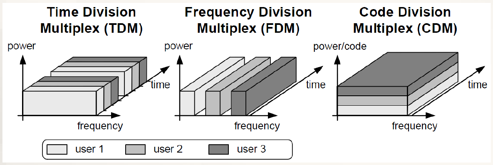

*그림 10. 시분할, 주파수 분할, 코드 분할 다중화의 자원 배분*

그림 10에서 세 축은 시간, 주파수, 전력(또는 부호)이다. TDM은 주파수 전체를 쓰는 블록을 시간 축으로 나란히 놓고, FDM은 시간 전체를 쓰는 블록을 주파수 축으로 나란히 놓으며, CDM은 시간과 주파수 전체를 겹쳐 쓰되 부호 축으로 구분한다.

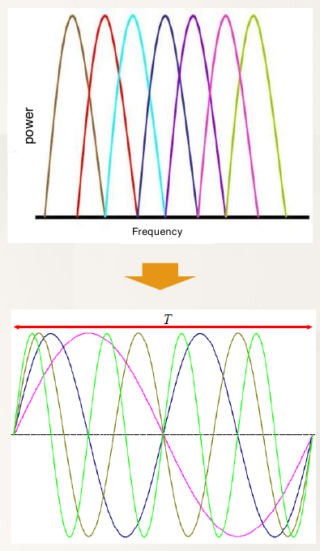

*그림 11. OFDM 부반송파의 겹친 스펙트럼과 한 심볼 구간의 직교 정현파*

**OFDM**은 직교성(orthogonality)을 이용한 다중 반송파 변조(multi-carrier modulation) 방식이다. 고속의 데이터 흐름을 여러 개의 저속 데이터 흐름으로 쪼개고, 각각을 서로 다른 **부반송파(subcarrier)** 에 실어 병렬로 전송한다.

> **용어 정의:** 두 신호(벡터)가 **직교(orthogonal)** 한다는 것은 두 신호의 내적이 0이라는 뜻이며, 서로 독립적이어서 한 신호가 다른 신호의 검출을 방해하지 않음을 의미한다.

심볼 길이가 $T$일 때 부반송파의 주파수를 $1/T$의 정수배($`k/T`$)로 정하면, 서로 다른 두 부반송파 $k \neq m$의 내적은 다음과 같이 0이 된다.

```math
\int_0^T e^{j 2 \pi k t / T} \cdot e^{-j 2 \pi m t / T} \, dt = \int_0^T e^{j 2 \pi (k - m) t / T} \, dt = \begin{cases} T & (k = m) \\ 0 & (k \neq m) \end{cases}
```

$k \neq m$이면 $e^{j 2 \pi (k-m) t / T}$가 구간 $T$ 동안 정확히 정수 번 회전하므로 적분이 0이 된다. 그림 11의 위쪽처럼 부반송파의 스펙트럼은 서로 겹치지만, 각 부반송파의 정점 주파수에서 다른 부반송파의 스펙트럼은 모두 0을 지난다. 그래서 FDM처럼 부반송파 사이에 빈 보호 대역을 두지 않고 촘촘히 배치해도 수신기가 각 부반송파를 분리할 수 있어 대역폭을 효율적으로 쓴다. 또 데이터를 저속으로 쪼개면 심볼 하나의 길이가 길어지므로, 다중 경로로 늦게 도착한 파가 다음 심볼을 침범하는 심볼 간 간섭(ISI)에 강해진다(2.13절의 순환 전치).

### 1.9 데이터 링크 계층의 특성과 프레임

데이터 링크 계층은 이웃한 두 노드 사이의 링크(link)에서 데이터를 전달하며, 다음 기능을 맡는다.

| 기능 | 내용 |
|:-----|:-----|
| 프레이밍과 링크 접근 | 네트워크 계층의 데이터그램에 헤더(출발지와 목적지의 MAC 주소 등)와 트레일러(오류 검출 비트 등)를 붙여 **프레임(frame)** 으로 만든다. 매체를 여럿이 공유하면 매체 접근 제어(MAC)로 누가 언제 보낼지 정한다. |
| 흐름 제어 | 이웃한 노드 사이에서 데이터를 주고받는 속도와 시점을 조절한다. 데이터 속도 제어, RTS/CTS, 비지 톤(busy tone)이 있다. |
| 채널 부호화를 이용한 오류 검출과 정정 | 오류를 검출하거나 정정하는 방법으로, 수신 측이 스스로 고치는 FEC(forward error correction)와 재전송을 요청하는 ARQ(automatic repeat request) 프로토콜이 있다. |

*표 6. 데이터 링크 계층의 기능*

> **참고:** 전통적인 의미의 흐름 제어는 수신 측이 처리할 수 있는 만큼만 송신 측이 보내도록 속도를 맞추는 기능이다. 무선 링크에서는 채널 상태에 맞춘 데이터 속도 조절과 다른 단말의 송신을 미리 막는 RTS/CTS, 비지 톤까지 같은 범주로 묶어 다룬다(1.11절).

IEEE 802.11 무선 LAN의 데이터 링크 계층 프레임을 **MPDU(MAC protocol data unit)** 라 하며, 그 구성은 다음과 같다(숫자는 옥텟 수).

```text
Octets:    2         2        6        6        6         2        6        2        var.     4
       +--------+---------+--------+--------+--------+---------+--------+--------+---------+-----+
       | Frame  |Duration/|Address |Address |Address | Sequence|Address |  QoS   |  Frame  | FCS |
       |Control |    ID   |   1    |   2    |   3    | Control |   4    |Control |   Body  |     |
       +--------+---------+--------+--------+--------+---------+--------+--------+---------+-----+
       |<----------------------------- MAC Header ------------------------------>|

Frame Control (bits):
     2       2        4       1     1       1       1      1     1        1        1
+---------+------+---------+-----+------+-------+-------+-----+------+---------+-------+
| Protocol| Type | Subtype |  To | From |  More | Retry | Pwr | More |Protected| Order |
| Version |      |         |  DS |  DS  |  Frag |       | Mgt | Data |  Frame  |       |
+---------+------+---------+-----+------+-------+-------+-----+------+---------+-------+
```

*그림 12. IEEE 802.11 MPDU와 프레임 제어 필드의 구성*

MAC 헤더의 첫 필드인 **프레임 제어(Frame Control)** 는 16비트이며, 프로토콜 버전, 프레임의 종류(Type)와 세부 종류(Subtype), 분배 시스템으로 가는지(To DS)와 분배 시스템에서 오는지(From DS), 뒤에 단편이 더 있는지(More Frag), 재전송인지(Retry), 전력 관리 상태(Pwr Mgt), 버퍼에 데이터가 더 있는지(More Data), 암호화되었는지(Protected Frame), 순서 유지(Order)를 나타낸다. **지속 시간(Duration/ID)** 은 이 교환이 채널을 얼마나 오래 쓸지 알려 주어 다른 단말이 그동안 기다리게 한다(1.11절의 NAV). **순서 제어(Sequence Control)** 는 프레임의 순서 번호와 단편 번호, **FCS(frame check sequence)** 는 오류 검출용 CRC이다.

주소 필드 네 개의 뜻은 To DS와 From DS 비트의 조합에 따라 달라진다.

| To DS | From DS | 주소 1 | 주소 2 | 주소 3 | 주소 4 | 상황 |
|:-----|:-----|:-----|:-----|:-----|:-----|:-----|
| 0 | 0 | DA | SA | BSSID | 없음 | AP 없이 단말끼리 통신하는 IBSS |
| 1 | 0 | BSSID | SA | DA | 없음 | 단말에서 AP로(인프라 구조) |
| 0 | 1 | DA | BSSID | SA | 없음 | AP에서 단말로(인프라 구조) |
| 1 | 1 | RA | TA | DA | SA | AP와 AP 사이의 무선 분배 시스템(WDS, 브리지) |

*표 7. To DS와 From DS 비트에 따른 주소 필드의 뜻*

> **용어 정의:** **DA(destination address)** 는 최종 목적지의 주소이다.

> **용어 정의:** **SA(source address)** 는 최초 출발지의 주소이다.

> **용어 정의:** **RA(receiver address)** 는 이 무선 구간의 수신기 주소이다.

> **용어 정의:** **TA(transmitter address)** 는 이 무선 구간의 송신기 주소이다.

> **용어 정의:** **BSS(basic service set)** 는 하나의 AP 또는 서로 통신하는 단말들로 이루어진 기본 단위이다.

> **용어 정의:** **BSSID**는 BSS의 식별자로, 인프라 구조에서는 AP의 MAC 주소이다.

> **용어 정의:** **IBSS(independent BSS)** 는 AP 없이 단말끼리 직접 통신하는 애드혹(ad hoc) 네트워크이다.

> **용어 정의:** **WDS(wireless distribution system)** 는 AP들을 무선으로 이어 만든 분배 시스템이다.

표 7에서 주소 1은 언제나 이 프레임을 받을 무선 수신기(RA)이고, 주소 2는 언제나 이 프레임을 보낸 무선 송신기(TA)이다. 예를 들어 단말이 AP로 보내는 프레임(To DS = 1)에서 무선 수신기는 AP(BSSID)이고, 최종 목적지 DA는 주소 3에 따로 적는다.

> **참고:** 프레임 본체(Frame Body)의 최대 길이는 표준의 판과 물리 계층에 따라 다르다. 원래의 IEEE 802.11은 상위 계층 데이터(MSDU)를 최대 2,304옥텟으로 정했고, 이후 여러 MSDU를 묶는 집성 기능이 도입되면서 더 길어졌다 [4]. 일부 자료는 BSS를 Base Station Sub-system으로, IBSS를 Internet BSS로 풀어 쓰지만, IEEE 802.11에서 BSS는 basic service set, IBSS는 independent BSS이다.

### 1.10 매체 접근 제어 프로토콜

**매체 접근 제어(MAC, medium access control) 프로토콜**은 여러 사용자가 같은 채널을 쓰려고 경쟁할 때 누가 언제 보낼지 정하는 규칙이다. 무선 매체는 주변의 모든 단말이 공유하므로 MAC 프로토콜이 특히 중요하다.

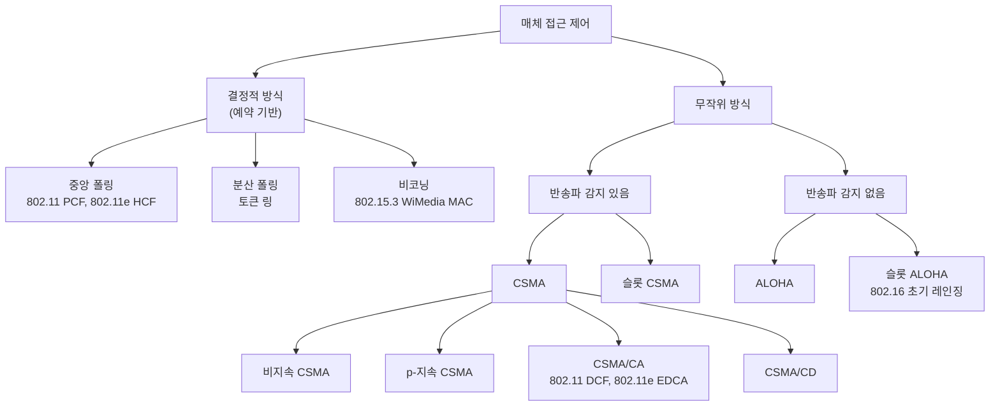

*그림 13. 매체 접근 제어 방식의 분류*

그림 13처럼 MAC 방식은 크게 두 갈래이다. **결정적 방식**은 누가 언제 보낼지 미리 예약하거나 차례를 정해 충돌이 없다. 중앙의 제어국이 단말에 차례로 물어보는 중앙 폴링, 토큰을 돌리는 분산 폴링, 비컨으로 시간 구간을 나누어 주는 비코닝이 있다. **무작위 방식**은 보낼 데이터가 생기면 경쟁하여 보내고, 충돌이 나면 다시 시도한다. 반송파 감지(carrier sense), 즉 채널이 비어 있는지 먼저 듣는지에 따라 CSMA 계열과 ALOHA 계열로 나뉜다. 각 방식의 기본 동작은 7주차에서 다루며, 여기서는 무선 통신의 관점에서 정리한다.

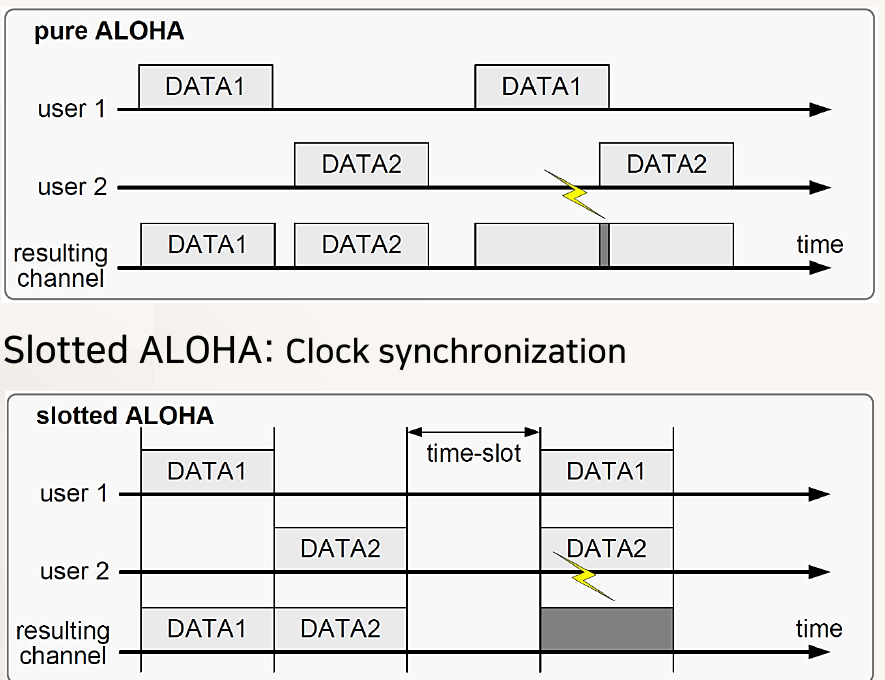

*그림 14. 순수 ALOHA와 슬롯 ALOHA의 전송과 충돌*

**순수 ALOHA(pure ALOHA).** 동기가 필요 없는 가장 단순한 방식으로, 보낼 데이터가 생기면 즉시 보낸다. 그림 14의 위쪽에서 사용자 1의 두 번째 DATA1과 사용자 2의 두 번째 DATA2가 시간상 일부라도 겹치므로 두 프레임 모두 망가진다. **슬롯 ALOHA(slotted ALOHA)** 는 시계를 맞추어 시간을 프레임 길이의 슬롯으로 나누고, 슬롯의 시작에서만 보내게 한다. 그러면 프레임이 일부만 겹치는 일이 없어지고 같은 슬롯을 고른 경우에만 충돌하므로, 충돌 가능 구간이 프레임 두 개 길이에서 한 개 길이로 줄어든다. 그 결과 최대 채널 효율이 순수 ALOHA의 약 18%($`1/2e`$)에서 약 37%($`1/e`$)로 높아진다 [5].

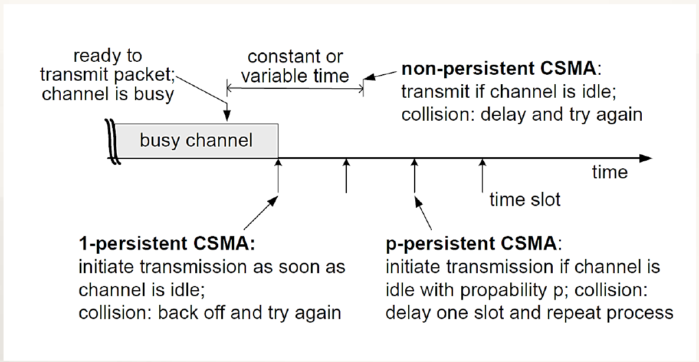

*그림 15. 1-지속, 비지속, p-지속 CSMA의 동작*

**CSMA(carrier sense multiple access).** 보내기 전에 채널을 들어 보고 비어 있을 때만 보낸다. 채널이 바쁠 때 어떻게 기다리는지에 따라 세 가지가 있다.

- **1-지속 CSMA(1-persistent):** 채널을 계속 감시하다가 비는 즉시 보낸다. 충돌하면 물러났다가(back off) 다시 시도한다. 여러 단말이 함께 기다리고 있으면 채널이 비는 순간 모두 보내 충돌하기 쉽다.
- **비지속 CSMA(non-persistent):** 채널이 바쁘면 일정하거나 임의의 시간만큼 기다린 뒤 다시 감지하고, 비어 있으면 보낸다. 충돌하면 지연 후 다시 시도한다. 충돌은 줄지만 채널이 비어도 놀리는 시간이 생긴다.
- **p-지속 CSMA(p-persistent):** 시간을 슬롯으로 나누고, 채널이 비어 있으면 확률 $p$로 보내고 확률 $1-p$로 한 슬롯 미룬 뒤 과정을 되풀이한다.

**CSMA/CD와 CSMA/CA.** **CSMA/CD(collision detection)** 는 보내는 동안 충돌을 감지하면 잼(jamming) 신호를 보내고 전송을 중단하는 방식으로, 유선 이더넷(IEEE 802.3)이 쓴다. **CSMA/CA(collision avoidance)** 는 채널을 예약하고, 다른 단말의 송신을 통지받은 단말은 매체 접근을 미루어 충돌을 미리 피하는 방식으로, 무선 LAN(IEEE 802.11)이 쓴다.

> **핵심:** 무선에서는 CSMA/CD를 쓸 수 없다. 단말이 보내는 동안 자기 신호가 수신 신호보다 훨씬 강해 다른 단말의 신호를 동시에 감지하기 어렵고, 송신 단말에서는 들리지 않는 단말이 수신 단말 쪽에서 충돌을 일으킬 수 있기 때문이다(숨은 터미널 문제). 그래서 무선에서는 충돌을 감지하는 대신 피하도록 설계한다.

### 1.11 흐름 제어: 링크 적응, RTS/CTS, 비지 톤

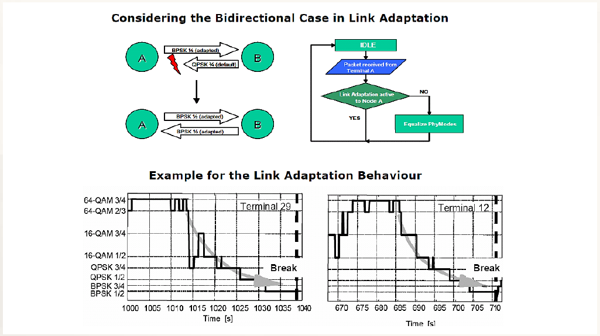

*그림 16. 양방향 링크 적응의 절차와 변조 방식의 변화 예*

**데이터 속도 제어와 링크 적응.** **링크 적응(LA, link adaptation)** 은 채널 상태에 맞추어 변조 방식과 부호화율을 바꾸는 기법이다. 그림 16의 아래쪽 그래프는 두 단말의 시간에 따른 전송 모드 변화이다. 채널이 좋을 때는 64-QAM 3/4로 빠르게 보내다가, 거리가 멀어지거나 장애물이 생겨 채널이 나빠지면 16-QAM, QPSK를 거쳐 BPSK 1/2까지 단계적으로 낮추어 오류를 줄인다. 위쪽은 양방향 링크의 경우이다. 단말 A가 B로 가는 링크를 낮은 모드(BPSK 1/2)로 적응시켰다면, B는 A에서 패킷을 받을 때 링크 적응이 작동 중인지 확인하고, 그렇다면 B에서 A로 가는 링크도 같은 물리 모드로 맞춘다(Equalize PhyMode). 두 방향의 무선 채널은 상태가 비슷하기 때문이다.

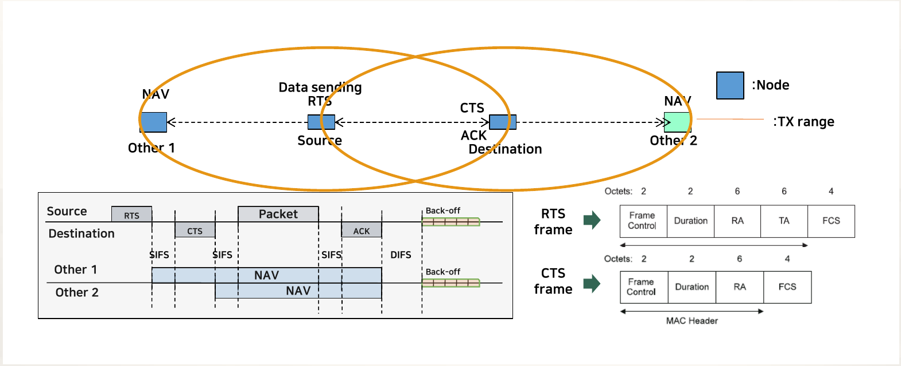

*그림 17. 숨은 터미널과 RTS/CTS 교환의 시간 흐름, RTS와 CTS 프레임의 구성*

**RTS/CTS.** 그림 17의 위쪽에서 Other 1은 송신자(Source)의 전파 범위 안에, Other 2는 수신자(Destination)의 전파 범위 안에만 있다. Other 2는 송신자의 신호를 듣지 못하므로, 송신자가 보내는 중에도 채널이 비었다고 판단해 송신하여 수신자 쪽에서 충돌을 일으킬 수 있다. 이것이 **숨은 터미널 문제(hidden terminal problem)** 이며, RTS/CTS로 해결한다.

1. 송신자가 짧은 **RTS(request to send)** 프레임으로 전송을 통보한다.
2. **SIFS(short inter-frame space)** 만큼 기다린 뒤, 수신자가 수신 준비가 되었음을 **CTS(clear to send)** 프레임으로 알린다.
3. 송신자가 SIFS 뒤에 데이터 패킷을 보내고, 수신자는 SIFS 뒤에 ACK로 수신을 확인한다.
4. RTS를 들은 Other 1과 CTS를 들은 Other 2는 프레임의 Duration 필드에 적힌 시간 동안 **NAV(network allocation vector)** 를 설정하고 송신을 미룬다. NAV가 끝나면 DIFS만큼 기다린 뒤 백오프(2.9절)를 거쳐 경쟁한다.

> **용어 정의:** **NAV(network allocation vector)** 는 다른 단말의 프레임에 적힌 Duration 값으로 설정하는 타이머이다. NAV가 0이 될 때까지 단말은 채널이 실제로 비어 있어도 바쁜 것으로 간주한다. 실제로 신호를 듣는 물리적 반송파 감지에 대비하여 가상 반송파 감지(virtual carrier sensing)라고도 한다.

그림 17의 오른쪽처럼 RTS 프레임은 프레임 제어(2옥텟), 지속 시간(2), RA(6), TA(6), FCS(4)로 20옥텟, CTS 프레임은 TA가 없어 14옥텟이다. 데이터 프레임보다 훨씬 짧으므로 RTS끼리 충돌하더라도 낭비되는 시간이 적다.

**비지 톤(busy tone).** 데이터를 받고 있는 노드가 좁은 별도의 주파수 대역(narrow channel band)으로 비지 톤을 보내, 주변 노드가 데이터 전송을 방해하지 못하게 하는 방식이다. 수신자가 직접 신호를 내므로 숨은 터미널도 수신 중임을 알 수 있다. 다만 추가로 좁은 대역을 써야 하므로 오버헤드가 생긴다.

### 1.12 오류 검출과 정정

오류를 검출하고 정정하는 방법에는 **패리티 검사(parity checking)**, **CRC(cyclic redundancy check)**, **FEC(forward error correction)**, **ARQ(automatic repeat request)** 가 있다.

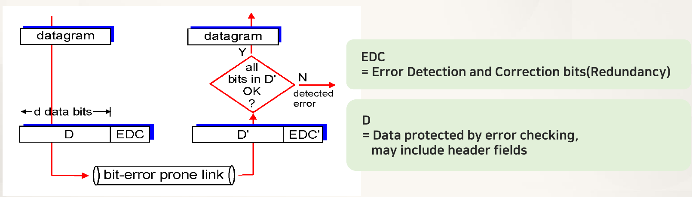

*그림 18. 오류 검출 비트(EDC)를 이용한 오류 검출 과정*

그림 18에서 송신 측은 보호할 데이터 $D$(헤더 필드를 포함할 수 있다)로부터 **EDC(error detection and correction bits)**, 즉 중복 비트를 계산해 $D$와 함께 보낸다. 비트 오류가 생길 수 있는 링크를 지나 수신 측은 $D'$와 $EDC'$를 받는다. 수신 측은 $D'$로 EDC를 다시 계산해 $EDC'$와 비교하고, 모든 비트가 맞으면 데이터그램을 위 계층으로 올리며, 그렇지 않으면 오류를 검출한다.

- **패리티 검사:** 1의 개수가 짝수(또는 홀수)가 되도록 비트 하나를 더한다. 예를 들어 짝수 패리티에서 1011001은 1이 4개이므로 패리티 비트 0을 붙인다. 비트 하나의 오류는 검출하지만 두 개가 동시에 틀리면 검출하지 못한다.
- **CRC:** 데이터를 다항식으로 보고 생성 다항식으로 나눈 나머지를 붙인다. 연속된 여러 비트의 오류(버스트 오류)도 잘 검출한다. CRC의 계산은 7주차에서 다룬다.
- **FEC:** 1.7절의 부호처럼 충분한 중복을 넣어 수신 측이 재전송 없이 스스로 오류를 고친다.
- **ARQ:** 오류를 검출하면 송신 측에 재전송을 요청한다(ACK를 받지 못하면 다시 보낸다).

> **주의:** 오류 검출은 완벽하지 않다. 오류가 우연히 EDC까지 맞아떨어지게 바꾸면 검출되지 않는다. EDC 비트가 많을수록 검출되지 않는 오류의 확률이 줄어든다. 또 차량 안전 메시지처럼 여러 수신자에게 방송하는 메시지는 ACK를 받지 않으므로 ARQ를 쓸 수 없고, FEC와 주기적인 반복 전송에 의존한다.

### 1.13 네트워크 계층: 포워딩과 라우팅

네트워크 계층에는 서로 다른 두 기능이 있다.

- **데이터 포워딩(data forwarding):** 라우터가 입력 포트로 들어온 데이터그램을 알맞은 출력 포트로 보내는 동작이다. 라우터는 **라우팅 테이블(포워딩 테이블)** 을 헤더 값으로 찾아(indexing) 출력 포트를 정한다.
- **라우팅(routing):** 네트워크 전체에 걸쳐 출발지에서 목적지까지 종단 사이의 경로를 정하는 일이다. 라우팅 알고리즘이 계산한 종단 사이의 최소 비용 경로들이 라우팅 테이블에 저장된다.

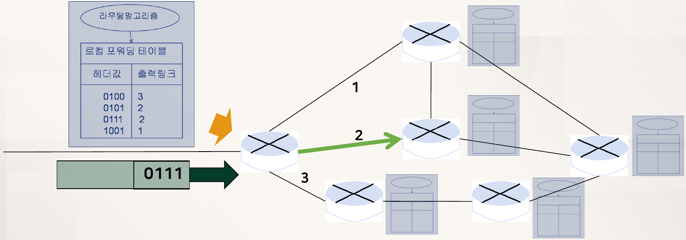

*그림 19. 라우팅 알고리즘이 만든 로컬 포워딩 테이블에 따른 패킷 전달*

그림 19에서 라우팅 알고리즘은 각 라우터의 로컬 포워딩 테이블을 만든다. 왼쪽 라우터의 테이블은 헤더 값 0100을 출력 링크 3으로, 0101과 0111을 출력 링크 2로, 1001을 출력 링크 1로 보낸다. 헤더 값이 0111인 패킷이 도착하면 라우터는 테이블에서 0111을 찾아 출력 링크 2로 내보낸다. 여행에 비유하면 라우팅은 지도를 보고 출발지에서 목적지까지의 전체 경로를 짜는 일이고, 포워딩은 교차로 하나에서 어느 쪽으로 나갈지 고르는 일이다 [5].

### 1.14 가상 회선과 데이터그램

네트워크 계층이 제공하는 서비스는 연결을 먼저 설정하는지에 따라 두 가지로 나뉜다. 회선 교환과 패킷 교환의 개념은 4주차에서 다루었다.

**가상 회선(VC, virtual circuit) 네트워크.** 회선 교환처럼 데이터를 보내기 전에 경로를 먼저 설정하는, 네트워크 계층의 **연결형 서비스**이다. 패킷 교환망 위에서 동작하지만, 경로가 정해지면 모든 패킷이 그 경로를 따라간다.

- 경로에 있는 각 링크마다 가상 회선 번호를 부여한다.
- 네트워크의 라우터는 현재 연결에 대한 연결 상태 정보(connection state information)를 유지한다.
- 새로운 연결이 설정될 때마다 그 연결의 항목이 라우터의 포워딩 테이블에 추가된다.

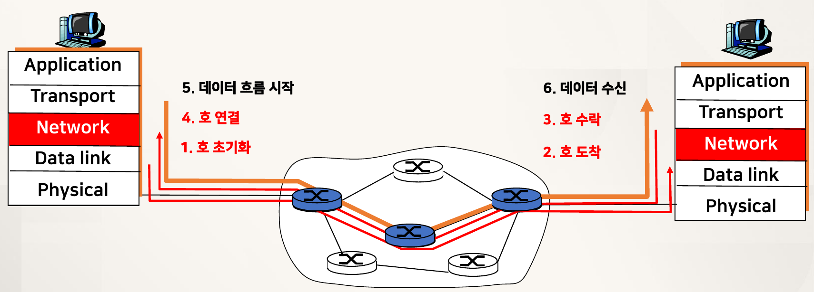

*그림 20. 가상 회선 서비스 모델의 호 설정과 데이터 전송 순서*

그림 20에서 연결은 다음 순서로 이루어진다. 1) 송신 측 네트워크 계층이 호(call)를 시작하고, 2) 호가 수신 측에 도착하면, 3) 수신 측이 호를 수락하고, 4) 송신 측에 호가 연결되었음이 알려지면, 5) 데이터 흐름이 시작되고, 6) 수신 측이 데이터를 받는다. 1\~4단계에서 경로의 라우터들이 연결 상태를 기록하므로, 이후의 데이터는 모두 같은 경로(굵은 선)를 따른다.

**데이터그램(datagram) 네트워크.** 연결 호를 유지하지 않는다는 뜻의 **비연결형 서비스**이다. 각 패킷이 목적지 주소를 담고 독립적으로 전달되므로, 출발지와 목적지 사이에서 패킷마다 다른 경로로 전달될 수 있다.

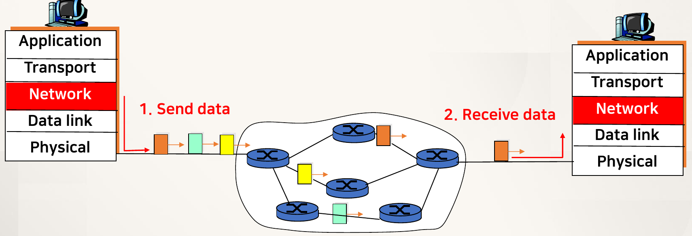

*그림 21. 데이터그램 서비스 모델의 패킷 전달*

그림 21에서 송신 측은 호 설정 없이 바로 데이터를 보내고(1), 세 패킷은 네트워크 안에서 서로 다른 경로를 거쳐 수신 측에 도착한다(2). 인터넷의 IP가 데이터그램 방식이다.

| 구분 | 가상 회선 | 데이터그램 |
|:-----|:-----|:-----|
| 연결 설정 | 데이터 전송 전에 호를 설정한다 | 설정 없이 바로 보낸다 |
| 경로 | 모든 패킷이 같은 경로를 따른다 | 패킷마다 경로가 다를 수 있다 |
| 라우터의 상태 정보 | 연결마다 상태를 유지한다 | 연결 상태를 유지하지 않는다 |
| 장애에 대한 대응 | 경로의 라우터가 고장 나면 연결이 끊긴다 | 다른 경로로 우회할 수 있다 |

*표 8. 가상 회선과 데이터그램 서비스의 비교*

### 1.15 IPv4

**IPv4**는 현재 인터넷의 대표적인 주소 체계이며, 총 32비트로 주소를 나타낸다. 사람이 읽기 쉽게 8비트씩 끊어 10진수로 쓰고 점으로 구분한다. 예를 들어 166.104.45.135는 2진수로 10100110.01101000.00101101.10000111이다. 32비트로 만들 수 있는 주소는 $2^{32} \approx 43$억 개이다.

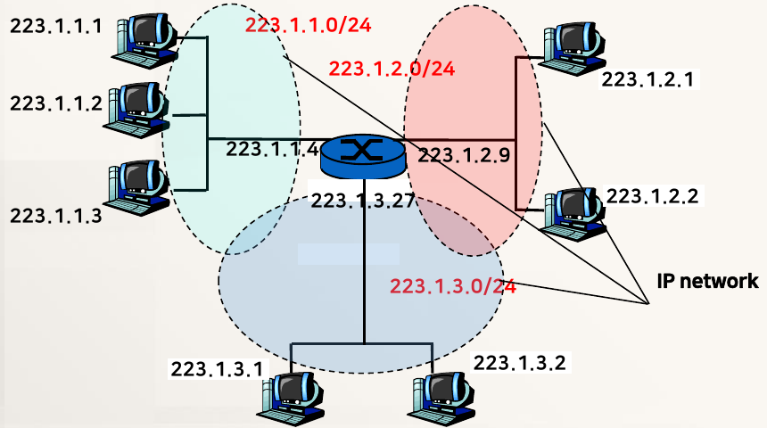

*그림 22. 라우터 하나로 연결된 세 IPv4 서브넷*

그림 22에서 라우터는 인터페이스 세 개(223.1.1.4, 223.1.2.9, 223.1.3.27)로 세 개의 IP 네트워크(서브넷)를 잇는다. 223.1.1.0/24라는 표기에서 /24는 주소의 앞 24비트가 네트워크를 나타내는 **네트워크 접두사(network prefix)** 라는 뜻이며, 같은 뜻을 32비트 마스크로 쓰면 앞 24비트가 1인 **서브넷 마스크(subnet mask)** 255.255.255.0이다. 따라서 223.1.1.1, 223.1.1.2, 223.1.1.3은 접두사 223.1.1이 같아 라우터를 거치지 않고 서로 통신하는 한 서브넷에 속하고, 223.1.2.1과 통신하려면 라우터를 거쳐야 한다.

IPv4 데이터그램의 헤더는 다음과 같다. 각 필드의 역할은 5주차에서 자세히 다루었다.

```text
0               8               16              24              32 bits
+-------+-------+---------------+-------------------------------+
|Version|   HL  |  Type of Svc. |    Datagram Length (bytes)    |
+-------+-------+---------------+-------------------------------+
|       16-bit Identifier       |Flags|  13-bit Fragment Offset |
+-------------------------------+-----+-------------------------+
|      TTL      |  Upper-layer  |        Header Checksum        |
|               |    Protocol   |                               |
+---------------+---------------+-------------------------------+
|                    32-bit Source IP Address                   |
+---------------------------------------------------------------+
|                 32-bit Destination IP Address                 |
+---------------------------------------------------------------+
|                        Options (if any)                       |
+---------------------------------------------------------------+
|                              Data                             |
+---------------------------------------------------------------+
```

*그림 23. IPv4 데이터그램의 형식*

버전, 헤더 길이(HL), 서비스 타입, 데이터그램 길이, 식별자, 플래그, 단편화 오프셋, TTL(time to live), 상위 계층 프로토콜, 헤더 체크섬, 출발지와 목적지 주소, 옵션, 데이터로 이루어진다.

### 1.16 IPv6와 IPv4의 공존

**IPv6**는 IPv4 주소가 고갈되어 개발되었다. 주소는 128비트이므로 $2^{128} \approx 3.4 \times 10^{38}$개의 주소를 만들 수 있다. 헤더도 다음과 같이 바뀌었다 [6].

- 라우터에서 되풀이되던 단편화와 헤더 체크섬을 없애 라우터의 처리를 줄이고 전달 속도를 높였다. 단편화는 출발지에서만 하고, 오류 검출은 링크 계층과 전송 계층에 맡긴다.
- 실시간 서비스처럼 특별한 처리를 요청하는 트래픽을 위해 **트래픽 클래스(traffic class, 우선순위)** 필드와 **흐름 라벨(flow label)** 필드를 추가하여 QoS를 지원한다.
- 헤더 길이를 40바이트로 고정하고, 옵션은 확장 헤더로 분리했다.

```text
0       4               12              20              28      32 bits
+-------+---------------+---------------------------------------+
|Version| Traffic Class |               Flow Label              |
+-------+---------------+---------------------------------------+
|         Payload Length        |  Next Header  |   Hop Limit   |
+-------------------------------+---------------+---------------+
|                                                               |
|                  Source IP Address (128 bits)                 |   fixed
|                                                               |   40 bytes
+---------------------------------------------------------------+
|                                                               |
|               Destination IP Address (128 bits)               |
|                                                               |
+---------------------------------------------------------------+
|                              Data                             |
+---------------------------------------------------------------+
```

*그림 24. IPv6 데이터그램의 형식*

버전(4비트), 트래픽 클래스(8비트), 흐름 라벨(20비트), 페이로드 길이(16비트), 다음 헤더(8비트), 홉 제한(hop limit, 8비트, IPv4의 TTL에 해당), 출발지 주소(128비트), 목적지 주소(128비트)로 모두 40바이트이다.

IPv6 주소는 16비트씩 여덟 묶음을 16진수로 쓰고 콜론으로 구분한다. 예를 들어 fa57:0:0:0:31a1:d13e:dbbb:c18d에서 연속된 0 묶음은 ::로 한 번 줄일 수 있어 fa57::31a1:d13e:dbbb:c18d로도 쓴다.

**확장 헤더.** IPv6는 옵션을 고정 헤더에 넣지 않고, **다음 헤더(Next Header)** 필드로 뒤따르는 확장 헤더(extension header)를 가리켜 구현한다. 마지막 확장 헤더의 다음 헤더 필드는 TCP(6) 같은 상위 계층 프로토콜을 가리킨다.

| 다음 헤더 값 | 가리키는 헤더 |
|:-----|:-----|
| 0 | 홉별 옵션(hop-by-hop options) |
| 6 | TCP |
| 43 | 라우팅(routing) |
| 44 | 단편(fragment) |
| 50 | 암호화 페이로드(ESP, encapsulating security payload) |
| 51 | 인증(AH, authentication header) |
| 60 | 목적지 옵션(destination options) |

*표 9. IPv6 다음 헤더 값의 예*

```text
(a) no extension header
+------------------------+--------------------------------------+
| IPv6 Header            | TCP                                  |
| Next Header: TCP (6)   |                                      |
+------------------------+--------------------------------------+

(b) one extension header
+------------------------+------------------------+-------------+
| IPv6 Header            | Hop-by-Hop Header      | TCP         |
| Next Header: HbH (0)   | Next Header: TCP (6)   |             |
+------------------------+------------------------+-------------+

(c) two extension headers
+------------------------+------------------------+-------------------------+
| IPv6 Header            | Hop-by-Hop Header      | ESP Header + (encrypted |
| Next Header: HbH (0)   | Next Header: ESP (50)  |  TCP segment ...)       |
+------------------------+------------------------+-------------------------+
```

*그림 25. 다음 헤더 필드로 이어지는 IPv6 확장 헤더의 사슬*

그림 25의 (a)는 확장 헤더가 없어 IPv6 헤더의 다음 헤더가 바로 TCP(6)를 가리키는 경우이다. (b)는 홉별 옵션 헤더를 하나 넣은 경우로, IPv6 헤더가 0을, 홉별 옵션 헤더가 TCP(6)를 가리킨다. (c)는 홉별 옵션 헤더 뒤에 암호화 헤더(ESP)를 둔 경우이다. 홉별 옵션 헤더는 경로의 모든 라우터가 읽어야 하므로 IPv6 헤더 바로 뒤에만 올 수 있고 [6], ESP 뒤의 TCP 세그먼트는 암호화되어 있다 [7].

> **참고:** IPv6 암호화 헤더의 다음 헤더 값을 60으로 적고 그 뒤에 홉별 옵션 헤더를 두는 자료가 있다. 그러나 60은 목적지 옵션 헤더의 값이고 암호화(ESP)는 50이며, 홉별 옵션 헤더는 반드시 IPv6 헤더 바로 뒤에 와야 한다 [6], [7].

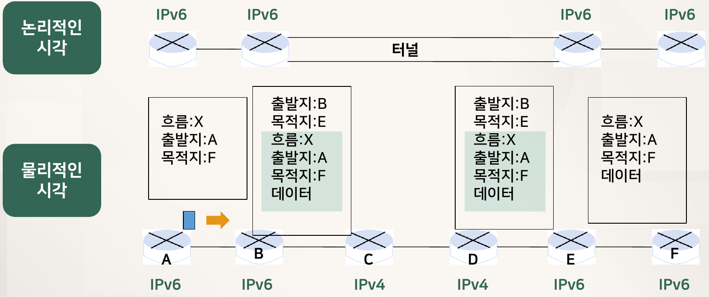

*그림 26. IPv4 구간을 지나는 IPv6 데이터그램의 터널링*

**IPv4와 IPv6의 공존: 터널링.** 인터넷의 모든 라우터를 한꺼번에 IPv6로 바꿀 수 없으므로, 한동안 두 버전이 함께 쓰인다. 그림 26의 아래쪽(물리적인 시각)에서 IPv6 라우터 A, B와 E, F 사이에 IPv4만 아는 라우터 C, D가 있다. A가 F로 보내는 IPv6 데이터그램(흐름 X, 출발지 A, 목적지 F, 데이터)이 B에 도착하면, B는 이 데이터그램 전체를 IPv4 데이터그램(출발지 B, 목적지 E)의 데이터 부분에 넣어 보낸다. C와 D는 평범한 IPv4 데이터그램으로 전달하고, E는 IPv4 헤더를 벗겨 원래의 IPv6 데이터그램을 꺼내 F로 보낸다. 위쪽(논리적인 시각)에서 보면 B와 E는 IPv4 구간을 지나는 가상의 링크, 즉 **터널(tunnel)** 로 직접 연결된 것처럼 보인다 [5]. 3.2절의 WAVE는 네트워크 계층에서 IPv6만 쓴다.

---

<br>

## 2. DSRC와 무선 LAN

### 2.1 DSRC의 특징

> **용어 정의:** **DSRC(Dedicated Short Range Communication, 단거리 전용 통신)** 는 도로변의 노변 기지국과 차량 사이에서 양방향으로 주고받는 근거리 무선 통신이다. 노변 쪽 장치를 RSU(roadside unit) 또는 RSE(roadside equipment), 차량 쪽 장치를 OBU(on-board unit) 또는 OBE(on-board equipment)라 한다.

DSRC의 특징은 다음과 같다.

- 노변과 차량 사이의 양방향 근거리 통신이며, 통신 영역(coverage)은 10\~100 m 이하이다.
- 다양한 ITS 서비스를 제공한다.
- 약 1 Mbps의 고속 전송을 한다.
- 능동 방식과 수동 방식이 모두 가능하다(2.3절).
- 값싼 ITS 무선 패킷 데이터 통신 시스템이다. 값싼 변조 기술(ASK)을 쓰고, 프로토콜 구조가 응용 계층, LLC, MAC, 물리 계층으로 단순하다.

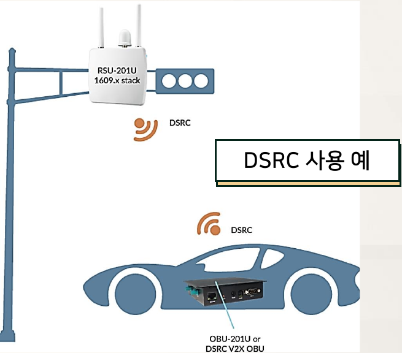

*그림 27. 노변 기지국(RSU)과 차량 탑재 장치(OBU)를 이용한 DSRC 사용 예*

그림 27에서 신호등 기둥에 달린 RSU와 차량 안의 OBU가 DSRC로 통신한다.

> **참고:** DSRC라는 이름은 지역에 따라 다른 기술을 가리킨다. 한국, 일본, 유럽에서는 이 절에서 다루는 5.8 GHz 대역의 요금 징수용 통신을 가리키고, 미국에서는 흔히 5.9 GHz 대역의 IEEE 802.11p 기반 통신, 즉 3절의 WAVE를 가리킨다. 1주차에서 WAVE를 넓은 의미의 DSRC라고 한 것은 미국식 용법이다.

### 2.2 DSRC의 계층 구조

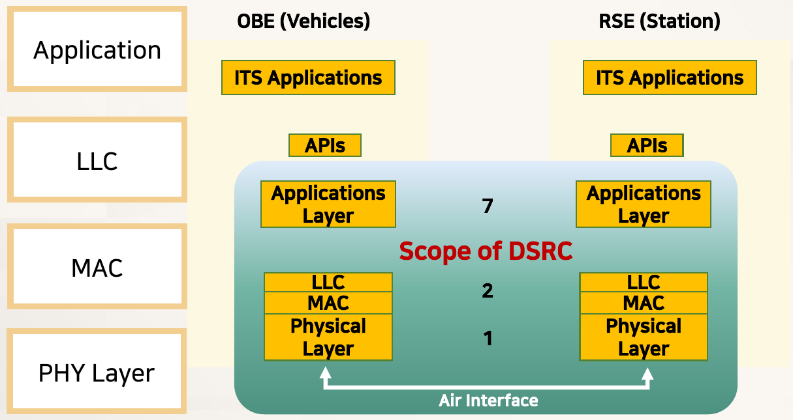

*그림 28. DSRC의 계층 구조와 표준화 범위*

그림 28에서 차량의 OBE와 노변의 RSE는 같은 계층 구조를 가진다. ITS 응용이 API를 통해 응용 계층(7계층)을 쓰고, 그 아래에 LLC와 MAC으로 이루어진 데이터 링크 계층(2계층), 물리 계층(1계층)이 있으며, 두 장치는 공기 중의 무선 인터페이스(air interface)로 연결된다. DSRC 표준의 범위(scope of DSRC)는 7계층, 2계층, 1계층이다.

> **핵심:** DSRC는 OSI의 3\~6계층을 생략한다. 노변 기지국과 차량이 한 번의 무선 구간으로 직접 연결되므로 경로를 정하는 네트워크 계층이 필요 없고, 통신이 차량이 통신 영역을 지나는 짧은 시간 동안만 이루어지므로 계층을 줄여 처리 시간과 오버헤드를 줄인다.

### 2.3 국내외 DSRC 통신 규격

국내 DSRC는 RSU와 OBU 사이의 통신에 **TDMA(time division multiple access)**, 즉 시간을 슬롯으로 나누어 단말마다 다른 슬롯을 배정하는 다중 접속 방식을 쓴다. 통신 매체에 따라 전파를 쓰는 RF-DSRC와 적외선을 쓰는 IR-DSRC가 있다.

| 구분 | RF-DSRC | IR-DSRC |
|:-----|:-----|:-----|
| 반송 주파수(전송 주파수) | 5.8 GHz | 파장 800\~900 nm(적외선) |
| 송수신 대역폭 | 10 MHz | 해당 없음 |
| 통신 방식 | 능동 | 능동 |
| 변조 방식 | ASK | ASK-OOK |
| 전송 속도 | 1.024 Mbps | 1.024 Mbps |
| 비트 오류율(BER) | $10^{-5}$ | $10^{-6}$ |

*표 10. 국내 DSRC의 기본 통신 규격*

> **용어 정의:** **OOK(on-off keying)** 는 ASK의 가장 단순한 형태로, 비트 1이면 반송파(또는 빛)를 켜고 0이면 끄는 방식이다.

> **용어 정의:** **BER(bit error rate, 비트 오류율)** 은 전송한 비트 가운데 틀린 비트의 비율로, $10^{-5}$은 10만 비트 중 1비트가 틀린다는 뜻이다.

| 지역 | 유럽(CEN) | 일본 | 한국 |
|:-----|:-----|:-----|:-----|
| 표준화 기구 | CEN TC 278 | ARIB STD-T55, T75 | TTA |
| 주파수(물리 계층) | 5.8 GHz | 5.8 GHz | 5.8 GHz |
| 능동/수동 방식 | 수동 | 능동 | 능동 |
| 변조 방식 | ASK, BPSK | ASK, QPSK | ASK |
| 전송 속도 | 다운링크 500 kbps, 업링크 250 kbps | 1 Mbps, 4 Mbps | 1 Mbps |

*표 11. 주요국의 RF-DSRC 규격*

**능동 방식과 수동 방식.** 능동(active) 방식의 OBU는 자신의 발진기와 송신기로 반송파를 직접 만들어 보낸다. 수동(passive) 방식의 OBU는 송신기가 없고, RSU가 보낸 변조되지 않은 반송파를 받아 자기 데이터로 변조한 뒤 되반사(backscatter)하여 응답한다 [8]. 수동 방식은 OBU가 싸고 전력을 적게 쓰지만 통신 거리가 짧고, 능동 방식은 OBU가 비싸지만 거리와 속도에서 유리하다. 표 11에서 유럽만 수동 방식을 쓴다. 유럽의 EN 12253은 RSU에서 OBU로 가는 다운링크를 500 kbps, OBU에서 RSU로 가는 업링크를 250 kbps로 정한다 [8].

### 2.4 DSRC 프로토콜 스택

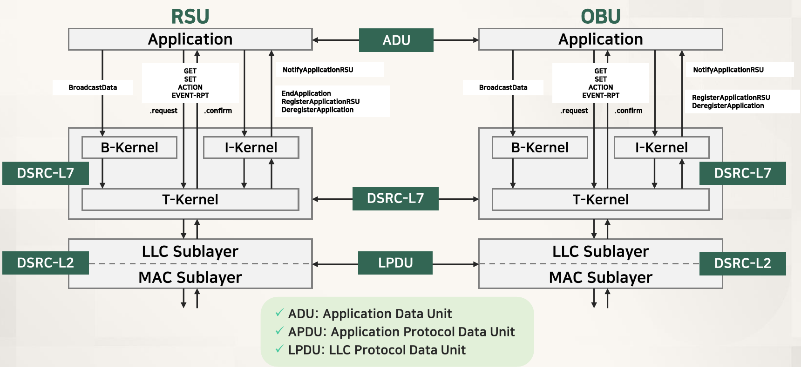

*그림 29. RSU와 OBU의 DSRC 프로토콜 스택*

그림 29는 RSU와 OBU의 DSRC 프로토콜 스택이다. 7계층(DSRC-L7)은 세 개의 커널(kernel)로 이루어지며, 이 응용 계층의 국제 표준은 ISO 15628이다 [9].

| 구성 요소 | 역할 |
|:-----|:-----|
| T-Kernel(transfer kernel) | LLC를 통해 상대편과 데이터를 주고받는다. GET, SET, ACTION, EVENT-REPORT 서비스를 요청(.request)과 확인(.confirm)으로 제공한다. |
| I-Kernel(initialisation kernel) | 통신 개시(초기화)와 응용의 등록, 등록 해제, 통지, 종료를 관리한다(RegisterApplicationRSU, DeregisterApplication, NotifyApplicationRSU, EndApplication). |
| B-Kernel(broadcast kernel) | 여러 OBU에 공통으로 보낼 데이터를 방송한다(BroadcastData). |
| LLC 부계층, MAC 부계층(DSRC-L2) | 프레임을 만들어 슬롯에 실어 보낸다. |

*표 12. DSRC 프로토콜 스택의 구성 요소*

계층 사이를 오가는 데이터 단위에는 응용 사이의 **ADU(application data unit)**, 7계층 프로토콜의 **APDU(application protocol data unit)**, LLC의 **LPDU(LLC protocol data unit)** 가 있다.

### 2.5 RF-DSRC MAC 프레임과 통신 절차

RF-DSRC의 MAC 계층은 시간을 슬롯으로 나눈 TDMA 프레임을 쓴다. 한 슬롯은 100옥텟, 약 0.8 ms이다. 100옥텟은 800비트이며, 1.024 Mbps에서 $800 / (1.024 \times 10^6) \approx 0.78$ ms에 해당한다.

```text
|<-100 octets->|
+--------------+-------+-------+-----+-------+--------+-----+--------+
|     FCMS     | MDS#1 | MDS#2 | ... | MDS#n | ACTS#1 | ... | ACTS#k |
+--------------+-------+-------+-----+-------+--------+-----+--------+
|<--0.8 ms---->|
  FCMS : 1 slot
  MDS  : 0 <= n <= 8      1 <= n + k <= 8
  ACTS : 0 <= k <= 8      total: 2 to 9 slots
```

*그림 30. RF-DSRC MAC 프레임의 슬롯 구성*

| 슬롯 | 이름 | 개수 | 역할 |
|:-----|:-----|:-----|:-----|
| FCMS | 프레임 제어 메시지 슬롯(frame control message slot) | 1 | RSU가 프레임의 구조와 각 슬롯의 배정 정보를 알린다. |
| MDS | 메시지 데이터 슬롯(message data slot) | 0\~8 | RSU와 링크가 연결된 OBU가 데이터를 주고받는다. |
| ACTS | 활성화 슬롯(activation slot) | 0\~8 | 아직 연결되지 않은 OBU가 링크 연결을 요청한다. |

*표 13. RF-DSRC MAC 프레임의 슬롯*

MDS와 ACTS의 합은 1개 이상 8개 이하이므로($`1 \le n + k \le 8`$), FCMS를 포함한 한 프레임은 2\~9개의 슬롯으로 이루어진다.

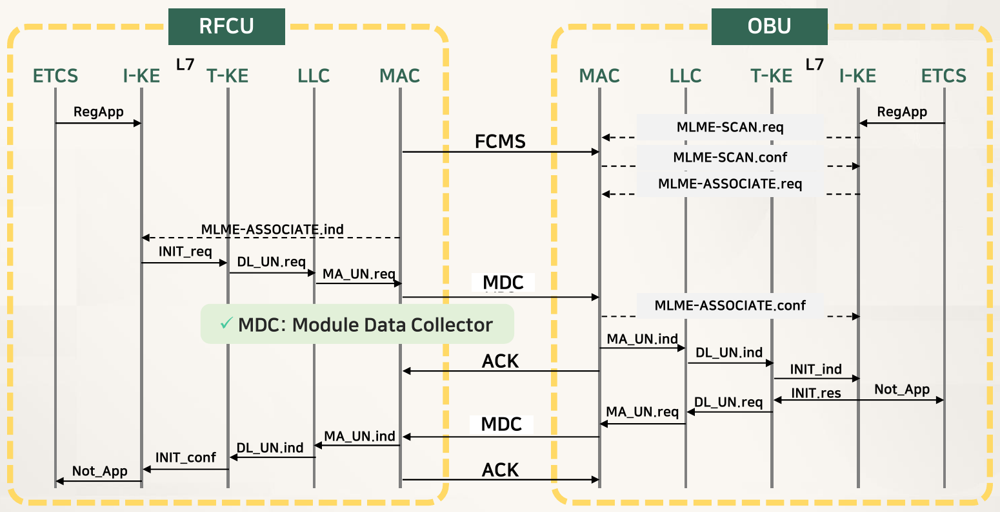

*그림 31. RFCU와 OBU 사이의 RF-DSRC 통신 절차*

그림 31은 노변 측 RFCU와 차량 측 OBU 사이의 통신 절차이다. 양쪽 모두 ETCS 응용, 7계층의 I-KE와 T-KE, LLC, MAC으로 이루어진다.

> **용어 정의:** 계층 사이의 서비스 요청은 네 종류의 서비스 프리미티브(service primitive)로 나타낸다. **request(.req)** 는 위 계층이 아래 계층에 서비스를 요청하는 것이다.

> **용어 정의:** **indication(.ind)** 은 아래 계층이 위 계층에 상대편의 요청이 왔음을 알리는 것이다.

> **용어 정의:** **response(.res)** 는 indication에 대한 위 계층의 응답이다.

> **용어 정의:** **confirm(.conf, .cfm)** 은 요청한 쪽에 결과를 확인해 주는 것이다.

1. 양쪽의 ETCS 응용이 각자의 I-KE에 응용을 등록한다(RegApp).
2. RFCU의 MAC이 FCMS를 방송한다. OBU의 관리 개체는 MLME-SCAN.req와 MLME-SCAN.conf로 FCMS를 찾아 프레임 정보를 얻고, MLME-ASSOCIATE.req로 연결을 시작한다.
3. RFCU 쪽에 MLME-ASSOCIATE.ind가 올라가면, I-KE가 초기화 요청(INIT_req)을 만들어 T-KE(DL_UN.req)와 LLC(MA_UN.req)를 거쳐 MAC으로 내려보내고, MAC은 MDS 슬롯 안의 **MDC(message data channel, 메시지 데이터 채널)** 로 OBU에 보낸다.
4. OBU는 MLME-ASSOCIATE.conf로 연결을 확인하고, 받은 데이터를 MA_UN.ind, DL_UN.ind, INIT_ind 순으로 I-KE까지 올린다. I-KE는 ETCS 응용에 통지(Not_App)하고, 초기화 응답(INIT.res)을 DL_UN.req, MA_UN.req를 거쳐 MDC로 RFCU에 보낸다. 데이터를 받은 쪽은 ACK로 수신을 확인한다.
5. RFCU는 응답을 MA_UN.ind, DL_UN.ind로 올려 I-KE에 초기화 확인(INIT_conf)을 전하고, I-KE는 ETCS 응용에 통지한다(Not_App). 이후 요금 징수 같은 응용 데이터를 같은 방식으로 주고받는다.

> **참고:** MDC는 메시지 데이터 슬롯 안에서 데이터를 싣는 메시지 데이터 채널(message data channel)이다. 같은 계열의 DSRC 표준은 슬롯 안의 채널을 FCMC(frame control message channel), MDC, ACKC(ACK channel), ACTC(activation channel)로 부른다 [10]. 일부 자료는 MDC를 Module Data Collector로 풀어 쓰지만 이 맥락의 뜻이 아니다.

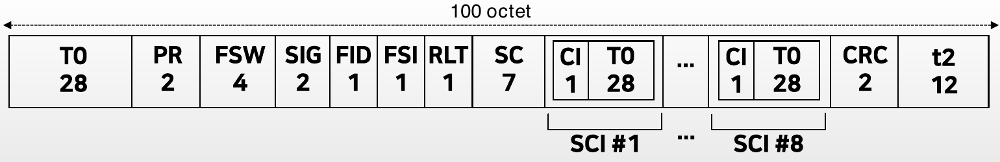

*그림 32. RF-DSRC FCMS의 필드 구성*

그림 32의 FCMS는 100옥텟 슬롯 안에 다음 필드를 담는다.

| 필드 | 뜻 | 역할 |
|:-----|:-----|:-----|
| PR | 프리앰블(preamble) | 비트 동기를 맞출 때 쓴다. |
| FSW | 프레임 동기 워드(frame synchronization word) | 프레임 동기를 맞출 때 쓴다. |
| SIG | 신호(signaling) | 통신 채널을 제어한다. |
| FID | 고정 장치 ID(fixed equipment ID) | 노변 기지국의 식별자이며, 노변 기지국을 초기화할 때 생성한다. |
| FSI | 프레임 구조 식별자(frame structure identifier) | 프레임의 구조 정보를 담는다. |
| RLT | 해제 타이머 식별자(release timer identifier) | 해당 링크에 다시 접속하기 위해 기다려야 하는 시간이다. |
| SC | 서비스 코드(service code) | OBU가 노변 기지국에서 제공하지 않는 서비스를 요구하여 쓸모없는 통신 부하를 일으키는 것을 막는다. |
| SCI #1\~#8 | 슬롯 제어 식별자(slot control identifier) | 필드의 순서에 대응하는 MDS나 ACTS 슬롯의 제어 정보를 담는다. |
| CRC | 순환 중복 검사 | 오류를 검출한다. |

*표 14. FCMS의 필드*

> **참고:** 그림 32에 적힌 숫자를 모두 옥텟으로 보고 더하면 100을 크게 넘는다. 예를 들어 CI(1)와 T0(28)로 이루어진 SCI 여덟 개만 더해도 $8 \times 29 = 232$이다. 따라서 이 숫자를 FCMS의 옥텟 배치로 그대로 읽을 수는 없으며, 필드의 크기를 더하면 정확히 100옥텟이 되는 MDS 슬롯(그림 33), ACTS 슬롯(그림 34)과 달리 그림 32는 필드의 종류와 순서를 보여 주는 그림으로 보아야 한다.

MDS 슬롯은 데이터를 싣는 MDC와 수신 확인을 싣는 ACKC로 이루어진다(숫자는 옥텟 수).

```text
|<--------------------- MDS slot: 100 octets ---------------------->|
+----+-----+-----+--------+-----+------+----+-----+----+-----+------+
| PR | CSW | MAC |  MSDU  | CRC |  t3  | PR | CSW | AI | CRC |  t4  |
| 2  |  2  |  2  |   65   |  2  |  11  | 2  |  2  | 1  |  2  |  9   |
+----+-----+-----+--------+-----+------+----+-----+----+-----+------+
|<------------ MDC ------------>|      |<------ ACKC ------->|

MAC control field (bits): FRG 1 | C/L 1 | reserved 1 | C/R 1 | SEQ 4 | LI 7 | reserved 1
```

*그림 33. RF-DSRC MDS 슬롯의 구성*

MDC는 PR(2), CSW(2), MAC 제어 필드(2), MSDU(65), CRC(2)의 73옥텟이고, ACKC는 PR(2), CSW(2), AI(1), CRC(2)의 7옥텟이다. 그 사이와 뒤의 t3(11)과 t4(9)는 송신과 수신을 전환하기 위한 시간 간격이며, 모두 더하면 $73 + 11 + 7 + 9 = 100$옥텟이 된다. CSW는 FCMS의 FSW처럼 PR 바로 뒤에 오는 동기 워드이다. 16비트의 MAC 제어 필드는 다음 하위 필드로 이루어지며, 나머지 두 비트는 이후 사용을 위해 예약되어 있다.

- **FRG(fragmentation, 1비트):** LPDU의 분할 정보이다.
- **C/L(continuous/last, 1비트):** 분할된 LPDU의 마지막 조각인지 알린다.
- **C/R(command/response, 1비트):** 명령인지 응답인지 구분한다.
- **SEQ(sequence number, 4비트):** MSDU의 순서 번호이다.
- **LI(length indicator, 7비트):** MSDU 안의 유효 데이터 길이이다.

ACKC의 **AI(acknowledgement identifier)** 는 수신 확인 정보이다.

ACTS 슬롯은 13옥텟짜리 활성화 채널(ACTC) 여섯 개로 이루어진다.

```text
|<------------------------------ ACTS slot: 100 octets ------------------------------>|
+---------+---+---------+---+---------+---+---------+---+---------+---+---------+-----+
| ACTC(1) | t5| ACTC(2) | t5| ACTC(3) | t5| ACTC(4) | t5| ACTC(5) | t5| ACTC(6) |  t6 |
|    13   | 2 |    13   | 2 |    13   | 2 |    13   | 2 |    13   | 2 |    13   |  12 |
+---------+---+---------+---+---------+---+---------+---+---------+---+---------+-----+

ACTC (13 octets):
+----+-----+-----+-----+-----+-----+-----+
| PR | CSW | FID | LID | LRI | LRC | CRC |
| 2  |  2  |  1  |  4  |  1  |  1  |  2  |
+----+-----+-----+-----+-----+-----+-----+
```

*그림 34. RF-DSRC ACTS 슬롯과 ACTC의 구성*

ACTC 여섯 개(78옥텟)와 그 사이의 간격 t5 다섯 개(10옥텟), 끝의 t6(12옥텟)을 더하면 100옥텟이다. ACTC의 필드는 노변 기지국의 식별자 **FID(fixed equipment ID)**, 링크 주소 필드 **LID(link address ID)**, 링크 접속 시도에 쓰는 **LRI(link request information)**, 재시도 횟수 정보 필드 **LRC(link retry counter)** 이다. 아직 링크가 없는 OBU는 FCMS로 ACTS의 위치를 알아낸 뒤 여섯 ACTC 가운데 하나를 임의로 골라 연결을 요청한다 [10]. 두 OBU가 같은 ACTC를 고르면 충돌하므로, 실패한 OBU는 다음 프레임에서 다시 시도하고 그 횟수를 LRC에 적는다. 1.10절의 슬롯 ALOHA와 같은 원리이다.

### 2.6 ETCS와 하이패스

> **용어 정의:** **ETCS(electronic toll collection system, 전자 요금 징수 시스템)** 는 RSE와 OBE 사이의 DSRC 무선 통신으로, OBE에 꽂힌 IC 카드에서 통행료를 자동으로 징수하는 서비스이다.

DSRC의 대표적인 응용인 ETCS는 나라마다 이름이 다르다. 한국은 하이패스(Hi-Pass), 일본은 ETC, 미국은 E-ZPass, 이탈리아는 Telepass, 포르투갈은 Via Verde이다.

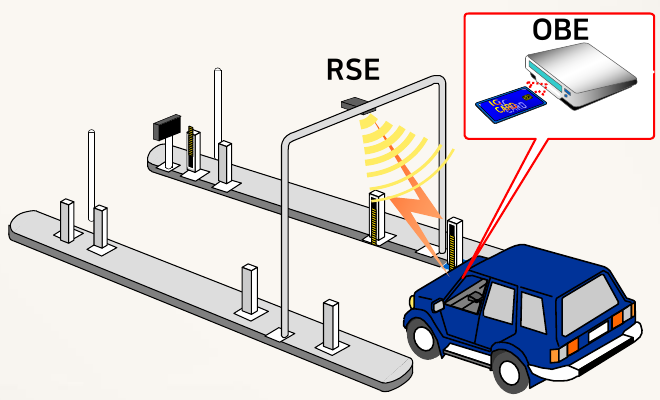

*그림 35. 요금소의 RSE와 차량의 OBE로 이루어진 ETCS*

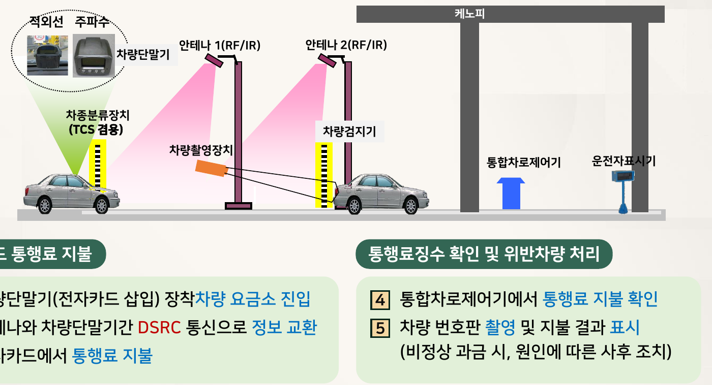

*그림 36. 하이패스 서비스 시스템의 구조*

그림 36의 하이패스 차로에는 요금소 지붕(캐노피) 앞의 기둥에 달린 안테나 1과 안테나 2(RF 또는 적외선), 차종 분류 장치(TCS 겸용), 차량 촬영 장치, 차량 검지기, 통합 차로 제어기, 운전자 표시기가 있다. 차량 단말기에는 적외선 방식과 주파수(RF) 방식이 있다. 징수는 다음 순서로 진행된다.

1. 전자 카드를 꽂은 차량 단말기를 단 차량이 요금소에 진입한다.
2. 안테나와 차량 단말기가 DSRC 통신으로 정보를 교환한다.
3. 전자 카드에서 통행료를 지불한다.
4. 통합 차로 제어기가 통행료 지불을 확인한다.
5. 차량 번호판을 촬영하고 지불 결과를 운전자 표시기에 보여 준다. 비정상 과금이면 원인에 따라 사후 조치한다.

1\~3단계는 전자 카드의 통행료 지불, 4\~5단계는 통행료 징수 확인과 위반 차량 처리이다.

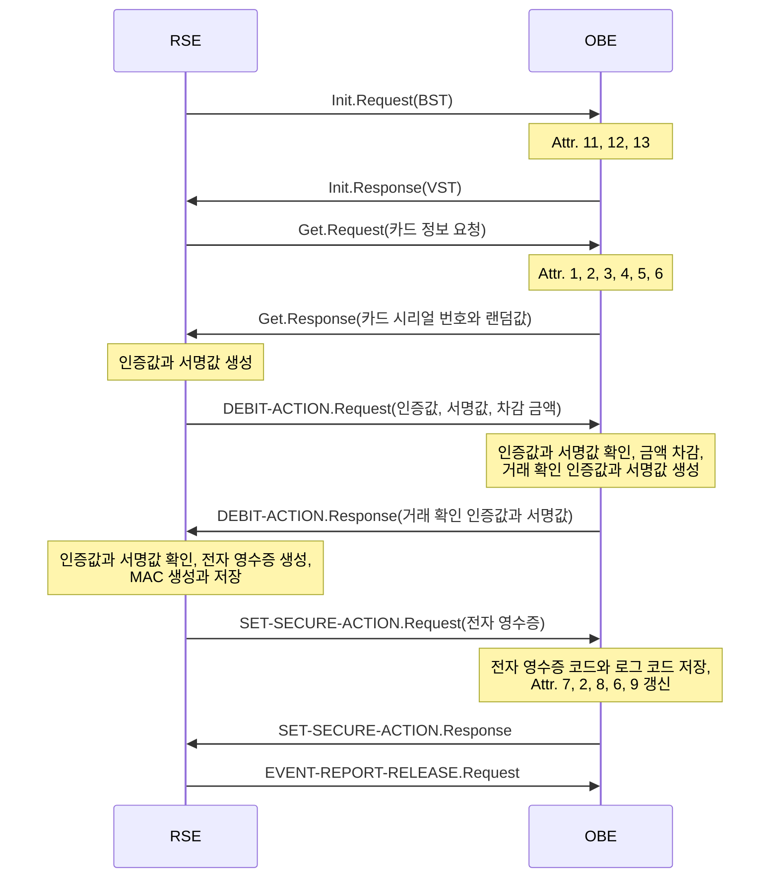

*그림 37. 하이패스 과금 정보의 전달 절차*

| ID | 정보 | ID | 정보 |
|:-----|:-----|:-----|:-----|
| 1 | 카드 정보 | 8 | 거래 종료 정보 2 |
| 2 | 최근 카드 거래 정보 | 9 | 거래 내역 정보 |
| 3 | 카드 소지자 정보 | 10 | 예약 |
| 4 | OBU 기본 정보 | 11 | 카드 관련 상세 정보 |
| 5 | 최근 OBU 거래 정보 | 12 | 예약 |
| 6 | OBU 추가 정보 | 13 | 거래 상세 정보 |
| 7 | 거래 종료 정보 1 | 14 | 예약 |

*표 15. 하이패스 과금 절차의 속성(Attr.) ID*

그림 37의 절차는 세 부분으로 나뉜다. 첫째, RSE가 **BST(beacon service table)** 로 자신이 제공하는 서비스를 알리고, OBE가 **VST(vehicle service table)** 로 자신이 지원하는 응용을 응답하여 통신을 초기화한다. 둘째, RSE가 카드 정보를 읽고 차감 금액을 보내면 OBE가 카드에서 금액을 차감한다. 이때 양쪽은 인증값과 서명값을 만들어 서로 확인하므로, 위조된 RSE나 OBE가 거래에 끼어들 수 없다. 셋째, RSE가 전자 영수증을 보내 OBE에 저장하게 하고, 통신을 해제한다. 여기서 RSE가 만드는 MAC은 매체 접근 제어가 아니라 메시지 인증 코드(message authentication code), 즉 메시지가 바뀌지 않았음을 확인하는 암호학적 검사값이다. 차량이 통신 영역을 지나는 짧은 시간 안에 이 모든 교환이 끝나야 하므로, DSRC는 계층이 단순하고 연결 설정이 빠르게 설계되었다.

### 2.7 IEEE 802.11 작업 그룹과 무선 LAN 표준

IEEE 802.11은 무선 LAN(WLAN) 표준이며, 기능을 더할 때마다 작업 그룹(TG, task group)이 개정안(amendment)을 만든다.

| 작업 그룹 | 내용 | 2013년 무렵의 상태 |
|:-----|:-----|:-----|
| TGa | 5 GHz OFDM 무선 LAN | 표준 발행 |
| TGb | 2.4 GHz CCK 무선 LAN | 표준 발행 |
| TGg | 2.4 GHz OFDM 무선 LAN | 표준 발행 |
| TGn | 고처리율(high throughput) | 표준 발행 |
| TGp | 차량 환경(vehicular environment) | 표준 발행 |
| TGv | 네트워크 관리(network management) | 표준 발행 |
| TGac | 6 GHz 이하의 초고처리율(very high throughput) | 시장의 쟁점 |
| TGad | 60 GHz의 초고처리율 | 시장의 쟁점 |
| TGaf | TV 화이트 스페이스(TV 방송의 빈 주파수) | 표준화의 쟁점 |
| TGah | 1 GHz 이하 대역 동작 | 표준화의 쟁점 |
| TGai | 빠른 링크 설정(fast link set-up) | 표준화의 쟁점 |

*표 16. IEEE 802.11의 주요 작업 그룹*

TGp가 만든 IEEE 802.11p가 3절의 WAVE의 물리 계층과 MAC 계층이다. 표 16의 쟁점 표준들도 이후 모두 발행되어 IEEE 802.11-2020에 통합되었다 [4].

| 802.11 프로토콜 | 주파수(GHz) | 대역폭(MHz) | 스트림당 데이터 전송 속도(Mbit/s) | 허용 MIMO 스트림 | 변조 | 실내 범위(m) | 실외 범위(m) |
|:-----|:-----|:-----|:-----|:-----|:-----|:-----|:-----|
| a | 5 | 20 | 6, 9, 12, 18, 24, 36, 48, 54 | 1 | OFDM | 35 | 120 |
| a | 3.7 | 20 | 6, 9, 12, 18, 24, 36, 48, 54 | 1 | OFDM | 없음 | 5,000 |
| b | 2.4 | 20 | 1, 2, 5.5, 11 | 1 | DSSS | 38 | 140 |
| g | 2.4 | 20 | 1, 2, 6, 9, 12, 18, 24, 36, 48, 54 | 1 | OFDM, DSSS | 38 | 140 |
| n | 2.4/5 | 20 | 7.2, 14.4, 21.7, 28.9, 43.3, 57.8, 65, 72.2 | 4×4 | OFDM | 70 | 250 |
| n | 2.4/5 | 40 | 15, 30, 45, 60, 90, 120, 135, 150 | 4×4 | OFDM | 70 | 250 |
| ac | 5 | 최소 20, 최대 160 | 87.6(20 MHz), 866.7(160 MHz) | 8×8 | OFDM | 70 초과 | 250 초과 |
| ad | 2.4/5/60 | 2,160 | 6,912 | 10×10 초과 | OFDM | 없음 | 없음 |

*표 17. IEEE 802.11 무선 LAN 표준의 특성 비교*

> **용어 정의:** **DSSS(direct sequence spread spectrum, 직접 수열 확산 스펙트럼)** 는 각 비트를 빠른 부호열에 곱해 넓은 대역으로 퍼뜨려 보내는 방식이다.

> **용어 정의:** **CCK(complementary code keying)** 는 802.11b가 5.5 Mbps와 11 Mbps에 쓰는 DSSS의 부호 방식이다.

> **용어 정의:** **MIMO(multiple input multiple output)** 는 송신과 수신에 여러 안테나를 써서 여러 데이터 흐름(공간 스트림)을 동시에 보내는 기술이며, 4×4는 송신 안테나 4개와 수신 안테나 4개를 뜻한다.

표 17의 3.7 GHz 행은 미국의 3.65\~3.7 GHz 대역에서 802.11a 방식을 고출력으로 쓰는 개정(802.11y)으로, 실외 5 km까지 닿는다. 802.11n은 MIMO와 40 MHz 대역 결합으로, 802.11ac는 최대 160 MHz와 8개 스트림으로 속도를 높였다. 802.11ad는 60 GHz 대역의 2,160 MHz 폭 채널로 최대 약 6.75 Gbit/s를 낸다 [11].

> **참고:** 802.11ad는 여러 공간 스트림을 동시에 보내는 MIMO가 아니라, 많은 안테나 소자로 전파를 한 방향에 모으는 빔포밍(beamforming)으로 60 GHz의 큰 경로 손실을 보상한다. 표 17의 "10×10 초과"는 이런 안테나 배열의 규모로 이해하는 편이 정확하다. 또 표 17의 802.11ad 속도 6,912 Mbit/s는 802.11ad의 최고 전송 속도인 약 6.75 Gbit/s보다 크게 적힌 값이다 [11].

### 2.8 무선 LAN의 구성 요소와 구조

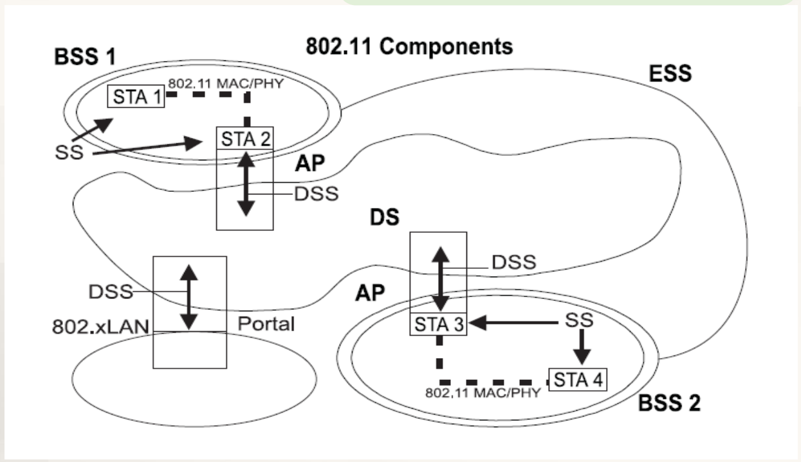

*그림 38. IEEE 802.11 무선 LAN의 구성 요소*

| 구성 요소 | 설명 |
|:-----|:-----|
| STA(station, 단말) | 802.11 MAC과 물리 계층을 갖춘 무선 장치이다. |
| AP(access point) | 무선 단말을 분배 시스템에 연결해 주는 단말이다. |
| BSS(basic service set) | 서로 통신하는 단말들의 기본 단위이다. 예를 들어 하나의 무선 LAN이다. 그림 38의 BSS 1에는 STA 1과 AP 역할의 STA 2가 있다. |
| DS(distribution system) | 여러 BSS의 AP를 서로 연결하는 시스템이다. |
| ESS(extended service set) | 여러 BSS가 DS로 연결되어 하나의 큰 네트워크처럼 보이는 집합이다. 예를 들어 무선 LAN과 유선 LAN을 합한 것이다. |
| 포털(portal) | 802.11 네트워크를 802.3 같은 다른 LAN(802.x LAN)에 연결하는 관문이다. |
| SS, DSS | 모든 단말이 제공하는 서비스(SS, station service)와 DS가 제공하는 서비스(DSS, distribution system service)이다. |

*표 18. 무선 LAN의 구성 요소*

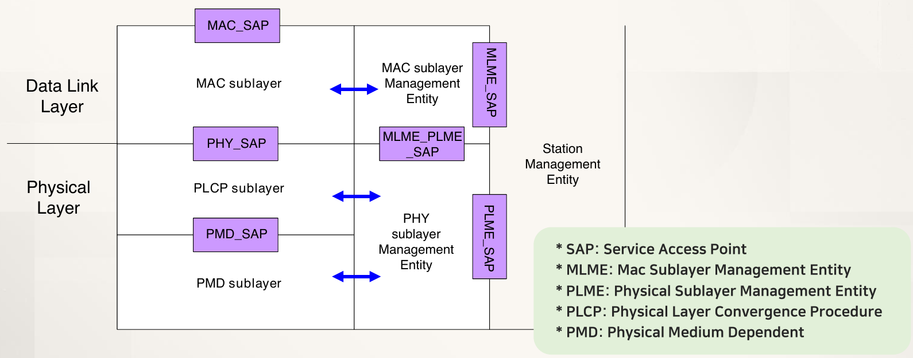

*그림 39. IEEE 802.11 무선 LAN의 계층 구조와 관리 개체*

그림 39에서 데이터 링크 계층에는 MAC 부계층이, 물리 계층에는 PLCP 부계층과 PMD 부계층이 있다. 각 부계층 옆에는 그 부계층의 설정과 상태를 관리하는 관리 개체가 있다.

> **용어 정의:** **SAP(service access point)** 는 한 계층이 위 계층에 서비스를 제공하는 접점이다.

> **용어 정의:** **MLME(MAC sublayer management entity)** 는 MAC 부계층의 관리 개체이다.

> **용어 정의:** **PLME(physical layer management entity)** 는 물리 계층의 관리 개체이다.

> **용어 정의:** **SME(station management entity)** 는 단말 전체를 관리하는 개체이다.

> **용어 정의:** **PLCP(physical layer convergence procedure)** 부계층은 MAC의 프레임을 물리 계층의 프레임으로 바꾼다.

> **용어 정의:** **PMD(physical medium dependent)** 부계층은 실제 무선 신호의 변조와 송수신을 맡는다.

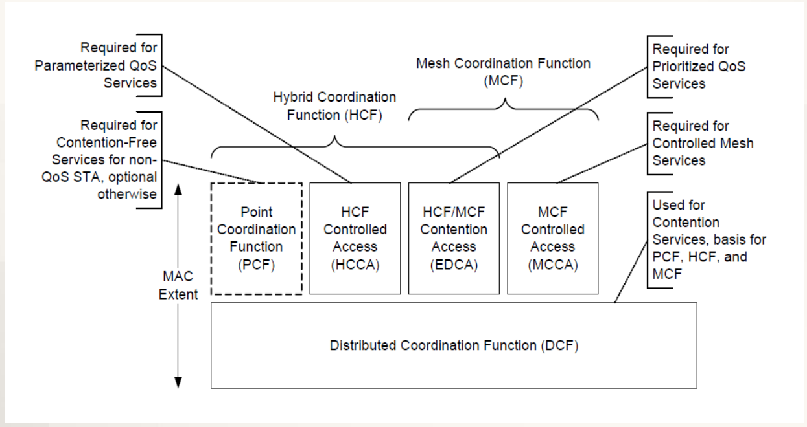

*그림 40. IEEE 802.11 MAC의 구조*

그림 40의 MAC 구조에서 맨 아래의 **DCF(distributed coordination function)** 는 경쟁 기반 서비스에 쓰이며, 다른 모든 접근 방식의 바탕이 된다. 그 위에는 다음 기능이 있다.

- **PCF(point coordination function):** QoS를 지원하지 않는 단말에 비경쟁 서비스를 제공하며, 선택 기능이다.
- **HCF(hybrid coordination function):** 경쟁 기반의 **EDCA(enhanced distributed channel access)** 로 우선순위가 있는 QoS 서비스를, 제어 기반의 **HCCA(HCF controlled channel access)** 로 매개변수화된 QoS 서비스를 제공한다.
- **MCF(mesh coordination function):** 메시 네트워크용으로, 제어 기반의 MCCA(MCF controlled channel access)와 경쟁 기반의 HCF/MCF 경쟁 접근을 쓴다.

> **용어 정의:** **QoS(quality of service)** 는 우선순위가 높은 패킷을 먼저 보내 서비스 품질을 높이는 기능이다.

### 2.9 DCF와 CSMA/CA

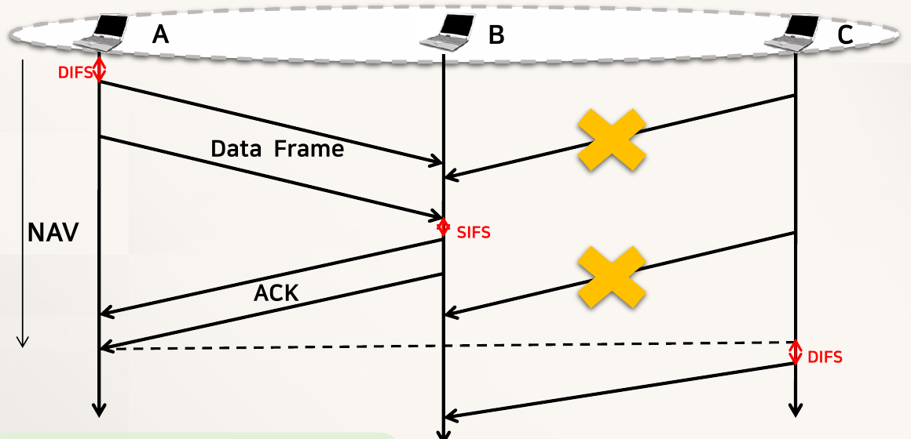

*그림 41. DCF에서 데이터 프레임, ACK, NAV의 시간 흐름*

DCF는 무선 LAN의 기본 접근 방식으로, 1.10절의 CSMA/CA를 구현한다. 그림 41에서 단말 A는 채널이 **DIFS(DCF interframe space)** 동안 비어 있음을 확인한 뒤 B에게 데이터 프레임을 보낸다. B는 프레임을 받고 **SIFS(short interframe space)** 뒤에 ACK를 보낸다. 그동안 C는 데이터 프레임의 Duration 값으로 NAV를 설정하여 송신을 미룬다. 그림의 X 표시처럼 C가 이 구간에 보냈다면 충돌했을 것이다. C는 ACK가 끝난 뒤 다시 DIFS만큼 기다린 다음에야 보낸다. SIFS가 DIFS보다 짧으므로, ACK는 새 데이터를 보내려는 다른 단말보다 항상 먼저 채널을 잡는다.

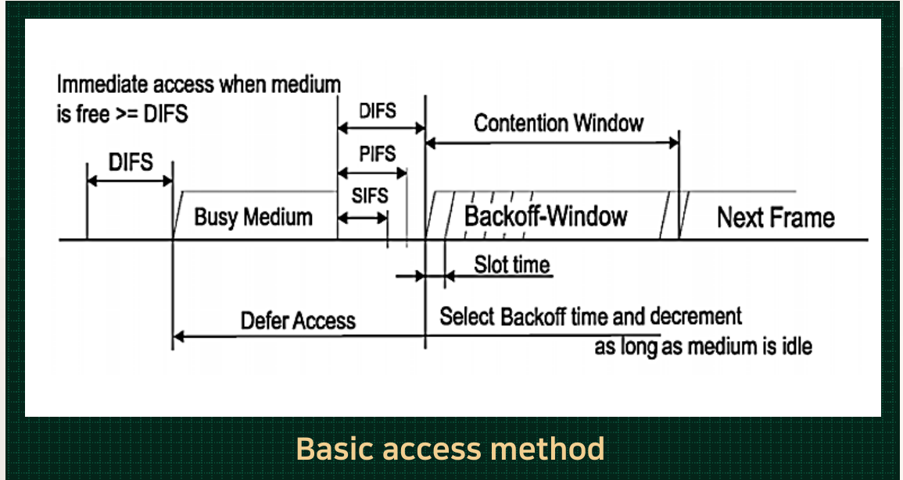

*그림 42. DCF의 기본 접근 방법과 프레임 간 간격*

그림 42의 기본 접근 방법(basic access method)은 다음과 같다.

1. 매체가 DIFS 이상 비어 있으면 즉시 보낸다.
2. 매체가 바쁘면(busy medium) 접근을 미룬다(defer access).
3. 매체가 다시 비면 DIFS만큼 기다린 뒤 경쟁 윈도(contention window) 안에서 백오프 시간을 골라, 매체가 비어 있는 동안 슬롯 시간마다 하나씩 줄인다. 0이 되면 보낸다.

프레임 간 간격(IFS)은 짧을수록 우선순위가 높다. 슬롯 시간을 $aSlotTime$이라 하면 다음 관계가 있다.

```math
PIFS = SIFS + aSlotTime, \qquad DIFS = SIFS + 2 \times aSlotTime
```

20 MHz OFDM 물리 계층에서는 $aSlotTime = 9$ µs, SIFS = 16 µs이므로 PIFS = 25 µs, DIFS = 34 µs이다 [4]. **PIFS(PCF interframe space)** 는 PCF의 제어국이 DCF 단말보다 먼저 채널을 잡을 때 쓴다.

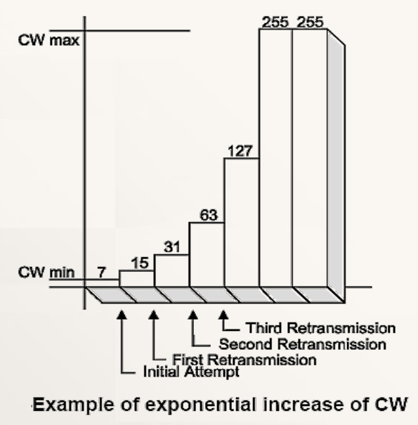

*그림 43. 재전송에 따른 경쟁 윈도의 지수적 증가와 백오프 시간의 계산*

**임의 백오프 시간.** 백오프 시간은 다음과 같이 정한다.

```math
\text{Backoff Time} = \text{Random}() \times aSlotTime
```

$\text{Random}()$은 구간 $[0, CW]$에서 고른 의사 난수 정수이고, 경쟁 윈도 $CW$는 $aCWmin \le CW \le aCWmax$를 만족한다. 슬롯 시간은 채널을 한 번 감지하는 데 필요한 최소 시간이다. 처음 시도할 때 $CW = aCWmin$이고, 전송에 실패할 때마다 $CW \leftarrow 2(CW + 1) - 1$로 늘리며, $aCWmax$에 이르면 더 늘리지 않는다. 그림 43의 예($aCWmin = 7$, $`aCWmax = 255`$)에서 CW는 7, 15, 31, 63, 127, 255, 255로 늘어난다. 전송에 성공하면 CW는 다시 $aCWmin$으로 돌아간다. 예를 들어 $CW = 15$, $aSlotTime = 9$ µs이면 백오프 시간은 0\~135 µs 가운데 9 µs 단위의 값이다. 충돌이 잦을수록 CW가 커져 단말들이 서로 다른 백오프 값을 고를 확률이 높아지고, 충돌이 줄어든다.

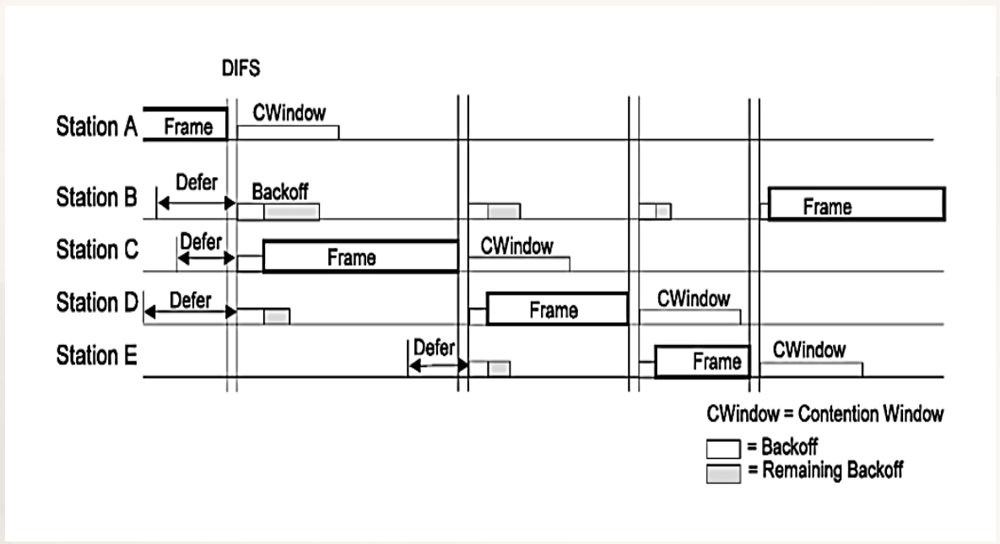

*그림 44. 여러 단말의 DCF 백오프 절차*

그림 44에서 단말 A가 프레임을 보내는 동안 B, C, D는 보낼 데이터가 생겼지만 미룬다(Defer). A의 전송이 끝나고 DIFS가 지나면 B, C, D는 각자 백오프 값을 골라 줄여 나간다. 백오프가 가장 먼저 0이 된 C가 프레임을 보내고, B와 D는 남은 백오프(remaining backoff)를 멈춘 채 기다린다. C의 전송이 끝나면 B와 D는 새 값을 고르지 않고 남은 값부터 다시 줄인다. 그래서 오래 기다린 단말일수록 남은 백오프가 작아 먼저 보낼 기회를 얻는다. 이어서 D가, 나중에 도착한 E가, 마지막으로 B가 보낸다.

### 2.10 QoS 지원: EDCA

IEEE 802.11e는 QoS를 지원하기 위해 EDCA를 도입했다.

- 우선순위가 높은 트래픽이 낮은 트래픽보다 전송될 기회가 많다.
- 우선순위가 높은 패킷에 더 작은 경쟁 윈도(CW)와 더 짧은 **AIFS(arbitration interframe space)** 를 준다.
- WAVE에서는 전송 기회(TXOP)가 0이다.

> **용어 정의:** **TXOP(transmission opportunity, 전송 기회)** 는 채널을 얻은 단말이 경쟁 없이 연속으로 채널을 쓸 수 있는 시간이다. 기존 802.11 DCF MAC에서는 느린 단말이 한 프레임을 보내는 데 채널 시간을 지나치게 많이 차지하는 문제가 있었는데, TXOP는 시간으로 한도를 정해 이를 줄인다. TXOP 한도가 0이면 채널을 얻을 때마다 MPDU 하나만 보낼 수 있다.

| 접근 범주 | 트래픽 종류 | 우선순위 | WAVE의 TXOP |
|:-----|:-----|:-----|:-----|
| AC_BK | 백그라운드(background) | 가장 낮음 | 0 |
| AC_BE | 최선형(best effort) | 낮음 | 0 |
| AC_VI | 영상(video) | 높음 | 0 |
| AC_VO | 음성(voice) | 가장 높음 | 0 |

*표 19. EDCA의 접근 범주*

> **참고:** IEEE 802.11e는 상위 계층이 붙인 사용자 우선순위(UP, user priority) 0\~7을 네 접근 범주로 대응시킨다. UP 1과 2는 AC_BK, 0과 3은 AC_BE, 4와 5는 AC_VI, 6과 7은 AC_VO이다 [4]. 접근 범주를 0\~3의 번호로 나열할 때 이 번호는 사용자 우선순위가 아니라 접근 범주의 순서이다.

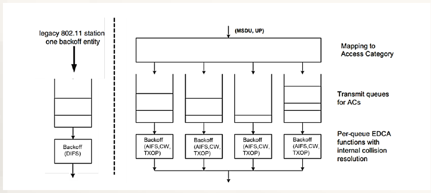

*그림 45. 기존 802.11 단말의 단일 백오프와 EDCA의 접근 범주별 큐*

그림 45의 왼쪽은 기존 802.11 단말로, 큐 하나와 DIFS를 쓰는 백오프 개체 하나만 있다. 오른쪽의 EDCA 단말은 상위 계층에서 내려온 MSDU를 우선순위에 따라 네 접근 범주의 전송 큐에 나누어 넣고(mapping to access category), 큐마다 자기 AIFS, CW, TXOP로 따로 백오프한다. 한 단말 안의 두 큐가 동시에 백오프를 끝내면 내부 충돌 해결(internal collision resolution)로 우선순위가 높은 큐가 보낸다.

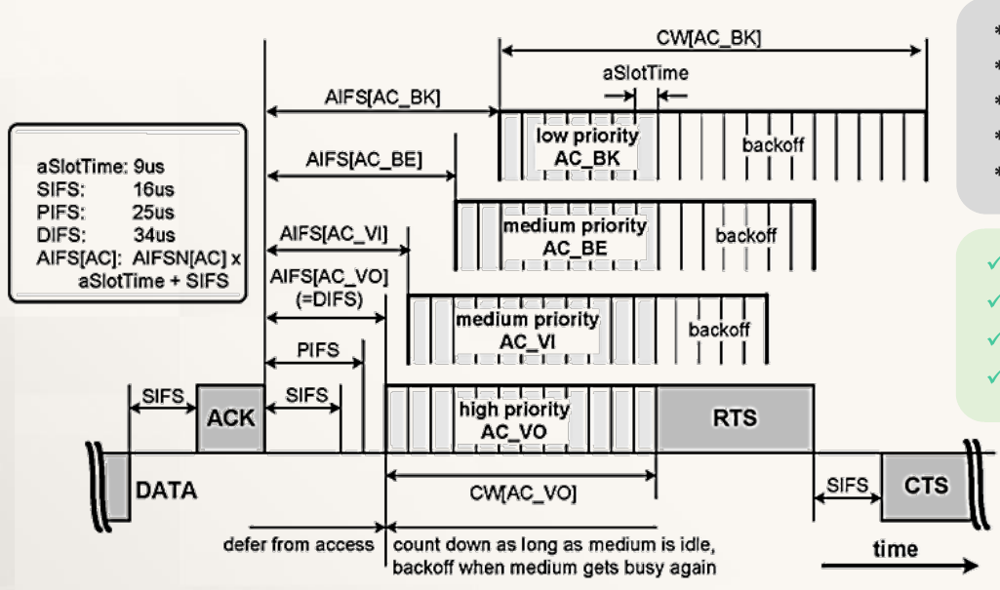

*그림 46. EDCA 접근 범주별 AIFS와 경쟁 윈도의 시간 관계*

그림 46에서 각 접근 범주의 AIFS는 다음과 같이 정한다.

```math
AIFS[AC] = AIFSN[AC] \times aSlotTime + SIFS
```

$AIFSN$은 접근 범주마다 정한 정수이다. 그림의 값($aSlotTime = 9$ µs, SIFS = 16 µs)을 쓰면 802.11의 기본값인 AC_VO와 AC_VI의 AIFSN 2는 AIFS 34 µs(= DIFS), AC_BE의 AIFSN 3은 $3 \times 9 + 16 = 43$ µs, AC_BK의 AIFSN 7은 $7 \times 9 + 16 = 79$ µs이다. 매체가 비면 높은 우선순위의 큐가 더 짧게 기다린 뒤 더 작은 경쟁 윈도에서 백오프하므로, 통계적으로 먼저 채널을 잡는다. 백오프는 매체가 비어 있는 동안만 줄고, 매체가 다시 바빠지면 멈춘다.

| 구분 | DCF | PCF |
|:-----|:-----|:-----|
| 서비스 | CSMA/CA와 같은 경쟁 서비스 | 우선순위 방식의 비경쟁 서비스 |
| 동작 | 단말이 데이터를 보내기 전에 충돌을 피하기 위해 미리 감지한 뒤 기다린다. | AP가 단말들에게 직접 차례로 물어보고, 단말은 그때까지 기다린다. |
| 제어 주체 | 각 단말 | AP |

*표 20. DCF와 PCF의 비교*

### 2.11 무선 LAN의 통신 절차

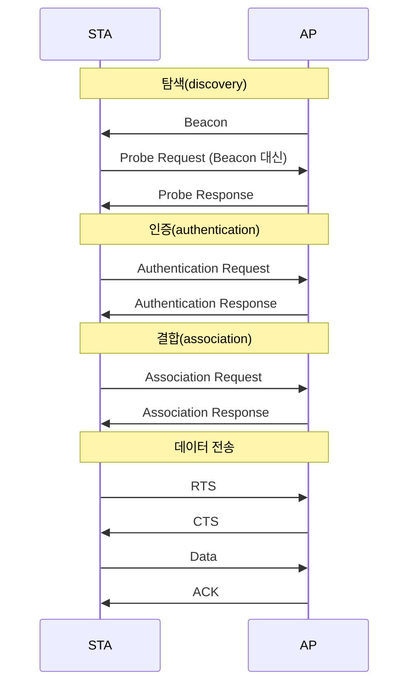

*그림 47. 무선 LAN 단말과 AP의 기본 통신 절차*

그림 47처럼 단말이 BSS의 AP와 데이터를 주고받기까지 네 단계를 거친다.

1. **탐색:** AP가 주기적으로 방송하는 비컨(Beacon)을 듣거나(수동 탐색), 단말이 Probe Request를 보내 AP의 Probe Response를 받는다(능동 탐색).
2. **인증:** 단말이 그 네트워크에 들어올 자격이 있는지 확인한다.
3. **결합:** 단말이 특정 AP에 소속을 등록하여, AP가 그 단말로 가는 프레임을 전달할 수 있게 한다.
4. **데이터 전송:** 필요하면 RTS/CTS로 채널을 예약하고, 데이터와 ACK를 주고받는다.

> **핵심:** 탐색, 인증, 결합에는 여러 번의 프레임 교환이 필요해 수백 ms가 걸릴 수 있다. 시속 100 km로 달리는 차량은 1초에 약 28 m를 지나가므로, 노변 기지국 하나의 통신 영역을 지나는 동안 이 절차를 마치기 어렵다. 그래서 3절의 WAVE는 인증과 결합 없이 바로 통신한다(3.3절).

### 2.12 MAC 프레임의 종류와 단편화

IEEE 802.11의 MAC 프레임은 일반 형식을 바탕으로 종류에 따라 필드를 생략한다. 표의 숫자는 옥텟 수, 괄호 안은 그 필드에 들어가는 주소이며, "없음"은 그 종류의 프레임에 없는 필드이다.

| 필드 | 일반 형식 | 관리 프레임 | 제어 프레임 | 데이터 프레임 |
|:-----|:-----|:-----|:-----|:-----|
| 프레임 제어(Frame Control) | 2 | 2 | 2 | 2 |
| 지속 시간/ID(Duration/ID) | 2 | 2 | 2 | 2 |
| 주소 1 | 6 | 6 (DA) | 6 (RA) | 6 |
| 주소 2 | 0 또는 6 | 6 (SA) | 0 또는 6 (TA) | 6 |
| 주소 3 | 0 또는 6 | 6 (BSSID) | 없음 | 6 |
| 순서 제어(Sequence Control) | 2 | 2 | 없음 | 2 |
| 주소 4 | 0 또는 6 | 없음 | 없음 | 0 또는 6 |
| QoS 제어(QoS Control) | 0 또는 2 | 없음 | 없음 | 0 또는 2 |
| HT 제어(HT Control) | 0 또는 4 | 0 또는 4 | 제어 래퍼 프레임에서만 4 | 0 또는 4 |
| 프레임 본체(Frame Body) | 가변 | 0\~2,304 | 없음 | 가변 |
| FCS | 4 | 4 | 4 | 4 |

*표 21. IEEE 802.11 MAC 프레임의 종류별 필드와 크기*

- **관리 프레임(management frame):** 비컨, 탐색, 인증, 결합처럼 네트워크를 관리하는 프레임이다. 주소 1\~3은 DA, SA, BSSID이고, 본체는 0\~2,304옥텟이다.
- **제어 프레임(control frame):** RTS, CTS, ACK, 블록 ACK처럼 채널 접근을 돕는 짧은 프레임이다. 수신기 주소(RA)와 송신기 주소(TA)만 있고 본체가 없다. HT 제어 필드는 빔포밍에 쓰는 제어 래퍼(Control Wrapper) 프레임에만 들어간다.
- **데이터 프레임(data frame):** 데이터 내용을 프레임 본체에 싣는다. 주소 필드의 수와 QoS 제어, HT 제어 필드의 유무는 To DS, From DS와 QoS 지원 여부에 따라 달라진다.
- **확장 프레임(extension frame):** 60 GHz의 802.11ad(DMG, directional multi-gigabit)가 도입한 형식으로, DMG 비컨에서는 Field 0이 BSSID이다.

**단편화(fragmentation).** MSDU가 한 번에 보내기에 너무 크면 MAC은 MSDU를 여러 조각으로 나눈다.

```text
                    MSDU (MAC Service Data Unit)
          [ part 0 | part 1 | part 2 | part 3 ]
              |        |        |        |
[MAC HDR|Frame Body|CRC] [MAC HDR|Frame Body|CRC] [MAC HDR|Frame Body|CRC] [MAC HDR|Frame Body|CRC]
       Fragment 0               Fragment 1               Fragment 2               Fragment 3

Source:      RTS        Fragment 0        Fragment 1        Fragment 2   ...
Destination:      CTS              ACK0              ACK1
             (every gap between frames = SIFS)
```

*그림 48. MSDU의 단편화와 단편 전송*

그림 48에서 각 단편(fragment)은 자기 MAC 헤더와 CRC(FCS)를 가진 독립된 프레임이다. 송신 측은 RTS/CTS로 채널을 잡은 뒤, 단편과 ACK를 SIFS 간격으로 주고받는다. 간격이 모두 SIFS이므로 다른 단말이 중간에 끼어들 수 없다(다른 단말은 최소 DIFS를 기다려야 한다). 단편 번호는 순서 제어 필드에, 뒤에 단편이 더 있는지는 프레임 제어 필드의 More Frag 비트에 적는다. 오류가 잦은 무선 채널에서 큰 프레임 하나를 통째로 다시 보내는 대신, 오류가 난 작은 단편만 다시 보내면 되므로 효율이 좋아진다.

### 2.13 OFDM 물리 계층

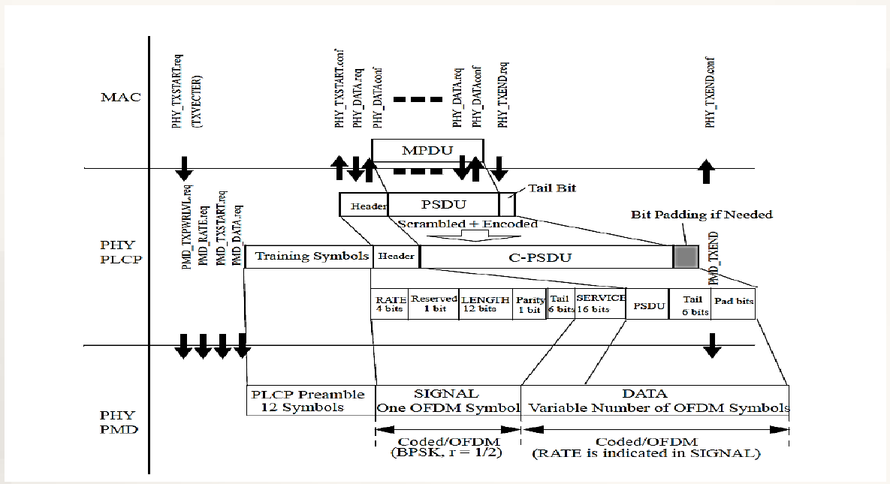

*그림 49. OFDM 물리 계층의 프레임 형식과 MAC, PLCP, PMD 사이의 프리미티브*

그림 49에서 MAC이 PHY_TXSTART.req로 전송 시작을 요청하고 PHY_DATA.req로 MPDU를 한 옥텟씩 넘기면, PLCP 부계층은 MPDU를 **PSDU(PLCP service data unit)** 로 받아 다음 형식의 물리 계층 프레임을 만든다.

- **PLCP 프리앰블(12 심볼):** 수신기가 신호를 감지하고, 수신 이득과 주파수, 시간 동기를 맞추는 훈련 심볼이다.
- **SIGNAL(OFDM 심볼 1개):** 항상 가장 강건한 BPSK, 부호화율 1/2로 보낸다. RATE(4비트, 뒤따르는 데이터의 변조와 부호화율), 예약(1비트), LENGTH(12비트, PSDU의 옥텟 수), 패리티(1비트), 꼬리(tail, 6비트)로 이루어진다.
- **DATA(가변 개수의 OFDM 심볼):** SERVICE(16비트), PSDU, 꼬리(6비트), 채움 비트(pad bits)로 이루어지며, 스크램블하고 부호화하여 SIGNAL의 RATE가 알려 준 속도로 보낸다.

수신기는 먼저 SIGNAL을 해석해야 DATA를 어떤 속도로 받아야 할지 알 수 있으므로, SIGNAL은 어떤 수신기라도 해석할 수 있는 가장 낮은 속도로 보낸다.

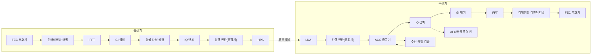

*그림 50. OFDM 물리 계층의 송신기와 수신기 블록도*

그림 50의 송신기에서 **FEC 부호기**는 1.7절의 길쌈 부호로 중복을 더하고, **인터리빙(interleaving)** 은 이웃한 비트를 서로 멀리 떨어진 부반송파에 흩어 놓아 특정 주파수가 페이딩으로 약해져도 오류가 몰리지 않게 하며, **매핑**은 비트 묶음을 BPSK\~64-QAM의 성상도 점으로 바꾼다. **IFFT(inverse fast Fourier transform)** 는 부반송파들의 값을 한꺼번에 시간 영역의 OFDM 심볼로 바꾸고, **GI(guard interval) 삽입**은 순환 전치를 붙인다. 이어서 심볼 파형을 다듬고, **IQ 변조**(동위상 성분과 직교 성분을 이용한 변조)로 중간 주파수의 반송파에 올린 다음, 혼합기(mixer)와 국부 발진기로 무선 주파수까지 올리고(상향 변환) **HPA(high power amplifier, 고출력 증폭기)** 로 증폭해 안테나로 보낸다. 수신기는 이 과정을 거꾸로 한다. **LNA(low noise amplifier, 저잡음 증폭기)** 로 증폭한 신호를 혼합기로 중간 주파수까지 내리고(하향 변환), 수신 레벨 검출기가 이득을 조절하는 **AGC(automatic gain control)** 증폭기로 신호의 크기를 맞춘다. 이어서 IQ 검파로 기저대역 신호를 얻은 뒤 **AFC(automatic frequency control)** 와 클록 복원으로 주파수와 시간을 맞춘다. GI를 제거하고 **FFT**로 부반송파 값을 꺼낸 다음, 디매핑과 디인터리빙, FEC 복호로 원래 비트를 복원한다.

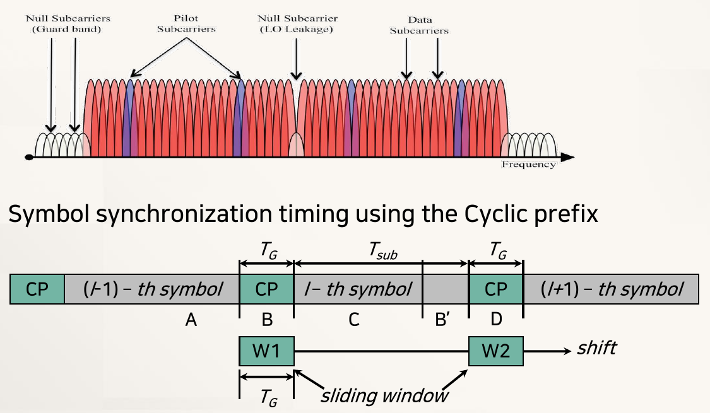

*그림 51. OFDM 부반송파의 배치와 순환 전치를 이용한 심볼 동기*

**부반송파.** 그림 51의 위쪽처럼 OFDM 채널의 부반송파는 역할이 나뉜다. 데이터를 싣는 **데이터 부반송파**, 수신기가 위상과 주파수 오차를 추적하도록 알려진 값을 싣는 **파일럿 부반송파**, 비워 두는 **널 부반송파**가 있다. 널 부반송파는 채널 양 끝의 보호 대역(guard band)과, 송수신기의 국부 발진기 누설(LO leakage)이 생기는 가운데(DC)에 둔다. 802.11a/g/p는 64개의 FFT 위치 가운데 데이터 48개와 파일럿 4개, 모두 52개를 쓴다.

**순환 전치와 심볼 동기.** 각 OFDM 심볼의 앞에는 그 심볼의 뒷부분 $T_G$ 길이를 복사해 붙인 **순환 전치(CP, cyclic prefix)** 가 있다. 다중 경로로 늦게 도착한 앞 심볼의 꼬리는 CP 구간에만 걸치므로, 수신기가 CP를 버리면 심볼 간 간섭이 사라진다. 그림 51의 아래쪽에서 CP(구간 B)는 같은 심볼의 끝부분(구간 $`B'`$)과 똑같다. 수신기는 길이 $T_G$인 두 창 W1과 W2를 $T_{sub}$(유효 심볼 길이)만큼 떨어뜨려 두고 신호를 따라 밀어 가며(sliding window) 두 창의 상관을 계산한다. 두 창이 각각 B와 $B'$에 정확히 놓일 때 상관이 최대가 되므로, 그 위치에서 심볼의 시작 시점을 찾는다. 20 MHz 채널에서 $T_{sub} = 3.2$ µs, $T_G = 0.8$ µs로 심볼 하나가 4 µs이다.

| 변조 | 부호화율 | 부반송파당 부호화 비트 | OFDM 심볼당 부호화 비트 | OFDM 심볼당 데이터 비트 | 속도(20 MHz, Mb/s) | 속도(10 MHz, Mb/s) | 속도(5 MHz, Mb/s) |
|:-----|:-----|:-----|:-----|:-----|:-----|:-----|:-----|
| BPSK | 1/2 | 1 | 48 | 24 | 6 | 3 | 1.5 |
| BPSK | 3/4 | 1 | 48 | 36 | 9 | 4.5 | 2.25 |
| QPSK | 1/2 | 2 | 96 | 48 | 12 | 6 | 3 |
| QPSK | 3/4 | 2 | 96 | 72 | 18 | 9 | 4.5 |
| 16-QAM | 1/2 | 4 | 192 | 96 | 24 | 12 | 6 |
| 16-QAM | 3/4 | 4 | 192 | 144 | 36 | 18 | 9 |
| 64-QAM | 2/3 | 6 | 288 | 192 | 48 | 24 | 12 |
| 64-QAM | 3/4 | 6 | 288 | 216 | 54 | 27 | 13.5 |

*표 22. 802.11a/g OFDM의 변조 방식과 부호화율별 데이터 전송 속도*

| 매개변수 | 20 MHz | 10 MHz | 5 MHz |
|:-----|:-----|:-----|:-----|
| FFT 크기 | 64 | 64 | 64 |
| 데이터 부반송파 수 | 48 | 48 | 48 |
| 파일럿 부반송파 수 | 4 | 4 | 4 |
| 전체 부반송파 수 | 52 | 52 | 52 |
| 부반송파 간격 | 312.5 kHz | 156.25 kHz | 78.125 kHz |
| BPSK OFDM 심볼 길이 | 4 µs | 8 µs | 16 µs |

*표 23. 채널 대역폭별 OFDM 매개변수*

**전송 속도의 계산.** 64-QAM, 부호화율 3/4, 20 MHz의 54 Mbps를 단계별로 계산하면 다음과 같다.

1. 부반송파 간격은 대역폭을 FFT 크기로 나눈 값이다. $20 \text{ MHz} / 64 = 312.5$ kHz.
2. 1초에 보내는 심볼 수는 심볼 길이의 역수이다. $1 \text{ s} / 4\ \mu\text{s} = 250{,}000$개.
3. 심볼당 부호화 비트는 데이터 부반송파 수와 부반송파당 비트 수의 곱이다. $48 \times 6 = 288$비트.
4. 데이터 전송 속도는 심볼 수, 심볼당 부호화 비트, 부호화율의 곱이다. $250{,}000 \times 288 \times 3/4 = 54{,}000{,}000$ bps $= 54$ Mbps.

10 MHz 채널은 부반송파 간격이 절반이므로 심볼 길이가 8 µs로 두 배가 되고, 1초에 125,000개의 심볼을 보내 같은 조합의 속도가 $125{,}000 \times 288 \times 3/4 = 27$ Mbps로 절반이 된다. 3절의 WAVE가 쓰는 10 MHz 채널의 속도 3\~27 Mbps가 이렇게 나온다. 심볼이 길어지면 CP도 1.6 µs로 길어져 실외의 긴 다중 경로 지연에 더 강해진다.

---

<br>

## 3. WAVE

### 3.1 WAVE 시스템의 개요와 특징

> **용어 정의:** **WAVE(Wireless Access in Vehicular Environments)** 는 안전(safety) 서비스와 이동성(mobility) 서비스를 위해 고속의 V2V, V2I 통신 네트워크 환경을 제공하는 차량 환경용 무선 접속 기술이다. 서비스 요구사항에 따라 원격 상대(remote peer)의 자원에 접근할 수 있는 서비스를 제공한다.

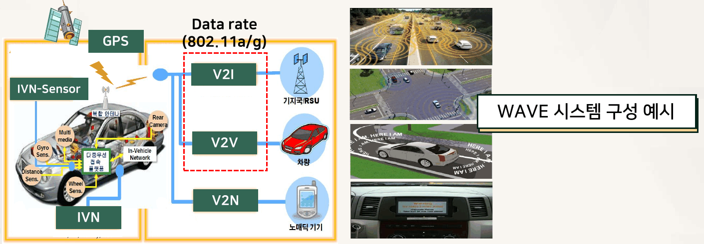

*그림 52. WAVE 시스템의 구성 예*

그림 52에서 차량의 WAVE 장치는 GPS 수신기, 차량 내부 네트워크(IVN)와 거기에 연결된 센서들과 이어져 있다. 바깥으로는 노변 기지국(RSU)과의 V2I, 다른 차량과의 V2V, 스마트폰 같은 휴대 기기(nomadic device)와의 V2N 통신을 하며, 데이터 전송 속도는 802.11a/g 수준이다. 오른쪽의 그림들은 교차로, 도로, 차량 실내 화면에서 WAVE 서비스가 쓰이는 예이다.

WAVE 프로토콜의 특징은 다음과 같다.

- **구조:** 물리 계층과 MAC 계층은 IEEE 802.11p, 그 위는 IEEE 1609.x 표준군이다.
- **다중 채널 동작:** 제어 채널(CCH)과 서비스 채널(SCH)을 번갈아 쓴다.
- **초기화:** 인증(authentication)과 결합(association) 없이, WAVE 서비스 광고(WSA)만으로 빠르게 링크에 접속한다.
- **네트워크 계층 서비스:** WSMP와 IP(IPv6)를 모두 지원한다.
- **기타:** GPS 기반으로 시각을 동기화하고, V2V와 V2I 통신을 모두 지원하며, WAVE 짧은 메시지(WSM)로 긴급 메시지 서비스를 지원한다.

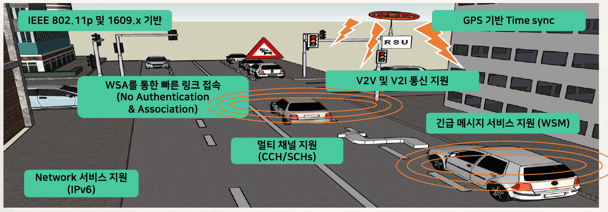

*그림 53. WAVE 프로토콜의 특징을 보여 주는 도로 상황*

그림 53은 이 특징들을 하나의 도로 상황에 표시한 것이다. 노변 기지국과 차량은 802.11p와 1609.x를 기반으로 GPS 시각에 맞추어 동작하고, WSA로 빠르게 접속하여 V2V와 V2I 통신을 하며, 위험 상황에서는 WSM으로 긴급 메시지를 보낸다. 멀티 채널(CCH와 SCH)과 IPv6 네트워크 서비스도 지원한다.

### 3.2 WAVE의 구조와 표준

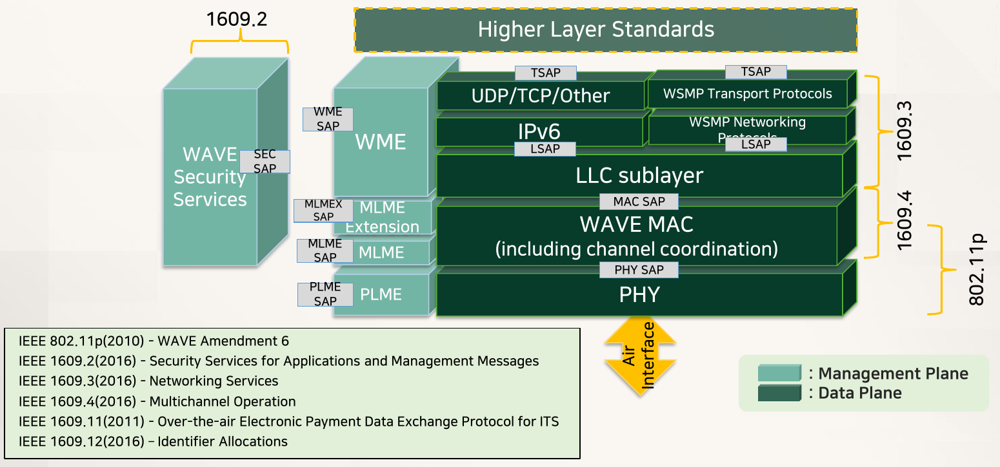

*그림 54. WAVE의 구조와 내부 인터페이스*

그림 54의 WAVE 구조는 데이터를 실어 나르는 **데이터 평면(data plane)** 과 이를 설정하고 관리하는 **관리 평면(management plane)** 으로 나뉜다.

- **데이터 평면:** 아래에서부터 물리 계층(PHY), 채널 조정 기능을 포함한 WAVE MAC, LLC 부계층이 있고, 그 위에 두 갈래의 네트워크 계층이 있다. 한쪽은 IPv6와 UDP/TCP 같은 전송 프로토콜, 다른 쪽은 WSMP의 네트워킹 프로토콜과 전송 프로토콜이다. 맨 위에는 상위 계층 표준(higher layer standards), 예를 들어 11주차의 SAE J2735 메시지가 온다.
- **관리 평면:** 물리 계층 관리 개체(PLME), MAC 관리 개체(MLME), 다중 채널 동작을 위한 MLME 확장(MLME extension), WAVE 관리 개체(WME, WAVE management entity), 보안 서비스(WAVE security services)가 있다. 각 계층과는 서비스 접점(SAP)으로 연결된다. 예를 들어 MLMEX SAP는 MLME 확장의 SAP, WME SAP는 WME의 SAP, SEC SAP는 보안 서비스의 SAP이다.

그림 오른쪽의 괄호는 각 표준이 맡는 범위이다. IEEE 802.11p는 물리 계층과 MAC을, IEEE 1609.4는 WAVE MAC의 채널 조정과 MLME 확장을, IEEE 1609.3은 LLC 부계층과 그 위의 네트워킹 서비스(IPv6, WSMP, WME)를, IEEE 1609.2는 보안 서비스를 맡는다.

| 표준 | 내용 |
|:-----|:-----|
| IEEE 802.11p(2010) | WAVE를 위한 IEEE 802.11의 6번째 개정(Amendment 6) [12] |
| IEEE 1609.2(2016) | 응용 메시지와 관리 메시지의 보안 서비스 [13] |
| IEEE 1609.3(2016) | 네트워킹 서비스 [14] |
| IEEE 1609.4(2016) | 다중 채널 동작 [15] |
| IEEE 1609.11(2010, 2011년 발행) | ITS를 위한 무선 전자 결제 데이터 교환 프로토콜 [16] |
| IEEE 1609.12(2016) | 식별자 할당 [17] |

*표 24. WAVE를 이루는 표준*

### 3.3 BSS 밖의 통신

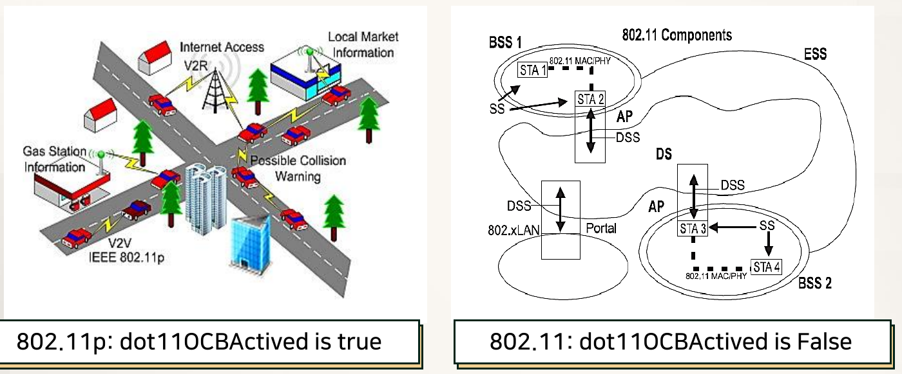

*그림 55. BSS 밖에서 통신하는 802.11p와 BSS 안에서 통신하는 802.11의 비교*

802.11p의 핵심 변경은 MIB 변수 **dot11OCBActivated**가 참(true)일 때 **BSS의 맥락 밖에서(OCB, outside the context of a BSS)** 통신할 수 있게 한 것이다. 그림 55의 오른쪽처럼 일반 802.11(dot11OCBActivated가 거짓)에서는 단말이 BSS에 들어가야 통신할 수 있으므로, 2.11절의 탐색, 인증, 결합을 거쳐야 한다. 왼쪽의 802.11p(dot11OCBActivated가 참)에서는 차량과 노변 기지국이 BSS에 가입하지 않고 바로 프레임을 주고받는다. 그래서 교차로에서 충돌 가능성을 경고하는 V2V 메시지, 노변 기지국을 통한 인터넷 접속(V2R), 주유소나 지역 상점 정보를 지나가는 차량이 즉시 받을 수 있다. OCB 프레임의 BSSID 필드에는 모든 비트가 1인 와일드카드 BSSID를 넣어 어느 단말이든 받게 한다 [4].

### 3.4 WAVE 물리 계층과 미국의 채널 배치

| 항목 | 규격 |
|:-----|:-----|
| 주파수 | 5.850\~5.925 GHz |
| 대역폭 | 75 MHz |
| 채널 | 10 MHz 채널 7개 |
| 변조 | BPSK, QPSK, 16-QAM, 64-QAM OFDM |
| 데이터 전송 속도 | 10 MHz 채널: 3, 4.5, 6, 9, 12, 18, 24, 27 Mbps; 20 MHz 채널: 6, 9, 12, 18, 24, 36, 48, 54 Mbps |
| 이동 속도 | 200 km/h |
| 통신 거리 | 최대 1,000 m |

*표 25. WAVE 물리 계층의 규격*

WAVE의 물리 계층은 2.13절의 802.11a OFDM을 10 MHz 채널로 줄여 쓴다. 표 22의 10 MHz 열이 WAVE의 데이터 전송 속도이다. 심볼과 CP가 두 배로 길어지므로, 빠르게 움직이는 차량 사이의 긴 다중 경로 지연에 강하다.

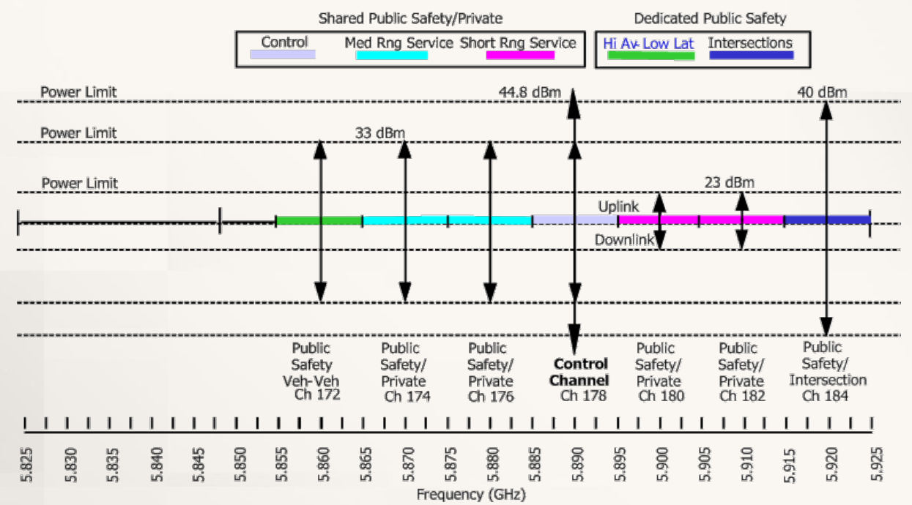

*그림 56. 미국의 WAVE 채널 배치와 채널별 송신 전력 한도*

그림 56은 미국 연방통신위원회(FCC)가 정한 5.9 GHz 대역의 채널 배치이다 [18]. 채널 번호 $n$의 중심 주파수는 $5000 + 5n$ MHz이므로, 예를 들어 채널 172의 중심 주파수는 $5000 + 5 \times 172 = 5860$ MHz이다. 맨 아래의 5 MHz(5.850\~5.855 GHz)는 보호 대역으로 남겨 둔다.

| 채널 | 중심 주파수(GHz) | 용도 | 송신 전력 한도 |
|:-----|:-----|:-----|:-----|
| 172 | 5.860 | 공공 안전 전용, 차량 간(V2V) 안전 | 33 dBm |
| 174 | 5.870 | 공공 안전과 민간 공유, 중거리 서비스 | 33 dBm |
| 176 | 5.880 | 공공 안전과 민간 공유, 중거리 서비스 | 33 dBm |
| 178 | 5.890 | 제어 채널(CCH) | 44.8 dBm |
| 180 | 5.900 | 공공 안전과 민간 공유, 단거리 서비스 | 23 dBm |
| 182 | 5.910 | 공공 안전과 민간 공유, 단거리 서비스 | 23 dBm |
| 184 | 5.920 | 공공 안전 전용, 교차로 | 40 dBm |

*표 26. 미국 WAVE 채널의 용도와 송신 전력 한도*

> **용어 정의:** **dBm**은 1 mW를 기준으로 한 전력의 데시벨 표현으로, $`P[\text{dBm}] = 10 \log_{10}(P / 1\ \text{mW})`$이다. 33 dBm은 $10^{3.3} \approx 2{,}000$ mW, 즉 약 2 W이고, 23 dBm은 약 0.2 W, 40 dBm은 10 W, 44.8 dBm은 약 30 W이다.

제어 채널 178은 모든 장치가 WSA와 안전 메시지를 듣기 위해 모이는 채널이므로 가장 높은 출력을 허용하고, 채널 172는 지연이 짧고 가용성이 높아야 하는 차량 간 안전 통신에, 채널 184는 교차로의 고출력 공공 안전 통신에 전용으로 배정한다. 나머지 서비스 채널은 거리에 따라 중거리(33 dBm)와 단거리(23 dBm)로 나누어 공유한다.

> **참고:** 이 채널 배치는 미국의 원래 계획이다. FCC는 2020년에 이 대역의 아래쪽 45 MHz를 비면허 와이파이 용도로 돌리고 위쪽 30 MHz를 C-V2X에 배정했다 [19]. 각국의 주파수 정책은 1주차에서 다루었다.

### 3.5 IEEE 802.11p MAC과 EDCA 매개변수

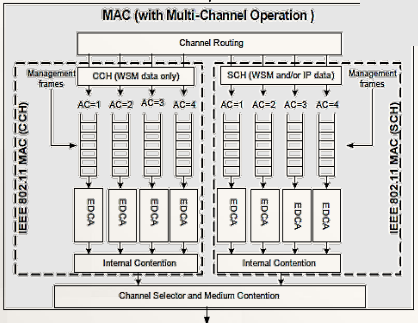

*그림 57. 다중 채널 동작을 하는 802.11p MAC의 송신 측 내부 구조*

그림 57은 송신 측 MAC의 개념적인 내부 구조이다. 위에서 내려온 데이터는 채널 라우팅(channel routing)에 의해 CCH용 MAC과 SCH용 MAC으로 나뉜다. CCH에는 WSM 데이터만, SCH에는 WSM과 IP 데이터를 보낼 수 있다. 각 채널의 MAC에는 2.10절의 EDCA처럼 네 접근 범주(AC)의 큐와 EDCA 기능이 있고, 관리 프레임도 함께 들어간다. 한 채널 안에서는 내부 경합(internal contention)으로 우선순위가 높은 큐가 먼저 나가고, 마지막으로 채널 선택기(channel selector)가 현재 채널 구간에 맞는 쪽을 골라 매체 경합(medium contention)에 참여시킨다.

| ACI | AC | CWmin | CWmax | AIFSN | TXOP 한도(DSSS, HR/DSSS) | TXOP 한도(OFDM, ERP) | TXOP 한도(그 밖의 PHY) |
|:-----|:-----|:-----|:-----|:-----|:-----|:-----|:-----|
| 01 | AC_BK | aCWmin | aCWmax | 7 | 0 | 0 | 0 |
| 00 | AC_BE | aCWmin | aCWmax | 3 | 0 | 0 | 0 |
| 10 | AC_VI | (aCWmin+1)/2 - 1 | aCWmin | 2 | 6.016 ms | 3.008 ms | 0 |
| 11 | AC_VO | (aCWmin+1)/4 - 1 | (aCWmin+1)/2 - 1 | 2 | 3.264 ms | 1.504 ms | 0 |

*표 27. dot11OCBActivated가 거짓일 때 단말의 기본 EDCA 매개변수*

| ACI | AC | CWmin | CWmax | AIFSN | TXOP 한도(OFDM) |
|:-----|:-----|:-----|:-----|:-----|:-----|
| 1 | AC_BK | aCWmin | aCWmax | 9 | 0 |
| 0 | AC_BE | aCWmin | aCWmax | 6 | 0 |
| 2 | AC_VI | (aCWmin+1)/2 - 1 | aCWmin | 3 | 0 |
| 3 | AC_VO | (aCWmin+1)/4 - 1 | (aCWmin+1)/2 - 1 | 2 | 0 |

*표 28. dot11OCBActivated가 참일 때(802.11p) 단말의 기본 EDCA 매개변수*

**ACI(access category index)** 는 접근 범주를 나타내는 2비트 번호이다. 표 27은 일반 802.11의 기본값이고, 표 28은 OCB 통신의 기본값이다. OCB에서는 모든 접근 범주의 TXOP 한도가 0이므로, 채널을 한 번 얻을 때마다 MPDU 하나만 보낼 수 있다. 차량 통신의 메시지는 대부분 짧은 방송 메시지이고, 한 단말이 채널을 오래 차지하면 다른 차량의 안전 메시지가 늦어지기 때문이다.

> **참고:** 자료에 따라 표 28의 AC_BE의 CWmin을 (aCWmin+1)/2 - 1로 적은 것이 있으나, IEEE 802.11의 OCB 기본값은 aCWmin이다 [4].

OFDM 물리 계층에서 $aCWmin = 15$, $aCWmax = 1023$이고, 10 MHz 채널에서 $aSlotTime = 13$ µs, SIFS = 32 µs이다 [4]. 이 값을 표 28에 넣으면 다음과 같다.

| AC | 경쟁 윈도 범위 | AIFSN | AIFS(10 MHz 채널) |
|:-----|:-----|:-----|:-----|
| AC_BK | 15\~1023 | 9 | $9 \times 13 + 32 = 149$ µs |
| AC_BE | 15\~1023 | 6 | $6 \times 13 + 32 = 110$ µs |
| AC_VI | 7\~15 | 3 | $3 \times 13 + 32 = 71$ µs |
| AC_VO | 3\~7 | 2 | $2 \times 13 + 32 = 58$ µs |

*표 29. 10 MHz 채널에서 OCB 기본 EDCA 매개변수의 실제 값*

AC_VI의 CWmin은 $(15 + 1)/2 - 1 = 7$, AC_VO의 CWmin은 $(15 + 1)/4 - 1 = 3$, CWmax는 $(15 + 1)/2 - 1 = 7$이다. AC_VO는 가장 짧게 기다리고(58 µs) 가장 작은 범위(처음에는 0\~3 슬롯, 재시도해도 최대 0\~7 슬롯)에서 백오프를 고르므로, 같은 순간에 경쟁하면 거의 항상 AC_BK보다 먼저 채널을 잡는다. OCB의 AIFSN이 일반 802.11보다 크게 벌어져 있어, 안전 메시지를 싣는 높은 우선순위가 더 확실하게 앞선다.

### 3.6 IEEE 1609.4 다중 채널 동작

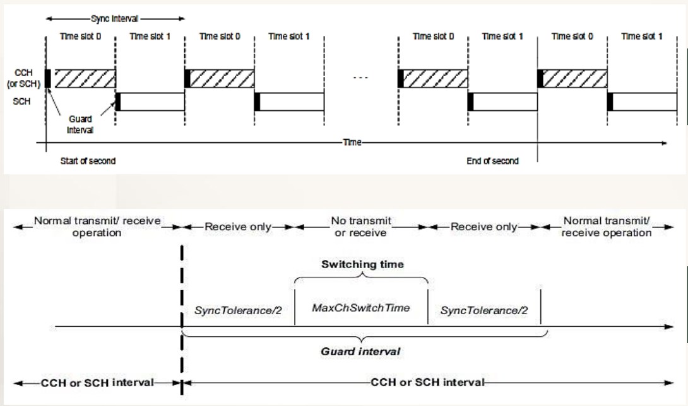

*그림 58. 동기 구간, 보호 구간, 시간 슬롯 0과 1*

장치에 무선 송수신기가 하나뿐이면 한순간에 한 채널만 쓸 수 있다. IEEE 1609.4는 시간을 나누어 한 송수신기로 제어 채널과 서비스 채널을 번갈아 쓰게 한다 [15].

- **동기 구간(sync interval):** 협정 세계시(UTC)의 매초 시작에 맞추어 시간을 일정한 동기 구간으로 나눈다. 기본값은 100 ms이므로 1초에 동기 구간이 10개 있다.
- **시간 슬롯:** 동기 구간은 CCH 구간(시간 슬롯 0)과 SCH 구간(시간 슬롯 1)으로 나뉘며, 기본값은 각각 50 ms이다.
- **보호 구간(guard interval):** 각 채널 구간의 시작에는 보호 구간(기본값 4 ms)이 있다. 그림 58의 아래쪽처럼 보호 구간은 장치 사이의 시각 오차를 허용하는 SyncTolerance/2, 채널을 바꾸는 데 걸리는 최대 시간 MaxChSwitchTime, 다시 SyncTolerance/2로 이루어진다. 앞뒤의 SyncTolerance/2 동안은 수신만 하고, 채널을 바꾸는 동안은 송신도 수신도 하지 않는다.

> **핵심:** 모든 장치가 같은 순간에 CCH로 모이므로, 서비스 채널에서 데이터를 주고받던 장치도 100 ms마다 CCH에서 안전 메시지와 WSA를 들을 수 있다. 이 방식이 동작하려면 모든 장치의 시각이 정확히 맞아야 하므로 3.7절의 시각 동기가 필요하다.


*그림 59. 연속, 교대, 즉시 채널 접근의 예*

그림 59의 세 가지 채널 접근 방식은 다음과 같다.

1. **연속 접근(continuous):** 시간 슬롯에 상관없이 CCH나 하나의 SCH에 계속 머문다. 송수신기가 두 개인 장치나 안전 메시지만 다루는 장치에 알맞다.
2. **교대 접근(alternating):** 시간 슬롯 0에는 CCH, 시간 슬롯 1에는 SCH를 쓴다.
3. **즉시 접근(immediate):** CCH 구간 도중이라도 시간 슬롯 1을 기다리지 않고 바로 SCH로 옮긴 뒤, 시간 슬롯 1이 끝날 때까지 SCH에 머문다. 큰 데이터를 빨리 주고받아야 할 때 쓴다.


*그림 60. 교대 접근의 채널 전환 절차*

그림 60의 교대 접근 절차는 다음과 같다.

1. IEEE 1609.3의 WME가 1609.4의 MLME 확장에 MLMEX-CHSTART.req로 CCH 구간의 채널 접근을 요청하고 MLMEX-CHSTART.cfm으로 확인받는다. SCH 구간에 대해서도 같은 요청을 한다. 이 요청은 채널 식별자(Channel Identifier), 시간 슬롯(Time Slot), 지원 속도 집합(OperationalRateSet), EDCA 매개변수 집합, 즉시 접근 여부(ImmediateAccess, 0\~255의 값이며 0이면 즉시 접근을 요청하지 않음)를 담는다.
2. 시간 슬롯 0이 시작되는 보호 구간(GI) 동안 MLME 확장은 802.11의 PLME에 PLME-SET.req를 보내, 필요하면 채널 시작 주파수(dot11ChannelStartingFactor)를 바꾸고, 현재 주파수(dot11CurrentFrequency)를 CCH로, 필요하면 채널 폭(dot11PhyOFDMChannelWidth)을 설정한다. 각 요청은 PLME-SET.cfm으로 확인된다.
3. 시간 슬롯 1이 시작되는 보호 구간에서 같은 방식으로 현재 주파수를 SCH로 바꾼다. 이후 동기 구간마다 2와 3을 되풀이한다.

즉시 접근에서는 WME가 MLMEX-CHSTART.req를 한 번 보내면 MLME 확장이 시간 슬롯 1을 기다리지 않고 곧바로 PLME-SET.req로 주파수를 SCH로 바꾸며, 시간 슬롯 1이 끝날 때까지 SCH를 쓴다.

### 3.7 시각 동기


*그림 61. 802.11과 802.11p의 시각 동기 방식*

- **802.11의 시각 동기:** AP에 연결된 모든 장치는 AP가 비컨에 담아 보내는 타임스탬프(time stamp)에 자기 로컬 타임스탬프를 맞춘다. 기준은 AP의 시계이다.
- **802.11p의 시각 동기:** BSS와 AP가 없으므로, 시각을 제공하는 장치(provider)가 타임스탬프와 함께 **시각 값(time value)** 과 **시각 오차(time error)** 를 보낸다. 시각 값은 위성(GPS)에서 얻은 UTC와의 차이(오프셋)이고, 시각 오차는 그 오프셋 오차의 표준 편차이다. 이를 받은 장치(user)는 자기 시계를 UTC에 맞춘다.

GPS 수신기가 있는 장치는 GPS로 UTC를 직접 얻지만, 터널 안처럼 GPS 신호가 없는 곳의 장치는 이웃이 보내는 시각 광고로 시계를 맞춘다.


*그림 62. 시각 광고(TA) 프레임의 전송 절차와 Time Advertisement 요소*

그림 62의 시각 광고(TA, timing advertisement) 절차는 다음과 같다.

1. 시각 제공자의 WME가 WME-TimingAdvertisementService.req를 받으면, MLME 확장에 MLMEX-TA.req를 보낸다. 이 요청은 목적지 MAC 주소, 반복 주기(Repeat Rate), 채널 식별자, 시간 슬롯, 광고할 내용(TimingAdvertisementContents)을 담는다. 확인(.cfm)을 받으면 WME는 상위 계층에 WME-Notification.ind로 알린다.
2. MLME 확장은 반복 주기마다 802.11 MLME에 MLME-TIMING_ADVERTISEMENT.req를 보내고, MLME는 TA 프레임을 방송한다. 이 요청은 상대 MAC 주소, 능력 정보, Time Advertisement 요소, 국가, 전력 제한, 확장 능력, 제조사별 정보를 담는다.
3. 시각 사용자의 MLME는 TA 프레임을 받아 MLME-TIMING_ADVERTISEMENT.ind로 타임스탬프, 로컬 시각, 수신 전력 지표(RCPI), 출발지 MAC 주소, 채널 식별자, 광고 내용을 올리고, MLME 확장은 MLMEX-TA.ind로 WME에 전달한다.

| 필드 | 크기(옥텟) | 내용 |
|:-----|:-----|:-----|
| Element ID | 1 | 요소의 종류 |
| Length | 1 | 요소의 길이 |
| Timing Capabilities | 1 | 시각 정보의 종류와 능력 |
| Time Value | 0 또는 10 | UTC와의 오프셋(선택) |
| Time Error | 0 또는 5 | 오프셋 오차의 표준 편차(선택) |
| Time Update Counter | 0 또는 1 | 시각 정보를 갱신할 때마다 바뀌는 카운터(선택) |

*표 30. Time Advertisement 요소의 구성*

### 3.8 WAVE 네트워킹 서비스: WSA와 WSM


*그림 63. 제공자가 WSA를 방송하여 사용자에게 서비스를 알리는 상황*

**WSA(WAVE service advertisement, WAVE 서비스 광고).**

- 인증과 결합 없이 빠르게 초기 링크를 설정하게 한다.
- **제공자(provider)** 는 WAVE 서비스를 광고하는 쪽으로, WSA를 방송하여 사용자에게 서비스가 있음을 알린다. 노변 기지국뿐 아니라 그림 63의 오른쪽처럼 위험을 알리는 차량도 제공자가 될 수 있다.
- **사용자(user)** 는 WSA를 받고 그에 따라 행동하는 쪽이다.
- WSA는 서비스가 있음을 알리는 정보를 담은 데이터 구조이며, 보안이 없는 WSA(unsecured WSA)나 서명된 WSA(secured WSA)로 보낸다.

제공자가 WSA를 보내면, 사용자는 관심 있는 서비스를 등록(service registration)하고 WSA가 알려 준 서비스 채널로 옮겨 WSM이나 IP 데이터그램으로 데이터를 주고받는다.


*그림 64. CCH 구간의 WSA와 SCH 구간의 WSM 교환*

**WSM(WAVE short message, WAVE 짧은 메시지).** WSMP로 보내는 짧은 메시지이다. 점대점 통신에 쓸 수 있고, 메시지 하나하나에 데이터 전송 속도, 송신 전력, 채널 번호를 따로 지정할 수 있다. IP 패킷은 이런 물리 계층의 값을 메시지마다 정할 수 없으므로, 짧고 중요한 메시지에는 WSM이 알맞다. 그림 64에서 RSE는 CCH 구간에 WSA를 방송하고, OBE는 SCH 구간에 그 서비스 채널로 옮겨 WSM을 주고받는다. 두 장치 모두 WME, WSMP와 IPv6, LLC, WAVE MAC, WAVE PHY로 이루어진 스택을 가진다.


*그림 65. 안전 응용을 위한 주기적 방송과 이벤트 방송*

안전 응용은 WSM을 두 가지 방식으로 방송한다. **주기적 방송(periodic broadcasting)** 은 모든 차량이 자기 위치, 속도, 방향을 정해진 주기로 보내 주변 차량이 서로를 인지하게 하는 것이고(11주차의 BSM), **이벤트 방송(event-driven broadcasting)** 은 급제동이나 사고 같은 위험이 생겼을 때 즉시 보내는 것이다. 그림 65의 가운데 차량이 위험을 감지해 이벤트 메시지를 보내는 동안, 다른 차량들은 계속 주기적 메시지를 보낸다.

### 3.9 WSM과 WSMP의 형식

| 필드 | 내용 |
|:-----|:-----|
| Subtype | 네트워크 기능의 종류: 널 네트워킹(null-networking), ITS 스테이션 내부 전달, N홉 전달, 위치 기반 전달 등 |
| N-Extensions flag | 네트워크 계층 확장 필드(N-Extensions)가 있는지 표시: 송신 전력, 채널 번호, 데이터 전송 속도, 채널 혼잡도(channel busy ratio) 등 |
| Version | 지역 메시지(localized message) 프로토콜의 버전 |
| TPID Feature selector | 전송 계층의 기능 선택: 정보 배포, 일반 세션 모드, LPP 모드 등 |
| TPID T-Extension flag | 전송 계층 확장 필드(T-Extensions, 요소 ID)가 있는지 표시 |
| Length of user data | 사용자 데이터의 길이(1\~2옥텟) |

*표 31. ISO 지역 메시지(LM) 형식의 필드*


*그림 66. IEEE 1609.3-2010, IEEE 1609.3-2016, ISO 16460의 WSM 형식 비교*

그림 66은 WSM 형식의 변화를 보여 준다. IEEE 1609.3-2010의 WSMP 헤더는 버전(1옥텟), PSID(최대 4옥텟), 확장 필드(가변), WSMP WAVE 요소 ID(1옥텟), 길이(2옥텟)로 이루어지고 그 뒤에 WSM 데이터가 온다. IEEE 1609.3-2016은 헤더를 네트워크 계층의 **WSMP-N-Header**와 전송 계층의 **WSMP-T-Header**로 나누었다. 같은 해의 ISO 16460은 ISO의 FNTP와 IEEE의 WSMP를 하나의 지역 메시지(LM, localized message) 형식으로 맞추어, 두 표준의 메시지가 같은 구조를 갖게 했다.

```text
|<-------------------- WSMP-N-Header --------------------->|<----- WSMP-T-Header ------>|<- Body ->|
+---------+-----------+---------+-------------------+------+---------+---------+--------+----------+
| Subtype |   Option  |   WSMP  |  WAVE Information | TPID | Address | WAVE IE |  WSM   | WSM Data |
|         | Indicator | Version | Element Extension |      |   Info  |   Ext.  | Length |          |
+---------+-----------+---------+-------------------+------+---------+---------+--------+----------+
   4 bits     1 bit      3 bits        variable      1 oct   variable  variable variable  variable
```

*그림 67. IEEE 1609.3-2016의 WSM 형식*

**WSMP-N-Header.** 4비트의 Subtype, 1비트의 WSMP-N-Header 선택 지시자(option indicator), 3비트의 WSMP 버전, 1옥텟의 **TPID(transport protocol identifier)** 로 이루어진다. 선택 지시자가 1이면 선택적인 WAVE 정보 요소 확장(WAVE Information Element Extension) 필드가 들어가며, 여기에는 송신에 쓴 전력(Transmit Power Used), 채널 번호, 데이터 전송 속도, 채널 부하(Channel Load)를 담을 수 있다.

| Subtype 값 | 뜻 |
|:-----|:-----|
| 0 | 널 네트워킹(null-networking), 필수 |
| 1 | ITS 스테이션 내부 전달(ITS station-internal forwarding) |
| 2 | N홉 전달(N-hop forwarding) |
| 3 | GeoNetworking 기능 |
| 4\~15 | 예약 |

*표 32. WSMP-N-Header의 Subtype 값*

널 네트워킹은 라우팅 없이 한 번의 무선 구간으로만 전달한다는 뜻이며, WAVE의 기본 동작이다.

**WSMP-T-Header.** T-Header의 주소 정보(Address Info) 필드의 내용과 선택적인 WAVE 정보 요소 확장 필드의 유무는 N-Header의 TPID 값에 따라 정해진다. WSM 길이(WSM Length) 필드는 필수이며, 상위 계층으로 넘길 WSM 데이터의 길이를 나타낸다. T-Header에 들어갈 수 있는 WAVE 정보 요소는 IEEE 1609.3에 정해져 있지 않다.

| TPID 값 | 주소 정보 | 비고 |
|:-----|:-----|:-----|
| 0 | 목적지 PSID, 출발지 주소 없음 | 필수, 정보 요소 확장 없음 |
| 1 | 목적지 PSID, 출발지 주소 없음 | 정보 요소 확장 있음 |
| 2, 3 | 출발지와 목적지의 ITS 포트 번호 | |
| 4, 5 | LPP 모드의 ITS 포트 번호 | |
| 6\~255 | 예약 | |

*표 33. TPID 값에 따른 WSMP-T-Header의 주소 정보*

TPID는 두 값씩 짝을 이루며, 앞의 값은 정보 요소 확장이 없는 형식이고 뒤의 값은 있는 형식이다. 따라서 가장 많이 쓰는 TPID 0의 T-Header는 PSID와 WSM 길이만, TPID 1은 PSID, 정보 요소 확장, WSM 길이를 담는다. PSID는 3.12절에서 다룬다.

### 3.10 WSA와 WSM의 캡슐화


*그림 68. IEEE 1609.3-2010의 WSA 캡슐화와 구성*

그림 68은 2010년 판에서 WSA가 만들어져 MAC까지 내려가는 과정이다.

1. 상위 계층의 서비스 요청을 받은 WME가 WSA 헤더, 서비스 정보 세그먼트(Service Info Segment), 채널 정보 세그먼트(Channel Info Segment), WAVE 라우팅 광고(WAVE Routing Advertisement)로 WSA를 만든다.
2. 보안 서비스가 보안 없는 WSA(프로토콜 버전, Type = unsecured, WSA) 또는 1609.2의 서명 메시지(프로토콜 버전, Type = signed_wsa, 보안 헤더, WSA, 보안 트레일러)로 감싸 1609Dot2Message를 만든다.
3. MLME 확장이 조직 식별자(OUI)와 내용 기술자(Content Descriptor)를 붙여 제조사별 내용(Vendor Specific Content)을 만들고, MLME가 범주(Category)와 OUI를 붙여 **제조사별 액션 프레임(vendor specific action frame)**, 즉 관리 프레임으로 MAC에 보낸다.


*그림 69. IEEE 1609.3-2016의 WSA 캡슐화와 구성*

그림 69의 2016년 판에서는 WSA를 관리 프레임이 아니라 WSM으로 보낸다. WME가 만든 WSA를 보안 서비스가 보안 없는 형식(프로토콜 버전, unsecured 선택, WSA) 또는 1609.2의 서명 데이터(프로토콜 버전, signedData 선택, 1609.2의 다른 필드, WSA, 1609.2의 다른 필드)로 감싸 Ieee1609Dot2Data를 만든다. WSMP는 T-Header의 PSID를 WSA를 뜻하는 0x87로 하여 WSMP 헤더를 붙이고, LLC 부계층은 Type 필드 0x88DC를 붙여 MAC 데이터 필드(MSDU)로 넘긴다.


*그림 70. IEEE 1609.3-2016의 WSM 구성과 계층별 프리미티브*

일반 WSM도 같은 방식으로 내려간다(그림 70). 상위 계층이 WSM-WaveShortMessage.req로 데이터를 넘기면, WSMP는 N-Header(Subtype 0, 선택 지시자, 버전, 선택적인 정보 요소 확장, TPID 0)와 T-Header(PSID, WSM 길이)를 붙여 WSM을 만들고 DL-UNITDATAX.req로 LLC에 넘긴다. LLC는 Type = 0x88DC를 붙여 MA-UNITDATAX.req로 MAC에 넘긴다.

> **용어 정의:** **이더타입(EtherType)** 은 프레임에 실린 데이터가 어떤 네트워크 계층 프로토콜의 것인지 알려 주는 2옥텟의 값이다. WAVE의 LLC는 WSMP 데이터에 0x88DC, IPv6 데이터에 0x86DD를 붙이므로, 수신 측 LLC는 이 값을 보고 데이터를 WSMP나 IPv6로 올린다 [14].

### 3.11 WAVE의 통신 절차


*그림 71. WSA의 방송과 서비스 이용 절차*

그림 71은 서비스 제공자와 사용자가 WSA로 서비스를 연결하는 절차이다.

- **제공자 측:** 상위 계층이 WME-ProviderService.req로 서비스를 요청하면 WME는 서비스 정보를 관리 정보 베이스(WME-MIB)에 기록하고(WME-Set.req) 확인(.cfm)을 돌려준다. WME는 MLMEX-CHSTART.req로 채널 접근을 시작하고, WSM-WaveShortMessage.req로 WSA를 WSMP에 넘긴다. 서비스가 IP를 쓰면 MLMEX-REGISTERTXPROFILE.req로 IP 패킷의 송신 매개변수를 등록한다. WSMP, LLC, MAC/PHY를 거쳐 WSA를 담은 WSM이 방송된다.
- **사용자 측:** 상위 계층이 WME-UserService.req로 관심 있는 서비스를 등록해 둔다. WSA를 담은 WSM이 MA-UNITDATA.ind, DL-UNITDATA.ind, WSM-WaveShortMessage.ind로 WME까지 올라오면, WME는 등록된 서비스와 맞는지 확인하여 이용 가능한 서비스 정보를 기록하고(AvailableServiceInfo), MLMEX-CHSTART.req로 그 서비스 채널에 접근한다. 서비스가 IP를 쓰면 송신 프로필도 등록하고, WME-Notification.ind로 상위 계층에 알린다. 이로써 서비스가 제공된다.

제공자가 WME-ProviderService.req로 서비스를 등록할 때 넘기는 주요 매개변수는 다음과 같다.

- 서비스를 구분하는 값: 로컬 서비스 인덱스(Local Service Index), 동작(Action, 추가, 삭제 등), 제공자 서비스 식별자(PSID), 제공자 서비스 맥락(Provider Service Context)
- 보낼 위치와 방식: 목적지 MAC 주소, WSA 형식(보안 여부), 서비스 채널 식별자, WSA를 보낼 채널 식별자, 채널 접근 방식, 반복 주기(Repeat Rate)
- IP 서비스 정보: IP 서비스 여부, IPv6 주소, 서비스 포트, 제공자 MAC 주소
- 사용자 측의 수용 조건: RCPI 문턱값(신호가 이보다 약한 WSA는 무시), WSA 수 문턱값과 그 계산 간격
- 기타: 정보 요소 지시자, 서명의 유효 기간(SignatureLifetime)


*그림 72. 서비스 제공자의 WSA 생성과 서비스 정보 세그먼트의 구성*

그림 72에서 제공자의 WME는 서비스 정보(Provider Service Info)와 서비스 상태(Service Status)를 WME-MIB에 기록하고, 어떤 채널 접근을 배정할지 정한 뒤 WSA를 만든다. WSA의 서비스 정보 세그먼트는 다음 필드로 이루어진다.

| 필드 | 크기 | 내용 |
|:-----|:-----|:-----|
| Service Info Count | 가변 | 뒤따르는 서비스 정보의 개수 |
| PSID | 가변 | 제공하는 서비스의 식별자 |
| Channel Index | 5비트 | 서비스를 제공하는 채널 정보의 위치 |
| Reserved | 2비트 | 예약 |
| Service Info Option Indicator | 1비트 | 정보 요소 확장이 있는지 표시 |
| WAVE Information Element Extension | 가변 | 제공자 서비스 맥락(1\~31옥텟), IPv6 주소(16), 서비스 포트(2), 제공자 MAC 주소(6), RCPI 문턱값(1), WSA 수 문턱값(1), WSA 수 문턱값 간격(1) |

*표 34. WSA의 서비스 정보 세그먼트*

서비스 정보는 Service Info Count가 알려 주는 개수만큼 되풀이되므로, WSA 하나로 여러 서비스를 한꺼번에 광고할 수 있다.

### 3.12 PSID

> **용어 정의:** **PSID(provider service identifier, 제공자 서비스 식별자)** 는 WSA와 WSM이 어떤 응용 서비스의 것인지 나타내는 식별자이다. ETSI와 ISO 표준에서는 같은 값을 AID(ITS application identifier) 라 부른다.

IEEE 1609.12는 WAVE 식별자의 할당을 정한 표준이며(2012년 9월 21일부터 유효), ETSI, ISO, SAE, IEEE 표준이 쓰는 PSID의 할당에 관한 규범적 요구사항을 담고 있다 [17]. PSID는 가변 길이이며, 첫 옥텟의 앞 비트들이 길이를 알려 주는 **p-부호화(p-encoding)** 로 나타낸다.

| 첫 옥텟의 앞 비트(b7 b6 b5 b4) | PSID 길이 | p-부호화 값의 범위(16진수) | 값의 개수 |
|:-----|:-----|:-----|:-----|
| 0 x x x | 1옥텟 | 00\~7F | $2^7 = 128$ |
| 1 0 x x | 2옥텟 | 80-00\~BF-FF | $2^{14} = 16{,}384$ |
| 1 1 0 x | 3옥텟 | C0-00-00\~DF-FF-FF | $2^{21} = 2{,}097{,}152$ |
| 1 1 1 0 | 4옥텟 | E0-00-00-00\~EF-FF-FF-FF | $2^{28} = 268{,}435{,}456$ |
| 1 1 1 1 | 5옥텟 이상 | 예약 | |

*표 35. PSID의 p-부호화 형식*

x는 0과 1 어느 것이어도 되는 비트이다. 값의 개수는 길이 표시에 쓰고 남은 비트 수로 계산한다. 예를 들어 2옥텟 형식은 16비트 가운데 앞의 2비트(10)가 길이 표시이므로 14비트가 남아 $2^{14}$개의 값을 나타낸다.

**예.** 수신기는 첫 옥텟의 앞 비트만 보고 PSID가 몇 옥텟인지 안다.

- PSID 03: 첫 옥텟이 0x03 = 00000011이고 b7이 0이므로 1옥텟이다.
- PSID 80-03: 첫 옥텟이 0x80 = 10000000으로 앞 비트가 10이므로 2옥텟이며, 두 번째 옥텟은 0x03이다.
- PSID C0-03-05: 첫 옥텟이 0xC0 = 11000000으로 앞 비트가 110이므로 3옥텟이며, 이어지는 옥텟은 0x03과 0x05이다.

옥텟은 첫 옥텟부터 차례로 전송된다. 짧은 PSID는 자주 쓰는 핵심 서비스에 배정하여 메시지를 짧게 만든다.

| PSID 값 | p-부호화 값 | 응용 분야 | 관련 표준 또는 기관 |
|:-----|:-----|:-----|:-----|
| 0x00 | 0x00 | 시스템(system) | ISO 15628 |
| 0x01 | 0x01 | 전자 요금 징수(electronic fee collection) | ISO 14906 |
| 0x02\~0x13 | 0x02\~0x13 | 화물 관리, 대중교통, 교통 정보, 주차 관리 등 DSRC 응용 | ISO 15628 등 |
| 0x14, 0x15 | 0x14, 0x15 | 전자 요금 징수의 준수 확인 통신 응용, 위치 보강 통신 응용 | ISO TS 12813, ISO TS 13141 |
| 0x20 | 0x20 | 차량 간 안전과 인지(vehicle to vehicle safety and awareness) | SAE J2735 |
| 0x21, 0x22 | 0x21, 0x22 | 센서가 제한된 차량의 차량 간 안전과 인지, 궤도 차량의 안전과 인지 | SAE J2735 |
| 0x23 | 0x23 | WAVE 보안 관리 | IEEE 1609.2 |
| 0x24 | 0x24 | CA 기본 서비스(cooperative awareness) | ETSI EN 302 637-2 |
| 0x25 | 0x25 | DEN 기본 서비스(decentralized environmental notification) | ETSI EN 302 637-3 |
| 0x26 | 0x26 | 공통 응용의 오작동 보고(misbehavior reporting) | CAMP |
| 0x27 | 0x27 | 취약 도로 이용자(VRU) 안전 응용 | SAE DSRC TC |
| 0x7F | 0x7F | 시험(testing) | IEEE P1609 WG |
| 0x80\~0x85 | 0x80-00\~0x80-05 | 차분 GPS 보정(비압축, 압축), 교차로 안전과 인지, 여행자 정보와 노변 표지, 이동 프로브 교환, 도로 위의 긴급 차량과 이상 거동 차량 | SAE J2735 |
| 0x86 | 0x80-06 | 원격 ITS 스테이션 관리 프로토콜(RMPE) | ISO 24102-2 |
| 0x87 | 0x80-07 | WAVE 서비스 광고(WSA) | IEEE 1609.3 |
| 0x88 | 0x80-08 | 보안 관리 정보의 피어 간 배포 | CAMP |
| 0x01-00 | 0x80-80 | 인증서 폐기 목록(CRL) 응용 | CAMP |
| 0x3E-80\~0x40-1F | 0xBE-00\~0xBF-9F | 예약(416개) | IEEE P1609 WG |
| 0x40-20\~0x40-5F | 0xBF-A0\~0xBF-DF | 사설 용도(64개) | IEEE P1609 WG |
| 0x40-60\~0x40-7F | 0xBF-E0\~0xBF-FF | 시험(32개) | IEEE P1609 WG |
| 0x40-80, 0x40-81 | 0xC0-00-00, 0xC0-00-01 | CAM 처리기, DENM 처리기(둘 다 사용 중단, deprecated) | ETSI |
| 0x20-40-81 | 0xE0-00-00-01 | ITS 스테이션 내부 관리 통신 프로토콜(IICP) | ISO 24102-4 |
| 0x10-20-40-7E | 0xEF-FF-FF-FE | IPv6 라우팅 | IEEE 1609.3 |

*표 36. IEEE 1609.12의 주요 PSID 할당*

2옥텟 이상의 PSID는 PSID 값과 p-부호화 값이 다르다. 2옥텟 형식의 첫 값 0x80-00이 PSID 0x80에 대응하므로, PSID 값은 p-부호화 값에서 0x8000을 빼고 0x80을 더한 값이다. 예를 들어 WSA의 PSID 0x87은 p-부호화하면 0x80-07이 되고, 3.10절에서 WSMP가 T-Header에 넣는 값이 이것이다.

### 3.13 WAVE 전자 결제 서비스

DSRC의 하이패스 같은 전자 요금 징수를 WAVE에서도 할 수 있도록, IEEE 1609.11은 **WAVE EPS(electronic payment service, 전자 결제 서비스)** 를 정한다 [16].


*그림 73. RSU와 OBU의 WAVE EPS 구조*

그림 73에서 요금을 받는 RSU 쪽은 **수취인(payee)**, 요금을 내는 OBU 쪽은 **지불인(payer)** 이다. 양쪽 모두 응용(payee 또는 payer application), 결제 서비스(payment service), WAVE 스택으로 이루어지며, 응용은 응용 핵심부(application core)와 **WIAL(WAVE interface application layer)** 로 나뉜다. 수취인과 지불인의 응용 핵심부 사이에서 직접 오가는 내용은 표준의 범위 밖(out of scope)이고, 응용 핵심부와 WIAL 사이는 DSRC 요금 징수의 응용 인터페이스 표준인 ISO 14906을 [20], 수취인과 지불인의 WIAL 사이는 DSRC 응용 계층 표준인 ISO 15628을 따른다 [9]. 즉 WAVE EPS는 DSRC 시대의 요금 징수 응용을 그대로 두고, 그 아래의 통신만 WAVE로 바꾼 구조이다.


*그림 74. RSU가 BST를 WSA에 담아 보내는 초기화 절차*


*그림 75. OBU가 VST를 WSM에 담아 응답하는 초기화 절차*

**초기화: BST와 VST의 교환.** 2.6절의 하이패스처럼 WAVE EPS도 BST와 VST를 교환하여 통신을 시작한다.

1. 그림 74에서 RSU의 수취인 응용 핵심부가 RegisterApplicationRSU.req로 응용을 등록한다. 이 요청은 응용 식별자(AID), 필수 응용 여부, 우선순위와 선택적인 장치 ID(EID), 프로필, 매개변수를 담는다.
2. WIAL의 I-KE가 Initialization.req로 **BST(beacon service table)** 를 만들어 T-KE에 넘긴다. BST는 비컨 ID, 시각, 프로필, 프로필 목록, 필수 응용 목록(AID, 선택적인 EID와 매개변수), 선택 응용 목록으로 이루어진다.
3. T-KE는 WME-ProviderService.req로 BST를 WSA의 제공자 서비스 맥락(ProviderServiceContext)에 넣어 등록하고, WAVE 스택은 BST를 담은 WSA를 반복해서 방송한다.
4. 그림 75에서 OBU의 WAVE 스택이 WSA를 받으면 WME-Notification으로 T-KE에 알리고, T-KE는 Initialization.ind(BST)로 I-KE에 넘긴다. I-KE는 NotifyApplicationOBU.req로 지불인 응용에 알리고, Initialization.res로 **VST(vehicle service table)** 를 만든다. VST는 프로필, 응용 목록(AID, 선택적인 EID와 매개변수), OBE 구성 정보(장치 등급, 제조사 ID, OBE 상태)로 이루어진다.
5. T-KE는 WSM-WaveShortMessage.req로 VST를 WSM에 담아 RSU에 보낸다.


*그림 76. WAVE EPS의 결제 절차*

그림 76의 결제 절차는 세 단계이다.

1. **초기화 단계:** RSE가 BST를 담은 WSA를 보내고, OBE가 VST를 담은 WSM으로 응답한다.
2. **요금 징수 단계:** RSE가 WSM으로 과금 정보를 요청하면, OBE의 ETC 응용은 결제 서비스에서 결제 데이터를 얻어(GetPaymentData) WSM으로 응답한다. RSE의 ETC 응용은 결제 서비스로 결제를 처리하고(MakePayment), WSM으로 과금 정보의 갱신을 요청한다. OBE는 결제 서비스에 영수증을 저장한다(SaveReceipts).
3. **후속 처리 단계:** RSE가 Event-Report-Release를 담은 WSM을 보내 거래를 끝낸다.

절차의 흐름은 2.6절의 하이패스(BST/VST 교환, 카드 정보 읽기, 차감, 영수증 저장, 해제)와 같고, 메시지를 싣는 수단만 DSRC의 슬롯에서 WAVE의 WSA와 WSM으로 바뀌었다.

---

<br>

## 4. 부록: 프랑스의 UTAC

자율주행차와 V2X 통신 장치는 실제 도로에 나가기 전에 통제된 시험장에서 같은 시나리오를 되풀이하며 시험하고, 판매하기 전에 법규 기준을 만족하는지 인증을 받아야 한다. 프랑스의 UTAC는 이런 시험과 인증을 맡는 대표적인 자동차 기관이다. 2주차의 한국자동차연구원, 4주차의 일본자동차연구소(JARI), 6주차의 영국 HORIBA MIRA와 함께 각국의 자동차 연구 기관으로 소개한다.

### 4.1 UTAC의 개요


*그림 77. UTAC의 설립 배경과 주요 수치*

UTAC는 1945년에 프랑스 파리 근교 Linas-Montlhéry 지역의 시험장(proving ground)을 기반으로 설립되었으며, 시험, 인증, 기술 지원, 교육, 세미나 등 다양한 업무를 한다. 그림 77의 수치에 따르면 UTAC는 전 세계에 8개의 시험 시설과 30개 이상의 전문 실험실을 두고, 10개국에서 1,280명의 직원(그 가운데 기술 전문가 500명 이상)이 일하며, 매출은 1억 7,300만 유로이다.

### 4.2 UTAC의 현황과 위치

- 전 세계 550명 이상의 전문가가 파리 근교의 시험장 2곳과 8개의 해외 거점을 운영하며 업무를 한다.
- 완성차의 형식 승인, 부품과 완성차의 시험 같은 서비스로 수익을 내고 기업을 지원한다.
- 2019년에 자율주행차 연구소 TEQMO를 세우고, 관련 기술의 연구개발, 시험, 전문가 컨설팅, 형식 승인 서비스를 제공한다.
- 파리 근교의 총길이 12 km 전용 시험 트랙에서 5G-ITS와 자율주행 기술의 다양한 연구개발을 추진한다.

> **용어 정의:** **형식 승인(type approval)** 은 차량이나 부품이 판매되기 전에 안전, 환경 같은 법규 기준을 만족하는지 공인 기관이 시험하여 승인하는 제도이다.

> **용어 정의:** **Euro NCAP(European New Car Assessment Programme)** 은 신차의 충돌 안전성과 안전 보조 기능을 평가하여 별점으로 공개하는 유럽의 신차 안전도 평가 제도이다.

> **용어 정의:** **ISO/IEC 17025**는 시험소와 교정 기관의 능력에 관한 국제 표준이다.


*그림 78. SIMCA가 1956년에 세운 시험장의 트랙 구성*

그림 78의 시험장은 자동차 회사 SIMCA가 1956년에 세운 것으로, 11개의 시험 트랙과 6개의 부속 시험 실험실(환경, 안전, 내구)을 갖추고 Euro NCAP과 ISO 17025 같은 국제 인정을 받았다. 트랙은 고속 오벌 트랙, 일반 도로 트랙, 동적 플랫폼, 승차감 트랙, 도심 트랙, 오프로드 트랙, 특수 트랙(돌 포장 트랙, 굴곡 트랙, 자갈 트랙, 염수 도하로, 음향 터널)으로 이루어진다.


*그림 79. 파리 근교에 있는 UTAC의 두 시험장의 위치*

그림 79처럼 UTAC의 본원은 파리 남쪽의 Linas-Montlhéry 자동차 경주장(Autodrome de Linas-Montlhéry)에, 북부 시험장은 파리 북쪽의 Mortefontaine 시험 센터(Centre d'essais de Mortefontaine)에 있다. 파리 서쪽의 업무 지구(La Défense)에서 두 시험장까지는 각각 약 51 km(약 60분), 두 시험장 사이는 약 74 km(약 120분)이다. 오른쪽 사진은 시험장의 고속 오벌 트랙이다.


*그림 80. UTAC의 해외 거점*

그림 80의 거점은 프랑스의 Mortefontaine 시험 센터와 Linas-Montlhéry 시험 센터, 영국의 Leyland 시험 시설과 Millbrook 시험장, 미국의 Michigan 시험 센터와 California 시험 센터, 핀란드의 겨울 시험장 2곳, 모로코의 여름 시험장이다. 추운 곳과 더운 곳에 시험장을 두어, 같은 차량을 극한의 기후에서 시험할 수 있다.

### 4.3 UTAC의 업무


*그림 81. 분야별 UTAC의 시험 시설*

| 분야 | 시험 시설 |
|:-----|:-----|
| 기존 파워트레인 | 엔진 시험실, 경량과 중량 차량의 섀시 동력계, 이동식 배출가스 측정(PEMS) 실험실 |
| 미래 파워트레인 | 2E, 3E, 4E 파워트레인 시험 장치, 배터리 팩 시험 챔버 12개, 전기 모터와 전기 구동 장치(EDU) 시험 실험실 |
| 안전 | Euro NCAP과 수동 안전 실험실, ADAS와 능동 안전 실험실, 실내와 실외의 겨울 타이어 시험 |
| 쾌적성과 품질 | EMC 챔버, NVH 챔버, NVH 브레이크 동력계 |
| 신뢰성과 내구성 | 파워트레인 시험 시스템, 중량 구조물 실험실, 충격과 진동 시험 장치 |
| 커넥티드 모빌리티 | 시뮬레이션, 5G CAV 빌리지, TEQMO 시험 센터(5G) |

*표 37. UTAC의 분야별 시험 시설*

> **용어 정의:** **EMC(electromagnetic compatibility, 전자파 적합성)** 는 전자 장치가 주변에 전자파 장해를 일으키지 않고 주변의 전자파에도 오동작하지 않는 성질이다.

> **용어 정의:** **NVH(noise, vibration, harshness)** 는 차량의 소음, 진동, 불쾌한 충격감을 묶어 부르는 말이다.

> **용어 정의:** **CAV(connected and automated vehicle)** 는 커넥티드 자율주행차이다.

> **용어 정의:** **ADAS(advanced driver assistance systems)** 는 첨단 운전자 보조 시스템이다.

| 업무 | 내용 |
|:-----|:-----|
| 규제 | 유엔 유럽경제위원회(UN-ECE, 제네바)와 브뤼셀의 세계 규제 개발에 참여하고, 유럽 차량 형식 승인의 모니터링과 지원, 규제 변화의 감시를 한다. |
| 형식 승인 | 국제적인 인정과 인증을 바탕으로 세계 각국의 형식 승인을 지원하고, 승인 절차를 관리한다. |
| 인증 | 국제 인증 기관으로서 해마다 1,000건 이상의 인증서를 발급하며, 7개 사무소에 130명의 감사원이 있다. |
| 시장 감시 | 공인 시험 기관으로서 환경, 차량과 장비 안전 규제의 기술 전문성을 제공하고, 조정과 모니터링을 한다. |
| 자격 | 특장차 제작자(coachbuilder), 음주 측정 시동 잠금 장치(IID)와 그 장착 업체의 공식 자격 기관으로서 자격자 명단을 관리하고 자격 절차를 지원한다. |
| 차량 검사 | 1991년부터 프랑스의 공식 자동차 기술 검사 기관으로서 검사 데이터를 관리하고, 검사 시설의 점검과 기술 지원을 한다. |
| 표준화 | 해마다 표준화 프로그램을 세워 표준을 만들고, 표준화의 필요를 파악하며, CEN과 ISO의 표준화 위원회를 조정한다. |
| 특수 차량 | 차량을 개조하여 은밀 방호, 시스템 통합, 배출가스 저감 같은 능력을 더하고, 방탄과 방폭 기능을 갖춘 방호 차량을 만든다. |
| 감사 | 기업의 성과를 평가하거나 인증을 준비하도록 돕고, 자동차 생산자, 제조사, 공급사를 위한 감사원을 둔다. |
| 교육 | 도로 위험 관리, 친환경 운전, 출퇴근 안전 교육과 정부 기관의 특수 자격 교육을 하며, 교육 과정은 프랑스의 교육 품질 인증(Qualiopi)을 받았다. |
| 행사 | 보도 발표와 제품 발표, 교육, 영화와 방송과 패션 촬영, 워크숍 같은 기업 대상(BtoB) 행사를 전담 팀과 시설로 열고, Linas-Montlhéry의 유산을 살려 해마다 14회 이상의 대중 대상(BtoC) 행사를 열며, 후원과 VIP 초청 같은 협력을 제공한다. |

*표 38. UTAC의 업무 분야*

### 4.4 시험장과 TEQMO


*그림 82. UTAC의 다섯 시험장*

| 시험장 | 국가 | 트랙 규모 | 주요 시설 |
|:-----|:-----|:-----|:-----|
| Linas-Montlhéry | 프랑스 | 23 km 이상 | 고속 오벌, 동적 플랫폼, 음향 트랙; TEQMO 시험 센터(첨단 트랙 12 km, 5G CAV 특화, ADAS 전문성) |
| Millbrook | 영국 | 70 km | 고속 오벌, 알파인 핸들링 코스, 4×4 오프로드, 1마일 직선로, 특수 노면; 5G CAV 테스트베드 |
| Mellatracks, Airport PG | 핀란드 | 실외 100 km | 눈과 얼음 위의 핸들링, 좌우 마찰이 다른 트랙과 경사로; 실내 트랙 6개(눈과 얼음 4개, 젖은 아스팔트와 마른 아스팔트 2개) |
| Mortefontaine | 프랑스 | 19 km 이상 | 고속 오벌, 도심과 오프로드, 특수 노면, 동적 플랫폼, 음향 터널 |
| Oued Zem | 모로코 | 고온 기후 시험 | 고속 트랙, 4 km 타행 시험로, 젖은 저마찰 노면 제동, 동적 플랫폼, 특수 노면(2021년 4분기 개장 예정이었음) |

*표 39. UTAC의 시험장*


*그림 83. TEQMO 시험장의 구역과 협력사*

**TEQMO**는 UTAC CERAM이 운영하는 자율주행차와 커넥티드카 기술 센터(Technology Center for Automated and Connected Vehicles)이다. 12 km의 트랙에 4G, 5G, ITS-G5, 와이파이 통신 인프라를 갖추고 공인 시험을 할 수 있다. ITS-G5는 3절의 WAVE와 같은 IEEE 802.11p 기반의 유럽 표준이므로(1주차), TEQMO에서는 WAVE 계열 통신과 14주차의 C-V2X를 모두 시험할 수 있다.

| 구역 | 내용 |
|:-----|:-----|
| 1. 고속도로 회로 | 길이 2.2 km, 3차로, 여러 언어의 표지, 터널과 요금소 |
| 2. 일반 도로 회로 | 길이 6.5 km, 도로 표지, 언덕 코스, 도로 가장자리 |
| 3. 도시 구역 | 모형 건물과 횡단보도, 신호등과 표지, 회전 교차로와 철도 건널목, 자동 주차 구역 |
| 4. 주차 구역 | 사선, 평행, 직각 주차, 주차선과 차단기, 블록, 측면 보호 구역, 움직이는 장애물 |
| 5. ADAS 동적 구역 | 38,800 m²의 동적 플랫폼, LED와 나트륨 조명, Euro NCAP 2020 교차로 시나리오, Euro NCAP 시험 타깃 |
| 6. 제동 구역 | Euro NCAP 자동 긴급 제동(AEB) 구역, 원형 판 2개, 마찰 계수 0.2\~0.9, 살수 시스템 |

*표 40. TEQMO 시험장의 구역*

협력사로는 도로 건설사 COLAS, 통신사 Orange와 Bouygues, 통신 장비사 Ericsson, 지도 회사 HERE가 있다. 도로, 통신망, 지도를 갖춘 협력 구조는 커넥티드 자율주행에 도로 인프라, 통신, 정밀 지도가 모두 필요함을 보여 준다.


*그림 84. 영국 Millbrook 시험장의 트랙 배치*

UTAC는 2021년 2월에 유럽에서 가장 큰 차량 시험 연구소 가운데 하나인 영국의 Millbrook 인수를 마쳐(2020년 12월 발표) [21] 더 많은 나라에 다양한 서비스를 제공할 기반을 마련했고, 2019년에는 전기차 관련 시험소를 완공하는 등 미래차의 시험과 인증 기반을 넓혔다. 그림 84의 Millbrook 시험장은 승용차와 대형 차량의 시험을 위해 특별히 만든 시설이다. 일반 도로 트랙은 까다로운 유럽 도로와 고속 서킷, 많은 특수 노면을 모사하며 유명한 Millbrook Hill Route를 포함하고, 오프로드 트랙에는 민간 차량과 군용 차량의 능력을 시험하는 장애물이 많다.

### 4.5 시험 시설


*그림 85. 부식, 밀봉, 기후, 먼지 시험 시설*

그림 85의 실험실에서는 차량의 부식(corrosion), 물이 새지 않는지 보는 밀봉(sealing), -30 °C\~+60 °C의 기후(climatics), 먼지(dust) 시험을 한다.


*그림 86. 시험장의 특수 노면과 시설*

| 시설 | 규격과 특징 |
|:-----|:-----|
| 염수 도하로(salted water ford) | 길이 200 m, 깊이 10 cm |
| 담수 도하로(freshwater ford) | 길이 25 m, 깊이 가변(최대 40 cm) |
| 음향 잔향 터널(acoustic reverberation tunnel) | 길이 100 m |
| 먼지 터널(dust tunnel) | 길이 100 m |
| 돌 포장 트랙(cobbled track) | 길이 800 m, 2 m마다 작은 패임 |
| 물결 트랙(wavy track) | 길이 80 m |
| 자갈길(gravel path) | 길이 130 m |
| 장애물(obstacles) | 보도 턱, 과속 방지턱 |
| 경사로(slopes) | 기울기 10, 15, 18, 25%의 보정된 경사로 |

*표 41. 시험장의 특수 노면과 시설의 규격*

이런 노면은 실제 도로에서 오랜 기간에 걸쳐 겪을 진동, 충격, 부식, 침수를 짧은 기간에 재현하여 차량과 부품의 내구성과 신뢰성을 시험하는 데 쓰인다.

---

<br>

## 개념 적용

| 상황 | 적용할 개념 |
|:-----|:-----|
| 노변 기지국의 안테나를 5 m에서 10 m 높이로 옮겼다. 차량까지의 거리는 2파 모델이 성립할 만큼 멀다. | 2파 모델에서 수신 전력은 $h_1^2$에 비례하므로 $20 \log 2 \approx 6$ dB 좋아진다(1.5절). |
| 차량이 노변 기지국에서 멀어지며 수신 SINR이 계속 낮아진다. | 링크 적응으로 64-QAM 3/4에서 16-QAM, QPSK를 거쳐 BPSK 1/2로 낮추어 오류를 줄인다(1.11절). |
| 교차로 양쪽의 두 차량은 건물에 가려 서로의 신호를 듣지 못하지만, 가운데의 노변 기지국은 둘 다 듣는다. | 숨은 터미널 문제이다. 유니캐스트라면 RTS/CTS로 채널을 예약하고 NAV로 상대의 송신을 미룬다(1.11절). |
| 고속도로 요금소를 차량이 멈추지 않고 지나가며 통행료를 낸다. | 5.8 GHz DSRC의 하이패스이다. BST와 VST로 초기화하고 TDMA 슬롯으로 인증과 차감을 마친다(2.5절, 2.6절). |
| 한 OBU에서 급제동 경고와 영상 스트리밍 데이터가 동시에 전송을 기다린다. | EDCA에서 급제동 경고를 AC_VO에 넣으면 AIFS 58 µs와 CW 3\~7로, AC_BK(149 µs, 15\~1023)보다 먼저 채널을 잡는다(3.5절). |
| 송수신기가 하나뿐인 OBU가 안전 메시지를 놓치지 않으면서 노변 기지국의 서비스도 받아야 한다. | IEEE 1609.4의 교대 접근으로 CCH 구간에는 안전 메시지와 WSA를, SCH 구간에는 서비스 데이터를 주고받는다(3.6절). |
| 터널 안에서 GPS 신호가 끊겨 OBU의 시계가 어긋나기 시작한다. | 이웃 장치가 보내는 TA 프레임의 시각 값과 시각 오차로 UTC에 다시 맞춘다(3.7절). |
| 시속 100 km로 달리는 차량이 노변 기지국의 통신 영역을 1초 남짓 만에 지나간다. | 인증과 결합 없는 OCB 통신과 WSA로 즉시 서비스를 시작한다(3.3절, 3.8절). |

*표 42. 상황별로 적용할 개념*

**T/F 점검:**

| 문장 | 판단과 근거 |
|:-----|:-----|
| 5.8 GHz DSRC는 OSI의 7계층을 모두 구현한다. | **F.** 응용 계층(7), 데이터 링크 계층(2), 물리 계층(1)만 정의한다. |
| 2파 모델에서 거리가 두 배가 되면 수신 전력은 6 dB 줄어든다. | **F.** 네제곱 법칙이므로 12 dB 줄어든다. 6 dB는 자유 공간의 경우이다. |
| 64-QAM은 한 심볼에 6비트를 싣는다. | **T.** $\log_2 64 = 6$이다. |
| 무선 LAN은 CSMA/CD로 충돌을 감지한다. | **F.** 송신 중에 충돌을 감지하기 어려우므로 CSMA/CA로 충돌을 피한다. |
| OCB 통신을 하는 802.11p 단말은 데이터를 보내기 전에 AP와 결합해야 한다. | **F.** BSS 밖에서 인증과 결합 없이 바로 통신한다. |
| WAVE의 TXOP 한도가 0이면 채널을 얻을 때마다 MPDU 하나만 보낼 수 있다. | **T.** |
| IPv6 라우터는 데이터그램을 전달할 때마다 헤더 체크섬을 다시 계산한다. | **F.** IPv6 헤더에는 체크섬이 없다. |
| WSA의 PSID 0x87은 WSMP 헤더에 1옥텟 0x87로 들어간다. | **F.** 0x80 이상의 PSID는 2옥텟으로 p-부호화되므로 0x80-07로 들어간다. |

---

<br>

## 요약

| 개념 | 핵심 요약 |
|:-----|:-----|
| OSI 참조 모델 | 이기종 시스템이 통신할 수 있도록 ISO가 정한 7계층 모델이며, 무선 기술의 차이는 주로 하위 세 계층(미디어 계층)에서 생긴다. |
| 무선 기술별 계층 구조 | IEEE 802.11은 IP 기반, DSRC는 1, 2, 7계층만, WAVE는 IP와 WSMP를 함께 쓰며, ETSI, ISO, 3GPP도 IP 옆에 가벼운 전용 경로를 둔다. |
| 전파 손실 | 자유 공간에서는 수신 전력이 거리의 제곱에, 2파 모델에서는 네제곱에 반비례하며, 섀도잉, 다중 경로 페이딩, 간섭이 더해진다. |
| 디지털 변조 | BPSK, QPSK, 8-QAM, 16-QAM, 64-QAM은 심볼당 1, 2, 3, 4, 6비트를 싣고, 점이 많을수록 빠르지만 잡음에 약하다. |
| 부호화율 | 정보 비트 $k$개를 $n$비트 부호어로 바꿀 때 $R = k/n$이며, 작을수록 오류 정정 능력이 크고 정보량은 줄어든다. |
| OFDM | 고속 데이터를 직교하는 여러 부반송파에 나누어 병렬로 보내며, 스펙트럼이 겹쳐도 분리되고 긴 심볼과 CP로 다중 경로에 강하다. |
| 매체 접근 제어 | 결정적 방식(폴링, 토큰, 비코닝)과 무작위 방식(ALOHA, CSMA)이 있으며, 무선 LAN은 CSMA/CA로 충돌을 피한다. |
| RTS/CTS와 NAV | 짧은 RTS와 CTS로 채널을 예약하고, 이를 들은 단말은 Duration 값으로 NAV를 설정해 숨은 터미널 문제를 줄인다. |
| 오류 검출과 정정 | 패리티, CRC로 검출하고, FEC로 스스로 고치거나 ARQ로 재전송을 요청하며, 방송 메시지는 FEC와 반복에 의존한다. |
| 포워딩과 라우팅 | 포워딩은 라우터 안에서 포워딩 테이블로 출력 포트를 고르는 일이고, 라우팅은 네트워크 전체의 종단 간 경로를 정하는 일이다. |
| 가상 회선과 데이터그램 | 가상 회선은 경로를 먼저 설정하는 연결형, 데이터그램은 패킷마다 독립적으로 전달하는 비연결형 서비스이다. |
| IPv4와 IPv6 | IPv4는 32비트, IPv6는 128비트 주소이며, IPv6는 체크섬과 라우터 단편화를 없애고 확장 헤더와 흐름 라벨을 쓴다. |
| DSRC | 5.8 GHz의 노변과 차량 사이 근거리 통신으로, ASK와 TDMA 슬롯(FCMS, MDS, ACTS)을 쓰며 하이패스 같은 요금 징수에 쓰인다. |
| 무선 LAN의 구성 | STA, AP, BSS, DS, ESS로 이루어지며, MAC은 DCF 위에 PCF, HCF(EDCA, HCCA), MCF를 둔다. |
| DCF | DIFS 동안 비어 있으면 보내고, 바쁘면 미룬 뒤 $[0, CW]$의 임의 백오프를 거치며, 실패할 때마다 CW가 두 배 가까이 커진다. |
| EDCA | 네 접근 범주(BK, BE, VI, VO)에 서로 다른 AIFS와 CW를 주어 우선순위가 높은 트래픽이 먼저 채널을 잡게 한다. |
| OFDM 물리 계층 | 프리앰블, SIGNAL, DATA로 프레임을 만들고, 20 MHz에서 6\~54 Mbps, 10 MHz에서 3\~27 Mbps를 낸다. |
| WAVE | IEEE 802.11p와 IEEE 1609.x로 이루어진 차량 통신으로, OCB, 다중 채널, WSA, WSMP, IPv6를 특징으로 한다. |
| 다중 채널 동작 | 100 ms의 동기 구간을 CCH 구간과 SCH 구간으로 나누어 한 송수신기로 두 종류의 채널을 번갈아 쓰며, 시각 동기가 필요하다. |
| WSA와 WSM | WSA는 서비스가 있음을 알리는 광고이고, WSM은 메시지마다 속도, 출력, 채널을 정할 수 있는 짧은 메시지이다. |
| PSID | 서비스를 구분하는 가변 길이 식별자로, 첫 옥텟의 앞 비트가 길이를 알려 주는 p-부호화를 쓴다. |
| WAVE EPS | DSRC의 요금 징수 응용(ISO 14906, ISO 15628)을 유지하면서 BST는 WSA에, VST와 결제 메시지는 WSM에 실어 보낸다. |
| UTAC | 1945년에 설립된 프랑스의 자동차 시험 인증 기관으로, 형식 승인, 시험, 인증을 하며 TEQMO에서 커넥티드 자율주행을 시험한다. |

---

<br>

## 점검 문제

1. **계층 구조:** 5.8 GHz DSRC가 OSI의 3\~6계층을 두지 않는 이유와, WAVE가 IP 외에 WSMP를 따로 두는 이유를 설명하라.

   <details>
   <summary>정답</summary>

   DSRC에서는 노변 기지국과 차량이 한 번의 무선 구간으로 직접 연결되므로 경로를 정하는 네트워크 계층이 필요 없다. 또 차량이 통신 영역을 지나는 짧은 시간 안에 거래를 끝내야 하므로 계층을 줄여 처리 시간과 오버헤드를 줄인다. WAVE는 인터넷 서비스를 위해 IPv6를 지원하지만, 안전 메시지처럼 짧고 급한 메시지는 IP 헤더와 주소 설정 없이 빠르게 보내야 하므로 가벼운 WSMP를 따로 둔다. WSMP는 메시지마다 데이터 전송 속도, 송신 전력, 채널을 정할 수도 있다.

   </details>

2. **2파 모델:** 송신 안테나 높이 8 m, 수신 안테나 높이 1.5 m, 안테나 이득 1, 거리 3 km일 때 2파 모델의 $P_R/P_T$를 dB로 구하고, 거리가 6 km가 되면 얼마나 줄어드는지 쓰라. 주파수는 5.9 GHz이다.

   <details>
   <summary>정답</summary>

   먼저 임계 거리를 확인한다. $d_c \approx 4 h_1 h_2 / \lambda = 4 \times 8 \times 1.5 / 0.0508 \approx 945$ m이므로 3 km에서 2파 모델의 근사가 성립한다. $h_1 h_2 / d^2 = 12 / (9 \times 10^6) \approx 1.33 \times 10^{-6}$이고, $P_R/P_T = (1.33 \times 10^{-6})^2$이므로 $20 \log_{10}(1.33 \times 10^{-6}) \approx -117.5$ dB이다. 거리가 두 배가 되면 $40 \log_{10} 2 \approx 12$ dB 줄어 약 $-129.5$ dB가 된다.

   </details>

3. **변조와 전송 속도:** 심볼 속도가 초당 100만 심볼인 시스템에서 QPSK, 16-QAM, 64-QAM의 비트 속도를 구하고, 64-QAM을 항상 쓰지 않는 이유를 설명하라.

   <details>
   <summary>정답</summary>

   심볼당 비트 수는 $\log_2 M$이므로 QPSK는 2비트, 16-QAM은 4비트, 64-QAM은 6비트이다. 비트 속도는 각각 2 Mbps, 4 Mbps, 6 Mbps이다. 64-QAM은 성상도의 점 사이가 좁아 잡음과 간섭에 약하므로, 신호가 약하거나 채널 상태가 나쁘면 오류가 많아진다. 그래서 채널 상태에 따라 변조 방식을 바꾸는 링크 적응을 쓴다.

   </details>

4. **OFDM 속도 계산:** 10 MHz 채널에서 16-QAM, 부호화율 1/2로 보낼 때의 데이터 전송 속도를 단계별로 계산하라.

   <details>
   <summary>정답</summary>

   부반송파 간격은 $10 \text{ MHz} / 64 = 156.25$ kHz이고 심볼 길이는 8 µs이므로 1초에 $1 / (8 \times 10^{-6}) = 125{,}000$개의 심볼을 보낸다. 심볼당 부호화 비트는 데이터 부반송파 48개 $\times$ 4비트 $= 192$비트이고, 부호화율 1/2을 곱하면 데이터 비트는 96비트이다. 따라서 $125{,}000 \times 96 = 12{,}000{,}000$ bps $= 12$ Mbps이다.

   </details>

5. **숨은 터미널과 방송:** 숨은 터미널 문제를 RTS/CTS가 해결하는 원리를 설명하고, 여러 차량에 방송하는 안전 메시지에는 RTS/CTS를 쓰지 않는 이유를 쓰라.

   <details>
   <summary>정답</summary>

   송신자가 RTS를 보내면 수신자가 CTS로 답한다. 송신자 주변의 단말은 RTS를, 송신자의 신호를 듣지 못하는 수신자 주변의 숨은 단말은 CTS를 듣고, 프레임의 Duration 값으로 NAV를 설정해 그동안 송신을 미룬다. 그래서 수신자 쪽의 충돌을 막는다. 방송 메시지는 받는 차량이 여럿이므로 누가 CTS를 보낼지 정할 수 없고, 모두 CTS를 보내면 CTS끼리 충돌한다. 또 짧은 메시지에 RTS/CTS 교환을 더하면 지연과 오버헤드가 커지므로 쓰지 않는다.

   </details>

6. **백오프:** $aCWmin = 15$, $aCWmax = 1023$, $aSlotTime = 13$ µs인 단말이 연속으로 세 번 전송에 실패했다. 네 번째 시도의 CW와 최대 백오프 시간을 구하라.

   <details>
   <summary>정답</summary>

   CW는 실패할 때마다 $2(CW + 1) - 1$로 늘어난다. 처음 15에서 31, 63, 127이 되므로 네 번째 시도의 CW는 127이다. 백오프 값은 0\~127 가운데 하나이므로 최대 백오프 시간은 $127 \times 13 = 1{,}651$ µs이다.

   </details>

7. **EDCA:** 10 MHz 채널의 OCB 기본값에서 AC_VO와 AC_BE의 AIFS를 계산하고, 두 범주가 동시에 경쟁할 때 AC_VO가 유리한 이유를 두 가지 쓰라.

   <details>
   <summary>정답</summary>

   $AIFS = AIFSN \times aSlotTime + SIFS$이므로 AC_VO는 $2 \times 13 + 32 = 58$ µs, AC_BE는 $6 \times 13 + 32 = 110$ µs이다. 첫째, AC_VO는 매체가 빈 뒤 더 짧게 기다리고 백오프를 시작한다. 둘째, AC_VO의 CW는 3\~7로 AC_BE의 15\~1023보다 훨씬 작아 더 작은 백오프 값을 고른다. 그래서 통계적으로 AC_VO가 먼저 채널을 잡는다.

   </details>

8. **DSRC 슬롯:** RF-DSRC의 MDS 슬롯이 100옥텟임을 필드의 크기로 확인하고, ACTS 슬롯에서 두 OBU가 같은 ACTC를 고르면 어떻게 되는지 설명하라.

   <details>
   <summary>정답</summary>

   MDC는 PR 2, CSW 2, MAC 2, MSDU 65, CRC 2로 73옥텟, ACKC는 PR 2, CSW 2, AI 1, CRC 2로 7옥텟이고, 간격 t3이 11옥텟, t4가 9옥텟이므로 $73 + 11 + 7 + 9 = 100$옥텟이다. ACTS에서 아직 링크가 없는 OBU는 ACTC 여섯 개 가운데 하나를 임의로 골라 연결을 요청하는데, 두 OBU가 같은 ACTC를 고르면 두 요청이 충돌해 노변 기지국이 둘 다 받지 못한다. 두 OBU는 다음 프레임에서 다시 임의의 ACTC를 골라 시도하고, 재시도 횟수를 LRC에 적는다.

   </details>

9. **다중 채널 동작:** IEEE 1609.4의 기본값으로 1초 동안 CCH 구간과 보호 구간은 각각 몇 번 있는지 쓰고, 보호 구간이 필요한 이유를 설명하라.

   <details>
   <summary>정답</summary>

   동기 구간이 100 ms이므로 1초에 동기 구간이 10개 있고, 동기 구간마다 CCH 구간과 SCH 구간이 하나씩 있으므로 CCH 구간은 10번, 보호 구간은 각 채널 구간의 시작마다 있어 20번이다. 보호 구간은 장치마다 시각이 조금씩 다른 것(SyncTolerance)과 송수신기의 주파수를 바꾸는 데 걸리는 시간(MaxChSwitchTime)을 흡수한다. 이 동안 송신하지 않으므로, 아직 채널을 바꾸지 못한 장치가 다른 채널의 프레임을 놓치거나 섞인 프레임을 받는 일을 막는다.

   </details>

10. **PSID:** WSMP 헤더의 PSID 필드 첫 옥텟이 0xA3일 때 PSID의 길이를 구하고, WSA의 PSID 0x87을 p-부호화한 값을 쓰라.

    <details>
    <summary>정답</summary>

    0xA3은 2진수로 10100011이고 앞 비트가 10이므로 PSID는 2옥텟이다. 0x80 이상의 PSID는 2옥텟 형식으로 부호화하며 PSID 0x80이 0x80-00에 대응하므로, 0x87은 $0x8000 + (0x87 - 0x80) = 0x8007$, 즉 0x80-07이다.

    </details>

11. **WSA의 캡슐화:** IEEE 1609.3-2010과 2016에서 WSA를 MAC으로 보내는 방식의 차이를 설명하라.

    <details>
    <summary>정답</summary>

    2010년 판에서는 WSA를 1609.2로 감싼 뒤 MLME 확장과 MLME가 OUI, 내용 기술자, 범주를 붙여 제조사별 액션 프레임, 즉 관리 프레임으로 보낸다. 2016년 판에서는 WSA를 1609.2 데이터(Ieee1609Dot2Data)로 감싼 뒤 WSMP가 PSID 0x87의 WSMP 헤더를 붙여 WSM으로 만들고, LLC가 이더타입 0x88DC를 붙여 데이터 프레임의 MSDU로 보낸다. 즉 WSA가 관리 프레임에서 일반 WSM으로 바뀌었다.

    </details>

12. **IPv6 확장 헤더:** IPv6 헤더 뒤에 홉별 옵션 헤더와 TCP가 차례로 온다. 두 헤더의 다음 헤더 필드 값을 쓰고, 홉별 옵션 헤더의 위치에 관한 규칙을 설명하라.

    <details>
    <summary>정답</summary>

    IPv6 헤더의 다음 헤더는 홉별 옵션 헤더를 가리키는 0이고, 홉별 옵션 헤더의 다음 헤더는 TCP를 가리키는 6이다. 홉별 옵션 헤더는 경로의 모든 라우터가 처리해야 하므로 반드시 IPv6 헤더 바로 뒤에 와야 한다.

    </details>

13. **포워딩:** 그림 19의 포워딩 테이블을 가진 라우터에 헤더 값이 0101인 패킷과 1001인 패킷이 도착했다. 각 패킷의 출력 링크를 쓰고, 이 테이블을 누가 만드는지 설명하라.

    <details>
    <summary>정답</summary>

    0101은 출력 링크 2로, 1001은 출력 링크 1로 나간다. 포워딩 테이블은 라우팅 알고리즘이 네트워크 전체의 최소 비용 경로를 계산하여 만들며, 라우터는 패킷이 올 때마다 테이블을 찾아 출력 링크만 고른다.

    </details>

14. **하이패스와 WAVE EPS:** 하이패스와 WAVE EPS의 결제 절차에서 같은 점과 다른 점을 설명하라.

    <details>
    <summary>정답</summary>

    두 절차 모두 BST와 VST의 교환으로 초기화하고, 과금 정보를 읽고 차감한 뒤 영수증을 저장하고 연결을 해제하는 흐름이 같다. WAVE EPS는 이 DSRC 요금 징수 응용(ISO 14906, ISO 15628)을 그대로 쓴다. 다른 점은 메시지를 싣는 수단이다. 하이패스는 5.8 GHz DSRC의 TDMA 슬롯(FCMS, MDS, ACTS)으로, WAVE EPS는 5.9 GHz WAVE의 WSA(BST)와 WSM(VST와 결제 메시지)으로 보낸다.

    </details>

15. **시험장의 역할:** UTAC의 TEQMO가 V2X 통신의 시험에 알맞은 이유를 시설과 통신 인프라의 관점에서 설명하라.

    <details>
    <summary>정답</summary>

    TEQMO는 고속도로, 일반 도로, 도시, 주차, ADAS, 제동 구역으로 이루어진 12 km의 트랙에서 터널, 요금소, 신호등, 회전 교차로 같은 실제 도로 상황을 반복해서 재현할 수 있다. 또 4G, 5G, ITS-G5, 와이파이 통신 인프라를 갖추고 통신사, 장비사, 지도 회사와 협력하므로, IEEE 802.11p 계열의 통신과 C-V2X를 같은 시나리오에서 시험하고 비교할 수 있다.

    </details>

---

<br>

## 참고 문헌

1. ISO/IEC 7498-1:1994, *Information technology - Open Systems Interconnection - Basic Reference Model: The Basic Model*, International Organization for Standardization, 1994.
2. T. S. Rappaport, *Wireless Communications: Principles and Practice*, 2nd ed., Upper Saddle River, NJ, USA: Prentice Hall, 2002.
3. A. Goldsmith, *Wireless Communications*, Cambridge, UK: Cambridge University Press, 2005.
4. IEEE Std 802.11-2020, *IEEE Standard for Information Technology - Telecommunications and Information Exchange between Systems - Local and Metropolitan Area Networks - Specific Requirements - Part 11: Wireless LAN Medium Access Control (MAC) and Physical Layer (PHY) Specifications*, 2021.
5. J. F. Kurose and K. W. Ross, *Computer Networking: A Top-Down Approach*, 8th ed., Hoboken, NJ, USA: Pearson, 2021.
6. S. Deering and R. Hinden, "Internet Protocol, Version 6 (IPv6) Specification," RFC 8200, Jul. 2017.
7. S. Kent, "IP Encapsulating Security Payload (ESP)," RFC 4303, Dec. 2005.
8. EN 12253:2004, *Road transport and traffic telematics - Dedicated short-range communication - Physical layer using microwave at 5.8 GHz*, European Committee for Standardization, 2004.
9. ISO 15628:2013, *Intelligent transport systems - Dedicated short range communication (DSRC) - DSRC application layer*, International Organization for Standardization, 2013.
10. ARIB STD-T75, *Dedicated Short-Range Communication System*, Association of Radio Industries and Businesses, 2001.
11. S. Shankar N., D. Dash, H. El Madi, and G. Gopalakrishnan, "WiGig and IEEE 802.11ad - For multi-gigabyte-per-second WPAN and WLAN," arXiv:1211.7356, Nov. 2012. https://arxiv.org/abs/1211.7356
12. IEEE Std 802.11p-2010, *Amendment 6: Wireless Access in Vehicular Environments*, 2010.
13. IEEE Std 1609.2-2016, *IEEE Standard for Wireless Access in Vehicular Environments - Security Services for Applications and Management Messages*, 2016.
14. IEEE Std 1609.3-2016, *IEEE Standard for Wireless Access in Vehicular Environments (WAVE) - Networking Services*, 2016.
15. IEEE Std 1609.4-2016, *IEEE Standard for Wireless Access in Vehicular Environments (WAVE) - Multi-Channel Operation*, 2016.
16. IEEE Std 1609.11-2010, *IEEE Standard for Wireless Access in Vehicular Environments (WAVE) - Over-the-Air Electronic Payment Data Exchange Protocol for Intelligent Transportation Systems (ITS)*, 2010.
17. IEEE Std 1609.12-2016, *IEEE Standard for Wireless Access in Vehicular Environments (WAVE) - Identifier Allocations*, 2016.
18. Federal Communications Commission, *Amendment of the Commission's Rules Regarding Dedicated Short-Range Communication Services in the 5.850-5.925 GHz Band (5.9 GHz Band)*, Memorandum Opinion and Order, FCC 06-110, Jul. 2006.
19. Federal Communications Commission, *Use of the 5.850-5.925 GHz Band*, First Report and Order, FCC 20-164, ET Docket No. 19-138, Nov. 2020.
20. ISO 14906:2018, *Electronic fee collection - Application interface definition for dedicated short-range communication*, International Organization for Standardization, 2018.
21. Spectris plc, "Divestment of Millbrook completed," regulatory announcement, London Stock Exchange, Feb. 2, 2021. https://www.sharesmagazine.co.uk/news/market/LSE20210202071511_3865205/Divestment-of-Millbrook-completed
