# Week 13 Lecture — Wireless Communication, DSRC, and WAVE

[Repository Guide](../../README.md) | [English](Concepts_Lecture.md) | [한국어](Concepts_Lecture.ko.md)

> **Last Updated:** 2026-11-04

> **Learning Objectives:**
> 1. Compare the protocol stacks of IEEE 802.11, DSRC, WAVE, the ETSI and ISO ITS stations, and 3GPP V2X against the OSI reference model
> 2. Explain path loss and fading in wireless channels, digital modulation (BPSK, QPSK, QAM), code rate, and the principle of OFDM, and calculate OFDM data rates
> 3. Explain medium access control in the wireless data link layer (ALOHA, CSMA, CSMA/CA, RTS/CTS) and forwarding, routing, IPv4, and IPv6 in the network layer
> 4. Explain the layered architecture and TDMA slot frame of 5.8 GHz DSRC and the toll collection procedure of Hi-Pass
> 5. Explain the components of IEEE 802.11 wireless LANs, channel access with DCF and EDCA, MAC frames, and the OFDM physical layer
> 6. Explain the architecture of WAVE built from IEEE 802.11p and the IEEE 1609 family, multichannel operation, WSA and WSM, PSIDs, and the electronic payment service, and introduce the test infrastructure of UTAC in France

---

## Table of Contents

- [1. Overview of Wireless Communication for Autonomous Driving](#1-overview-of-wireless-communication-for-autonomous-driving)
  - [1.1 The OSI Reference Model](#11-the-osi-reference-model)
  - [1.2 Roles of the Lower Three Layers in Wireless Communication](#12-roles-of-the-lower-three-layers-in-wireless-communication)
  - [1.3 Layered Architectures of Wireless Technologies](#13-layered-architectures-of-wireless-technologies)
  - [1.4 Characteristics of the Physical Layer](#14-characteristics-of-the-physical-layer)
  - [1.5 Fundamentals of Radio Propagation](#15-fundamentals-of-radio-propagation)
  - [1.6 Digital Modulation](#16-digital-modulation)
  - [1.7 Coding and Code Rate](#17-coding-and-code-rate)
  - [1.8 Multiplexing and OFDM](#18-multiplexing-and-ofdm)
  - [1.9 Characteristics of the Data Link Layer and Frames](#19-characteristics-of-the-data-link-layer-and-frames)
  - [1.10 Medium Access Control Protocols](#110-medium-access-control-protocols)
  - [1.11 Flow Control: Link Adaptation, RTS/CTS, and Busy Tone](#111-flow-control-link-adaptation-rtscts-and-busy-tone)
  - [1.12 Error Detection and Correction](#112-error-detection-and-correction)
  - [1.13 The Network Layer: Forwarding and Routing](#113-the-network-layer-forwarding-and-routing)
  - [1.14 Virtual Circuits and Datagrams](#114-virtual-circuits-and-datagrams)
  - [1.15 IPv4](#115-ipv4)
  - [1.16 IPv6 and Coexistence with IPv4](#116-ipv6-and-coexistence-with-ipv4)
- [2. DSRC and Wireless LAN](#2-dsrc-and-wireless-lan)
  - [2.1 Characteristics of DSRC](#21-characteristics-of-dsrc)
  - [2.2 Layered Architecture of DSRC](#22-layered-architecture-of-dsrc)
  - [2.3 DSRC Specifications in Korea and Abroad](#23-dsrc-specifications-in-korea-and-abroad)
  - [2.4 The DSRC Protocol Stack](#24-the-dsrc-protocol-stack)
  - [2.5 RF-DSRC MAC Frames and the Communication Procedure](#25-rf-dsrc-mac-frames-and-the-communication-procedure)
  - [2.6 ETCS and Hi-Pass](#26-etcs-and-hi-pass)
  - [2.7 IEEE 802.11 Task Groups and Wireless LAN Standards](#27-ieee-80211-task-groups-and-wireless-lan-standards)
  - [2.8 Components and Architecture of Wireless LANs](#28-components-and-architecture-of-wireless-lans)
  - [2.9 DCF and CSMA/CA](#29-dcf-and-csmaca)
  - [2.10 QoS Support: EDCA](#210-qos-support-edca)
  - [2.11 The Wireless LAN Communication Procedure](#211-the-wireless-lan-communication-procedure)
  - [2.12 Types of MAC Frames and Fragmentation](#212-types-of-mac-frames-and-fragmentation)
  - [2.13 The OFDM Physical Layer](#213-the-ofdm-physical-layer)
- [3. WAVE](#3-wave)
  - [3.1 Overview and Characteristics of the WAVE System](#31-overview-and-characteristics-of-the-wave-system)
  - [3.2 WAVE Architecture and Standards](#32-wave-architecture-and-standards)
  - [3.3 Communication Outside the Context of a BSS](#33-communication-outside-the-context-of-a-bss)
  - [3.4 The WAVE Physical Layer and the U.S. Channel Plan](#34-the-wave-physical-layer-and-the-us-channel-plan)
  - [3.5 The IEEE 802.11p MAC and EDCA Parameters](#35-the-ieee-80211p-mac-and-edca-parameters)
  - [3.6 IEEE 1609.4 Multichannel Operation](#36-ieee-16094-multichannel-operation)
  - [3.7 Time Synchronization](#37-time-synchronization)
  - [3.8 WAVE Networking Services: WSA and WSM](#38-wave-networking-services-wsa-and-wsm)
  - [3.9 WSM and WSMP Formats](#39-wsm-and-wsmp-formats)
  - [3.10 Encapsulation of WSAs and WSMs](#310-encapsulation-of-wsas-and-wsms)
  - [3.11 WAVE Communication Procedures](#311-wave-communication-procedures)
  - [3.12 PSID](#312-psid)
  - [3.13 The WAVE Electronic Payment Service](#313-the-wave-electronic-payment-service)
- [4. Appendix: UTAC of France](#4-appendix-utac-of-france)
  - [4.1 Overview of UTAC](#41-overview-of-utac)
  - [4.2 Current Status and Locations of UTAC](#42-current-status-and-locations-of-utac)
  - [4.3 UTAC's Services](#43-utacs-services)
  - [4.4 Proving Grounds and TEQMO](#44-proving-grounds-and-teqmo)
  - [4.5 Test Facilities](#45-test-facilities)
- [Concept Applications](#concept-applications)
- [Summary](#summary)
- [Self-Check Questions](#self-check-questions)
- [References](#references)

---

<br>

## 1. Overview of Wireless Communication for Autonomous Driving

V2X communication, in which an autonomous vehicle exchanges information with other vehicles, roadside units, and remote servers, takes place entirely over wireless links. The character of a wireless technology is determined by how it designs the lower layers of the OSI reference model, namely the physical layer, the data link layer, and the network layer. Section 1 summarizes the problems wireless communication must solve in these three layers and the techniques that solve them. Section 2 covers DSRC, short-range communication between the roadside and vehicles, together with the IEEE 802.11 wireless LAN on which it builds, and Section 3 covers WAVE, the wireless access technology for vehicular environments. Section 4 introduces UTAC, an automotive testing and certification organization in France.

### 1.1 The OSI Reference Model

> **Definition:** The **OSI reference model (Open Systems Interconnection Reference Model)** is a seven-layer international standard model defined by the International Organization for Standardization (ISO) so that heterogeneous systems with different manufacturers and structures can communicate regardless of their network architecture [1]. Its goal is to open communication between systems without changing the logic of their underlying hardware and software.

The word open means that a system is not tied to one company's specification: any system that follows the standard can be connected to any other. The OSI model itself was covered in detail in Week 5, so this section reviews only the parts needed to understand wireless communication.

The layering idea of OSI can be compared to students at a school in Seoul and a school in Rome exchanging letters.

| Layer | What happens between the school in Seoul and the school in Rome | Corresponding communication function |
|:-----|:-----|:-----|
| 7. Application | A student in Seoul writes a letter saying "안녕", and a student in Rome replies "Ciao". | The service the user wants (exchanging letters) |
| 6. Presentation | The letters are translated into English ("Hello"), the language both schools share. | Conversion of the data representation |
| 5. Session | A teacher collects the students' letters, writes the Rome address, and hands out the letters that arrive. | Managing the dialogue between the two sides |
| 4. Transport | The teachers of the two schools send parcels to each other. | Delivery between the end points |
| 3. Network | Mailbags are carried between the origin post office and the destination post office. | Path determination |
| 2. Data link | Neighboring post offices with a direct service hand mailbags to each other. | Delivery between adjacent nodes |
| 1. Physical | A carrier such as an airplane transports the mailbags according to the specified bag size and delivery method. | Signal transmission over the medium |

*Table 1. The seven OSI layers compared to an exchange of letters between schools in Seoul and Rome*

Each layer uses the service of the layer directly below it and provides a service to the layer directly above it. It talks to the same layer on the other side according to an agreement called a protocol. On the sending side, data moves down from the top and each layer adds its control information (a header); on the receiving side, data moves up from the bottom and the headers are removed one by one. This is like a letter that is placed in an envelope, a parcel, and a mailbag in turn and taken out in reverse order at the destination.

| Group | Layer | Data unit | Main function |
|:-----|:-----|:-----|:-----|
| Host layers | 7. Application | Data | Network services for application processes |
| Host layers | 6. Presentation | Data | Data representation and encryption |
| Host layers | 5. Session | Data | Management of communication (dialogue) between hosts |
| Host layers | 4. Transport | Segments | End-to-end connections and reliability |
| Media layers | 3. Network | Datagrams | Path determination and IP (logical addressing) |
| Media layers | 2. Data link | Frames | MAC and LLC (physical addressing) |
| Media layers | 1. Physical | Bits | Medium, frequency, modulation, transmission and reception |

*Table 2. Groups, data units, and main functions of the seven OSI layers*

The upper four layers run only on the two communicating hosts (end computers), so they are called the **host layers**; the lower three layers run along the delivery path, including the routers and switches in between, so they are called the **media layers**.

### 1.2 Roles of the Lower Three Layers in Wireless Communication

Most of the differences between wireless technologies arise in the media layers. The three layers do the following.

| Layer | Responsibilities |
|:-----|:-----|
| Physical layer | Defines the physical standards for network communication. It defines the electrical, mechanical, and procedural connection between two systems and deals with the medium, frequency, modulation, transmission and reception, and data rate. |
| Data link layer | Sets up a link (communication channel) to adjacent nodes (hosts and routers) using physical addresses (MAC addresses). It encapsulates network layer packets into frames (framing) and is responsible for flow control that prevents physical collisions on the medium and for link-level error detection and correction. |
| Network layer | Handles logical addresses (IP addresses) and determines the path a datagram travels (data forwarding). It selects the best path with routing protocols and supports network services such as virtual circuits and packet switching. Its representative protocol is IP (Internet Protocol). |

*Table 3. Roles of the physical, data link, and network layers*

Unlike wired communication, wireless communication shares a single medium, the air, with every nearby terminal; signals weaken greatly with distance and obstacles; and when terminals move fast, as vehicles do, the communication partners change frequently. Each wireless technology therefore designs these three layers differently.

### 1.3 Layered Architectures of Wireless Technologies

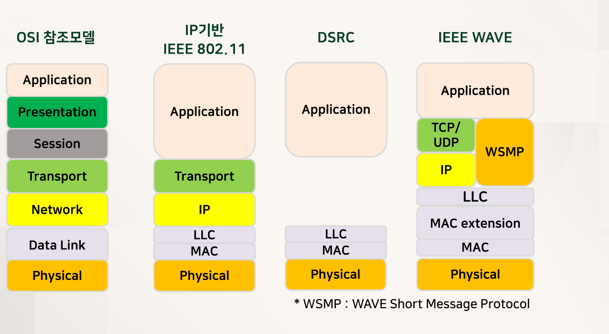

*Figure 1. Layered architectures of the OSI reference model, IP-based IEEE 802.11, DSRC, and IEEE WAVE*

Figure 1 places the layers of three wireless technologies side by side with the OSI reference model.

- **IP-based IEEE 802.11 (wireless LAN):** A single application layer covers OSI layers 5-7, followed by a transport layer (TCP or UDP), IP, a data link layer split into LLC and MAC, and the physical layer. The structure is the same as the Internet.
- **DSRC:** There are only the application, LLC, MAC, and physical layers, with no transport or network layer. This is because the roadside unit and the vehicle are connected directly over a single wireless hop, so there is no path to find (Section 2.2).
- **IEEE WAVE:** On top of the physical layer and MAC, it places a MAC extension for multichannel operation and LLC, and above them two branches of the network layer. One is IP with TCP/UDP, as on the Internet; the other is the **WSMP (WAVE Short Message Protocol)** for sending short safety messages quickly (Section 3).

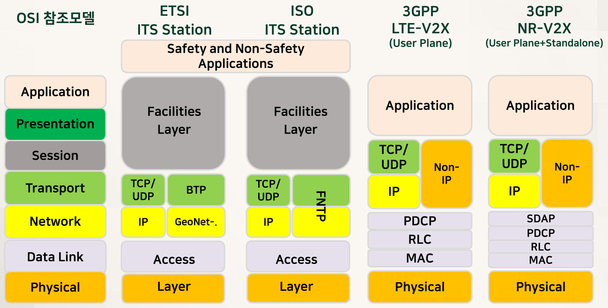

*Figure 2. Layered architectures of the ETSI and ISO ITS stations and of 3GPP LTE-V2X and NR-V2X*

Figure 2 shows the architectures of other standards bodies.

- **ETSI ITS station (Europe):** A **facilities layer**, corresponding to OSI layers 5-7, provides common functions to safety and non-safety applications. The transport layer has TCP/UDP alongside the **BTP (Basic Transport Protocol)**, and the network layer has IP alongside **GeoNetworking**, which delivers packets using position information. The data link and physical layers are grouped as the **access layer**.
- **ISO ITS station:** The facilities and access layers are similar to those of ETSI, and next to IP and TCP/UDP it places the lightweight **FNTP (Fast Networking and Transport layer Protocol)**, which handles the transport and network layers together. The ISO ITS station architecture (CALM) is covered in Week 14.
- **3GPP LTE-V2X (user plane):** It reuses the radio protocol stack of mobile communication. Above the physical layer, MAC, **RLC (Radio Link Control)**, and **PDCP (Packet Data Convergence Protocol)** form the data link layer, followed by IP with TCP/UDP or a Non-IP path that does not use IP.
- **3GPP NR-V2X:** It adds the **SDAP (Service Data Adaptation Protocol)**, which separates data flows by quality of service, above PDCP in the LTE-V2X structure. C-V2X is covered in Week 14.

> **Key Point:** The OSI layer composition differs by wireless technology, region, and standards body. They share one feature, however: next to the IP path, they provide a lightweight dedicated path that bypasses IP (WSMP, BTP with GeoNetworking, FNTP, Non-IP) for short, urgent messages such as vehicle safety messages. The purpose is to reduce the time and overhead of IP headers and address configuration.

### 1.4 Characteristics of the Physical Layer

The physical layer converts bits into actual signals and sends them over the medium. It deals with three things.

1. **Transmission media:** Media are divided into wired and wireless media. The frequencies of wireless media are regulated by each country. There are **licensed spectra**, which the country assigns exclusively to a specific operator or use, and **unlicensed spectra** and open spectra, which several users can share without a license as long as they meet the technical rules.
2. **Transmitter and receiver:** The key question is how far a signal reaches. The transmission distance is determined by free-space propagation, attenuation, fading, shadowing, interference, SIR and SINR, the interference range, path loss models, and the transmit power and receiver sensitivity.
3. **Efficiency of data transmission:** This covers modulation and coding, duplexing, and multiplexing, which let the same bandwidth carry more data.

> **Definition:** The **SIR (signal-to-interference ratio)** is the ratio $S/I$ of the desired signal power $S$ to the interference power $I$ from other transmitters, and the **SINR (signal-to-interference-plus-noise ratio)** is $S/(I+N)$, which also includes the noise power $N$. The larger the value, the more accurately the receiver can interpret the signal. The **receiver sensitivity** is the minimum received power at which the receiver can receive a signal below a specified error rate. **Duplexing** is the way two-way communication is carried on one link: TDD divides time and FDD divides frequency.

### 1.5 Fundamentals of Radio Propagation

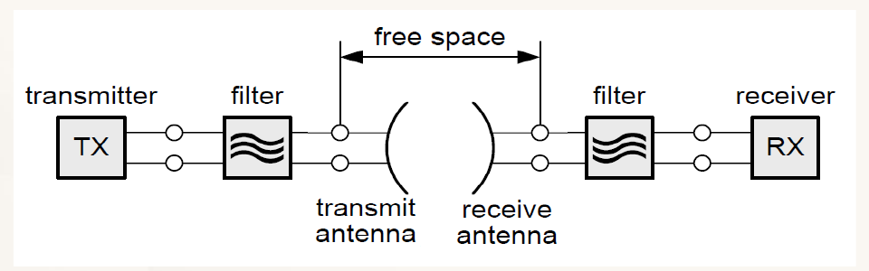

*Figure 3. The radio transmission path from transmitter to receiver through free space*

In Figure 3, the signal produced by the transmitter (TX) passes through a filter that removes unwanted frequency components and is radiated as an electromagnetic wave by the transmit antenna. The wave travels through free space, reaches the receive antenna, and passes through another filter into the receiver (RX).

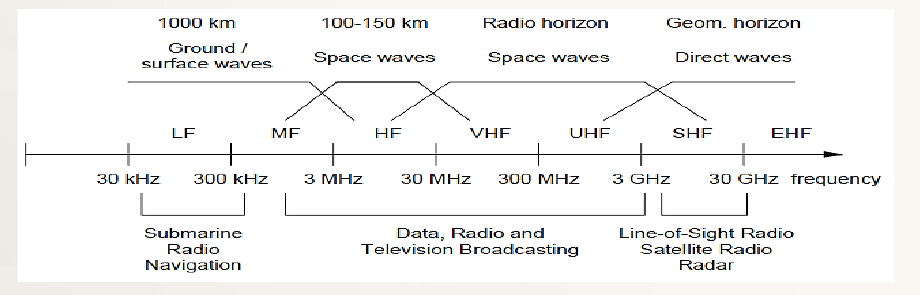

*Figure 4. Propagation modes, ranges, and main applications of electromagnetic waves by frequency band*

| Band | Frequency range | Main propagation mode | Example applications |
|:-----|:-----|:-----|:-----|
| LF, MF | 30 kHz-3 MHz | Ground (surface) waves that follow the earth, up to about 1,000 km | Submarine communication, radio navigation, broadcasting |
| HF | 3-30 MHz | Space waves, about 100-150 km | Data radio, radio broadcasting |
| VHF, UHF | 30 MHz-3 GHz | Space waves, up to the radio horizon | Data radio, radio and television broadcasting |
| SHF, EHF | 3-300 GHz | Direct waves, up to the geometric horizon (line of sight) | Line-of-sight radio, satellite communication, radar |

*Table 4. Propagation modes and applications by frequency band*

The higher the frequency, the more radio waves travel in straight lines like light, cannot bend around obstacles, and propagate well only within the line of sight (LOS). In exchange, a wide bandwidth is available, which makes high data rates easier. Since 5.8 GHz DSRC and 5.9 GHz WAVE belong to the SHF band, roadside units are installed high up where they can look down on vehicles.

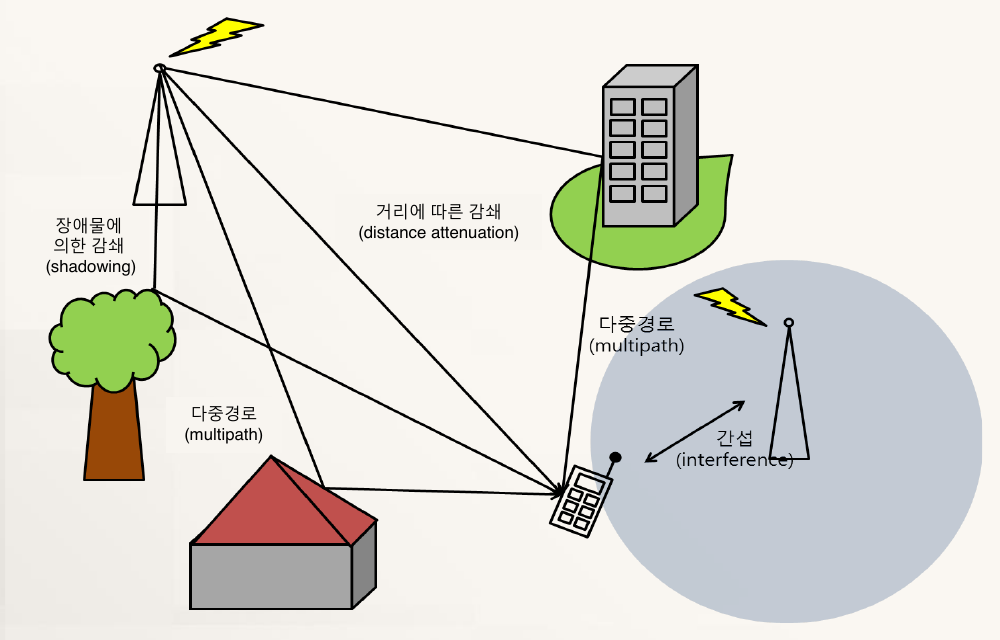

*Figure 5. Attenuation, shadowing, multipath, and interference in wireless communication*

Figure 5 shows the typical problems of wireless communication between a base station and a terminal.

> **Definition:** **Distance attenuation** is the decrease of received power with distance, because the energy per unit area falls as the wave spreads out. **Shadowing** is attenuation caused by obstacles such as trees or buildings blocking the wave. **Multipath** is the arrival at the receiver of the direct wave and waves reflected from buildings and the ground over different paths with different delays, and the rapid fluctuation of received strength as these waves reinforce or cancel each other depending on their phases is called **fading**. **Interference** is the mixing of signals from other transmitters on the same or nearby frequencies into the desired signal.

Because vehicles move fast, the reinforcement and cancellation of multipath waves change within short times, and the Doppler effect also shifts the frequency slightly. This is why the physical layer of vehicular communication must be more robust than that of indoor wireless LANs.

**Path loss models.** A path loss model expresses, as a function of distance, the fraction of the transmit power $P_T$ that reaches the receiver as $P_R$. The simplest case is free space with no obstacles at all, described by the Friis formula [2].

```math
\frac{P_R}{P_T} = G_T G_R \left( \frac{\lambda}{4 \pi d} \right)^2
```

$G_T$ and $G_R$ are the gains of the transmit and receive antennas, $\lambda$ is the wavelength, and $d$ is the distance. Since the received power is inversely proportional to the square of the distance, doubling the distance reduces the received power to 1/4, that is, by $10 \log_{10} 4 \approx 6$ dB. For example, the wavelength at 5.9 GHz is $\lambda = c/f = (3 \times 10^8)/(5.9 \times 10^9) \approx 0.0508$ m. With antenna gains of 1, the free-space path loss at 100 m is $20 \log_{10}(4 \pi \times 100 / 0.0508) \approx 87.9$ dB, and at 200 m it is about 93.9 dB.

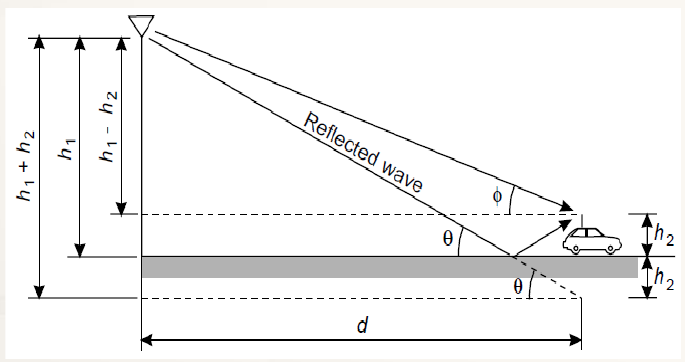

*Figure 6. The two-ray model with a direct wave and a ground-reflected wave*

Real roads always have reflecting surfaces. The **two-ray model** in Figure 6 considers only two waves arriving at a vehicle antenna of height $h_2$ at distance $d$ from a transmit antenna of height $h_1$: the direct wave and the wave reflected from the ground. The reflected wave appears to come from a mirror-image antenna at depth $h_1$ below the ground, so the path difference of the two waves is computed with the heights $h_1 + h_2$ and $h_1 - h_2$. When the distance is large enough, the two waves meet almost in opposite phase and cancel each other, and the received power is approximated as follows.

```math
L_F = \frac{P_R}{P_T} = G_T \cdot G_R \cdot \left( \frac{h_1 h_2}{d^2} \right)^2
```

Converting this to decibels with the logarithm rules $\log(ab) = \log a + \log b$ and $\log x^n = n \log x$ gives the following.

```math
L_F[\text{dB}] = 10 \log \left( G_T \cdot G_R \cdot \frac{(h_1 h_2)^2}{d^4} \right) = 10 \log G_T + 10 \log G_R + 20 \log h_1 + 20 \log h_2 - 40 \log d
```

Three things can be read from this formula. First, the received power is inversely proportional to the fourth power of the distance, so doubling the distance reduces it by $40 \log 2 \approx 12$ dB, much faster than in free space (6 dB). Second, doubling the antenna height $h_1$ or $h_2$ improves it by $20 \log 2 \approx 6$ dB, another reason roadside units are mounted high. Third, the wavelength does not appear in this approximation.

For example, with $h_1 = 10$ m, $h_2 = 1.5$ m, and $G_T = G_R = 1$, at $d = 2{,}000$ m the result is $20 \log_{10}(10 \times 1.5 / 2000^2) = 20 \log_{10}(3.75 \times 10^{-6}) \approx -108.5$ dB, and at $d = 4{,}000$ m it is about $-120.6$ dB, 12 dB lower.

> **Caution:** The fourth-power law of the two-ray model holds when the distance exceeds the critical distance $d_c \approx 4 h_1 h_2 / \lambda$ [3]. In the example above, the critical distance at 5.9 GHz is $4 \times 10 \times 1.5 / 0.0508 \approx 1{,}181$ m, so the example distances were chosen beyond it. Closer than the critical distance, the direct and reflected waves alternately reinforce and cancel, so the received power fluctuates strongly, and on average it decreases roughly as in free space.

### 1.6 Digital Modulation

**Modulation** is carrying digital bits on the amplitude, frequency, or phase of a carrier. The basic principles of ASK, FSK, and PSK were covered in Week 4. Wireless communication sends more bits at once by using phase and amplitude together. One unit of signal is called a **symbol**, and a plot of the possible symbols as points on the amplitude-phase plane is called a **constellation diagram**.

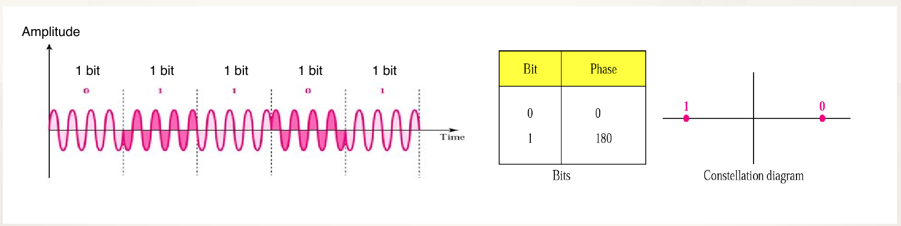

*Figure 7. The waveform, bit-to-phase mapping, and constellation of BPSK*

**BPSK (Binary Phase Shift Keying).** Bits 0 and 1 are mapped to carriers whose phases differ by 180° (π). In Figure 7, when the bit sequence 0, 1, 1, 0, 1 is sent, the intervals with 0 have phase 0° and the intervals with 1 have phase 180°, and the constellation has two points facing each other across the origin. One bit is sent per symbol.

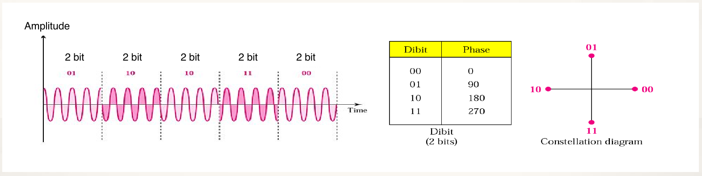

*Figure 8. The waveform, two-bit-to-phase mapping, and constellation of QPSK*

**QPSK (Quadrature Phase Shift Keying).** The four two-bit groups (dibits) are mapped to carriers whose phases differ by 90° (π/2). In the table of Figure 8, 00 is 0°, 01 is 90°, 10 is 180°, and 11 is 270°, and the bit sequence 01, 10, 10, 11, 00 is sent as waveforms with those phases. Two bits are sent per symbol, so at the same symbol rate data goes twice as fast as with BPSK.

> **Note:** Most digital communication systems, including IEEE 802.11, use **Gray code** mapping, which assigns phases in the order 00, 01, 11, 10 so that the bit groups of neighboring constellation points differ in only one bit [4]. This way, even if noise makes the receiver choose a neighboring point by mistake, only one bit error results.

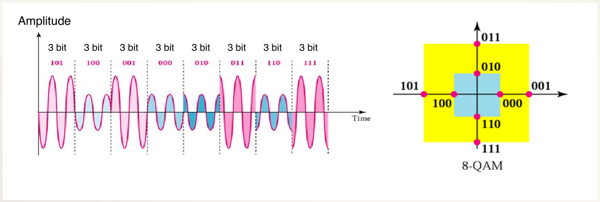

*Figure 9. The waveform and constellation of 8-QAM*

**QAM (Quadrature Amplitude Modulation).** Unlike PSK, it uses amplitude (magnitude) as well as phase as a variable. The 8-QAM in Figure 9 uses eight points that combine two amplitudes and four phases to send 3 bits ($`2^3 = 8`$) at once. In the constellation, the inner four points (000, 010, 100, 110) have the small amplitude and the outer four points (001, 011, 101, 111) have the large amplitude, and two points in the same direction share the same phase. By the same principle, 16-QAM sends 4 bits ($`2^4 = 16`$) at once and 64-QAM sends 6 bits ($`2^6 = 64`$). In general, a modulation with $M$ points carries the following number of bits per symbol.

```math
b = \log_2 M
```

| Modulation | Constellation points $M$ | Bits per symbol $b$ |
|:-----|:-----|:-----|
| BPSK | 2 | 1 |
| QPSK | 4 | 2 |
| 8-QAM | 8 | 3 |
| 16-QAM | 16 | 4 |
| 64-QAM | 64 | 6 |

*Table 5. Constellation points and bits per symbol by modulation*

> **Key Point:** The more points a constellation has, the more bits each symbol carries and the higher the data rate, but at the same transmit power the points are closer together and more vulnerable to noise. That is why 64-QAM is used when the signal is strong and clean and BPSK when it is weak or noisy (link adaptation in Section 1.11).

### 1.7 Coding and Code Rate

> **Definition:** **Channel coding** is a technique that transforms the original data by adding extra bits (redundancy) so that errors in the data can be detected and corrected. Representative examples are **linear block codes** and **convolutional codes**.

Every channel code converts $k$ information bits that one actually wants to send into an $n$-bit codeword ($`n > k`$). The ratio of the number of information bits to the codeword length is called the **code rate**.

```math
R = \frac{\text{information bit length}}{\text{encoded codeword length}} = \frac{k}{n}
```

- The larger the codeword length $n$, the more work the decoder must do and the more complex the system becomes.
- The code rate $R$ is related to the bandwidth the communication system occupies and to the error-correcting capability of the code. The smaller $R$, the more redundancy and the better the error correction, but the less information can be sent in the same bandwidth.

The simplest example is the repetition code, which repeats each bit three times. Since 0 is sent as 000 and 1 as 111, $k = 1$, $n = 3$, and $R = 1/3$. If the receiver decides the original bit by majority vote among the three received bits, the bit is recovered correctly even if one of the three bits is wrong. IEEE 802.11a/g/p use convolutional codes with code rates of 1/2, 2/3, and 3/4. With code rate 1/2, 24 information bits become 48 coded bits, and with 3/4, 36 information bits become 48 (Section 2.13).

### 1.8 Multiplexing and OFDM

**Multiplexing** is a technique that lets several users or data flows share one transmission medium. The principle of FDM was covered in Week 4.

1. **Time division multiplexing (TDM):** Time is divided and each user gets a different time interval.
2. **Frequency division multiplexing (FDM):** The frequency band is divided and each user gets a different frequency.
3. **Code division multiplexing (CDM):** All users use the same time and frequency, but each multiplies its signal by a different code, and the receiver picks out its own with its code.
4. **Space division multiplexing (SDM):** Two or more antennas send different data flows at the same time and frequency. Multiple-antenna (MIMO) technology uses this.
5. **Orthogonal frequency division multiplexing (OFDM):** Explained below.

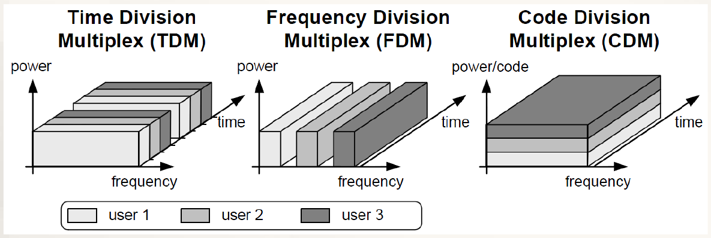

*Figure 10. Resource allocation in time, frequency, and code division multiplexing*

In Figure 10, the three axes are time, frequency, and power (or code). TDM lines up blocks that use the whole frequency band along the time axis, FDM lines up blocks that use the whole time along the frequency axis, and CDM overlaps the whole time and frequency and separates users along the code axis.

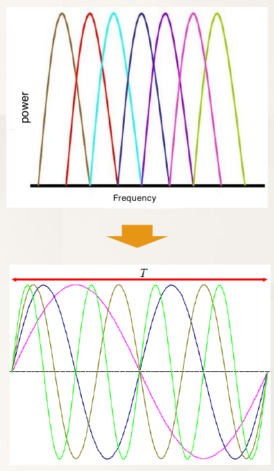

*Figure 11. Overlapping spectra of OFDM subcarriers and orthogonal sinusoids in one symbol period*

**OFDM** is a multi-carrier modulation scheme that uses orthogonality. It splits a high-speed data flow into many low-speed flows and transmits them in parallel, each on a different **subcarrier**.

> **Definition:** Two signals (vectors) being **orthogonal** means that their inner product is 0, which implies that they are independent and one signal does not interfere with detecting the other.

If the symbol length is $T$ and the subcarrier frequencies are chosen as integer multiples of $1/T$ ($`k/T`$), the inner product of two different subcarriers $k \neq m$ is 0, as follows.

```math
\int_0^T e^{j 2 \pi k t / T} \cdot e^{-j 2 \pi m t / T} \, dt = \int_0^T e^{j 2 \pi (k - m) t / T} \, dt = \begin{cases} T & (k = m) \\ 0 & (k \neq m) \end{cases}
```

If $k \neq m$, $e^{j 2 \pi (k-m) t / T}$ rotates exactly an integer number of times during the interval $T$, so the integral is 0. As in the upper part of Figure 11, the spectra of the subcarriers overlap, but at the peak frequency of each subcarrier the spectra of all other subcarriers pass through 0. So even though the subcarriers are packed closely without empty guard bands between them, as FDM would need, the receiver can still separate each subcarrier, and the bandwidth is used efficiently. In addition, splitting the data into slow flows makes each symbol longer, which makes the system robust to inter-symbol interference (ISI), in which waves delayed by multipath intrude into the next symbol (the cyclic prefix in Section 2.13).

### 1.9 Characteristics of the Data Link Layer and Frames

The data link layer delivers data over the link between two adjacent nodes and has the following functions.

| Function | Description |
|:-----|:-----|
| Framing and link access | Attaches a header (source and destination MAC addresses, and so on) and a trailer (error detection bits, and so on) to a network layer datagram to make a **frame**. If the medium is shared, medium access control (MAC) decides who sends when. |
| Flow control | Controls the pace and timing of data exchange between adjacent nodes. It includes data rate control, RTS/CTS, and busy tones. |
| Error detection and correction by channel coding | Methods for detecting or correcting errors, including FEC (forward error correction), with which the receiver fixes errors itself, and ARQ (automatic repeat request) protocols, which ask for retransmission. |

*Table 6. Functions of the data link layer*

> **Note:** Flow control in the traditional sense is the function of matching the sender's rate to what the receiver can handle. For wireless links, data rate adjustment to the channel state and RTS/CTS and busy tones, which keep other terminals from transmitting in advance, are treated in the same category (Section 1.11).

The data link layer frame of the IEEE 802.11 wireless LAN is called an **MPDU (MAC protocol data unit)** and is structured as follows (the numbers are octets).

```text
Octets:    2         2        6        6        6         2        6        2        var.     4
       +--------+---------+--------+--------+--------+---------+--------+--------+---------+-----+
       | Frame  |Duration/|Address |Address |Address | Sequence|Address |  QoS   |  Frame  | FCS |
       |Control |    ID   |   1    |   2    |   3    | Control |   4    |Control |   Body  |     |
       +--------+---------+--------+--------+--------+---------+--------+--------+---------+-----+
       |<----------------------------- MAC Header ------------------------------>|

Frame Control (bits):
     2       2        4       1     1       1       1      1     1        1        1
+---------+------+---------+-----+------+-------+-------+-----+------+---------+-------+
| Protocol| Type | Subtype |  To | From |  More | Retry | Pwr | More |Protected| Order |
| Version |      |         |  DS |  DS  |  Frag |       | Mgt | Data |  Frame  |       |
+---------+------+---------+-----+------+-------+-------+-----+------+---------+-------+
```

*Figure 12. Structure of the IEEE 802.11 MPDU and its Frame Control field*

The first field of the MAC header, **Frame Control**, is 16 bits and indicates the protocol version, the frame type (Type) and subtype (Subtype), whether the frame goes to the distribution system (To DS) or comes from it (From DS), whether more fragments follow (More Frag), whether it is a retransmission (Retry), the power management state (Pwr Mgt), whether more data is buffered (More Data), whether it is encrypted (Protected Frame), and whether order must be preserved (Order). **Duration/ID** tells how long this exchange will occupy the channel so that other terminals wait during that time (the NAV in Section 1.11). **Sequence Control** holds the sequence number and fragment number of the frame, and the **FCS (frame check sequence)** is a CRC for error detection.

The meaning of the four address fields depends on the combination of the To DS and From DS bits.

| To DS | From DS | Address 1 | Address 2 | Address 3 | Address 4 | Situation |
|:-----|:-----|:-----|:-----|:-----|:-----|:-----|
| 0 | 0 | DA | SA | BSSID | None | IBSS, in which terminals communicate without an AP |
| 1 | 0 | BSSID | SA | DA | None | From a terminal to the AP (infrastructure) |
| 0 | 1 | DA | BSSID | SA | None | From the AP to a terminal (infrastructure) |
| 1 | 1 | RA | TA | DA | SA | Wireless distribution system (WDS, bridge) between APs |

*Table 7. Meaning of the address fields by the To DS and From DS bits*

> **Definition:** The **DA (destination address)** is the final destination, the **SA (source address)** is the original source, the **RA (receiver address)** is the receiver on this wireless hop, and the **TA (transmitter address)** is the transmitter on this wireless hop. A **BSS (basic service set)** is the basic unit made of one AP or of terminals communicating with each other, and the **BSSID** is the identifier of a BSS, which in an infrastructure network is the MAC address of the AP. An **IBSS (independent BSS)** is an ad hoc network in which terminals communicate directly without an AP. A **WDS (wireless distribution system)** is a distribution system built by connecting APs wirelessly.

In Table 7, Address 1 is always the wireless receiver of the frame (RA), and Address 2 is always the wireless transmitter that sent the frame (TA). For example, in a frame a terminal sends to the AP (To DS = 1), the wireless receiver is the AP (BSSID), and the final destination DA is written separately in Address 3.

> **Note:** The maximum length of the Frame Body depends on the edition of the standard and the physical layer. The original IEEE 802.11 set the maximum upper-layer data unit (MSDU) at 2,304 octets, and it grew longer when aggregation of several MSDUs was introduced [4]. Some materials expand BSS as Base Station Sub-system and IBSS as Internet BSS, but in IEEE 802.11 a BSS is a basic service set and an IBSS is an independent BSS.

### 1.10 Medium Access Control Protocols

A **medium access control (MAC) protocol** is the set of rules that decides who sends when as multiple users compete to use the same channel. Since a wireless medium is shared by every nearby terminal, MAC protocols are especially important.

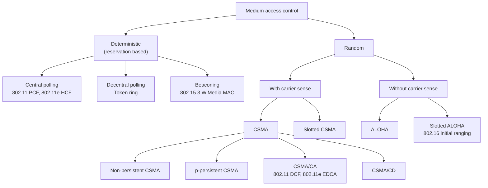

*Figure 13. Classification of medium access control methods*

As in Figure 13, MAC methods fall into two broad branches. **Deterministic methods** reserve in advance or fix the order of who sends when, so there are no collisions. They include central polling, in which a central controller asks terminals in turn, decentral polling, which passes a token around, and beaconing, which hands out time intervals with beacons. **Random methods** compete to send whenever there is data and retry after a collision. They divide into the CSMA family and the ALOHA family depending on carrier sense, that is, whether a terminal first listens to check if the channel is idle. The basic operation of each method is covered in Week 7; this section summarizes them from the viewpoint of wireless communication.

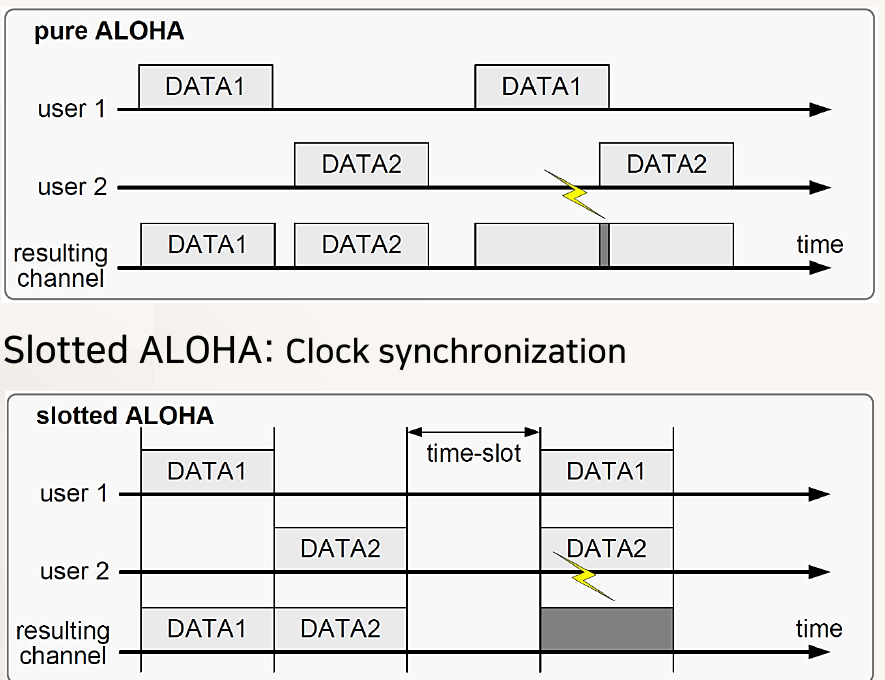

*Figure 14. Transmissions and collisions in pure ALOHA and slotted ALOHA*

**Pure ALOHA.** The simplest method, which needs no synchronization, sends as soon as there is data. In the upper part of Figure 14, user 1's second DATA1 and user 2's second DATA2 overlap in time even partially, so both frames are destroyed. **Slotted ALOHA** synchronizes clocks, divides time into slots one frame long, and allows sending only at the start of a slot. Then frames never overlap partially, and collisions occur only when the same slot is chosen, so the vulnerable period shrinks from two frame lengths to one. As a result, the maximum channel efficiency rises from about 18% ($`1/2e`$) for pure ALOHA to about 37% ($`1/e`$) [5].

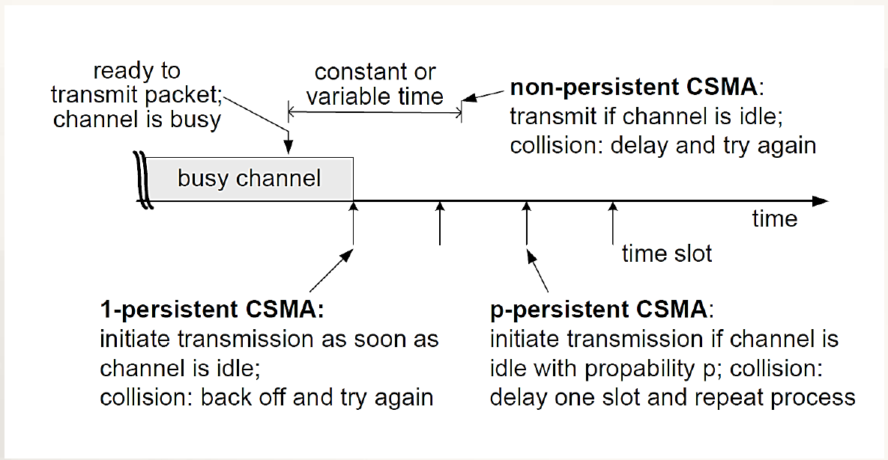

*Figure 15. Operation of 1-persistent, non-persistent, and p-persistent CSMA*

**CSMA (carrier sense multiple access).** A terminal listens to the channel before sending and sends only when it is idle. There are three variants, depending on how a terminal waits when the channel is busy.

- **1-persistent CSMA:** The terminal keeps monitoring the channel and sends as soon as it becomes idle. After a collision, it backs off and tries again. If several terminals are waiting together, they all send the moment the channel becomes idle and are likely to collide.
- **Non-persistent CSMA:** If the channel is busy, the terminal waits a constant or random time, senses again, and sends if it is idle. After a collision, it retries after a delay. Collisions decrease, but the channel can sit unused even when it is idle.
- **p-persistent CSMA:** Time is divided into slots; if the channel is idle, the terminal sends with probability $p$ and with probability $1-p$ defers one slot and repeats the process.

**CSMA/CD and CSMA/CA.** **CSMA/CD (collision detection)** sends a jamming signal and stops transmitting when it detects a collision while sending; wired Ethernet (IEEE 802.3) uses it. **CSMA/CA (collision avoidance)** reserves the channel, and terminals notified of another terminal's transmission defer their medium access to avoid collisions in advance; wireless LAN (IEEE 802.11) uses it.

> **Key Point:** CSMA/CD cannot be used in wireless networks. While a terminal transmits, its own signal is far stronger than any received signal, so it is hard to sense another terminal's signal at the same time, and a terminal that the sender cannot hear can cause a collision at the receiver (the hidden terminal problem). Wireless networks are therefore designed to avoid collisions instead of detecting them.

### 1.11 Flow Control: Link Adaptation, RTS/CTS, and Busy Tone

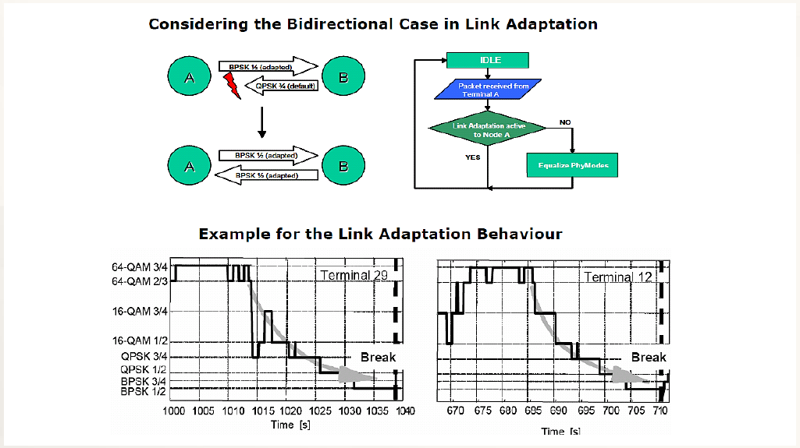

*Figure 16. The bidirectional link adaptation procedure and an example of modulation changes*

**Data rate control and link adaptation.** **Link adaptation (LA)** is a technique that changes the modulation and code rate to suit the channel state. The graphs at the bottom of Figure 16 show how the transmission modes of two terminals change over time. While the channel is good, they send fast with 64-QAM 3/4; when the channel worsens as the distance grows or obstacles appear, they step down through 16-QAM and QPSK to BPSK 1/2 to reduce errors. The upper part shows the bidirectional case. If terminal A has adapted the link toward B to a low mode (BPSK 1/2), then when B receives a packet from A it checks whether link adaptation is active and, if so, sets the link from B to A to the same physical mode (Equalize PhyMode). This is because the radio channels in the two directions are in similar states.

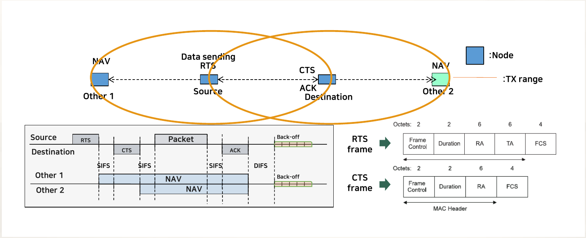

*Figure 17. Hidden terminals, the timing of an RTS/CTS exchange, and the structure of RTS and CTS frames*

**RTS/CTS.** In the upper part of Figure 17, Other 1 is only within the radio range of the sender (Source), and Other 2 is only within the radio range of the receiver (Destination). Other 2 cannot hear the sender, so it may judge the channel idle while the sender is transmitting, send, and cause a collision at the receiver. This is the **hidden terminal problem**, and RTS/CTS solves it.

1. The sender announces its transmission with a short **RTS (request to send)** frame.
2. After waiting an **SIFS (short inter-frame space)**, the receiver announces that it is ready to receive with a **CTS (clear to send)** frame.
3. The sender sends the data packet after an SIFS, and the receiver confirms reception with an ACK after an SIFS.
4. Other 1, which heard the RTS, and Other 2, which heard the CTS, set their **NAV (network allocation vector)** for the time written in the frame's Duration field and defer transmission. When the NAV expires, they wait a DIFS and then compete through backoff (Section 2.9).

> **Definition:** The **NAV (network allocation vector)** is a timer set from the Duration value written in another terminal's frame. Until the NAV reaches 0, a terminal treats the channel as busy even if it is actually idle. In contrast to physical carrier sensing, which actually listens to the signal, it is also called virtual carrier sensing.

As on the right of Figure 17, an RTS frame consists of Frame Control (2 octets), Duration (2), RA (6), TA (6), and FCS (4) for 20 octets, and a CTS frame has no TA and is 14 octets. They are much shorter than data frames, so even if RTS frames collide, little time is wasted.

**Busy tone.** A node that is receiving data sends a busy tone on a separate narrow frequency band (narrow channel band) so that nearby nodes cannot disturb the data transmission. Because the receiver itself emits the signal, even hidden terminals can tell that it is receiving. However, the extra narrow band adds overhead.

### 1.12 Error Detection and Correction

Methods for detecting and correcting errors include **parity checking**, **CRC (cyclic redundancy check)**, **FEC (forward error correction)**, and **ARQ (automatic repeat request)**.

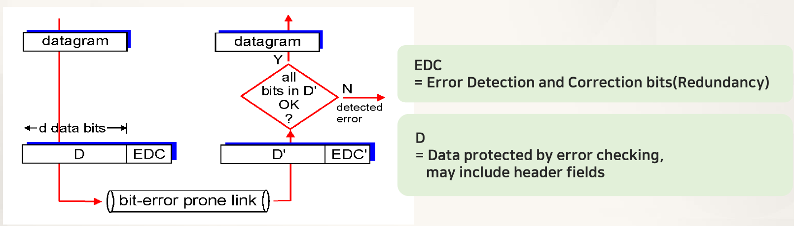

*Figure 18. The error detection process using error detection bits (EDC)*

In Figure 18, the sender computes **EDC (error detection and correction bits)**, that is, redundancy bits, from the data $D$ to be protected (which may include header fields) and sends them together with $D$. After passing through a bit-error-prone link, the receiver gets $D'$ and $EDC'$. The receiver recomputes the EDC from $D'$ and compares it with $EDC'$; if all bits match, it passes the datagram to the upper layer, and otherwise it has detected an error.

- **Parity checking:** One bit is added so that the number of 1s is even (or odd). For example, with even parity, 1011001 has four 1s, so a parity bit of 0 is appended. It detects a single-bit error but not two bits wrong at the same time.
- **CRC:** The data is treated as a polynomial and the remainder of dividing it by a generator polynomial is appended. It also detects well errors in several consecutive bits (burst errors). CRC calculation is covered in Week 7.
- **FEC:** As with the codes in Section 1.7, enough redundancy is included for the receiver to fix errors itself without retransmission.
- **ARQ:** When an error is detected, the receiver asks the sender to retransmit (the sender resends if it does not receive an ACK).

> **Caution:** Error detection is not perfect. If errors happen to change the data so that the EDC still matches, they are not detected. The more EDC bits, the lower the probability of undetected errors. Also, messages broadcast to many receivers, such as vehicle safety messages, receive no ACK, so they cannot use ARQ and rely on FEC and periodic repetition.

### 1.13 The Network Layer: Forwarding and Routing

The network layer has two distinct functions.

- **Data forwarding:** The action of a router sending a datagram that arrived at an input port to the appropriate output port. The router looks up (indexes) its **routing table (forwarding table)** with a header value to decide the output port.
- **Routing:** Determining the end-to-end path from source to destination across the whole network. The least-cost end-to-end paths computed by a routing algorithm are stored in the routing tables.

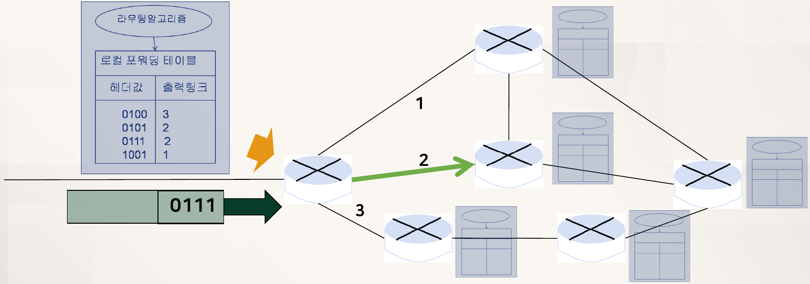

*Figure 19. Packet delivery according to the local forwarding table built by the routing algorithm*

In Figure 19, the routing algorithm builds the local forwarding table of each router. The table of the router on the left sends header value 0100 to output link 3, 0101 and 0111 to output link 2, and 1001 to output link 1. When a packet with header value 0111 arrives, the router finds 0111 in the table and sends the packet out on output link 2. In terms of a trip, routing is planning the whole route from origin to destination on a map, and forwarding is choosing which way to go at a single intersection [5].

### 1.14 Virtual Circuits and Datagrams

The services the network layer provides divide into two kinds, depending on whether a connection is set up first. The concepts of circuit switching and packet switching were covered in Week 4.

**Virtual circuit (VC) networks.** A **connection-oriented service** of the network layer that, like circuit switching, sets up the path before sending data. It runs over a packet-switched network, but once the path is set, every packet follows it.

- A virtual circuit number is assigned to each link on the path.
- The routers in the network maintain connection state information for the current connections.
- Each time a new connection is set up, an entry for that connection is added to the routers' forwarding tables.

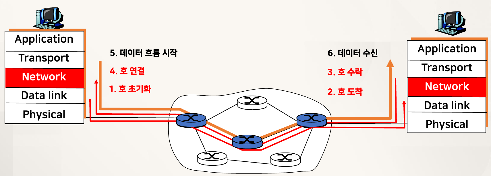

*Figure 20. Call setup and data transfer order in the virtual circuit service model*

In Figure 20, a connection is made in this order: 1) the network layer of the sender initiates a call, 2) the call arrives at the receiver, 3) the receiver accepts the call, 4) the sender is told the call is connected, 5) the data flow begins, and 6) the receiver receives the data. In steps 1-4 the routers on the path record the connection state, so all later data follows the same path (the thick line).

**Datagram networks.** A **connectionless service**, meaning that no connection call is maintained. Each packet carries the destination address and is delivered independently, so between source and destination each packet may take a different path.

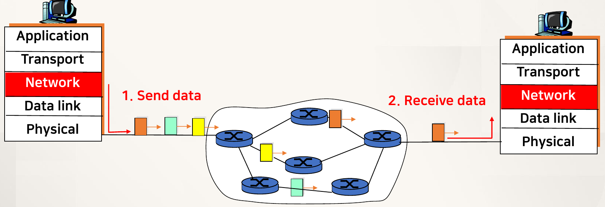

*Figure 21. Packet delivery in the datagram service model*

In Figure 21, the sender sends data immediately without call setup (1), and the three packets reach the receiver over different paths in the network (2). The Internet's IP is a datagram service.

| Aspect | Virtual circuit | Datagram |
|:-----|:-----|:-----|
| Connection setup | A call is set up before data transfer | Data is sent immediately without setup |
| Path | All packets follow the same path | Each packet may take a different path |
| State in routers | State is kept for each connection | No connection state is kept |
| Response to failures | The connection breaks if a router on the path fails | Packets can be rerouted around the failure |

*Table 8. Comparison of virtual circuit and datagram services*

### 1.15 IPv4

**IPv4** is the representative addressing scheme of today's Internet and expresses addresses in 32 bits in total. For readability, the address is split into 8-bit groups written in decimal and separated by dots. For example, 166.104.45.135 is 10100110.01101000.00101101.10000111 in binary. With 32 bits, $2^{32} \approx 4.3$ billion addresses are possible.

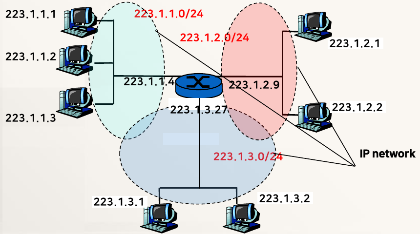

*Figure 22. Three IPv4 subnets connected by one router*

In Figure 22, the router connects three IP networks (subnets) with its three interfaces (223.1.1.4, 223.1.2.9, 223.1.3.27). In the notation 223.1.1.0/24, /24 means that the first 24 bits of the address are the **network prefix** that identifies the network; written as a 32-bit mask with the first 24 bits set to 1, the same meaning is the **subnet mask** 255.255.255.0. So 223.1.1.1, 223.1.1.2, and 223.1.1.3 share the prefix 223.1.1 and belong to one subnet in which they communicate without going through the router, while communicating with 223.1.2.1 requires going through the router.

The header of an IPv4 datagram is as follows. The role of each field was covered in detail in Week 5.

```text
0               8               16              24              32 bits
+-------+-------+---------------+-------------------------------+
|Version|   HL  |  Type of Svc. |    Datagram Length (bytes)    |
+-------+-------+---------------+-------------------------------+
|       16-bit Identifier       |Flags|  13-bit Fragment Offset |
+-------------------------------+-----+-------------------------+
|      TTL      |  Upper-layer  |        Header Checksum        |
|               |    Protocol   |                               |
+---------------+---------------+-------------------------------+
|                    32-bit Source IP Address                   |
+---------------------------------------------------------------+
|                 32-bit Destination IP Address                 |
+---------------------------------------------------------------+
|                        Options (if any)                       |
+---------------------------------------------------------------+
|                              Data                             |
+---------------------------------------------------------------+
```

*Figure 23. The IPv4 datagram format*

It consists of the version, header length (HL), type of service, datagram length, identifier, flags, fragment offset, TTL (time to live), upper-layer protocol, header checksum, source and destination addresses, options, and data.

### 1.16 IPv6 and Coexistence with IPv4

**IPv6** was developed because IPv4 addresses ran out. Addresses are 128 bits, so $2^{128} \approx 3.4 \times 10^{38}$ addresses are possible. The header also changed as follows [6].

- Fragmentation and the header checksum, which were repeated at every router, were removed to reduce router processing and speed up forwarding. Fragmentation is done only at the source, and error detection is left to the link and transport layers.
- For traffic that requests special handling, such as real-time services, a **traffic class (priority)** field and a **flow label** field were added to support QoS.
- The header length was fixed at 40 bytes, and options were moved into extension headers.

```text
0       4               12              20              28      32 bits
+-------+---------------+---------------------------------------+
|Version| Traffic Class |               Flow Label              |
+-------+---------------+---------------------------------------+
|         Payload Length        |  Next Header  |   Hop Limit   |
+-------------------------------+---------------+---------------+
|                                                               |
|                  Source IP Address (128 bits)                 |   fixed
|                                                               |   40 bytes
+---------------------------------------------------------------+
|                                                               |
|               Destination IP Address (128 bits)               |
|                                                               |
+---------------------------------------------------------------+
|                              Data                             |
+---------------------------------------------------------------+
```

*Figure 24. The IPv6 datagram format*

It consists of the version (4 bits), traffic class (8 bits), flow label (20 bits), payload length (16 bits), next header (8 bits), hop limit (8 bits, corresponding to the TTL of IPv4), source address (128 bits), and destination address (128 bits), 40 bytes in total.

An IPv6 address is written as eight 16-bit groups in hexadecimal separated by colons. For example, in fa57:0:0:0:31a1:d13e:dbbb:c18d, a run of zero groups can be shortened once to ::, so it is also written fa57::31a1:d13e:dbbb:c18d.

**Extension headers.** IPv6 does not put options in the fixed header; it implements them by having the **Next Header** field point to a following extension header. The Next Header field of the last extension header points to an upper-layer protocol such as TCP (6).

| Next Header value | Header it points to |
|:-----|:-----|
| 0 | Hop-by-hop options |
| 6 | TCP |
| 43 | Routing |
| 44 | Fragment |
| 50 | ESP (encapsulating security payload) |
| 51 | AH (authentication header) |
| 60 | Destination options |

*Table 9. Examples of IPv6 Next Header values*

```text
(a) no extension header
+------------------------+--------------------------------------+
| IPv6 Header            | TCP                                  |
| Next Header: TCP (6)   |                                      |
+------------------------+--------------------------------------+

(b) one extension header
+------------------------+------------------------+-------------+
| IPv6 Header            | Hop-by-Hop Header      | TCP         |
| Next Header: HbH (0)   | Next Header: TCP (6)   |             |
+------------------------+------------------------+-------------+

(c) two extension headers
+------------------------+------------------------+-------------------------+
| IPv6 Header            | Hop-by-Hop Header      | ESP Header + (encrypted |
| Next Header: HbH (0)   | Next Header: ESP (50)  |  TCP segment ...)       |
+------------------------+------------------------+-------------------------+
```

*Figure 25. A chain of IPv6 extension headers linked by the Next Header field*

In Figure 25, (a) has no extension header, so the Next Header of the IPv6 header points directly to TCP (6). (b) inserts one hop-by-hop options header: the IPv6 header points to 0, and the hop-by-hop options header points to TCP (6). (c) places an encryption header (ESP) after the hop-by-hop options header. Because every router on the path must read the hop-by-hop options header, it may only come directly after the IPv6 header [6], and the TCP segment after the ESP is encrypted [7].

> **Note:** Some materials give 60 as the Next Header value of the IPv6 encryption header and place a hop-by-hop options header after it. However, 60 is the value of the destination options header, encryption (ESP) is 50, and the hop-by-hop options header must come directly after the IPv6 header [6], [7].

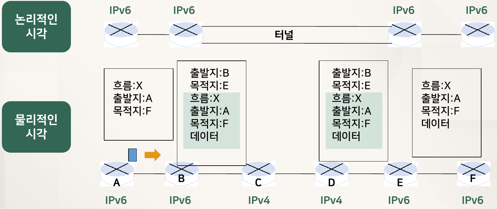

*Figure 26. Tunneling of an IPv6 datagram through an IPv4 segment*

**Coexistence of IPv4 and IPv6: tunneling.** Since not every router on the Internet can be switched to IPv6 at once, the two versions are used together for a while. In the lower part of Figure 26 (the physical view), IPv4-only routers C and D sit between IPv6 routers A, B and E, F. When an IPv6 datagram that A sends to F (flow X, source A, destination F, data) arrives at B, B places the whole datagram in the data part of an IPv4 datagram (source B, destination E) and sends it. C and D forward it as an ordinary IPv4 datagram, and E strips the IPv4 header, takes out the original IPv6 datagram, and sends it to F. In the upper part (the logical view), B and E appear to be directly connected by a virtual link through the IPv4 segment, that is, a **tunnel** [5]. WAVE in Section 3.2 uses only IPv6 at the network layer.

---

<br>

## 2. DSRC and Wireless LAN

### 2.1 Characteristics of DSRC

> **Definition:** **DSRC (Dedicated Short Range Communication)** is short-range two-way wireless communication between roadside units and vehicles. The roadside device is called an **RSU (roadside unit)** or **RSE (roadside equipment)**, and the vehicle device an **OBU (on-board unit)** or **OBE (on-board equipment)**.

DSRC has the following characteristics.

- It is two-way short-range communication between the roadside and vehicles, with a coverage of 10-100 m or less.
- It provides a variety of ITS services.
- It transmits at high speed, about 1 Mbps.
- Both active and passive modes are possible (Section 2.3).
- It is a low-cost ITS wireless packet data communication system. It uses a cheap modulation technique (ASK), and its protocol structure is simple, consisting of the application layer, LLC, MAC, and the physical layer.

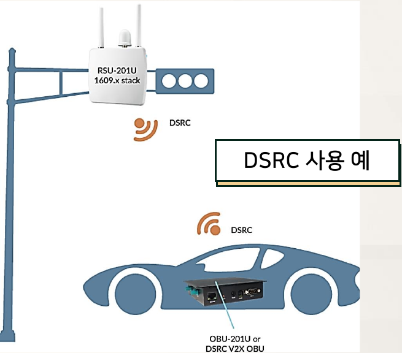

*Figure 27. An example of DSRC use with a roadside unit (RSU) and an on-board unit (OBU)*

In Figure 27, the RSU mounted on a traffic signal pole and the OBU in the vehicle communicate over DSRC.

> **Note:** The name DSRC refers to different technologies in different regions. In Korea, Japan, and Europe it refers to the 5.8 GHz toll-collection communication covered in this section, while in the United States it often refers to IEEE 802.11p-based communication in the 5.9 GHz band, that is, WAVE in Section 3. Calling WAVE DSRC in the broad sense in Week 1 follows the American usage.

### 2.2 Layered Architecture of DSRC

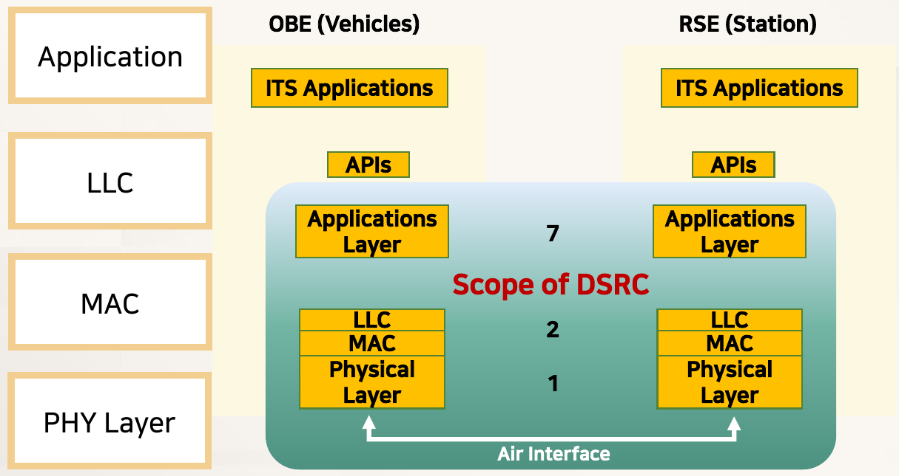

*Figure 28. The layered architecture and standardization scope of DSRC*

In Figure 28, the vehicle's OBE and the roadside RSE have the same layered architecture. ITS applications use the application layer (layer 7) through APIs; below it are the data link layer (layer 2), made of LLC and MAC, and the physical layer (layer 1); and the two devices are connected by the air interface. The scope of the DSRC standards is layers 7, 2, and 1.

> **Key Point:** DSRC omits OSI layers 3-6. Since the roadside unit and the vehicle are connected directly over a single wireless hop, no network layer is needed to choose a path, and since communication happens only during the short time a vehicle passes through the coverage area, fewer layers reduce processing time and overhead.

### 2.3 DSRC Specifications in Korea and Abroad

Korean DSRC uses **TDMA (time division multiple access)** for communication between the RSU and OBU, a multiple access scheme that divides time into slots and assigns different slots to different terminals. Depending on the medium, there is RF-DSRC, which uses radio waves, and IR-DSRC, which uses infrared light.

| Item | RF-DSRC | IR-DSRC |
|:-----|:-----|:-----|
| Carrier frequency (transmission frequency) | 5.8 GHz | Wavelength 800-900 nm (infrared) |
| Tx/Rx bandwidth | 10 MHz | Not applicable |
| Communication mode | Active | Active |
| Modulation | ASK | ASK-OOK |
| Bit rate | 1.024 Mbps | 1.024 Mbps |
| Bit error rate (BER) | $10^{-5}$ | $10^{-6}$ |

*Table 10. Basic communication specifications of Korean DSRC*

> **Definition:** **OOK (on-off keying)** is the simplest form of ASK, turning the carrier (or light) on for bit 1 and off for 0. The **BER (bit error rate)** is the fraction of transmitted bits that are wrong; $10^{-5}$ means one wrong bit in 100,000 bits.

| Region | Europe (CEN) | Japan | Korea |
|:-----|:-----|:-----|:-----|
| Standards organization | CEN TC 278 | ARIB STD-T55, T75 | TTA |
| Frequency (physical layer) | 5.8 GHz | 5.8 GHz | 5.8 GHz |
| Active/passive mode | Passive | Active | Active |
| Modulation | ASK, BPSK | ASK, QPSK | ASK |
| Transmission speed | Downlink 500 kbps, uplink 250 kbps | 1 Mbps, 4 Mbps | 1 Mbps |

*Table 11. RF-DSRC specifications of major countries*

**Active and passive modes.** In active mode, the OBU generates and transmits the carrier itself with its own oscillator and transmitter. In passive mode, the OBU has no transmitter; it receives the unmodulated carrier sent by the RSU, modulates it with its own data, and reflects it back (backscatter) as its reply [8]. Passive OBUs are cheap and consume little power but have a short range, while active OBUs cost more but have advantages in range and speed. In Table 11, only Europe uses passive mode. The European EN 12253 specifies 500 kbps for the downlink from the RSU to the OBU and 250 kbps for the uplink from the OBU to the RSU [8].

### 2.4 The DSRC Protocol Stack

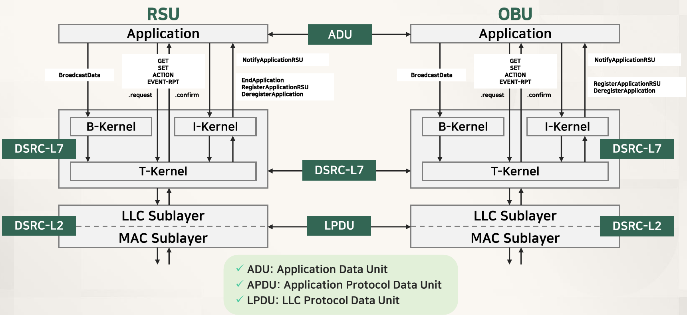

*Figure 29. The DSRC protocol stacks of the RSU and OBU*

Figure 29 shows the DSRC protocol stacks of the RSU and OBU. Layer 7 (DSRC-L7) consists of three kernels, and the international standard for this application layer is ISO 15628 [9].

| Component | Role |
|:-----|:-----|
| T-Kernel (transfer kernel) | Exchanges data with the other side through LLC. Provides the GET, SET, ACTION, and EVENT-REPORT services as requests (.request) and confirmations (.confirm). |
| I-Kernel (initialisation kernel) | Manages the start of communication (initialization) and the registration, deregistration, notification, and termination of applications (RegisterApplicationRSU, DeregisterApplication, NotifyApplicationRSU, EndApplication). |
| B-Kernel (broadcast kernel) | Broadcasts data common to several OBUs (BroadcastData). |
| LLC sublayer, MAC sublayer (DSRC-L2) | Build frames and send them in slots. |

*Table 12. Components of the DSRC protocol stack*

The data units passed between layers include the **ADU (application data unit)** between applications, the **APDU (application protocol data unit)** of the layer 7 protocol, and the **LPDU (LLC protocol data unit)** of LLC.

### 2.5 RF-DSRC MAC Frames and the Communication Procedure

The MAC layer of RF-DSRC uses a TDMA frame that divides time into slots. One slot is 100 octets, about 0.8 ms. 100 octets is 800 bits, which at 1.024 Mbps corresponds to $800 / (1.024 \times 10^6) \approx 0.78$ ms.

```text
|<-100 octets->|
+--------------+-------+-------+-----+-------+--------+-----+--------+
|     FCMS     | MDS#1 | MDS#2 | ... | MDS#n | ACTS#1 | ... | ACTS#k |
+--------------+-------+-------+-----+-------+--------+-----+--------+
|<--0.8 ms---->|
  FCMS : 1 slot
  MDS  : 0 <= n <= 8      1 <= n + k <= 8
  ACTS : 0 <= k <= 8      total: 2 to 9 slots
```

*Figure 30. Slot structure of the RF-DSRC MAC frame*

| Slot | Name | Count | Role |
|:-----|:-----|:-----|:-----|
| FCMS | Frame control message slot | 1 | The RSU announces the frame structure and the assignment of each slot. |
| MDS | Message data slot | 0-8 | The RSU and OBUs with an established link exchange data. |
| ACTS | Activation slot | 0-8 | OBUs that are not yet connected request a link connection. |

*Table 13. Slots of the RF-DSRC MAC frame*

Since the number of MDS and ACTS slots together is at least 1 and at most 8 ($`1 \le n + k \le 8`$), a frame including the FCMS consists of 2-9 slots.

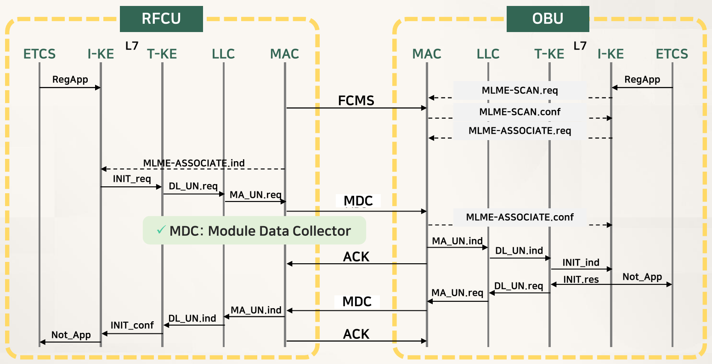

*Figure 31. The RF-DSRC communication procedure between the RFCU and OBU*

Figure 31 shows the communication procedure between the roadside RFCU and the vehicle OBU. Both consist of the ETCS application, the layer 7 I-KE and T-KE, LLC, and MAC.

> **Definition:** Service requests between layers are expressed with four kinds of service primitives. A **request (.req)** is an upper layer asking a lower layer for a service, an **indication (.ind)** is a lower layer informing an upper layer that a request from the other side has arrived, a **response (.res)** is the upper layer's answer to an indication, and a **confirm (.conf, .cfm)** reports the result back to the requesting side.

1. The ETCS application on each side registers with its own I-KE (RegApp).
2. The MAC of the RFCU broadcasts the FCMS. The management entity of the OBU finds the FCMS and obtains the frame information with MLME-SCAN.req and MLME-SCAN.conf, and starts a connection with MLME-ASSOCIATE.req.
3. When MLME-ASSOCIATE.ind reaches the RFCU side, the I-KE creates an initialization request (INIT_req) and passes it down through the T-KE (DL_UN.req) and LLC (MA_UN.req) to the MAC, which sends it to the OBU on the **MDC (message data channel)** inside an MDS slot.
4. The OBU confirms the connection with MLME-ASSOCIATE.conf and passes the received data up through MA_UN.ind, DL_UN.ind, and INIT_ind to the I-KE. The I-KE notifies the ETCS application (Not_App) and sends the initialization response (INIT.res) through DL_UN.req and MA_UN.req to the RFCU on the MDC. The side that receives data confirms reception with an ACK.
5. The RFCU passes the response up through MA_UN.ind and DL_UN.ind, delivers the initialization confirmation (INIT_conf) to the I-KE, and the I-KE notifies the ETCS application (Not_App). Application data such as toll collection is then exchanged in the same way.

> **Note:** The MDC is the message data channel that carries data within a message data slot. DSRC standards of the same family call the channels within slots the FCMC (frame control message channel), MDC, ACKC (ACK channel), and ACTC (activation channel) [10]. Some materials expand MDC as Module Data Collector, but that is not its meaning in this context.

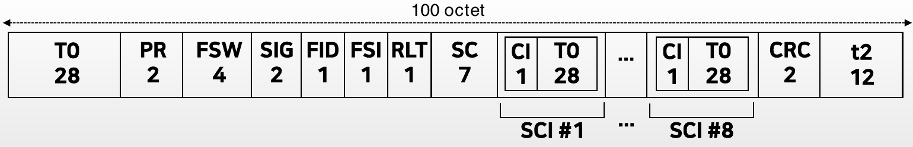

*Figure 32. Field structure of the RF-DSRC FCMS*

The FCMS in Figure 32 carries the following fields within the 100-octet slot.

| Field | Meaning | Role |
|:-----|:-----|:-----|
| PR | Preamble | Used for bit synchronization. |
| FSW | Frame synchronization word | Used for frame synchronization. |
| SIG | Signaling | Controls the communication channel. |
| FID | Fixed equipment ID | The identifier of the roadside unit, generated when the roadside unit is initialized. |
| FSI | Frame structure identifier | Carries information on the frame structure. |
| RLT | Release timer identifier | The time to wait before reconnecting to the link. |
| SC | Service code | Prevents an OBU from requesting a service the roadside unit does not provide and causing useless communication load. |
| SCI #1-#8 | Slot control identifier | Carries the control information of the MDS or ACTS slot corresponding to the field's position. |
| CRC | Cyclic redundancy check | Detects errors. |

*Table 14. Fields of the FCMS*

> **Note:** If all the numbers in Figure 32 are read as octets, they add up to far more than 100. The eight SCIs alone, each made of CI (1) and T0 (28), give $8 \times 29 = 232$. These numbers therefore cannot be read directly as the octet layout of the FCMS; unlike the MDS slot (Figure 33) and the ACTS slot (Figure 34), whose field sizes add up to exactly 100 octets, Figure 32 should be read as showing the kinds and order of the fields.

An MDS slot consists of an MDC, which carries data, and an ACKC, which carries the acknowledgment (the numbers are octets).

```text
|<--------------------- MDS slot: 100 octets ---------------------->|
+----+-----+-----+--------+-----+------+----+-----+----+-----+------+
| PR | CSW | MAC |  MSDU  | CRC |  t3  | PR | CSW | AI | CRC |  t4  |
| 2  |  2  |  2  |   65   |  2  |  11  | 2  |  2  | 1  |  2  |  9   |
+----+-----+-----+--------+-----+------+----+-----+----+-----+------+
|<------------ MDC ------------>|      |<------ ACKC ------->|

MAC control field (bits): FRG 1 | C/L 1 | reserved 1 | C/R 1 | SEQ 4 | LI 7 | reserved 1
```

*Figure 33. Structure of the RF-DSRC MDS slot*

The MDC is 73 octets: PR (2), CSW (2), MAC control field (2), MSDU (65), and CRC (2); the ACKC is 7 octets: PR (2), CSW (2), AI (1), and CRC (2). The t3 (11) and t4 (9) between and after them are time gaps for switching between transmission and reception, and everything adds up to $73 + 11 + 7 + 9 = 100$ octets. The CSW is a synchronization word that comes right after the PR, like the FSW of the FCMS. The 16-bit MAC control field consists of the following subfields, and its remaining two bits are reserved for future use.

- **FRG (fragmentation, 1 bit):** Fragmentation information of the LPDU.
- **C/L (continuous/last, 1 bit):** Indicates whether this is the last piece of a fragmented LPDU.
- **C/R (command/response, 1 bit):** Distinguishes commands from responses.
- **SEQ (sequence number, 4 bits):** The sequence number of the MSDU.
- **LI (length indicator, 7 bits):** The length of the valid data in the MSDU.

The **AI (acknowledgement identifier)** of the ACKC is the acknowledgment information.

An ACTS slot consists of six 13-octet activation channels (ACTCs).

```text
|<------------------------------ ACTS slot: 100 octets ------------------------------>|
+---------+---+---------+---+---------+---+---------+---+---------+---+---------+-----+
| ACTC(1) | t5| ACTC(2) | t5| ACTC(3) | t5| ACTC(4) | t5| ACTC(5) | t5| ACTC(6) |  t6 |
|    13   | 2 |    13   | 2 |    13   | 2 |    13   | 2 |    13   | 2 |    13   |  12 |
+---------+---+---------+---+---------+---+---------+---+---------+---+---------+-----+

ACTC (13 octets):
+----+-----+-----+-----+-----+-----+-----+
| PR | CSW | FID | LID | LRI | LRC | CRC |
| 2  |  2  |  1  |  4  |  1  |  1  |  2  |
+----+-----+-----+-----+-----+-----+-----+
```

*Figure 34. Structure of the RF-DSRC ACTS slot and ACTC*

Six ACTCs (78 octets), the five gaps t5 between them (10 octets), and t6 at the end (12 octets) add up to 100 octets. The fields of an ACTC are the roadside unit identifier **FID (fixed equipment ID)**, the link address field **LID (link address ID)**, the **LRI (link request information)** used for a link connection attempt, and the retry count field **LRC (link retry counter)**. An OBU without a link learns the position of the ACTS from the FCMS and then requests a connection by choosing one of the six ACTCs at random [10]. If two OBUs choose the same ACTC, they collide, so an OBU that fails tries again in the next frame and writes the number of attempts in the LRC. This is the same principle as slotted ALOHA in Section 1.10.

### 2.6 ETCS and Hi-Pass

> **Definition:** An **ETCS (electronic toll collection system)** is a service that automatically collects tolls from the IC card inserted in the OBE through DSRC wireless communication between the RSE and OBE.

ETCS, the representative application of DSRC, has different names in different countries: Hi-Pass in Korea, ETC in Japan, E-ZPass in the United States, Telepass in Italy, and Via Verde in Portugal.

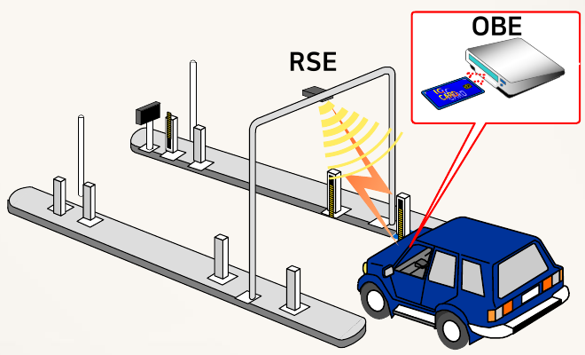

*Figure 35. An ETCS consisting of the RSE at the toll plaza and the OBE in the vehicle*

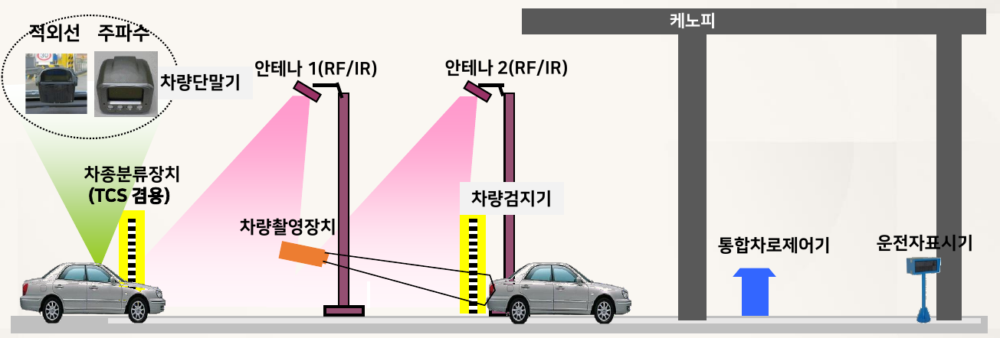

*Figure 36. Structure of the Hi-Pass service system*

A Hi-Pass lane in Figure 36 has antenna 1 and antenna 2 (RF or infrared) mounted on poles in front of the toll plaza canopy, a vehicle classification unit (combined with the TCS), a vehicle camera, a vehicle detector, an integrated lane controller, and a driver display. Vehicle terminals come in infrared and radio frequency (RF) types. Collection proceeds in the following order.

1. A vehicle equipped with a vehicle terminal holding an electronic card enters the toll plaza.
2. The antenna and the vehicle terminal exchange information over DSRC.
3. The toll is paid from the electronic card.
4. The integrated lane controller confirms the toll payment.
5. The license plate is photographed and the payment result is shown on the driver display. If the charge is abnormal, follow-up action is taken according to the cause.

Steps 1-3 are the toll payment by electronic card, and steps 4-5 are confirmation of collection and handling of violating vehicles.

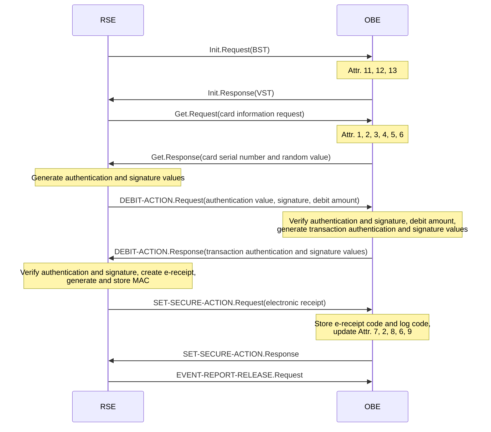

*Figure 37. The Hi-Pass billing information transfer procedure*

| ID | Information | ID | Information |
|:-----|:-----|:-----|:-----|
| 1 | Card information | 8 | Transaction completion information 2 |
| 2 | Recent card transaction information | 9 | Transaction history information |
| 3 | Cardholder information | 10 | Reserved |
| 4 | OBU basic information | 11 | Detailed card information |
| 5 | Recent OBU transaction information | 12 | Reserved |
| 6 | OBU additional information | 13 | Detailed transaction information |
| 7 | Transaction completion information 1 | 14 | Reserved |

*Table 15. Attribute (Attr.) IDs in the Hi-Pass billing procedure*

The procedure in Figure 37 has three parts. First, the RSE announces the services it offers with a **BST (beacon service table)**, and the OBE replies with a **VST (vehicle service table)** listing the applications it supports, initializing communication. Second, the RSE reads the card information and sends the amount to debit, and the OBE debits it from the card. During this, both sides generate and check authentication and signature values, so a forged RSE or OBE cannot interfere in the transaction. Third, the RSE sends an electronic receipt for the OBE to store and releases the communication. The MAC the RSE generates here is not medium access control but a message authentication code, a cryptographic check value that confirms a message has not been altered. Because the whole exchange must finish in the short time a vehicle passes through the coverage area, DSRC was designed with simple layers and fast connection setup.

### 2.7 IEEE 802.11 Task Groups and Wireless LAN Standards

IEEE 802.11 is the wireless LAN (WLAN) standard, and each time a feature is added a task group (TG) produces an amendment.

| Task group | Subject | Status around 2013 |
|:-----|:-----|:-----|
| TGa | 5 GHz OFDM wireless LAN | Standard published |
| TGb | 2.4 GHz CCK wireless LAN | Standard published |
| TGg | 2.4 GHz OFDM wireless LAN | Standard published |
| TGn | High throughput | Standard published |
| TGp | Vehicular environment | Standard published |
| TGv | Network management | Standard published |
| TGac | Very high throughput below 6 GHz | Hot issue in the market |
| TGad | Very high throughput at 60 GHz | Hot issue in the market |
| TGaf | TV white space (unused TV broadcast frequencies) | Hot issue in standardization |
| TGah | Sub-1 GHz operation | Hot issue in standardization |
| TGai | Fast link set-up | Hot issue in standardization |

*Table 16. Major task groups of IEEE 802.11*

IEEE 802.11p, produced by TGp, is the physical and MAC layer of WAVE in Section 3. The standards listed as issues in Table 16 were all published later and incorporated into IEEE 802.11-2020 [4].

| 802.11 protocol | Frequency (GHz) | Bandwidth (MHz) | Data rate per stream (Mbit/s) | Allowable MIMO streams | Modulation | Indoor range (m) | Outdoor range (m) |
|:-----|:-----|:-----|:-----|:-----|:-----|:-----|:-----|
| a | 5 | 20 | 6, 9, 12, 18, 24, 36, 48, 54 | 1 | OFDM | 35 | 120 |
| a | 3.7 | 20 | 6, 9, 12, 18, 24, 36, 48, 54 | 1 | OFDM | None | 5,000 |
| b | 2.4 | 20 | 1, 2, 5.5, 11 | 1 | DSSS | 38 | 140 |
| g | 2.4 | 20 | 1, 2, 6, 9, 12, 18, 24, 36, 48, 54 | 1 | OFDM, DSSS | 38 | 140 |
| n | 2.4/5 | 20 | 7.2, 14.4, 21.7, 28.9, 43.3, 57.8, 65, 72.2 | 4×4 | OFDM | 70 | 250 |
| n | 2.4/5 | 40 | 15, 30, 45, 60, 90, 120, 135, 150 | 4×4 | OFDM | 70 | 250 |
| ac | 5 | Min. 20, max. 160 | 87.6 (20 MHz), 866.7 (160 MHz) | 8×8 | OFDM | Over 70 | Over 250 |
| ad | 2.4/5/60 | 2,160 | 6,912 | Over 10×10 | OFDM | None | None |

*Table 17. Comparison of the characteristics of IEEE 802.11 wireless LAN standards*

> **Definition:** **DSSS (direct sequence spread spectrum)** spreads each bit over a wide band by multiplying it by a fast code sequence. **CCK (complementary code keying)** is the DSSS code scheme 802.11b uses for 5.5 Mbps and 11 Mbps. **MIMO (multiple input multiple output)** is a technology that uses several antennas for transmission and reception to send several data flows (spatial streams) at the same time; 4×4 means four transmit and four receive antennas.

The 3.7 GHz row of Table 17 is the amendment (802.11y) that uses the 802.11a scheme at high power in the U.S. 3.65-3.7 GHz band, reaching up to 5 km outdoors. 802.11n raised speeds with MIMO and 40 MHz channel bonding, and 802.11ac with up to 160 MHz and eight streams. 802.11ad delivers up to about 6.75 Gbit/s with 2,160 MHz-wide channels in the 60 GHz band [11].

> **Note:** 802.11ad compensates for the large path loss at 60 GHz not with MIMO, which sends several spatial streams at once, but with beamforming, which focuses the wave in one direction using many antenna elements. The "Over 10×10" in Table 17 is more accurately understood as the size of such antenna arrays. Also, the 802.11ad rate of 6,912 Mbit/s in Table 17 is larger than the maximum 802.11ad data rate of about 6.75 Gbit/s [11].

### 2.8 Components and Architecture of Wireless LANs

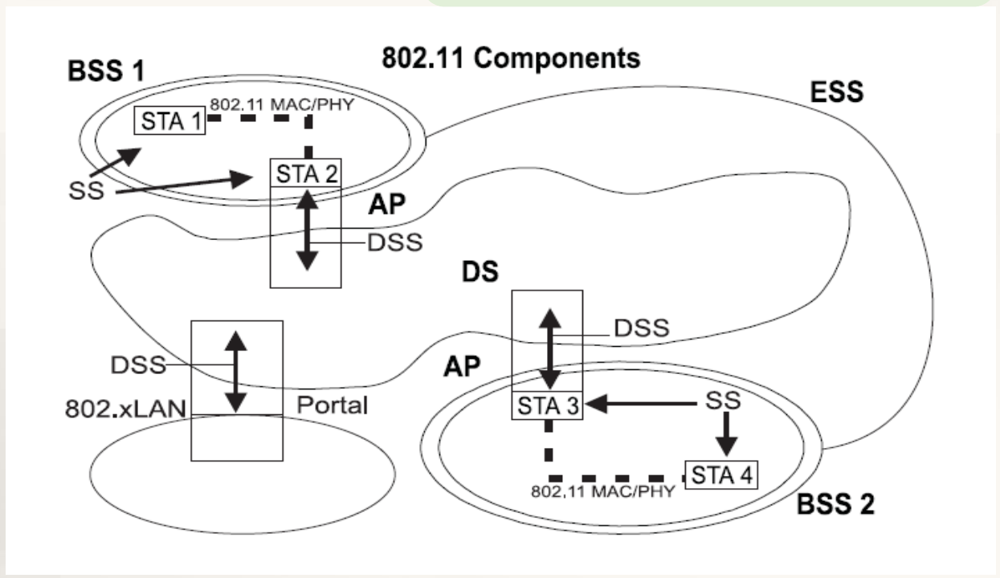

*Figure 38. Components of an IEEE 802.11 wireless LAN*

| Component | Description |
|:-----|:-----|
| STA (station) | A wireless device with an 802.11 MAC and physical layer. |
| AP (access point) | A station that connects wireless terminals to the distribution system. |
| BSS (basic service set) | The basic unit of stations communicating with each other, for example one wireless LAN. BSS 1 in Figure 38 has STA 1 and STA 2 acting as the AP. |
| DS (distribution system) | The system that interconnects the APs of several BSSs. |
| ESS (extended service set) | A set of BSSs connected by a DS so that they look like one large network, for example a wireless LAN combined with a wired LAN. |
| Portal | The gateway that connects an 802.11 network to another LAN such as 802.3 (802.x LAN). |
| SS, DSS | The services provided by every station (SS, station service) and by the DS (DSS, distribution system service). |

*Table 18. Components of a wireless LAN*

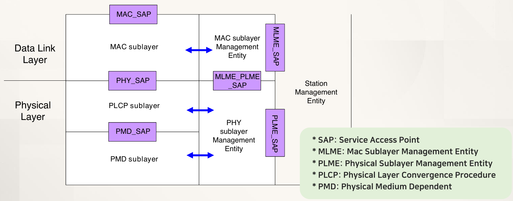

*Figure 39. Layered architecture and management entities of an IEEE 802.11 wireless LAN*

In Figure 39, the data link layer contains the MAC sublayer, and the physical layer contains the PLCP and PMD sublayers. Next to each sublayer is a management entity that manages its configuration and state.

> **Definition:** An **SAP (service access point)** is the point at which a layer provides its service to the layer above. The **MLME (MAC sublayer management entity)** is the management entity of the MAC sublayer, the **PLME (physical layer management entity)** that of the physical layer, and the **SME (station management entity)** manages the whole station. The **PLCP (physical layer convergence procedure)** sublayer converts MAC frames into physical layer frames, and the **PMD (physical medium dependent)** sublayer handles the modulation and transmission and reception of the actual radio signal.

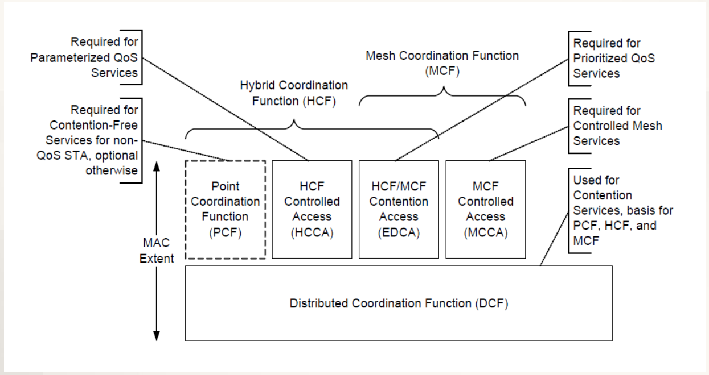

*Figure 40. Architecture of the IEEE 802.11 MAC*

In the MAC architecture of Figure 40, the **DCF (distributed coordination function)** at the bottom is used for contention-based services and is the basis of all other access methods. Above it are the following functions.

- **PCF (point coordination function):** Provides contention-free services to stations without QoS support and is optional.
- **HCF (hybrid coordination function):** Provides prioritized QoS services with the contention-based **EDCA (enhanced distributed channel access)** and parameterized QoS services with the controlled **HCCA (HCF controlled channel access)**.
- **MCF (mesh coordination function):** For mesh networks, it uses the controlled MCCA (MCF controlled channel access) and the contention-based HCF/MCF contention access.

> **Definition:** **QoS (quality of service)** is the function of improving service quality by sending high-priority packets first.

### 2.9 DCF and CSMA/CA

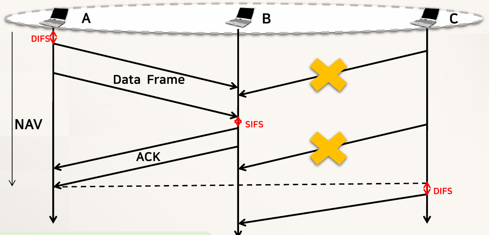

*Figure 41. Timing of data frames, ACKs, and the NAV in DCF*

DCF is the basic access method of wireless LANs and implements the CSMA/CA of Section 1.10. In Figure 41, station A confirms that the channel has been idle for a **DIFS (DCF interframe space)** and then sends a data frame to B. B receives the frame and sends an ACK after an **SIFS (short interframe space)**. Meanwhile, C sets its NAV from the Duration value of the data frame and defers transmission. As the X marks in the figure show, C would have caused a collision had it sent during this period. C sends only after waiting another DIFS once the ACK has ended. Since SIFS is shorter than DIFS, an ACK always seizes the channel before other stations that want to send new data.

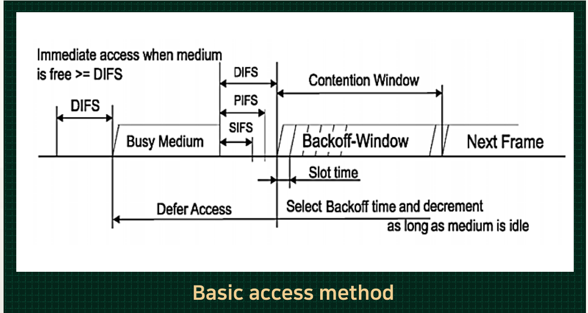

*Figure 42. The basic access method of DCF and the interframe spaces*

The basic access method in Figure 42 is as follows.

1. If the medium has been idle for a DIFS or longer, send immediately.
2. If the medium is busy, defer access.
3. When the medium becomes idle again, wait a DIFS, choose a backoff time within the contention window, and decrement it by one for every slot time the medium stays idle. Send when it reaches 0.

The shorter an interframe space (IFS), the higher its priority. With the slot time $aSlotTime$, the following relations hold.

```math
PIFS = SIFS + aSlotTime, \qquad DIFS = SIFS + 2 \times aSlotTime
```

In the 20 MHz OFDM physical layer, $aSlotTime = 9$ µs and SIFS = 16 µs, so PIFS = 25 µs and DIFS = 34 µs [4]. The **PIFS (PCF interframe space)** is used by the PCF controller to seize the channel before DCF stations.

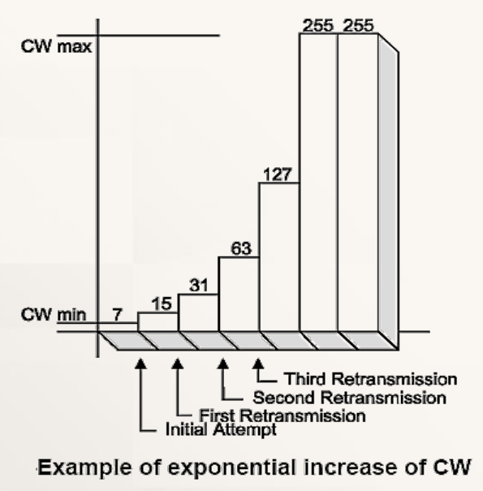

*Figure 43. Exponential growth of the contention window with retransmissions and the backoff time calculation*

**Random backoff time.** The backoff time is chosen as follows.

```math
\text{Backoff Time} = \text{Random}() \times aSlotTime
```

$\text{Random}()$ is a pseudo-random integer drawn from the interval $[0, CW]$, and the contention window $CW$ satisfies $aCWmin \le CW \le aCWmax$. The slot time is the minimum time needed to sense the channel once. On the first attempt $CW = aCWmin$; after each failed transmission it grows as $CW \leftarrow 2(CW + 1) - 1$, and once it reaches $aCWmax$ it grows no further. In the example of Figure 43 ($aCWmin = 7$, $`aCWmax = 255`$), CW grows as 7, 15, 31, 63, 127, 255, 255. After a successful transmission, CW returns to $aCWmin$. For example, with $CW = 15$ and $aSlotTime = 9$ µs, the backoff time is one of the values in 0-135 µs in steps of 9 µs. The more frequent the collisions, the larger CW grows, making it more likely that stations choose different backoff values, and collisions decrease.

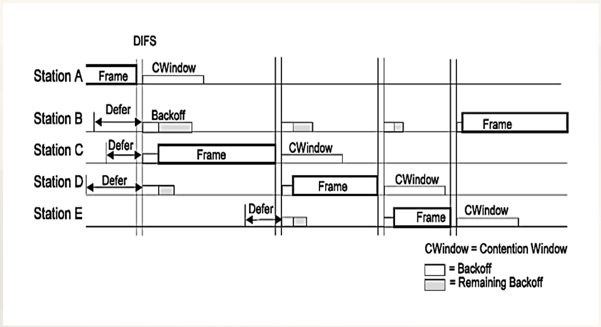

*Figure 44. The DCF backoff procedure of several stations*

In Figure 44, while station A sends a frame, B, C, and D get data to send but defer (Defer). After A's transmission ends and a DIFS passes, B, C, and D each choose a backoff value and count it down. C, whose backoff reaches 0 first, sends its frame, and B and D wait with their remaining backoff frozen. When C's transmission ends, B and D do not choose new values but resume counting down from the remaining values. So the longer a station has waited, the smaller its remaining backoff and the sooner it gets a chance to send. Next D sends, then E, which arrived later, and finally B.

### 2.10 QoS Support: EDCA

IEEE 802.11e introduced EDCA to support QoS.

- High-priority traffic has a higher chance of being sent than low-priority traffic.
- Higher-priority packets get a smaller contention window (CW) and a shorter **AIFS (arbitration interframe space)**.
- In WAVE, the transmission opportunity (TXOP) is 0.

> **Definition:** A **TXOP (transmission opportunity)** is a time during which a station that has obtained the channel may use it continuously without contention. The legacy 802.11 DCF MAC had the problem of slow stations taking an inordinate amount of channel time to send one frame, and TXOP reduces it by limiting the time. If the TXOP limit is 0, only one MPDU can be sent each time the channel is obtained.

| Access category | Traffic type | Priority | TXOP in WAVE |
|:-----|:-----|:-----|:-----|
| AC_BK | Background | Lowest | 0 |
| AC_BE | Best effort | Low | 0 |
| AC_VI | Video | High | 0 |
| AC_VO | Voice | Highest | 0 |

*Table 19. Access categories of EDCA*

> **Note:** IEEE 802.11e maps the user priorities (UP) 0-7 attached by upper layers to the four access categories: UP 1 and 2 to AC_BK, 0 and 3 to AC_BE, 4 and 5 to AC_VI, and 6 and 7 to AC_VO [4]. When the access categories are listed with numbers 0-3, these numbers are the order of the access categories, not user priorities.

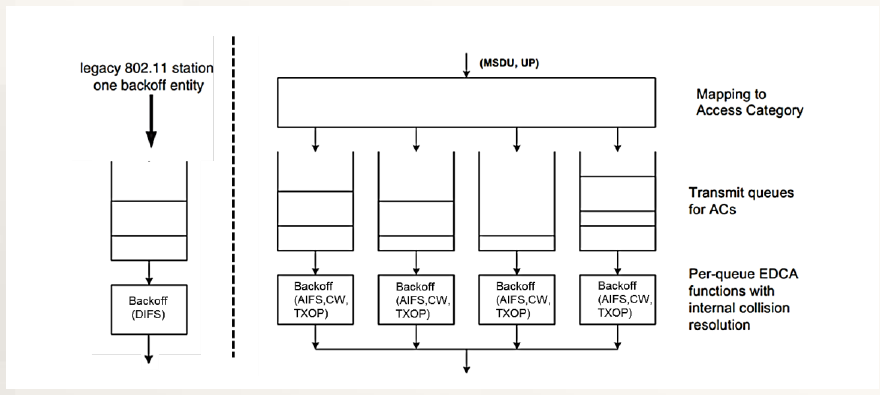

*Figure 45. The single backoff of a legacy 802.11 station and the per-category queues of EDCA*

The left side of Figure 45 is a legacy 802.11 station with only one queue and one backoff entity using DIFS. The EDCA station on the right distributes MSDUs from the upper layer into the transmit queues of the four access categories according to priority (mapping to access category), and each queue backs off separately with its own AIFS, CW, and TXOP. If two queues within one station finish their backoff at the same time, internal collision resolution lets the higher-priority queue send.

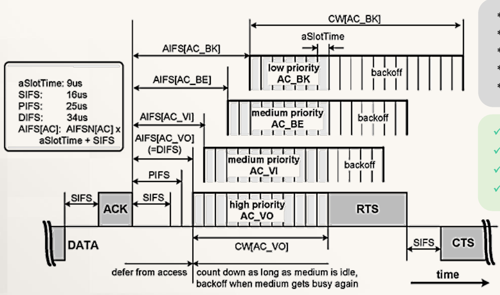

*Figure 46. Timing of AIFS and contention windows by EDCA access category*

In Figure 46, the AIFS of each access category is defined as follows.

```math
AIFS[AC] = AIFSN[AC] \times aSlotTime + SIFS
```

$AIFSN$ is an integer set for each access category. With the values in the figure ($aSlotTime = 9$ µs, SIFS = 16 µs), the 802.11 defaults give an AIFS of 34 µs (= DIFS) for AIFSN 2 of AC_VO and AC_VI, $3 \times 9 + 16 = 43$ µs for AIFSN 3 of AC_BE, and $7 \times 9 + 16 = 79$ µs for AIFSN 7 of AC_BK. When the medium becomes idle, a higher-priority queue waits a shorter time and then backs off within a smaller contention window, so statistically it seizes the channel first. The backoff decreases only while the medium is idle and stops when the medium becomes busy again.

| Aspect | DCF | PCF |
|:-----|:-----|:-----|
| Service | Contention service, such as CSMA/CA | Contention-free service based on priority |
| Operation | Before sending data, a station senses in advance and waits to avoid collisions. | The AP asks the stations directly in turn, and each station waits until then. |
| Controlled by | Each station | The AP |

*Table 20. Comparison of DCF and PCF*

### 2.11 The Wireless LAN Communication Procedure

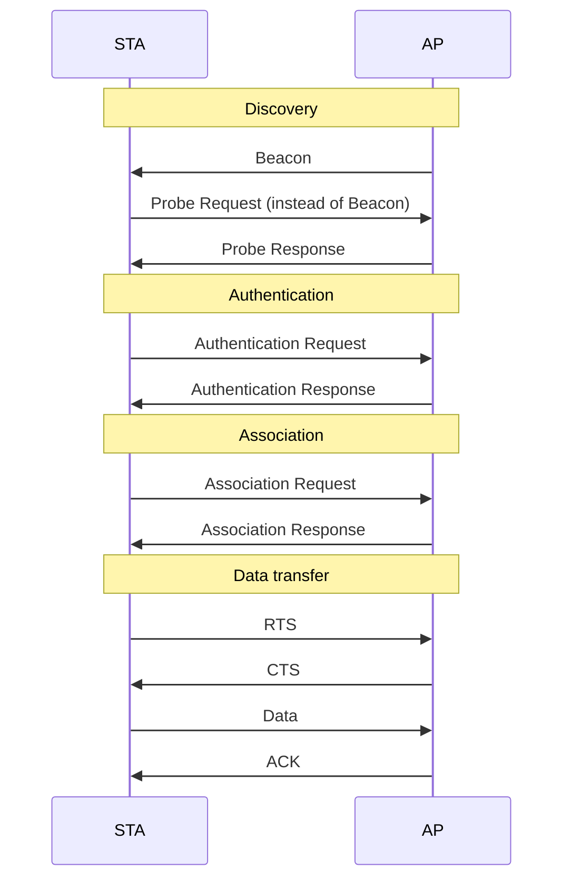

*Figure 47. The basic communication procedure between a wireless LAN station and an AP*

As in Figure 47, a station goes through four stages before exchanging data with the AP of a BSS.

1. **Discovery:** The station listens to the beacons the AP broadcasts periodically (passive scanning), or sends a Probe Request and receives the AP's Probe Response (active scanning).
2. **Authentication:** It is checked whether the station is entitled to join the network.
3. **Association:** The station registers its membership with a particular AP so that the AP can deliver frames destined to it.
4. **Data transfer:** If needed, the channel is reserved with RTS/CTS, and data and ACKs are exchanged.

> **Key Point:** Discovery, authentication, and association require several frame exchanges and can take hundreds of milliseconds. A vehicle traveling at 100 km/h covers about 28 m per second, so it is hard to complete this procedure while passing through the coverage of a single roadside unit. That is why WAVE in Section 3 communicates immediately without authentication and association (Section 3.3).

### 2.12 Types of MAC Frames and Fragmentation

The MAC frames of IEEE 802.11 omit fields from the general format depending on their type. The numbers in the table are octets, the parentheses show the address that goes into the field, and "None" marks a field that the frame type does not have.

| Field | General format | Management frame | Control frame | Data frame |
|:-----|:-----|:-----|:-----|:-----|
| Frame Control | 2 | 2 | 2 | 2 |
| Duration/ID | 2 | 2 | 2 | 2 |
| Address 1 | 6 | 6 (DA) | 6 (RA) | 6 |
| Address 2 | 0 or 6 | 6 (SA) | 0 or 6 (TA) | 6 |
| Address 3 | 0 or 6 | 6 (BSSID) | None | 6 |
| Sequence Control | 2 | 2 | None | 2 |
| Address 4 | 0 or 6 | None | None | 0 or 6 |
| QoS Control | 0 or 2 | None | None | 0 or 2 |
| HT Control | 0 or 4 | 0 or 4 | 4 only in a Control Wrapper frame | 0 or 4 |
| Frame Body | Variable | 0-2,304 | None | Variable |
| FCS | 4 | 4 | 4 | 4 |

*Table 21. Fields and sizes of IEEE 802.11 MAC frames by type*

- **Management frames:** Frames that manage the network, such as beacons, probes, authentication, and association. Addresses 1-3 are DA, SA, and BSSID, and the body is 0-2,304 octets.
- **Control frames:** Short frames that assist channel access, such as RTS, CTS, ACK, and Block ACK. They have only the receiver address (RA) and transmitter address (TA) and no body. The HT Control field appears only in the Control Wrapper frame used for beamforming.
- **Data frames:** Carry the data content in the frame body. The number of address fields and the presence of the QoS Control and HT Control fields depend on To DS, From DS, and QoS support.
- **Extension frames:** A format introduced by 802.11ad (DMG, directional multi-gigabit) at 60 GHz; in a DMG beacon, Field 0 is the BSSID.

**Fragmentation.** If an MSDU is too big to send at once, the MAC splits it into several pieces.

```text
                    MSDU (MAC Service Data Unit)
          [ part 0 | part 1 | part 2 | part 3 ]
              |        |        |        |
[MAC HDR|Frame Body|CRC] [MAC HDR|Frame Body|CRC] [MAC HDR|Frame Body|CRC] [MAC HDR|Frame Body|CRC]
       Fragment 0               Fragment 1               Fragment 2               Fragment 3

Source:      RTS        Fragment 0        Fragment 1        Fragment 2   ...
Destination:      CTS              ACK0              ACK1
             (every gap between frames = SIFS)
```

*Figure 48. Fragmentation of an MSDU and transmission of the fragments*

In Figure 48, each fragment is an independent frame with its own MAC header and CRC (FCS). After seizing the channel with RTS/CTS, the sender exchanges fragments and ACKs at SIFS intervals. Since every gap is an SIFS, other stations cannot cut in (they must wait at least a DIFS). The fragment number is written in the Sequence Control field, and whether more fragments follow is written in the More Frag bit of the Frame Control field. On an error-prone wireless channel, only the small fragment with an error needs to be resent instead of one large frame, which improves efficiency.

### 2.13 The OFDM Physical Layer

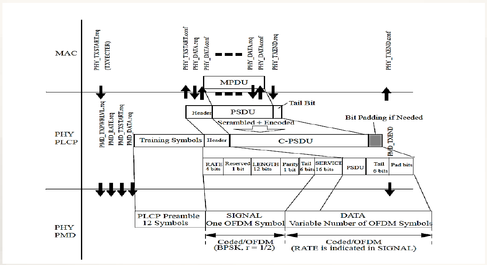

*Figure 49. The OFDM physical layer frame format and the primitives between MAC, PLCP, and PMD*

In Figure 49, when the MAC requests the start of transmission with PHY_TXSTART.req and hands over the MPDU one octet at a time with PHY_DATA.req, the PLCP sublayer receives the MPDU as a **PSDU (PLCP service data unit)** and builds a physical layer frame in the following format.

- **PLCP preamble (12 symbols):** Training symbols with which the receiver detects the signal and sets its receive gain and frequency and time synchronization.
- **SIGNAL (one OFDM symbol):** Always sent with the most robust BPSK at code rate 1/2. It consists of RATE (4 bits, the modulation and code rate of the following data), Reserved (1 bit), LENGTH (12 bits, the number of octets in the PSDU), Parity (1 bit), and Tail (6 bits).
- **DATA (a variable number of OFDM symbols):** Consists of SERVICE (16 bits), the PSDU, Tail (6 bits), and pad bits, and is scrambled, encoded, and sent at the rate announced by the RATE of SIGNAL.

The receiver must first interpret SIGNAL to know at what rate to receive DATA, so SIGNAL is sent at the lowest rate that any receiver can interpret.

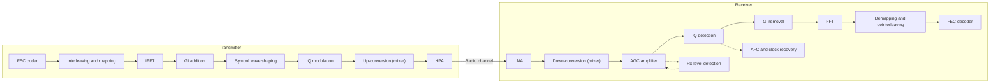

*Figure 50. Block diagram of the transmitter and receiver of the OFDM physical layer*

In the transmitter of Figure 50, the **FEC coder** adds redundancy with the convolutional code of Section 1.7; **interleaving** scatters neighboring bits onto subcarriers far apart so that errors do not cluster even if a particular frequency is weakened by fading; and **mapping** converts bit groups into constellation points of BPSK through 64-QAM. The **IFFT (inverse fast Fourier transform)** converts the values of all subcarriers at once into a time-domain OFDM symbol, and **GI (guard interval) addition** attaches the cyclic prefix. The symbol waveform is then shaped, placed on an intermediate-frequency carrier by **IQ modulation** (modulation using in-phase and quadrature components), raised to the radio frequency by a mixer and a local oscillator (up-conversion), amplified by the **HPA (high power amplifier)**, and sent to the antenna. The receiver reverses the process. The signal amplified by the **LNA (low noise amplifier)** is lowered to the intermediate frequency by a mixer (down-conversion), and the **AGC (automatic gain control)** amplifier, whose gain is controlled by the receive level detector, adjusts the signal level. Then IQ detection yields the baseband signal, and **AFC (automatic frequency control)** and clock recovery align frequency and time. After the GI is removed and the **FFT** extracts the subcarrier values, demapping, deinterleaving, and FEC decoding restore the original bits.

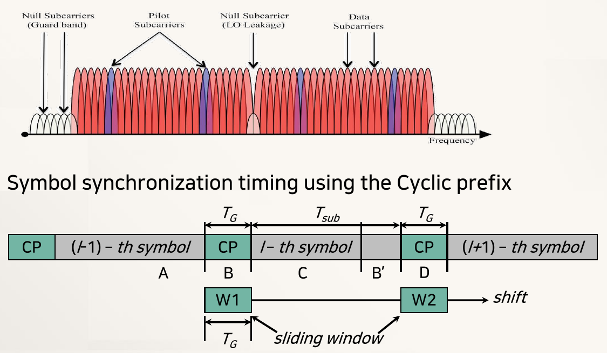

*Figure 51. Arrangement of OFDM subcarriers and symbol synchronization using the cyclic prefix*

**Subcarriers.** As in the upper part of Figure 51, the subcarriers of an OFDM channel have different roles. There are **data subcarriers**, which carry data; **pilot subcarriers**, which carry known values so the receiver can track phase and frequency errors; and **null subcarriers**, which are left empty. Null subcarriers are placed at the guard bands at both edges of the channel and at the center (DC), where leakage from the transceiver's local oscillator (LO leakage) appears. 802.11a/g/p use 52 of the 64 FFT positions: 48 for data and 4 for pilots.

**Cyclic prefix and symbol synchronization.** In front of each OFDM symbol is a **cyclic prefix (CP)**, a copy of the last part of length $T_G$ of that symbol. The tail of the previous symbol that arrives late through multipath falls only on the CP interval, so when the receiver discards the CP, inter-symbol interference disappears. In the lower part of Figure 51, the CP (interval B) is identical to the end of the same symbol (interval $`B'`$). The receiver places two windows W1 and W2 of length $T_G$ a distance $T_{sub}$ (the useful symbol length) apart, slides them along the signal (sliding window), and computes the correlation of the two windows. The correlation peaks when the windows sit exactly on B and $B'$, so the start of the symbol is found at that position. In a 20 MHz channel, $T_{sub} = 3.2$ µs and $T_G = 0.8$ µs, so one symbol is 4 µs.

| Modulation | Code rate | Coded bits per subcarrier | Coded bits per OFDM symbol | Data bits per OFDM symbol | Rate (20 MHz, Mb/s) | Rate (10 MHz, Mb/s) | Rate (5 MHz, Mb/s) |
|:-----|:-----|:-----|:-----|:-----|:-----|:-----|:-----|
| BPSK | 1/2 | 1 | 48 | 24 | 6 | 3 | 1.5 |
| BPSK | 3/4 | 1 | 48 | 36 | 9 | 4.5 | 2.25 |
| QPSK | 1/2 | 2 | 96 | 48 | 12 | 6 | 3 |
| QPSK | 3/4 | 2 | 96 | 72 | 18 | 9 | 4.5 |
| 16-QAM | 1/2 | 4 | 192 | 96 | 24 | 12 | 6 |
| 16-QAM | 3/4 | 4 | 192 | 144 | 36 | 18 | 9 |
| 64-QAM | 2/3 | 6 | 288 | 192 | 48 | 24 | 12 |
| 64-QAM | 3/4 | 6 | 288 | 216 | 54 | 27 | 13.5 |

*Table 22. Data rates of 802.11a/g OFDM by modulation and code rate*

| Parameter | 20 MHz | 10 MHz | 5 MHz |
|:-----|:-----|:-----|:-----|
| FFT size | 64 | 64 | 64 |
| Number of data subcarriers | 48 | 48 | 48 |
| Number of pilot subcarriers | 4 | 4 | 4 |
| Total number of subcarriers | 52 | 52 | 52 |
| Subcarrier spacing | 312.5 kHz | 156.25 kHz | 78.125 kHz |
| Duration of a BPSK OFDM symbol | 4 µs | 8 µs | 16 µs |

*Table 23. OFDM parameters by channel bandwidth*

**Calculating the data rate.** The 54 Mbps of 64-QAM, code rate 3/4, at 20 MHz is computed step by step as follows.

1. The subcarrier spacing is the bandwidth divided by the FFT size: $20 \text{ MHz} / 64 = 312.5$ kHz.
2. The number of symbols sent per second is the reciprocal of the symbol duration: $1 \text{ s} / 4 \text{ µs} = 250{,}000$.
3. The coded bits per symbol are the number of data subcarriers times the bits per subcarrier: $48 \times 6 = 288$ bits.
4. The data rate is the product of the number of symbols, the coded bits per symbol, and the code rate: $250{,}000 \times 288 \times 3/4 = 54{,}000{,}000$ bps $= 54$ Mbps.

In a 10 MHz channel, the subcarrier spacing is halved, so the symbol duration doubles to 8 µs and 125,000 symbols are sent per second, halving the rate of the same combination to $125{,}000 \times 288 \times 3/4 = 27$ Mbps. This is how the 3-27 Mbps rates of the 10 MHz channels used by WAVE in Section 3 arise. With longer symbols, the CP also grows to 1.6 µs, making the system more robust to the long multipath delays outdoors.

---

<br>

## 3. WAVE

### 3.1 Overview and Characteristics of the WAVE System

> **Definition:** **WAVE (Wireless Access in Vehicular Environments)** is a wireless access technology for vehicular environments that provides a high-speed V2V and V2I communication network environment for safety and mobility services. It provides services that give access to the resources of a remote peer according to service requirements.

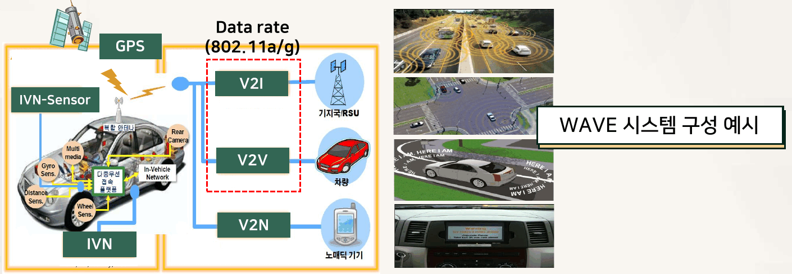

*Figure 52. An example configuration of a WAVE system*

In Figure 52, the vehicle's WAVE device is connected to the GPS receiver and to the in-vehicle network (IVN) and its sensors. Outside the vehicle, it communicates V2I with roadside units (RSUs), V2V with other vehicles, and V2N with nomadic devices such as smartphones, at data rates on the level of 802.11a/g. The pictures on the right are examples of WAVE services used at intersections, on roads, and on in-vehicle displays.

The WAVE protocols have the following characteristics.

- **Architecture:** The physical and MAC layers are IEEE 802.11p, and the layers above are the IEEE 1609.x family.
- **Multichannel operation:** The control channel (CCH) and service channels (SCH) are used in alternation.
- **Initialization:** Devices connect to a link quickly with only a WAVE service advertisement (WSA), without authentication and association.
- **Network layer services:** Both WSMP and IP (IPv6) are supported.
- **Others:** Time is synchronized based on GPS, both V2V and V2I communication are supported, and emergency message services are supported with WAVE short messages (WSM).

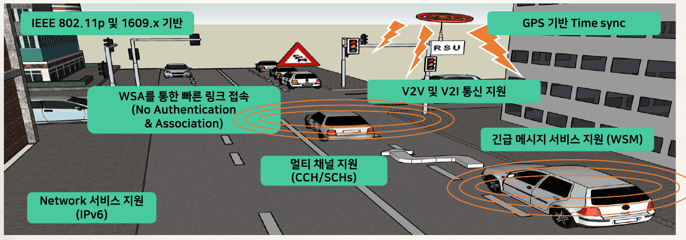

*Figure 53. A road scene showing the characteristics of the WAVE protocols*

Figure 53 marks these characteristics on a single road scene. Roadside units and vehicles operate on GPS time based on 802.11p and 1609.x, connect quickly through WSAs to communicate V2V and V2I, and send emergency messages as WSMs in dangerous situations. Multiple channels (CCH and SCHs) and IPv6 network services are also supported.

### 3.2 WAVE Architecture and Standards

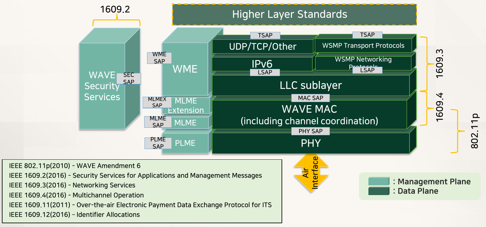

*Figure 54. The WAVE architecture and its internal interfaces*

The WAVE architecture in Figure 54 is divided into the **data plane**, which carries data, and the **management plane**, which configures and manages it.

- **Data plane:** From the bottom there are the physical layer (PHY), the WAVE MAC including channel coordination, and the LLC sublayer, above which there are two branches of the network layer. One is IPv6 with transport protocols such as UDP/TCP; the other is the networking and transport protocols of WSMP. At the top come the higher layer standards, for example the SAE J2735 messages of Week 11.
- **Management plane:** It contains the physical layer management entity (PLME), the MAC management entity (MLME), the MLME extension for multichannel operation, the WAVE management entity (WME), and the WAVE security services. They connect to each layer through service access points (SAPs). For example, the MLMEX SAP is the SAP of the MLME extension, the WME SAP that of the WME, and the SEC SAP that of the security services.

The brackets on the right of the figure show the scope of each standard. IEEE 802.11p covers the physical layer and MAC, IEEE 1609.4 the channel coordination of the WAVE MAC and the MLME extension, IEEE 1609.3 the LLC sublayer and the networking services above it (IPv6, WSMP, WME), and IEEE 1609.2 the security services.

| Standard | Content |
|:-----|:-----|
| IEEE 802.11p (2010) | The sixth amendment to IEEE 802.11 (Amendment 6), for WAVE [12] |
| IEEE 1609.2 (2016) | Security services for application and management messages [13] |
| IEEE 1609.3 (2016) | Networking services [14] |
| IEEE 1609.4 (2016) | Multichannel operation [15] |
| IEEE 1609.11 (2010, published 2011) | Over-the-air electronic payment data exchange protocol for ITS [16] |
| IEEE 1609.12 (2016) | Identifier allocations [17] |

*Table 24. Standards that make up WAVE*

### 3.3 Communication Outside the Context of a BSS

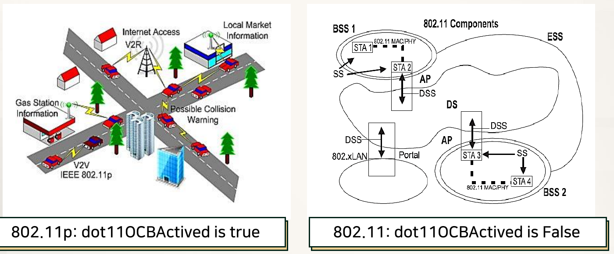

*Figure 55. Comparison of 802.11p communicating outside a BSS and 802.11 communicating within a BSS*

The key change in 802.11p is that when the MIB variable **dot11OCBActivated** is true, stations can communicate **outside the context of a BSS (OCB)**. As on the right of Figure 55, in ordinary 802.11 (dot11OCBActivated false) a station must join a BSS before communicating, so it must go through the discovery, authentication, and association of Section 2.11. In 802.11p on the left (dot11OCBActivated true), vehicles and roadside units exchange frames immediately without joining a BSS. A passing vehicle can therefore receive at once V2V messages warning of possible collisions at an intersection, Internet access through a roadside unit (V2R), and information from gas stations or local shops. The BSSID field of OCB frames carries the wildcard BSSID with all bits set to 1 so that any station receives them [4].

### 3.4 The WAVE Physical Layer and the U.S. Channel Plan

| Item | Specification |
|:-----|:-----|
| Frequency | 5.850-5.925 GHz |
| Bandwidth | 75 MHz |
| Channels | Seven 10 MHz channels |
| Modulation | BPSK, QPSK, 16-QAM, 64-QAM OFDM |
| Data rate | 10 MHz channels: 3, 4.5, 6, 9, 12, 18, 24, 27 Mbps; 20 MHz channels: 6, 9, 12, 18, 24, 36, 48, 54 Mbps |
| Speed | 200 km/h |
| Coverage | Up to 1,000 m |

*Table 25. Specifications of the WAVE physical layer*

The WAVE physical layer uses the 802.11a OFDM of Section 2.13 scaled down to 10 MHz channels. The 10 MHz column of Table 22 gives the data rates of WAVE. Since the symbol and CP are twice as long, it is robust to the long multipath delays between fast-moving vehicles.

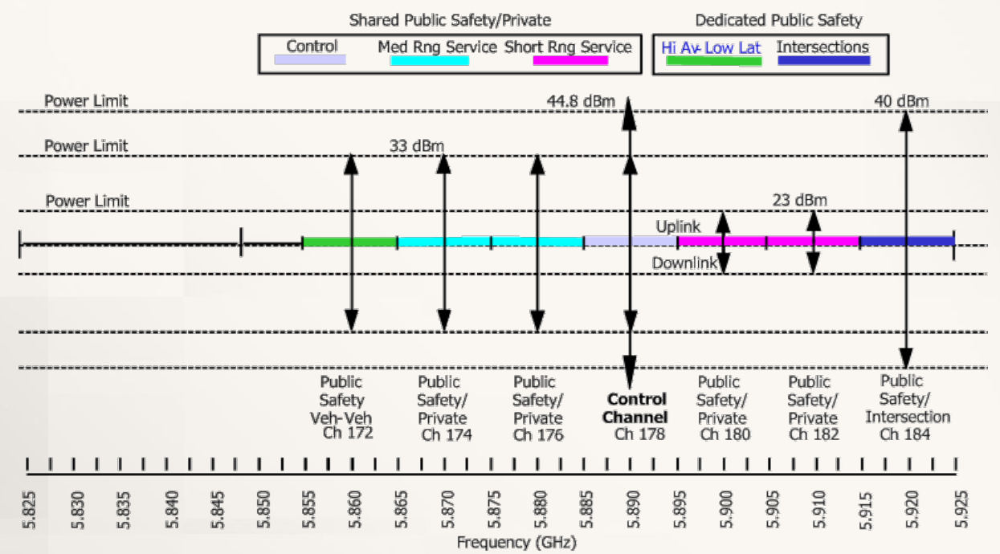

*Figure 56. The U.S. WAVE channel plan and the transmit power limit of each channel*

Figure 56 is the channel plan of the 5.9 GHz band set by the U.S. Federal Communications Commission (FCC) [18]. The center frequency of channel number $n$ is $5000 + 5n$ MHz, so for example channel 172 is centered at $5000 + 5 \times 172 = 5860$ MHz. The lowest 5 MHz (5.850-5.855 GHz) is left as a guard band.

| Channel | Center frequency (GHz) | Use | Transmit power limit |
|:-----|:-----|:-----|:-----|
| 172 | 5.860 | Dedicated public safety, vehicle-to-vehicle (V2V) safety | 33 dBm |
| 174 | 5.870 | Shared public safety and private, medium-range service | 33 dBm |
| 176 | 5.880 | Shared public safety and private, medium-range service | 33 dBm |
| 178 | 5.890 | Control channel (CCH) | 44.8 dBm |
| 180 | 5.900 | Shared public safety and private, short-range service | 23 dBm |
| 182 | 5.910 | Shared public safety and private, short-range service | 23 dBm |
| 184 | 5.920 | Dedicated public safety, intersections | 40 dBm |

*Table 26. Uses and transmit power limits of the U.S. WAVE channels*

> **Definition:** **dBm** expresses power in decibels relative to 1 mW: $`P[\text{dBm}] = 10 \log_{10}(P / 1\ \text{mW})`$. 33 dBm is $10^{3.3} \approx 2{,}000$ mW, about 2 W; 23 dBm is about 0.2 W, 40 dBm is 10 W, and 44.8 dBm is about 30 W.

Control channel 178 is where all devices gather to hear WSAs and safety messages, so it allows the highest power; channel 172 is dedicated to vehicle-to-vehicle safety communication, which needs low latency and high availability, and channel 184 to high-power public safety communication at intersections. The remaining service channels are shared and split by range into medium range (33 dBm) and short range (23 dBm).

> **Note:** This channel plan is the original U.S. plan. In 2020 the FCC reassigned the lower 45 MHz of the band to unlicensed Wi-Fi and the upper 30 MHz to C-V2X [19]. National spectrum policies were covered in Week 1.

### 3.5 The IEEE 802.11p MAC and EDCA Parameters

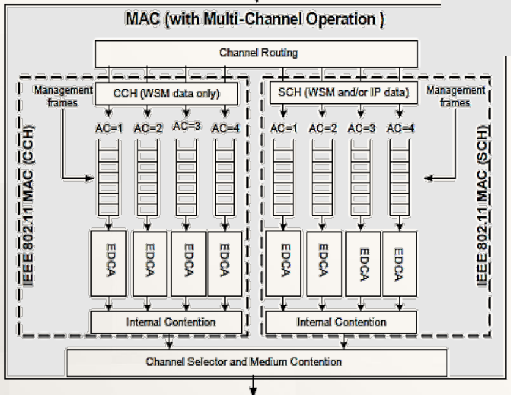

*Figure 57. Internal architecture of the transmit side of an 802.11p MAC with multichannel operation*

Figure 57 is the conceptual internal architecture of the transmit side of the MAC. Data coming down from above is split by channel routing into the MAC for the CCH and the MAC for the SCH. Only WSM data may be sent on the CCH, while WSM and IP data may be sent on the SCH. The MAC for each channel has queues and EDCA functions for the four access categories (ACs), like EDCA in Section 2.10, and management frames enter as well. Within a channel, internal contention lets the higher-priority queue go first, and finally the channel selector picks the side that matches the current channel interval and enters it into medium contention.

| ACI | AC | CWmin | CWmax | AIFSN | TXOP limit (DSSS, HR/DSSS) | TXOP limit (OFDM, ERP) | TXOP limit (other PHYs) |
|:-----|:-----|:-----|:-----|:-----|:-----|:-----|:-----|
| 01 | AC_BK | aCWmin | aCWmax | 7 | 0 | 0 | 0 |
| 00 | AC_BE | aCWmin | aCWmax | 3 | 0 | 0 | 0 |
| 10 | AC_VI | (aCWmin+1)/2 - 1 | aCWmin | 2 | 6.016 ms | 3.008 ms | 0 |
| 11 | AC_VO | (aCWmin+1)/4 - 1 | (aCWmin+1)/2 - 1 | 2 | 3.264 ms | 1.504 ms | 0 |

*Table 27. Default EDCA parameters of a station when dot11OCBActivated is false*

| ACI | AC | CWmin | CWmax | AIFSN | TXOP limit (OFDM) |
|:-----|:-----|:-----|:-----|:-----|:-----|
| 1 | AC_BK | aCWmin | aCWmax | 9 | 0 |
| 0 | AC_BE | aCWmin | aCWmax | 6 | 0 |
| 2 | AC_VI | (aCWmin+1)/2 - 1 | aCWmin | 3 | 0 |
| 3 | AC_VO | (aCWmin+1)/4 - 1 | (aCWmin+1)/2 - 1 | 2 | 0 |

*Table 28. Default EDCA parameters of a station when dot11OCBActivated is true (802.11p)*

The **ACI (access category index)** is a 2-bit number that identifies an access category. Table 27 lists the defaults of ordinary 802.11, and Table 28 the defaults for OCB communication. In OCB, the TXOP limit of every access category is 0, so only one MPDU can be sent each time the channel is obtained. This is because vehicular messages are mostly short broadcast messages, and if one station held the channel for long, other vehicles' safety messages would be delayed.

> **Note:** Some materials give the CWmin of AC_BE in Table 28 as (aCWmin+1)/2 - 1, but the OCB default in IEEE 802.11 is aCWmin [4].

In the OFDM physical layer $aCWmin = 15$ and $aCWmax = 1023$, and in a 10 MHz channel $aSlotTime = 13$ µs and SIFS = 32 µs [4]. Substituting these values into Table 28 gives the following.

| AC | Contention window range | AIFSN | AIFS (10 MHz channel) |
|:-----|:-----|:-----|:-----|
| AC_BK | 15-1023 | 9 | $9 \times 13 + 32 = 149$ µs |
| AC_BE | 15-1023 | 6 | $6 \times 13 + 32 = 110$ µs |
| AC_VI | 7-15 | 3 | $3 \times 13 + 32 = 71$ µs |
| AC_VO | 3-7 | 2 | $2 \times 13 + 32 = 58$ µs |

*Table 29. Actual values of the default OCB EDCA parameters in a 10 MHz channel*

The CWmin of AC_VI is $(15 + 1)/2 - 1 = 7$, and the CWmin of AC_VO is $(15 + 1)/4 - 1 = 3$ with a CWmax of $(15 + 1)/2 - 1 = 7$. AC_VO waits the shortest time (58 µs) and draws its backoff from the smallest range (0-3 slots at first, at most 0-7 slots after retries), so when competing at the same moment it almost always seizes the channel before AC_BK. Because the AIFSN values of OCB are spread further apart than those of ordinary 802.11, the high priority that carries safety messages stays ahead more reliably.

### 3.6 IEEE 1609.4 Multichannel Operation

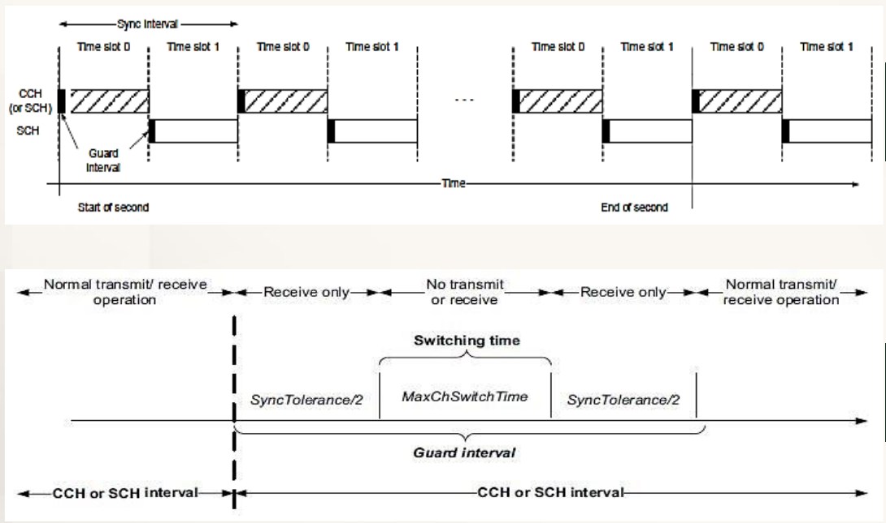

*Figure 58. The sync interval, guard intervals, and time slots 0 and 1*

If a device has only one radio transceiver, it can use only one channel at a time. IEEE 1609.4 divides time so that one transceiver can alternate between the control channel and the service channels [15].

- **Sync interval:** Time is divided into equal sync intervals aligned with the start of each second of Coordinated Universal Time (UTC). The default is 100 ms, so there are 10 sync intervals per second.
- **Time slots:** A sync interval is divided into the CCH interval (time slot 0) and the SCH interval (time slot 1), each 50 ms by default.
- **Guard interval:** At the start of each channel interval there is a guard interval (4 ms by default). As in the lower part of Figure 58, the guard interval consists of SyncTolerance/2, which allows for time errors between devices, MaxChSwitchTime, the maximum time to switch channels, and another SyncTolerance/2. During the SyncTolerance/2 parts at either end the device only receives, and while switching channels it neither transmits nor receives.

> **Key Point:** Because all devices gather on the CCH at the same moment, even a device exchanging data on a service channel can hear safety messages and WSAs on the CCH every 100 ms. For this to work, the clocks of all devices must agree precisely, so the time synchronization of Section 3.7 is needed.


*Figure 59. Examples of continuous, alternating, and immediate channel access*

The three channel access modes in Figure 59 are as follows.

1. **Continuous access:** The device stays on the CCH or one SCH regardless of the time slot. This suits devices with two transceivers or devices that handle only safety messages.
2. **Alternating access:** The device uses the CCH in time slot 0 and an SCH in time slot 1.
3. **Immediate access:** Even in the middle of the CCH interval, the device moves to the SCH at once without waiting for time slot 1 and stays on the SCH through time slot 1. It is used when large data must be exchanged quickly.


*Figure 60. The channel switching procedure for alternating access*

The alternating access procedure in Figure 60 is as follows.

1. The WME of IEEE 1609.3 requests channel access for the CCH interval from the MLME extension of 1609.4 with MLMEX-CHSTART.req and receives confirmation with MLMEX-CHSTART.cfm. It makes the same request for the SCH interval. The request carries the channel identifier (Channel Identifier), time slot (Time Slot), supported rate set (OperationalRateSet), EDCA parameter set, and whether immediate access is wanted (ImmediateAccess, a value of 0-255, where 0 means immediate access is not requested).
2. During the guard interval (GI) at the start of time slot 0, the MLME extension sends PLME-SET.req to the 802.11 PLME to change the channel starting frequency (dot11ChannelStartingFactor) if needed, set the current frequency (dot11CurrentFrequency) to the CCH, and set the channel width (dot11PhyOFDMChannelWidth) if needed. Each request is confirmed with PLME-SET.cfm.
3. During the guard interval at the start of time slot 1, the current frequency is changed to the SCH in the same way. Steps 2 and 3 then repeat every sync interval.

With immediate access, once the WME sends one MLMEX-CHSTART.req, the MLME extension immediately switches the frequency to the SCH with PLME-SET.req without waiting for time slot 1 and uses the SCH until time slot 1 ends.

### 3.7 Time Synchronization


*Figure 61. Time synchronization in 802.11 and 802.11p*

- **Time synchronization in 802.11:** All devices connected to an AP set their local timestamp to the timestamp the AP sends in its beacons. The reference is the AP's clock.
- **Time synchronization in 802.11p:** Since there is no BSS or AP, the device that provides time (provider) sends a **time value** and a **time error** together with the timestamp. The time value is the offset from UTC obtained from satellites (GPS), and the time error is the standard deviation of the error of that offset. A device that receives them (user) sets its own clock to UTC.

A device with a GPS receiver obtains UTC directly from GPS, but a device where there is no GPS signal, such as in a tunnel, sets its clock from the timing advertisements its neighbors send.


*Figure 62. The transmission procedure of timing advertisement (TA) frames and the Time Advertisement element*

The timing advertisement (TA) procedure in Figure 62 is as follows.

1. When the WME of the timing provider receives WME-TimingAdvertisementService.req, it sends MLMEX-TA.req to the MLME extension. The request carries the destination MAC address, the repeat rate (Repeat Rate), the channel identifier, the time slot, and the contents to advertise (TimingAdvertisementContents). On receiving the confirmation (.cfm), the WME informs the upper layer with WME-Notification.ind.
2. At every repeat interval, the MLME extension sends MLME-TIMING_ADVERTISEMENT.req to the 802.11 MLME, and the MLME broadcasts a TA frame. The request carries the peer MAC address, capability information, the Time Advertisement element, country, power constraint, extended capabilities, and vendor-specific information.
3. The MLME of the timing user receives the TA frame and passes up the timestamp, local time, received channel power indicator (RCPI), source MAC address, channel identifier, and advertised contents with MLME-TIMING_ADVERTISEMENT.ind, and the MLME extension delivers them to the WME with MLMEX-TA.ind.

| Field | Size (octets) | Content |
|:-----|:-----|:-----|
| Element ID | 1 | Type of the element |
| Length | 1 | Length of the element |
| Timing Capabilities | 1 | Kind of timing information and capabilities |
| Time Value | 0 or 10 | Offset from UTC (optional) |
| Time Error | 0 or 5 | Standard deviation of the offset error (optional) |
| Time Update Counter | 0 or 1 | Counter that changes each time the timing information is updated (optional) |

*Table 30. Structure of the Time Advertisement element*

### 3.8 WAVE Networking Services: WSA and WSM


*Figure 63. Providers broadcasting WSAs to announce services to users*

**WSA (WAVE service advertisement).**

- It enables fast initial link setup without authentication and association.
- The **provider** is the side that advertises a WAVE service, announcing the availability of services to users by broadcasting WSAs. Not only roadside units but also a vehicle warning of danger, as on the right of Figure 63, can be a provider.
- The **user** is the side that receives a WSA and acts on it.
- A WSA is a data structure carrying information that announces the availability of a service, and it is sent as an unsecured WSA or a signed (secured) WSA.

When the provider sends a WSA, the user registers the service it is interested in (service registration), moves to the service channel the WSA announced, and exchanges data with WSMs or IP datagrams.


*Figure 64. WSAs in the CCH interval and WSM exchange in the SCH interval*

**WSM (WAVE short message).** A short message sent with WSMP. It can be used for point-to-point communication, and the data rate, transmit power, and channel number can be set individually for each message. IP packets cannot set such physical layer values per message, so WSMs suit short, important messages. In Figure 64, the RSE broadcasts a WSA in the CCH interval, and the OBE moves to that service channel in the SCH interval to exchange WSMs. Both devices have stacks consisting of WME, WSMP and IPv6, LLC, WAVE MAC, and WAVE PHY.


*Figure 65. Periodic and event-driven broadcasting for safety applications*

Safety applications broadcast WSMs in two ways. **Periodic broadcasting** has every vehicle send its position, speed, and heading at a fixed period so that nearby vehicles are aware of each other (the BSM of Week 11), and **event-driven broadcasting** sends immediately when a hazard such as hard braking or an accident occurs. While the vehicle in the middle of Figure 65 detects a hazard and sends an event message, the other vehicles keep sending periodic messages.

### 3.9 WSM and WSMP Formats

| Field | Content |
|:-----|:-----|
| Subtype | Kind of network function: null-networking, ITS station-internal forwarding, N-hop forwarding, geo-forwarding, and so on |
| N-Extensions flag | Indicates whether network layer extension fields (N-Extensions) are present: transmit power, channel number, data rate, channel busy ratio, and so on |
| Version | Version of the localized message protocol |
| TPID Feature selector | Selection of transport layer features: information dissemination, general session mode, LPP mode, and so on |
| TPID T-Extension flag | Indicates whether transport layer extension fields (T-Extensions, element IDs) are present |
| Length of user data | Length of the user data (1-2 octets) |

*Table 31. Fields of the ISO localized message (LM) format*


*Figure 66. Comparison of the WSM formats of IEEE 1609.3-2010, IEEE 1609.3-2016, and ISO 16460*

Figure 66 shows how the WSM format changed. The WSMP header of IEEE 1609.3-2010 consists of the version (1 octet), PSID (up to 4 octets), extension fields (variable), WSMP WAVE element ID (1 octet), and length (2 octets), followed by the WSM data. IEEE 1609.3-2016 split the header into the network layer **WSMP-N-Header** and the transport layer **WSMP-T-Header**. ISO 16460 of the same year aligned ISO's FNTP and IEEE's WSMP into one localized message (LM) format so that the messages of both standards share the same structure.

```text
|<-------------------- WSMP-N-Header --------------------->|<----- WSMP-T-Header ------>|<- Body ->|
+---------+-----------+---------+-------------------+------+---------+---------+--------+----------+
| Subtype |   Option  |   WSMP  |  WAVE Information | TPID | Address | WAVE IE |  WSM   | WSM Data |
|         | Indicator | Version | Element Extension |      |   Info  |   Ext.  | Length |          |
+---------+-----------+---------+-------------------+------+---------+---------+--------+----------+
   4 bits     1 bit      3 bits        variable      1 oct   variable  variable variable  variable
```

*Figure 67. The WSM format of IEEE 1609.3-2016*

**WSMP-N-Header.** It consists of a 4-bit Subtype, a 1-bit WSMP-N-Header option indicator, a 3-bit WSMP version, and a 1-octet **TPID (transport protocol identifier)**. If the option indicator is 1, an optional WAVE Information Element Extension field is included, which can carry the transmit power used (Transmit Power Used), the channel number, the data rate, and the channel load (Channel Load).

| Subtype value | Meaning |
|:-----|:-----|
| 0 | Null-networking, mandatory |
| 1 | ITS station-internal forwarding |
| 2 | N-hop forwarding |
| 3 | GeoNetworking features |
| 4-15 | Reserved |

*Table 32. Subtype values of the WSMP-N-Header*

Null-networking means delivery over a single wireless hop only, without routing, and it is the basic operation of WAVE.

**WSMP-T-Header.** The content of the Address Info field of the T-Header and the presence of the optional WAVE Information Element Extension field are determined by the TPID value in the N-Header. The WSM Length field is mandatory and indicates the length of the WSM data to be passed up to higher layers. The WAVE information elements that may be included in the T-Header are not specified in IEEE 1609.3.

| TPID value | Address info | Remarks |
|:-----|:-----|:-----|
| 0 | Destination PSID, no source address | Mandatory, no information element extension |
| 1 | Destination PSID, no source address | Information element extension present |
| 2, 3 | Source and destination ITS port numbers | |
| 4, 5 | ITS port numbers in LPP mode | |
| 6-255 | Reserved | |

*Table 33. Address info of the WSMP-T-Header by TPID value*

TPID values come in pairs: the first value of each pair is the format without the information element extension and the second the format with it. So the T-Header of the most common TPID 0 carries only the PSID and WSM length, and TPID 1 carries the PSID, the information element extension, and the WSM length. PSIDs are covered in Section 3.12.

### 3.10 Encapsulation of WSAs and WSMs


*Figure 68. WSA encapsulation and building in IEEE 1609.3-2010*

Figure 68 shows how a WSA was built and passed down to the MAC in the 2010 edition.

1. The WME, on receiving a service request from the higher layer, builds the WSA from the WSA header, the Service Info Segment, the Channel Info Segment, and the WAVE Routing Advertisement.
2. The security services wrap it as an unsecured WSA (protocol version, Type = unsecured, WSA) or as a 1609.2 signed message (protocol version, Type = signed_wsa, security header, WSA, security trailer) to make a 1609Dot2Message.
3. The MLME extension attaches an organizationally unique identifier (OUI) and a Content Descriptor to make the Vendor Specific Content, and the MLME attaches a Category and the OUI and sends it to the MAC as a **vendor specific action frame**, that is, a management frame.


*Figure 69. WSA encapsulation and building in IEEE 1609.3-2016*

In the 2016 edition in Figure 69, the WSA is sent as a WSM rather than a management frame. The security services wrap the WSA built by the WME in an unsecured format (protocol version, unsecured selection, WSA) or as 1609.2 signed data (protocol version, signedData selection, other 1609.2 fields, WSA, other 1609.2 fields) to make an Ieee1609Dot2Data. WSMP attaches a WSMP header whose T-Header PSID is 0x87, meaning WSA, and the LLC sublayer attaches the Type field 0x88DC and passes the result to the MAC as the MAC data field (MSDU).


*Figure 70. Building a WSM in IEEE 1609.3-2016 and the primitives between layers*

Ordinary WSMs go down the same way (Figure 70). When the higher layer hands over data with WSM-WaveShortMessage.req, WSMP builds the WSM by attaching the N-Header (Subtype 0, option indicator, version, optional information element extension, TPID 0) and the T-Header (PSID, WSM length) and passes it to LLC with DL-UNITDATAX.req. LLC attaches Type = 0x88DC and passes it to the MAC with MA-UNITDATAX.req.

> **Definition:** The **EtherType** is a 2-octet value that tells which network layer protocol the data carried in a frame belongs to. The LLC of WAVE attaches 0x88DC to WSMP data and 0x86DD to IPv6 data, so the receiving LLC uses this value to pass the data up to WSMP or IPv6 [14].

### 3.11 WAVE Communication Procedures


*Figure 71. The procedure of WSA broadcasting and service use*

Figure 71 is the procedure by which a service provider and a user connect a service through a WSA.

- **Provider side:** When the higher layer requests a service with WME-ProviderService.req, the WME records the service information in the management information base (WME-MIB) (WME-Set.req) and returns a confirmation (.cfm). The WME starts channel access with MLMEX-CHSTART.req and passes the WSA to WSMP with WSM-WaveShortMessage.req. If the service uses IP, it registers the transmit parameters of IP packets with MLMEX-REGISTERTXPROFILE.req. Through WSMP, LLC, and MAC/PHY, the WSM containing the WSA is broadcast.
- **User side:** The higher layer registers the services it is interested in with WME-UserService.req in advance. When the WSM containing the WSA comes up to the WME through MA-UNITDATA.ind, DL-UNITDATA.ind, and WSM-WaveShortMessage.ind, the WME checks whether it matches a registered service, records the available service information (AvailableServiceInfo), and accesses that service channel with MLMEX-CHSTART.req. If the service uses IP, it also registers a transmit profile and informs the higher layer with WME-Notification.ind. The service is then provided.

The main parameters the provider passes when registering a service with WME-ProviderService.req are as follows.

- Values that identify the service: local service index (Local Service Index), action (Action, such as add or delete), provider service identifier (PSID), and provider service context (Provider Service Context)
- Where and how to send: destination MAC address, WSA type (secured or not), service channel identifier, identifier of the channel on which to send the WSA, channel access mode, and repeat rate (Repeat Rate)
- IP service information: whether the service is an IP service, IPv6 address, service port, and provider MAC address
- Acceptance conditions on the user side: RCPI threshold (WSAs weaker than this are ignored), WSA count threshold, and its counting interval
- Others: information elements indicator and signature lifetime (SignatureLifetime)


*Figure 72. WSA generation at the service provider and the structure of the Service Info Segment*

In Figure 72, the provider's WME records the service information (Provider Service Info) and the service status (Service Status) in the WME-MIB, decides which channel access to assign, and builds the WSA. The Service Info Segment of the WSA consists of the following fields.

| Field | Size | Content |
|:-----|:-----|:-----|
| Service Info Count | Variable | Number of service information entries that follow |
| PSID | Variable | Identifier of the offered service |
| Channel Index | 5 bits | Position of the channel information of the channel offering the service |
| Reserved | 2 bits | Reserved |
| Service Info Option Indicator | 1 bit | Indicates whether an information element extension is present |
| WAVE Information Element Extension | Variable | Provider service context (1-31 octets), IPv6 address (16), service port (2), provider MAC address (6), RCPI threshold (1), WSA count threshold (1), WSA count threshold interval (1) |

*Table 34. The Service Info Segment of a WSA*

Since service information repeats as many times as Service Info Count indicates, one WSA can advertise several services at once.

### 3.12 PSID

> **Definition:** The **PSID (provider service identifier)** is an identifier that indicates which application service a WSA or WSM belongs to. In ETSI and ISO standards the same value is called the **AID (ITS application identifier)**.

IEEE 1609.12 is the standard for the allocation of WAVE identifiers (active since September 21, 2012), and it contains normative requirements for the allocation of PSIDs used in ETSI, ISO, SAE, and IEEE standards [17]. PSIDs have variable length and are expressed with **p-encoding**, in which the leading bits of the first octet indicate the length.

| Leading bits of the first octet (b7 b6 b5 b4) | PSID length | Range of p-encoded values (hexadecimal) | Number of values |
|:-----|:-----|:-----|:-----|
| 0 x x x | 1 octet | 00-7F | $2^7 = 128$ |
| 1 0 x x | 2 octets | 80-00 to BF-FF | $2^{14} = 16{,}384$ |
| 1 1 0 x | 3 octets | C0-00-00 to DF-FF-FF | $2^{21} = 2{,}097{,}152$ |
| 1 1 1 0 | 4 octets | E0-00-00-00 to EF-FF-FF-FF | $2^{28} = 268{,}435{,}456$ |
| 1 1 1 1 | 5 octets or more | Reserved | |

*Table 35. The p-encoding format of PSIDs*

An x is a bit that may be either 0 or 1. The number of values is computed from the bits left after the length indication. For example, the 2-octet format uses the first 2 of its 16 bits (10) for the length indication, leaving 14 bits that represent $2^{14}$ values.

**Examples.** A receiver knows how many octets a PSID has just by looking at the leading bits of the first octet.

- PSID 03: The first octet is 0x03 = 00000011, and b7 is 0, so it is 1 octet.
- PSID 80-03: The first octet is 0x80 = 10000000 with leading bits 10, so it is 2 octets, and the second octet is 0x03.
- PSID C0-03-05: The first octet is 0xC0 = 11000000 with leading bits 110, so it is 3 octets, and the following octets are 0x03 and 0x05.

The octets are transmitted starting from the first octet. Short PSIDs are assigned to frequently used core services to keep messages short.

| PSID value | p-encoded value | Application area | Related standard or organization |
|:-----|:-----|:-----|:-----|
| 0x00 | 0x00 | System | ISO 15628 |
| 0x01 | 0x01 | Electronic fee collection | ISO 14906 |
| 0x02-0x13 | 0x02-0x13 | DSRC applications such as freight management, public transport, traffic information, and parking management | ISO 15628 and others |
| 0x14, 0x15 | 0x14, 0x15 | EFC compliance check communication applications, localisation augmentation communication applications | ISO TS 12813, ISO TS 13141 |
| 0x20 | 0x20 | Vehicle to vehicle safety and awareness | SAE J2735 |
| 0x21, 0x22 | 0x21, 0x22 | Limited sensor vehicle to vehicle safety and awareness, tracked vehicle safety and awareness | SAE J2735 |
| 0x23 | 0x23 | WAVE security management | IEEE 1609.2 |
| 0x24 | 0x24 | CA basic service (cooperative awareness) | ETSI EN 302 637-2 |
| 0x25 | 0x25 | DEN basic service (decentralized environmental notification) | ETSI EN 302 637-3 |
| 0x26 | 0x26 | Misbehavior reporting for common applications | CAMP |
| 0x27 | 0x27 | Vulnerable road user (VRU) safety application | SAE DSRC TC |
| 0x7F | 0x7F | Testing | IEEE P1609 WG |
| 0x80-0x85 | 0x80-00 to 0x80-05 | Differential GPS corrections (uncompressed, compressed), intersection safety and awareness, traveler information and roadside signage, mobile probe exchanges, emergency and erratic vehicles present in the roadway | SAE J2735 |
| 0x86 | 0x80-06 | Remote ITS station management protocol (RMPE) | ISO 24102-2 |
| 0x87 | 0x80-07 | WAVE service advertisement (WSA) | IEEE 1609.3 |
| 0x88 | 0x80-08 | Peer-to-peer distribution of security management information | CAMP |
| 0x01-00 | 0x80-80 | Certificate revocation list (CRL) application | CAMP |
| 0x3E-80 to 0x40-1F | 0xBE-00 to 0xBF-9F | Reserved (416 values) | IEEE P1609 WG |
| 0x40-20 to 0x40-5F | 0xBF-A0 to 0xBF-DF | Private use (64 values) | IEEE P1609 WG |
| 0x40-60 to 0x40-7F | 0xBF-E0 to 0xBF-FF | Testing (32 values) | IEEE P1609 WG |
| 0x40-80, 0x40-81 | 0xC0-00-00, 0xC0-00-01 | Cooperative Awareness Message (CAM) processor, Decentralized Environmental Notification Message (DENM) processor (both deprecated) | ETSI |
| 0x20-40-81 | 0xE0-00-00-01 | ITS station internal management communications protocol (IICP) | ISO 24102-4 |
| 0x10-20-40-7E | 0xEF-FF-FF-FE | IPv6 routing | IEEE 1609.3 |

*Table 36. Major PSID allocations in IEEE 1609.12*

For PSIDs of 2 octets or more, the PSID value and the p-encoded value differ. Since the first value of the 2-octet format, 0x80-00, corresponds to PSID 0x80, the PSID value is the p-encoded value minus 0x8000 plus 0x80. For example, the WSA PSID 0x87 is p-encoded as 0x80-07, which is the value WSMP puts in the T-Header in Section 3.10.

### 3.13 The WAVE Electronic Payment Service

So that electronic toll collection such as DSRC's Hi-Pass can also be done over WAVE, IEEE 1609.11 defines the **WAVE EPS (electronic payment service)** [16].


*Figure 73. The WAVE EPS architecture of the RSU and OBU*

In Figure 73, the RSU side, which receives the toll, is the **payee**, and the OBU side, which pays it, is the **payer**. Both consist of an application (payee or payer application), a payment service, and a WAVE stack, and the application is divided into an application core and the **WIAL (WAVE interface application layer)**. What passes directly between the payee and payer application cores is out of the scope of the standard; the interface between the application core and the WIAL follows ISO 14906, the application interface standard for DSRC toll collection [20], and the interface between the WIALs of the payee and payer follows ISO 15628, the DSRC application layer standard [9]. In other words, WAVE EPS keeps the toll collection application of the DSRC era as it is and replaces only the communication beneath it with WAVE.


*Figure 74. The initialization procedure in which the RSU sends the BST in a WSA*


*Figure 75. The initialization procedure in which the OBU replies with the VST in a WSM*

**Initialization: exchange of BST and VST.** Like Hi-Pass in Section 2.6, WAVE EPS starts communication by exchanging a BST and a VST.

1. In Figure 74, the payee application core of the RSU registers the application with RegisterApplicationRSU.req. The request carries the application identifier (AID), whether the application is mandatory, its priority, and an optional equipment ID (EID), profiles, and parameters.
2. The I-KE of the WIAL creates the **BST (beacon service table)** with Initialization.req and passes it to the T-KE. The BST consists of a beacon ID, the time, the profile, a profile list, a mandatory application list (AID, optional EID and parameters), and a non-mandatory application list.
3. The T-KE registers the BST in the provider service context (ProviderServiceContext) of a WSA with WME-ProviderService.req, and the WAVE stack repeatedly broadcasts the WSA containing the BST.
4. In Figure 75, when the WAVE stack of the OBU receives the WSA, it informs the T-KE with WME-Notification, and the T-KE passes it to the I-KE with Initialization.ind (BST). The I-KE notifies the payer application with NotifyApplicationOBU.req and creates the **VST (vehicle service table)** with Initialization.res. The VST consists of the profile, an application list (AID, optional EID and parameters), and the OBE configuration (equipment class, manufacturer ID, OBE status).
5. The T-KE sends the VST to the RSU in a WSM with WSM-WaveShortMessage.req.


*Figure 76. The payment procedure of WAVE EPS*

The payment procedure in Figure 76 has three phases.

1. **Initialization phase:** The RSE sends a WSA containing the BST, and the OBE replies with a WSM containing the VST.
2. **Toll collection phase:** When the RSE requests billing information by WSM, the OBE's ETC application obtains payment data from its payment service (GetPaymentData) and replies by WSM. The RSE's ETC application processes the payment through its payment service (MakePayment) and requests an update of the billing information by WSM. The OBE stores the receipt in its payment service (SaveReceipts).
3. **Follow-up phase:** The RSE ends the transaction by sending a WSM containing Event-Report-Release.

The flow of the procedure is the same as Hi-Pass in Section 2.6 (BST/VST exchange, reading card information, debiting, storing the receipt, release); only the means of carrying the messages has changed from DSRC slots to WAVE WSAs and WSMs.

---

<br>

## 4. Appendix: UTAC of France

Before autonomous vehicles and V2X communication devices go onto real roads, they must be tested by repeating the same scenarios on controlled proving grounds, and before they are sold they must be certified as meeting the regulations. UTAC of France is a leading automotive organization that carries out such testing and certification. It is introduced as one of the national automotive research organizations, together with the Korea Automotive Technology Institute in Week 2, the Japan Automobile Research Institute (JARI) in Week 4, and HORIBA MIRA of the United Kingdom in Week 6.

### 4.1 Overview of UTAC


*Figure 77. The founding background and key figures of UTAC*

UTAC was founded in 1945 based on the proving ground in the Linas-Montlhéry area near Paris, France, and carries out a variety of work including testing, certification, technical support, training, and seminars. According to the figures in Figure 77, UTAC has 8 test facilities and more than 30 specialized laboratories worldwide, 1,280 employees in 10 countries (including more than 500 technical experts), and a turnover of 173 million euros.

### 4.2 Current Status and Locations of UTAC

- More than 550 experts worldwide carry out the work, operating two proving grounds near Paris and eight overseas branches.
- It earns revenue and supports companies through services such as type approval of complete vehicles and testing of components and complete vehicles.
- In 2019 it established the autonomous vehicle research center TEQMO and provides research and development, testing, expert consulting, and type approval services for the related technologies.
- It pursues a variety of research and development on 5G-ITS and autonomous driving technologies on a dedicated 12 km test track near Paris.

> **Definition:** **Type approval** is a system in which an accredited body tests and approves that a vehicle or component meets regulatory requirements such as safety and environmental standards before it is sold. **Euro NCAP (European New Car Assessment Programme)** is Europe's new car safety rating program, which evaluates the crash safety and safety assistance functions of new cars and publishes them as star ratings, and **ISO/IEC 17025** is the international standard for the competence of testing and calibration laboratories.


*Figure 78. Track layout of the proving ground built by SIMCA in 1956*

The proving ground in Figure 78 was built by the car maker SIMCA in 1956; it has 11 test tracks and 6 associated testing laboratories (environment, safety, endurance) and holds international accreditations such as Euro NCAP and ISO 17025. The tracks consist of a high-speed oval track, a road track, a dynamic platform, a comfort track, an urban track, off-road tracks, and special tracks (cobbled track, undulation track, gravel track, salt-water ford crossing, acoustic tunnel).


*Figure 79. Locations of UTAC's two proving grounds near Paris*

As in Figure 79, UTAC's headquarters is at the Linas-Montlhéry motor racing circuit (Autodrome de Linas-Montlhéry) south of Paris, and its northern proving ground is at the Mortefontaine test center (Centre d'essais de Mortefontaine) north of Paris. From the business district west of Paris (La Défense), each proving ground is about 51 km away (about 60 minutes), and the two proving grounds are about 74 km apart (about 120 minutes). The photo on the right is a high-speed oval track of the proving ground.


*Figure 80. UTAC's overseas sites*

The sites in Figure 80 are the Mortefontaine and Linas-Montlhéry test centers in France, the Leyland test facility and Millbrook proving ground in the United Kingdom, the Michigan and California test centers in the United States, two winter proving grounds in Finland, and a summer proving ground in Morocco. Having proving grounds in cold and hot places allows the same vehicle to be tested in extreme climates.

### 4.3 UTAC's Services


*Figure 81. UTAC's test facilities by domain*

| Domain | Test facilities |
|:-----|:-----|
| Conventional powertrain | Engine test cells, chassis dynamometers for light and heavy vehicles, portable emissions measurement (PEMS) laboratories |
| Future powertrain | 2E, 3E, and 4E powertrain rigs, 12 battery pack test chambers, laboratories for electric machines and electric drive units (EDU) |
| Safety | Euro NCAP and passive safety laboratories, ADAS and active safety laboratories, indoor and outdoor winter tyre testing |
| Comfort and quality | EMC chambers, NVH chambers, NVH brake dynamometer |
| Reliability and durability | Powertrain test systems, heavy-duty structures laboratory, shock and vibration rigs |
| Connected mobility | Simulation, 5G CAV village, TEQMO test center (5G) |

*Table 37. UTAC's test facilities by domain*

> **Definition:** **EMC (electromagnetic compatibility)** is the property of an electronic device that it neither causes electromagnetic disturbance to its surroundings nor malfunctions because of electromagnetic waves around it. **NVH (noise, vibration, harshness)** is a collective term for a vehicle's noise, vibration, and unpleasant shocks. A **CAV (connected and automated vehicle)** is a connected autonomous vehicle, and **ADAS (advanced driver assistance systems)** are systems that assist the driver.

| Service | Description |
|:-----|:-----|
| Regulations | Takes part in the development of worldwide regulations at the UN Economic Commission for Europe (UN-ECE, Geneva) and in Brussels, and monitors and supports European vehicle type approval and watches regulatory changes. |
| Type approval | Supports type approval around the world on the basis of international recognitions and accreditations, and manages approval processes. |
| Certification | As an international certification body, it issues more than 1,000 certificates a year and has 130 auditors in 7 offices. |
| Market surveillance | As an accredited official test organization, it provides technical expertise in environmental and vehicle and equipment safety regulations and carries out coordination and monitoring. |
| Qualifications | As the official qualification body for coachbuilders and for alcohol ignition interlock devices (IID) and their fitters, it maintains official lists of qualified professionals and supports qualification processes. |
| Vehicle inspection | As the official vehicle technical inspection body of France since 1991, it manages inspection data and provides inspection and technical assistance for inspection facilities. |
| Standardisation | Sets standards through an annual standardization program, identifies standardization needs, and coordinates standardization committees at CEN and ISO. |
| Special vehicles | Converts vehicles to add capabilities such as discreet protection, systems integration, and reduced emissions, and builds protected vehicles with ballistic and blast protection. |
| Audit | Helps companies assess their performance or prepare for certification, and has auditors for automotive producers, manufacturers, and suppliers. |
| Training | Provides training in road risk management, eco-driving, and commuting safety and special qualification training for government agencies, and its courses hold the French training quality certification (Qualiopi). |
| Events | Runs business (BtoB) events such as press and product presentations, training, cinema, TV, and fashion shootings, and workshops with a dedicated team and infrastructure, holds more than 14 public (BtoC) events a year at Linas-Montlhéry, drawing on its heritage, and offers partnerships such as sponsorship and VIP access. |

*Table 38. UTAC's service areas*

### 4.4 Proving Grounds and TEQMO


*Figure 82. UTAC's five proving grounds*

| Proving ground | Country | Track size | Main facilities |
|:-----|:-----|:-----|:-----|
| Linas-Montlhéry | France | Over 23 km | High-speed oval, dynamic platforms, acoustic track; TEQMO test center (12 km of high-tech tracks, 5G CAV specialisms, ADAS expertise) |
| Millbrook | United Kingdom | 70 km | High-speed oval, alpine handling course, 4×4 off-road, mile straight, special surfaces; 5G CAV test bed |
| Mellatracks, Airport PG | Finland | 100 km outdoors | Handling on snow and ice, split-friction tracks and slopes; 6 indoor circuits (4 snow and ice, 2 wet and dry asphalt) |
| Mortefontaine | France | Over 19 km | High-speed oval, urban and off-road, special surfaces, dynamic platforms, acoustic tunnel |
| Oued Zem | Morocco | Hot climate testing | High-speed track, 4 km coast-down straight, low-grip wet braking, dynamic platforms, special surfaces (scheduled to open in Q4 2021) |

*Table 39. UTAC's proving grounds*


*Figure 83. Zones and partners of the TEQMO proving ground*

**TEQMO** is the Technology Center for Automated and Connected Vehicles operated by UTAC CERAM. It has 4G, 5G, ITS-G5, and Wi-Fi communication infrastructure on 12 km of tracks and can carry out official tests. Since ITS-G5 is a European standard based on IEEE 802.11p, like WAVE in Section 3 (Week 1), both WAVE-family communication and the C-V2X of Week 14 can be tested at TEQMO.

| Zone | Description |
|:-----|:-----|
| 1. Highway circuit | 2.2 km long, 3 lanes, multilingual signage, tunnel and toll booth |
| 2. Road circuit | 6.5 km long, road signage, hilly course, road edges |
| 3. City area | Mock buildings and crosswalks, traffic lights and signage, roundabouts and a level crossing, automated parking area |
| 4. Parking zones | Angled, parallel, and perpendicular parking, lot striping and barriers, blocks, flank guard zone, moving obstacles |
| 5. ADAS dynamic area | 38,800 m² dynamic platform, LED and sodium lighting, Euro NCAP 2020 crossing scenarios, Euro NCAP test targets |
| 6. Braking area | Euro NCAP autonomous emergency braking (AEB) area, 2 circular plates, friction coefficient 0.2-0.9, watering system |

*Table 40. Zones of the TEQMO proving ground*

The partners are the road construction company COLAS, the telecom operators Orange and Bouygues, the telecom equipment maker Ericsson, and the map company HERE. A partnership covering roads, communication networks, and maps shows that connected autonomous driving needs road infrastructure, communication, and high-definition maps together.


*Figure 84. Track layout of the Millbrook proving ground in the United Kingdom*

In February 2021 (announced December 2020) [21], UTAC completed the acquisition of Millbrook in the United Kingdom, one of the largest vehicle test laboratories in Europe, laying a foundation for offering diverse services in more countries, and in 2019 it completed a test facility for electric vehicles, broadening its testing and certification base for future vehicles. The Millbrook proving ground in Figure 84 is a facility specially built for testing passenger cars and heavy vehicles. Its road tracks simulate demanding European roads, a high-speed circuit, and many special surfaces and include the famous Millbrook Hill Route, and its off-road tracks have many obstacles that test the capabilities of civilian and military vehicles.

### 4.5 Test Facilities


*Figure 85. Corrosion, sealing, climatic, and dust test facilities*

The laboratories in Figure 85 test vehicles for corrosion, sealing (whether water leaks in), climatics at -30 °C to +60 °C, and dust.


*Figure 86. Special surfaces and facilities of the proving ground*

| Facility | Specifications and features |
|:-----|:-----|
| Salted water ford | 200 m long, 10 cm deep |
| Freshwater ford | 25 m long, variable depth (up to 40 cm) |
| Acoustic reverberation tunnel | 100 m long |
| Dust tunnel | 100 m long |
| Cobbled track | 800 m long, a slight pothole every 2 m |
| Wavy track | 80 m long |
| Gravel path | 130 m long |
| Obstacles | Pavements, speed bumps and humps |
| Slopes | Calibrated ramps of 10, 15, 18, and 25% |

*Table 41. Specifications of the special surfaces and facilities of the proving ground*

Such surfaces are used to test the durability and reliability of vehicles and components by reproducing in a short period the vibration, shocks, corrosion, and flooding they would experience on real roads over a long time.

---

<br>

## Concept Applications

| Situation | Concept to apply |
|:-----|:-----|
| The antenna of a roadside unit is moved from a height of 5 m to 10 m. The vehicles are far enough away for the two-ray model to hold. | In the two-ray model the received power is proportional to $h_1^2$, so it improves by $20 \log 2 \approx 6$ dB (Section 1.5). |
| As a vehicle moves away from a roadside unit, the received SINR keeps falling. | Link adaptation steps down from 64-QAM 3/4 through 16-QAM and QPSK to BPSK 1/2 to reduce errors (Section 1.11). |
| Two vehicles on opposite sides of an intersection are hidden from each other by buildings, but the roadside unit in the middle hears both. | This is the hidden terminal problem. For unicast, the channel is reserved with RTS/CTS, and the NAV makes the other side defer (Section 1.11). |
| A vehicle passes a highway toll plaza without stopping and pays the toll. | This is Hi-Pass over 5.8 GHz DSRC. It initializes with the BST and VST and completes authentication and debiting in TDMA slots (Sections 2.5 and 2.6). |
| A hard-braking warning and video streaming data are waiting to be sent from the same OBU at the same time. | In EDCA, putting the hard-braking warning in AC_VO, with an AIFS of 58 µs and a CW of 3-7, lets it seize the channel before AC_BK (149 µs, 15-1023) (Section 3.5). |
| An OBU with only one transceiver must receive services from a roadside unit without missing safety messages. | With the alternating access of IEEE 1609.4, it exchanges safety messages and WSAs in the CCH interval and service data in the SCH interval (Section 3.6). |
| Inside a tunnel, the GPS signal is lost and the OBU's clock begins to drift. | It realigns to UTC with the time value and time error in TA frames sent by neighboring devices (Section 3.7). |
| A vehicle traveling at 100 km/h passes through the coverage of a roadside unit in little more than a second. | It starts the service immediately with OCB communication and WSAs, without authentication and association (Sections 3.3 and 3.8). |

*Table 42. Concepts to apply by situation*

**True/False Check:**

| Statement | Judgment and Reason |
|:-----|:-----|
| 5.8 GHz DSRC implements all seven OSI layers. | **F.** It defines only the application layer (7), the data link layer (2), and the physical layer (1). |
| In the two-ray model, doubling the distance reduces the received power by 6 dB. | **F.** It follows a fourth-power law, so the reduction is 12 dB. 6 dB is the free-space case. |
| 64-QAM carries 6 bits per symbol. | **T.** $\log_2 64 = 6$. |
| Wireless LANs detect collisions with CSMA/CD. | **F.** Since collisions are hard to detect while transmitting, they avoid collisions with CSMA/CA. |
| An 802.11p station in OCB communication must associate with an AP before sending data. | **F.** It communicates immediately outside a BSS without authentication and association. |
| If the WAVE TXOP limit is 0, only one MPDU can be sent each time the channel is obtained. | **T.** |
| An IPv6 router recalculates the header checksum every time it forwards a datagram. | **F.** The IPv6 header has no checksum. |
| The WSA PSID 0x87 is placed in the WSMP header as the single octet 0x87. | **F.** PSIDs of 0x80 and above are p-encoded in 2 octets, so it is placed as 0x80-07. |

---

<br>

## Summary

| Concept | Key Summary |
|:-----|:-----|
| OSI reference model | A seven-layer model defined by ISO so that heterogeneous systems can communicate; the differences between wireless technologies arise mainly in the lower three (media) layers. |
| Layered architectures of wireless technologies | IEEE 802.11 is IP-based, DSRC has only layers 1, 2, and 7, and WAVE uses IP and WSMP together; ETSI, ISO, and 3GPP also place lightweight dedicated paths next to IP. |
| Path loss | The received power is inversely proportional to the square of the distance in free space and to the fourth power in the two-ray model, with shadowing, multipath fading, and interference added on top. |
| Digital modulation | BPSK, QPSK, 8-QAM, 16-QAM, and 64-QAM carry 1, 2, 3, 4, and 6 bits per symbol; more points mean higher speed but more vulnerability to noise. |
| Code rate | When $k$ information bits become an $n$-bit codeword, $R = k/n$; the smaller it is, the greater the error-correcting capability and the less the information. |
| OFDM | Sends high-speed data in parallel over many orthogonal subcarriers, which are separable even though their spectra overlap and are robust to multipath thanks to long symbols and the CP. |
| Medium access control | There are deterministic methods (polling, token, beaconing) and random methods (ALOHA, CSMA), and wireless LANs avoid collisions with CSMA/CA. |
| RTS/CTS and NAV | Short RTS and CTS frames reserve the channel, and stations that hear them set their NAV from the Duration value, reducing the hidden terminal problem. |
| Error detection and correction | Errors are detected with parity and CRC and fixed by the receiver with FEC or resent with ARQ; broadcast messages rely on FEC and repetition. |
| Forwarding and routing | Forwarding is choosing the output port inside a router with the forwarding table, and routing is determining end-to-end paths across the whole network. |
| Virtual circuits and datagrams | A virtual circuit is a connection-oriented service that sets up the path first, and a datagram service is connectionless, delivering each packet independently. |
| IPv4 and IPv6 | IPv4 uses 32-bit and IPv6 128-bit addresses; IPv6 removes the checksum and router fragmentation and uses extension headers and flow labels. |
| DSRC | Short-range communication between the roadside and vehicles at 5.8 GHz that uses ASK and TDMA slots (FCMS, MDS, ACTS), used for toll collection such as Hi-Pass. |
| Wireless LAN components | Consists of STAs, APs, BSSs, the DS, and ESSs; the MAC places PCF, HCF (EDCA, HCCA), and MCF on top of DCF. |
| DCF | A station sends if the medium has been idle for a DIFS; if it is busy, it defers and then performs a random backoff in $[0, CW]$, and CW almost doubles after each failure. |
| EDCA | Gives the four access categories (BK, BE, VI, VO) different AIFS and CW values so that higher-priority traffic seizes the channel first. |
| OFDM physical layer | Builds frames from the preamble, SIGNAL, and DATA, delivering 6-54 Mbps at 20 MHz and 3-27 Mbps at 10 MHz. |
| WAVE | Vehicular communication made of IEEE 802.11p and IEEE 1609.x, characterized by OCB, multiple channels, WSA, WSMP, and IPv6. |
| Multichannel operation | Divides the 100 ms sync interval into a CCH interval and an SCH interval so that one transceiver alternates between the two kinds of channel; it requires time synchronization. |
| WSA and WSM | A WSA is an advertisement announcing that a service is available, and a WSM is a short message whose rate, power, and channel can be set per message. |
| PSID | A variable-length identifier that distinguishes services, using p-encoding in which the leading bits of the first octet indicate the length. |
| WAVE EPS | Keeps the DSRC toll collection application (ISO 14906, ISO 15628) and carries the BST in a WSA and the VST and payment messages in WSMs. |
| UTAC | A French automotive testing and certification organization founded in 1945 that performs type approval, testing, and certification and tests connected autonomous driving at TEQMO. |

---

<br>

## Self-Check Questions

1. **Layered architecture:** Explain why 5.8 GHz DSRC has no OSI layers 3-6 and why WAVE has WSMP separately in addition to IP.

   <details>
   <summary>Answer</summary>

   In DSRC the roadside unit and the vehicle are connected directly over a single wireless hop, so no network layer is needed to determine a path. Also, the transaction must be completed in the short time a vehicle passes through the coverage area, so fewer layers reduce processing time and overhead. WAVE supports IPv6 for Internet services, but short, urgent messages such as safety messages must be sent quickly without IP headers and address configuration, so it has the lightweight WSMP separately. WSMP can also set the data rate, transmit power, and channel per message.

   </details>

2. **Two-ray model:** With a transmit antenna height of 8 m, a receive antenna height of 1.5 m, antenna gains of 1, and a distance of 3 km, find $P_R/P_T$ of the two-ray model in dB, and state how much it decreases when the distance becomes 6 km. The frequency is 5.9 GHz.

   <details>
   <summary>Answer</summary>

   First check the critical distance. $d_c \approx 4 h_1 h_2 / \lambda = 4 \times 8 \times 1.5 / 0.0508 \approx 945$ m, so the two-ray approximation holds at 3 km. $h_1 h_2 / d^2 = 12 / (9 \times 10^6) \approx 1.33 \times 10^{-6}$, and $P_R/P_T = (1.33 \times 10^{-6})^2$, so $20 \log_{10}(1.33 \times 10^{-6}) \approx -117.5$ dB. When the distance doubles, it drops by $40 \log_{10} 2 \approx 12$ dB to about $-129.5$ dB.

   </details>

3. **Modulation and data rate:** In a system with a symbol rate of one million symbols per second, find the bit rates of QPSK, 16-QAM, and 64-QAM, and explain why 64-QAM is not always used.

   <details>
   <summary>Answer</summary>

   The number of bits per symbol is $\log_2 M$, so QPSK carries 2 bits, 16-QAM 4 bits, and 64-QAM 6 bits. The bit rates are 2 Mbps, 4 Mbps, and 6 Mbps. In 64-QAM the constellation points are close together, so it is vulnerable to noise and interference, and errors increase when the signal is weak or the channel is poor. That is why link adaptation changes the modulation according to the channel state.

   </details>

4. **OFDM rate calculation:** Calculate step by step the data rate of 16-QAM with code rate 1/2 in a 10 MHz channel.

   <details>
   <summary>Answer</summary>

   The subcarrier spacing is $10 \text{ MHz} / 64 = 156.25$ kHz and the symbol duration is 8 µs, so $1 / (8 \times 10^{-6}) = 125{,}000$ symbols are sent per second. The coded bits per symbol are 48 data subcarriers $\times$ 4 bits $= 192$ bits, and multiplying by the code rate 1/2 gives 96 data bits. Therefore the rate is $125{,}000 \times 96 = 12{,}000{,}000$ bps $= 12$ Mbps.

   </details>

5. **Hidden terminals and broadcasting:** Explain how RTS/CTS solves the hidden terminal problem, and state why RTS/CTS is not used for safety messages broadcast to many vehicles.

   <details>
   <summary>Answer</summary>

   The sender transmits an RTS and the receiver answers with a CTS. Stations near the sender hear the RTS, and hidden stations near the receiver that cannot hear the sender hear the CTS; they set their NAV from the Duration value of the frame and defer transmission for that time. This prevents collisions at the receiver. A broadcast message has many receiving vehicles, so it cannot be decided who should send the CTS, and if all of them sent CTS frames, the CTS frames would collide. Adding an RTS/CTS exchange to a short message would also increase delay and overhead, so it is not used.

   </details>

6. **Backoff:** A station with $aCWmin = 15$, $aCWmax = 1023$, and $aSlotTime = 13$ µs failed three transmissions in a row. Find the CW and the maximum backoff time for the fourth attempt.

   <details>
   <summary>Answer</summary>

   CW grows as $2(CW + 1) - 1$ after each failure. Starting from 15, it becomes 31, 63, and 127, so the CW for the fourth attempt is 127. The backoff value is one of 0-127, so the maximum backoff time is $127 \times 13 = 1{,}651$ µs.

   </details>

7. **EDCA:** With the OCB defaults in a 10 MHz channel, calculate the AIFS of AC_VO and AC_BE, and give two reasons why AC_VO has the advantage when the two categories compete at the same time.

   <details>
   <summary>Answer</summary>

   Since $AIFS = AIFSN \times aSlotTime + SIFS$, AC_VO has $2 \times 13 + 32 = 58$ µs and AC_BE has $6 \times 13 + 32 = 110$ µs. First, AC_VO waits a shorter time after the medium becomes idle before starting its backoff. Second, the CW of AC_VO is 3-7, much smaller than the 15-1023 of AC_BE, so it draws smaller backoff values. Statistically, AC_VO therefore seizes the channel first.

   </details>

8. **DSRC slots:** Confirm from the field sizes that the RF-DSRC MDS slot is 100 octets, and explain what happens when two OBUs choose the same ACTC in an ACTS slot.

   <details>
   <summary>Answer</summary>

   The MDC is 73 octets (PR 2, CSW 2, MAC 2, MSDU 65, CRC 2), the ACKC is 7 octets (PR 2, CSW 2, AI 1, CRC 2), and the gaps t3 and t4 are 11 and 9 octets, so $73 + 11 + 7 + 9 = 100$ octets. In an ACTS, an OBU without a link requests a connection by choosing one of the six ACTCs at random; if two OBUs choose the same ACTC, the two requests collide and the roadside unit receives neither. The two OBUs try again in the next frame by choosing a random ACTC again and write the number of retries in the LRC.

   </details>

9. **Multichannel operation:** With the IEEE 1609.4 defaults, state how many CCH intervals and how many guard intervals occur in one second, and explain why guard intervals are needed.

   <details>
   <summary>Answer</summary>

   The sync interval is 100 ms, so there are 10 sync intervals per second, each with one CCH interval and one SCH interval; there are therefore 10 CCH intervals and, since there is a guard interval at the start of every channel interval, 20 guard intervals. A guard interval absorbs the small differences in time between devices (SyncTolerance) and the time it takes a transceiver to change frequency (MaxChSwitchTime). Since no one transmits during this time, it prevents devices that have not yet switched channels from missing frames on the other channel or receiving mixed frames.

   </details>

10. **PSID:** If the first octet of the PSID field in a WSMP header is 0xA3, find the length of the PSID, and give the p-encoded value of the WSA PSID 0x87.

    <details>
    <summary>Answer</summary>

    0xA3 is 10100011 in binary, and its leading bits are 10, so the PSID is 2 octets. PSIDs of 0x80 and above are encoded in the 2-octet format, with PSID 0x80 corresponding to 0x80-00, so 0x87 becomes $0x8000 + (0x87 - 0x80) = 0x8007$, that is, 0x80-07.

    </details>

11. **WSA encapsulation:** Explain the difference between IEEE 1609.3-2010 and 2016 in how a WSA is sent to the MAC.

    <details>
    <summary>Answer</summary>

    In the 2010 edition, the WSA is wrapped by 1609.2, and then the MLME extension and MLME attach the OUI, content descriptor, and category so that it is sent as a vendor specific action frame, that is, a management frame. In the 2016 edition, the WSA is wrapped as 1609.2 data (Ieee1609Dot2Data), WSMP attaches a WSMP header with PSID 0x87 to make a WSM, and LLC attaches the EtherType 0x88DC so that it is sent as the MSDU of a data frame. In other words, the WSA changed from a management frame to an ordinary WSM.

    </details>

12. **IPv6 extension headers:** An IPv6 header is followed by a hop-by-hop options header and then TCP. Give the Next Header values of the two headers and explain the rule for the position of the hop-by-hop options header.

    <details>
    <summary>Answer</summary>

    The Next Header of the IPv6 header is 0, pointing to the hop-by-hop options header, and the Next Header of the hop-by-hop options header is 6, pointing to TCP. Because every router on the path must process the hop-by-hop options header, it must come directly after the IPv6 header.

    </details>

13. **Forwarding:** Packets with header values 0101 and 1001 arrive at a router with the forwarding table of Figure 19. Give the output link of each packet and explain who builds this table.

    <details>
    <summary>Answer</summary>

    0101 goes out on output link 2 and 1001 on output link 1. The forwarding table is built by the routing algorithm, which computes least-cost paths across the whole network, and the router only looks up the table and chooses the output link each time a packet arrives.

    </details>

14. **Hi-Pass and WAVE EPS:** Explain the similarities and differences between the payment procedures of Hi-Pass and WAVE EPS.

    <details>
    <summary>Answer</summary>

    Both procedures initialize by exchanging a BST and a VST and follow the same flow of reading billing information, debiting, storing a receipt, and releasing the connection. WAVE EPS reuses this DSRC toll collection application (ISO 14906, ISO 15628) as it is. The difference is the means of carrying the messages. Hi-Pass sends them in the TDMA slots (FCMS, MDS, ACTS) of 5.8 GHz DSRC, while WAVE EPS sends them in the WSAs (BST) and WSMs (VST and payment messages) of 5.9 GHz WAVE.

    </details>

15. **Role of proving grounds:** Explain why UTAC's TEQMO is suitable for testing V2X communication, in terms of facilities and communication infrastructure.

    <details>
    <summary>Answer</summary>

    TEQMO can repeatedly reproduce real road situations such as tunnels, toll booths, traffic lights, and roundabouts on 12 km of tracks made up of highway, road, city, parking, ADAS, and braking zones. It also has 4G, 5G, ITS-G5, and Wi-Fi communication infrastructure and works with telecom operators, equipment makers, and a map company, so IEEE 802.11p-family communication and C-V2X can be tested and compared in the same scenarios.

    </details>

---

<br>

## References

1. ISO/IEC 7498-1:1994, *Information technology - Open Systems Interconnection - Basic Reference Model: The Basic Model*, International Organization for Standardization, 1994.
2. T. S. Rappaport, *Wireless Communications: Principles and Practice*, 2nd ed., Upper Saddle River, NJ, USA: Prentice Hall, 2002.
3. A. Goldsmith, *Wireless Communications*, Cambridge, UK: Cambridge University Press, 2005.
4. IEEE Std 802.11-2020, *IEEE Standard for Information Technology - Telecommunications and Information Exchange between Systems - Local and Metropolitan Area Networks - Specific Requirements - Part 11: Wireless LAN Medium Access Control (MAC) and Physical Layer (PHY) Specifications*, 2021.
5. J. F. Kurose and K. W. Ross, *Computer Networking: A Top-Down Approach*, 8th ed., Hoboken, NJ, USA: Pearson, 2021.
6. S. Deering and R. Hinden, "Internet Protocol, Version 6 (IPv6) Specification," RFC 8200, Jul. 2017.
7. S. Kent, "IP Encapsulating Security Payload (ESP)," RFC 4303, Dec. 2005.
8. EN 12253:2004, *Road transport and traffic telematics - Dedicated short-range communication - Physical layer using microwave at 5.8 GHz*, European Committee for Standardization, 2004.
9. ISO 15628:2013, *Intelligent transport systems - Dedicated short range communication (DSRC) - DSRC application layer*, International Organization for Standardization, 2013.
10. ARIB STD-T75, *Dedicated Short-Range Communication System*, Association of Radio Industries and Businesses, 2001.
11. S. Shankar N., D. Dash, H. El Madi, and G. Gopalakrishnan, "WiGig and IEEE 802.11ad - For multi-gigabyte-per-second WPAN and WLAN," arXiv:1211.7356, Nov. 2012. https://arxiv.org/abs/1211.7356
12. IEEE Std 802.11p-2010, *Amendment 6: Wireless Access in Vehicular Environments*, 2010.
13. IEEE Std 1609.2-2016, *IEEE Standard for Wireless Access in Vehicular Environments - Security Services for Applications and Management Messages*, 2016.
14. IEEE Std 1609.3-2016, *IEEE Standard for Wireless Access in Vehicular Environments (WAVE) - Networking Services*, 2016.
15. IEEE Std 1609.4-2016, *IEEE Standard for Wireless Access in Vehicular Environments (WAVE) - Multi-Channel Operation*, 2016.
16. IEEE Std 1609.11-2010, *IEEE Standard for Wireless Access in Vehicular Environments (WAVE) - Over-the-Air Electronic Payment Data Exchange Protocol for Intelligent Transportation Systems (ITS)*, 2010.
17. IEEE Std 1609.12-2016, *IEEE Standard for Wireless Access in Vehicular Environments (WAVE) - Identifier Allocations*, 2016.
18. Federal Communications Commission, *Amendment of the Commission's Rules Regarding Dedicated Short-Range Communication Services in the 5.850-5.925 GHz Band (5.9 GHz Band)*, Memorandum Opinion and Order, FCC 06-110, Jul. 2006.
19. Federal Communications Commission, *Use of the 5.850-5.925 GHz Band*, First Report and Order, FCC 20-164, ET Docket No. 19-138, Nov. 2020.
20. ISO 14906:2018, *Electronic fee collection - Application interface definition for dedicated short-range communication*, International Organization for Standardization, 2018.
21. Spectris plc, "Divestment of Millbrook completed," regulatory announcement, London Stock Exchange, Feb. 2, 2021. https://www.sharesmagazine.co.uk/news/market/LSE20210202071511_3865205/Divestment-of-Millbrook-completed
