# 14주차 이론 — C-V2X, CALM, 자율주행 통신의 법규제와 보급정책

[레포지토리 안내](../../README.ko.md) | [English](Concepts_Lecture.md) | [한국어](Concepts_Lecture.ko.md)

> **최종 수정일:** 2026-11-18

> **학습 목표:**
> 1. 이동통신 세대의 발전과 3GPP의 표준화 절차를 설명하고, 5G의 세 서비스 범주와 핵심 성능 지표를 4G와 비교할 수 있다
> 2. ProSe와 사이드링크(PC5), Uu 인터페이스의 차이와 D2D 자원 할당 방식(스케줄링 모드, 자율 모드)을 설명할 수 있다
> 3. LTE-V2X와 NR-V2X의 운영 시나리오, C-V2X의 두 전송 모드와 릴리스별 진화를 설명하고, IEEE 802.11p와 비교할 수 있다
> 4. CALM의 목표와 ITS 스테이션 참조 아키텍처의 계층, 개체, 노드, 인터페이스를 설명할 수 있다
> 5. CALM 관련 ISO 표준(ISO 21218, ISO/TS 16460, FNTP, FSAP, ISO 24102)의 역할을 설명하고 LM NPDU의 필드를 해석할 수 있다
> 6. 규제와 표준의 차이, UN/ECE WP.29와 UN R155, R156, 한국의 자율주행 규제 개선 과제와 국가별 V2X 보급 정책을 설명할 수 있다

---

## 목차

- [1. 자율주행 무선통신: C-V2X](#1-자율주행-무선통신-c-v2x)
  - [1.1 이동통신의 발전](#11-이동통신의-발전)
  - [1.2 3GPP와 이동통신 표준화 절차](#12-3gpp와-이동통신-표준화-절차)
  - [1.3 5G NR의 사용 시나리오와 핵심 성능](#13-5g-nr의-사용-시나리오와-핵심-성능)
  - [1.4 5G 주파수](#14-5g-주파수)
  - [1.5 5G 무선 접속 기술과 네트워크 구성 옵션](#15-5g-무선-접속-기술과-네트워크-구성-옵션)
  - [1.6 근접 서비스(ProSe)와 D2D 통신](#16-근접-서비스prose와-d2d-통신)
  - [1.7 LTE-V2X 운영 시나리오](#17-lte-v2x-운영-시나리오)
  - [1.8 NR-V2X 운영 시나리오](#18-nr-v2x-운영-시나리오)
  - [1.9 C-V2X의 표준화 단계와 두 전송 모드](#19-c-v2x의-표준화-단계와-두-전송-모드)
  - [1.10 C-V2X 표준화 로드맵과 5G-V2X](#110-c-v2x-표준화-로드맵과-5g-v2x)
  - [1.11 C-V2X의 상위 계층 아키텍처](#111-c-v2x의-상위-계층-아키텍처)
  - [1.12 IEEE 802.11p와 C-V2X의 비교](#112-ieee-80211p와-c-v2x의-비교)
  - [1.13 C-V2X 유즈케이스](#113-c-v2x-유즈케이스)
  - [1.14 5GAA와 C-V2X 시연](#114-5gaa와-c-v2x-시연)
  - [1.15 3GPP가 정의한 5G-V2X 유즈케이스](#115-3gpp가-정의한-5g-v2x-유즈케이스)
- [2. 자율주행 무선통신: CALM 하이브리드 통신 기술](#2-자율주행-무선통신-calm-하이브리드-통신-기술)
  - [2.1 CALM의 개념과 초기 아키텍처](#21-calm의-개념과-초기-아키텍처)
  - [2.2 CALM의 통신 환경과 통신 시나리오](#22-calm의-통신-환경과-통신-시나리오)
  - [2.3 ITS 스테이션의 구현 형태](#23-its-스테이션의-구현-형태)
  - [2.4 ISO TC204 WG16의 구성](#24-iso-tc204-wg16의-구성)
  - [2.5 ITS 스테이션 참조 아키텍처: ISO 21217](#25-its-스테이션-참조-아키텍처-iso-21217)
  - [2.6 ITS-S 접속 계층](#26-its-s-접속-계층)
  - [2.7 ITS-S 네트워킹 및 전송 계층](#27-its-s-네트워킹-및-전송-계층)
  - [2.8 ITS-S 관리 개체](#28-its-s-관리-개체)
  - [2.9 접속 기술 지원: ISO 21218](#29-접속-기술-지원-iso-21218)
  - [2.10 로컬 메시지: ISO/TS 16460](#210-로컬-메시지-isots-16460)
  - [2.11 FNTP와 FSAP](#211-fntp와-fsap)
  - [2.12 ITS 스테이션 관리 표준: ISO 24102](#212-its-스테이션-관리-표준-iso-24102)
  - [2.13 경로와 흐름 관리: ISO 24102-6](#213-경로와-흐름-관리-iso-24102-6)
- [3. 자율주행 통신 법규제와 보급정책](#3-자율주행-통신-법규제와-보급정책)
  - [3.1 규제와 표준](#31-규제와-표준)
  - [3.2 UN/ECE WP.29](#32-unece-wp29)
  - [3.3 자율주행차 규제혁파 로드맵](#33-자율주행차-규제혁파-로드맵)
  - [3.4 무선 업데이트(OTA)](#34-무선-업데이트ota)
  - [3.5 자율주행차 사이버 보안](#35-자율주행차-사이버-보안)
  - [3.6 차량 소프트웨어 업데이트](#36-차량-소프트웨어-업데이트)
  - [3.7 V2X 통신의 의무 장착과 보급 현황](#37-v2x-통신의-의무-장착과-보급-현황)
- [개념 적용](#개념-적용)
- [용어 사전](#용어-사전)
- [요약](#요약)
- [점검 문제](#점검-문제)
- [참고 문헌](#참고-문헌)

---

<br>

## 1. 자율주행 무선통신: C-V2X

1주차에서는 C-V2X를 이동통신 기반의 차량 통신 방식으로 간단히 소개했고, 13주차에서는 무선 LAN 기반의 DSRC와 WAVE를 다루었다. 이 절은 C-V2X를 이해하는 데 필요한 이동통신의 배경(세대의 발전, 표준화 단체 3GPP, 5G NR, 단말 간 직접 통신)을 먼저 정리한 뒤, C-V2X의 운영 시나리오, 전송 모드, 표준화 로드맵, IEEE 802.11p와의 비교, 유즈케이스를 차례로 다룬다.

> **용어 정의:** **C-V2X(Cellular Vehicle-to-Everything)** 는 이동통신 표준화 단체 3GPP가 LTE와 5G NR을 바탕으로 정의한 차량 통신 기술이다. 차량이 기지국을 거쳐 통신하는 방식과 기지국 없이 주변 차량, 노변 기지국, 보행자 단말과 직접 통신하는 방식을 모두 포함한다. LTE를 바탕으로 한 C-V2X를 LTE-V2X, 5G NR을 바탕으로 한 C-V2X를 NR-V2X(또는 5G-V2X)라고 한다.

### 1.1 이동통신의 발전

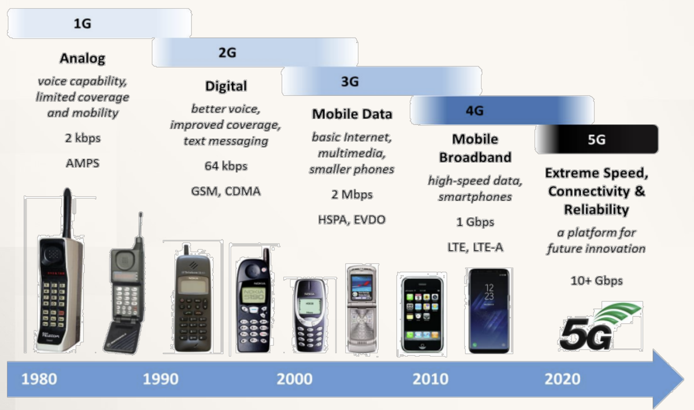

*그림 1. 1G부터 5G까지 이동통신의 발전과 세대별 특징*

이동통신은 대략 10년마다 한 세대씩 발전해 왔다. 그림 1은 각 세대가 처음 등장한 시기와 대표 기능, 최대 전송 속도, 대표 기술, 그 시기의 단말기를 보여 준다 [1].

| 세대 | 시기 | 핵심 특징 | 최대 전송 속도 | 대표 기술 |
|:-----|:-----|:-----|:-----|:-----|
| 1G | 1980년대 | 아날로그 방식이다. 음성 통화만 가능하고 커버리지와 이동성이 제한적이다. | 2 kbps | AMPS |
| 2G | 1990년대 | 디지털 방식이다. 음성 품질과 커버리지가 좋아지고 문자 메시지를 보낼 수 있다. | 64 kbps | GSM, CDMA |
| 3G | 2000년대 | 이동 데이터 통신이 시작된다. 기본적인 인터넷과 멀티미디어를 쓸 수 있고 단말기가 작아진다. | 2 Mbps | HSPA, EV-DO |
| 4G | 2010년대 | 이동 광대역 통신이다. 고속 데이터와 스마트폰이 보편화된다. | 1 Gbps | LTE, LTE-A |
| 5G | 2020년대 | 초고속, 초연결, 고신뢰성을 갖추어 미래 혁신의 플랫폼이 된다. | 10 Gbps 이상 | NR |

*표 1. 이동통신 세대별 특징*

> **용어 정의:** **디지털 이동통신**은 음성을 0과 1의 비트열로 바꾸어 보내는 방식이다. 디지털 방식은 오류 정정과 암호화가 가능하고 같은 주파수에 더 많은 사용자를 수용할 수 있다.

아날로그에서 디지털로의 전환이 1세대와 2세대를 가른다. 표 1에 나온 대표 기술 가운데 1세대의 **AMPS**는 미국의 아날로그 표준이고, 2세대의 **GSM**은 유럽에서 시작된 시분할 방식 표준, **CDMA**는 미국의 IS-95가 쓴 코드 분할 다중 접속 방식이다.

각 세대에는 여러 진영의 표준이 경쟁했다. 그림 2는 세대별 표준의 계보를 정리한 것이다 [2].

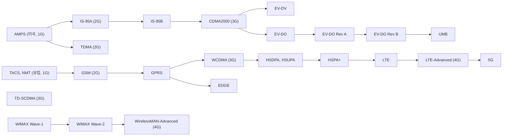

*그림 2. 이동통신 표준의 세대별 계보*

그림 2에서 미국의 AMPS에서 출발한 CDMA 계열 가운데 IS-95는 미국 통신산업협회(TIA)의 표준이고, 3세대인 CDMA2000과 EV-DO는 3GPP2라는 표준화 단체가 관리했다. 유럽의 GSM에서 출발한 계열(GPRS, EDGE, WCDMA, HSPA)은 3GPP가 관리했으며, 중국의 3세대 표준 TD-SCDMA도 3GPP 규격에 포함되었다. IEEE는 무선 MAN 표준인 IEEE 802.16을 바탕으로 WiMAX 계열을 만들었다. 3세대 표준은 ITU의 IMT-2000, 4세대는 IMT-Advanced, 5세대는 IMT-2020이라는 요구 조건을 만족하도록 개발되었다. 4세대 이후에는 3GPP의 LTE 계열이 사실상 세계 단일 표준이 되었고, 5G도 3GPP가 만든다.

GSM 망에 패킷 전송을 더한 다음 단계에서 3GPP는 3세대의 무선 접속 방식을 광대역 CDMA(**WCDMA**)로 바꾸었고, 이후 그 하향과 상향 데이터 속도를 높인 **HSPA**를 거쳐 4세대로 이어 갔다.

> **용어 정의:** **LTE(Long Term Evolution)** 는 3GPP의 4세대 무선 접속 기술이며, LTE-Advanced는 IMT-Advanced 요구 조건을 만족하도록 LTE를 개선한 것이다.

### 1.2 3GPP와 이동통신 표준화 절차

> **용어 정의:** **3GPP(3rd Generation Partnership Project)** 는 각국의 통신 표준화 기관이 함께 만든 이동통신 국제 표준화 단체이다. 회원사는 3GPP에서 기술 규격을 만들고, 각 기관은 그 규격을 자국의 표준으로 채택한다.

3GPP의 주요 사실은 다음과 같다 [3], [2].

- 3GPP는 IMT-2000(3세대) 표준화 작업을 위해 1998년 12월에 설립되었다. 오늘날 5G 무선 표준을 개발하는 중심 단체이다.
- 설립 당시 3GPP는 비동기 방식(GSM, WCDMA 계열)을 주축으로 하는 표준화 기관들의 연합이었다. 동기 방식(CDMA2000 계열)은 3GPP2가 따로 표준화했다.
- 기관 회원은 한국의 TTA, 유럽의 ETSI, 미국의 ATIS, 일본의 ARIB와 TTC, 중국의 CCSA, 인도의 TSDSI로 모두 7개 표준화 기관이다.
- 2022년 5월 기준으로 이 기관들을 통해 약 720개 회원사가 3GPP에 참가했으며, 한국 TTA를 통해 참가한 회원사는 26개사였다.

> **참고:** 이동통신에서 **동기 방식**은 모든 기지국이 GPS 같은 위성 시각 신호에 맞추어 똑같은 시각 기준으로 동작하는 방식이고, **비동기 방식**은 기지국마다 독립적인 시각 기준으로 동작하는 방식이다. 비동기 방식은 기지국 설치가 자유롭지만 단말이 기지국을 찾는 절차가 더 복잡하다.

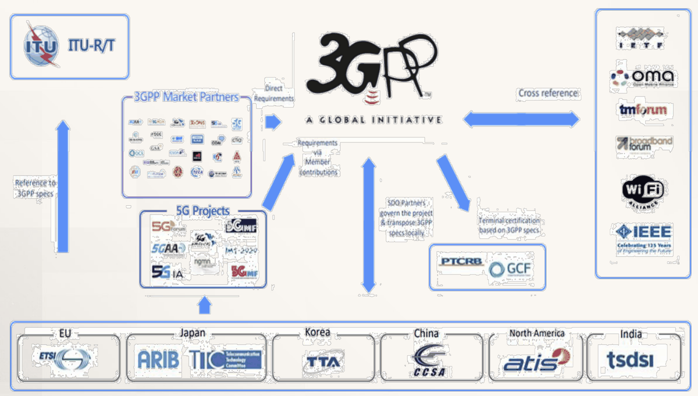

*그림 3. 3GPP와 관련 국제기구, 시장 대표 단체, 표준화 기관의 관계*

그림 3은 3GPP를 둘러싼 조직의 관계를 보여 준다. 아래쪽의 기관 회원(유럽 ETSI, 일본 ARIB와 TTC, 한국 TTA, 중국 CCSA, 북미 ATIS, 인도 TSDSI)은 프로젝트를 운영하고 3GPP 규격을 자국 표준으로 전환한다. 왼쪽의 시장 대표 단체(3GPP Market Partners)와 5G 관련 프로젝트(5GAA, 5G IA, 5GMF 등)는 요구 사항을 제시하고 회원사를 통해 기고한다. 위쪽의 ITU-R은 3GPP 규격을 참조하여 국제 표준을 만든다. 오른쪽의 IETF, OMA, TM Forum, Broadband Forum, Wi-Fi Alliance, IEEE는 3GPP와 서로의 규격을 상호 참조하며, PTCRB와 GCF는 3GPP 규격을 바탕으로 단말기를 인증한다.

3GPP의 표준화는 두 단계로 진행된다.

1. **기술 규격 개발:** 개별 회원(기업, 연구 기관)은 기술 규격 그룹(TSG, Technical Specification Group) 산하의 작업반 회의에 참여하여 기술 규격(TS, Technical Specification)을 만든다.
2. **전환 채택:** 기관 회원은 완성된 기술 규격을 각국의 표준으로 전환 채택하고, ITU 국제 표준에 반영되도록 ITU에 제출한다. 3세대 규격은 IMT-2000(ITU-R 권고 M.1457), 4세대 규격은 IMT-Advanced(M.2012), 5세대 규격은 IMT-2020(M.2150)에 반영되었다.

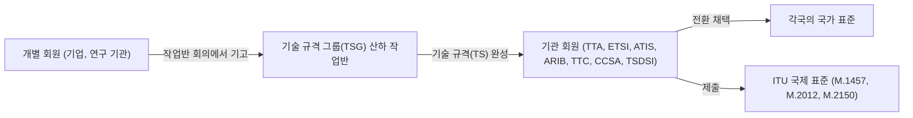

*그림 4. 3GPP의 이동통신 국제 표준화 절차*

### 1.3 5G NR의 사용 시나리오와 핵심 성능

> **용어 정의:** **5G NR(New Radio)** 은 3GPP가 정의한 5세대 이동통신의 무선 접속 기술이다. LTE와의 호환성을 고려하지 않고 새로 설계했다는 뜻에서 New Radio라고 부른다.

ITU-R 권고 M.2083은 5G(IMT-2020)의 사용 시나리오를 세 가지 서비스 범주로 나눈다 [4].

| 범주 | 원어 | 뜻 |
|:-----|:-----|:-----|
| eMBB | enhanced Mobile Broadband | 초고속 이동 광대역 통신이다. 초고화질 영상, 가상 현실처럼 많은 데이터를 빠르게 보내는 서비스를 위한 것이다. |
| URLLC | Ultra Reliable and Low Latency Communications | 초고신뢰 저지연 통신이다. 자율주행, 원격 수술, 공장 자동화처럼 지연과 오류가 치명적인 서비스를 위한 것이다. |
| mMTC | massive Machine Type Communications | 대규모 사물 통신이다. 센서처럼 적은 데이터를 가끔 보내는 수많은 기기를 동시에 연결하기 위한 것이다. |

*표 2. 5G의 세 가지 서비스 범주*

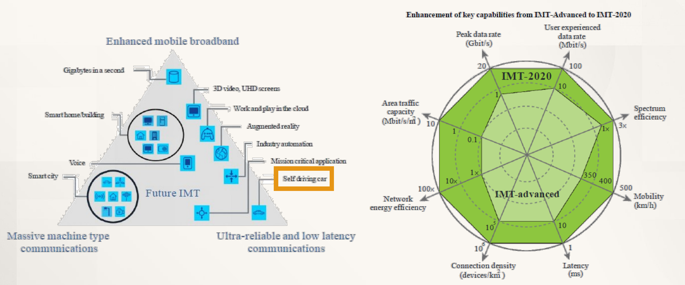

*그림 5. 5G의 사용 시나리오와 IMT-Advanced 대비 핵심 성능의 향상*

그림 5의 왼쪽 삼각형은 세 범주를 꼭짓점으로 놓고 응용을 배치한 것이다. eMBB 쪽에는 1초에 기가바이트를 내려받는 서비스, 3D 영상과 UHD 화면, 클라우드에서의 업무와 놀이, 증강 현실이 있고, mMTC 쪽에는 스마트 홈과 빌딩, 스마트 시티가 있다. URLLC 쪽에는 산업 자동화, 미션 크리티컬 응용, 자율주행차(self-driving car)가 있다. 자율주행차가 URLLC에 놓인 것은 차량 안전 통신에서는 전송 속도보다 지연 시간과 신뢰성이 결정적이기 때문이다.

오른쪽의 방사형 그래프는 4세대(IMT-Advanced, 안쪽)와 5세대(IMT-2020, 바깥쪽)의 여덟 가지 핵심 성능을 비교한다. 각 지표의 목표값은 표 3과 같다 [4].

| 구분 | 4G (IMT-Advanced) | 5G (IMT-2020) |
|:-----|:-----|:-----|
| 최대 전송 속도 | 1 Gbps | 20 Gbps |
| 이용자 체감 전송 속도 | 10 Mbps | 100\~1,000 Mbps |
| 전송 지연 | 10 ms | 1 ms |
| 고속 이동성 | 350 km/h | 500 km/h |
| 최대 기기 연결 수 | 10만 개/km² | 100만 개/km² |
| 주파수 효율 | 기준 | 4G 대비 3배 |
| 면적당 데이터 처리 용량 | 0.1 Mbps/m² | 10 Mbps/m² |
| 에너지 효율 | 기준 | 4G 대비 100배 |

*표 3. 4G와 5G의 핵심 성능 목표 비교*

> **참고:** 원 자료의 비교표는 5G의 면적당 데이터 처리 용량도 0.1 Mbps/m²로 적었으나, ITU-R M.2083이 제시한 IMT-2020의 목표값은 10 Mbit/s/m²로 4G의 100배이다 [4]. 표 3은 이 값으로 고친 것이다. 이용자 체감 전송 속도의 목표는 100 Mbit/s이며, 실내 핫스폿처럼 유리한 환경에서는 1 Gbit/s까지 기대한다.

각 지표의 뜻은 다음과 같다 [4].

| 지표 | 뜻 |
|:-----|:-----|
| 최대 전송 속도(peak data rate) | 이상적인 조건에서 한 단말이 얻을 수 있는 최대 전송 속도이다. |
| 이용자 체감 전송 속도(user experienced data rate) | 커버리지 전역에서 이용자가 실제로 얻는 전송 속도이다. |
| 전송 지연(latency) | 무선망이 패킷을 송신 측에서 수신 측으로 전달하는 데 걸리는 시간이다. |
| 고속 이동성(mobility) | 정해진 서비스 품질을 유지하며 지원할 수 있는 최대 이동 속도이다. |
| 최대 기기 연결 수(connection density) | 단위 면적(km²)당 연결할 수 있는 기기의 수이다. |
| 주파수 효율(spectrum efficiency) | 주파수 1 Hz당 보낼 수 있는 초당 비트 수(bit/s/Hz)이다. |
| 면적당 데이터 처리 용량(area traffic capacity) | 단위 면적(m²)에서 망 전체가 처리하는 데이터의 양이다. |
| 에너지 효율(network energy efficiency) | 같은 에너지로 보내거나 받을 수 있는 데이터의 양이다. |

*표 4. 5G 핵심 성능 지표의 뜻*

전송 지연이 차량 안전에 중요한 이유는 차량의 이동 거리로 계산해 보면 분명해진다. 시속 100 km로 달리는 차량의 속도는 초속 $100{,}000 / 3{,}600 \approx 27.8$ m이다.

```math
\begin{aligned}
10\ \text{ms 동안 이동 거리} &= 27.8\ \text{m/s} \times 0.010\ \text{s} \approx 0.28\ \text{m} \\
1\ \text{ms 동안 이동 거리} &= 27.8\ \text{m/s} \times 0.001\ \text{s} \approx 0.028\ \text{m} = 2.8\ \text{cm} \\
100\ \text{ms 동안 이동 거리} &= 27.8\ \text{m/s} \times 0.100\ \text{s} \approx 2.8\ \text{m}
\end{aligned}
```

경고 메시지가 100 ms 늦으면 그동안 차량은 약 2.8 m를 더 나아가므로 충돌을 피할 여유가 그만큼 줄어든다. 반면 1 GB(= 8 Gb) 파일을 내려받는 시간은 최대 전송 속도가 1 Gbps일 때 $8 / 1 = 8$초, 20 Gbps일 때 $8 / 20 = 0.4$초로, 이 차이는 편의성의 문제이지 안전의 문제는 아니다.

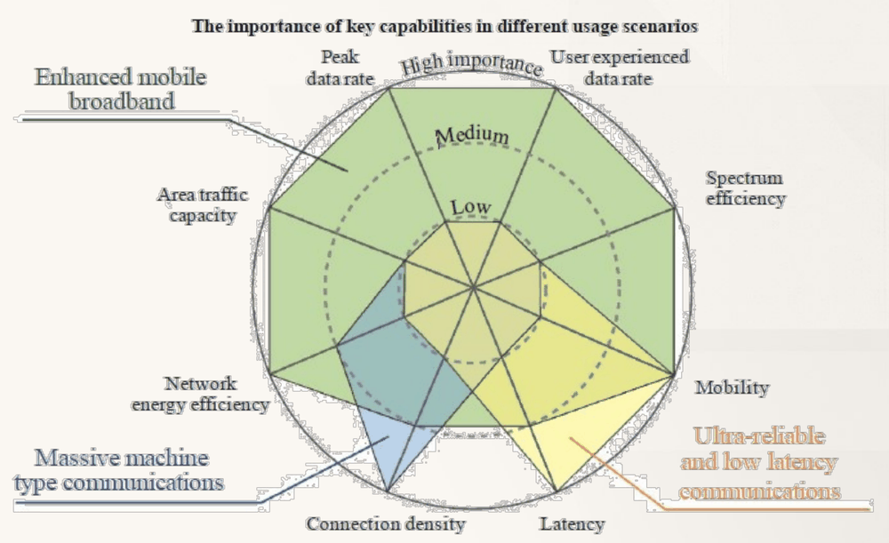

*그림 6. 사용 시나리오별 핵심 성능의 중요도*

그림 6은 세 시나리오에서 각 지표가 얼마나 중요한지를 높음(high), 중간(medium), 낮음(low)으로 표시한 것이다. eMBB는 최대 전송 속도, 이용자 체감 전송 속도, 면적당 처리 용량, 주파수 효율, 에너지 효율, 이동성이 모두 높음이고 전송 지연과 최대 기기 연결 수는 중간이다. mMTC는 최대 기기 연결 수가 높음, 에너지 효율이 중간이고, URLLC는 전송 지연과 이동성이 높음이며, 두 시나리오의 나머지 지표는 낮음이다. 초고신뢰 저지연 시나리오 가운데 일부, 특히 안전이 결정적인(safety critical) 응용에서는 저지연이 가장 중요할 수 있으며, 모빌리티와 교통 안전에 쓰일 때는 저지연 성능이 고속 전송 속도보다 중요할 수 있다 [4].

5G의 세 범주별 대표 유즈케이스와 목표 성능은 표 5와 같다. 유즈케이스는 통신 주체의 조합에 따라 사람과 사람, 사람과 기계, 기계와 기계 사이의 통신으로도 나눌 수 있다 [1].

| 범주 | 대표 유즈케이스 | 목표 성능 |
|:-----|:-----|:-----|
| eMBB | 가상 현실과 증강 현실, 영상 통화와 가상 회의, 고정형 무선 접속, UHD 영상, 영상 감시, 모바일 클라우드 컴퓨팅 | 최대 하향 20 Gbps, 상향 10 Gbps, 사용자 평면 지연 4 ms, 이동성 500 km/h |
| mMTC | 웨어러블, 소셜 네트워킹, 스마트 홈과 스마트 시티, 헬스케어 모니터링, 차량과 인프라 사이의 통신(V2I), 산업 자동화 | km²당 기기 100만 개, 배터리 수명 10년 이상, 커버리지 20 dB 향상 |
| URLLC | 공공 안전, 원격 수술, 차량과 보행자 사이의 통신(V2P), 차량 사이의 통신(V2V), 산업 자동화 | 사용자 평면 지연 1 ms, 높은 보안성과 복원력, 가용성 99.99999% |

*표 5. 5G 서비스 범주별 유즈케이스와 목표 성능*

표 5에서 V2V와 V2P는 URLLC에, 도로 인프라와 주고받는 V2I는 mMTC에 놓였다. 차량끼리와 차량과 보행자 사이의 메시지는 충돌 회피에 직결되므로 지연과 신뢰성이 가장 중요하고, 많은 노변 기지국과 센서를 연결하는 V2I에는 대규모 연결이 중요하기 때문이다.

### 1.4 5G 주파수

나라마다 5G에 쓰려고 선호하는 주파수 대역은 표 6과 같다.

| 국가 | 5G 주파수 선호 대역 |
|:-----|:-----|
| 한국 | 3.5 GHz, 26.5\~29.5 GHz |
| 미국 | 700 MHz, 1.7 GHz, 3.5 GHz, 24 GHz, 28 GHz, 39 GHz |
| 중국 | 3.3\~3.6 GHz, 4.8\~5.0 GHz, 26 GHz, 39 GHz |
| 일본 | 3.6\~4.2 GHz, 4.4\~4.9 GHz, 27.5\~29.5 GHz |
| 유럽 | 1.5 GHz, 3.6 GHz, 26 GHz |

*표 6. 국가별 5G 주파수 선호 대역*

5G 후보 주파수는 6 GHz 이하의 **sub-6 GHz** 대역과 24\~100 GHz의 **밀리미터파(mmWave)** 대역으로 나뉜다. 낮은 주파수는 전파가 멀리 가고 건물 같은 장애물을 잘 돌아 들어가 넓은 지역을 덮기에 유리하다. 높은 주파수는 넓은 대역폭을 확보할 수 있어 전송 속도가 빠르지만, 전파가 멀리 가지 못하고 장애물에 쉽게 가로막혀 기지국을 촘촘히 세워야 한다.

한국은 2018년 6월 경매로 3.5 GHz 대역과 28 GHz 대역을 이동통신 3사에 할당했다 [5].

| 대역 | 사업자 | 할당 범위 | 대역폭 | 낙찰가 |
|:-----|:-----|:-----|:-----|:-----|
| 3.5 GHz | LG U+ | 3.42\~3.50 GHz | 80 MHz | 8,095억 원 |
| 3.5 GHz | KT | 3.50\~3.60 GHz | 100 MHz | 9,680억 원 |
| 3.5 GHz | SK텔레콤 | 3.60\~3.70 GHz | 100 MHz | 1조 2,185억 원 |
| 28 GHz | KT | 26.5\~27.3 GHz | 800 MHz | 2,078억 원 |
| 28 GHz | LG U+ | 27.3\~28.1 GHz | 800 MHz | 2,072억 원 |
| 28 GHz | SK텔레콤 | 28.1\~28.9 GHz | 800 MHz | 2,073억 원 |

*표 7. 한국의 5G 주파수 경매 결과*

대역폭은 할당 범위의 위 끝에서 아래 끝을 빼서 구한다. 예를 들어 LG U+의 3.5 GHz 대역은 $3.50 - 3.42 = 0.08$ GHz $= 80$ MHz이고, 28 GHz 대역의 각 블록은 $27.3 - 26.5 = 0.8$ GHz $= 800$ MHz이다. 3.5 GHz 대역은 모두 $80 + 100 + 100 = 280$ MHz, 28 GHz 대역은 모두 $3 \times 800 = 2{,}400$ MHz로, 밀리미터파 대역이 약 8.6배 넓다. 낙찰가의 합은 3.5 GHz 대역이 $8{,}095 + 9{,}680 + 12{,}185 = 29{,}960$억 원, 28 GHz 대역이 $2{,}078 + 2{,}072 + 2{,}073 = 6{,}223$억 원으로, 전체는 3조 6,183억 원이다. 대역폭이 훨씬 넓은 28 GHz 대역의 낙찰가는 오히려 낮다. 밀리미터파는 도달 거리가 짧아 같은 지역을 덮으려면 기지국이 훨씬 많이 필요하다.

### 1.5 5G 무선 접속 기술과 네트워크 구성 옵션

> **용어 정의:** **RAT(Radio Access Technology, 무선 접속 기술)** 는 단말과 기지국 사이의 무선 구간에서 쓰는 통신 방식이다. LTE와 NR은 서로 다른 RAT이다.

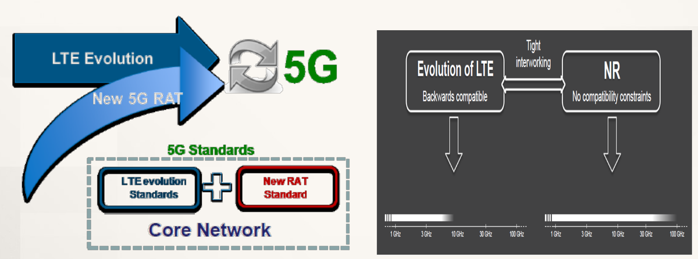

*그림 7. LTE의 진화와 새로운 5G RAT(NR)의 결합*

5G의 무선 접속 기술은 두 갈래로 이루어진다. 하나는 LTE-A Pro에서 발전한 **LTE의 진화**로, 기존 LTE 단말과의 하위 호환성(backward compatibility)을 유지한다. 다른 하나는 호환성의 제약 없이 새로 설계한 **NR**이다. 그림 7의 오른쪽처럼 두 기술은 긴밀하게 연동(tight interworking)되며, LTE의 진화는 대략 10 GHz 이하의 낮은 주파수에서, NR은 1 GHz 이하부터 약 100 GHz에 이르는 넓은 주파수에서 동작한다. 5G 표준은 LTE 진화 표준과 새 RAT 표준이 하나의 코어 네트워크를 공유하는 형태이다.

> **용어 정의:** **코어 네트워크(core network)** 는 기지국들을 묶어 인증, 이동성 관리, 인터넷 연결을 담당하는 이동통신망의 중심부이다.

LTE의 코어 네트워크를 **EPC**, 5G의 코어 네트워크를 **5GC**라고 한다. 코어 네트워크와 단말 사이에는 기지국이 있으며, 기지국의 이름은 쓰는 무선 접속 기술과 연결되는 코어 네트워크에 따라 달라진다. LTE 기지국은 **eNB**, NR 기지국은 **gNB**, 5GC에 연결되는 LTE 기지국은 **ng-eNB**라고 한다.

LTE와 NR을 어떻게 조합하고 어느 코어 네트워크에 연결하느냐에 따라 3GPP는 여러 가지 네트워크 구성 옵션을 검토했다 [6]. 단독으로 운영하는 **SA(Standalone)** 는 LTE나 5G가 각각 독립적으로 운영되는 구성이고, 비단독으로 운영하는 **NSA(Non-Standalone)** 는 LTE와 5G 망을 결합해 쓰는 구성이다.

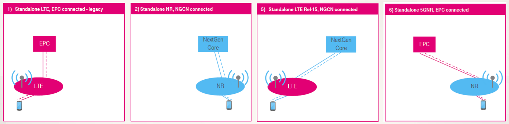

*그림 8. SA 방식의 네트워크 구성 옵션*

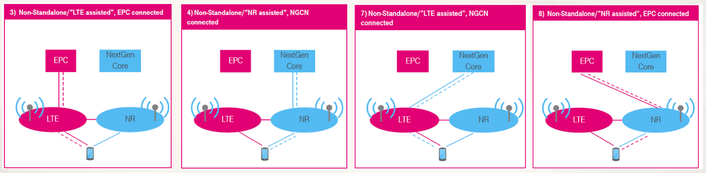

*그림 9. NSA 방식의 네트워크 구성 옵션*

| 옵션 | 방식 | 무선 접속 | 코어 네트워크 | 설명 |
|:-----|:-----|:-----|:-----|:-----|
| 1 | SA | LTE | EPC | 기존 LTE 망이다. |
| 2 | SA | NR | 5GC | NR과 5GC만으로 이루어진 완전한 5G 망이다. |
| 5 | SA | LTE (Rel-15 개선) | 5GC | 개선된 LTE 기지국을 5GC에 연결한다. |
| 6 | SA | NR | EPC | NR 기지국을 LTE의 코어에 연결한다. |
| 3 | NSA | LTE가 주도, NR이 보조 | EPC | LTE가 제어를 맡고 NR은 데이터 용량을 더한다(LTE assisted). |
| 4 | NSA | NR이 주도, LTE가 보조 | 5GC | NR이 제어를 맡고 LTE가 보조한다(NR assisted). |
| 7 | NSA | LTE가 주도, NR이 보조 | 5GC | 옵션 3과 같은 조합을 5GC에 연결한다. |
| 8 | NSA | NR이 주도, LTE가 보조 | EPC | 옵션 4와 같은 조합을 EPC에 연결한다. |

*표 8. 5G 네트워크 구성 옵션*

그림 8과 그림 9에서 분홍색 선은 EPC와 기지국 사이의 인터페이스(제어 평면 S1-C, 사용자 평면 S1-U)이고, 하늘색 선은 5GC와 기지국 사이의 인터페이스(제어 평면 N2, 사용자 평면 N3; 그림의 NG2, NG3는 표준화 초기의 이름이다)이다. 점선은 제어 평면, 실선은 사용자 평면이다. NSA 구성에서 주도하는 기지국(앵커)만 코어와 제어 평면으로 연결되고, 보조하는 기지국은 사용자 평면 데이터만 나누어 맡는다. 이렇게 단말이 두 기지국에 동시에 연결되는 것을 **이중 연결(DC, dual connectivity)** 이라고 하며, 1.8절의 NR-V2X 시나리오에 다시 나온다.

### 1.6 근접 서비스(ProSe)와 D2D 통신

> **용어 정의:** **D2D(Device-to-Device) 통신**은 단말끼리 기지국과 코어 네트워크를 거치지 않고 직접 주고받는 통신이다.

ProSe는 두 가지 기능으로 이루어진다 [7], [8].

| 기능 | 내용 | 예 |
|:-----|:-----|:-----|
| ProSe 탐색(ProSe Discovery) | 근처에 있는 단말이나 서비스를 발견한다. | 주변 상점의 광고, 근처의 친구 찾기 |
| ProSe 직접 통신(ProSe Direct Communication) | 근접한 단말끼리 데이터나 음성을 직접 교환한다. | 재난 현장에서 기지국 없이 하는 구조대의 그룹 통화 |

*표 9. ProSe의 두 가지 기능*

ProSe 직접 통신에는 한 단말과 한 단말이 통신하는 **일대일(one-to-one)**, 한 단말이 여러 단말에게 보내는 **일대다(one-to-many)**, 다른 단말을 중계기로 삼아 네트워크에 접속하는 **단말-네트워크 중계(UE-to-Network Relay)** 의 세 형태가 있다. 이 가운데 일대다 직접 통신은 주변 차량 모두에게 같은 메시지를 뿌리는 V2X 방송 통신의 바탕이 된다.

LTE 표준에서는 단말 사이의 직접 링크를 **사이드링크(sidelink)** 라고 부른다. 기지국에서 단말로 가는 하향링크, 단말에서 기지국으로 가는 상향링크와 구별하기 위한 이름이다.

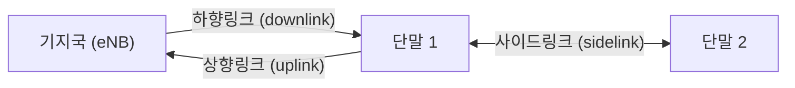

*그림 10. 하향링크, 상향링크, 사이드링크*

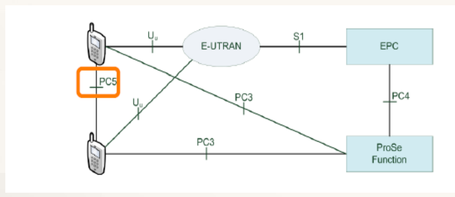

*그림 11. 로밍이 없는 경우의 단순화한 ProSe 아키텍처*

그림 11은 ProSe의 아키텍처이다. 두 단말은 각각 무선 인터페이스 **Uu**로 LTE 무선 접속망(E-UTRAN)에 연결되고, E-UTRAN은 S1 인터페이스로 코어 네트워크(EPC)에 연결된다. 두 단말 사이의 직접 인터페이스가 **PC5**이다. **ProSe 기능(ProSe Function)** 은 ProSe를 쓸 수 있는 단말에 권한과 설정을 내려 주는 네트워크 기능으로, 단말과는 PC3, EPC와는 PC4 인터페이스로 연결된다 [8].

그림 11의 인터페이스 가운데 무선 구간 자체에 대응하는 것은 단말과 기지국 사이의 무선 인터페이스인 **Uu**와, 단말끼리 직접 연결하는 PC5의 두 가지이다.

> **용어 정의:** **PC5**는 단말과 단말 사이의 직접 인터페이스이다.

> **참고:** 원 자료는 사이드링크(SL)를 LTE의 D2D 통신, PC5를 5G의 D2D 통신, Uu를 V2I의 통신으로 구분하여 설명하지만, 이것은 단순화한 설명이다. 3GPP에서 사이드링크는 단말 사이의 무선 링크 자체를, PC5는 아키텍처에서 단말 사이의 참조점을 가리키는 이름이며, LTE와 NR 모두 두 용어를 쓴다(LTE 사이드링크, NR 사이드링크, LTE PC5, NR PC5). 그림 11의 PC5도 LTE(E-UTRAN) 아키텍처에 있다. Uu는 단말과 기지국 사이의 무선 인터페이스이므로 V2I뿐 아니라 기지국을 거치는 모든 통신(V2N 등)에 쓰인다 [8], [9].

D2D 통신에서 단말이 어떤 시간과 주파수 자원으로 신호를 보낼지 정하는 방식은 두 가지이다 [7].

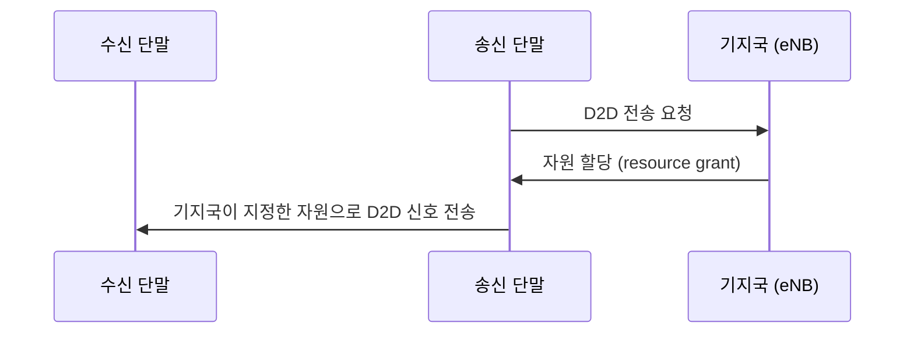

*그림 12. 스케줄링 모드의 자원 할당 절차*

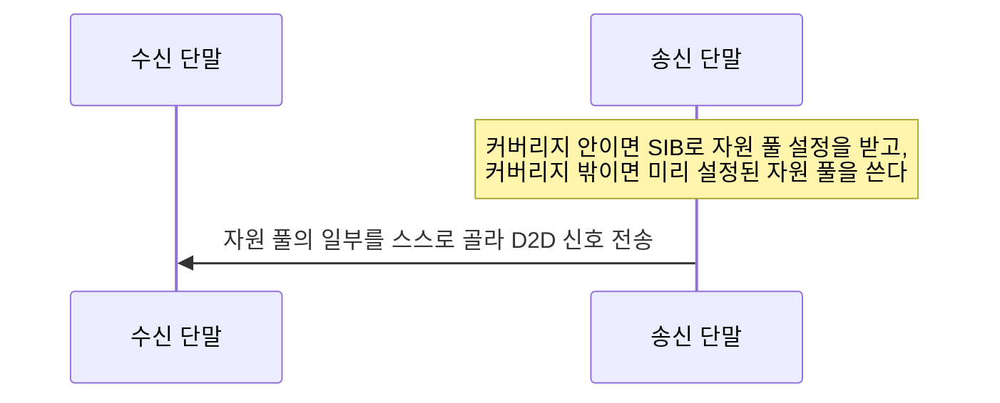

*그림 13. 자율 모드의 자원 할당 절차*

| 구분 | 스케줄링 모드(scheduled mode) | 자율 모드(autonomous mode) |
|:-----|:-----|:-----|
| 자원을 정하는 주체 | 기지국(eNB)이 단말마다(UE-specific) 물리 자원을 지정한다. | 단말이 단말을 특정하지 않고(non-UE-specific) 할당된 자원 풀에서 스스로 고른다. |
| 절차 | 송신 단말이 전송을 요청하면 기지국이 자원을 허가하고, 단말은 그 자원으로 보낸다. | 커버리지 안에서는 SIB로 알려 준 자원 풀을, 커버리지 밖에서는 미리 설정된 자원 풀을 쓴다. |
| 장점 | 기지국이 자원을 조정하므로 충돌을 막는다. | 네트워크가 없거나 고장 나도 동작한다. |
| 단점 | 기지국의 커버리지 안에서만 쓸 수 있다. | 여러 단말이 같은 자원을 고르면 충돌할 수 있다. |
| V2X에서의 이름 | LTE-V2X의 모드 3, NR-V2X의 모드 1 | LTE-V2X의 모드 4, NR-V2X의 모드 2 |

*표 10. D2D 자원 할당의 두 가지 방식*

표 10에서 두 방식의 장단점은 단말이 기지국의 신호를 받을 수 있는 곳에 있는지에 따라 갈린다.

V2X를 위한 Release 14는 D2D의 두 방식을 차량 환경에 맞게 고쳐 사이드링크 전송 모드 3(기지국이 스케줄링)과 모드 4(단말이 자율 선택)로 정의했다 [10]. 모드 4의 단말은 다른 단말이 쓰고 있는 자원을 감지(sensing)하여 비어 있을 가능성이 높은 자원을 고르고, 그 자원을 일정 기간 반복해서 쓴다. NR-V2X에서는 같은 개념을 자원 할당 모드 1과 모드 2라고 부른다 [11].

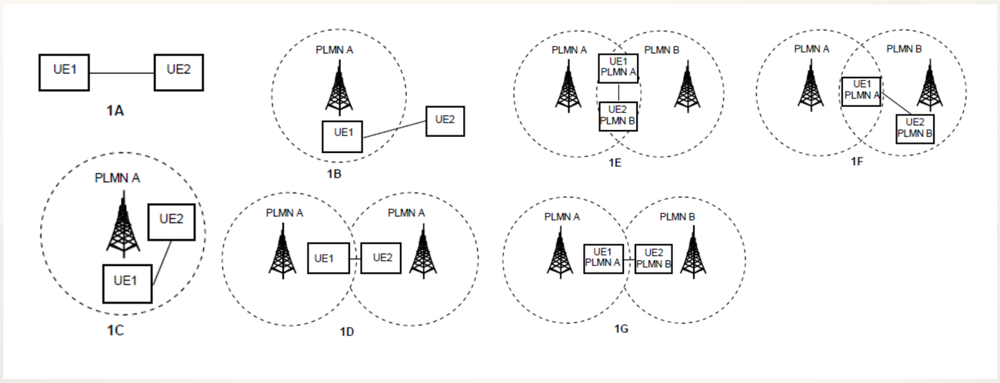

*그림 14. 중계가 없는 ProSe 직접 통신 시나리오*

그림 14는 중계 없이 두 단말(UE1, UE2)이 직접 통신하는 일곱 가지 시나리오이다. 점선 원은 기지국의 커버리지이다 [12].

| 시나리오 | 상황 |
|:-----|:-----|
| 1A | 두 단말 모두 커버리지 밖에 있다(out of coverage). |
| 1B | UE1은 PLMN A의 커버리지 안에, UE2는 커버리지 밖에 있다(partial coverage). |
| 1C | 두 단말이 같은 PLMN의 같은 셀 안에 있다. |
| 1D | 두 단말이 같은 PLMN A의 서로 다른 셀에 있다. |
| 1E | PLMN A 가입자인 UE1과 PLMN B 가입자인 UE2가 두 PLMN의 커버리지가 겹치는 지역에 함께 있다. |
| 1F | UE1(PLMN A)은 두 PLMN이 겹치는 지역에, UE2(PLMN B)는 PLMN B만 덮는 지역에 있다. |
| 1G | UE1은 PLMN A만 덮는 지역에, UE2는 PLMN B만 덮는 지역에 있다. |

*표 11. 중계가 없는 ProSe 직접 통신 시나리오*

시나리오 1E\~1G는 서로 다른 사업자에 가입한 차량끼리도 직접 통신해야 하는 V2X에서 특히 중요하다. 차량 안전 메시지는 상대 차량이 어느 통신사에 가입했는지와 관계없이 전달되어야 하기 때문이다.

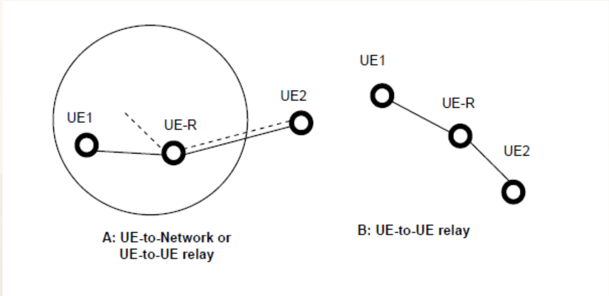

*그림 15. 중계가 있는 ProSe 직접 통신 시나리오*

그림 15는 중계 단말(UE-R)이 있는 경우이다. A에서는 커버리지 안의 UE-R이 커버리지 밖의 UE2를 네트워크에 연결해 주거나(단말-네트워크 중계) 커버리지 안의 UE1과 이어 준다(단말-단말 중계). B에서는 네트워크 없이 UE-R이 UE1과 UE2 사이를 중계한다(단말-단말 중계) [12].

### 1.7 LTE-V2X 운영 시나리오

3GPP TR 36.885는 LTE를 바탕으로 한 V2X의 운영 시나리오를 세 가지로 정의했다 [13]. 그림에 보이는 E-UTRAN은 LTE의 무선 접속망, 곧 LTE 기지국이다. NR을 바탕으로 한 NR-V2X의 운영 시나리오는 1.8절에서 다룬다.

**시나리오 1: PC5 기반.** 차량 단말이 V2X 메시지를 사이드링크(SL)로 주변의 여러 단말에게 직접 보낸다. 기지국을 거치지 않는다.

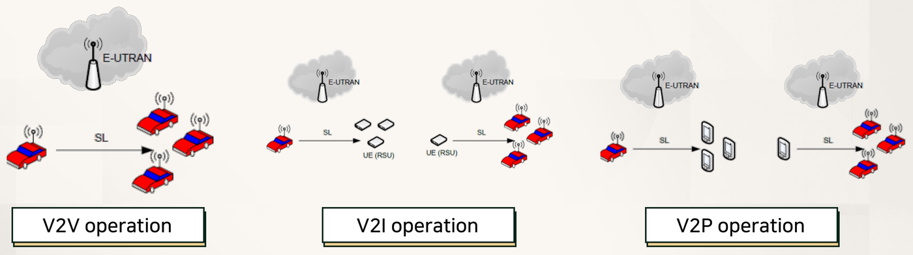

*그림 16. PC5 기반 V2X 운영 시나리오*

그림 16의 V2V에서는 차량이 주변 차량에게, V2I에서는 차량과 단말형 노변 기지국(UE(RSU)) 사이에서, V2P에서는 차량과 보행자의 단말 사이에서 사이드링크로 메시지가 오간다.

**시나리오 2: Uu 기반.** 차량 단말이 V2X 메시지를 상향링크(UL)로 기지국에 보내고, 기지국이 하향링크(DL)로 그 지역의 여러 단말에게 전달한다.

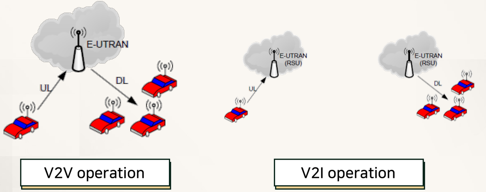

*그림 17. Uu 기반 V2X 운영 시나리오: V2V와 V2I*

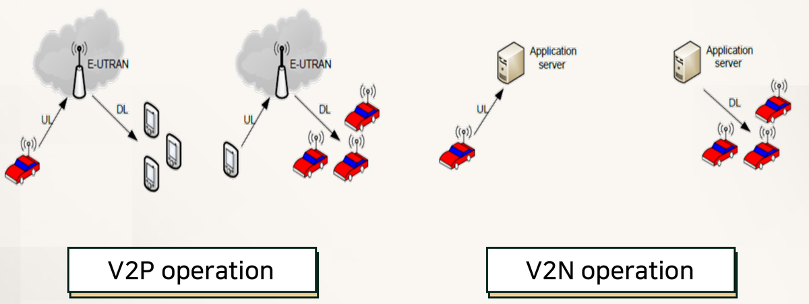

*그림 18. Uu 기반 V2X 운영 시나리오: V2P와 V2N*

그림 17의 V2I에서는 기지국 자체가 노변 기지국 역할을 한다(E-UTRAN(RSU)). 차량은 상향링크로 노변 기지국에 메시지를 보내거나 하향링크로 노변 기지국의 메시지를 받는다. 그림 18의 V2P는 보행자 단말과 같은 방식으로 주고받고, V2N은 차량이 기지국을 거쳐 망 너머의 응용 서버(application server)와 통신한다.

**시나리오 3: PC5와 Uu를 함께 사용.** 사이드링크와 기지국 경로를 이어서 메시지를 더 넓은 지역에 퍼뜨린다.

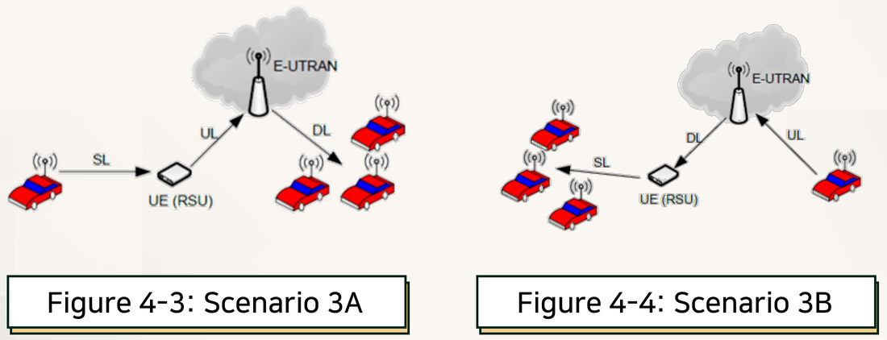

*그림 19. PC5와 Uu를 함께 쓰는 V2X 운영 시나리오 3A와 3B*

- **시나리오 3A:** 차량이 사이드링크로 V2X 메시지를 보낸다. 이를 받은 단말형 노변 기지국(UE(RSU))이 상향링크로 기지국에 전달하고, 기지국은 하향링크로 그 지역의 여러 단말에게 방송한다.
- **시나리오 3B:** 차량이 상향링크로 기지국에 V2X 메시지를 보낸다. 기지국은 이를 하나 이상의 단말형 노변 기지국에 전달하고, 노변 기지국이 사이드링크로 주변 단말에게 보낸다.

> **용어 정의:** **노변 기지국(RSU, roadside unit)** 은 도로변에 설치되어 차량과 통신하는 장치이다. C-V2X의 RSU에는 단말형과 기지국형이 있다.

| 시나리오 | 쓰는 링크 | 장점 | 한계 |
|:-----|:-----|:-----|:-----|
| 1 (PC5 기반) | 사이드링크 | 기지국을 거치지 않아 지연이 짧고 커버리지 밖에서도 동작한다. | 전파가 닿는 거리 안에서만 전달된다. |
| 2 (Uu 기반) | 상향링크, 하향링크 | 기지국을 통해 넓은 지역과 서버에 전달된다. | 기지국과 코어를 거치므로 지연이 길고 망이 있어야 한다. |
| 3 (함께 사용) | 사이드링크, 상향링크, 하향링크 | 직접 통신의 짧은 지연과 기지국의 넓은 전달 범위를 결합한다. | 구성이 복잡하고 RSU와 기지국 사이의 연동이 필요하다. |

*표 12. LTE-V2X 운영 시나리오의 비교*

### 1.8 NR-V2X 운영 시나리오

3GPP TR 38.885는 NR을 바탕으로 한 V2X의 운영 시나리오를 정의했다 [14]. NR-V2X 차량은 NR 사이드링크(NR V2X SL)와 LTE 사이드링크(LTE V2X SL)를 함께 쓸 수 있으며, 두 사이드링크의 제어와 설정 정보를 어느 기지국이 주느냐에 따라 시나리오가 나뉜다.

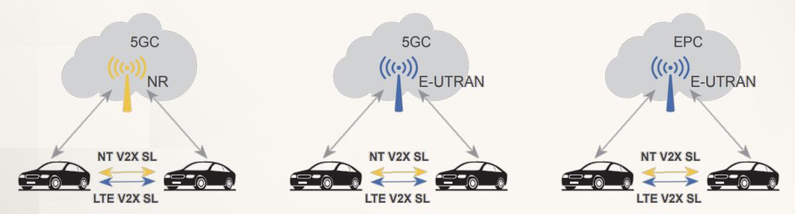

*그림 20. NR-V2X의 독립형 시나리오*

**독립형(standalone) 시나리오**에서는 하나의 기지국(gNB, ng-eNB 또는 eNB)이 사이드링크를 위한 V2X 통신 제어와 구성 정보를 제공한다. 그림 20의 왼쪽은 5GC에 연결된 NR 기지국(gNB), 가운데는 5GC에 연결된 LTE 기지국(ng-eNB), 오른쪽은 EPC에 연결된 LTE 기지국(eNB)이 두 사이드링크를 모두 제어하는 경우이다.

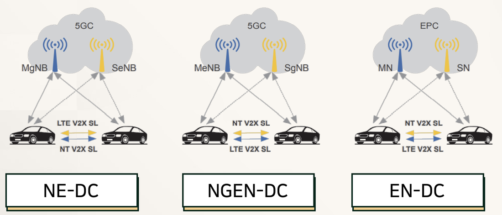

*그림 21. NR-V2X의 다중 무선 이중 연결(MR-DC) 시나리오*

**MR-DC(Multi-Radio Dual Connectivity, 다중 무선 이중 연결) 시나리오**에서는 차량이 서로 다른 RAT의 두 기지국에 동시에 연결되어 있고, 여러 Uu 인터페이스를 통해 사이드링크를 위한 제어와 구성 정보를 받는다. 그림 21의 세 경우는 1.5절의 NSA 옵션에 대응한다.

| MR-DC 종류 | 주 기지국(master) | 보조 기지국(secondary) | 코어 | 대응 옵션 |
|:-----|:-----|:-----|:-----|:-----|
| NE-DC (NR-E-UTRA DC) | gNB (MgNB) | ng-eNB (SeNB) | 5GC | 옵션 4 |
| NGEN-DC (NG-RAN E-UTRA-NR DC) | ng-eNB (MeNB) | gNB (SgNB) | 5GC | 옵션 7 |
| EN-DC (E-UTRA-NR DC) | eNB (MN) | gNB (SN) | EPC | 옵션 3 |

*표 13. NR-V2X의 MR-DC 시나리오*

### 1.9 C-V2X의 표준화 단계와 두 전송 모드

C-V2X의 직접 통신 링크인 사이드링크의 PC5 인터페이스는 Release 12에서 정의된 D2D 통신에서 출발했다. 3GPP는 표준을 **릴리스(Release)** 라는 단위로 묶어 내놓으며, 릴리스마다 C-V2X의 기능이 더해졌다.

| 릴리스 (완료 시기) | 추가된 C-V2X 기능 | 대표 유즈케이스 |
|:-----|:-----|:-----|
| Rel-8\~13 (2016년 3월) | LTE-V2X 이동통신망 통신(Uu) | 위험 경고(hazard warning) |
| Rel-14 (2017년 3월) | LTE-V2X 직접 통신(PC5) | V2V 안전 유즈케이스 |
| Rel-15 (2018년 6월) | 5G-V2X 이동통신망 통신(Uu) | 향상된 내비게이션과 인포테인먼트 |
| Rel-16 (2019년 12월 예정) | 5G-V2X 직접 통신(PC5) | 협력형 자율주행 |
| Rel-17 (2022년 6월) | V2P 응용을 위한 5G-V2X 전력 효율 개선 | 고도화된 협력형 자율주행, 교통 약자(VRU)와의 상호작용 |

*표 14. 3GPP 릴리스별 C-V2X 기능의 발전*

> **참고:** 표 14의 완료 시기는 2020년 무렵의 산업계 자료(Qualcomm, 5GAA)가 제시한 일정이다 [15]. Release 16은 일정이 늦어져 2020년 7월에 완료(동결)되었다 [16]. **릴리스 동결(freeze)** 은 그 릴리스에 새 기능을 더 넣지 않고 규격을 확정하는 것이다.

C-V2X에는 서로 보완하는 두 가지 전송 모드가 있다 [15].

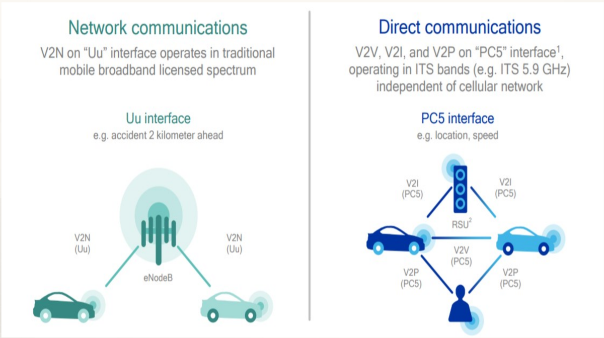

*그림 22. C-V2X의 네트워크 통신과 직접 통신*

| 전송 모드 | 인터페이스 | 주파수 | 통신 대상 | 예 |
|:-----|:-----|:-----|:-----|:-----|
| 네트워크 통신(network communication) | Uu | 이동통신사의 면허 대역(기존 이동 광대역 스펙트럼) | V2N | 2 km 앞의 사고 정보 |
| 직접 통신(direct communication) | PC5 | ITS 전용 대역(예: 5.9 GHz), 이동통신망과 무관하게 동작 | V2V, V2I, V2P | 주변 차량의 위치와 속도 |

*표 15. C-V2X의 두 가지 전송 모드*

그림 22의 왼쪽에서 두 차량은 기지국(eNodeB)을 거쳐 V2N으로 통신하고, 오른쪽에서는 차량, 노변 기지국, 보행자가 PC5로 직접 통신한다. 3GPP는 직접 통신에서도 기지국이 자원을 조정해 주는 방식(1.6절의 모드 3)을 함께 정의한다.

> **용어 정의:** **면허 대역(licensed spectrum)** 은 정부가 특정 사업자에게 독점 사용권을 준 주파수 대역이다.

> **용어 정의:** **ITS 대역**은 지능형 교통 체계 용도로 지정해 둔 대역이다. 5.9 GHz 대역의 할당은 나라마다 다르며 1주차에서 정리했다.

C-V2X 직접 통신은 네트워크 없이 스스로 동작하는(self-managed) 세 가지 특성을 갖는다 [15].

| 특성 | 내용 |
|:-----|:-----|
| USIM 없는 동작(USIM-less operation) | C-V2X 직접 통신은 USIM을 요구하지 않는다. 이동통신사에 가입하지 않은 차량이나 노변 기지국도 참여할 수 있다. |
| 자율적 자원 선택(autonomous resource selection) | 분산 스케줄링에 따라 차량이 네트워크의 도움 없이 자원 풀에서 자원을 고른다. |
| GNSS 시각 동기(GNSS time synchronization) | C-V2X는 측위뿐 아니라 시각 동기에도 GNSS를 쓰므로 이동통신망 없이도 단말끼리 시각을 맞출 수 있다. |

*표 16. C-V2X 직접 통신의 자율 동작 특성*

시각 동기가 필요한 이유는 사이드링크가 시간을 일정한 길이의 구간으로 나누어 자원을 나누어 쓰기 때문이다. 모든 단말이 구간의 시작 시각에 합의해야 같은 자원 풀을 겹치지 않게 쓸 수 있다. GNSS는 IEEE 802.11p를 포함한 모든 V2X 기술에서 측위를 위해 이미 필요하며, 시각은 위치 계산 과정에서 함께 구해지고 측위보다 적은 수의 위성만 있으면 된다 [15].

### 1.10 C-V2X 표준화 로드맵과 5G-V2X

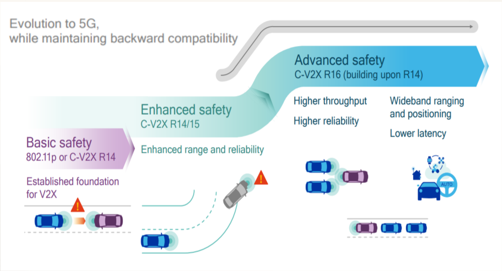

*그림 23. 하위 호환성을 유지하며 5G로 진화하는 V2X 기술*

그림 23은 V2X 기술이 하위 호환성을 유지하면서 세 단계로 진화하는 모습이다 [15]. 첫 단계인 **기본 안전(basic safety)** 은 IEEE 802.11p 또는 C-V2X Rel-14로 V2X의 기반을 확립한다. 둘째 단계인 **향상된 안전(enhanced safety)** 은 C-V2X Rel-14와 Rel-15로 통신 거리와 신뢰성을 높인다. 셋째 단계인 **고급 안전(advanced safety)** 은 Rel-14를 바탕으로 한 C-V2X Rel-16으로 더 높은 전송 속도와 신뢰성, 광대역 거리 측정과 측위, 더 짧은 지연을 제공한다.

| 항목 | D2D 통신 (Rel-12/13) | 향상된 안전 (Rel-14 1단계, Rel-15 2단계) | 자율주행 (Rel-16 5G NR, 3단계) |
|:-----|:-----|:-----|:-----|
| 목적 | 기본 D2D 통신의 기반 확립 | V2X 안전을 위한 통신 거리와 신뢰성 향상 | 자율주행을 위한 초고신뢰, 저지연, 고속 통신 |
| 네트워크 독립 동작 | 아니요 | 예 | 예 |
| 통신 형태(PHY/MAC) | 방송만 | 방송만 | 방송, 유니캐스트, 멀티캐스트 |
| 고속 이동 지원 | 아니요 | 예 | 예 |
| 고밀도 환경 지원 | 아니요 | 예 | 예 |
| 전송 속도 | | 향상된 안전을 위한 높은 전송 속도 | 초고속 |
| 지연 시간 | | 향상된 안전 응용을 위한 낮은 지연 | 초저지연 |
| 신뢰성 | | 향상된 안전 응용을 위한 신뢰성 | 초고신뢰 |
| 측위 | 아니요 | 위치 정보 공유 | 광대역 거리 측정과 측위 |

*표 17. 자율주행용 5G를 향한 C-V2X의 진화*

> **용어 정의:** **멀티캐스트(multicast)** 는 특정한 단말 집단(예: 군집주행 차량들)에게 보내는 통신이다. Rel-14와 Rel-15의 사이드링크는 방송만 지원하므로 모든 메시지가 주변 모두에게 전달된다. 두 차량이 주행 계획을 협상하는 것처럼 특정 상대와 주고받는 통신에는 유니캐스트가 필요하다.

5G NR은 직접 통신과 네트워크 통신 모두에 새로운 무선 기술을 제공한다 [15].

| 5G NR의 새 기술 | 뜻 |
|:-----|:-----|
| 확장 가능한 OFDM 뉴머롤로지(scalable OFDM numerology) | 부반송파 간격을 15 kHz의 $2^\mu$배로 바꿀 수 있어, 상황에 따라 심볼 길이와 지연을 조절한다. |
| 측위를 위한 광대역 전송(wideband transmissions for positioning) | 넓은 대역폭으로 신호의 도착 시각을 정밀하게 재어 거리와 위치를 정확히 구한다. |
| 고급 LDPC, 폴라 채널 부호화(advanced LDPC/polar channel coding) | 데이터에는 LDPC 부호, 제어 정보에는 폴라 부호를 써서 오류 정정 성능을 높인다. |
| 자기 완결형 서브프레임(self-contained sub-frame) | 한 전송 단위 안에 데이터와 그에 대한 응답을 함께 넣어 왕복 지연을 줄인다. |
| 저지연 슬롯 구조(low-latency slot structure design) | 짧은 슬롯과 슬롯보다 짧은 전송 단위로 데이터를 빨리 보낸다. |
| 매시브 MIMO(massive MIMO) | 기지국에 수십\~수백 개의 안테나를 달아 빔을 원하는 방향으로 모아 보낸다. |

*표 18. 5G-V2X를 위한 5G NR의 새 기술*

데이터 채널의 LDPC 부호와 제어 채널의 폴라 부호는 NR의 채널 부호화 규격에 정의되어 있다 [17]. 이 기술 덕분에 PC5 직접 통신은 더 높은 전송 속도와 URLLC 성능을 얻고 ITS 대역에서 네트워크 도움 없이 동작하도록 설계되며, Uu 네트워크 통신도 면허 대역에서 더 높은 전송 속도와 URLLC 성능을 얻는다.

> **용어 정의:** **뉴머롤로지(numerology)** 는 부반송파 간격과 그에 따라 정해지는 심볼 길이, 슬롯 길이의 조합이다.

NR의 부반송파 간격은 $\Delta f = 15 \times 2^\mu$ kHz이고, 한 슬롯은 14개의 OFDM 심볼로 이루어지며 슬롯 길이는 $1 / 2^\mu$ ms이다 [18]. 부반송파 간격이 넓을수록 심볼과 슬롯이 짧아져 지연이 줄어든다.

| $\mu$ | 부반송파 간격 | 슬롯 길이 |
|:-----|:-----|:-----|
| 0 | 15 kHz | 1 ms |
| 1 | 30 kHz | 0.5 ms |
| 2 | 60 kHz | 0.25 ms |
| 3 | 120 kHz | 0.125 ms |

*표 19. NR 뉴머롤로지에 따른 부반송파 간격과 슬롯 길이*

넓은 부반송파 간격은 고속 차량에서 생기는 **도플러 효과**에도 강하다. 도플러 주파수 이동은 $f_d = v f_c / c$이다. 서로 마주 보고 시속 120 km로 달리는 두 차량의 상대 속도는 시속 240 km, 곧 $240{,}000 / 3{,}600 \approx 66.7$ m/s이다. 반송파 주파수 $f_c = 5.9$ GHz, 빛의 속도 $c = 3 \times 10^8$ m/s를 넣으면 다음과 같다.

```math
f_d = \frac{66.7 \times 5.9 \times 10^9}{3 \times 10^8} = 66.7 \times 19.67 \approx 1{,}311\ \text{Hz}
```

이 이동량은 15 kHz 간격의 약 $`1{,}311 / 15{,}000 \approx 8.7\%`$이지만 30 kHz 간격에서는 약 4.4%로 줄어, 부반송파끼리의 간섭이 작아진다.

광대역 전송이 측위에 유리한 이유도 간단히 계산할 수 있다. 대역폭이 $B$인 신호로 도착 시각을 구분할 수 있는 해상도는 대략 $1/B$이다. $B = 100$ MHz이면 $1 / (100 \times 10^6) = 10$ ns이고, 빛은 10 ns 동안 $3 \times 10^8 \times 10 \times 10^{-9} = 3$ m를 가므로 거리 해상도는 약 3 m이다. 대역폭을 400 MHz로 넓히면 약 0.75 m로 좋아진다.

커넥티드카는 5G-V2X로 다음 기능을 얻는다. 이 기능들은 광대역 반송파 지원, 높은 전송 속도, 초저지연, 초고신뢰, 강한 보안을 바탕으로 하며, 기존 기능과의 하위 호환성을 유지한다 [15].

| 기능 | 내용 |
|:-----|:-----|
| 고속 센서 공유(high throughput sensor sharing) | 차량이 수집한 원시 데이터나 가공한 센서 데이터를 높은 전송 속도와 낮은 지연으로 교환한다. |
| 의도와 궤적 공유(intention/trajectory sharing) | 차량이 계획한 주행 궤적을 공유하여 서로의 움직임을 미리 안다. |
| 광대역 거리 측정과 측위(wideband ranging and positioning) | 광대역 반송파로 정확한 위치와 거리를 구해 협력 주행과 자율주행에 쓴다. |
| 지역 고정밀 지도와 조감도(local HD maps, bird's eye view) | 카메라와 센서 데이터로 지역의 동적 지도를 만들어 교차로 등에 배포한다. |

*표 20. 커넥티드카의 5G-V2X 기능*

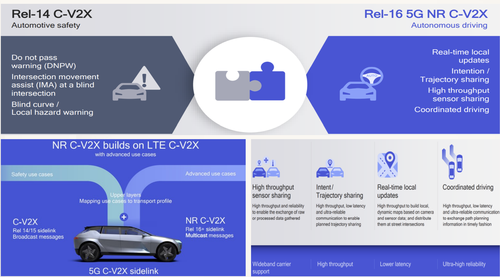

*그림 24. Rel-14 C-V2X를 보완하는 Rel-16 5G NR C-V2X*

그림 24처럼 5G NR C-V2X는 Rel-14를 대체하는 것이 아니라 보완한다. Rel-14 C-V2X는 자동차 안전(추월 금지 경고(DNPW), 사각 교차로에서의 교차로 진입 보조(IMA), 굽은 길과 지역 위험 경고)을 맡고, Rel-16 5G NR C-V2X는 자율주행(실시간 지역 지도 갱신, 의도와 궤적 공유, 고속 센서 공유, 협조 주행)을 맡는다. 아래쪽 그림처럼 하나의 차량이 안전 유즈케이스에는 Rel-14/15 사이드링크의 방송 메시지를, 고급 유즈케이스에는 Rel-16 이후 사이드링크의 멀티캐스트 메시지를 쓰고, 상위 계층이 유즈케이스를 알맞은 전송 방식에 대응시킨다.

### 1.11 C-V2X의 상위 계층 아키텍처

C-V2X는 무선 구간(하위 계층)만 새로 정의하고, 자동차 산업이 이미 정의한 상위 계층은 다시 쓴다 [15].

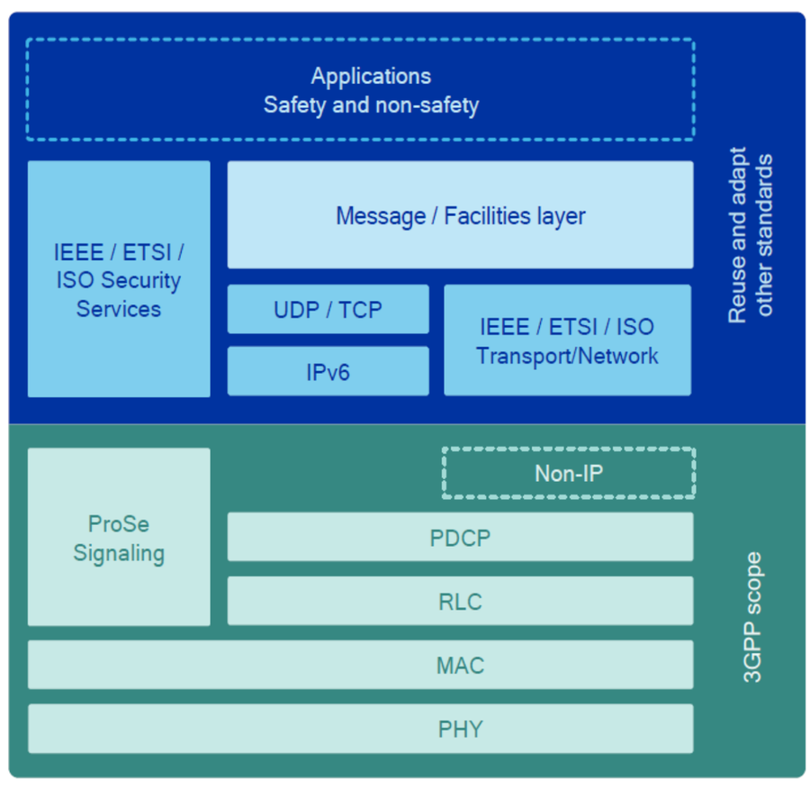

*그림 25. C-V2X의 프로토콜 스택과 재사용하는 상위 계층*

- **DSRC와 C-ITS의 서비스, 응용 계층 재사용:** 차량용 메시지와 응용은 ETSI와 SAE 같은 자동차 표준 단체가 이미 정의했다. 3GPP의 하위 계층과 연결하기 위한 추상화 계층(abstraction layer)은 5GAA와 함께 개발한다.
- **기존 보안 계층과 전송 계층 재사용:** ISO, ETSI, IEEE 1609 계열이 정의한 보안과 전송, 네트워크 프로토콜을 그대로 쓴다.
- **무선과 하위 계층의 지속적인 개선:** 계속 진화하는 V2X 유즈케이스를 지원하도록 3GPP가 하위 계층을 발전시킨다.

그림 25의 위쪽(파란색)은 응용(안전, 비안전), 메시지와 퍼실리티 계층, UDP/TCP와 IPv6, IEEE, ETSI, ISO의 전송과 네트워크 계층, 보안 서비스로, 다른 표준을 재사용하고 적응시키는 부분이다. 아래쪽(초록색)은 3GPP의 범위로, ProSe 시그널링, IP를 쓰지 않는 경로(Non-IP), PDCP, RLC, MAC, PHY로 이루어진다. 이와 함께 V2X를 지원하도록 LTE 직접 통신(LTE Direct)의 네트워크 아키텍처와 시스템 설계도 개선되었다. 메시지 계층의 SAE J2735 메시지는 11주차, IEEE 1609 계열은 13주차에서 다루었다.

그림 25의 3GPP 범위에서 맨 아래의 **PHY**는 신호를 변조하여 전파로 보내는 물리 계층이고, 그 위의 **MAC**은 무선 자원을 나누어 쓰는 매체 접근 제어 계층이다. PHY와 MAC 위에는 데이터를 무선 구간에 맞게 다듬는 두 계층이 더 있는데, **RLC**는 패킷의 분할과 재전송을, **PDCP**는 헤더 압축과 암호화를 맡는다.

### 1.12 IEEE 802.11p와 C-V2X의 비교

| 항목 | IEEE 802.11p | C-V2X Rel-14/15 | C-V2X Rel-16 (예상 설계) |
|:-----|:-----|:-----|:-----|
| 규격 완료 | 완료 | Rel-14는 2016년 완료, Rel-15는 2018년 완료 예정 | 2019년 |
| 저지연 직접 통신 지원 | 지원 | 지원 (Rel-14: 4 ms) | 지원 (1 ms 이하) |
| 네트워크 통신 지원 | 제한적 (AP를 통해서만) | 지원 | 지원 |
| 네트워크 도움 없이 동작 | 가능 | 가능 | 가능 |
| ITS 5.9 GHz 대역에서 동작 | 가능 | 가능 | 가능 |
| SIM 없는 동작 | 가능 | 가능 | 가능 |
| V2V, V2I, V2P의 보안과 프라이버시 | IEEE WAVE와 ETSI ITS 보안 서비스를 따름 | IEEE WAVE와 ETSI ITS 보안 서비스를 따름 | IEEE WAVE와 ETSI ITS 보안 서비스를 따름 |
| V2N의 보안과 프라이버시 | 해당 없음 | 지원 | 지원 |
| 5.9 GHz에서의 공존 | 3GPP 기술과 인접 채널로 공존 | 802.11p와 인접 채널로 공존, R14부터 같은 채널 공존 | 802.11p와 인접 채널로 공존, R14부터 같은 채널 공존, Wi-Fi와도 공존 |
| 진화 경로 | 없음 | 있음 | Rel-14/15와 호환 |

*표 21. IEEE 802.11p와 C-V2X의 성능 비교*

표 21에서 C-V2X는 직접 통신의 지연, 네트워크 통신 지원, 진화 경로에서 802.11p보다 유리하게 평가되었다. 두 기술 모두 기지국 없이 5.9 GHz ITS 대역에서 동작하고 SIM을 요구하지 않으며, V2V, V2I, V2P의 보안은 같은 IEEE WAVE와 ETSI ITS 보안 서비스를 쓴다. **AP(access point)** 는 무선 LAN의 접속점으로, 802.11p 단말은 노변 기지국 같은 접속점을 거쳐서만 망에 연결될 수 있다는 뜻이다.

> **참고:** 표 21은 C-V2X 칩셋을 공급하는 Qualcomm의 자료이므로 C-V2X에 유리한 관점이 반영되어 있다. 802.11p 단말도 인터넷에 연결된 노변 기지국을 통해 망 서비스를 받을 수 있으며, 802.11p의 진화 경로로는 하위 호환성을 유지하는 IEEE 802.11bd(NGV, Next Generation V2X)가 2022년에 표준화되었다 [19]. 따라서 802.11p의 네트워크 통신을 제한적이라고 하거나 진화 경로가 없다고 평가한 두 항목은 그대로 받아들이기 어렵다. 1주차의 차량 통신 방식 비교표도 IEEE 802.11bd를 WAVE의 세부 방식으로 포함한다. 표 21의 규격 완료 시기도 당시의 전망이다. Rel-14는 V2V 규격이 2016년 9월, V2X 전체가 2017년 3월에 완료되었고(ASN.1 동결 2017년 6월), Rel-15는 2018년 6월, Rel-16은 2020년 7월에 동결되었다.

### 1.13 C-V2X 유즈케이스

5GAA는 커넥티드 협조형 주행을 위한 C-V2X 유즈케이스의 진화를 두 방향으로 정리했다 [20]. 협력(cooperation) 방향은 운전자에게 경고만 하는 단계(connected driver warning), 운전을 보조하는 단계(connected driver assistance), 차량끼리 협조하여 주행하는 단계(connected cooperative driving)로 나아가고, 자동화(automation) 방향은 교통 효율과 안전, 고급 안전, 자율주행으로 나아간다.

| 자동화 단계 | 유즈케이스 |
|:-----|:-----|
| 교통 효율과 안전(traffic efficiency/safety) | 지역 위험과 교통 정보, 기본 안전, 교차로 안전, 교통 약자 집단 인지(VRU collective awareness), 동적 객체 데이터 공유, 교통 약자와의 복잡한 상호작용 |
| 고급 안전(advanced safety) | 위험 정보 수집과 공유, 고정밀 지도를 위한 데이터 수집과 공유, 분석하지 않은 센서 신호 공유, 동적 교차로 관리, 동적 협조 교통 흐름 |
| 자율주행(automated driving) | 자동 발레 주차, 자율주행차의 원격 운전(tele-operated driving), 협조 기동(cooperative maneuvers), 협조 적응형 순항 제어(CACC) |

*표 22. 커넥티드 협조형 주행을 위한 C-V2X 유즈케이스의 진화*

C-V2X는 유즈케이스의 지연 요구에 따라 두 전송 모드를 나누어 쓴다. 능동 안전 유즈케이스에는 직접 통신을 쓴다. 직접 통신은 지연이 짧고, 통신 거리와 신뢰성, 비가시선(NLOS) 성능이 향상되었기 때문이다.

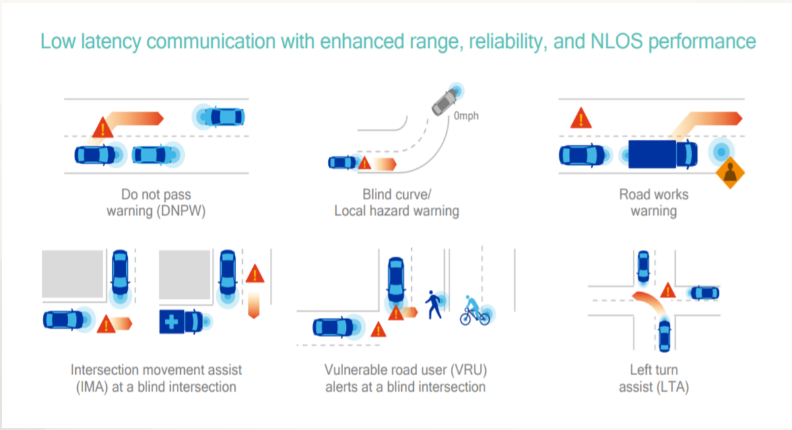

*그림 26. 능동 안전 유즈케이스를 위한 직접 통신*

그림 26의 여섯 가지 유즈케이스는 추월 금지 경고(DNPW), 굽은 길과 지역 위험 경고(정지한 차량이 굽은 길 너머에 있음), 도로 공사 경고, 사각 교차로에서의 교차로 진입 보조(IMA), 사각 교차로에서의 교통 약자 경고, 좌회전 보조(LTA)이다. 모두 운전자나 차량 센서가 미리 알아차리기 어려운 위험을 짧은 지연으로 알려야 한다.

> **용어 정의:** **비가시선(NLOS, non-line-of-sight)** 은 송신기와 수신기 사이에 건물이나 다른 차량 같은 장애물이 있어 서로 직접 보이지 않는 상태이다. 카메라와 레이더는 NLOS의 물체를 감지하기 어렵지만, 전파는 반사와 회절로 장애물 너머까지 전달될 수 있다.

지연을 어느 정도 허용하는 유즈케이스에는 네트워크 통신을 쓴다. 텔레매틱스, 인포테인먼트, 정보 제공형 안전 서비스가 여기에 속한다.

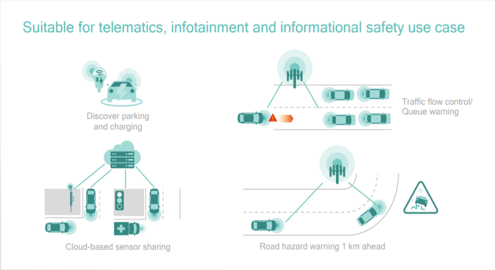

*그림 27. 지연이 허용되는 유즈케이스의 네트워크 통신*

그림 27의 유즈케이스는 주차장과 충전소 찾기, 교통 흐름 제어와 대기 행렬 경고, 클라우드 기반 센서 공유, 1 km 앞의 도로 위험 경고이다.

### 1.14 5GAA와 C-V2X 시연

> **용어 정의:** **5GAA(5G Automotive Association)** 는 자동차 산업과 통신 산업이 함께 만든 국제 단체로, C-V2X를 비롯한 셀룰러 기반 차량 통신의 개발과 보급을 추진한다.

5GAA의 주요 사실은 다음과 같다.

- 2016년 9월 Audi, BMW, Daimler, Ericsson, Huawei, Intel, Nokia, Qualcomm이 참여하여 창설했다.
- 5G가 C-ITS와 ITS를 위한 궁극적인 플랫폼이 된다는 비전을 내세우며, C-V2X의 강력한 지지자이다.
- 2017년 4월 3GPP에 합류했다.
- 2018년 2월 2020년까지 LTE-V2X를 보급하겠다고 공표했다.

5GAA가 2017년 12월에 발표한 LTE-V2X 보급 일정은 표 23과 같다 [21].

| 항목 | 일정 |
|:-----|:-----|
| 여러 공급사의 C-V2X(R14) 칩셋 | 2017년 하반기 시험용 칩셋, 2018년 상호 운용성 시험, 2019년 모드 4 칩셋의 상용 공급 |
| 완성차 업체와의 통합, 검증, 시험 (유럽, 중국, 미국) | 2018년 상반기\~2020년 |
| 교통 인프라 시험 (유럽, 중국, 미국) | 2018년 상반기\~2020년 |
| 5.9 GHz 주파수 확보 목표 | 2017년 하반기 유럽 주파수와 중국 시험 주파수 확보, 2018년 중국 상용 주파수, 2018년 하반기 유럽, 2019년 미국 상용 주파수 |
| 차량 보급 시작 | 2020년 |

*표 23. 5GAA의 LTE-V2X 보급 일정 (2017년 12월 발표)*

같은 자료는 C-V2X가 2017년 6월 3GPP Release 14로 규격화되었고, 상용 칩셋이 2018년에 준비되며, 형식 승인을 받은 차량의 상용 보급은 늦어도 2020년에 세계적으로 시작될 것이라고 전망했다. 여기서 모드 4는 1.6절에서 본 단말의 자율적 자원 선택 방식이다.

5GAA는 C-V2X 직접 통신(PC5)을 실제 도로 환경에서 시연했다.

- **미국 시연:** 2018년 4월 말 미국 워싱턴 D.C.에서 Audi, Ford, Qualcomm이 ITS 5.9 GHz 대역에서 여섯 가지 시나리오로 C-V2X 직접 통신을 시연했다.
- **유럽 시연:** 2018년 7월 5GAA, BMW 그룹, Ford, PSA 그룹, Qualcomm, Savari가 프랑스 파리에서 여러 제조사의 차량 사이의 C-V2X 직접 통신을 유럽 최초로 함께 시연했다. 실시간으로 진행된 이 시연에서는 승용차, 오토바이, 도로 시설 사이의 직접 통신을 선보였다.

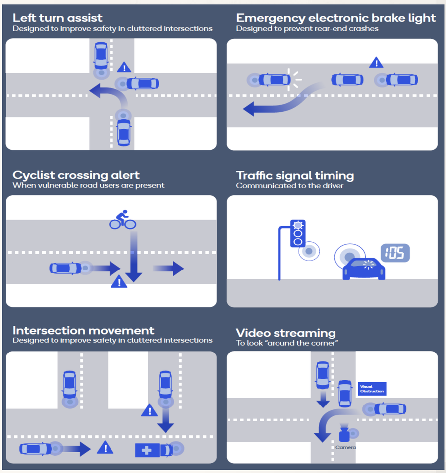

*그림 28. 미국 시연의 C-V2X 시나리오*

| 시연 | 시나리오 |
|:-----|:-----|
| 미국 (2018년 4월) | 좌회전 보조, 전자식 긴급 제동등, 자전거 횡단 경고, 신호등 시간 정보, 교차로 진입 보조, 모퉁이 너머를 보는 영상 스트리밍 |
| 유럽 (2018년 7월) | 긴급 제동 경고등(후방 추돌 방지), 교차로 좌회전 충돌 경고, 신호 변경과 시간 정보, 보행자 보호 경고(보행자와 자전거 보호), 교차로 충돌 경고, 정지 차량 경고(후방 추돌 방지) |

*표 24. 5GAA C-V2X 시연의 시나리오*

### 1.15 3GPP가 정의한 5G-V2X 유즈케이스

3GPP TR 22.886은 5G-V2X의 유즈케이스를 다음과 같이 분류했다 [22], [23].

| 분류 | 유즈케이스 |
|:-----|:-----|
| 일반(general) | 서로 다른 3GPP RAT를 쓰는 차량 사이의 통신, 다중 PLMN 환경, 다중 RAT 유즈케이스, 5G 커버리지 밖의 유즈케이스, 동적 승차 공유, 차량을 통한 테더링, ECU의 안전한 소프트웨어 업데이트 |
| 확장 센서(extended sensor) | 센서와 상태 지도 공유, 주변 환경의 집단 인지(collective perception of environment), 자율주행을 위한 영상 데이터 공유 |
| 고급 주행(advanced driving) | 협력 충돌 회피(CoCA), 제한된 자율주행과 완전 자율주행을 위한 정보 공유, 긴급 궤적 정렬, 도심 주행을 위한 교차로 안전 정보 제공, 자율주행차의 협력 차로 변경(CLC), V2X 시나리오를 위한 3D 영상 합성 |
| 군집주행(platooning) | 차량 군집주행 지원, 군집 내부의 정보 교환, 근거리 그룹을 위한 자동 협조 주행, 제한된 자율 군집주행과 완전 자율 군집주행을 위한 정보 공유, 주행 모드 변경 |
| 원격 주행(remote driving) | 원격 주행 지원, 원격 조작 지원(TeSo) |

*표 25. 3GPP가 정의한 5G-V2X 유즈케이스*

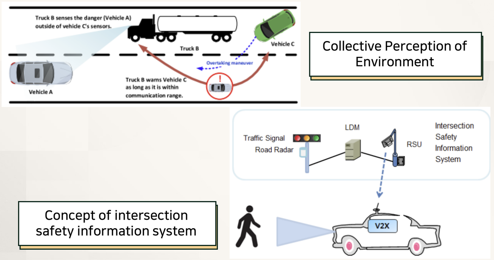

*그림 29. 주변 환경의 집단 인지와 교차로 안전 정보 시스템*

그림 29의 위쪽은 **집단 인지(collective perception)** 의 예이다. 트럭 B는 자기 센서로 차량 A를 감지하지만, 트럭 B 뒤의 차량 C는 트럭에 가려 차량 A를 보지 못한다. 차량 C가 추월하려 할 때 트럭 B는 통신 거리 안에 있는 차량 C에게 차량 A의 존재를 경고한다. 아래쪽은 **교차로 안전 정보 시스템**으로, 신호등과 도로 레이더가 수집한 정보가 LDM 서버를 거쳐 노변 기지국(RSU)으로 전달되고, RSU는 보행자처럼 차량 센서가 보지 못하는 대상의 정보를 V2X로 차량에 알린다.

> **용어 정의:** **LDM(Local Dynamic Map, 지역 동적 지도)** 은 정적인 도로 지도 위에 신호 상태, 주변 차량과 보행자의 위치처럼 시시각각 바뀌는 정보를 겹쳐 관리하는 데이터베이스이다.

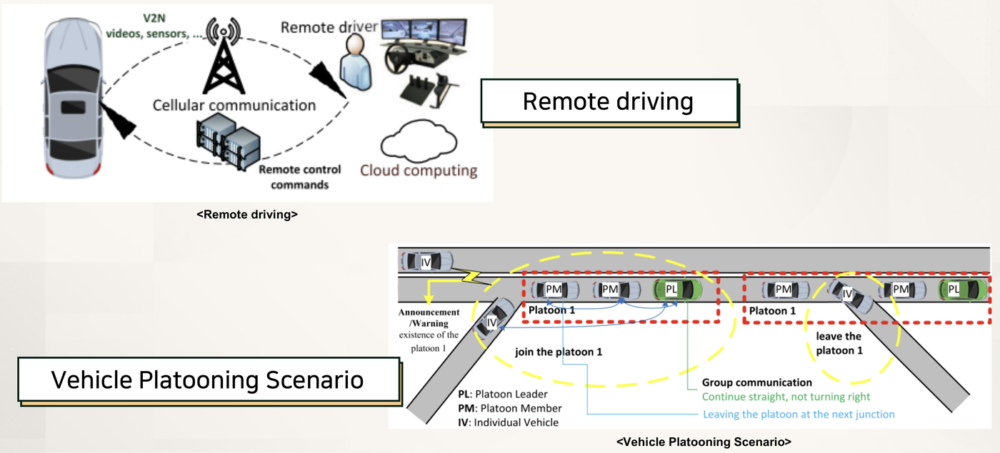

*그림 30. 원격 주행과 차량 군집주행 시나리오*

그림 30의 왼쪽은 **원격 주행**이다. 차량은 V2N으로 영상과 센서 데이터를 셀룰러 통신망을 통해 원격 운전자에게 보내고, 원격 운전자는 원격 제어 명령을 보낸다. 클라우드 컴퓨팅이 이 과정을 돕는다. 오른쪽은 **차량 군집주행**이다. 군집 선두 차량(PL, platoon leader)과 군집 구성 차량(PM, platoon member)이 그룹 통신으로 주행 정보를 공유한다. 개별 차량(IV, individual vehicle)은 군집의 존재를 알리는 공지와 경고를 받아 군집에 합류할 수 있고, 다음 교차로에서 다른 방향으로 갈 구성 차량은 군집에서 이탈한다. 그룹 통신은 "직진하고 우회전하지 않음", "다음 교차로에서 군집을 떠남" 같은 의도를 공유한다.

> **용어 정의:** **군집주행(platooning)** 은 여러 차량이 통신으로 속도와 제동을 맞추어 짧은 차간 거리로 줄지어 달리는 주행 방식이다. 공기 저항이 줄어 연료를 아끼고 도로 용량이 늘어나지만, 앞차의 제동 정보가 매우 짧은 지연으로 전달되어야 한다.

---

<br>

## 2. 자율주행 무선통신: CALM 하이브리드 통신 기술

1절의 C-V2X와 13주차의 WAVE는 각각 하나의 무선 기술을 중심으로 한 차량 통신 체계이다. 실제 차량은 이동통신, 5.9 GHz 차량 통신, 무선 LAN, 위성, 방송처럼 여러 무선 기술을 함께 쓸 수 있으므로, 상황에 따라 가장 알맞은 기술을 골라 끊김 없이 통신하는 구조가 필요하다. 이렇게 여러 접속 기술을 묶어 쓰는 통신을 **하이브리드 통신(hybrid communications)** 이라 하며, 국제 표준화 기구 ISO가 이를 위해 정의한 표준 체계가 CALM이다.

> **용어 정의:** **CALM(Communications Access for Land Mobiles)** 은 ISO의 지능형 교통 체계 기술위원회(ISO TC204) 산하 WG16이 만든 육상 이동체 통신 표준 체계이다. 하나의 ITS 스테이션이 여러 무선 접속 기술을 동시에 갖추고, 응용의 요구와 통신 환경에 따라 접속 기술을 골라 쓰거나 바꾸어 쓰게 한다.

### 2.1 CALM의 개념과 초기 아키텍처

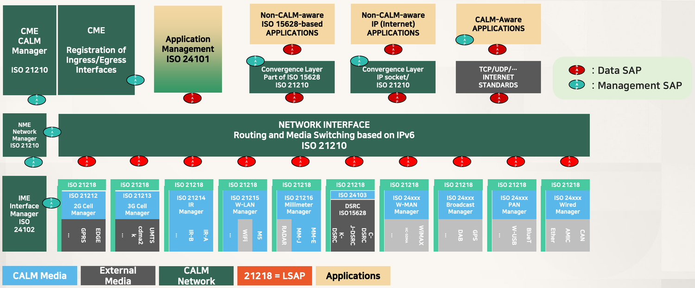

*그림 31. 초기 단계의 CALM 아키텍처*

그림 31은 초기 단계의 CALM 아키텍처이다. 맨 아래에는 여러 통신 매체가 있다. 2G 셀룰러(GPRS, EDGE), 3G 셀룰러(UMTS, cdma2000), 적외선(IR), 무선 LAN(Wi-Fi, M5), 밀리미터파(레이더, MM-J, MM-E), DSRC(J-DSRC, K-DSRC, C-DSRC 같은 지역별 DSRC), 무선 MAN(WiMAX, HC-SDMA), 방송(DAB, GPS), 개인 영역 네트워크(무선 USB, Bluetooth), 유선(Ethernet, AMIC, CAN)이 각각의 매체 관리자(manager)를 통해 연결된다. 매체마다 ISO 21212(2G), ISO 21213(3G), ISO 21214(IR), ISO 21215(W-LAN), ISO 21216(밀리미터파) 같은 표준이 있고, 모든 매체의 윗면은 ISO 21218이 정의한 링크 서비스 접근점(LSAP)으로 통일된다.

그 위의 네트워크 인터페이스(ISO 21210)는 IPv6를 바탕으로 경로 설정과 매체 전환을 맡는다. 맨 위에는 세 종류의 응용이 있다. CALM을 인식하지 못하는 ISO 15628(DSRC 응용 계층) 기반 응용과 IP(인터넷) 응용은 수렴 계층(convergence layer)을 거쳐 연결되고, CALM을 인식하는 응용은 TCP/UDP 같은 인터넷 표준 위에서 직접 동작한다. 왼쪽의 관리 개체(CME, CALM Management Entity)는 CALM 관리자와 입출력 인터페이스 등록을 맡고, 네트워크 관리자(NME)와 인터페이스 관리자(IME, ISO 24102)가 각 계층을 관리하며, 응용 관리는 ISO 24101이 정의한다. 범례의 빨간 점은 데이터를 주고받는 데이터 SAP, 청록색 점은 관리 정보를 주고받는 관리 SAP이다. 아래쪽 범례는 CALM 매체(옅은 파란색), 외부 매체(회색), CALM 네트워크 요소(짙은 녹색), ISO 21218의 LSAP(주황색), 응용(베이지색)을 색으로 구분한다.

> **용어 정의:** **SAP(Service Access Point, 서비스 접근점)** 은 한 계층이 위나 옆의 계층에 서비스를 제공하는 논리적인 접점이다. 데이터나 명령은 SAP를 통해서만 계층 사이를 오간다.

CALM의 목표는 다음 여섯 가지로 정리된다.

1. 넓은 지역의 중장거리 통신을 지원한다.
2. 서비스 중심의 광역 ITS 통신을 지원한다.
3. 셀룰러, M5, 적외선(IR) 등 다양한 무선 통신 기술의 접속을 지원한다.
4. 핸드오버와 로밍을 통해 끊김 없는 연속 통신과 여러 지점과의 동시 통신(multipoint communication)을 제공한다.
5. ITS 전용의 비IP(non-IP) 통신과 IPv6 기반 인터넷 통신을 모두 지원한다.
6. 비IP 방식의 차량 간(V2V) 통신을 지원한다.

> **용어 정의:** **핸드오버(handover)** 는 이동하는 단말의 연결을 한 기지국이나 접속 기술에서 다른 것으로 끊김 없이 넘기는 것이다.

### 2.2 CALM의 통신 환경과 통신 시나리오

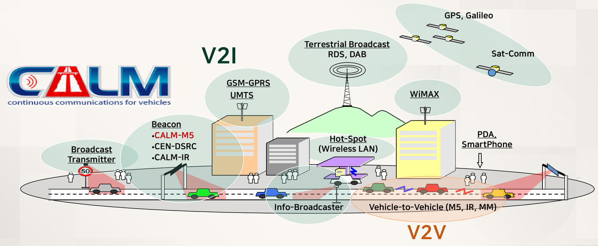

*그림 32. CALM이 묶는 여러 통신 매체와 통신 환경*

그림 32는 CALM이 아우르는 통신 환경이다. 차량은 V2I 통신으로 비컨(CALM-M5, CEN-DSRC, CALM-IR), 방송 송신기, 셀룰러망(GSM-GPRS, UMTS), 지상파 방송(RDS, DAB), WiMAX, 무선 LAN 핫스폿, 정보 방송 장치와 연결되고, 위성 측위(GPS, Galileo)와 위성 통신, 운전자의 PDA와 스마트폰과도 연결된다. 차량끼리는 M5, 적외선, 밀리미터파(MM)로 V2V 통신을 한다. 그림 속 CALM 로고의 문구(continuous communications for vehicles)는 이처럼 여러 매체를 바꾸어 가며 차량의 통신을 끊기지 않게 하려는 목표를 나타낸다.

CALM은 ITS 스테이션이 차량에 있는지 도로변에 있는지, 다른 스테이션의 통신을 중계하는지에 따라 여덟 가지 통신 시나리오를 정의한다.

| 번호 | 통신 시나리오 |
|:-----|:-----|
| 1 | 차량 스테이션과 노변 스테이션 사이의 단일 홉 링크이다. 노변 스테이션을 통해 인터넷에 접속할 수도 있다. |
| 2 | 두 차량 스테이션 사이의 단일 홉 링크이다. |
| 3 | 두 노변 스테이션 사이의 단일 홉 링크이다. 인터넷에 접속할 수도 있다. |
| 4 | 차량 스테이션이 다른 차량 스테이션과 노변 스테이션 사이를 중계한다. 노변 스테이션을 통해 인터넷에 접속할 수도 있다. |
| 5 | 차량 스테이션이 두 차량 스테이션 사이를 중계한다. |
| 6 | 노변 스테이션이 두 노변 스테이션 사이를 중계한다. 인터넷에 접속할 수도 있다. |
| 7 | 노변 스테이션이 두 차량 스테이션 사이를 중계한다. |
| 8 | 차량 스테이션이 두 노변 스테이션 사이를 중계한다. |

*표 26. CALM의 통신 시나리오*

> **용어 정의:** **홉(hop)** 은 패킷이 한 노드에서 다음 노드로 한 번 전달되는 구간이다.

> **용어 정의:** **단일 홉(single-hop)** 링크는 두 스테이션이 직접 연결된 것이고, 중계 스테이션(forwarding station)을 거치면 다중 홉(multi-hop) 통신이 된다.

### 2.3 ITS 스테이션의 구현 형태

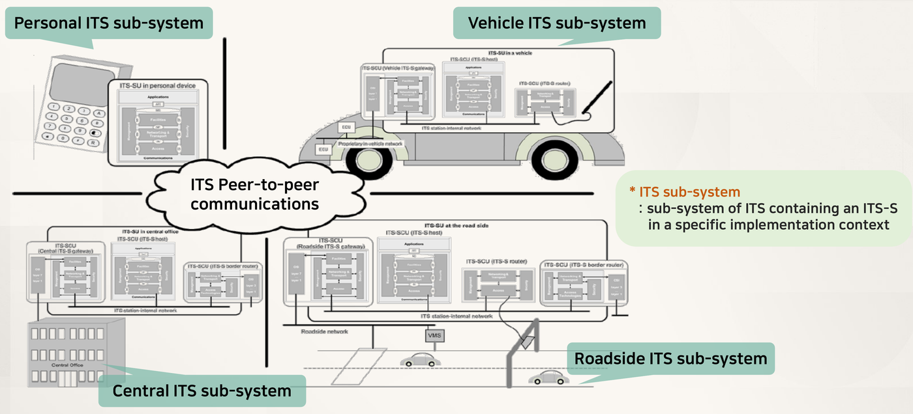

*그림 33. ITS 스테이션의 대표적인 구현 형태*

ITS 스테이션은 어디에 설치되느냐에 따라 네 가지 **ITS 서브시스템**으로 구현된다. ITS 서브시스템은 특정한 구현 환경에 놓인 ITS 스테이션을 포함하는 ITS의 하위 시스템이다.

| 서브시스템 | 구현 예 |
|:-----|:-----|
| 개인 ITS 서브시스템(personal) | 스마트폰이나 개인 단말에 구현된 ITS 스테이션이다. |
| 차량 ITS 서브시스템(vehicle) | 차량에 구현된 ITS 스테이션이다. 차량 내부 네트워크로 여러 장치(호스트, 라우터, 게이트웨이)가 연결된다. |
| 노변 ITS 서브시스템(roadside) | 신호등, 표지판 같은 도로변 시설에 구현된 ITS 스테이션이다. |
| 중앙 ITS 서브시스템(central) | 교통 관제 센터 같은 중앙 시설에 구현된 ITS 스테이션이다. |

*표 27. ITS 서브시스템의 종류*

네 서브시스템은 그림 33 가운데의 ITS 피어 투 피어 통신(ITS peer-to-peer communications)으로 서로 대등하게 통신한다. 어느 서브시스템이든 같은 참조 아키텍처를 따르므로 서로 연동할 수 있다.

### 2.4 ISO TC204 WG16의 구성

ISO TC204의 WG16(통신)은 OSI 참조 모델의 계층 구조에 맞추어 세부 작업반(SWG, sub-working group)을 두었다.

| 세부 작업반 | 담당 | OSI 계층과의 관계 |
|:-----|:-----|:-----|
| SWG 16.0 | CALM 아키텍처 | 전 계층의 구조 |
| SWG 16.1 | 매체와 관리(media and management) | 하위 계층 (통신 매체) |
| SWG 16.2 | 네트워킹(networking) | 상위 계층 (네트워크) |
| SWG 16.3 | 프로브 데이터(probe data) | 응용 핵심 기능 |
| SWG 16.4 | 응용 관리(application management) | 응용 핵심 기능 |
| SWG 16.5 | 재난 감시(disaster monitoring) | 응용 핵심 기능 |
| SWG 16.6 | 보안과 합법적 감청(security and lawful intercept) | 전 계층 |

*표 28. ISO TC204 WG16의 세부 작업반*

하위 계층이 다루는 통신 매체는 통신 거리에 따라 근거리 전용 통신(DSRC), 중거리 통신(medium area communication), 광역 통신(wide area communication)으로 나뉜다. 맨 위의 개별 응용(individual application)은 응용 인터페이스(application IF)를 통해 이 구조를 이용한다.

### 2.5 ITS 스테이션 참조 아키텍처: ISO 21217

ISO 21217:2014(Intelligent transport systems - Communications access for land mobiles (CALM) - Architecture)는 CALM의 중심 표준이다 [24]. 이 표준은 ITS 스테이션을 이루는 모든 계층과 개체에 필요한 기능과 그 사이의 개방형 인터페이스를 정의하는 데 초점을 두며, 서로 다른 제조사의 ITS 스테이션이 호환되도록 기능을 구현하게 하는 것이 목적이다. 내용은 요구 사항, ITS 스테이션 아키텍처, ITS 스테이션 인터페이스, 대표적인 구현 형태 등으로 이루어진다.

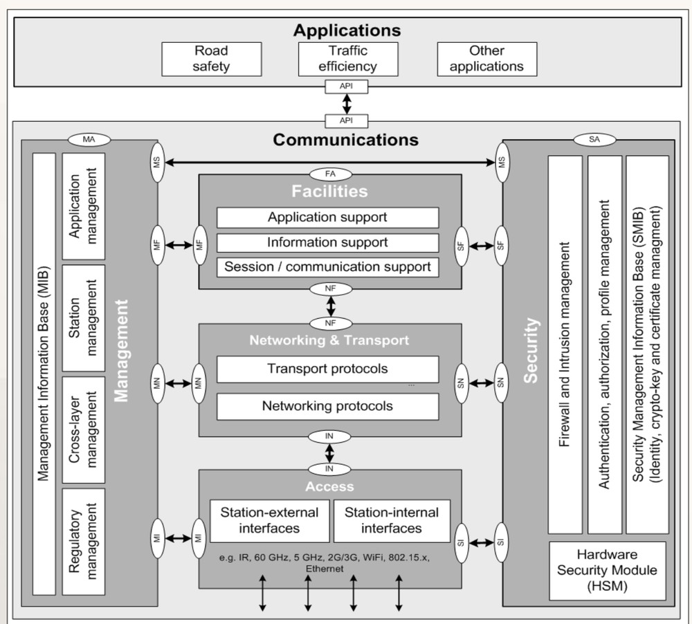

*그림 34. ITS 스테이션 참조 아키텍처*

그림 34의 ITS 스테이션 참조 아키텍처는 가운데에 세 개의 통신 계층을 쌓고, 왼쪽에 관리 개체, 오른쪽에 보안 개체를 세로로 둔다 [24], [25].

| 구성 요소 | 하는 일 | 대응하는 OSI 계층 |
|:-----|:-----|:-----|
| 응용(applications) | 도로 안전, 교통 효율, 기타 응용이다. API로 통신 계층을 이용한다. | 응용 |
| 퍼실리티 계층(facilities layer) | 응용 지원, 정보 지원, 세션과 통신 지원처럼 여러 응용이 공통으로 쓰는 기능을 제공한다. | 5\~7계층 |
| 네트워킹 및 전송 계층(networking & transport layer) | 전송 프로토콜과 네트워킹 프로토콜로 패킷의 경로와 전달을 맡는다. | 3, 4계층 |
| 접속 계층(access layer) | 적외선, 60 GHz, 5 GHz, 2G/3G, Wi-Fi, IEEE 802.15.x, Ethernet 같은 스테이션 외부, 내부 인터페이스를 제공한다. | 1, 2계층 |
| 관리 개체(management entity) | 관리 정보 베이스(MIB), 응용 관리, 스테이션 관리, 계층 간 관리, 규제 정보 관리를 맡는다. | 전 계층 |
| 보안 개체(security entity) | 방화벽과 침입 관리, 인증과 권한 부여, 프로필 관리, 신원, 암호 키, 인증서를 담은 보안 관리 정보 베이스, 하드웨어 보안 모듈(HSM)을 맡는다. | 전 계층 |

*표 29. ITS 스테이션 참조 아키텍처의 구성 요소*

> **[컴퓨터네트워크]** OSI 참조 모델은 통신 기능을 물리, 데이터 링크, 네트워크, 전송, 세션, 표현, 응용의 일곱 계층으로 나눈 모델이다(5주차). ITS 스테이션 아키텍처는 1, 2계층을 접속 계층으로, 3, 4계층을 네트워킹 및 전송 계층으로, 5\~7계층을 퍼실리티 계층으로 묶고, 모든 계층에 걸치는 관리와 보안을 별도의 개체로 분리했다.

ISO 21217이 정의하는 기본 용어는 다음과 같다 [24].

| 용어 | 정의 |
|:-----|:-----|
| ITS-S (ITS station) | 퍼실리티 계층, 네트워킹 및 전송 계층, 접속 계층, 관리 개체, 보안 개체, 응용 개체로 이루어져 ITS 서비스를 제공하는 기능적 개체이다. |
| ITS-SU (ITS-S unit) | ITS-S를 실제로 구현한 것이다. |
| ITS-SCU (ITS-S communication unit) | ITS-SU 안에서 그 기능의 일부나 전부를 담은 물리적 장치이다. |

*표 30. ITS 스테이션의 기본 용어*

예를 들어 한 차량의 ITS 스테이션(ITS-S)을 구현한 것이 ITS-SU이고, 그 안에 V2X 통신 모듈과 셀룰러 통신 모듈이 따로 들어 있다면 두 모듈이 각각 ITS-SCU이다.

ITS-S를 이루는 장치(노드)는 패킷을 다루는 방식에 따라 세 가지로 나뉜다 [24].

| 노드 | 정의 | 패킷 전달 |
|:-----|:-----|:-----|
| ITS-S 호스트(host) | 라우터, 경계 라우터, 이동 라우터, 게이트웨이의 기능을 제외한 ITS-S 기능으로 이루어진 노드이다. | 자기에게 오지 않은 패킷은 전달하지 않는다. |
| ITS-S 라우터(router) | 두 네트워크를 연결하는 라우팅 기능으로 이루어진 노드이다. | 자기에게 오지 않은 패킷을 다른 네트워크로 전달한다. |
| ITS-S 게이트웨이(gateway) | 4계층(네트워킹 및 전송 계층)보다 위에서 서로 다른 두 프로토콜 스택을 연결하는 노드이다. | 서로 다른 프로토콜 사이를 변환할 수 있다. |

*표 31. ITS 스테이션의 노드 종류*

> **[컴퓨터네트워크]** 인터넷에서 호스트는 데이터를 만들고 받는 끝 장치이고, 라우터는 3계층에서 네트워크 사이로 패킷을 전달하는 장치이다. 게이트웨이는 프로토콜 체계가 서로 다른 두 네트워크를 상위 계층에서 이어 주는 장치로, 차량에서는 CAN 같은 차량 내부 네트워크와 외부 통신망을 잇는 장치가 대표적이다.

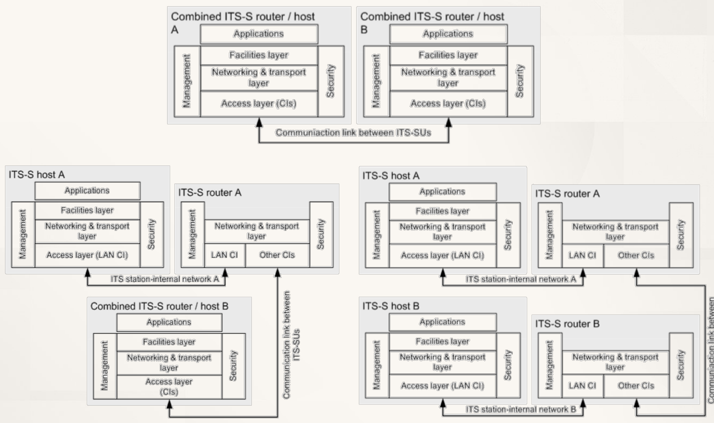

*그림 35. ITS 스테이션 아키텍처의 적용 예*

그림 35는 아키텍처를 실제 장치에 적용하는 세 가지 예이다. 위쪽은 라우터와 호스트 기능을 하나로 합친 두 장치(combined ITS-S router/host A, B)가 ITS-SU 사이의 통신 링크로 직접 연결된 경우이다. 왼쪽 아래는 호스트 A와 라우터 A가 스테이션 내부 네트워크 A(LAN 통신 인터페이스)로 연결되고, 라우터 A가 다른 통신 인터페이스로 상대 스테이션의 합친 장치 B와 연결된 경우이다. 오른쪽 아래는 양쪽 스테이션이 모두 호스트와 라우터를 따로 두고 각자의 내부 네트워크로 연결한 경우이다. 어떤 경우든 각 장치는 그림 34의 계층 구조를 따른다.

### 2.6 ITS-S 접속 계층

ITS-S 접속 계층은 스테이션 내부와 외부의 개체들 사이에 통신 수단을 제공한다. 접속 계층이 제공하는 인터페이스는 네 종류이다 [24].

| 구분 | 스테이션 외부와의 통신 | 스테이션 내부 통신 |
|:-----|:-----|:-----|
| 무선 | (a) ITS-S 외부로의 무선 인터페이스 (예: 5.9 GHz, 셀룰러) | (c) 스테이션 내부 통신을 위한 무선 인터페이스 |
| 유선 | (b) ITS-S 외부로의 유선 인터페이스 | (d) 스테이션 내부 통신을 위한 유선 인터페이스 (예: 차량 내 Ethernet) |

*표 32. ITS-S 접속 계층이 제공하는 인터페이스*

다양한 접속 기술은 ITS-S 관리 개체(MI 인터페이스), 보안 개체(SI 인터페이스), 네트워킹 및 전송 계층(IN 인터페이스)과 연결되도록 변형될 수 있다. 원래 ITS를 위해 만들어지지 않은 Wi-Fi나 셀룰러 모듈도 이런 적응 기능을 더하면 ITS 스테이션의 접속 계층으로 쓸 수 있다는 뜻이다.

### 2.7 ITS-S 네트워킹 및 전송 계층

ITS-S 네트워킹 및 전송 계층은 다음으로 이루어진다 [24].

1. OSI의 네트워크 계층과 전송 계층에 해당하는 프로토콜
2. 필요하면 관리 적응 개체(MAE, management adaptation entity)와 보안 적응 개체(SAE, security adaptation entity) 같은 수정 요소
3. 관리 개체와의 MN, 보안 개체와의 SN, 접속 계층과의 IN, 퍼실리티 계층과의 NF 인터페이스

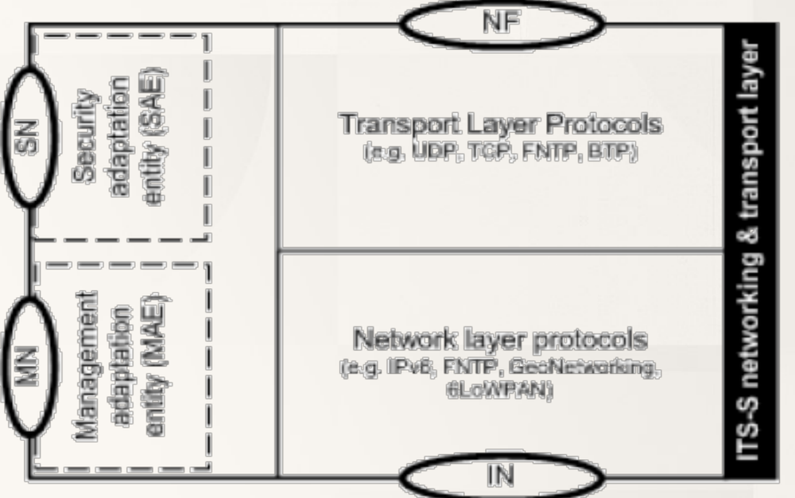

*그림 36. ITS-S 네트워킹 및 전송 계층의 구성 요소*

그림 36에서 계층 안쪽은 위의 전송 계층 프로토콜(UDP, TCP, FNTP, BTP)과 아래의 네트워크 계층 프로토콜(IPv6, FNTP, GeoNetworking, 6LoWPAN)로 나뉘고, 왼쪽의 보안 적응 개체(SAE)와 관리 적응 개체(MAE)가 각각 SN과 MN 인터페이스로 보안 개체와 관리 개체에 연결된다. 위의 NF와 아래의 IN은 퍼실리티 계층, 접속 계층과의 인터페이스이다.

네트워킹 및 전송 계층에서 쓰는 네트워크 프로토콜은 다음과 같다 [24].

| 프로토콜 | 특징 |
|:-----|:-----|
| IPv4 | 가장 널리 보급된 IP 버전이다. 다만 주소가 고갈되어 C-ITS의 보급 요건을 완전히 충족하지 못한다. |
| IPv6 | C-ITS에 필요한 요건을 제공하며 사실상 무한한 주소를 제공한다. IPv4 기반 시스템과 통신하려면 IPv4-IPv6 변환 메커니즘을 쓴다. |
| 6LoWPAN | 저전력 무선 개인 영역 네트워크에서 IPv6 패킷을 압축하여 전달하는 기술이다. |
| FNTP | 시간 요건이 엄격하고 지연이 짧아야 하는 ITS-S 응용을 위해 설계되었다. IP 같은 일반적인 네트워킹 기능 대신 MAC 주소로 네트워크의 노드에 접근한다. |
| WSMP | WAVE Short Message Protocol이다. 시간이 결정적인 안전 응용처럼 시간 요건이 엄격하고 지연이 짧아야 하는 응용을 위해 설계되었다. |
| GeoNetworking | 목적지 스테이션이 있는 대상 지역을 지리 좌표로 지정한다. EU의 GeoNet 연구 과제를 통해 기반이 개발되었다. |

*표 33. ITS-S 네트워킹 프로토콜*

IPv4 주소는 32비트이므로 $2^{32} = 4{,}294{,}967{,}296$, 약 43억 개뿐이다. 차량, 노변 기지국, 센서마다 주소가 필요한 ITS에는 부족하다. IPv6 주소는 128비트이므로 $2^{128} \approx 3.4 \times 10^{38}$개로, 사실상 고갈될 걱정이 없다. IPv4와 IPv6는 13주차에서 다루었다.

WSMP는 13주차에서 본 IEEE 1609.3의 프로토콜로, IP 헤더 없이 짧은 안전 메시지를 보낸다 [26]. GeoNetworking은 IP 주소 대신 위치를 기준으로 패킷을 전달하는 유럽 ETSI의 네트워크 프로토콜로, 특정 위치의 한 스테이션에 보내는 GeoUnicast, 지정한 지역 안의 모든 스테이션에 보내는 GeoBroadcast, 지정한 지역 안의 아무 스테이션 하나에 보내는 GeoAnycast를 제공한다 [27]. "교차로 반경 200 m 안의 모든 차량"처럼 지역을 목적지로 삼는 V2X 메시지에 알맞다.

전송 프로토콜로는 ITS-S의 통신 요건을 만족하기 위해 다음 네 가지를 쓴다.

| 프로토콜 | 특징 |
|:-----|:-----|
| UDP (User Datagram Protocol) | 연결 설정과 재전송이 없는 간단한 전송 프로토콜이다. 지연이 짧다. |
| TCP (Transmission Control Protocol) | 연결을 설정하고 순서와 재전송을 보장하는 신뢰성 있는 전송 프로토콜이다. |
| FNTP (Fast Networking & Transport Layer Protocol) | 네트워킹과 전송 기능을 하나로 합친 ITS 전용의 경량 프로토콜이다. |
| BTP (Basic Transport Protocol) | GeoNetworking 위에서 포트 번호로 응용을 구분하는 간단한 전송 프로토콜이다. |

*표 34. ITS-S 전송 프로토콜*

BTP는 UDP처럼 연결 없이 포트 번호만 붙여 GeoNetworking 패킷을 알맞은 응용에 넘겨준다 [28].

### 2.8 ITS-S 관리 개체

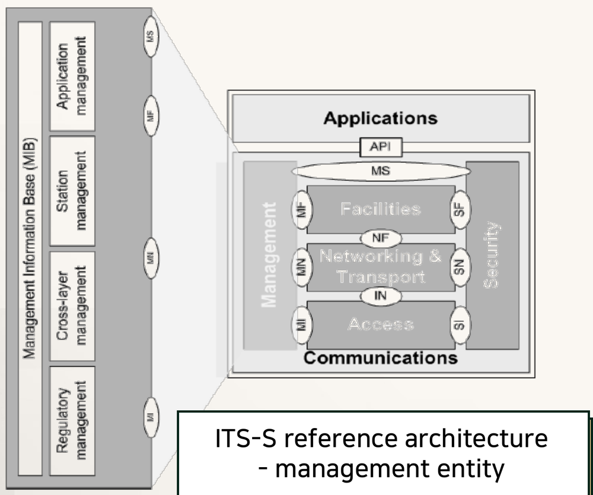

*그림 37. ITS-S 참조 아키텍처의 관리 개체*

ITS-S 관리 개체는 다음으로 이루어진다 [24].

- 여러 가지 관리 프로토콜
- 관리 정보 베이스(MIB, Management Information Base)
- ITS-SCU 사이의 스테이션 내부 관리 통신의 지원
- 접속 계층과의 MI, 네트워킹 및 전송 계층과의 MN, 퍼실리티 계층과의 MF, 보안 개체와의 MS, 응용 개체와의 MA(API를 통함) 인터페이스

그림 37에서 관리 개체는 MIB를 중심으로 응용 관리, 스테이션 관리, 계층 간 관리(cross-layer management), 규제 정보 관리(regulatory management)로 나뉜다. 계층 간 관리는 예를 들어 접속 계층이 측정한 무선 링크의 품질을 네트워킹 계층의 경로 선택에 알려 주는 것처럼, 한 계층의 정보를 다른 계층의 결정에 쓰게 한다.

ITS-S 관리는 다른 스테이션이 원격으로 관리하는 **원격 관리(remote ITS-S management)** 와 스테이션 안에서 하는 **로컬 관리(local ITS-S management)** 로 나뉜다. 로컬 관리는 다시 한 ITS-SCU 안의 관리와, 여러 ITS-SCU에 걸친 ITS-S 전체의 관리로 나뉜다.

> **용어 정의:** **MIB(Management Information Base, 관리 정보 베이스)** 는 장치의 설정값, 상태, 통계처럼 관리에 필요한 정보를 정해진 구조로 모아 둔 데이터베이스이다. 관리 프로토콜은 MIB의 값을 읽거나 바꾸어 장치를 관리한다.

### 2.9 접속 기술 지원: ISO 21218

ISO 21218(Intelligent transport systems - Hybrid communications - Access technology support)은 모든 접속 기술 또는 여러 접속 기술에 공통으로 적용되는 ITS 스테이션 접속 계층의 구조를 정의한다 [29].

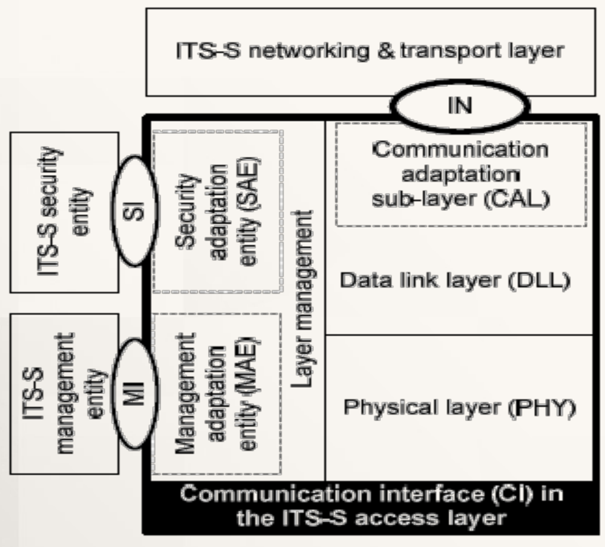

*그림 38. ITS-S 접속 계층의 구조*

그림 38에서 접속 계층의 한 **통신 인터페이스(CI, communication interface)** 는 아래부터 물리 계층(PHY), 데이터 링크 계층(DLL), 통신 적응 부계층(CAL, communication adaptation sub-layer)으로 이루어진다. CAL은 접속 기술마다 다른 하위 계층을 네트워킹 및 전송 계층(IN 인터페이스)에 같은 모양으로 보여 주는 적응 계층이다. 옆의 계층 관리(layer management)와 관리 적응 개체(MAE), 보안 적응 개체(SAE)는 MI와 SI 인터페이스로 관리 개체, 보안 개체와 연결된다.

ISO 21218의 주요 내용은 다음과 같다.

| 내용 | 설명 |
|:-----|:-----|
| CI의 분류(classification of CIs) | 접속 기술의 특성(방송 가능 여부, 연결 방식 등)에 따라 CI를 분류한다. |
| 링크 식별자(Link-ID) | 한 CI 위의 특정 통신 링크를 식별하는 번호이다. |
| CI와 VCI의 개념과 절차 | 하나의 물리적 CI 위에 상대 스테이션별, 또는 방송용의 논리적 인터페이스(VCI)를 만들고 관리하는 절차이다. |
| I-파라미터(I-Parameter) | CI의 설정과 상태를 나타내는 파라미터로, 관리 개체가 읽고 쓴다. |
| 통신 SAP와 관리 SAP | 접속 계층이 데이터와 관리 정보를 주고받는 접점이다. |

*표 35. ISO 21218의 주요 내용*

> **용어 정의:** **CI(communication interface, 통신 인터페이스)** 는 접속 기술 하나를 구현한 통신 장치의 인스턴스(예: 5.9 GHz 무선 모듈 하나)이다.

> **용어 정의:** **VCI(virtual communication interface, 가상 통신 인터페이스)** 는 하나의 CI 위에 만든 논리적인 인터페이스로, 특정 상대와의 유니캐스트 링크나 방송 링크 하나에 해당한다.

### 2.10 로컬 메시지: ISO/TS 16460

ISO/TS 16460:2016(Intelligent transport systems - Communications access for land mobiles (CALM) - Communications protocol messages for global usage)은 미국의 IEEE WAVE와 ISO의 CALM이 같은 무선 메시지를 주고받을 수 있게 하는 기술 사양서이다 [30].

> **용어 정의:** ISO의 **TS(Technical Specification, 기술 사양서)** 는 기술위원회(TC)나 분과위원회(SC) 수준의 합의를 반영한 규범적 문서이다. 앞으로 국제 표준으로 합의될 것이 예상되는 중간 단계의 표준 문서이며, 국제 표준(IS, International Standard)은 아니다.

ISO/TS 16460의 개념과 내용은 다음과 같다.

- **개념:** FNTP와 WSMP를 조화시키고, FSAP와 WSA를 조화시킨다. 이를 통해 IEEE WAVE와 ETSI ITS를 모두 지원하며, 사설 서비스 채널(private service channel)을 지원한다.
- **내용:** 메시지 형식, 로컬 메시지(LM, Localized Message), 서비스 광고 메시지(SAM, Service Advertisement Message), 서비스 응답 메시지(SRM, Service Response Message)를 정의한다.

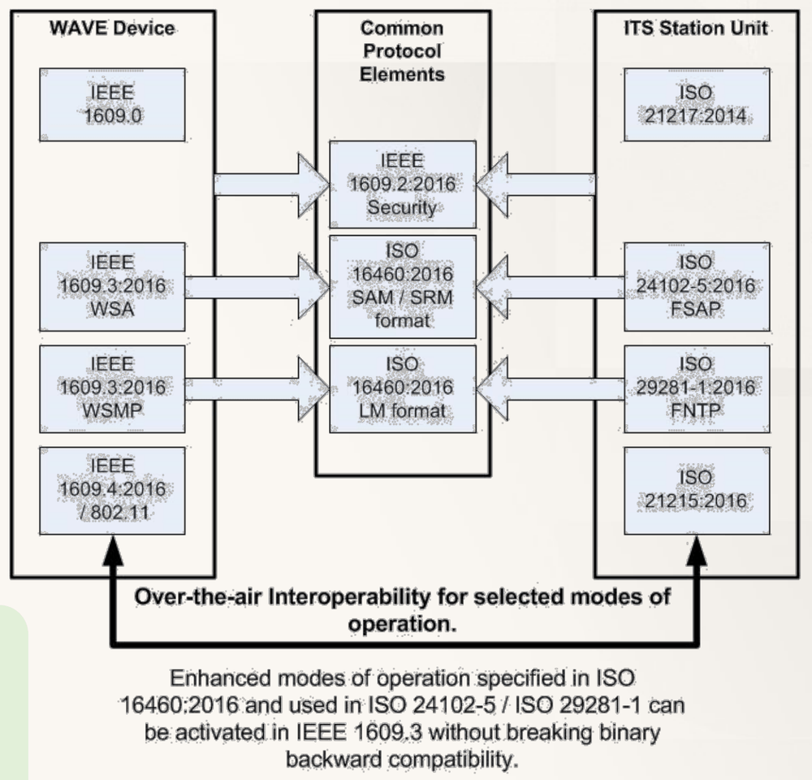

*그림 39. WAVE 장치와 ITS 스테이션이 공유하는 공통 프로토콜 요소*

그림 39의 왼쪽은 WAVE 장치의 표준(IEEE 1609.0 아키텍처, IEEE 1609.3의 WSA와 WSMP, IEEE 1609.4와 IEEE 802.11)이고, 오른쪽은 ITS 스테이션의 표준(ISO 21217 아키텍처, FSAP, FNTP, ISO 21215의 M5)이다. 가운데의 공통 프로토콜 요소(IEEE 1609.2 보안, ISO 16460의 SAM/SRM 형식과 LM 형식)를 양쪽이 함께 쓰므로, 선택된 동작 모드에서는 무선 구간의 상호 운용성(over-the-air interoperability)이 보장된다. ISO 16460에서 정의하고 FSAP와 FNTP가 쓰는 확장 동작 모드는 IEEE 1609.3의 이진 하위 호환성을 깨지 않고 활성화할 수 있다.

ISO/TS 16460이 정의한 LM의 네트워크 계층 프로토콜 데이터 단위(NPDU)의 일반 형식은 그림 40과 같다.

```text
LM NPDU
├─ N-Header
│   ├─ Subtype ..................... 4 bits
│   ├─ N-Extensions flag ........... 1 bit
│   ├─ Version ..................... 3 bits
│   ├─ (depends on Subtype) ........ variable
│   └─ N-Extensions ................ variable
├─ T-Header
│   ├─ TPID
│   │   ├─ Feature selector ........ 7 bits
│   │   └─ T-Extensions flag ....... 1 bit
│   ├─ (depends on TPID) ........... variable
│   ├─ T-Extensions ................ variable
│   └─ Length of User Data ......... 1-2 octets
└─ Body
    └─ User Data ................... variable
```

*그림 40. LM NPDU의 일반 형식*

LM NPDU는 네트워크 헤더(N-Header), 전송 헤더(T-Header), 본문(Body)으로 이루어진다. N-Header의 앞 세 필드는 $4 + 1 + 3 = 8$비트로 정확히 1옥텟이고, T-Header의 TPID(Transport Protocol Identifier)도 $7 + 1 = 8$비트로 1옥텟이다. 확장 플래그(extensions flag)가 1이면 뒤에 확장 필드가 붙고, 0이면 생략된다. 서브타입이나 TPID의 값에 따라 그 기능에 필요한 필드가 이어지며, 마지막으로 사용자 데이터의 길이(1\~2옥텟)와 사용자 데이터가 온다.

서브타입(subtype) 필드는 네트워킹 기능을 고른다.

| Subtype | N-Extensions flag | N-Extensions | 네트워킹 기능 | 비고 |
|:-----|:-----|:-----|:-----|:-----|
| 0 | 0 / 1 | 없음 / 있음 | 널 네트워킹(null networking) | IEEE 1609.3-2016에 정의된 필수 기능 |
| 1 | 0 / 1 | 없음 / 있음 | ITS 스테이션 내부 전달 | |
| 2 | 0 / 1 | 없음 / 있음 | N홉 전달(N-hop forwarding) | |
| 3 | 0 / 1 | 없음 / 있음 | 지리 기반 전달(geo-forwarding) | 예약됨. 이 버전에서는 정의하지 않음 |
| 4\~7 | 0 / 1 | 없음 / 있음 | ISO용 예약 | 네트워킹 기능 4개를 더 정의할 수 있음 |
| 8\~15 | 0 / 1 | 없음 / 있음 | IEEE용 예약 | 네트워킹 기능 8개를 더 정의할 수 있음 |

*표 36. LM NPDU의 서브타입 값*

TPID의 기능 선택자(feature selector)는 전송 기능을 고른다.

| Feature selector | T-Extensions flag | T-Extensions | 전송 기능 | 비고 |
|:-----|:-----|:-----|:-----|:-----|
| 0 | 0 / 1 | 없음 / 있음 | 정보 배포(information dissemination) | IEEE 1609.3-2016에 정의된 필수 기능 |
| 1 | 0 / 1 | 없음 / 있음 | 일반 세션 모드(general session mode) | |
| 2 | 0 / 1 | 없음 / 있음 | LPP 모드 | |
| 3\~10 | 0 / 1 | 없음 / 있음 | ISO용 예약 | 전송 기능 8개를 더 정의할 수 있음 |
| 11\~127 | 0 / 1 | 없음 / 있음 | IEEE용 예약 | 전송 기능 117개를 더 정의할 수 있음 |

*표 37. LM NPDU의 TPID 값*

두 표의 값 범위는 필드의 비트 수와 정확히 맞는다. 4비트 서브타입은 $2^4 = 16$개의 값(0\~15)을 가지며, 정의된 4개(0\~3), ISO 예약 4개(4\~7), IEEE 예약 8개(8\~15)를 더하면 $4 + 4 + 8 = 16$이다. 7비트 기능 선택자는 $2^7 = 128$개의 값(0\~127)을 가지며, 정의된 3개(0\~2), ISO 예약 8개(3\~10), IEEE 예약 117개(11\~127)를 더하면 $3 + 8 + 117 = 128$이다.

예를 들어 필드를 그림 40의 순서대로 첫 옥텟의 상위 비트부터 채운다고 가정하면, Subtype이 2(N홉 전달), N-Extensions flag가 1, Version이 3인 헤더의 첫 옥텟은 다음과 같다.

```math
\underbrace{0010}_{\text{Subtype}=2}\ \underbrace{1}_{\text{flag}}\ \underbrace{011}_{\text{Version}=3} = 00101011_2 = \text{0x2B}
```

### 2.11 FNTP와 FSAP

**FNTP(Fast Networking & Transport Layer Protocol)** 는 ISO 29281-1(Intelligent transport systems - Localized communications - Part 1: Fast networking & transport layer protocol (FNTP))이 정의한 프로토콜이다 [31].

- **개념:** FNTP는 IP를 쓰지 않는(non-IP) 프로토콜이며, 근거리의 로컬 통신(localized communications)을 위한 프로토콜이다. ITS-S 접속 계층에서는 EtherType 값 0x8950으로 식별된다.
- **내용:** 프로토콜 요소(SAP, FNTP NPDU), 일반 프로토콜 절차(포트 관리와 전달 테이블 등), 패킷 송신 절차, 패킷 수신 절차를 정의한다.

> **용어 정의:** **EtherType**은 이더넷 계열 프레임에서 그 안에 실린 상위 프로토콜이 무엇인지 알려 주는 2옥텟 필드이다. 예를 들어 IPv4는 0x0800, IPv6는 0x86DD이고, WAVE의 WSMP는 0x88DC이다 [26]. 수신 장치는 이 값을 보고 프레임을 알맞은 프로토콜에 넘긴다.

FNTP는 IP 헤더, 주소 변환, 경로 탐색 같은 절차를 생략하므로 헤더가 짧고 처리가 빠르다. 그 대신 IP 인터넷과 직접 연결되지 않으므로 주변 스테이션과의 짧고 시간이 중요한 메시지에 쓴다. WAVE의 WSMP와 같은 목적을 갖는 ISO의 프로토콜이라고 볼 수 있으며, 2.10절의 ISO/TS 16460이 두 프로토콜을 조화시킨다. FNTP 참조 아키텍처에서 FNTP는 포트 관리(port management) 기능과 함께 네트워킹 및 전송 계층에 놓이고, 그 아래 접속 계층에는 MAC 그룹캐스트 프레임을 지원하는 ISO 21216(밀리미터파), ISO 21215(M5), ISO 21214(적외선)의 CI와 스테이션 내부망에 접속하는 LAN CI가 있으며, 관리 개체에는 경로와 흐름 관리, CI 관리가 있다.

**FSAP(Fast Service Advertisement Protocol)** 는 ISO 22418이 정의한 프로토콜이다 [32]. 그림 39의 ISO 24102-5는 같은 FSAP를 정의했던 이전 표준이다.

- **개념:** ITS 응용 식별자(ITS-AID)로 고유하게 식별되는 ITS 서비스를 그 지역에서 광고(advertise)하는 것을 지원한다.
- **내용:** FSAM(fast service advertisement message)과 FSRM(fast service response message)의 형식, 세 가지 응용 세션 유형, FSAP 통신 처리기와 FSAP 관리자 등을 포함한 프로토콜 절차를 정의한다.

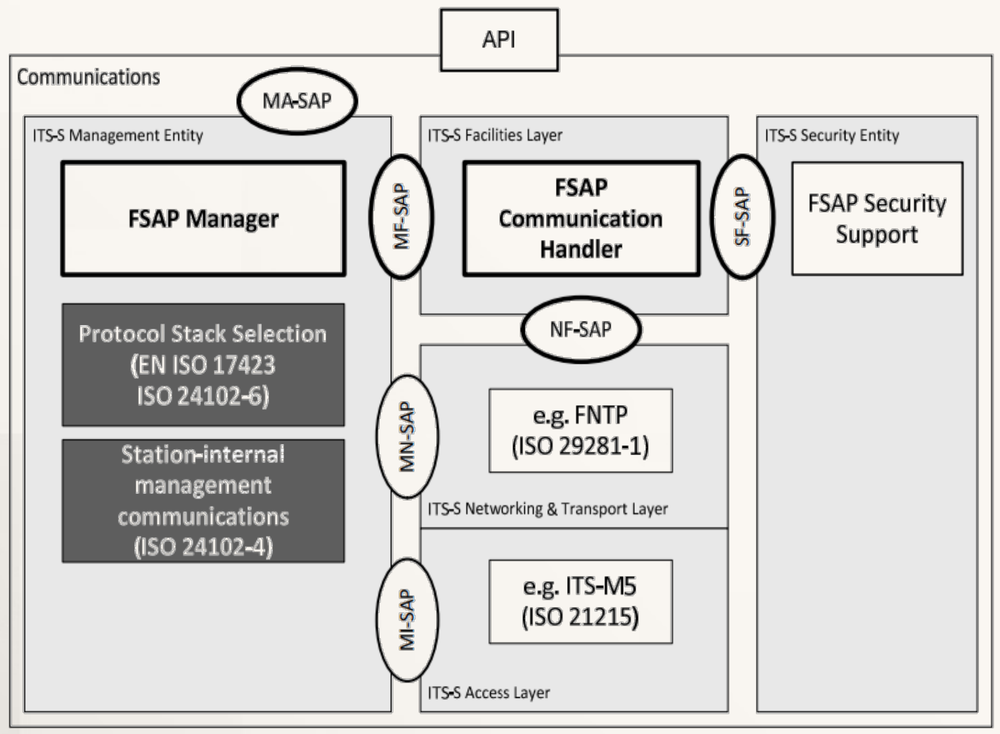

*그림 41. FSAP 참조 아키텍처*

그림 41에서 FSAP의 기능은 여러 개체에 나뉘어 있다. 관리 개체의 FSAP 관리자(FSAP manager)는 프로토콜 스택 선택(EN ISO 17423, ISO 24102-6)과 스테이션 내부 관리 통신(ISO 24102-4)을 이용하고, 퍼실리티 계층의 FSAP 통신 처리기(FSAP communication handler)는 메시지를 만들고 해석하며, 보안 개체의 FSAP 보안 지원이 메시지를 보호한다. 메시지는 네트워킹 및 전송 계층의 FNTP(ISO 29281-1)와 접속 계층의 ITS-M5(ISO 21215)를 통해 전달된다. 각 개체 사이는 MA, MF, SF, NF, MN, MI SAP로 연결된다.

> **용어 정의:** **서비스 광고(service advertisement)** 는 서비스를 제공하는 스테이션(예: 주차장의 노변 기지국)이 어떤 서비스를 어느 채널에서 제공하는지 주기적으로 알리고, 이용하려는 스테이션이 그 정보를 보고 서비스에 참여하는 방식이다.

### 2.12 ITS 스테이션 관리 표준: ISO 24102

ISO 24102 시리즈(Intelligent transport systems - ITS station management)는 ITS 스테이션의 관리 기능을 여러 부(part)로 나누어 정의한다 [33].

**제1부 로컬 관리(ISO 24102-1, local management).** 로컬 ITS 스테이션 관리의 기능, ITS-SCU 안의 CI와 VCI 관리, 간섭 방지를 정의한다. 주요 내용은 CI 관리, CI 간 우선순위 조정(cross-CI prioritization), 규제 정보 관리, 네트워킹 및 전송 계층 관리, 관리 데이터 요소이다.

| 관리 기능 | 내용 |
|:-----|:-----|
| CI와 VCI 관리 | CI와 VCI의 등록, 생성, 활성화, 삭제를 맡는다. |
| CI 간 우선순위 조정 | 스테이션 안의 여러 인터페이스 사이에 간섭이 생기면, 간섭을 일으키는 CI를 멈추고 우선순위가 높은 CI가 송신하게 한다. |
| 규제 정보 관리 | 지역별 법규에 따른 인터페이스의 동작 방식, 속도, 시간 서비스 같은 규제 정보를 관리한다. |
| 네트워킹 및 전송 계층 관리 | 네트워킹 및 전송 계층 프로토콜의 신규 등록, 갱신, 비활성화, 삭제를 맡는다. |
| 관리 데이터 요소 | 스테이션 안에 어떤 SCU가 있고 각 SCU의 유형(호스트, 라우터, 호스트 겸 라우터)이 무엇인지 담은 SCU 목록, VCI 목록, CI 간 우선순위 표 등이다. |

*표 38. ISO 24102-1 로컬 관리의 기능*

CI 간 우선순위 조정이 필요한 예는 요금 징수용 5.8 GHz DSRC와 5.9 GHz M5처럼 주파수가 가까운 두 무선 인터페이스를 한 차량에 함께 다는 경우이다. 한 인터페이스가 송신하는 동안 바로 옆의 다른 인터페이스는 강한 신호에 수신이 방해받을 수 있으므로, 관리 개체가 우선순위가 낮은 쪽의 동작을 잠시 멈춘다.

**제4부 스테이션 내부 관리 통신(ISO 24102-4, station-internal management communications).** 같은 ITS-S 안의 서로 다른 ITS-SCU에 있는 관리 개체들이 스테이션 내부 네트워크를 통해 통신하는 방법을 정의한다. 이 통신(IIC, ITS-S internal management communications)의 특별한 목적은 다른 SCU의 관리 서비스 접근점(SAP)을 원격으로 이용하는 것이다. 주요 내용은 IIC 프로토콜 데이터 단위(PDU), 통신 절차(초기화, 송신, 수신), 관리 절차이다. 참조 아키텍처에서는 관리 개체의 스테이션 내부 관리 통신 관리자(IICM, ITS station-internal management communication manager)와 퍼실리티 계층의 스테이션 내부 관리 통신 에이전트(IICA, ITS station-internal management communication agent)가 이 통신을 맡고, CI 선택 관리자(CI selection manager)가 쓸 통신 인터페이스를 고르며, 내부 통신 수단의 예로 ISO 29281-1의 FNTP와 스테이션 내부망에 접속하는 LAN CI를 쓴다.

**제2부 ITS-SCU의 원격 관리(ISO 24102-2, remote management of ITS-SCUs).** 다른 스테이션이 원격으로 ITS-SU의 ITS-SCU를 관리하는 기능이다.

- ITS-SCU 안의 정보를 설정, 갱신, 삭제한다.
- ITS-SCU에 영구 정보(예: 소프트웨어)를 설치, 갱신, 제거한다.
- 관리 정보를 통지하고 조회한다.

주요 내용은 원격 관리 아키텍처, 서비스 프리미티브 함수, 원격 관리 PDU, 원격 관리 절차이다. 관리 개체의 원격 관리 프로토콜 실행부(RMPE)와 퍼실리티 계층의 원격 관리 통신 처리기(RMCH)가 이 기능을 수행한다.

**제3부 서비스 접근점(ISO 24102-3, service access points).** 관리 서비스 접근점(SAP)을 정의한다. 관리 개체와 각 계층 사이의 MI-SAP, MN-SAP, MF-SAP, 계층 사이의 NF-SAP, IN-SAP, 보안 개체와 각 계층 사이의 SI-SAP, SN-SAP, SF-SAP, 그리고 각 SAP의 서비스 프리미티브(예: 명령(command), 요청(request))를 다룬다.

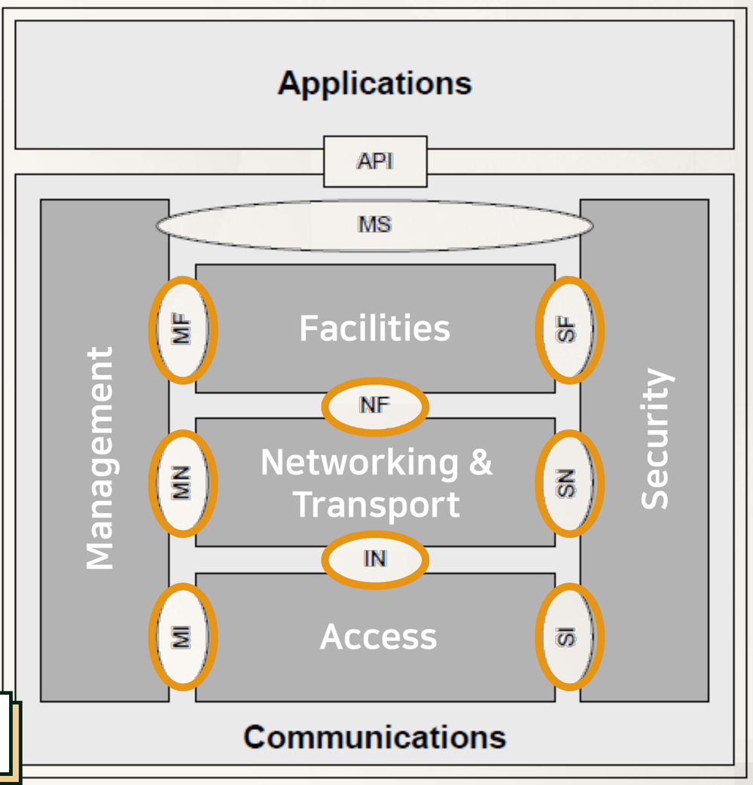

*그림 42. 인터페이스 이름을 표시한 ITS 스테이션 참조 아키텍처*

그림 42처럼 인터페이스 이름은 연결된 두 요소의 머리글자를 이어 붙여 만든다.

| 인터페이스 | 연결하는 두 요소 |
|:-----|:-----|
| MA, MF, MN, MI | 관리 개체(M)와 응용(A), 퍼실리티(F), 네트워킹 및 전송(N), 접속(I) |
| SA, SF, SN, SI | 보안 개체(S)와 응용(A), 퍼실리티(F), 네트워킹 및 전송(N), 접속(I) |
| MS | 관리 개체(M)와 보안 개체(S) |
| FA | 퍼실리티 계층(F)과 응용(A) |
| NF | 네트워킹 및 전송 계층(N)과 퍼실리티 계층(F) |
| IN | 접속 계층(I)과 네트워킹 및 전송 계층(N) |

*표 39. ITS 스테이션 참조 아키텍처의 인터페이스 이름*

> **용어 정의:** **서비스 프리미티브(service primitive)** 는 한 계층이 SAP를 통해 다른 계층에 서비스를 요청하거나 결과를 알리는 추상적인 호출 단위이다. 요청(request), 확인(confirm), 표시(indication), 응답(response) 같은 종류가 있으며, 함수 호출과 비슷하게 생각할 수 있다.

### 2.13 경로와 흐름 관리: ISO 24102-6

ISO 24102-6(path and flow management)은 여러 접속 기술 가운데 어느 것으로, 어떤 경로로 보낼지 정하는 기능을 정의한다 [33].

- **개념:** 경로와 흐름 관리에 필요한 정보를 수집하는 ITS 스테이션의 기능을 정의한다. 관리 개체가 수집한 정보는 가장 알맞은 통신 프로필과 라우팅 경로를 결정하는 데 쓰인다.
- **내용:** ITS-S 능력 관리, 경로 관리, 흐름 관리, 경로 선택, 통신 프로필 관리를 다룬다.

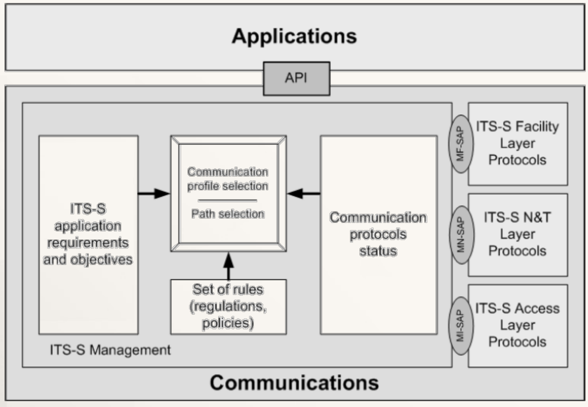

*그림 43. 통신 프로필과 경로 선택의 아키텍처*

그림 43에서 ITS-S 관리 개체 안의 통신 프로필 선택과 경로 선택 기능은 세 가지 입력을 받는다. 왼쪽의 ITS-S 응용 요구 사항과 목표(예: 허용 지연, 필요한 전송 속도, 비용), 오른쪽의 통신 프로토콜 상태(각 계층의 프로토콜이 MF, MN, MI SAP로 알려 주는 링크 상태), 아래의 규칙 집합(규제와 정책)이다.

> **용어 정의:** **흐름(flow)** 은 한 응용 세션에서 같은 요구 사항을 갖는 패킷들의 연속이다.

> **용어 정의:** **통신 프로필(communication profile)** 은 흐름 하나를 보내는 데 쓰는 프로토콜과 접속 기술의 조합(예: M5 위의 FNTP, LTE 위의 IPv6)이다.

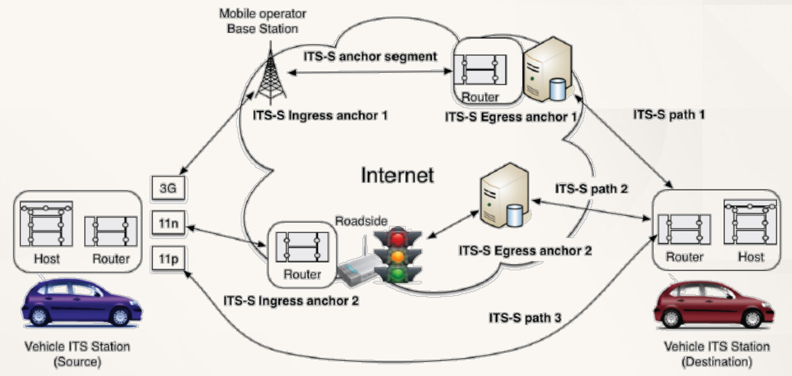

*그림 44. ITS-S 경로와 ITS-S 앵커 구간의 개념*

그림 44는 출발지 차량 ITS 스테이션(호스트와 라우터, 3G, IEEE 802.11n, 802.11p 인터페이스)에서 목적지 차량 ITS 스테이션까지의 세 경로를 보여 준다.

| 경로 | 지나가는 길 |
|:-----|:-----|
| ITS-S 경로 1 | 3G로 이동통신사 기지국(진입 앵커 1)에 들어가 인터넷을 지나 라우터(진출 앵커 1)를 거쳐 목적지에 이른다. |
| ITS-S 경로 2 | 노변 라우터(진입 앵커 2)에 들어가 인터넷 안의 진출 앵커 2를 거쳐 목적지에 이른다. |
| ITS-S 경로 3 | 인프라를 거치지 않고 차량끼리 직접 통신한다. |

*표 40. 그림 44의 세 ITS-S 경로*

진입 앵커(ingress anchor)는 패킷이 인프라 망으로 들어가는 지점, 진출 앵커(egress anchor)는 인프라 망에서 나오는 지점이며, 그 사이의 구간을 **ITS-S 앵커 구간(anchor segment)** 이라고 한다. 경로와 흐름 관리는 흐름마다 알맞은 경로를 고른다. 예를 들어 영상 콘텐츠를 내려받는 인포테인먼트 흐름은 지연을 견딜 수 있고 전송량이 크므로 경로 1(셀룰러)로, 바로 옆 차량에 보내는 충돌 경고 흐름은 지연이 가장 짧아야 하므로 경로 3(802.11p 직접 통신)으로 보낸다. 셀룰러 신호가 약해지면 같은 흐름을 경로 2로 옮겨 통신을 이어 간다. 이것이 CALM이 말하는 하이브리드 통신의 핵심이다.

---

<br>

## 3. 자율주행 통신 법규제와 보급정책

자율주행 통신 기술이 도로에 쓰이려면 기술 표준과 함께 법과 규제의 뒷받침이 필요하다. 이 절은 규제와 표준의 관계, 국제 자동차 규제의 중심인 UN/ECE WP.29, 한국 정부의 자율주행 규제 개선 계획 가운데 통신과 관련된 무선 업데이트, 사이버 보안, 소프트웨어 업데이트 과제, 그리고 V2X 통신의 의무 장착과 보급 현황을 다룬다.

### 3.1 규제와 표준

**규제(regulation)** 와 **표준(standard)** 은 둘 다 기술이 따라야 할 기준을 정하지만 강제성이 다르다.

| 구분 | 규제 | 표준 |
|:-----|:-----|:-----|
| 근거 | 법률과 그 하위 법령 | 표준화 기구의 합의 |
| 강제성 | 국가가 강제하며, 인증을 받지 않으면 판매할 수 없는 반강제 인증을 포함한다. | 자발적으로 따르며, 필요에 따라 민간 인증을 받는다. |
| 국제 기구 | UN/ECE WP.29 | ISO TC22, ISO TC204 |
| 한국의 체계 | 국토교통부, 한국교통안전공단, 자동차안전연구원 | 산업통상자원부 국가기술표준원, 한국표준협회 |

*표 41. 규제와 표준의 비교*

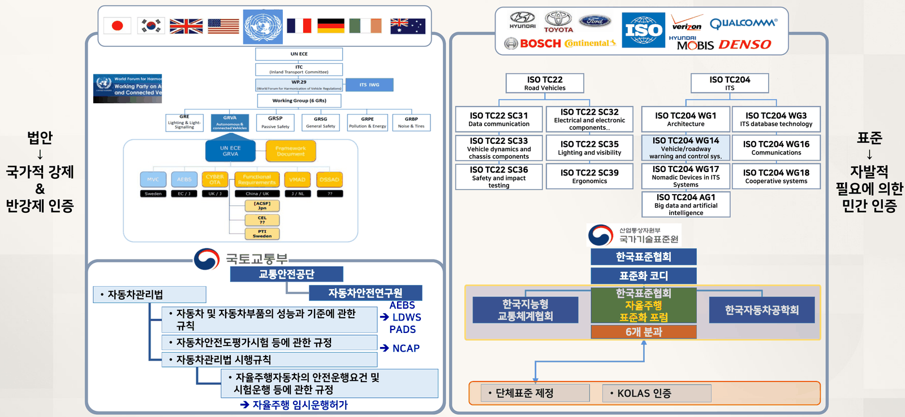

*그림 45. 자율주행 관련 국제와 국내의 규제 체계와 표준 체계*

그림 45의 왼쪽은 규제 체계이다. 일본, 한국, 영국, 미국, 프랑스, 독일 같은 국가가 참여하는 UN 유럽경제위원회(UN ECE)의 내륙 운송 위원회(ITC) 아래에 자동차 규정 국제 조화 포럼(WP.29)과 ITS 비공식 작업반(ITS IWG)이 있다. WP.29 아래에는 여섯 개의 전문 작업반(GR, working party)이 있으며, 그 가운데 자율주행차와 커넥티드카를 다루는 GRVA 아래에 다시 세부 비공식 작업반이 있다(3.2절).

한국의 규제는 국토교통부가 주관하고 한국교통안전공단과 그 산하의 자동차안전연구원이 시험과 인증을 맡는다. 자동차관리법 아래에 세 가지 하위 법령이 있다.

- **자동차 및 자동차부품의 성능과 기준에 관한 규칙:** 비상 자동 제동 장치(AEBS), 차로 이탈 경고 장치(LDWS), 부분 자율주행 시스템(PADS) 같은 장치의 안전 기준을 정한다.
- **자동차안전도평가시험 등에 관한 규정:** 신차의 안전도를 평가하여 공개하는 신차 안전도 평가(NCAP)의 근거이다.
- **자동차관리법 시행규칙:** 그 아래의 자율주행자동차의 안전운행요건 및 시험운행 등에 관한 규정이 자율주행차의 임시운행허가 기준을 정한다.

첫째 하위 법령이 개별 장치의 안전 기준을 정한다면, 나머지 두 하위 법령은 신차의 안전도를 평가하는 제도와 자율주행차의 시험 운행을 허가하는 제도의 근거가 된다.

> **용어 정의:** **임시운행허가**는 아직 안전 기준이 없는 자율주행차가 시험 목적으로 도로를 달릴 수 있도록 국토교통부가 내주는 허가이다.

그림 45의 오른쪽은 표준 체계이다. 현대자동차, Toyota, Ford, Bosch, Continental, Verizon, Qualcomm, 현대모비스, Denso 같은 기업이 ISO의 표준 개발에 참여한다. 자동차 관련 표준은 두 기술위원회가 나누어 맡는다.

| 기술위원회 | 하위 조직 |
|:-----|:-----|
| ISO TC22 (도로 차량, road vehicles) | SC31 데이터 통신, SC32 전기 전자 부품, SC33 차량 동역학과 섀시 부품, SC35 조명과 시계, SC36 안전과 충돌 시험, SC39 인간 공학 |
| ISO TC204 (지능형 교통 체계, ITS) | WG1 아키텍처, WG3 ITS 데이터베이스 기술, WG14 차량과 도로의 경고 및 제어 시스템, WG16 통신, WG17 ITS의 휴대 기기, WG18 협력 시스템, AG1 빅데이터와 인공지능 |

*표 42. 자동차 관련 ISO 기술위원회의 구성*

2절의 CALM은 TC204의 WG16이 만든 표준이고, 3주차와 9주차의 CAN 표준(ISO 11898)은 TC22의 SC31이 다룬다. 한국에서는 산업통상자원부 국가기술표준원 아래의 한국표준협회가 표준화 코디네이터를 두고, 한국지능형교통체계협회, 한국자동차공학회와 함께 6개 분과로 이루어진 자율주행 표준화 포럼을 운영한다. 이 포럼에서 단체 표준을 제정하며, 시험 기관은 KOLAS 인증을 받는다.

> **용어 정의:** **단체 표준**은 국가 표준이 아니라 산업계 단체가 합의하여 정한 표준이다.

### 3.2 UN/ECE WP.29

> **용어 정의:** **WP.29(World Forum for Harmonization of Vehicle Regulations, 자동차 규정 국제 조화 포럼)** 는 UN 유럽경제위원회 아래에서 자동차의 안전과 환경에 관한 국제 규정(UN Regulation)을 만드는 기구이다. 1958년 협정에 가입한 국가들은 WP.29가 채택한 UN 규정을 자국의 형식 승인 기준으로 쓰고, 다른 가입국의 형식 승인을 서로 인정한다 [34].

> **용어 정의:** **형식 승인(type approval)** 은 자동차를 판매하기 전에 그 형식(모델)이 안전 기준과 환경 기준을 만족하는지 정부나 지정 기관이 확인하여 승인하는 제도이다.

WP.29의 전문 작업반과 자율주행 관련 비공식 작업반(IWG, informal working group)은 표 43과 같다.

| 구분 | 이름 | 담당 |
|:-----|:-----|:-----|
| 전문 작업반 | GRBP | 소음과 타이어(noise and tyres) |
| 전문 작업반 | GRE | 조명과 등화 신호(lighting and light-signalling) |
| 전문 작업반 | GRPE | 오염과 에너지(pollution and energy) |
| 전문 작업반 | GRSG | 일반 안전(general safety provisions) |
| 전문 작업반 | GRSP | 수동 안전(passive safety) |
| 전문 작업반 | GRVA | 자동화, 자율주행, 커넥티드 차량(automated/autonomous and connected vehicles) |
| 전문 작업반 | GRRF | 제동과 주행 장치(brakes and running gear) |
| 비공식 작업반 | ADAS | 첨단 운전자 보조 시스템 |
| 비공식 작업반 | FRAV | 자율주행차의 기능 요구 사항(functional requirements) |
| 비공식 작업반 | DSSAD/EDR | 자율주행 데이터 저장 장치와 사고 기록 장치 |
| 비공식 작업반 | VMAD | 자율주행의 검증 방법(validation method) |
| 비공식 작업반 | CS/OTA | 사이버 보안과 소프트웨어 업데이트 |
| 비공식 작업반 | ACSF | 자동 명령 조향 기능(automatically commanded steering function) |
| 비공식 작업반 | MVC | 모듈형 차량 결합(modular vehicle combinations) |
| 비공식 작업반 | AEBS/LDWS | 비상 자동 제동 장치와 차로 이탈 경고 장치 |

*표 43. WP.29의 전문 작업반과 자율주행 관련 비공식 작업반*

> **참고:** WP.29는 2018년 6월 제동과 주행 장치를 다루던 GRRF를 자율주행과 커넥티드 차량을 다루는 GRVA로 개편했다 [34]. 표 43은 개편 전후의 작업반을 함께 적은 것이며, 개편 이후의 구성은 그림 45처럼 GR이 여섯 개이다. 또 원 자료는 DSSAD/EDR 작업반의 담당을 조명과 등화 신호로 적었으나, DSSAD(Data Storage System for Automated Driving)는 자율주행 시스템의 작동 기록 장치, EDR(Event Data Recorder)은 사고 전후의 차량 상태를 기록하는 장치이므로 표 43은 이를 바로잡아 적었다.

자율주행 통신과 직접 관련된 작업반은 GRVA 아래의 CS/OTA(사이버 보안과 무선 업데이트)이다. 이 작업반의 결과가 3.5절과 3.6절의 UN R155와 UN R156이다.

### 3.3 자율주행차 규제혁파 로드맵

한국 정부는 자율주행차의 상용화를 가로막는 규제를 미리 찾아 고치기 위해 자율주행차 규제혁파 로드맵을 마련했고, 2021년 12월에는 이를 보완한 자율주행차 규제혁신 로드맵 2.0을 확정했다 [35]. 로드맵 2.0은 2030년까지 추진할 과제를 단기(2022\~2023년), 중기(2024\~2026년), 장기(2027\~2030년)로 나누었으며, 그 가운데 단기 과제 6건은 표 44와 같다.

| 영역 | 과제명 (소관 부처, 관련 법령) | 기존 | 개선 |
|:-----|:-----|:-----|:-----|
| 차량 | 1. 무선 업데이트(OTA) 허용 (국토부, 자동차관리법) | 자동차 정비는 원칙적으로 정비업체에서 해야 하며, 임시 실증 특례로 전자 제어 장치 등의 무선 업데이트(OTA)를 일부 허용한다. | 정비업체를 방문하지 않고 OTA로 전자 제어 장치 등을 업데이트하거나 정비할 수 있게 한다. OTA를 정비업의 범위에서 제외한다(\~2022년). |
| 차량 | 2. 자율주행 영상 데이터의 학습용 활용 허가 (국토부, 개인정보보호위원회, 자율차법, 개인정보보호법) | 자율주행차가 수집하는 여러 형태의 영상 데이터는 개인 정보 유출 우려 때문에 활용하거나 처리할 수 없다. | 적절한 보호 조치(물리적 또는 논리적으로 분리된 공간, 데이터의 익명, 가명 처리 기준 마련 등) 아래 연구 개발 목적에 한하여 활용을 허용한다(\~2023년). |
| 차량 | 3. 자율주행 안전 교육 규정 마련 (경찰청, 국토부, 도로교통법, 필요하면 자동차관리법) | 자율주행차의 운행과 관리에 필수적인 사항에 대한 운전자 교육 규정이 없다. | 자율주행 기능 관련 교육(운전자 제어권 전환 등), 비상 상황 대처 등 최소한의 운전자 사전 교육 규정을 마련한다(\~2023년). |
| 기반 조성 | 4. 정밀도로지도 온라인 제공 허용 (국토부, 국가공간정보 보안관리규정) | 정밀도로지도 가운데 점군 데이터는 국가공간정보 보안관리규정에 따라 오프라인으로만 제공할 수 있다. | 정밀도로지도 점군 데이터의 온라인 공급을 허용한다(\~2022년). |
| 기반 조성 | 5. 자율협력주행 시스템 인증 관리 체계 마련 (국토부, 자율차법) | 차세대 지능형 교통체계(C-ITS)로 차량과 차량, 차량과 도로가 통신할 때 해킹과 개인 정보 유출 등의 우려가 있다. | 2021년 7월 27일 개정된 자율차법에 따라, 인증서를 발급받은 차량과 인프라만 통신할 수 있는 인증 관리 체계의 세부 기준을 마련하여 운영한다(\~2022년). |
| 서비스 | 6. 자율주행 모빌리티 서비스 실증 특례 확대 (국토부, 모빌리티법) | 자율주행 모빌리티로 여객과 화물을 수송하는 등 여러 서비스를 사업화하기 위한 실증 특례 수요가 많지만, 이에 특화된 규제 샌드박스가 없다. | 모빌리티활성화법을 제정하여 모빌리티 분야에 특화된 규제 샌드박스를 새로 만들고, 다양한 신규 사업의 실증과 사업화를 지원한다(\~2022년). |

*표 44. 자율주행차 규제혁파 로드맵의 단기 과제*

> **용어 정의:** **규제 샌드박스(regulatory sandbox)** 는 새로운 기술이나 서비스를 일정 기간, 일정 지역에서 기존 규제를 면제하거나 유예한 채 시험하게 하는 제도이다.

표 44의 5번 과제는 C-ITS 통신의 보안과 직결된다. V2X 메시지를 받은 차량이 그 메시지를 믿고 제동하려면, 메시지를 보낸 차량이나 노변 기지국이 정당한 인증서를 가진 참여자인지 확인할 수 있어야 하기 때문이다.

### 3.4 무선 업데이트(OTA)

단기 과제 1번은 차량 소프트웨어의 무선 업데이트를 허용하는 것이다.

- **현행:** 자동차 정비는 원칙적으로 정비업체에서 해야 하며, 임시 실증 특례로 전자 제어 장치 등에 대한 무선 업데이트(OTA)를 일부 허용한다.
- **개선:** 정비업체를 방문하지 않고 OTA로 전자 제어 장치 등을 업데이트하거나 정비할 수 있게 한다. OTA를 정비업의 범위에서 제외한다(\~2022년).
- **효과:** OTA를 활용하여 이용자의 편의를 늘리고 차량 안전 관리 체계를 강화한다.

> **용어 정의:** **OTA(over-the-air)** 는 무선 통신으로 기기의 소프트웨어, 펌웨어, 설정을 원격으로 내려보내 갱신하는 기술이다.

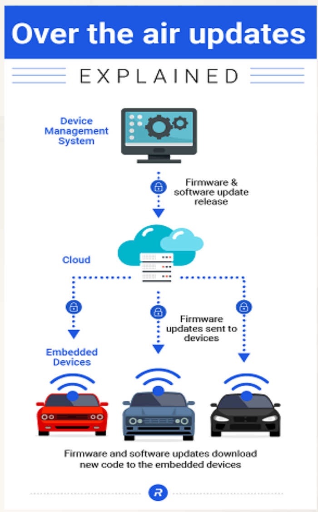

*그림 46. OTA 업데이트의 흐름*

그림 46처럼 OTA는 제조사의 장치 관리 시스템(device management system)이 펌웨어와 소프트웨어 업데이트를 배포하면, 클라우드가 이를 차량에 내장된 장치들로 보내고, 각 장치가 새 코드를 내려받는 순서로 진행된다. OTA는 대상에 따라 다음과 같이 나뉜다.

| 종류 | 뜻 |
|:-----|:-----|
| SOTA (Software over-the-air) | 인포테인먼트, 지도, 응용 같은 소프트웨어를 무선으로 갱신한다. |
| FOTA (Firmware over-the-air) | 엔진, 제동, 조향 ECU 같은 제어기의 펌웨어를 무선으로 갱신한다. |
| OTASP (Over-the-air service provisioning) | 단말을 이동통신망에 처음 등록하고 서비스를 개통하는 데 필요한 정보를 무선으로 내려보낸다. |
| OTAP (Over-the-air provisioning) | 기기가 망에 접속하는 데 필요한 설정 정보를 무선으로 내려보낸다. |
| OTAPA (Over-the-air parameter administration) | 이미 개통된 단말의 설정 파라미터를 무선으로 관리하고 바꾼다. |

*표 45. OTA의 종류*

자동차에서 특히 중요한 것은 SOTA와 FOTA이다. FOTA로 제동이나 조향 ECU의 펌웨어를 바꾸는 것은 차량의 안전 기능 자체를 바꾸는 일이므로, 업데이트의 무결성과 안전성을 보장하는 규정이 필요하다(3.6절).

### 3.5 자율주행차 사이버 보안

로드맵 2.0의 중기 과제(23건) 가운데 8번 과제는 자율주행차의 사이버 보안 체계를 마련하는 것이다(국토부, 자동차관리법, 자동차규칙).

- **현행:** 자율주행차와 자율주행 시스템을 대상으로 하는 해킹 등 사이버 위협에 대한 보호와 보안 대책이 없다. 사이버 보안에 관한 국제 기준(UN R155)은 2020년 6월에 마련되어 각국이 도입을 준비하고 있다.
- **개선:** 차량의 개발 단계부터 폐기까지 차량 자체의 보안 안전성과 제작사별 관리 역량을 확보할 수 있도록 관리 체계를 마련한다(\~2024년).
- **효과:** 차량의 사이버 보안 안전성을 확보하고 신뢰도를 높인다.

두 가지 기준 문서가 이 과제의 바탕이다.

| 문서 | 성격 | 내용 |
|:-----|:-----|:-----|
| UN R155 | WP.29의 규정 (규제) | 사이버 보안과 사이버 보안 관리 체계(CSMS)에 관한 차량 승인의 통일 규정이다. 2021년 1월 22일 1958년 협정의 부속 규정으로 발효되었다 [36]. |
| ISO/SAE 21434 | ISO와 SAE의 공동 표준 (표준) | 도로 차량의 사이버 보안 공학(cybersecurity engineering) 표준이다. 2021년 8월 초판이 나왔다 [37]. |

*표 46. 차량 사이버 보안의 국제 기준*

UN R155는 제작사가 조직 차원의 CSMS를 갖추고 차량 형식마다 위험을 평가하고 대응했음을 입증하도록 요구하며, ISO/SAE 21434는 그 요구를 만족하기 위해 개발 생명 주기 전체에서 수행할 공학 활동을 구체적으로 정한다. 유럽 연합은 이 규정을 2022년 7월부터 새로 승인받는 차량 형식에, 2024년 7월부터 모든 신규 등록 차량에 의무로 적용했다 [38]. 한국도 2024년 2월 자동차관리법을 개정하여 자동차 사이버 보안 관리 체계 인증과 소프트웨어 업데이트 관리 제도를 도입했으며, 2025년 8월 14일부터 시행했다 [39].

> **[정보보호]** 정보 보안의 세 가지 목표는 기밀성(허가받지 않은 자가 정보를 보지 못함), 무결성(정보가 허가 없이 바뀌지 않음), 가용성(필요할 때 정보와 서비스를 쓸 수 있음)이다. V2X 메시지에는 전자 서명으로 무결성과 송신자 인증을 보장하는 것이 특히 중요하며, 3.3절의 인증 관리 체계가 서명에 쓰는 인증서를 발급하고 관리한다.

자율주행차의 정보 처리 흐름을 보면 보안이 왜 거의 모든 요소에 필요한지 알 수 있다 [40].

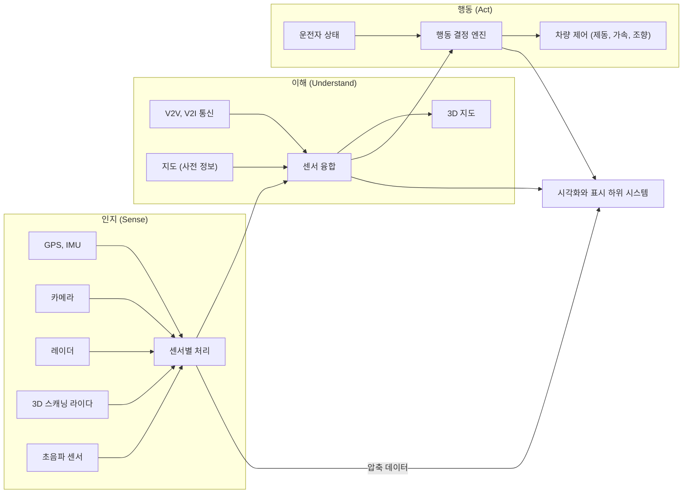

*그림 47. 자율주행차의 인지, 이해, 행동 처리 흐름*

그림 47에서 센서 데이터는 센서별 처리를 거쳐 물체의 파라미터(시각, 크기, 위치와 속도)로 바뀌고, 센서 융합은 이를 V2V, V2I 통신과 지도 정보와 합쳐 3D 지도를 만든다. 행동 결정 엔진은 융합 결과와 운전자 상태를 바탕으로 아무것도 하지 않음, 경고, 보완, 제어 가운데 하나를 고르고, 차량 제어 장치가 제동, 가속, 조향을 실행한다. 센서별 처리 결과는 압축되어 시각화와 표시 하위 시스템으로 보내지고, 융합 결과와 행동 결정도 이 하위 시스템에 표시된다. 이 흐름의 어느 한 곳(통신, 네트워크, 소프트웨어, 센서)이라도 공격당하면 잘못된 판단과 제어로 이어지므로, 정보 보안은 거의 모든 요소에 적용되어야 한다.

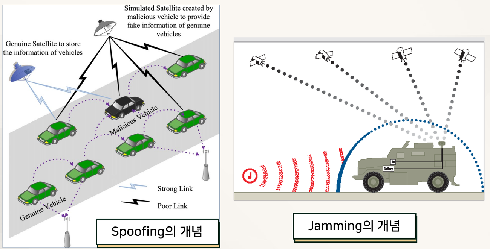

*그림 48. 스푸핑과 재밍의 개념*

무선 통신과 위성 측위를 노리는 대표적인 공격은 스푸핑과 재밍이다.

- **스푸핑(spoofing):** 정상적인 송신자인 것처럼 위장하여 가짜 정보를 보내는 공격이다. 그림 48의 왼쪽에서 악의적인 차량(malicious vehicle)은 위성을 흉내 낸 가짜 신호를 만들어 정상 차량(genuine vehicle)들에게 잘못된 위치 정보를 준다. 정상 차량은 실제 위성의 신호보다 가까이에서 오는 강한 가짜 신호를 따르게 된다.
- **재밍(jamming):** 강한 방해 전파를 쏘아 정상 신호를 수신하지 못하게 하는 공격이다. 그림 48의 오른쪽에서 차량의 재밍 장치가 위성 신호의 수신을 막는다.

1.9절에서 본 것처럼 C-V2X 직접 통신은 측위뿐 아니라 시각 동기에도 GNSS를 쓰므로, GNSS를 노린 스푸핑과 재밍은 위치 정보를 오염시킬 뿐 아니라 V2X 통신 자체를 방해할 수 있다. 이 때문에 차량 보안은 통신 메시지의 서명뿐 아니라 센서와 측위 신호의 이상 탐지까지 포함해야 한다.

### 3.6 차량 소프트웨어 업데이트

중기 과제 9번은 차량 소프트웨어 업데이트의 기준을 마련하는 것이다(국토부, 자동차관리법).

- **현행:** 차량의 전장화에 따라 다양한 차량용 소프트웨어가 활용되고 있으나, 소프트웨어 업데이트에 대한 안전 관리 규정이 없다.
- **개선:** 안정적인 소프트웨어 업데이트를 위한 제작사 의무 사항, 인증 체계, 기술 조건 같은 제도 기반을 마련한다(\~2024년). 소프트웨어 업데이트에 관한 국제 기준(UN R156)은 2020년 6월에 마련되어 각국이 도입을 준비하고 있다.
- **효과:** 차량의 안전도를 확보하고 소프트웨어 관련 기술 개발을 활성화한다.

OTA는 스마트폰에서 먼저 보편화된 뒤 자동차로 확산되었다 [41].

| 시기 | 사건 |
|:-----|:-----|
| 2009년 | Android 플랫폼이 T-Mobile G1에 첫 OTA 업데이트를 배포했다. |
| 2012년 이전 | 스마트폰의 OTA 업데이트가 보편화되었다. |
| 2012년 | Tesla가 Model S에 주행 가능 거리 계산기를 보정하는 첫 OTA 소프트웨어 패치를 제공했다. |
| 2014년 | Tesla가 위치 기반 에어 서스펜션 기능을 OTA로 추가했다. 이 기능은 포트홀과 가파른 진입로의 위치를 기억해 자동으로 차체 높이를 조절한다. |
| 2017년 | Mack Trucks가 트럭의 파워트레인 부품과 차량 파라미터(최고 속도 제한, 성능 최적화 등)를 갱신하는 OTA를 내놓았다. |
| 2018년 | GM이 2020년형 Cadillac CT5에 OTA 업데이트를 도입했다. |
| 2019년 | BMW가 일부 모델에 OTA 소프트웨어 업데이트를 도입했다. |
| 2019\~2020년 | Ford가 2020년에 OTA 기능을 추가하고 전 모델에 4G LTE 연결을 넣을 계획을 밝혔다. |
| 2023년 | GM이 전 모델에 OTA 업데이트를 제공할 계획을 밝혔다. |

*표 47. OTA 업데이트의 발전*

UN R156(소프트웨어 업데이트와 소프트웨어 업데이트 관리 체계에 관한 차량 승인의 통일 규정)은 R155와 함께 2021년 1월 22일 발효되었다 [42].

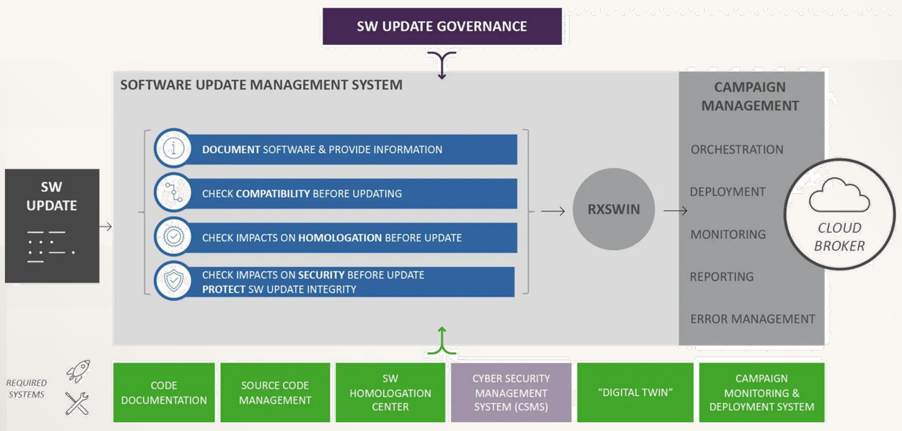

*그림 49. UN R156이 요구하는 소프트웨어 업데이트 관리 체계*

그림 49의 가운데는 **SUMS(Software Update Management System, 소프트웨어 업데이트 관리 체계)** 로, 소프트웨어 업데이트를 내보내기 전에 네 가지를 확인하도록 요구한다.

1. 소프트웨어를 문서화하고 관련 정보를 제공한다.
2. 업데이트하기 전에 차량의 다른 구성과의 호환성을 확인한다.
3. 업데이트하기 전에 형식 승인(homologation)에 미치는 영향을 확인한다.
4. 업데이트하기 전에 보안에 미치는 영향을 확인하고, 업데이트의 무결성을 보호한다.

확인을 마친 업데이트는 RXSWIN으로 관리되고, 오른쪽의 캠페인 관리(조율, 배포, 모니터링, 보고, 오류 관리)가 클라우드 중개자(cloud broker)를 통해 차량에 배포한다. 이를 위해 코드 문서화, 소스 코드 관리, 소프트웨어 형식 승인 센터, 사이버 보안 관리 체계(CSMS), 디지털 트윈, 캠페인 모니터링과 배포 시스템 같은 지원 시스템이 필요하며, 맨 위의 소프트웨어 업데이트 거버넌스가 전체를 통제한다.

> **용어 정의:** **RXSWIN(R X Software Identification Number)** 은 UN 규정 X의 형식 승인과 관련된 차량 소프트웨어를 식별하는 번호이다. 업데이트로 형식 승인과 관련된 소프트웨어가 바뀌면 RXSWIN도 바뀌므로, 당국과 제작사는 이 번호로 차량이 승인받은 상태인지 추적한다.

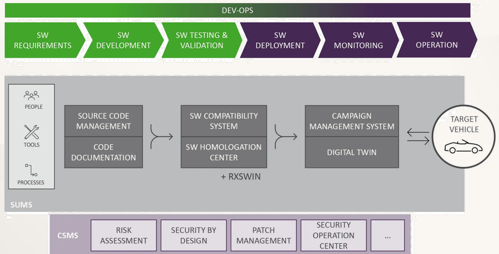

*그림 50. UN R156의 SUMS와 CSMS*

그림 50은 SUMS와 CSMS가 소프트웨어 개발 운영(DevOps)의 흐름 속에서 어떻게 맞물리는지 보여 준다. 위쪽의 DevOps 흐름은 소프트웨어 요구 사항, 개발, 시험과 검증, 배포, 모니터링, 운영으로 이어진다. 가운데의 SUMS는 사람, 도구, 프로세스를 바탕으로 소스 코드 관리와 코드 문서화, 소프트웨어 호환성 시스템과 소프트웨어 형식 승인 센터(RXSWIN 포함), 캠페인 관리 시스템과 디지털 트윈을 거쳐 대상 차량과 업데이트를 주고받는다. 아래쪽의 CSMS는 위험 평가, 설계 단계의 보안(security by design), 패치 관리, 보안 운영 센터 같은 활동으로 이 전체를 보안 측면에서 뒷받침한다. 정리하면 R155는 사이버 보안 관리 체계(CSMS)를, R156은 소프트웨어 업데이트 관리 체계(SUMS)를 요구하며, 안전한 OTA를 위해서는 두 체계가 함께 동작해야 한다.

### 3.7 V2X 통신의 의무 장착과 보급 현황

미국 교통부는 2015년 무렵 V2V 통신의 의무 장착을 위해 다음과 같은 일정을 제시했다.

| 시기 | 미국 교통부의 커넥티드 차량 이정표 |
|:-----|:-----|
| 2014년 8월 | NHTSA가 V2V 통신에 관한 규칙 제정 사전 공고(ANPRM)를 발표했다. |
| 2015년 5월 | 교통부 장관 Foxx가 V2V 규칙 제정의 가속화를 발표했다. |
| 2015년 여름 | 연방도로청(FHWA)이 V2I 지침 문서를 발표했다. |
| 2015년 가을 | 1차 커넥티드 차량 시범 사업이 시작되었다. |
| 2015년 말 | V2V 규칙 제정안(NPRM)을 부처 간 검토에 회부했다. |
| 2017년 | 커넥티드 차량 기술을 갖춘 신차가 나올 것으로 예상했다. |

*표 48. 미국의 커넥티드 차량 이정표 (2015년 계획)*

> **용어 정의:** **NPRM(notice of proposed rulemaking)** 은 구체적인 규칙 제정안을 공고하는 것이다.

표 48의 일정에서 V2V 규칙 제정은 차량 안전을 맡는 미국 도로교통안전국(**NHTSA**)이, V2I 지침은 도로를 맡는 미국 연방도로청(**FHWA**)이 담당했다.

그러나 이 계획은 실현되지 않았다. NHTSA는 새로운 V2V 통신 방식의 등장과 미국 연방통신위원회(FCC)의 5.9 GHz 규정 변경을 이유로 2023년 11월 V2V 의무화 규칙 제정안을 공식 철회했다 [43].

주요국의 보급 정책을 보면 미국과 중국은 C-V2X를 선택했고, 통신 인프라가 복잡한 유럽은 여러 방식을 수용하는 형태로 추진했다.

| 국가 | 보급 현황 |
|:-----|:-----|
| 미국 | FCC가 5.9 GHz 대역 75 MHz의 용도를 바꾸는 규정을 2021년 7월에 발효했다. ITS 주파수 사용에서 WAVE 기술을 배제하고 ITS 주파수의 상위 30 MHz를 C-V2X 용도로 쓴다 [44]. 2024년 11월에는 C-V2X의 세부 운용 규정을 확정했다 [45]. |
| 유럽 | 2020년 3월 ITS 주파수 대역을 70 MHz 대역폭에서 80 MHz 대역폭으로 확장했다. 2019년 1월 유럽 도로의 C-ITS 구축을 촉진할 법적 기반으로 ITS-G5(WAVE)를 강제하는 EC 위임 규정(delegated regulation)이 제출되었으나, 2019년 7월 EU 각료이사회에서 최종 부결되었다. 이후 C-V2X까지 포함하는 새 규정을 2021년에 제정할 예정이었다. |
| 중국 | 2018년 10월 C-V2X용으로 5.905\~5.925 GHz 범위의 주파수를 공식 지정했다. 10개 이상의 지역에 C-V2X 기술 기반의 국가 단위 테스트베드를 구축했고, 2022년까지 10여 개 완성차 업체가 C-V2X 직접 통신이 가능한 차량을 출시할 예정이었다. |

*표 49. 해외의 V2X 보급 현황*

한국에서 자동차 안전 서비스용 통신 방식을 정하는 일정은 다음과 같이 진행되었다.

- 2016년 5.9 GHz 대역(5.855\~5.925 GHz)의 70 MHz를 ITS 용도로 할당했으나 통신 방식은 정하지 않았다.
- 2020년 7월 한국판 뉴딜의 사회간접자본(SOC) 디지털화 사업에 포함된 C-ITS 인프라 구축 계획은 2022년까지 전국 고속국도의 절반인 2,085 km에, 2025년까지 전 구간인 4,075 km에 C-ITS를 설치한다고 발표했다.
- **공동작업반 구성:** 2021년 7월 26일 과학기술정보통신부와 국토교통부가 C-ITS 인프라 전국 구축을 위한 협의를 진행하고 공동작업반을 구성했다.
- **실증:** 통신 방식을 정하기 위해 2021년 4분기 말부터 2022년 4분기까지 인증 절차를 포함하여 LTE-V2X를 실증한다.
- **선정:** LTE-V2X 실증과 기반 C-ITS 인프라 구축을 마친 뒤 2023년에 WAVE와 LTE-V2X의 듀얼 모드 시범 사업(2,000 km 구간)으로 성능을 비교하고 단일 V2X 통신 방식을 선정한다.
- **구축:** 2024년부터 선정된 통신 방식으로 C-ITS 인프라 구축 본사업을 진행한다.

> **참고:** 원 자료는 2016년 할당 대역을 5.860 GHz부터의 70 MHz로 적었으나, 할당된 대역은 5.855\~5.925 GHz이다 [46]. 두 방식의 시범 사업을 위해 2022년 3월 70 MHz 가운데 하위 20 MHz를 LTE-V2X, 상위 30 MHz를 WAVE에 배치했고 [46], 2023년 12월 과학기술정보통신부와 국토교통부는 C-ITS의 단일 통신 방식을 LTE-V2X로 정했다 [47]. 각국 정책의 더 자세한 경과는 1주차의 3.7절과 3.8절에 정리했다.

---

<br>

## 개념 적용

| 상황 | 적용할 개념 |
|:-----|:-----|
| 고속도로에서 앞차가 급제동한 사실을 뒤따르는 여러 차량에 수십 ms 안에 알려야 한다. | 기지국을 거치지 않는 PC5 직접 통신(시나리오 1)으로 방송한다. 지연이 짧고 이동통신망이 없어도 동작한다(1.7절, 1.9절). |
| 산간 도로처럼 이동통신 기지국의 커버리지가 없는 곳에서도 차량끼리 경고를 주고받아야 한다. | 자율 모드(LTE-V2X 모드 4)로 자원 풀에서 자원을 스스로 고르고, GNSS로 시각을 맞춘다(1.6절, 1.9절). |
| 1 km 앞에서 난 사고와 주변 주차장 정보를 운전자에게 알려 주려 한다. | 지연이 허용되는 정보이므로 Uu 기반 네트워크 통신(V2N)으로 서버에서 받는다(1.13절). |
| 서로 다른 통신사에 가입한 두 차량, 그리고 통신사에 가입하지 않은 노변 기지국이 안전 메시지를 주고받아야 한다. | C-V2X 직접 통신은 USIM을 요구하지 않고 ITS 대역에서 동작하므로 가입 사업자와 무관하게 통신한다(1.6절, 1.9절). |
| 셀룰러, M5, Wi-Fi를 모두 갖춘 차량이 주행 중에 영상 스트리밍과 충돌 경고를 동시에 처리해야 한다. | CALM의 경로와 흐름 관리가 흐름마다 알맞은 통신 프로필과 경로를 고르고, 링크 상태가 바뀌면 경로를 옮긴다(2.13절). |
| 제작사가 제동 ECU의 펌웨어를 원격으로 갱신하려 한다. | FOTA이며, UN R156의 SUMS에 따라 호환성, 형식 승인, 보안 영향을 확인하고 RXSWIN을 관리해야 한다(3.4절, 3.6절). |
| 공격자가 가짜 GNSS 신호를 송출하여 주변 차량의 위치를 속이려 한다. | 스푸핑 공격이며, UN R155의 CSMS에 따른 위험 평가와 대응, 측위 신호의 이상 탐지가 필요하다(3.5절). |

*표 50. 개념 적용 사례*

**T/F 점검:**

| 문장 | 판단과 근거 |
|:-----|:-----|
| C-V2X 직접 통신을 하려면 차량에 USIM이 있어야 한다. | **F.** 직접 통신은 USIM 없이 동작한다. |
| PC5 기반 운영 시나리오에서도 V2X 메시지는 기지국을 거쳐 전달된다. | **F.** PC5 기반 시나리오에서는 단말끼리 사이드링크로 직접 주고받는다. |
| ITU-R M.2083의 분류에서 자율주행차는 URLLC 범주의 대표 응용이다. | **T.** 차량 안전 통신에는 지연과 신뢰성이 전송 속도보다 중요하다. |
| Rel-14 LTE-V2X의 사이드링크는 유니캐스트 통신을 지원한다. | **F.** Rel-14와 Rel-15의 사이드링크는 방송만 지원하며, 유니캐스트와 멀티캐스트는 Rel-16 NR-V2X에서 지원한다. |
| ITS-S 호스트는 자기에게 오지 않은 패킷을 다른 네트워크로 전달한다. | **F.** 그것은 ITS-S 라우터의 기능이며, 호스트는 자기에게 오지 않은 패킷을 전달하지 않는다. |
| GeoNetworking은 목적지를 IP 주소 대신 지리 좌표로 지정할 수 있다. | **T.** 대상 지역을 지리 좌표로 지정하여 그 지역의 스테이션에 전달한다. |
| UN R155는 소프트웨어 업데이트 관리 체계(SUMS)를 요구하는 규정이다. | **F.** R155는 사이버 보안 관리 체계(CSMS)를, R156이 SUMS를 요구한다. |

---

<br>

## 용어 사전

| 영문 | 한국어 | 한 줄 정의 |
|:-----|:-----|:-----|
| LTE-V2X | LTE-V2X | LTE를 바탕으로 한 C-V2X이다. |
| NR-V2X | NR-V2X | 5G NR을 바탕으로 한 C-V2X이다. |
| Analog Mobile Communication | 아날로그 이동통신 | 음성 신호의 파형을 그대로 반송파에 실어 보내는 방식이다. |
| AMPS (Advanced Mobile Phone System) | AMPS | 미국의 1세대 아날로그 표준이다. |
| GSM (Global System for Mobile communications) | GSM | 유럽에서 시작된 2세대 시분할 방식 표준이다. |
| CDMA (code division multiple access) | 코드 분할 다중 접속 | 사용자마다 다른 코드를 곱해 같은 주파수를 동시에 쓰게 하는 다중 접속 방식으로, 2세대에서는 미국의 IS-95가 이 방식을 썼다. |
| GPRS (General Packet Radio Service) | GPRS | EDGE(Enhanced Data rates for GSM Evolution)와 함께 GSM 망에 패킷 데이터 전송을 더한 기술이다. |
| WCDMA (Wideband CDMA) | WCDMA | 3GPP의 3세대 표준이다. |
| HSPA (High Speed Packet Access) | HSPA | WCDMA의 하향(HSDPA)과 상향(HSUPA) 데이터 속도를 높인 개선판이다. |
| TS (Technical Specification) | 기술 규격 | 3GPP 문서 가운데 장비가 반드시 따라야 하는 규범적 내용을 담는 문서이다. |
| TR (Technical Report) | 기술 보고서 | 3GPP 문서 가운데 새 기능을 표준화하기 전에 요구 사항, 시나리오, 후보 기술을 연구한 결과를 담는 문서이다. 1절에서 인용하는 TR 36.885, TR 38.885, TR 22.886은 V2X를 연구한 기술 보고서이다. |
| User Plane | 사용자 평면 | 사용자의 실제 데이터가 지나가는 경로이다. |
| Control Plane | 제어 평면 | 연결 설정, 이동성 관리 같은 제어 신호가 지나가는 경로이다. |
| 99.99999% Availability | 가용성 99.99999% | 서비스가 정상 동작하지 않는 시간의 비율이 $10^{-7}$ 이하라는 뜻이다. |
| EPC (Evolved Packet Core) | EPC | LTE의 코어 네트워크이다. |
| 5GC (5G Core) | 5GC | 5G의 코어 네트워크이며, 표준화 초기에는 NGCN(Next Generation Core Network)이라고도 불렀다. |
| eNB | eNB | LTE 기지국이다. |
| gNB | gNB | NR 기지국이다. |
| ng-eNB | ng-eNB | 5GC에 연결되는 LTE 기지국이다. |
| ProSe (Proximity-based Services) | 근접 서비스 | 3GPP가 Release 12에서 정의한, 가까이 있는 단말끼리 D2D 통신으로 제공하는 서비스이다. |
| UE (User Equipment) | UE | 3GPP에서 단말을 부르는 이름으로, 스마트폰뿐 아니라 차량에 장착된 통신 모듈도 UE이다. |
| Interface | 인터페이스 | 이동통신 표준에서 두 기능 요소 사이의 연결과 그 위의 규약을 가리키는 이름으로, 참조점(reference point)이라고도 한다. |
| Uu | Uu | 단말과 기지국 사이의 무선 인터페이스이다. |
| Resource Pool | 자원 풀 | 사이드링크 전송에 쓰도록 미리 정해 둔 시간 구간과 주파수 구간의 집합이다. |
| SIB (System Information Block) | 시스템 정보 블록 | 기지국이 셀 안의 모든 단말에게 주기적으로 방송하는 시스템 정보로, 자원 풀 설정 같은 정보를 담는다. |
| Coverage | 커버리지 | 기지국의 신호가 닿는 지역이다. |
| PLMN (Public Land Mobile Network) | PLMN | 한 이동통신 사업자가 운영하는 공중 이동통신망이다. 국가 코드인 MCC(Mobile Country Code)와 사업자 코드인 MNC(Mobile Network Code)를 합친 번호로 식별하며, 한국의 SK텔레콤, KT, LG U+의 망이 각각 하나의 PLMN이다. |
| Cell | 셀 | 기지국 하나가 담당하는 지역이다. |
| UE-type RSU | 단말형 RSU | 단말과 같은 방식으로 PC5를 쓰는 RSU이다. |
| eNB-type RSU | 기지국형 RSU | 기지국이 RSU 기능을 겸하는 RSU이다. |
| Vulnerable Road User (VRU) | 교통 약자 | 보행자, 자전거 이용자, 이륜차 운전자처럼 차량과 충돌했을 때 보호 장치가 거의 없는 도로 이용자이다. |
| USIM (Universal Subscriber Identity Module) | USIM | 이동통신 가입자를 인증하는 정보를 담은 칩(유심)이다. |
| GNSS (Global Navigation Satellite System) | GNSS | GPS, Galileo, GLONASS, BeiDou 같은 위성 항법 시스템을 통틀어 부르는 말로, 위치뿐 아니라 정밀한 시각 정보도 제공한다. |
| Broadcast | 방송 | 범위 안의 모든 단말에게 보내는 통신이다. |
| Unicast | 유니캐스트 | 특정한 한 단말에게 보내는 통신이다. |
| OFDM (orthogonal frequency division multiplexing) | 직교 주파수 분할 다중화 | 넓은 대역을 서로 간섭하지 않는 많은 좁은 부반송파(subcarrier)로 나누어 데이터를 나란히 보내는 방식이다. |
| DNPW (Do Not Pass Warning) | 추월 금지 경고 | 추월하려는 차량에게 반대 차로에서 차량이 다가온다고 경고하는 기능이다. |
| IMA (Intersection Movement Assist) | 교차로 진입 보조 | 시야가 가려진 교차로에서 교차 방향 차량과의 충돌 위험을 알리는 기능이다. |
| PHY | PHY | LTE와 NR의 무선 프로토콜 스택에서 신호를 변조하여 전파로 보내는 물리 계층이다. |
| MAC (Medium Access Control) | MAC | 무선 자원을 나누어 쓰는 매체 접근 제어 계층이다. |
| RLC (Radio Link Control) | RLC | 패킷의 분할과 재전송을 맡는 계층이다. |
| PDCP (Packet Data Convergence Protocol) | PDCP | 헤더 압축과 암호화를 맡는 계층이다. |
| CALM-aware Application | CALM 인식 응용 | CALM의 관리 기능을 알고 통신 요구 사항을 직접 알려 주는 응용이다. |
| non-CALM-aware Application | CALM 비인식 응용 | CALM을 모르는 기존 응용이다. |
| Roaming | 로밍 | 가입한 사업자의 망 밖에서 다른 사업자의 망을 이용하는 것이다. |
| M5 | M5 | CALM-M5 또는 ITS-M5라고도 하며, 5 GHz 대역에서 IEEE 802.11p를 바탕으로 동작하는 CALM의 차량 통신 매체(ISO 21215)이다. |
| CEN-DSRC | CEN-DSRC | 유럽 표준화 위원회(CEN)가 정한 5.8 GHz 대역의 근거리 전용 통신으로, 주로 통행료 징수에 쓰인다. |
| RDS (Radio Data System) | RDS | FM 방송에 교통 정보 같은 데이터를 실어 보내는 기술이다. |
| DAB (Digital Audio Broadcasting) | DAB | 디지털 라디오 방송이다. |
| Probe Data | 프로브 데이터 | 주행하는 차량을 일종의 이동 센서로 보고 수집하는 속도, 위치, 노면 상태 같은 데이터이다. |
| Lawful Intercept | 합법적 감청 | 법에 따른 절차로 수사 기관이 통신 내용을 확인할 수 있게 하는 기능이다. |
| NPDU (network protocol data unit) | NPDU | 네트워크 계층이 주고받는 데이터 단위이다. |
| Octet | 옥텟 | 8비트를 뜻하며, 통신 규격에서는 바이트 대신 이 말을 쓴다. |
| ITS-AID (ITS Application Identifier) | ITS-AID | ITS 응용을 구별하는 번호로, IEEE WAVE의 PSID와 같은 번호 체계를 쓴다. FSAP의 FSAM은 13주차에서 본 WAVE의 WSA(WAVE Service Advertisement)에 해당한다. |
| Path | 경로 | 출발지에서 목적지까지 패킷이 지나가는 길이다. |
| AEBS (Advanced Emergency Braking System) | AEBS | 충돌 위험을 감지하면 스스로 제동하는 장치이다. |
| LDWS (Lane Departure Warning System) | LDWS | 차로를 벗어나면 경고하는 장치이다. |
| PADS (Partially Automated Driving System) | PADS | 운전자 대신 일정 조건에서 주행을 맡는 부분 자율주행 시스템이다. |
| NCAP (New Car Assessment Program) | NCAP | 신차의 충돌 안전성과 보조 장치 성능을 평가하여 소비자에게 공개하는 제도이다. |
| KOLAS (Korea Laboratory Accreditation Scheme) | KOLAS | 시험 기관과 교정 기관의 능력을 국제 기준에 따라 공인하는 한국의 인정 제도이다. |
| Point Cloud Data | 점군 데이터 | 라이다로 측정한 3차원 점들의 집합으로, 정밀도로지도를 만드는 원자료이다. |
| Autonomous Vehicle Act | 자율차법 | 자율주행자동차 상용화 촉진 및 지원에 관한 법률의 약칭이다. |
| Firmware | 펌웨어 | ECU 같은 하드웨어에 내장되어 그 장치를 직접 제어하는 저수준 소프트웨어이다. |
| Digital Twin | 디지털 트윈 | 실제 차량의 하드웨어와 소프트웨어 구성을 그대로 본뜬 가상 모델로, 업데이트를 실제 차량에 보내기 전에 미리 시험하는 데 쓴다. |
| ANPRM (advance notice of proposed rulemaking) | ANPRM | 규칙을 만들기 전에 의견을 구하는 사전 공고이다. |
| NHTSA | NHTSA | 미국 도로교통안전국이다. |
| FHWA | FHWA | 미국 연방도로청이다. |

*표 51. 용어 사전*

---

<br>

## 요약

| 개념 | 핵심 요약 |
|:-----|:-----|
| 이동통신의 발전 | 1G 아날로그 음성에서 5G 초고속, 초연결, 고신뢰 통신까지 약 10년마다 세대가 바뀌었고, 4G 이후 3GPP의 LTE 계열이 세계 표준이 되었다. |
| 3GPP | 1998년 설립된 이동통신 표준화 단체로, 7개 기관 회원을 통해 참가한 회원사가 만든 기술 규격이 각국 표준과 ITU 국제 표준으로 전환된다. |
| 5G의 세 범주 | eMBB는 초고속, URLLC는 초고신뢰 저지연, mMTC는 대규모 연결을 위한 것이며, 차량 안전 통신은 URLLC에 속한다. |
| SA와 NSA | SA는 LTE나 NR이 독립적으로 운영되는 구성이고, NSA는 한 기지국이 주도하고 다른 RAT의 기지국이 보조하는 이중 연결 구성이다. |
| ProSe와 사이드링크 | 3GPP Rel-12의 근접 서비스에서 정의된 단말 간 직접 링크가 사이드링크(PC5)이며, C-V2X 직접 통신의 바탕이다. |
| 자원 할당 | 기지국이 자원을 지정하는 스케줄링 모드는 충돌을 막고, 단말이 자원 풀에서 고르는 자율 모드는 네트워크 없이 동작한다. |
| LTE-V2X 운영 시나리오 | PC5 기반, Uu 기반, 둘을 함께 쓰는 시나리오(3A, 3B)가 있으며 지연과 전달 범위가 서로 다르다. |
| NR-V2X 운영 시나리오 | 한 기지국이 사이드링크를 제어하는 독립형과, 두 RAT의 기지국이 함께 제어하는 MR-DC(NE-DC, NGEN-DC, EN-DC)가 있다. |
| C-V2X의 두 전송 모드 | Uu 네트워크 통신은 면허 대역의 V2N에, PC5 직접 통신은 ITS 대역의 V2V, V2I, V2P에 쓰며, 직접 통신은 USIM 없이 GNSS로 동기를 맞춘다. |
| C-V2X의 진화 | Rel-14/15의 LTE-V2X가 방송 기반 안전 서비스를, Rel-16 이후의 NR-V2X가 유니캐스트와 멀티캐스트 기반의 자율주행 서비스를 맡는다. |
| 802.11p와 C-V2X | 두 기술 모두 5.9 GHz에서 기지국 없이 동작하며 같은 보안 서비스를 쓴다. C-V2X는 직접 통신의 지연과 망 연동에서 유리하게 평가되며, 802.11p는 하위 호환성을 유지하는 802.11bd로 진화했다. |
| CALM | ISO TC204 WG16의 하이브리드 통신 표준 체계로, 하나의 ITS 스테이션이 여러 접속 기술을 골라 쓰며 끊김 없이 통신하게 한다. |
| ITS 스테이션 참조 아키텍처 | 접속, 네트워킹 및 전송, 퍼실리티 계층과 관리, 보안 개체로 이루어지며, 구성 요소 사이는 이름 붙은 SAP로 연결된다. |
| CALM 관련 표준 | ISO 21218은 접속 계층, ISO/TS 16460은 WAVE와의 공통 메시지, ISO 29281-1은 FNTP, ISO 22418은 FSAP, ISO 24102는 스테이션 관리와 경로 선택을 정의한다. |
| 규제와 표준 | 규제는 법에 근거한 국가적 강제이고 표준은 자발적 합의이며, 국제 규제는 UN/ECE WP.29, 국제 표준은 ISO TC22와 TC204가 맡는다. |
| UN R155와 R156 | R155는 사이버 보안 관리 체계(CSMS), R156은 소프트웨어 업데이트 관리 체계(SUMS)를 요구하며, 안전한 OTA에는 둘 다 필요하다. |
| V2X 보급 정책 | 미국과 중국은 C-V2X를 택했고 유럽은 여러 방식을 수용했으며, 한국은 2023년 C-ITS의 통신 방식을 LTE-V2X로 정했다. |

---

<br>

## 점검 문제

1. **지연과 이동 거리:** 시속 72 km로 달리는 차량에 경고 메시지가 20 ms 늦게 도착할 때와 100 ms 늦게 도착할 때, 그동안 차량이 이동하는 거리를 각각 구하고 차이를 쓰라.

   <details>
   <summary>정답</summary>

   시속 72 km는 $72{,}000 / 3{,}600 = 20$ m/s이다. 20 ms 동안 $20 \times 0.020 = 0.4$ m, 100 ms 동안 $20 \times 0.100 = 2$ m를 이동하므로 차이는 $2 - 0.4 = 1.6$ m이다. 지연이 80 ms 늘면 차량이 1.6 m를 더 나아간 뒤에야 경고를 받으므로, 충돌을 피할 여유가 그만큼 줄어든다.

   </details>

2. **5G 서비스 범주:** 다음 서비스를 eMBB, URLLC, mMTC 가운데 가장 알맞은 범주로 분류하고 이유를 쓰라. (가) 뒷좌석의 8K 영상 스트리밍, (나) 교차로의 차량 충돌 경고, (다) 도로변 수천 개의 노면 온도 센서

   <details>
   <summary>정답</summary>

   (가)는 많은 데이터를 빠르게 보내야 하므로 eMBB이다. (나)는 수 ms 안에 오류 없이 전달되어야 사고를 막을 수 있으므로 URLLC이다. (다)는 적은 데이터를 가끔 보내는 수많은 기기를 연결해야 하므로 mMTC이다.

   </details>

3. **주파수 대역폭:** 한국의 5G 경매에서 KT가 받은 3.5 GHz 대역(3.50\~3.60 GHz)과 28 GHz 대역(26.5\~27.3 GHz)의 대역폭을 각각 구하고, 28 GHz 대역이 몇 배 넓은지 쓰라. 넓은 대역폭에도 28 GHz 대역의 활용이 어려운 이유도 쓰라.

   <details>
   <summary>정답</summary>

   3.5 GHz 대역은 $3.60 - 3.50 = 0.10$ GHz $= 100$ MHz, 28 GHz 대역은 $27.3 - 26.5 = 0.8$ GHz $= 800$ MHz이므로 28 GHz 대역이 $800 / 100 = 8$배 넓다. 그러나 높은 주파수의 전파는 멀리 가지 못하고 건물 같은 장애물에 쉽게 가로막히므로, 넓은 지역을 덮으려면 기지국을 촘촘히 세워야 한다.

   </details>

4. **자원 할당 방식:** D2D 통신의 스케줄링 모드와 자율 모드 가운데, 기지국 커버리지 밖에서도 쓸 수 있는 방식은 무엇이며 그 대가로 생기는 문제는 무엇인지 쓰라.

   <details>
   <summary>정답</summary>

   자율 모드이다. 커버리지 밖에서는 미리 설정된 자원 풀에서 단말이 스스로 자원을 고르므로 기지국 없이도 동작한다. 그 대가로 기지국이 자원을 조정하지 않으므로 여러 단말이 같은 자원을 골라 충돌할 수 있다. LTE-V2X의 모드 4는 다른 단말의 사용 자원을 감지하여 충돌 가능성을 줄인다.

   </details>

5. **운영 시나리오 추적:** LTE-V2X 운영 시나리오 3A에서 차량 A가 보낸 위험 경고가 사이드링크의 전파가 닿지 않는 멀리 있는 차량 B에게 전달되는 과정을 링크 순서대로 쓰라.

   <details>
   <summary>정답</summary>

   차량 A가 사이드링크(PC5)로 경고를 방송한다. 이를 받은 단말형 RSU가 상향링크(Uu)로 기지국에 전달한다. 기지국은 하향링크(Uu)로 그 지역의 여러 단말에게 방송하며, 차량 B는 이 하향링크로 경고를 받는다. 직접 통신의 짧은 지연과 기지국의 넓은 전달 범위를 결합한 방식이다.

   </details>

6. **전송 모드 선택:** (가) 추월 금지 경고(DNPW), (나) 1 km 앞의 도로 위험 경고, (다) 충전소 찾기에 C-V2X의 네트워크 통신과 직접 통신 가운데 어느 것이 알맞은지 쓰라.

   <details>
   <summary>정답</summary>

   (가)는 반대 차로에서 다가오는 차량과의 충돌을 막아야 하므로 지연이 짧은 PC5 직접 통신이 알맞다. (나)와 (다)는 멀리 있는 정보이거나 편의 정보로 지연이 어느 정도 허용되므로, 서버와 연결되는 Uu 네트워크 통신(V2N)이 알맞다.

   </details>

7. **뉴머롤로지와 도플러:** NR에서 $\mu = 2$일 때 부반송파 간격과 슬롯 길이를 구하라. 또 상대 속도가 시속 180 km인 두 차량이 5.9 GHz에서 통신할 때의 도플러 주파수 이동을 구하고, 30 kHz 부반송파 간격의 몇 %인지 쓰라 ($c = 3 \times 10^8$ m/s).

   <details>
   <summary>정답</summary>

   부반송파 간격은 $15 \times 2^2 = 60$ kHz, 슬롯 길이는 $1 / 2^2 = 0.25$ ms이다. 시속 180 km는 $180{,}000 / 3{,}600 = 50$ m/s이므로 $f_d = 50 \times 5.9 \times 10^9 / (3 \times 10^8) = 50 \times 19.67 \approx 983$ Hz이다. 이는 30 kHz의 $`983 / 30{,}000 \approx 3.3\%`$이다.

   </details>

8. **참조 아키텍처:** 다음 기능이 ITS 스테이션 참조 아키텍처의 어느 계층이나 개체에 속하는지 쓰라. (가) IPv6, (나) 5.9 GHz 무선 모듈, (다) 인증서 관리, (라) 여러 응용이 공통으로 쓰는 정보 지원, (마) 규제 정보 관리

   <details>
   <summary>정답</summary>

   (가)는 네트워킹 및 전송 계층, (나)는 접속 계층, (다)는 보안 개체, (라)는 퍼실리티 계층, (마)는 관리 개체에 속한다.

   </details>

9. **노드의 종류:** 차량 안의 장치 가운데 (가) 차량 내부 네트워크와 셀룰러망 사이에서 패킷을 전달하는 장치, (나) V2X 메시지를 받아 화면에 표시하기만 하는 장치, (다) CAN 메시지를 해석하여 4계층보다 위의 다른 프로토콜로 바꾸어 외부에 보내는 장치를 ITS-S 호스트, 라우터, 게이트웨이로 분류하라.

   <details>
   <summary>정답</summary>

   (가)는 두 네트워크를 연결하고 자기에게 오지 않은 패킷을 전달하므로 ITS-S 라우터이다. (나)는 자기에게 온 데이터만 처리하므로 ITS-S 호스트이다. (다)는 4계층보다 위에서 서로 다른 프로토콜 스택을 연결하고 변환하므로 ITS-S 게이트웨이이다.

   </details>

10. **LM NPDU:** 필드를 그림 40의 순서대로 첫 옥텟의 상위 비트부터 채운다고 가정할 때, Subtype이 1, N-Extensions flag가 0, Version이 3인 첫 옥텟을 2진수와 16진수로 쓰라. 또 서브타입 값 가운데 IEEE용으로 예약된 값은 몇 개인가?

    <details>
    <summary>정답</summary>

    Subtype 1은 4비트로 0001, 플래그는 0, Version 3은 3비트로 011이므로 첫 옥텟은 $`0001\ 0\ 011 = 00010011_2 = \text{0x13}`$이다. IEEE용 예약 값은 8\~15이므로 $15 - 8 + 1 = 8$개이다.

    </details>

11. **IPv4와 IPv6:** IPv6 주소의 개수는 IPv4 주소 개수의 몇 배인지 2의 거듭제곱과 10의 거듭제곱으로 나타내고, C-ITS에 IPv6가 필요한 이유를 쓰라.

    <details>
    <summary>정답</summary>

    $2^{128} / 2^{32} = 2^{96} \approx 7.9 \times 10^{28}$배이다. IPv4 주소는 약 43억 개뿐이고 이미 고갈되었지만, C-ITS에서는 차량, 노변 기지국, 센서마다 주소가 필요하므로 사실상 무한한 주소를 제공하는 IPv6가 필요하다.

    </details>

12. **사이버 보안 규정:** UN R155와 UN R156이 각각 요구하는 관리 체계를 쓰고, OTA로 제동 ECU를 갱신할 때 두 규정이 모두 관련되는 이유를 설명하라.

    <details>
    <summary>정답</summary>

    R155는 사이버 보안 관리 체계(CSMS)를, R156은 소프트웨어 업데이트 관리 체계(SUMS)를 요구한다. OTA 업데이트는 R156에 따라 호환성과 형식 승인 영향을 확인하고 RXSWIN을 관리해야 하며, 동시에 무선으로 전달되는 업데이트가 위조되거나 변조되지 않도록 보호해야 하므로 R155의 CSMS가 다루는 위험 평가와 보안 대책도 필요하다. 그래서 R156의 네 번째 확인 항목이 보안 영향과 업데이트의 무결성이다.

    </details>

13. **스푸핑과 재밍:** 스푸핑과 재밍의 차이를 쓰고, 두 공격이 GNSS를 노릴 때 C-V2X 직접 통신까지 영향을 받는 이유를 설명하라.

    <details>
    <summary>정답</summary>

    스푸핑은 정상 송신자로 위장하여 가짜 정보를 보내 수신자를 속이는 공격이고, 재밍은 강한 방해 전파로 정상 신호를 받지 못하게 하는 공격이다. C-V2X 직접 통신은 측위뿐 아니라 사이드링크의 시각 동기에도 GNSS를 쓰므로, GNSS가 속거나 막히면 위치 정보가 틀어질 뿐 아니라 단말들이 자원 구간의 시각에 합의하지 못해 통신 자체가 방해받을 수 있다.

    </details>

14. **경로 선택:** 그림 44의 세 경로를 갖춘 차량이 (가) 대용량 지도 갱신 파일을 내려받고, (나) 바로 옆 차량에 충돌 경고를 보내야 한다. 각 흐름에 알맞은 경로와 이유를 쓰라.

    <details>
    <summary>정답</summary>

    (가)는 전송량이 크고 지연을 견딜 수 있으므로 셀룰러를 거쳐 인터넷으로 가는 경로 1(신호가 약하면 노변 라우터를 거치는 경로 2)이 알맞다. (나)는 지연이 가장 짧아야 하고 상대가 바로 옆에 있으므로, 인프라를 거치지 않는 직접 통신 경로 3이 알맞다. 이처럼 흐름마다 경로를 고르는 것이 ISO 24102-6의 경로와 흐름 관리이다.

    </details>

---

<br>

## 참고 문헌

1. 5G Americas, figures on the evolution of cellular technology from 1G to 5G and on eMBB, mMTC, and URLLC use cases. https://www.5gamericas.org
2. 한국정보통신기술협회(TTA), 3GPP 표준화 현황과 이동통신 표준의 발전 자료. https://www.tta.or.kr
3. 3GPP, "About 3GPP." https://www.3gpp.org/about-us
4. ITU-R, *IMT Vision - Framework and overall objectives of the future development of IMT for 2020 and beyond*, Recommendation ITU-R M.2083-0, Sep. 2015.
5. 과학기술정보통신부, 5G 이동통신 주파수 경매 결과, 2018년 6월.
6. 3GPP TSG RAN #72, document RP-161249 (NR architecture configuration options), Busan, Korea, Jun. 2016.
7. S. Martinez Lopez, "An overview of D2D in 3GPP LTE standard," presentation, Orange, Jun. 21, 2016. https://www.slideshare.net/wiless/an-overview-of-d2d-in-3gpp-lte-standard
8. 3GPP TS 23.303, *Proximity-based services (ProSe); Stage 2*, Release 12.
9. 3GPP TS 23.285, *Architecture enhancements for V2X services*, Release 14, 2017.
10. 3GPP TS 36.300, *Evolved Universal Terrestrial Radio Access (E-UTRA) and Evolved Universal Terrestrial Radio Access Network (E-UTRAN); Overall description; Stage 2*, Release 14.
11. 3GPP TS 38.300, *NR; NR and NG-RAN Overall description; Stage-2*, Release 16.
12. 3GPP TR 23.703, *Study on architecture enhancements to support Proximity-based Services (ProSe)*, Release 12.
13. 3GPP TR 36.885 V14.0.0, *Study on LTE-based V2X services*, Jun. 2016.
14. 3GPP TR 38.885 V16.0.0, *Study on NR Vehicle-to-Everything (V2X)*, Mar. 2019.
15. Qualcomm Technologies, Inc., C-V2X presentation and "5G V2X" webinar deck, Mar. 2020.
16. 3GPP, "Release 16." https://www.3gpp.org/specifications-technologies/releases/release-16
17. 3GPP TS 38.212, *NR; Multiplexing and channel coding*, Release 15.
18. 3GPP TS 38.211, *NR; Physical channels and modulation*, Release 15.
19. IEEE Std 802.11bd-2022, *Enhancements for Next Generation V2X*, amendment to IEEE Std 802.11, 2023.
20. 5G Automotive Association (5GAA), "A visionary roadmap for advanced driving use cases, connectivity technologies, and radio spectrum needs," white paper, Nov. 2022. https://5gaa.org/content/uploads/2023/01/5gaa-white-paper-roadmap.pdf
21. 5G Automotive Association (5GAA), "Timeline for deployment of LTE-V2X," Dec. 18, 2017.
22. 3GPP TR 22.886 V16.2.0, *Study on enhancement of 3GPP support for 5G V2X services*, Dec. 2018.
23. A. Alalewi, I. Dayoub, and S. Cherkaoui, "On 5G-V2X use cases and enabling technologies: A comprehensive survey," *IEEE Access*, vol. 9, pp. 107710-107737, 2021.
24. ISO 21217:2014, *Intelligent transport systems - Communications access for land mobiles (CALM) - Architecture*, International Organization for Standardization, 2014.
25. ETSI EN 302 665 V1.1.1, *Intelligent Transport Systems (ITS); Communications Architecture*, Sep. 2010.
26. IEEE Std 1609.3-2016, *IEEE Standard for Wireless Access in Vehicular Environments (WAVE) - Networking Services*, 2016.
27. ETSI EN 302 636-4-1, *Intelligent Transport Systems (ITS); Vehicular Communications; GeoNetworking; Part 4: Geographical addressing and forwarding for point-to-point and point-to-multipoint communications; Sub-part 1: Media-Independent Functionality*.
28. ETSI EN 302 636-5-1, *Intelligent Transport Systems (ITS); Vehicular Communications; GeoNetworking; Part 5: Transport Protocols; Sub-part 1: Basic Transport Protocol*.
29. ISO 21218, *Intelligent transport systems - Hybrid communications - Access technology support*, International Organization for Standardization.
30. ISO/TS 16460:2016, *Intelligent transport systems - Communications access for land mobiles (CALM) - Communications protocol messages for global usage*, International Organization for Standardization, 2016.
31. ISO 29281-1, *Intelligent transport systems - Localized communications - Part 1: Fast networking & transport layer protocol (FNTP)*, International Organization for Standardization.
32. ISO 22418, *Intelligent transport systems - Fast service advertisement protocol (FSAP)*, International Organization for Standardization.
33. ISO 24102 series, *Intelligent transport systems - ITS station management*, Parts 1-4 and 6, International Organization for Standardization.
34. UNECE, "World Forum for Harmonization of Vehicle Regulations (WP.29)." https://unece.org/transport/vehicle-regulations/world-forum-harmonization-vehicle-regulations-wp29
35. 국토교통부, "자율주행차 규제혁신 로드맵 2.0," 2021년 12월.
36. UNECE, *UN Regulation No. 155 - Uniform provisions concerning the approval of vehicles with regards to cyber security and cyber security management system*, E/ECE/TRANS/505/Rev.3/Add.154, Jan. 2021.
37. ISO/SAE 21434:2021, *Road vehicles - Cybersecurity engineering*, Aug. 2021.
38. European Parliament and Council of the European Union, Regulation (EU) 2019/2144 on type-approval requirements for motor vehicles as regards their general safety and the protection of vehicle occupants and vulnerable road users, *Official Journal of the European Union*, L 325, Dec. 2019.
39. 자동차관리법 (2024년 2월 13일 개정, 2025년 8월 14일 시행), 제30조의9, 제34조의5. 국가법령정보센터. https://www.law.go.kr
40. F. Mujica, "Scalable electronics driving autonomous vehicle technologies," Kilby Labs, Texas Instruments, technical report, 2014.
41. FutureBridge, OTA update timeline in the automotive industry, FutureBridge Analysis.
42. UNECE, *UN Regulation No. 156 - Uniform provisions concerning the approval of vehicles with regards to software update and software update management system*, E/ECE/TRANS/505/Rev.3/Add.155, Jan. 2021.
43. NHTSA, "Federal Motor Vehicle Safety Standards; V2V Communications," withdrawal of notice of proposed rulemaking, *Federal Register*, vol. 88, no. 222, pp. 80685-80686, Nov. 20, 2023.
44. Federal Communications Commission, *Use of the 5.850-5.925 GHz Band*, First Report and Order, FCC 20-164, ET Docket No. 19-138, Nov. 2020.
45. Federal Communications Commission, *Use of the 5.850-5.925 GHz Band*, Second Report and Order, FCC 24-123, ET Docket No. 19-138, Nov. 2024.
46. 과학기술정보통신부, 국토교통부, "자율주행 시대를 앞당기기 위해 과기정통부와 국토부 맞손," 보도자료, 2022년 3월 16일.
47. 김병욱, "정부, 지능형 교통체계 통신방식 'LTE-V2X'로 통합 추진," *뉴데일리*, 2023년 12월 12일.
