# Week 14 Lecture — C-V2X, CALM, and Regulations and Deployment Policies for Autonomous Driving Communication

[Repository Guide](../../README.md) | [English](Concepts_Lecture.md) | [한국어](Concepts_Lecture.ko.md)

> **Last Updated:** 2026-11-18

> **Learning Objectives:**
> 1. Explain the evolution of mobile communication generations and the 3GPP standardization procedure, and compare the three 5G service categories and key performance indicators with those of 4G
> 2. Explain the differences between ProSe, the sidelink (PC5), and the Uu interface, and the D2D resource allocation methods (scheduled mode and autonomous mode)
> 3. Explain the operation scenarios of LTE-V2X and NR-V2X, the two C-V2X transmission modes, and their evolution across releases, and compare C-V2X with IEEE 802.11p
> 4. Explain the goals of CALM and the layers, entities, nodes, and interfaces of the ITS station reference architecture
> 5. Explain the roles of the CALM-related ISO standards (ISO 21218, ISO/TS 16460, FNTP, FSAP, ISO 24102) and interpret the fields of an LM NPDU
> 6. Explain the difference between regulations and standards, UN/ECE WP.29 and UN R155 and R156, Korea's regulatory improvement tasks for autonomous driving, and national V2X deployment policies

---

## Table of Contents

- [1. Wireless Communication for Autonomous Driving: C-V2X](#1-wireless-communication-for-autonomous-driving-c-v2x)
  - [1.1 Evolution of Mobile Communication](#11-evolution-of-mobile-communication)
  - [1.2 3GPP and the Mobile Communication Standardization Procedure](#12-3gpp-and-the-mobile-communication-standardization-procedure)
  - [1.3 Usage Scenarios and Key Capabilities of 5G NR](#13-usage-scenarios-and-key-capabilities-of-5g-nr)
  - [1.4 5G Spectrum](#14-5g-spectrum)
  - [1.5 5G Radio Access Technologies and Network Deployment Options](#15-5g-radio-access-technologies-and-network-deployment-options)
  - [1.6 Proximity-based Services (ProSe) and D2D Communication](#16-proximity-based-services-prose-and-d2d-communication)
  - [1.7 LTE-V2X Operation Scenarios](#17-lte-v2x-operation-scenarios)
  - [1.8 NR-V2X Operation Scenarios](#18-nr-v2x-operation-scenarios)
  - [1.9 Standardization Stages and the Two Transmission Modes of C-V2X](#19-standardization-stages-and-the-two-transmission-modes-of-c-v2x)
  - [1.10 C-V2X Standardization Roadmap and 5G-V2X](#110-c-v2x-standardization-roadmap-and-5g-v2x)
  - [1.11 Upper Layer Architecture of C-V2X](#111-upper-layer-architecture-of-c-v2x)
  - [1.12 Comparison of IEEE 802.11p and C-V2X](#112-comparison-of-ieee-80211p-and-c-v2x)
  - [1.13 C-V2X Use Cases](#113-c-v2x-use-cases)
  - [1.14 5GAA and C-V2X Demonstrations](#114-5gaa-and-c-v2x-demonstrations)
  - [1.15 5G-V2X Use Cases Defined by 3GPP](#115-5g-v2x-use-cases-defined-by-3gpp)
- [2. Wireless Communication for Autonomous Driving: CALM Hybrid Communication Technology](#2-wireless-communication-for-autonomous-driving-calm-hybrid-communication-technology)
  - [2.1 Concept and Early Architecture of CALM](#21-concept-and-early-architecture-of-calm)
  - [2.2 Communication Environment and Communication Scenarios of CALM](#22-communication-environment-and-communication-scenarios-of-calm)
  - [2.3 Implementation Forms of ITS Stations](#23-implementation-forms-of-its-stations)
  - [2.4 Structure of ISO TC204 WG16](#24-structure-of-iso-tc204-wg16)
  - [2.5 ITS Station Reference Architecture: ISO 21217](#25-its-station-reference-architecture-iso-21217)
  - [2.6 ITS-S Access Layer](#26-its-s-access-layer)
  - [2.7 ITS-S Networking & Transport Layer](#27-its-s-networking--transport-layer)
  - [2.8 ITS-S Management Entity](#28-its-s-management-entity)
  - [2.9 Access Technology Support: ISO 21218](#29-access-technology-support-iso-21218)
  - [2.10 Localized Message: ISO/TS 16460](#210-localized-message-isots-16460)
  - [2.11 FNTP and FSAP](#211-fntp-and-fsap)
  - [2.12 ITS Station Management Standards: ISO 24102](#212-its-station-management-standards-iso-24102)
  - [2.13 Path and Flow Management: ISO 24102-6](#213-path-and-flow-management-iso-24102-6)
- [3. Regulations and Deployment Policies for Autonomous Driving Communication](#3-regulations-and-deployment-policies-for-autonomous-driving-communication)
  - [3.1 Regulations and Standards](#31-regulations-and-standards)
  - [3.2 UN/ECE WP.29](#32-unece-wp29)
  - [3.3 Regulatory Reform Roadmap for Autonomous Vehicles](#33-regulatory-reform-roadmap-for-autonomous-vehicles)
  - [3.4 Over-the-Air Updates (OTA)](#34-over-the-air-updates-ota)
  - [3.5 Cybersecurity of Autonomous Vehicles](#35-cybersecurity-of-autonomous-vehicles)
  - [3.6 Vehicle Software Updates](#36-vehicle-software-updates)
  - [3.7 V2X Communication Mandates and Deployment Status](#37-v2x-communication-mandates-and-deployment-status)
- [Concept Applications](#concept-applications)
- [Glossary](#glossary)
- [Summary](#summary)
- [Self-Check Questions](#self-check-questions)
- [References](#references)

---

<br>

## 1. Wireless Communication for Autonomous Driving: C-V2X

Week 1 briefly introduced C-V2X as a cellular-based vehicle communication method, and Week 13 covered DSRC and WAVE, which are based on wireless LAN. This section first summarizes the mobile communication background needed to understand C-V2X (the evolution of generations, the standards body 3GPP, 5G NR, and direct communication between devices), and then covers the operation scenarios, transmission modes, standardization roadmap, comparison with IEEE 802.11p, and use cases of C-V2X in turn.

> **Definition:** **C-V2X (Cellular Vehicle-to-Everything)** is the vehicle communication technology defined by the mobile communication standards body 3GPP on the basis of LTE and 5G NR. It includes both communication in which the vehicle goes through a base station and direct communication without a base station with nearby vehicles, roadside units, and pedestrian devices. The LTE-based version of C-V2X is called LTE-V2X, and the 5G NR-based version NR-V2X (or 5G-V2X).

### 1.1 Evolution of Mobile Communication

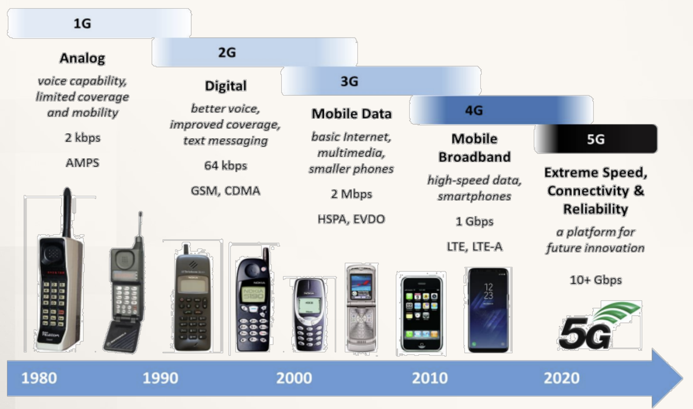

*Figure 1. Evolution of mobile communication from 1G to 5G and the features of each generation*

Mobile communication has advanced by one generation roughly every ten years. Figure 1 shows when each generation first appeared, its representative capability, peak data rate, representative technologies, and the handsets of that period [1].

| Generation | Period | Key features | Peak data rate | Representative technologies |
|:-----|:-----|:-----|:-----|:-----|
| 1G | 1980s | Analog. Only voice calls are possible, and coverage and mobility are limited. | 2 kbps | AMPS |
| 2G | 1990s | Digital. Voice quality and coverage improve, and text messages can be sent. | 64 kbps | GSM, CDMA |
| 3G | 2000s | Mobile data begins. Basic Internet and multimedia become available, and handsets become smaller. | 2 Mbps | HSPA, EV-DO |
| 4G | 2010s | Mobile broadband. High-speed data and smartphones become widespread. | 1 Gbps | LTE, LTE-A |
| 5G | 2020s | Extreme speed, connectivity, and reliability make it a platform for future innovation. | 10 Gbps or more | NR |

*Table 1. Features of each mobile communication generation*

> **Definition:** **Digital mobile communication** converts the voice into a bit stream of 0s and 1s before sending it. Digital systems allow error correction and encryption and can accommodate more users on the same frequency.

The shift from analog to digital separates the first and second generations. Among the representative technologies in Table 1, the first-generation **AMPS** is the analog standard of the United States, and in the second generation **GSM** is the time-division standard that started in Europe and **CDMA** is the code division multiple access method used by the American IS-95 standard.

Standards from several camps competed in each generation. Figure 2 summarizes the lineage of the standards by generation [2].

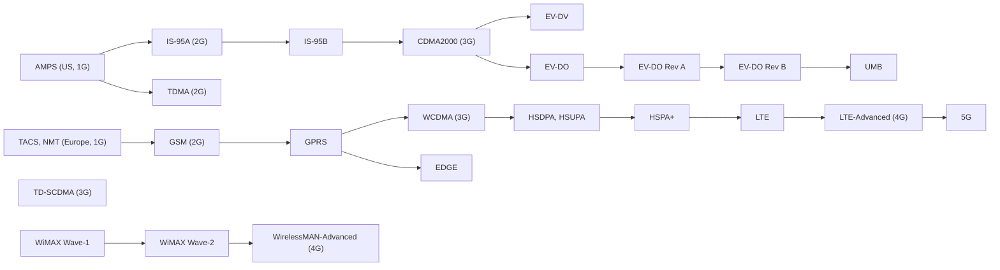

*Figure 2. Lineage of mobile communication standards by generation*

In Figure 2, within the CDMA family that started from the American AMPS, IS-95 is a standard of the U.S. Telecommunications Industry Association (TIA), and the third-generation CDMA2000 and EV-DO were managed by a standards body called 3GPP2. The family that started from the European GSM (GPRS, EDGE, WCDMA, HSPA) was managed by 3GPP, and China's third-generation standard TD-SCDMA was also included in the 3GPP specifications. IEEE created the WiMAX family based on its wireless MAN standard IEEE 802.16. Third-generation standards were developed to meet the ITU requirements called IMT-2000, fourth-generation standards IMT-Advanced, and fifth-generation standards IMT-2020. From the fourth generation onward, the LTE family of 3GPP became the de facto single worldwide standard, and 5G is also developed by 3GPP.

After packet transmission was added to the GSM network, 3GPP changed the radio access method to wideband CDMA (**WCDMA**) for the third generation, and then carried it on to the fourth generation through **HSPA**, which raised its downlink and uplink data rates.

> **Definition:** **LTE (Long Term Evolution)** is the fourth-generation radio access technology of 3GPP, and LTE-Advanced is LTE improved to meet the IMT-Advanced requirements.

### 1.2 3GPP and the Mobile Communication Standardization Procedure

> **Definition:** **3GPP (3rd Generation Partnership Project)** is an international mobile communication standards body formed jointly by the telecommunication standards organizations of several countries. Member companies develop technical specifications in 3GPP, and each organization adopts those specifications as its national standards.

The main facts about 3GPP are as follows [3], [2].

- 3GPP was founded in December 1998 for the standardization of IMT-2000 (the third generation). Today it is the central body developing 5G radio standards.
- At its founding, 3GPP was an alliance of standards organizations centered on the asynchronous approach (the GSM and WCDMA family). The synchronous approach (the CDMA2000 family) was standardized separately by 3GPP2.
- Its organizational partners are seven standards organizations: TTA of Korea, ETSI of Europe, ATIS of the United States, ARIB and TTC of Japan, CCSA of China, and TSDSI of India.
- As of May 2022, about 720 member companies took part in 3GPP through these organizations, and 26 of them took part through TTA of Korea.

> **Note:** In mobile communication, the **synchronous approach** makes all base stations operate on the same time reference by aligning them to a satellite time signal such as GPS, while the **asynchronous approach** lets each base station operate on its own independent time reference. The asynchronous approach makes base station installation more flexible, but the procedure by which a device finds a base station is more complex.

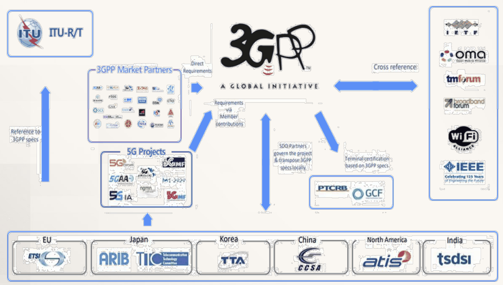

*Figure 3. Relationships among 3GPP, related international organizations, market representation bodies, and standards organizations*

Figure 3 shows the relationships among the organizations around 3GPP. The organizational partners at the bottom (ETSI of Europe, ARIB and TTC of Japan, TTA of Korea, CCSA of China, ATIS of North America, and TSDSI of India) govern the project and transpose 3GPP specifications into their local standards. The market representation bodies on the left (3GPP Market Partners) and the 5G-related projects (5GAA, 5G IA, 5GMF, and others) present requirements and contribute through member companies. ITU-R at the top references 3GPP specifications to create international standards. IETF, OMA, TM Forum, Broadband Forum, Wi-Fi Alliance, and IEEE on the right cross-reference specifications with 3GPP, and PTCRB and GCF certify terminals based on 3GPP specifications.

3GPP standardization proceeds in two stages.

1. **Developing technical specifications:** Individual members (companies and research institutes) take part in working group meetings under the Technical Specification Groups (TSGs) to develop Technical Specifications (TSs).
2. **Transposition:** The organizational partners transpose completed technical specifications into the standards of each country and submit them to the ITU so that they are reflected in ITU international standards. Third-generation specifications were reflected in IMT-2000 (Recommendation ITU-R M.1457), fourth-generation specifications in IMT-Advanced (M.2012), and fifth-generation specifications in IMT-2020 (M.2150).

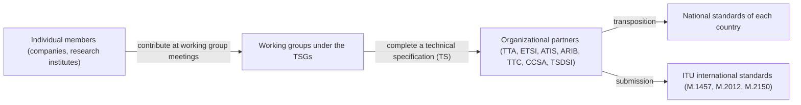

*Figure 4. 3GPP's international standardization procedure for mobile communication*

### 1.3 Usage Scenarios and Key Capabilities of 5G NR

> **Definition:** **5G NR (New Radio)** is the radio access technology of fifth-generation mobile communication defined by 3GPP. It is called New Radio because it was newly designed without considering compatibility with LTE.

Recommendation ITU-R M.2083 divides the usage scenarios of 5G (IMT-2020) into three service categories [4].

| Category | Full name | Meaning |
|:-----|:-----|:-----|
| eMBB | enhanced Mobile Broadband | Very high-speed mobile broadband communication. It serves services that send large amounts of data quickly, such as ultra-high-definition video and virtual reality. |
| URLLC | Ultra Reliable and Low Latency Communications | Ultra-reliable low-latency communication. It serves services for which delay and errors are critical, such as autonomous driving, remote surgery, and factory automation. |
| mMTC | massive Machine Type Communications | Massive machine-type communication. It serves the simultaneous connection of countless devices, such as sensors, that send small amounts of data occasionally. |

*Table 2. The three service categories of 5G*

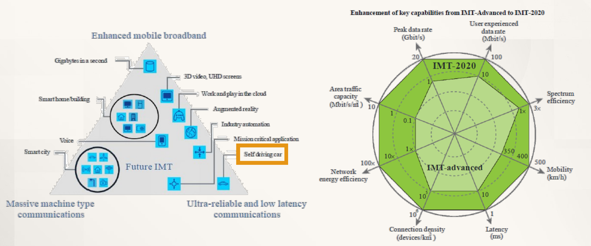

*Figure 5. Usage scenarios of 5G and the enhancement of key capabilities from IMT-Advanced*

The triangle on the left of Figure 5 places the three categories at its corners and arranges applications among them. Near eMBB are services that download gigabytes in a second, 3D video and UHD screens, work and play in the cloud, and augmented reality; near mMTC are smart homes and buildings and smart cities. Near URLLC are industry automation, mission-critical applications, and the self-driving car. The self-driving car is placed in URLLC because latency and reliability, rather than data rate, are decisive in vehicle safety communication.

The radar chart on the right compares eight key capabilities of the fourth generation (IMT-Advanced, inner) and the fifth generation (IMT-2020, outer). The target values of each indicator are given in Table 3 [4].

| Item | 4G (IMT-Advanced) | 5G (IMT-2020) |
|:-----|:-----|:-----|
| Peak data rate | 1 Gbps | 20 Gbps |
| User-experienced data rate | 10 Mbps | 100-1,000 Mbps |
| Latency | 10 ms | 1 ms |
| Mobility | 350 km/h | 500 km/h |
| Connection density | 100,000 devices/km² | 1,000,000 devices/km² |
| Spectrum efficiency | Baseline | 3 times that of 4G |
| Area traffic capacity | 0.1 Mbps/m² | 10 Mbps/m² |
| Energy efficiency | Baseline | 100 times that of 4G |

*Table 3. Comparison of key capability targets of 4G and 5G*

> **Note:** The comparison table in the original material also lists the area traffic capacity of 5G as 0.1 Mbps/m², but the IMT-2020 target given in ITU-R M.2083 is 10 Mbit/s/m², 100 times that of 4G [4]. Table 3 uses this corrected value. The target for the user-experienced data rate is 100 Mbit/s, and up to 1 Gbit/s is expected in favorable environments such as indoor hotspots.

The meaning of each indicator is as follows [4].

| Indicator | Meaning |
|:-----|:-----|
| Peak data rate | The maximum data rate a single device can achieve under ideal conditions. |
| User-experienced data rate | The data rate that users actually achieve throughout the coverage area. |
| Latency | The time the radio network takes to deliver a packet from the sender to the receiver. |
| Mobility | The maximum speed that can be supported while maintaining a defined quality of service. |
| Connection density | The number of devices that can be connected per unit area (km²). |
| Spectrum efficiency | The number of bits per second that can be sent per 1 Hz of spectrum (bit/s/Hz). |
| Area traffic capacity | The amount of data the whole network handles in a unit area (m²). |
| Network energy efficiency | The amount of data that can be sent or received with the same energy. |

*Table 4. Meaning of the 5G key capability indicators*

Why latency matters for vehicle safety becomes clear when it is expressed as the distance a vehicle travels. A vehicle driving at 100 km/h moves at $100{,}000 / 3{,}600 \approx 27.8$ m per second.

```math
\begin{aligned}
\text{Distance traveled in 10 ms} &= 27.8\ \text{m/s} \times 0.010\ \text{s} \approx 0.28\ \text{m} \\
\text{Distance traveled in 1 ms} &= 27.8\ \text{m/s} \times 0.001\ \text{s} \approx 0.028\ \text{m} = 2.8\ \text{cm} \\
\text{Distance traveled in 100 ms} &= 27.8\ \text{m/s} \times 0.100\ \text{s} \approx 2.8\ \text{m}
\end{aligned}
```

If a warning message arrives 100 ms late, the vehicle travels about 2.8 m further in the meantime, and the margin for avoiding a collision shrinks by that much. In contrast, downloading a 1 GB (= 8 Gb) file takes $8 / 1 = 8$ seconds at a peak data rate of 1 Gbps and $8 / 20 = 0.4$ seconds at 20 Gbps; this difference is a matter of convenience, not of safety.

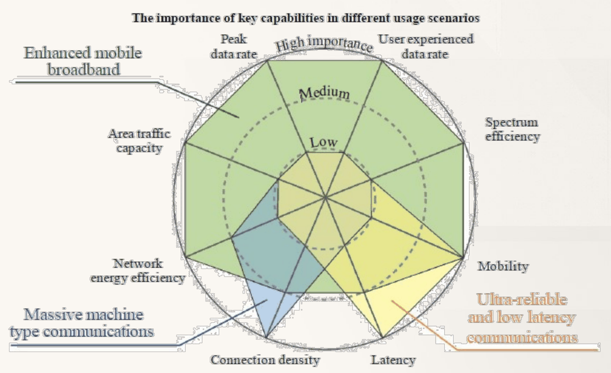

*Figure 6. Importance of key capabilities in different usage scenarios*

Figure 6 marks how important each indicator is in the three scenarios as high, medium, or low. For eMBB, the peak data rate, user-experienced data rate, area traffic capacity, spectrum efficiency, energy efficiency, and mobility are all high, while latency and connection density are medium. For mMTC, connection density is high and energy efficiency is medium; for URLLC, latency and mobility are high; the remaining indicators of these two scenarios are low. In some ultra-reliable low-latency scenarios, especially safety-critical applications, low latency can be the most important, and when used for mobility and traffic safety, low-latency performance can matter more than a high data rate [4].

The representative use cases and performance targets of each of the three 5G categories are given in Table 5. The use cases can also be divided by the combination of communicating parties into human-to-human, human-to-machine, and machine-to-machine communication [1].

| Category | Representative use cases | Performance targets |
|:-----|:-----|:-----|
| eMBB | Virtual and augmented reality, video calling and virtual meetings, fixed wireless access, UHD video, video monitoring, mobile cloud computing | Peak 20 Gbps downlink and 10 Gbps uplink, 4 ms user plane latency, 500 km/h mobility |
| mMTC | Wearables, social networking, smart homes and smart cities, health care monitoring, vehicle-to-infrastructure communication (V2I), industrial automation | 1 million devices per km², battery life of 10 years or more, 20 dB coverage enhancement |
| URLLC | Public safety, remote surgery, vehicle-to-pedestrian communication (V2P), vehicle-to-vehicle communication (V2V), industrial automation | 1 ms user plane latency, high security and resilience, 99.99999% availability |

*Table 5. Use cases and performance targets of each 5G service category*

In Table 5, V2V and V2P are placed in URLLC, while V2I, which exchanges data with road infrastructure, is placed in mMTC. Messages between vehicles and between vehicles and pedestrians are directly tied to collision avoidance, so latency and reliability matter most, whereas massive connectivity matters for V2I, which connects many roadside devices and sensors.

### 1.4 5G Spectrum

The frequency bands that each country prefers for 5G are given in Table 6.

| Country | Preferred 5G bands |
|:-----|:-----|
| Korea | 3.5 GHz, 26.5-29.5 GHz |
| United States | 700 MHz, 1.7 GHz, 3.5 GHz, 24 GHz, 28 GHz, 39 GHz |
| China | 3.3-3.6 GHz, 4.8-5.0 GHz, 26 GHz, 39 GHz |
| Japan | 3.6-4.2 GHz, 4.4-4.9 GHz, 27.5-29.5 GHz |
| Europe | 1.5 GHz, 3.6 GHz, 26 GHz |

*Table 6. Preferred 5G frequency bands by country*

The candidate frequencies for 5G are divided into the **sub-6 GHz** band below 6 GHz and the **millimeter wave (mmWave)** band of 24-100 GHz. Low frequencies travel far and bend well around obstacles such as buildings, which makes them suitable for covering wide areas. High frequencies offer wide bandwidths and therefore high data rates, but the waves do not travel far and are easily blocked by obstacles, so base stations must be deployed densely.

In June 2018, Korea assigned the 3.5 GHz and 28 GHz bands to its three mobile operators by auction [5].

| Band | Operator | Assigned range | Bandwidth | Winning bid |
|:-----|:-----|:-----|:-----|:-----|
| 3.5 GHz | LG U+ | 3.42-3.50 GHz | 80 MHz | KRW 809.5 billion |
| 3.5 GHz | KT | 3.50-3.60 GHz | 100 MHz | KRW 968.0 billion |
| 3.5 GHz | SK Telecom | 3.60-3.70 GHz | 100 MHz | KRW 1,218.5 billion |
| 28 GHz | KT | 26.5-27.3 GHz | 800 MHz | KRW 207.8 billion |
| 28 GHz | LG U+ | 27.3-28.1 GHz | 800 MHz | KRW 207.2 billion |
| 28 GHz | SK Telecom | 28.1-28.9 GHz | 800 MHz | KRW 207.3 billion |

*Table 7. Results of Korea's 5G spectrum auction*

The bandwidth is obtained by subtracting the lower edge of the assigned range from the upper edge. For example, LG U+'s 3.5 GHz block is $3.50 - 3.42 = 0.08$ GHz $= 80$ MHz, and each 28 GHz block is $27.3 - 26.5 = 0.8$ GHz $= 800$ MHz. The 3.5 GHz band totals $80 + 100 + 100 = 280$ MHz and the 28 GHz band totals $3 \times 800 = 2{,}400$ MHz, so the millimeter wave band is about 8.6 times wider. The winning bids sum to $809.5 + 968.0 + 1{,}218.5 = 2{,}996.0$ billion won for the 3.5 GHz band and $207.8 + 207.2 + 207.3 = 622.3$ billion won for the 28 GHz band, or KRW 3,618.3 billion in total. The 28 GHz band sold for less despite its much wider bandwidth; millimeter waves travel only short distances, so covering the same area needs far more base stations.

### 1.5 5G Radio Access Technologies and Network Deployment Options

> **Definition:** A **RAT (Radio Access Technology)** is the communication method used over the radio segment between a device and a base station. LTE and NR are different RATs.

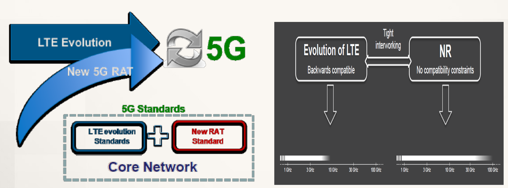

*Figure 7. Combination of LTE evolution and the new 5G RAT (NR)*

The radio access technology of 5G consists of two branches. One is the **evolution of LTE**, developed from LTE-A Pro, which maintains backward compatibility with existing LTE devices. The other is **NR**, newly designed without compatibility constraints. As on the right of Figure 7, the two technologies are tightly interworked, and the evolution of LTE operates at low frequencies of roughly 10 GHz or less, while NR operates over a wide range from below 1 GHz up to about 100 GHz. The 5G standards take the form in which the LTE evolution standards and the new RAT standard share one core network.

> **Definition:** The **core network** is the central part of a mobile network that ties base stations together and handles authentication, mobility management, and Internet connection.

The core network of LTE is called the **EPC** and that of 5G the **5GC**. Between the core network and the terminals are the base stations, whose names depend on the radio access technology they use and the core network they connect to: an LTE base station is an **eNB**, an NR base station is a **gNB**, and an LTE base station connected to the 5GC is an **ng-eNB**.

3GPP studied several network deployment options depending on how LTE and NR are combined and which core network they connect to [6]. **SA (Standalone)** is a configuration in which LTE or 5G operates independently, and **NSA (Non-Standalone)** is a configuration that combines LTE and 5G networks.

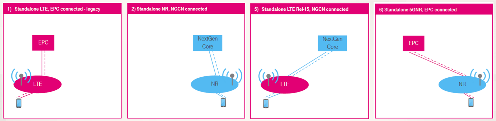

*Figure 8. Network deployment options of the SA type*

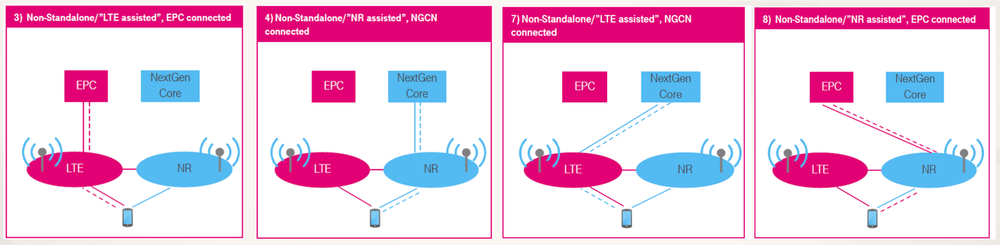

*Figure 9. Network deployment options of the NSA type*

| Option | Type | Radio access | Core network | Description |
|:-----|:-----|:-----|:-----|:-----|
| 1 | SA | LTE | EPC | The existing LTE network. |
| 2 | SA | NR | 5GC | A complete 5G network consisting only of NR and the 5GC. |
| 5 | SA | LTE (Rel-15 enhanced) | 5GC | An enhanced LTE base station is connected to the 5GC. |
| 6 | SA | NR | EPC | An NR base station is connected to the LTE core. |
| 3 | NSA | LTE leads, NR assists | EPC | LTE handles control and NR adds data capacity (LTE assisted). |
| 4 | NSA | NR leads, LTE assists | 5GC | NR handles control and LTE assists (NR assisted). |
| 7 | NSA | LTE leads, NR assists | 5GC | The same combination as option 3 connected to the 5GC. |
| 8 | NSA | NR leads, LTE assists | EPC | The same combination as option 4 connected to the EPC. |

*Table 8. 5G network deployment options*

In Figures 8 and 9, the pink lines are the interfaces between the EPC and base stations (control plane S1-C and user plane S1-U), and the light blue lines are the interfaces between the 5GC and base stations (control plane N2 and user plane N3; NG2 and NG3 in the figures are names from the early standardization stage). Dashed lines are the control plane and solid lines the user plane. In an NSA configuration, only the leading base station (the anchor) is connected to the core through the control plane, and the assisting base station only shares the user plane data. A device connected to two base stations at the same time in this way is said to use **dual connectivity (DC)**, which appears again in the NR-V2X scenarios of Section 1.8.

### 1.6 Proximity-based Services (ProSe) and D2D Communication

> **Definition:** **D2D (Device-to-Device) communication** is communication that devices exchange directly without going through a base station or core network.

ProSe consists of two functions [7], [8].

| Function | Content | Example |
|:-----|:-----|:-----|
| ProSe Discovery | Discovers nearby devices or services. | Advertisements of nearby shops, finding friends nearby |
| ProSe Direct Communication | Exchanges data or voice directly between nearby devices. | Group calls of rescue teams at a disaster site without a base station |

*Table 9. The two functions of ProSe*

ProSe direct communication takes three forms: **one-to-one**, in which one device communicates with another; **one-to-many**, in which one device sends to several devices; and **UE-to-Network Relay**, in which a device reaches the network by using another device as a relay. Of these, one-to-many direct communication is the basis of V2X broadcast communication, which sends the same message to all nearby vehicles.

In the LTE standard, the direct link between devices is called the **sidelink**. The name distinguishes it from the downlink, which goes from the base station to the device, and the uplink, which goes from the device to the base station.

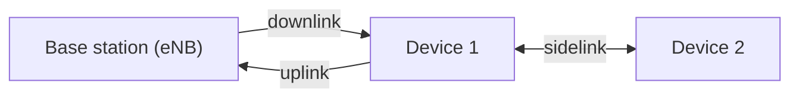

*Figure 10. Downlink, uplink, and sidelink*

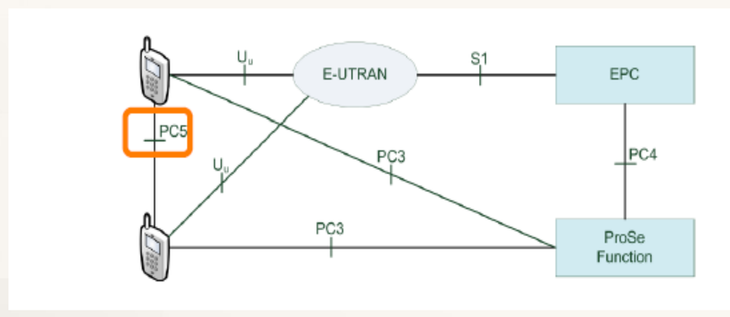

*Figure 11. Simplified ProSe architecture without roaming*

Figure 11 is the ProSe architecture. Each of the two devices connects to the LTE radio access network (E-UTRAN) through the radio interface **Uu**, and the E-UTRAN connects to the core network (EPC) through the S1 interface. The direct interface between the two devices is **PC5**. The **ProSe Function** is a network function that grants authorization and configuration to devices that may use ProSe; it connects to devices through the PC3 interface and to the EPC through the PC4 interface [8].

Among the interfaces in Figure 11, two correspond to the radio links themselves: **Uu**, the radio interface between a device and a base station, and PC5, which connects devices directly.

> **Definition:** **PC5** is the direct interface between two devices.

> **Note:** The original material distinguishes the sidelink (SL) as LTE D2D communication, PC5 as 5G D2D communication, and Uu as V2I communication, but this is a simplification. In 3GPP, sidelink names the radio link between devices itself and PC5 names the reference point between devices in the architecture, and both LTE and NR use both terms (LTE sidelink, NR sidelink, LTE PC5, NR PC5). The PC5 in Figure 11 is also in an LTE (E-UTRAN) architecture. Uu is the radio interface between a device and a base station, so it is used not only for V2I but for every communication that goes through a base station (such as V2N) [8], [9].

There are two ways to decide which time and frequency resources a device uses to transmit in D2D communication [7].

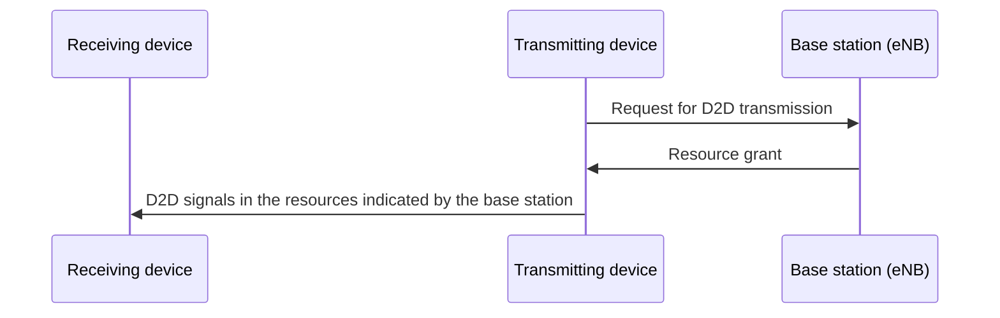

*Figure 12. Resource allocation procedure in scheduled mode*

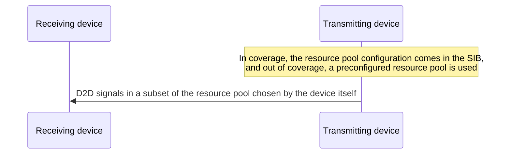

*Figure 13. Resource allocation procedure in autonomous mode*

| Item | Scheduled mode | Autonomous mode |
|:-----|:-----|:-----|
| Who decides the resources | The base station (eNB) indicates the physical resources for each device (UE-specific). | The device itself selects from resource pools allocated without specifying devices (non-UE-specific). |
| Procedure | When the transmitting device requests transmission, the base station grants resources, and the device transmits in them. | In coverage the device uses the resource pool announced in the SIB, and out of coverage a preconfigured resource pool. |
| Advantage | Collisions are avoided because the base station coordinates the resources. | It works even when the network is absent or has failed. |
| Disadvantage | It can be used only within the coverage of a base station. | Collisions can occur if several devices choose the same resources. |
| Name in V2X | Mode 3 of LTE-V2X, mode 1 of NR-V2X | Mode 4 of LTE-V2X, mode 2 of NR-V2X |

*Table 10. The two methods of D2D resource allocation*

In Table 10, the advantages and disadvantages of the two modes depend on whether the terminal is where it can receive the base station's signal.

Release 14, which introduced V2X, adapted the two D2D methods to the vehicular environment and defined them as sidelink transmission mode 3 (scheduled by the base station) and mode 4 (autonomous selection by the device) [10]. A mode 4 device senses the resources that other devices are using, selects resources that are likely to be free, and reuses them repeatedly for a certain period. In NR-V2X the same concepts are called resource allocation mode 1 and mode 2 [11].

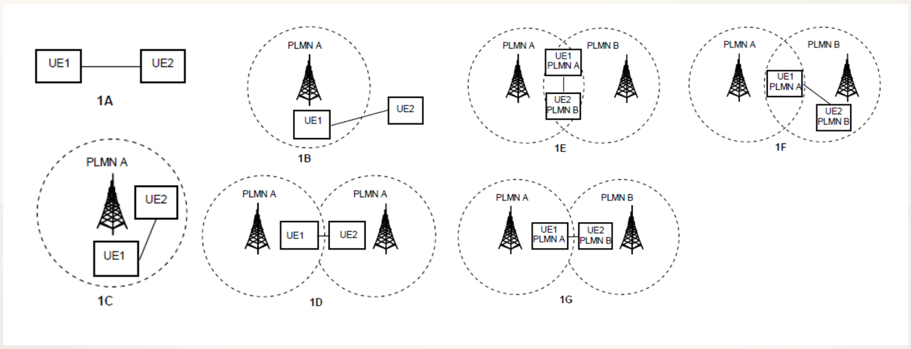

*Figure 14. ProSe direct communication scenarios without relay*

Figure 14 shows seven scenarios in which two devices (UE1 and UE2) communicate directly without a relay. The dashed circles are the coverage areas of base stations [12].

| Scenario | Situation |
|:-----|:-----|
| 1A | Both devices are out of coverage. |
| 1B | UE1 is within the coverage of PLMN A and UE2 is out of coverage (partial coverage). |
| 1C | The two devices are in the same cell of the same PLMN. |
| 1D | The two devices are in different cells of the same PLMN A. |
| 1E | UE1, a subscriber of PLMN A, and UE2, a subscriber of PLMN B, are together in the area where the coverage of the two PLMNs overlaps. |
| 1F | UE1 (PLMN A) is in the area where the two PLMNs overlap, and UE2 (PLMN B) is in the area covered only by PLMN B. |
| 1G | UE1 is in the area covered only by PLMN A, and UE2 is in the area covered only by PLMN B. |

*Table 11. ProSe direct communication scenarios without relay*

Scenarios 1E-1G are especially important in V2X, where vehicles subscribed to different operators must also communicate directly. Vehicle safety messages must be delivered regardless of which operator the other vehicle is subscribed to.

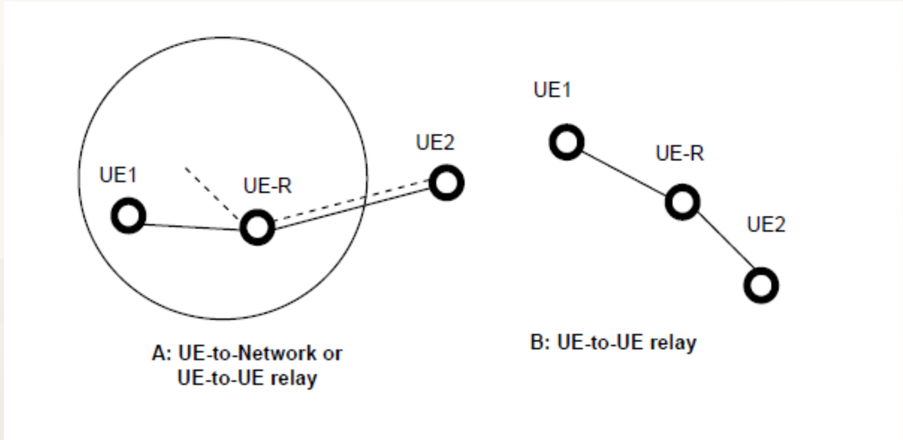

*Figure 15. ProSe direct communication scenarios with relay*

Figure 15 shows cases with a relay device (UE-R). In A, the UE-R within coverage connects UE2, which is out of coverage, to the network (UE-to-network relay) or links it with UE1 within coverage (UE-to-UE relay). In B, the UE-R relays between UE1 and UE2 without a network (UE-to-UE relay) [12].

### 1.7 LTE-V2X Operation Scenarios

3GPP TR 36.885 defined three operation scenarios for LTE-based V2X [13]. The E-UTRAN shown in the figures is the LTE radio access network, that is, the LTE base station. The operation scenarios of NR-V2X, which is based on NR, are covered in Section 1.8.

**Scenario 1: PC5-based.** A vehicle UE sends a V2X message directly to multiple nearby UEs over the sidelink (SL). It does not go through a base station.

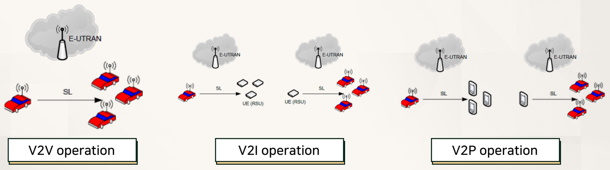

*Figure 16. PC5-based V2X operation scenarios*

In Figure 16, messages travel over the sidelink from a vehicle to nearby vehicles in V2V, between a vehicle and a UE-type roadside unit (UE (RSU)) in V2I, and between a vehicle and a pedestrian's device in V2P.

**Scenario 2: Uu-based.** A vehicle UE sends a V2X message to the base station over the uplink (UL), and the base station delivers it to multiple UEs in the area over the downlink (DL).

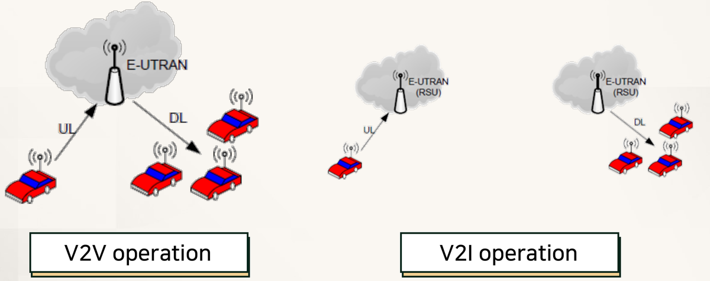

*Figure 17. Uu-based V2X operation scenarios: V2V and V2I*

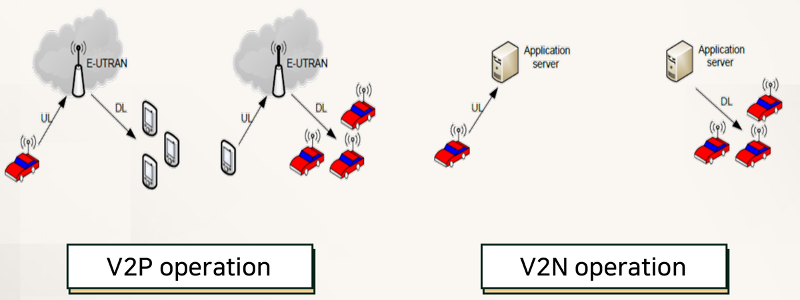

*Figure 18. Uu-based V2X operation scenarios: V2P and V2N*

In V2I of Figure 17, the base station itself acts as the roadside unit (E-UTRAN (RSU)). The vehicle sends a message to the roadside unit over the uplink or receives a message from the roadside unit over the downlink. V2P in Figure 18 exchanges messages with pedestrian devices in the same way, and in V2N the vehicle communicates through the base station with an application server beyond the network.

**Scenario 3: Using both PC5 and Uu.** The sidelink and the base station path are chained to spread a message over a wider area.

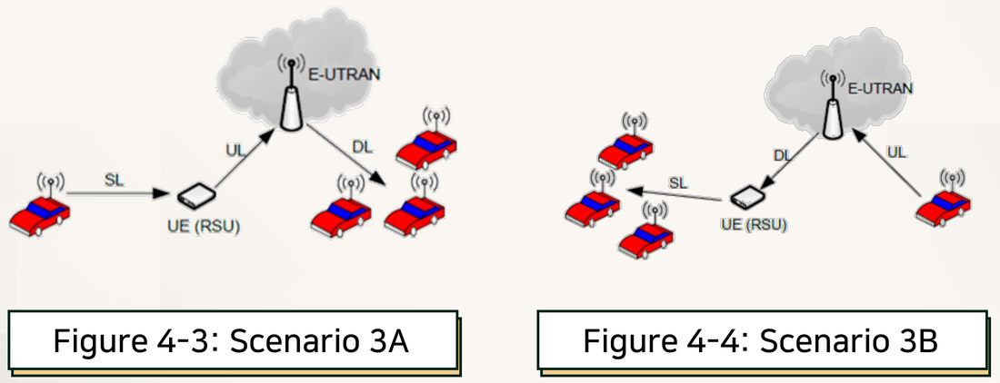

*Figure 19. V2X operation scenarios 3A and 3B using both PC5 and Uu*

- **Scenario 3A:** A vehicle sends a V2X message over the sidelink. A UE-type roadside unit (UE (RSU)) that receives it forwards it to the base station over the uplink, and the base station broadcasts it to multiple UEs in the area over the downlink.
- **Scenario 3B:** A vehicle sends a V2X message to the base station over the uplink. The base station forwards it to one or more UE-type roadside units, and the roadside units send it to nearby UEs over the sidelink.

> **Definition:** A **roadside unit (RSU)** is a device installed at the roadside that communicates with vehicles. In C-V2X there are UE-type and eNB-type RSUs.

| Scenario | Links used | Advantage | Limitation |
|:-----|:-----|:-----|:-----|
| 1 (PC5-based) | Sidelink | Latency is short because no base station is involved, and it works out of coverage. | Messages are delivered only within radio range. |
| 2 (Uu-based) | Uplink, downlink | Messages are delivered to wide areas and servers through the base station. | Latency is longer because messages pass through the base station and core, and a network is required. |
| 3 (combined) | Sidelink, uplink, downlink | Combines the short latency of direct communication with the wide delivery range of the base station. | The configuration is complex, and interworking between RSUs and base stations is required. |

*Table 12. Comparison of the LTE-V2X operation scenarios*

### 1.8 NR-V2X Operation Scenarios

3GPP TR 38.885 defined the operation scenarios of NR-based V2X [14]. An NR-V2X vehicle can use both the NR sidelink (NR V2X SL) and the LTE sidelink (LTE V2X SL), and the scenarios differ in which base station provides the control and configuration information for the two sidelinks.

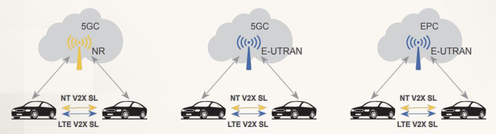

*Figure 20. Standalone scenarios of NR-V2X*

In the **standalone scenarios**, a single base station (gNB, ng-eNB, or eNB) provides the V2X communication control and configuration information for the sidelinks. On the left of Figure 20 an NR base station (gNB) connected to the 5GC, in the middle an LTE base station (ng-eNB) connected to the 5GC, and on the right an LTE base station (eNB) connected to the EPC controls both sidelinks.

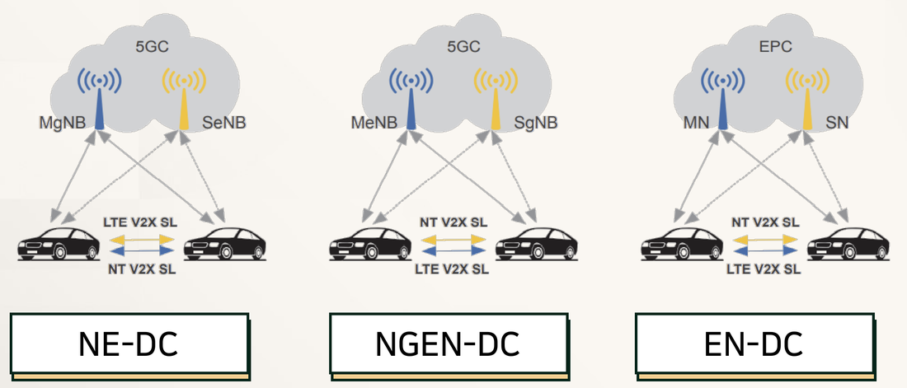

*Figure 21. Multi-radio dual connectivity (MR-DC) scenarios of NR-V2X*

In the **MR-DC (Multi-Radio Dual Connectivity) scenarios**, a vehicle is connected at the same time to two base stations of different RATs and receives the control and configuration information for the sidelinks through multiple Uu interfaces. The three cases in Figure 21 correspond to the NSA options of Section 1.5.

| MR-DC type | Master base station | Secondary base station | Core | Corresponding option |
|:-----|:-----|:-----|:-----|:-----|
| NE-DC (NR-E-UTRA DC) | gNB (MgNB) | ng-eNB (SeNB) | 5GC | Option 4 |
| NGEN-DC (NG-RAN E-UTRA-NR DC) | ng-eNB (MeNB) | gNB (SgNB) | 5GC | Option 7 |
| EN-DC (E-UTRA-NR DC) | eNB (MN) | gNB (SN) | EPC | Option 3 |

*Table 13. MR-DC scenarios of NR-V2X*

### 1.9 Standardization Stages and the Two Transmission Modes of C-V2X

The PC5 interface of the sidelink, the direct communication link of C-V2X, started from the D2D communication defined in Release 12. 3GPP publishes standards in units called **releases**, and C-V2X features were added in each release.

| Release (completion) | C-V2X feature added | Representative use case |
|:-----|:-----|:-----|
| Rel-8-13 (March 2016) | LTE-V2X mobile network communications (Uu) | Hazard warning |
| Rel-14 (March 2017) | LTE-V2X direct communications (PC5) | V2V safety use cases |
| Rel-15 (June 2018) | 5G-V2X mobile network communications (Uu) | Enhanced navigation and infotainment |
| Rel-16 (planned for December 2019) | 5G-V2X direct communications (PC5) | Cooperative automated driving |
| Rel-17 (June 2022) | 5G-V2X power efficiency for V2P applications | Advanced cooperative automated driving and interaction with vulnerable road users (VRUs) |

*Table 14. Evolution of C-V2X features by 3GPP release*

> **Note:** The completion dates in Table 14 are the schedules given in industry materials (Qualcomm, 5GAA) from around 2020 [15]. Release 16 was delayed and was completed (frozen) in July 2020 [16]. A **release freeze** means finalizing the specifications without adding new features to that release.

C-V2X has two complementary transmission modes [15].

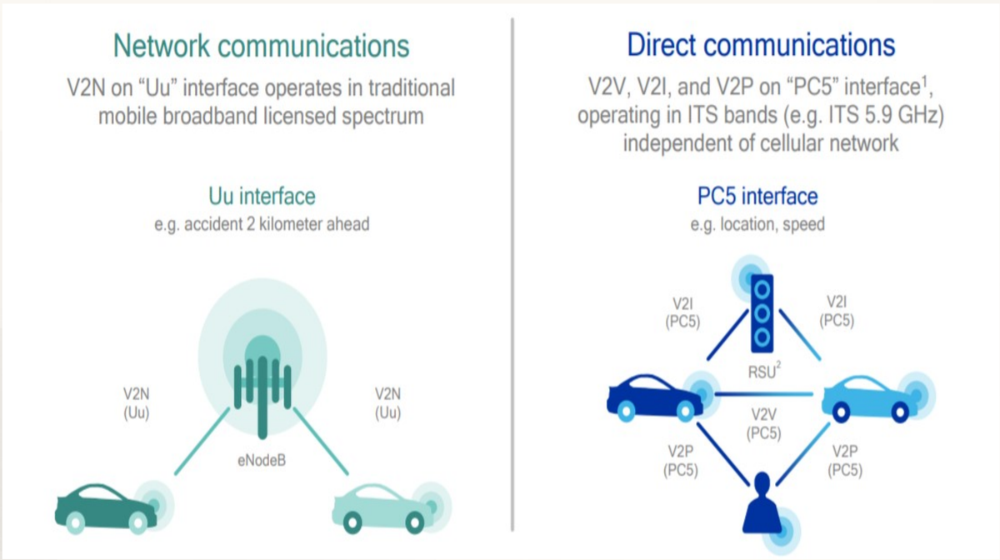

*Figure 22. Network communications and direct communications of C-V2X*

| Transmission mode | Interface | Spectrum | Communication partners | Example |
|:-----|:-----|:-----|:-----|:-----|
| Network communication | Uu | Licensed spectrum of mobile operators (traditional mobile broadband spectrum) | V2N | Information about an accident 2 km ahead |
| Direct communication | PC5 | ITS bands (for example, 5.9 GHz), operating independently of the cellular network | V2V, V2I, V2P | Location and speed of nearby vehicles |

*Table 15. The two transmission modes of C-V2X*

On the left of Figure 22, two vehicles communicate through a base station (eNodeB) by V2N, and on the right, vehicles, a roadside unit, and a pedestrian communicate directly over PC5. 3GPP also defines a method in which the base station coordinates resources even for direct communication (mode 3 of Section 1.6).

> **Definition:** **Licensed spectrum** is a frequency band for which the government has granted exclusive use rights to a specific operator.

> **Definition:** An **ITS band** is a band designated for intelligent transport systems. The allocation of the 5.9 GHz band differs by country and was summarized in Week 1.

C-V2X direct communication has three characteristics that let it manage itself without a network (self-managed) [15].

| Characteristic | Content |
|:-----|:-----|
| USIM-less operation | C-V2X direct communication does not require a USIM. Vehicles and roadside units that have not subscribed to a mobile operator can also take part. |
| Autonomous resource selection | Following distributed scheduling, a vehicle selects resources from resource pools without network assistance. |
| GNSS time synchronization | C-V2X uses GNSS not only for positioning but also for time synchronization, so devices can align their time without a cellular network. |

*Table 16. Self-managed characteristics of C-V2X direct communication*

Time synchronization is needed because the sidelink divides time into intervals of fixed length and shares resources by these intervals. All devices must agree on the start times of the intervals to use the same resource pool without overlapping. GNSS is already required for positioning in every V2X technology, including IEEE 802.11p, and the time is obtained as part of the position calculation and requires fewer satellites than positioning does [15].

### 1.10 C-V2X Standardization Roadmap and 5G-V2X

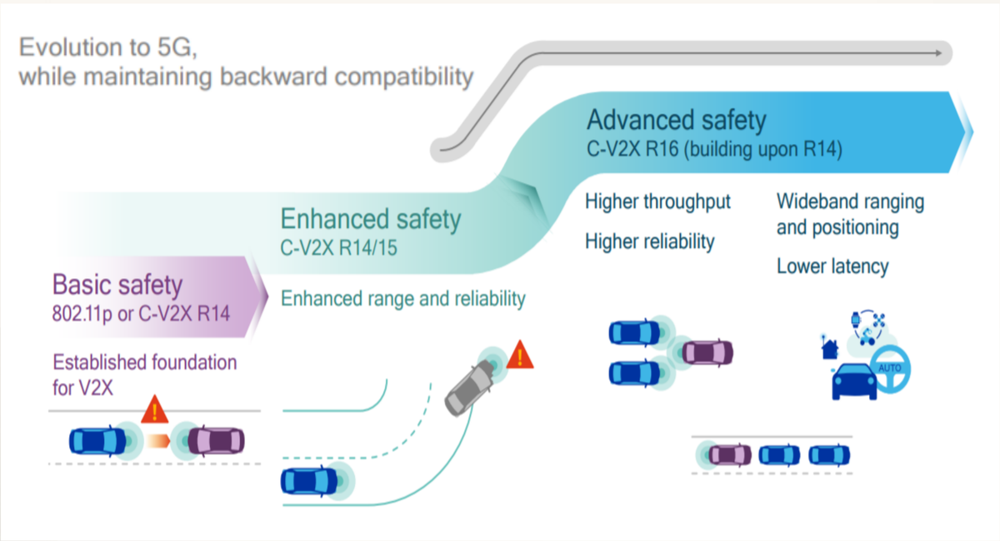

*Figure 23. Evolution of V2X technology to 5G while maintaining backward compatibility*

Figure 23 shows V2X technology evolving in three stages while maintaining backward compatibility [15]. The first stage, **basic safety**, establishes the foundation for V2X with IEEE 802.11p or C-V2X Rel-14. The second stage, **enhanced safety**, improves communication range and reliability with C-V2X Rel-14 and Rel-15. The third stage, **advanced safety**, provides higher data rates and reliability, wideband ranging and positioning, and lower latency with C-V2X Rel-16, which builds upon Rel-14.

| Item | D2D communications (Rel-12/13) | Enhanced safety (Rel-14 phase I, Rel-15 phase II) | Autonomous driving (Rel-16 5G NR, phase III) |
|:-----|:-----|:-----|:-----|
| Purpose | Establish the foundation for basic D2D communication | Enhance communication range and reliability for V2X safety | Ultra-reliable, low-latency, high-throughput communication for autonomous driving |
| Network-independent operation | No | Yes | Yes |
| Communication type (PHY/MAC) | Broadcast only | Broadcast only | Broadcast, unicast, multicast |
| High-speed support | No | Yes | Yes |
| High-density support | No | Yes | Yes |
| Data rate | | High throughput for enhanced safety | Ultra-high throughput |
| Latency | | Low latency for enhanced safety applications | Ultra-low latency |
| Reliability | | Reliability for enhanced safety applications | Ultra-high reliability |
| Positioning | No | Sharing of position information | Wideband ranging and positioning |

*Table 17. Evolution of C-V2X toward 5G for autonomous driving*

> **Definition:** **Multicast** is communication sent to a specific group of devices (for example, the vehicles of a platoon). Because the sidelink of Rel-14 and Rel-15 supports only broadcast, every message is delivered to everyone nearby. Communication with a specific partner, such as two vehicles negotiating their driving plans, requires unicast.

5G NR provides new radio technologies for both direct and network communications [15].

| New 5G NR technology | Meaning |
|:-----|:-----|
| Scalable OFDM numerology | The subcarrier spacing can be changed to $2^\mu$ times 15 kHz, adjusting the symbol length and latency to the situation. |
| Wideband transmissions for positioning | A wide bandwidth measures the arrival time of a signal precisely to obtain distance and position accurately. |
| Advanced LDPC/polar channel coding | LDPC codes for data and polar codes for control information improve error correction performance. |
| Self-contained sub-frame | Data and the response to it are placed in one transmission unit to reduce round-trip delay. |
| Low-latency slot structure design | Short slots and transmission units shorter than a slot send data quickly. |
| Massive MIMO | Tens to hundreds of antennas on a base station focus beams in the desired directions. |

*Table 18. New 5G NR technologies for 5G-V2X*

LDPC codes for the data channels and polar codes for the control channels are defined in the NR channel coding specification [17]. Thanks to these technologies, PC5 direct communication gains higher data rates and URLLC capabilities and is designed to work without network assistance in the ITS spectrum, and Uu network communication also gains higher data rates and URLLC capabilities in licensed spectrum.

> **Definition:** A **numerology** is the combination of subcarrier spacing and the symbol length and slot length determined by it.

The subcarrier spacing of NR is $\Delta f = 15 \times 2^\mu$ kHz, one slot consists of 14 OFDM symbols, and the slot length is $1 / 2^\mu$ ms [18]. The wider the subcarrier spacing, the shorter the symbols and slots, and the lower the latency.

| $\mu$ | Subcarrier spacing | Slot length |
|:-----|:-----|:-----|
| 0 | 15 kHz | 1 ms |
| 1 | 30 kHz | 0.5 ms |
| 2 | 60 kHz | 0.25 ms |
| 3 | 120 kHz | 0.125 ms |

*Table 19. Subcarrier spacing and slot length by NR numerology*

A wide subcarrier spacing is also robust against the **Doppler effect** that arises in fast vehicles. The Doppler frequency shift is $f_d = v f_c / c$. Two vehicles approaching each other at 120 km/h each have a relative speed of 240 km/h, that is, $240{,}000 / 3{,}600 \approx 66.7$ m/s. Substituting the carrier frequency $f_c = 5.9$ GHz and the speed of light $c = 3 \times 10^8$ m/s gives the following.

```math
f_d = \frac{66.7 \times 5.9 \times 10^9}{3 \times 10^8} = 66.7 \times 19.67 \approx 1{,}311\ \text{Hz}
```

This shift is about $`1{,}311 / 15{,}000 \approx 8.7\%`$ of a 15 kHz spacing but shrinks to about 4.4% of a 30 kHz spacing, so the interference between subcarriers becomes smaller.

Why wideband transmission helps positioning can also be calculated simply. The resolution with which a signal of bandwidth $B$ can distinguish arrival times is roughly $1/B$. For $B = 100$ MHz this is $1 / (100 \times 10^6) = 10$ ns, and light travels $3 \times 10^8 \times 10 \times 10^{-9} = 3$ m in 10 ns, so the distance resolution is about 3 m. Widening the bandwidth to 400 MHz improves it to about 0.75 m.

With 5G-V2X, connected cars gain the following capabilities. They rely on wideband carrier support, high throughput, ultra-low latency, ultra-high reliability, and strong security, while maintaining backward compatibility with existing capabilities [15].

| Capability | Content |
|:-----|:-----|
| High throughput sensor sharing | Vehicles exchange raw or processed sensor data they have gathered with high throughput and low latency. |
| Intention/trajectory sharing | Vehicles share their planned driving trajectories so that each knows the others' movements in advance. |
| Wideband ranging and positioning | Wideband carriers provide accurate position and distance for cooperative and automated driving. |
| Local HD maps and bird's eye view | Local dynamic maps are built from camera and sensor data and distributed, for example at intersections. |

*Table 20. 5G-V2X capabilities of connected cars*

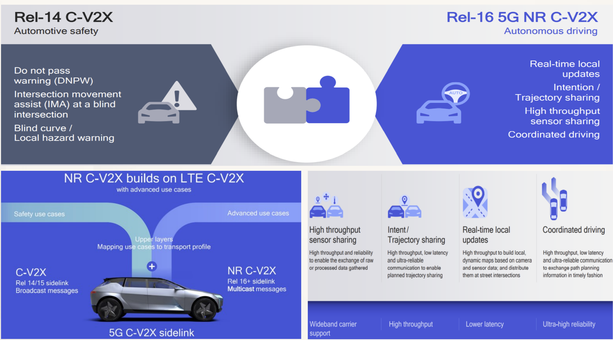

*Figure 24. Rel-16 5G NR C-V2X complementing Rel-14 C-V2X*

As Figure 24 shows, 5G NR C-V2X complements rather than replaces Rel-14. Rel-14 C-V2X handles automotive safety (do not pass warning (DNPW), intersection movement assist (IMA) at a blind intersection, and blind curve and local hazard warning), and Rel-16 5G NR C-V2X handles autonomous driving (real-time local updates, intention and trajectory sharing, high throughput sensor sharing, and coordinated driving). As in the lower part of the figure, one vehicle uses broadcast messages over the Rel-14/15 sidelink for safety use cases and multicast messages over the Rel-16+ sidelink for advanced use cases, and the upper layers map each use case to the appropriate transport.

### 1.11 Upper Layer Architecture of C-V2X

C-V2X newly defines only the radio segment (lower layers) and reuses the upper layers already defined by the automotive industry [15].

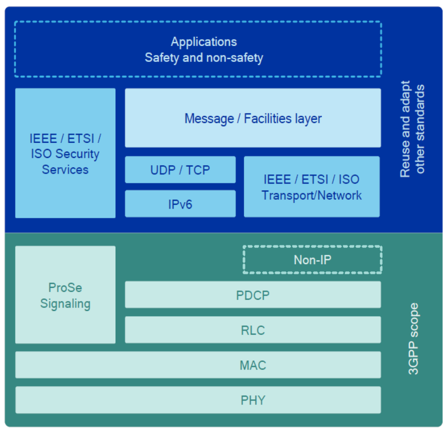

*Figure 25. Protocol stack of C-V2X and the reused upper layers*

- **Reuse of DSRC and C-ITS service and application layers:** Vehicle messages and applications have already been defined by automotive standards bodies such as ETSI and SAE. An abstraction layer for interfacing with the 3GPP lower layers is developed together with 5GAA.
- **Reuse of existing security and transport layers:** The security, transport, and network protocols defined by ISO, ETSI, and the IEEE 1609 family are used as they are.
- **Continuous enhancements to the radio and lower layers:** 3GPP develops the lower layers to support the ever-evolving V2X use cases.

The upper part of Figure 25 (blue) consists of the applications (safety and non-safety), the message and facilities layer, UDP/TCP and IPv6, the IEEE, ETSI, and ISO transport and network layers, and security services; this part reuses and adapts other standards. The lower part (green) is the scope of 3GPP and consists of ProSe signaling, the path that does not use IP (Non-IP), PDCP, RLC, MAC, and PHY. In addition, the network architecture and system design of LTE Direct were also enhanced to support V2X. The SAE J2735 messages of the message layer were covered in Week 11, and the IEEE 1609 family in Week 13.

Within the 3GPP scope of Figure 25, the **PHY** at the bottom is the physical layer that modulates signals and sends them as radio waves, and the **MAC** above it is the medium access control layer that shares radio resources. Above PHY and MAC are two more layers that prepare the data for the radio link: **RLC** handles the segmentation and retransmission of packets, and **PDCP** handles header compression and ciphering.

### 1.12 Comparison of IEEE 802.11p and C-V2X

| Item | IEEE 802.11p | C-V2X Rel-14/15 | C-V2X Rel-16 (expected design) |
|:-----|:-----|:-----|:-----|
| Specification completed | Completed | Rel-14 completed in 2016, Rel-15 to be completed in 2018 | 2019 |
| Support for low-latency direct communications | Supported | Supported (Rel-14: 4 ms) | Supported (1 ms or less) |
| Support for network communication | Limited (via APs only) | Supported | Supported |
| Can operate without network assistance | Yes | Yes | Yes |
| Can operate in the ITS 5.9 GHz spectrum | Yes | Yes | Yes |
| SIM-less operation | Yes | Yes | Yes |
| Security and privacy on V2V, V2I, and V2P | As per IEEE WAVE and ETSI ITS security services | As per IEEE WAVE and ETSI ITS security services | As per IEEE WAVE and ETSI ITS security services |
| Security and privacy on V2N | N/A | Supported | Supported |
| Coexistence in 5.9 GHz | Adjacent channel with 3GPP technology | Adjacent channel with 802.11p, co-channel coexistence from R14 onward | Adjacent channel with 802.11p, co-channel coexistence from R14 onward, and with Wi-Fi |
| Evolution path | None | Yes | Compatible with Rel-14/15 |

*Table 21. Performance comparison of IEEE 802.11p and C-V2X*

In Table 21, C-V2X is rated more favorably than 802.11p in direct communication latency, support for network communication, and evolution path. Both technologies operate in the 5.9 GHz ITS band without a base station and do not require a SIM, and their V2V, V2I, and V2P security uses the same IEEE WAVE and ETSI ITS security services. An **AP (access point)** is the access point of a wireless LAN; the entry means that an 802.11p device can connect to a network only through an access point such as a roadside unit.

> **Note:** Table 21 comes from Qualcomm, which supplies C-V2X chipsets, so it reflects a perspective favorable to C-V2X. An 802.11p device can also receive network services through a roadside unit connected to the Internet, and IEEE 802.11bd (NGV, Next Generation V2X), which maintains backward compatibility, was standardized in 2022 as the evolution path of 802.11p [19]. The two entries that call 802.11p's network communication limited and say it has no evolution path are therefore difficult to accept as they are. The comparison table of vehicle communication methods in Week 1 also includes IEEE 802.11bd as a variant of WAVE. The completion dates in Table 21 are also projections of that time. Rel-14 completed V2V in September 2016 and the full V2X feature in March 2017 (ASN.1 freeze June 2017), Rel-15 was frozen in June 2018, and Rel-16 in July 2020.

### 1.13 C-V2X Use Cases

5GAA organized the evolution of C-V2X use cases for connected cooperative driving along two directions [20]. The cooperation direction advances from only warning the driver (connected driver warning) to assisting driving (connected driver assistance) to vehicles driving cooperatively with each other (connected cooperative driving), and the automation direction advances from traffic efficiency and safety to advanced safety to automated driving.

| Automation stage | Use cases |
|:-----|:-----|
| Traffic efficiency/safety | Local hazard and traffic information, basic safety, intersection safety, VRU collective awareness, data sharing of dynamic objects, VRU complex interactions |
| Advanced safety | Hazard information collection and sharing, data collection and sharing for high-definition maps, non-analyzed sensor signal sharing, dynamic intersection management, dynamic cooperative traffic flow |
| Automated driving | Automated valet parking, tele-operated driving for automated vehicles, cooperative maneuvers, cooperative adaptive cruise control (CACC) |

*Table 22. Evolution of C-V2X use cases for connected cooperative driving*

C-V2X divides the two transmission modes according to the latency requirements of the use cases. Active safety use cases use direct communication, because it has short latency and enhanced range, reliability, and non-line-of-sight (NLOS) performance.

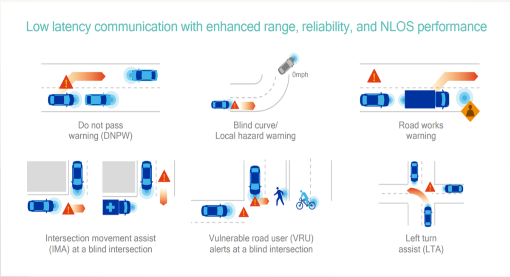

*Figure 26. Direct communications for active safety use cases*

The six use cases in Figure 26 are do not pass warning (DNPW), blind curve and local hazard warning (a stopped vehicle beyond a curve), road works warning, intersection movement assist (IMA) at a blind intersection, vulnerable road user alerts at a blind intersection, and left turn assist (LTA). All of them must report, with short latency, hazards that the driver or vehicle sensors can hardly notice in advance.

> **Definition:** **Non-line-of-sight (NLOS)** is the condition in which an obstacle such as a building or another vehicle lies between the transmitter and receiver so that they cannot see each other directly. Cameras and radars can hardly detect objects in NLOS, but radio waves can reach beyond obstacles by reflection and diffraction.

Use cases that tolerate some latency use network communication. Telematics, infotainment, and informational safety services belong here.

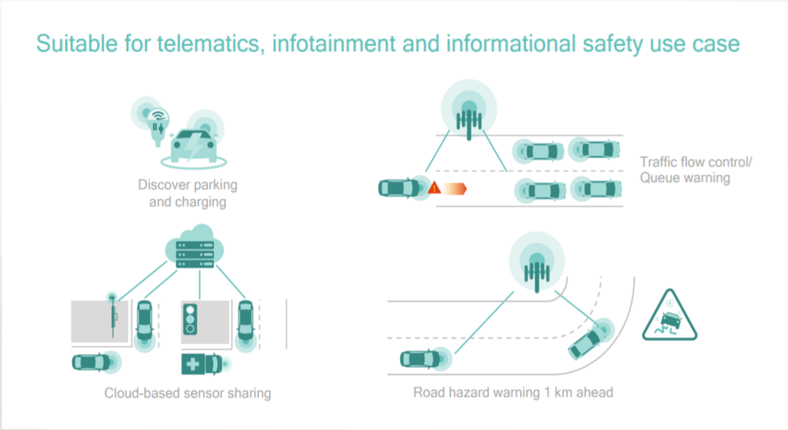

*Figure 27. Network communications for latency-tolerant use cases*

The use cases in Figure 27 are discovering parking and charging, traffic flow control and queue warning, cloud-based sensor sharing, and road hazard warning 1 km ahead.

### 1.14 5GAA and C-V2X Demonstrations

> **Definition:** **5GAA (5G Automotive Association)** is an international association formed jointly by the automotive and telecommunication industries that promotes the development and deployment of cellular-based vehicle communication, including C-V2X.

The main facts about 5GAA are as follows.

- It was founded in September 2016 with the participation of Audi, BMW, Daimler, Ericsson, Huawei, Intel, Nokia, and Qualcomm.
- Its vision is that 5G will become the ultimate platform for C-ITS and ITS, and it is a strong supporter of C-V2X.
- It joined 3GPP in April 2017.
- In February 2018 it announced that LTE-V2X would be deployed by 2020.

The LTE-V2X deployment timeline that 5GAA announced in December 2017 is given in Table 23 [21].

| Item | Schedule |
|:-----|:-----|
| C-V2X (R14) chipsets from various vendors | Chipsets for tests in H2 2017, interoperability tests in 2018, commercial availability of mode 4 chipsets in 2019 |
| Integration, validation, and testing with OEMs (EU, China, US) | H1 2018-2020 |
| Testing of traffic infrastructure (EU, China, US) | H1 2018-2020 |
| 5.9 GHz spectrum target availability | EU spectrum and Chinese test spectrum in H2 2017, Chinese deployment spectrum in 2018, EU in H2 2018, US deployment spectrum in 2019 |
| Start of vehicle deployment | 2020 |

*Table 23. 5GAA's LTE-V2X deployment timeline (announced December 2017)*

The same material stated that C-V2X had been codified in 3GPP Release 14 in June 2017, that commercial chipsets would be ready in 2018, and that commercial in-vehicle deployment (type-approved vehicles) was foreseen to start globally by 2020 at the latest. Mode 4 here is the autonomous resource selection by the device seen in Section 1.6.

5GAA demonstrated C-V2X direct communication (PC5) in real road environments.

- **US demonstration:** In late April 2018 in Washington, D.C., Audi, Ford, and Qualcomm demonstrated C-V2X direct communication in the ITS 5.9 GHz band with six scenarios.
- **European demonstration:** In July 2018 in Paris, France, 5GAA, the BMW Group, Ford, Groupe PSA, Qualcomm, and Savari jointly gave Europe's first demonstration of C-V2X direct communication between vehicles of multiple manufacturers. This real-time demonstration showed direct communication among passenger cars, a motorcycle, and road infrastructure.

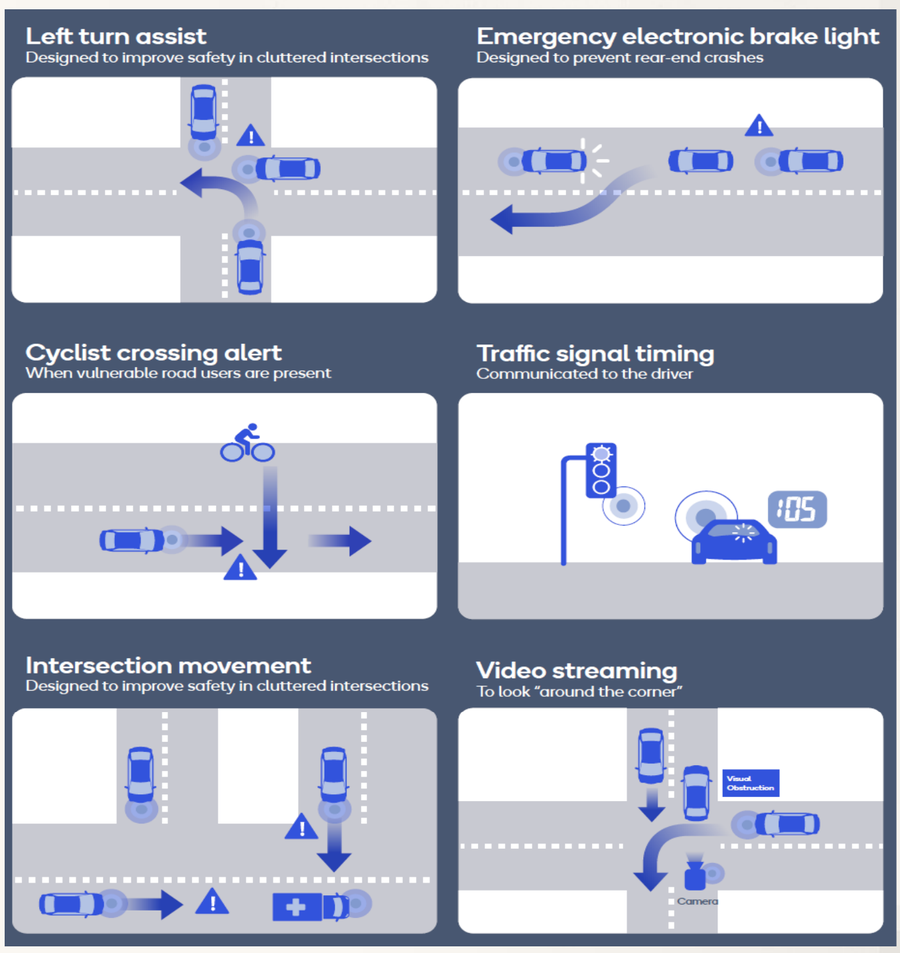

*Figure 28. C-V2X scenarios of the US demonstration*

| Demonstration | Scenarios |
|:-----|:-----|
| United States (April 2018) | Left turn assist, emergency electronic brake light, cyclist crossing alert, traffic signal timing, intersection movement assist, video streaming to look around the corner |
| Europe (July 2018) | Emergency braking warning light (preventing rear-end collisions), left-turn collision warning in an intersection, traffic signal change and timing, pedestrian protection warning (protecting pedestrians and cyclists), intersection collision warning, stop car warning (preventing rear-end collisions) |

*Table 24. Scenarios of the 5GAA C-V2X demonstrations*

### 1.15 5G-V2X Use Cases Defined by 3GPP

3GPP TR 22.886 classified the use cases of 5G-V2X as follows [22], [23].

| Group | Use cases |
|:-----|:-----|
| General | Communication between vehicles of different 3GPP RATs, multi-PLMN environment, multi-RAT use case, use case out of 5G coverage, dynamic ride sharing, tethering via vehicle, secure software update for electronic control units |
| Extended sensors | Sensor and state map sharing, collective perception of environment, video data sharing for automated driving |
| Advanced driving | Cooperative collision avoidance (CoCA), information sharing for limited and full automated driving, emergency trajectory alignment, intersection safety information provisioning for urban driving, cooperative lane change (CLC) of automated vehicles, 3D video composition for V2X scenarios |
| Platooning | eV2X support for vehicle platooning, information exchange within a platoon, automated cooperative driving for short-distance grouping, information sharing for limited and full automated platooning, changing driving mode |
| Remote driving | eV2X support for remote driving, teleoperated support (TeSo) |

*Table 25. 5G-V2X use cases defined by 3GPP*

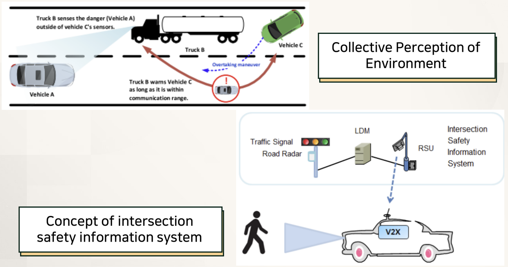

*Figure 29. Collective perception of the environment and the intersection safety information system*

The top of Figure 29 is an example of **collective perception**. Truck B detects vehicle A with its own sensors, but vehicle C behind truck B cannot see vehicle A because the truck blocks the view. When vehicle C tries to overtake, truck B warns vehicle C, which is within communication range, of vehicle A's presence. The bottom is the **intersection safety information system**: information collected by the traffic signal and road radar is delivered through the LDM server to the roadside unit (RSU), and the RSU informs vehicles by V2X about objects such as pedestrians that vehicle sensors cannot see.

> **Definition:** An **LDM (Local Dynamic Map)** is a database that overlays rapidly changing information, such as signal states and the positions of nearby vehicles and pedestrians, on a static road map and manages it.

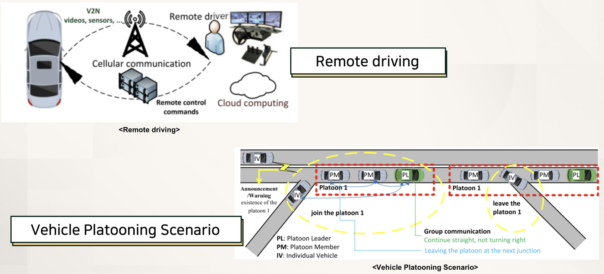

*Figure 30. Remote driving and vehicle platooning scenarios*

The left of Figure 30 is **remote driving**. The vehicle sends video and sensor data by V2N through the cellular network to a remote driver, and the remote driver sends remote control commands. Cloud computing assists this process. The right is **vehicle platooning**. The platoon leader (PL) and platoon members (PM) share driving information by group communication. An individual vehicle (IV) receives announcements and warnings about the existence of the platoon and can join it, and a member that will go in another direction at the next junction leaves the platoon. Group communication shares intentions such as "continue straight, not turning right" and "leaving the platoon at the next junction".

> **Definition:** **Platooning** is a driving method in which several vehicles align their speed and braking through communication and drive in a line with short gaps. It saves fuel by reducing air resistance and increases road capacity, but the braking information of the vehicle ahead must be delivered with very short latency.

---

<br>

## 2. Wireless Communication for Autonomous Driving: CALM Hybrid Communication Technology

The C-V2X of Section 1 and the WAVE of Week 13 are each vehicle communication systems built around one radio technology. A real vehicle can use several radio technologies together, such as cellular, 5.9 GHz vehicular communication, wireless LAN, satellite, and broadcasting, so a structure is needed that selects the most suitable technology for the situation and communicates without interruption. Communication that combines several access technologies in this way is called **hybrid communications**, and the standards framework that the International Organization for Standardization (ISO) defined for it is CALM.

> **Definition:** **CALM (Communications Access for Land Mobiles)** is the land mobile communication standards framework created by WG16 under the ISO technical committee on intelligent transport systems (ISO TC204). It lets one ITS station be equipped with several radio access technologies at once and select or switch among them according to the requirements of applications and the communication environment.

### 2.1 Concept and Early Architecture of CALM

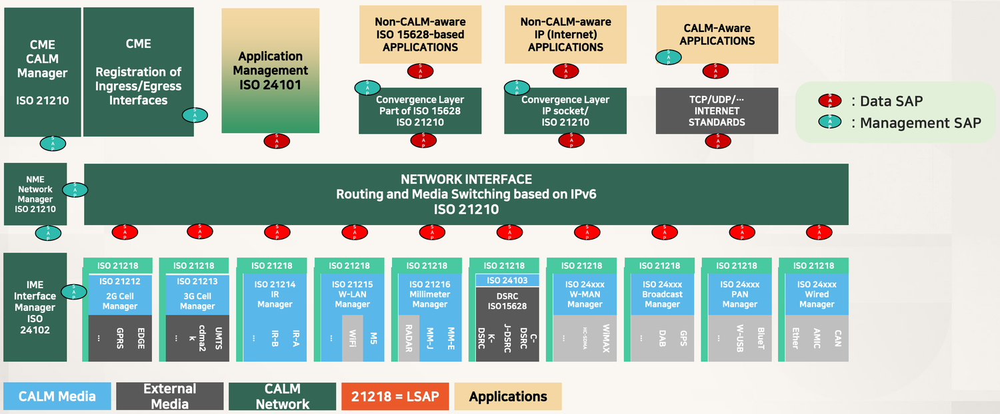

*Figure 31. Early stage CALM architecture*

Figure 31 is the early stage CALM architecture. At the bottom are the various communication media. 2G cellular (GPRS, EDGE), 3G cellular (UMTS, cdma2000), infrared (IR), wireless LAN (Wi-Fi, M5), millimeter wave (radar, MM-J, MM-E), DSRC (regional variants such as J-DSRC, K-DSRC, and C-DSRC), wireless MAN (WiMAX, HC-SDMA), broadcast (DAB, GPS), personal area networks (wireless USB, Bluetooth), and wired media (Ethernet, AMIC, CAN) are each connected through their own medium manager. Each medium has a standard such as ISO 21212 (2G), ISO 21213 (3G), ISO 21214 (IR), ISO 21215 (W-LAN), and ISO 21216 (millimeter wave), and the top of every medium is unified into the link service access point (LSAP) defined by ISO 21218.

The network interface above them (ISO 21210) handles routing and media switching based on IPv6. At the top are three kinds of applications. Non-CALM-aware applications based on ISO 15628 (the DSRC application layer) and IP (Internet) applications connect through convergence layers, while CALM-aware applications run directly over Internet standards such as TCP/UDP. The management entity on the left (CME, CALM Management Entity) handles the CALM manager and the registration of ingress and egress interfaces, the network manager (NME) and the interface manager (IME, ISO 24102) manage each layer, and application management is defined by ISO 24101. In the legend, the red dots are data SAPs that exchange data, and the teal dots are management SAPs that exchange management information. The legend at the bottom distinguishes by color CALM media (light blue), external media (gray), CALM network elements (dark green), the LSAP of ISO 21218 (orange), and applications (beige).

> **Definition:** A **SAP (Service Access Point)** is the logical point at which one layer provides services to the layer above or beside it. Data and commands pass between layers only through SAPs.

The goals of CALM can be summarized in the following six points.

1. It supports medium- and long-range communication over wide areas.
2. It supports service-oriented wide-area ITS communication.
3. It supports access to various wireless technologies such as cellular, M5, and infrared (IR).
4. It provides continuous communication without interruption and simultaneous communication with several points (multipoint communication) through handover and roaming.
5. It supports both ITS-dedicated non-IP communication and IPv6-based Internet communication.
6. It supports non-IP vehicle-to-vehicle (V2V) communication.

> **Definition:** **Handover** is passing the connection of a moving device from one base station or access technology to another without interruption.

### 2.2 Communication Environment and Communication Scenarios of CALM

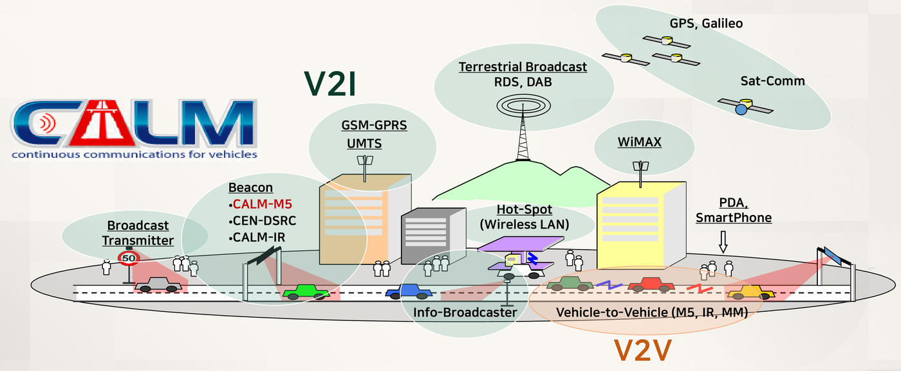

*Figure 32. The various communication media and the communication environment that CALM combines*

Figure 32 is the communication environment that CALM covers. Through V2I communication, the vehicle connects with beacons (CALM-M5, CEN-DSRC, CALM-IR), broadcast transmitters, cellular networks (GSM-GPRS, UMTS), terrestrial broadcasting (RDS, DAB), WiMAX, wireless LAN hot spots, and info-broadcasters, and it also connects with satellite positioning (GPS, Galileo), satellite communication, and the driver's PDA and smartphone. Vehicles perform V2V communication with each other over M5, infrared, and millimeter wave (MM). The phrase on the CALM logo in the figure (continuous communications for vehicles) expresses the goal of keeping a vehicle's communication uninterrupted by switching among several media in this way.

CALM defines eight communication scenarios depending on whether an ITS station is in a vehicle or at the roadside and whether it forwards the communication of other stations.

| No. | Communication scenario |
|:-----|:-----|
| 1 | A single-hop link between a vehicle station and a roadside station. Internet access through the roadside station is optional. |
| 2 | A single-hop link between two vehicle stations. |
| 3 | A single-hop link between two roadside stations. Internet access is optional. |
| 4 | A vehicle station forwards between another vehicle station and a roadside station. Internet access through the roadside station is optional. |
| 5 | A vehicle station forwards between two vehicle stations. |
| 6 | A roadside station forwards between two roadside stations. Internet access is optional. |
| 7 | A roadside station forwards between two vehicle stations. |
| 8 | A vehicle station forwards between two roadside stations. |

*Table 26. Communication scenarios of CALM*

> **Definition:** A **hop** is one transfer of a packet from one node to the next.

> **Definition:** A **single-hop** link connects two stations directly, and going through a forwarding station makes it multi-hop communication.

### 2.3 Implementation Forms of ITS Stations

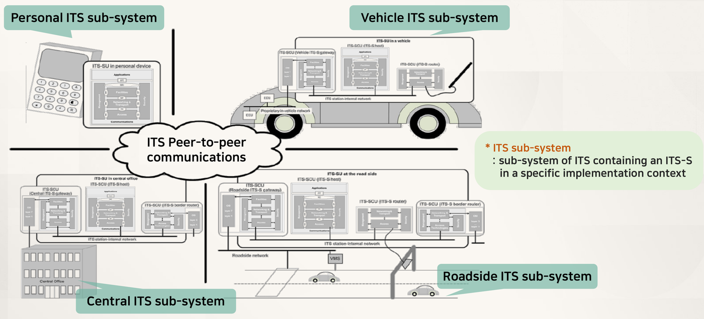

*Figure 33. Typical implementations of ITS station units*

Depending on where they are installed, ITS stations are implemented as four kinds of **ITS sub-systems**. An ITS sub-system is a sub-system of ITS containing an ITS station in a specific implementation context.

| Sub-system | Implementation example |
|:-----|:-----|
| Personal ITS sub-system | An ITS station implemented in a smartphone or personal device. |
| Vehicle ITS sub-system | An ITS station implemented in a vehicle. Several devices (hosts, routers, gateways) are connected by the in-vehicle network. |
| Roadside ITS sub-system | An ITS station implemented in roadside facilities such as traffic signals and signs. |
| Central ITS sub-system | An ITS station implemented in a central facility such as a traffic control center. |

*Table 27. Kinds of ITS sub-systems*

The four sub-systems communicate with each other as peers through the ITS peer-to-peer communications in the middle of Figure 33. Because every sub-system follows the same reference architecture, they can interoperate.

### 2.4 Structure of ISO TC204 WG16

WG16 (communications) of ISO TC204 set up sub-working groups (SWGs) according to the layered structure of the OSI reference model.

| Sub-working group | Responsibility | Relation to OSI layers |
|:-----|:-----|:-----|
| SWG 16.0 | CALM architecture | Structure of all layers |
| SWG 16.1 | Media and management | Lower layers (communication media) |
| SWG 16.2 | Networking | Upper layers (network) |
| SWG 16.3 | Probe data | Application core functions |
| SWG 16.4 | Application management | Application core functions |
| SWG 16.5 | Disaster monitoring | Application core functions |
| SWG 16.6 | Security and lawful intercept | All layers |

*Table 28. Sub-working groups of ISO TC204 WG16*

The communication media handled by the lower layers are divided by communication range into dedicated short range communication (DSRC), medium area communication, and wide area communication. Individual applications at the top use this structure through the application interface (application IF).

### 2.5 ITS Station Reference Architecture: ISO 21217

ISO 21217:2014 (Intelligent transport systems - Communications access for land mobiles (CALM) - Architecture) is the central standard of CALM [24]. It focuses on defining the functions needed for all layers and entities that make up an ITS station and the open interfaces between them, and its purpose is to let ITS stations from different manufacturers implement their functions interoperably. Its contents consist of requirements, the ITS station architecture, ITS station interfaces, typical implementations, and so on.

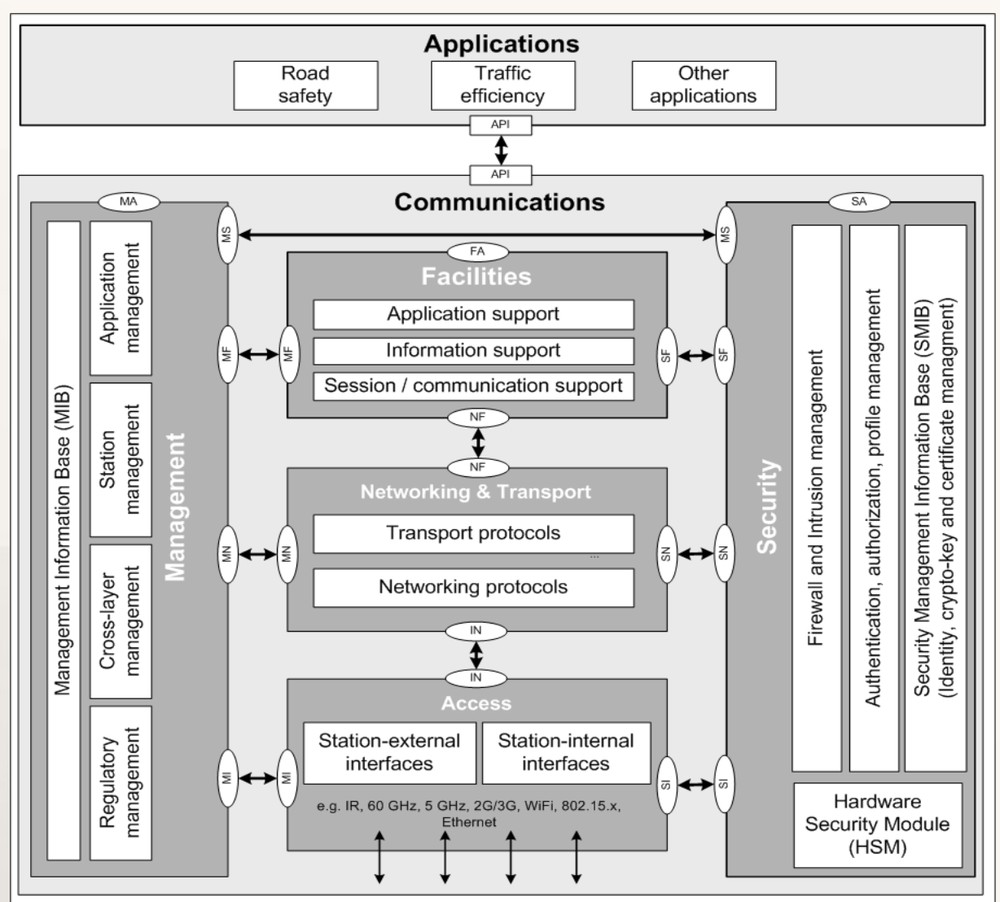

*Figure 34. ITS station reference architecture*

The ITS station reference architecture in Figure 34 stacks three communication layers in the middle and places the management entity vertically on the left and the security entity on the right [24], [25].

| Component | Function | Corresponding OSI layers |
|:-----|:-----|:-----|
| Applications | Road safety, traffic efficiency, and other applications. They use the communication layers through an API. | Application |
| Facilities layer | Provides functions shared by many applications, such as application support, information support, and session and communication support. | Layers 5-7 |
| Networking & transport layer | Handles the routing and delivery of packets with transport protocols and networking protocols. | Layers 3 and 4 |
| Access layer | Provides station-external and station-internal interfaces such as infrared, 60 GHz, 5 GHz, 2G/3G, Wi-Fi, IEEE 802.15.x, and Ethernet. | Layers 1 and 2 |
| Management entity | Handles the management information base (MIB), application management, station management, cross-layer management, and regulatory management. | All layers |
| Security entity | Handles firewall and intrusion management, authentication and authorization, profile management, the security management information base holding identities, cryptographic keys, and certificates, and the hardware security module (HSM). | All layers |

*Table 29. Components of the ITS station reference architecture*

> **[Computer Networks]** The OSI reference model divides communication functions into seven layers: physical, data link, network, transport, session, presentation, and application (Week 5). The ITS station architecture groups layers 1 and 2 as the access layer, layers 3 and 4 as the networking & transport layer, and layers 5-7 as the facilities layer, and it separates management and security, which span all layers, into separate entities.

The basic terms defined by ISO 21217 are as follows [24].

| Term | Definition |
|:-----|:-----|
| ITS-S (ITS station) | A functional entity comprised of a facilities layer, a networking & transport layer, an access layer, a management entity, a security entity, and an applications entity, providing ITS services. |
| ITS-SU (ITS-S unit) | An implementation of an ITS-S. |
| ITS-SCU (ITS-S communication unit) | A physical unit in an ITS-SU containing a part or all of its functionality. |

*Table 30. Basic terms of the ITS station*

For example, the implementation of a vehicle's ITS station (ITS-S) is an ITS-SU, and if it contains a separate V2X communication module and a cellular communication module, each of the two modules is an ITS-SCU.

The devices (nodes) that make up an ITS-S are divided into three kinds according to how they handle packets [24].

| Node | Definition | Packet forwarding |
|:-----|:-----|:-----|
| ITS-S host | A node comprised of ITS-S functionalities other than those of a router, border router, mobile router, or gateway. | Does not forward packets not addressed to itself. |
| ITS-S router | A node comprised of routing functionalities that connect two networks. | Forwards packets not addressed to itself to another network. |
| ITS-S gateway | A node that interconnects two different protocol stacks above layer 4 (the networking & transport layer). | May convert between different protocols. |

*Table 31. Kinds of ITS station nodes*

> **[Computer Networks]** On the Internet, a host is an end device that creates and receives data, and a router is a device that forwards packets between networks at layer 3. A gateway is a device that connects two networks with different protocol systems at upper layers; in vehicles, a typical example is the device that connects an in-vehicle network such as CAN with external communication networks.

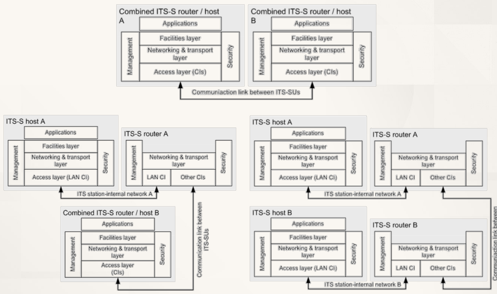

*Figure 35. Examples of applying the ITS station architecture*

Figure 35 shows three examples of applying the architecture to real devices. At the top, two devices that combine router and host functions (combined ITS-S router/host A and B) are directly connected by a communication link between ITS-SUs. At the lower left, host A and router A are connected by station-internal network A (a LAN communication interface), and router A connects to the combined device B of the other station through another communication interface. At the lower right, both stations have separate hosts and routers connected by their own internal networks. In every case each device follows the layer structure of Figure 34.

### 2.6 ITS-S Access Layer

The ITS-S access layer provides the means of communication among entities inside and outside the station. The access layer provides four kinds of interfaces [24].

| Item | Communication with the outside of the station | Station-internal communication |
|:-----|:-----|:-----|
| Wireless | (a) Wireless interfaces out of the ITS-S (for example, 5.9 GHz, cellular) | (c) Wireless interfaces for station-internal communication |
| Wired | (b) Wired interfaces out of the ITS-S | (d) Wired interfaces for station-internal communication (for example, in-vehicle Ethernet) |

*Table 32. Interfaces provided by the ITS-S access layer*

The various access technologies may be modified so that they interface with the ITS-S management entity (MI interface), the security entity (SI interface), and the networking & transport layer (IN interface). This means that Wi-Fi or cellular modules that were not originally made for ITS can also serve as the access layer of an ITS station once such adaptation functions are added.

### 2.7 ITS-S Networking & Transport Layer

The ITS-S networking & transport layer consists of the following [24].

1. Protocols corresponding to an OSI network layer and an OSI transport layer
2. If needed, modified elements such as the management adaptation entity (MAE) and the security adaptation entity (SAE)
3. The interfaces MN to the management entity, SN to the security entity, IN to the access layer, and NF to the facilities layer

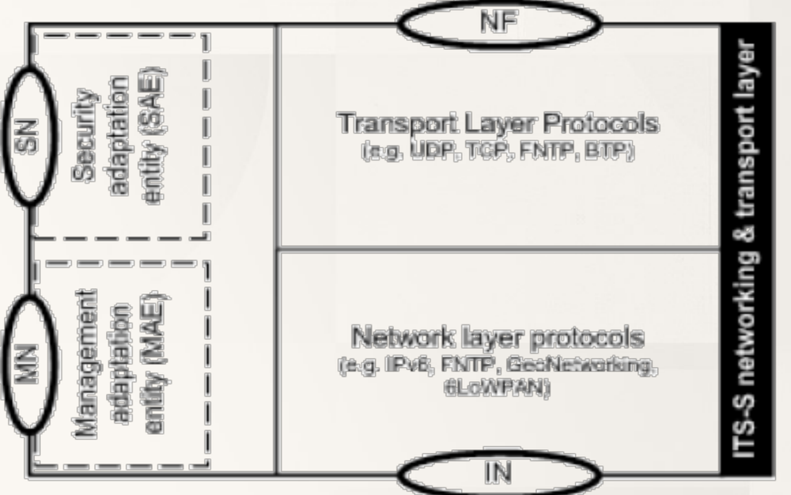

*Figure 36. Elements of the ITS-S networking & transport layer*

In Figure 36, the inside of the layer is divided into the transport layer protocols at the top (UDP, TCP, FNTP, BTP) and the network layer protocols at the bottom (IPv6, FNTP, GeoNetworking, 6LoWPAN), and the security adaptation entity (SAE) and management adaptation entity (MAE) on the left connect to the security entity and management entity through the SN and MN interfaces. NF at the top and IN at the bottom are the interfaces to the facilities layer and the access layer.

The network protocols used in the networking & transport layer are as follows [24].

| Protocol | Characteristics |
|:-----|:-----|
| IPv4 | The most widely deployed IP version. However, its addresses are exhausted, so it does not fully meet the deployment requirements of C-ITS. |
| IPv6 | Provides what C-ITS requires and offers a practically unlimited number of addresses. IPv4-IPv6 transition mechanisms are used to communicate with IPv4-based systems. |
| 6LoWPAN | A technology that compresses and carries IPv6 packets over low-power wireless personal area networks. |
| FNTP | Designed for ITS-S applications with strict timing requirements and short latency. Instead of general networking functions such as those of IP, it uses MAC addresses to reach nodes on the network. |
| WSMP | The WAVE Short Message Protocol. Designed for applications with strict timing requirements and short latency, such as time-critical safety applications. |
| GeoNetworking | Specifies the target area of the destination stations with geographic coordinates. Its basis was developed through the EU GeoNet research project. |

*Table 33. ITS-S networking protocols*

An IPv4 address has 32 bits, so there are only $2^{32} = 4{,}294{,}967{,}296$, about 4.3 billion, addresses. This is not enough for ITS, where every vehicle, roadside unit, and sensor needs an address. An IPv6 address has 128 bits, giving $2^{128} \approx 3.4 \times 10^{38}$ addresses, so there is practically no risk of exhaustion. IPv4 and IPv6 were covered in Week 13.

WSMP is the IEEE 1609.3 protocol seen in Week 13 that sends short safety messages without an IP header [26]. GeoNetworking is a network protocol of the European ETSI that delivers packets based on position instead of IP addresses; it provides GeoUnicast, which sends to one station at a specific position, GeoBroadcast, which sends to all stations in a specified area, and GeoAnycast, which sends to any one station in a specified area [27]. It suits V2X messages whose destination is an area, such as "all vehicles within 200 m of the intersection".

The following four transport protocols are used to meet the communication requirements of the ITS-S.

| Protocol | Characteristics |
|:-----|:-----|
| UDP (User Datagram Protocol) | A simple transport protocol without connection setup or retransmission. Its latency is short. |
| TCP (Transmission Control Protocol) | A reliable transport protocol that sets up a connection and guarantees ordering and retransmission. |
| FNTP (Fast Networking & Transport Layer Protocol) | A lightweight ITS-dedicated protocol that combines networking and transport functions. |
| BTP (Basic Transport Protocol) | A simple transport protocol over GeoNetworking that distinguishes applications by port number. |

*Table 34. ITS-S transport protocols*

Like UDP, BTP attaches only a port number without a connection and hands GeoNetworking packets to the appropriate application [28].

### 2.8 ITS-S Management Entity

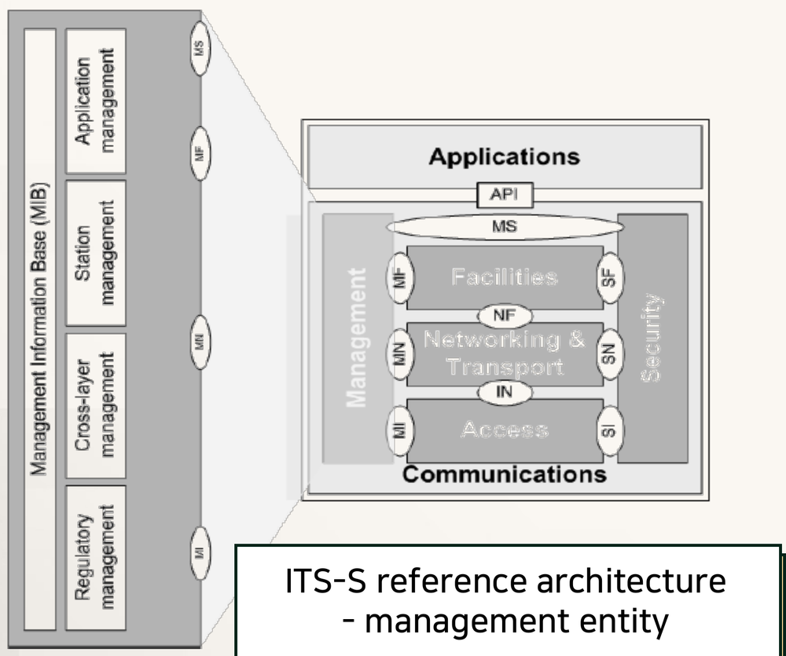

*Figure 37. Management entity of the ITS-S reference architecture*

The ITS-S management entity consists of the following [24].

- Various management protocols
- A Management Information Base (MIB)
- Support for station-internal management communication between ITS-SCUs
- The interfaces MI to the access layer, MN to the networking & transport layer, MF to the facilities layer, MS to the security entity, and MA to the application entity (via an API)

In Figure 37, the management entity is centered on the MIB and divided into application management, station management, cross-layer management, and regulatory management. Cross-layer management lets the information of one layer be used in the decisions of another layer, for example by reporting the quality of a radio link measured by the access layer to the path selection of the networking layer.

ITS-S management is divided into **remote ITS-S management**, performed remotely by another station, and **local ITS-S management**, performed within the station. Local management is further divided into management inside one ITS-SCU and management of the whole ITS-S covering several ITS-SCUs.

> **Definition:** A **MIB (Management Information Base)** is a database that collects, in a defined structure, the information needed for management, such as a device's settings, status, and statistics. Management protocols manage devices by reading or changing values in the MIB.

### 2.9 Access Technology Support: ISO 21218

ISO 21218 (Intelligent transport systems - Hybrid communications - Access technology support) defines the structure of the ITS station access layer that applies commonly to all or several access technologies [29].

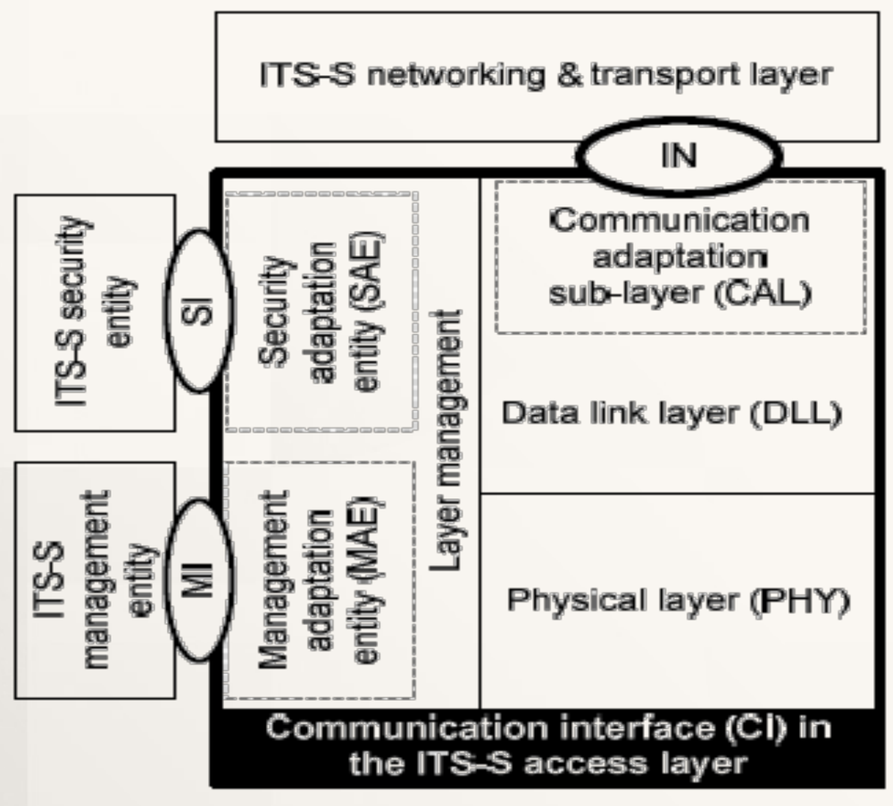

*Figure 38. Architecture of the ITS-S access layer*

In Figure 38, one **communication interface (CI)** of the access layer consists, from the bottom, of the physical layer (PHY), the data link layer (DLL), and the communication adaptation sub-layer (CAL). The CAL is an adaptation layer that presents lower layers, which differ for each access technology, in the same form to the networking & transport layer (IN interface). The layer management, management adaptation entity (MAE), and security adaptation entity (SAE) beside it connect to the management entity and security entity through the MI and SI interfaces.

The main contents of ISO 21218 are as follows.

| Content | Description |
|:-----|:-----|
| Classification of CIs | Classifies CIs according to the characteristics of the access technology (whether broadcasting is possible, the connection type, and so on). |
| Link-ID | A number that identifies a specific communication link on a CI. |
| CI and VCI concepts and procedures | Procedures for creating and managing logical interfaces (VCIs) for each peer station or for broadcasting on one physical CI. |
| I-Parameters | Parameters that represent the settings and status of a CI, read and written by the management entity. |
| Communication SAP and management SAP | The points at which the access layer exchanges data and management information. |

*Table 35. Main contents of ISO 21218*

> **Definition:** A **CI (communication interface)** is an instance of a communication device implementing one access technology (for example, one 5.9 GHz radio module).

> **Definition:** A **VCI (virtual communication interface)** is a logical interface created on one CI, corresponding to one unicast link with a specific peer or one broadcast link.

### 2.10 Localized Message: ISO/TS 16460

ISO/TS 16460:2016 (Intelligent transport systems - Communications access for land mobiles (CALM) - Communications protocol messages for global usage) is a technical specification that lets the American IEEE WAVE and the ISO CALM exchange the same radio messages [30].

> **Definition:** An ISO **TS (Technical Specification)** is a normative document reflecting consensus at the level of a technical committee (TC) or subcommittee (SC). It is an intermediate-stage standards document expected to be agreed on as an international standard in the future, and it is not an international standard (IS, International Standard).

The concept and contents of ISO/TS 16460 are as follows.

- **Concept:** It harmonizes FNTP with WSMP and FSAP with WSA. In this way it supports both IEEE WAVE and ETSI ITS, and it supports a private service channel.
- **Contents:** It defines message formats, the Localized Message (LM), the Service Advertisement Message (SAM), and the Service Response Message (SRM).

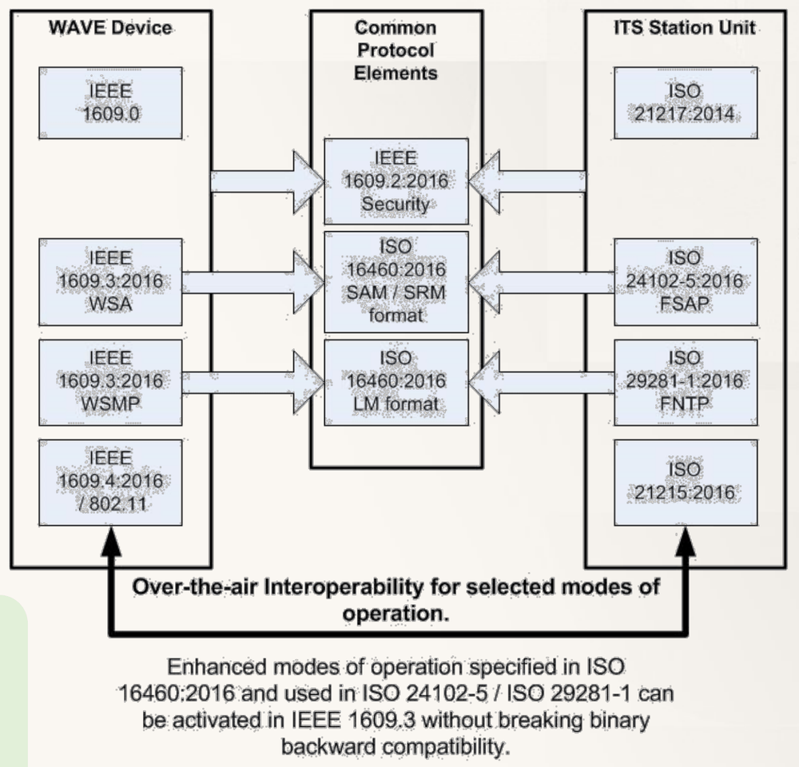

*Figure 39. Common protocol elements shared by WAVE devices and ITS stations*

The left of Figure 39 shows the standards of a WAVE device (IEEE 1609.0 architecture, WSA and WSMP of IEEE 1609.3, IEEE 1609.4 and IEEE 802.11), and the right shows the standards of an ITS station (ISO 21217 architecture, FSAP, FNTP, M5 of ISO 21215). Because both sides use the common protocol elements in the middle (IEEE 1609.2 security and the SAM/SRM format and LM format of ISO 16460), over-the-air interoperability is guaranteed for selected modes of operation. The enhanced modes of operation defined in ISO 16460 and used by FSAP and FNTP can be activated without breaking the binary backward compatibility of IEEE 1609.3.

The general format of the network protocol data unit (NPDU) of the LM defined by ISO/TS 16460 is shown in Figure 40.

```text
LM NPDU
├─ N-Header
│   ├─ Subtype ..................... 4 bits
│   ├─ N-Extensions flag ........... 1 bit
│   ├─ Version ..................... 3 bits
│   ├─ (depends on Subtype) ........ variable
│   └─ N-Extensions ................ variable
├─ T-Header
│   ├─ TPID
│   │   ├─ Feature selector ........ 7 bits
│   │   └─ T-Extensions flag ....... 1 bit
│   ├─ (depends on TPID) ........... variable
│   ├─ T-Extensions ................ variable
│   └─ Length of User Data ......... 1-2 octets
└─ Body
    └─ User Data ................... variable
```

*Figure 40. General format of the LM NPDU*

The LM NPDU consists of a network header (N-Header), a transport header (T-Header), and a body. The first three fields of the N-Header take $4 + 1 + 3 = 8$ bits, exactly one octet, and the TPID (Transport Protocol Identifier) of the T-Header also takes $7 + 1 = 8$ bits, one octet. If an extensions flag is 1, extension fields follow; if it is 0, they are omitted. Depending on the value of the subtype or TPID, the fields needed for that feature follow, and finally the length of the user data (1-2 octets) and the user data come.

The subtype field selects the networking feature.

| Subtype | N-Extensions flag | N-Extensions | Networking feature | Remark |
|:-----|:-----|:-----|:-----|:-----|
| 0 | 0 / 1 | Not present / Present | Null networking | Mandatory feature specified in IEEE 1609.3-2016 |
| 1 | 0 / 1 | Not present / Present | ITS station-internal forwarding | |
| 2 | 0 / 1 | Not present / Present | N-hop forwarding | |
| 3 | 0 / 1 | Not present / Present | Geo-forwarding | Reserved. Not specified in this version |
| 4-7 | 0 / 1 | Not present / Present | Reserved for ISO | Allows for 4 further networking features |
| 8-15 | 0 / 1 | Not present / Present | Reserved for IEEE | Allows for 8 further networking features |

*Table 36. Subtype values of the LM NPDU*

The feature selector of the TPID selects the transport feature.

| Feature selector | T-Extensions flag | T-Extensions | Transport feature | Remark |
|:-----|:-----|:-----|:-----|:-----|
| 0 | 0 / 1 | Not present / Present | Information dissemination | Mandatory feature specified in IEEE 1609.3-2016 |
| 1 | 0 / 1 | Not present / Present | General session mode | |
| 2 | 0 / 1 | Not present / Present | LPP mode | |
| 3-10 | 0 / 1 | Not present / Present | Reserved for ISO | Allows for 8 further transport features |
| 11-127 | 0 / 1 | Not present / Present | Reserved for IEEE | Allows for 117 further transport features |

*Table 37. TPID values of the LM NPDU*

The value ranges in the two tables match the bit widths of the fields exactly. The 4-bit subtype has $2^4 = 16$ values (0-15), and the 4 defined values (0-3), 4 values reserved for ISO (4-7), and 8 values reserved for IEEE (8-15) add up to $4 + 4 + 8 = 16$. The 7-bit feature selector has $2^7 = 128$ values (0-127), and the 3 defined values (0-2), 8 values reserved for ISO (3-10), and 117 values reserved for IEEE (11-127) add up to $3 + 8 + 117 = 128$.

For example, assuming that the fields are filled in the order of Figure 40 starting from the most significant bit of the first octet, the first octet of a header with Subtype 2 (N-hop forwarding), N-Extensions flag 1, and Version 3 is as follows.

```math
\underbrace{0010}_{\text{Subtype}=2}\ \underbrace{1}_{\text{flag}}\ \underbrace{011}_{\text{Version}=3} = 00101011_2 = \text{0x2B}
```

### 2.11 FNTP and FSAP

**FNTP (Fast Networking & Transport Layer Protocol)** is the protocol defined by ISO 29281-1 (Intelligent transport systems - Localized communications - Part 1: Fast networking & transport layer protocol (FNTP)) [31].

- **Concept:** FNTP is a non-IP protocol and a protocol for nearby localized communications. At the ITS-S access layer it is identified by the EtherType value 0x8950.
- **Contents:** It defines the protocol elements (SAPs, FNTP NPDU), general protocol procedures (port management, forwarding tables, and so on), the procedure for transmitting packets, and the procedure for receiving packets.

> **Definition:** The **EtherType** is a 2-octet field in Ethernet-family frames that indicates which upper-layer protocol is carried inside. For example, IPv4 is 0x0800, IPv6 is 0x86DD, and the WSMP of WAVE is 0x88DC [26]. The receiving device looks at this value and passes the frame to the appropriate protocol.

Because FNTP omits procedures such as the IP header, address resolution, and route discovery, its header is short and its processing is fast. On the other hand, it does not connect directly to the IP Internet, so it is used for short, time-critical messages with nearby stations. It can be seen as the ISO protocol with the same purpose as the WSMP of WAVE, and ISO/TS 16460 of Section 2.10 harmonizes the two protocols. In the FNTP reference architecture, FNTP sits in the networking & transport layer together with a port management function; the access layer below it contains the CIs of ISO 21216 (millimeter wave), ISO 21215 (M5), and ISO 21214 (infrared), which support MAC groupcast frames, and a LAN CI for access to the station-internal network; and the management entity contains path and flow management and CI management.

**FSAP (Fast Service Advertisement Protocol)** is the protocol defined by ISO 22418 [32]. The ISO 24102-5 in Figure 39 is the earlier standard that defined the same FSAP.

- **Concept:** It supports locally advertising ITS services that are uniquely identified by an ITS application identifier (ITS-AID).
- **Contents:** It defines the formats of the FSAM (fast service advertisement message) and FSRM (fast service response message), three types of application session, and the protocol procedures including the FSAP communication handler and the FSAP manager.

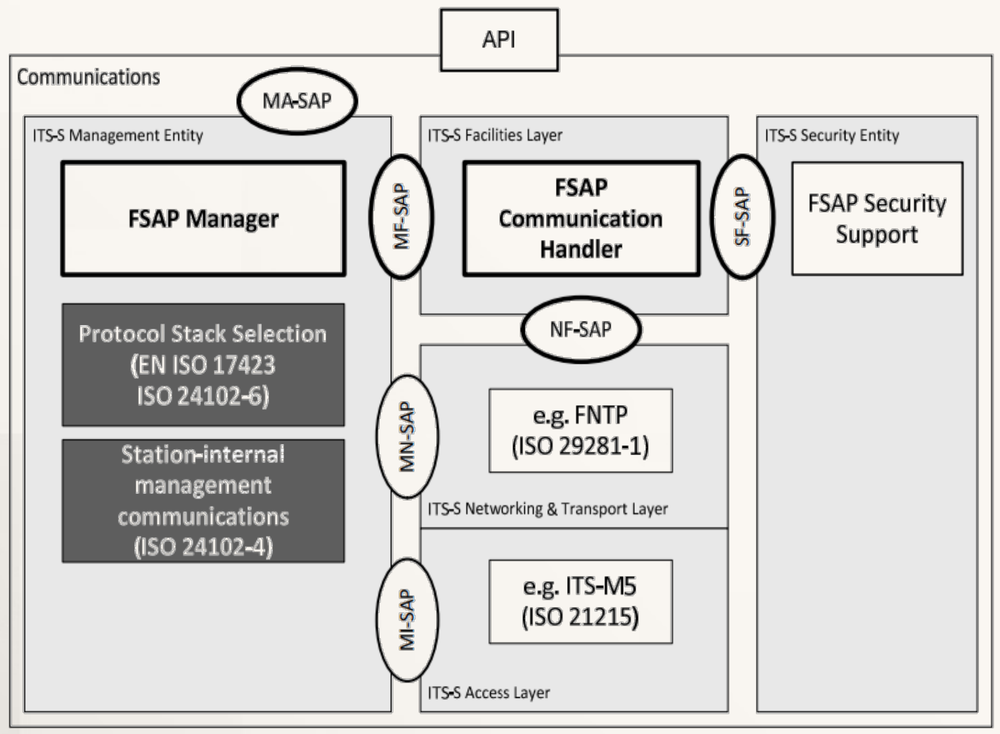

*Figure 41. FSAP reference architecture*

In Figure 41, the functions of FSAP are distributed over several entities. The FSAP manager in the management entity uses protocol stack selection (EN ISO 17423, ISO 24102-6) and station-internal management communications (ISO 24102-4), the FSAP communication handler in the facilities layer creates and interprets messages, and FSAP security support in the security entity protects the messages. Messages are delivered through FNTP (ISO 29281-1) in the networking & transport layer and ITS-M5 (ISO 21215) in the access layer. The entities are connected by the MA, MF, SF, NF, MN, and MI SAPs.

> **Definition:** **Service advertisement** is a method in which a station providing a service (for example, the roadside unit of a parking lot) periodically announces which services it provides on which channel, and a station that wants to use them joins a service after seeing that information.

### 2.12 ITS Station Management Standards: ISO 24102

The ISO 24102 series (Intelligent transport systems - ITS station management) defines the management functions of the ITS station in several parts [33].

**Part 1, local management (ISO 24102-1).** It defines the functionality of local ITS station management, CI and VCI management in an ITS-SCU, and interference protection. Its main contents are CI management, cross-CI prioritization, regulatory information management, networking & transport layer management, and management data elements.

| Management function | Content |
|:-----|:-----|
| CI and VCI management | Handles the registration, creation, activation, and deletion of CIs and VCIs. |
| Cross-CI prioritization | When interference occurs between several interfaces within a station, it stops the interfering CI and lets the higher-priority CI transmit. |
| Regulatory information management | Manages regulatory information such as the operating mechanisms, speeds, and time services of interfaces according to regional laws. |
| Networking & transport layer management | Handles the new registration, update, deactivation, and deletion of networking & transport layer protocols. |
| Management data elements | Items such as the SCU list, which records which SCUs are in the station and the type of each SCU (host, router, host and router), the VCI list, and the cross-CI prioritization table. |

*Table 38. Functions of ISO 24102-1 local management*

An example in which cross-CI prioritization is needed is a vehicle equipped with two radio interfaces at nearby frequencies, such as 5.8 GHz DSRC for toll collection and 5.9 GHz M5. While one interface transmits, the reception of the adjacent interface can be disturbed by the strong signal, so the management entity briefly stops the operation of the lower-priority interface.

**Part 4, station-internal management communications (ISO 24102-4).** It defines how the management entities in different ITS-SCUs of the same ITS-S communicate through the station-internal network. A specific purpose of this communication (IIC, ITS-S internal management communications) is to use the management service access points (SAPs) of other SCUs remotely. Its main contents are the IIC protocol data units (PDUs), the communication procedure (initialization, transmission, reception), and the management procedure. In the reference architecture, the ITS station-internal management communication manager (IICM) in the management entity and the ITS station-internal management communication agent (IICA) in the facilities layer carry out this communication, a CI selection manager chooses the communication interface to use, and FNTP of ISO 29281-1 together with a LAN CI for access to the station-internal network serves as an example of the internal means of communication.

**Part 2, remote management of ITS-SCUs (ISO 24102-2).** These are the functions by which another station remotely manages the ITS-SCUs of an ITS-SU.

- Setting, updating, and deleting information in an ITS-SCU.
- Installing, updating, and uninstalling persistent information (for example, software) in an ITS-SCU.
- Notifying and retrieving management information.

Its main contents are the remote management architecture, service primitive functions, remote management PDUs, and the remote management procedure. The remote management protocol execution (RMPE) in the management entity and the remote management communication handler (RMCH) in the facilities layer perform these functions.

**Part 3, service access points (ISO 24102-3).** It specifies the management service access points (SAPs). It covers the MI-SAP, MN-SAP, and MF-SAP between the management entity and each layer, the NF-SAP and IN-SAP between layers, the SI-SAP, SN-SAP, and SF-SAP between the security entity and each layer, and the service primitives of each SAP (for example, command and request).

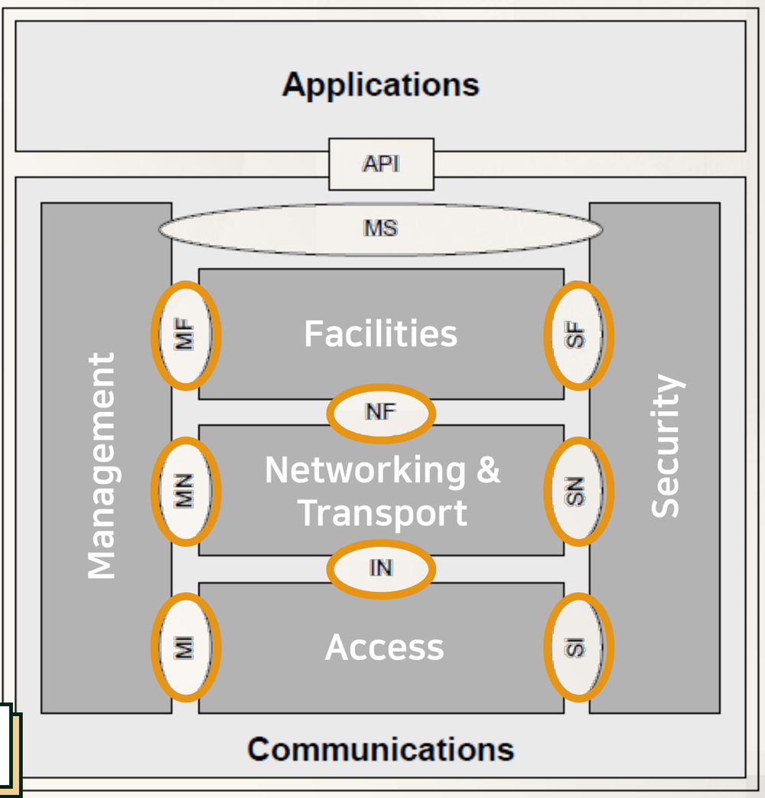

*Figure 42. ITS station reference architecture with named interfaces*

As in Figure 42, interface names are formed by joining the initials of the two connected elements.

| Interface | The two elements it connects |
|:-----|:-----|
| MA, MF, MN, MI | Management entity (M) and applications (A), facilities (F), networking & transport (N), access (I) |
| SA, SF, SN, SI | Security entity (S) and applications (A), facilities (F), networking & transport (N), access (I) |
| MS | Management entity (M) and security entity (S) |
| FA | Facilities layer (F) and applications (A) |
| NF | Networking & transport layer (N) and facilities layer (F) |
| IN | Access layer (I) and networking & transport layer (N) |

*Table 39. Interface names of the ITS station reference architecture*

> **Definition:** A **service primitive** is an abstract unit of invocation by which one layer requests a service from another layer or reports a result through a SAP. There are kinds such as request, confirm, indication, and response, and it can be thought of as similar to a function call.

### 2.13 Path and Flow Management: ISO 24102-6

ISO 24102-6 (path and flow management) defines the functions that decide which of several access technologies and which path to send over [33].

- **Concept:** It defines the functionalities of the ITS station used to collect the information needed for path and flow management. The information collected by the management entity is used to determine the most appropriate communication profile and routing path.
- **Contents:** It covers ITS-S capabilities management, path management, flow management, path selection, and communication profile management.

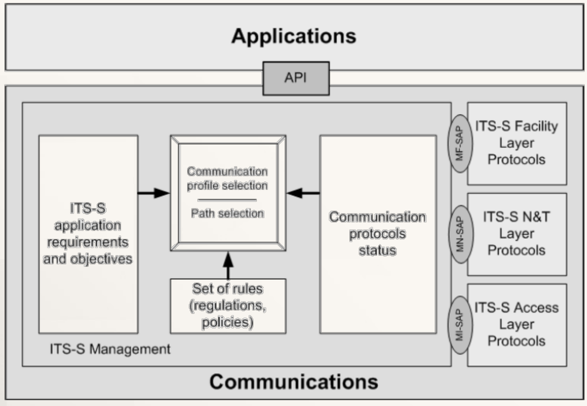

*Figure 43. Architecture of communication profile and path selection*

In Figure 43, the communication profile selection and path selection functions inside the ITS-S management entity take three inputs: the ITS-S application requirements and objectives on the left (for example, tolerable latency, required data rate, and cost), the communication protocol status on the right (the link status reported by the protocols of each layer through the MF, MN, and MI SAPs), and the set of rules at the bottom (regulations and policies).

> **Definition:** A **flow** is a sequence of packets of one application session with the same requirements.

> **Definition:** A **communication profile** is the combination of protocols and access technology used to send one flow (for example, FNTP over M5, or IPv6 over LTE).

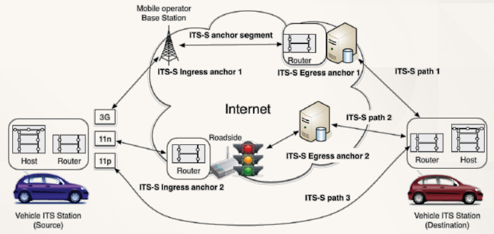

*Figure 44. Concept of the ITS-S path and the ITS-S anchor segment*

Figure 44 shows three paths from the source vehicle ITS station (host and router with 3G, IEEE 802.11n, and 802.11p interfaces) to the destination vehicle ITS station.

| Path | Route |
|:-----|:-----|
| ITS-S path 1 | Enters the mobile operator's base station (ingress anchor 1) over 3G, crosses the Internet, and reaches the destination through a router (egress anchor 1). |
| ITS-S path 2 | Enters a roadside router (ingress anchor 2) and reaches the destination through egress anchor 2 in the Internet. |
| ITS-S path 3 | The vehicles communicate directly without going through infrastructure. |

*Table 40. The three ITS-S paths of Figure 44*

The ingress anchor is the point where packets enter the infrastructure network, the egress anchor is the point where they leave it, and the segment between them is called the **ITS-S anchor segment**. Path and flow management chooses the appropriate path for each flow. For example, an infotainment flow that downloads video content tolerates latency and carries a large volume, so it is sent over path 1 (cellular), while a collision warning flow to the vehicle right next to it needs the shortest latency, so it is sent over path 3 (802.11p direct communication). If the cellular signal weakens, the same flow is moved to path 2 to keep the communication going. This is the core of what CALM calls hybrid communications.

---

<br>

## 3. Regulations and Deployment Policies for Autonomous Driving Communication

For autonomous driving communication technology to be used on roads, it needs the support of laws and regulations as well as technical standards. This section covers the relationship between regulations and standards, UN/ECE WP.29 at the center of international vehicle regulation, the communication-related tasks of the Korean government's plan for improving autonomous driving regulations (over-the-air updates, cybersecurity, and software updates), and the mandates and deployment status of V2X communication.

### 3.1 Regulations and Standards

**Regulations** and **standards** both define criteria that technology must follow, but they differ in how binding they are.

| Item | Regulation | Standard |
|:-----|:-----|:-----|
| Basis | Laws and their subordinate statutes | Consensus of standards bodies |
| Binding force | Enforced by the state, including semi-mandatory certification without which a product cannot be sold. | Followed voluntarily, with private certification obtained as needed. |
| International body | UN/ECE WP.29 | ISO TC22, ISO TC204 |
| System in Korea | Ministry of Land, Infrastructure and Transport, Korea Transportation Safety Authority, Korea Automobile Testing and Research Institute | Korean Agency for Technology and Standards of the Ministry of Trade, Industry and Energy, Korean Standards Association |

*Table 41. Comparison of regulations and standards*

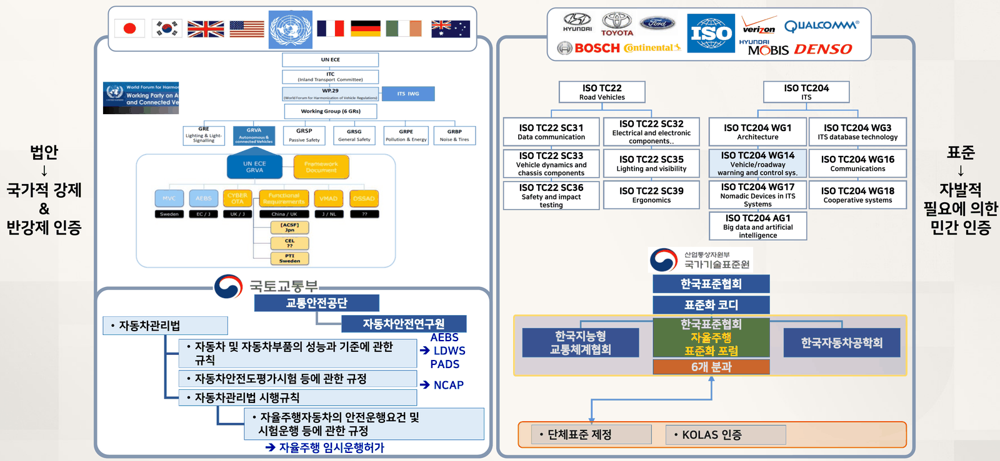

*Figure 45. International and Korean regulatory and standards systems related to autonomous driving*

The left of Figure 45 is the regulatory system. Under the Inland Transport Committee (ITC) of the UN Economic Commission for Europe (UN ECE), in which countries such as Japan, Korea, the United Kingdom, the United States, France, and Germany take part, are the World Forum for Harmonization of Vehicle Regulations (WP.29) and the ITS informal working group (ITS IWG). Under WP.29 are six working parties (GRs), and under GRVA, which deals with autonomous and connected vehicles, there are further informal working groups (Section 3.2).

Regulation in Korea is led by the Ministry of Land, Infrastructure and Transport (MOLIT), and the Korea Transportation Safety Authority and its affiliated Korea Automobile Testing and Research Institute handle testing and certification. Under the Motor Vehicle Management Act there are three subordinate statutes.

- **Rules on the performance and standards of motor vehicles and vehicle parts:** Define the safety standards of devices such as the advanced emergency braking system (AEBS), the lane departure warning system (LDWS), and the partially automated driving system (PADS).
- **Regulations on vehicle safety assessment tests:** The basis of the New Car Assessment Program (NCAP), which assesses and publishes the safety of new cars.
- **Enforcement rules of the Motor Vehicle Management Act:** The regulations under them on the safe operation requirements and test operation of autonomous vehicles define the criteria for temporary operation permits for autonomous vehicles.

Whereas the first subordinate statute sets the safety standards for individual devices, the other two provide the basis for the program that assesses the safety of new vehicles and the system that permits the test driving of automated vehicles.

> **Definition:** A **temporary operation permit** is a permit issued by MOLIT that lets autonomous vehicles, for which safety standards do not yet exist, drive on roads for testing.

The right of Figure 45 is the standards system. Companies such as Hyundai Motor, Toyota, Ford, Bosch, Continental, Verizon, Qualcomm, Hyundai Mobis, and Denso take part in developing ISO standards. Vehicle-related standards are divided between two technical committees.

| Technical committee | Subgroups |
|:-----|:-----|
| ISO TC22 (road vehicles) | SC31 data communication, SC32 electrical and electronic components, SC33 vehicle dynamics and chassis components, SC35 lighting and visibility, SC36 safety and impact testing, SC39 ergonomics |
| ISO TC204 (intelligent transport systems, ITS) | WG1 architecture, WG3 ITS database technology, WG14 vehicle/roadway warning and control systems, WG16 communications, WG17 nomadic devices in ITS systems, WG18 cooperative systems, AG1 big data and artificial intelligence |

*Table 42. Structure of the vehicle-related ISO technical committees*

The CALM of Section 2 is a standard created by WG16 of TC204, and the CAN standard (ISO 11898) of Weeks 3 and 9 is handled by SC31 of TC22. In Korea, the Korean Standards Association under the Korean Agency for Technology and Standards of the Ministry of Trade, Industry and Energy appoints standardization coordinators and, together with the Intelligent Transport Society of Korea and the Korean Society of Automotive Engineers, runs an autonomous driving standardization forum consisting of six subcommittees. This forum establishes association standards, and testing laboratories obtain KOLAS accreditation.

> **Definition:** An **association standard** is a standard agreed on by an industry association rather than a national standard.

### 3.2 UN/ECE WP.29

> **Definition:** **WP.29 (World Forum for Harmonization of Vehicle Regulations)** is the body under the UN Economic Commission for Europe that creates international regulations (UN Regulations) on vehicle safety and the environment. Countries that are parties to the 1958 Agreement use the UN Regulations adopted by WP.29 as their national type approval criteria and mutually recognize the type approvals of other parties [34].

> **Definition:** **Type approval** is a system in which the government or a designated body checks and approves, before a vehicle is sold, that its type (model) meets safety and environmental standards.

The working parties of WP.29 and the informal working groups (IWGs) related to autonomous driving are given in Table 43.

| Kind | Name | Responsibility |
|:-----|:-----|:-----|
| Working party | GRBP | Noise and tyres |
| Working party | GRE | Lighting and light-signalling |
| Working party | GRPE | Pollution and energy |
| Working party | GRSG | General safety provisions |
| Working party | GRSP | Passive safety |
| Working party | GRVA | Automated/autonomous and connected vehicles |
| Working party | GRRF | Brakes and running gear |
| Informal working group | ADAS | Advanced driver assistance systems |
| Informal working group | FRAV | Functional requirements for automated vehicles |
| Informal working group | DSSAD/EDR | Data storage systems for automated driving and event data recorders |
| Informal working group | VMAD | Validation method for automated driving |
| Informal working group | CS/OTA | Cybersecurity and software updates |
| Informal working group | ACSF | Automatically commanded steering function |
| Informal working group | MVC | Modular vehicle combinations |
| Informal working group | AEBS/LDWS | Advanced emergency braking systems and lane departure warning systems |

*Table 43. Working parties of WP.29 and informal working groups related to autonomous driving*

> **Note:** In June 2018, WP.29 reorganized GRRF, which dealt with brakes and running gear, into GRVA, which deals with automated and connected vehicles [34]. Table 43 lists the working parties from before and after the reorganization together, and after the reorganization there are six GRs, as in Figure 45. The original material also gives the responsibility of the DSSAD/EDR group as lighting and light-signalling, but DSSAD (Data Storage System for Automated Driving) is a device that records the operation of the automated driving system and EDR (Event Data Recorder) is a device that records the vehicle state before and after a crash, so Table 43 corrects this.

The working group directly related to autonomous driving communication is CS/OTA (cybersecurity and over-the-air updates) under GRVA. The results of this group are UN R155 and UN R156 of Sections 3.5 and 3.6.

### 3.3 Regulatory Reform Roadmap for Autonomous Vehicles

To find and fix in advance the regulations that block the commercialization of autonomous vehicles, the Korean government prepared a regulatory reform roadmap for autonomous vehicles, and in December 2021 it finalized the Regulatory Innovation Roadmap 2.0 for autonomous vehicles, which supplements it [35]. Roadmap 2.0 divides the tasks to be pursued by 2030 into short-term (2022-2023), medium-term (2024-2026), and long-term (2027-2030) tasks, and its six short-term tasks are given in Table 44.

| Area | Task (responsible ministry, related law) | Before | Improvement |
|:-----|:-----|:-----|:-----|
| Vehicle | 1. Allow over-the-air updates (OTA) (MOLIT, Motor Vehicle Management Act) | In principle, vehicle maintenance must be done at a repair shop, and over-the-air updates (OTA) of electronic control units and the like are partly allowed under a temporary regulatory exemption for demonstration. | Electronic control units and the like can be updated or maintained by OTA without visiting a repair shop. OTA is excluded from the scope of the maintenance business (by 2022). |
| Vehicle | 2. Permit the use of autonomous driving video data for training (MOLIT, Personal Information Protection Commission, Autonomous Vehicle Act, Personal Information Protection Act) | Video data of various forms collected by autonomous vehicles cannot be used or processed because of concerns about personal information leakage. | Use is permitted only for research and development under appropriate protective measures (physically or logically separated spaces, criteria for anonymizing and pseudonymizing data, and so on) (by 2023). |
| Vehicle | 3. Prepare autonomous driving safety education rules (National Police Agency, MOLIT, Road Traffic Act, Motor Vehicle Management Act if needed) | There are no driver education rules on matters essential to the operation and management of autonomous vehicles. | Minimum rules for prior driver education are prepared, covering autonomous driving functions (such as transfer of driving control), responses to emergencies, and so on (by 2023). |
| Infrastructure | 4. Allow online provision of high-definition road maps (MOLIT, national spatial information security management rules) | The point cloud data of high-definition road maps can be provided only offline under the national spatial information security management rules. | Online supply of the point cloud data of high-definition road maps is allowed (by 2022). |
| Infrastructure | 5. Establish a certification management system for cooperative automated driving systems (MOLIT, Autonomous Vehicle Act) | When vehicles communicate with vehicles and with roads through the next-generation intelligent transport system (C-ITS), there are concerns about hacking, personal information leakage, and so on. | Under the Autonomous Vehicle Act amended on July 27, 2021, detailed criteria are prepared and operated for a certification management system in which only vehicles and infrastructure issued certificates can communicate (by 2022). |
| Service | 6. Expand regulatory exemptions for demonstrating autonomous mobility services (MOLIT, Mobility Act) | There is much demand for regulatory exemptions to commercialize various services such as passenger and freight transport with autonomous mobility, but there is no regulatory sandbox specialized for it. | A regulatory sandbox specialized for mobility is newly created by enacting a mobility promotion act, strengthening support for demonstrating and commercializing various new businesses (by 2022). |

*Table 44. Short-term tasks of the regulatory reform roadmap for autonomous vehicles*

> **Definition:** A **regulatory sandbox** is a system that lets new technologies or services be tested for a certain period in a certain area with existing regulations waived or deferred.

Task 5 of Table 44 is directly tied to the security of C-ITS communication. For a vehicle that receives a V2X message to trust it and brake, it must be able to verify that the vehicle or roadside unit that sent the message is a legitimate participant holding a valid certificate.

### 3.4 Over-the-Air Updates (OTA)

Short-term task 1 is to allow over-the-air updates of vehicle software.

- **Current:** In principle, vehicle maintenance must be done at a repair shop, and over-the-air updates (OTA) of electronic control units and the like are partly allowed under a temporary regulatory exemption for demonstration.
- **Improvement:** Electronic control units and the like can be updated or maintained by OTA without visiting a repair shop. OTA is excluded from the scope of the maintenance business (by 2022).
- **Effect:** Using OTA increases user convenience and strengthens the vehicle safety management system.

> **Definition:** **OTA (over-the-air)** is a technology that remotely sends a device's software, firmware, and settings over wireless communication to update them.

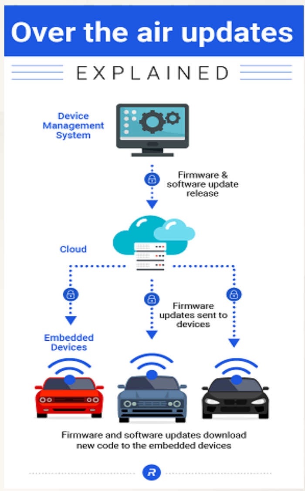

*Figure 46. Flow of an OTA update*

As in Figure 46, OTA proceeds in the following order: the manufacturer's device management system releases firmware and software updates, the cloud sends them to the devices embedded in vehicles, and each device downloads the new code. OTA is divided by target as follows.

| Kind | Meaning |
|:-----|:-----|
| SOTA (Software over-the-air) | Updates software such as infotainment, maps, and applications wirelessly. |
| FOTA (Firmware over-the-air) | Updates the firmware of controllers such as engine, brake, and steering ECUs wirelessly. |
| OTASP (Over-the-air service provisioning) | Sends wirelessly the information needed to first register a device on a mobile network and activate service. |
| OTAP (Over-the-air provisioning) | Sends wirelessly the configuration information a device needs to access a network. |
| OTAPA (Over-the-air parameter administration) | Manages and changes the configuration parameters of an already activated device wirelessly. |

*Table 45. Kinds of OTA*

SOTA and FOTA are especially important for vehicles. Changing the firmware of a brake or steering ECU by FOTA changes the safety functions of the vehicle themselves, so rules that guarantee the integrity and safety of updates are needed (Section 3.6).

### 3.5 Cybersecurity of Autonomous Vehicles

Task 8 among the medium-term tasks (23 items) of roadmap 2.0 is to establish a cybersecurity system for autonomous vehicles (MOLIT, Motor Vehicle Management Act, vehicle rules).

- **Current:** There are no protection or security measures against cyber threats such as hacking aimed at autonomous vehicles and automated driving systems. The international standard on cybersecurity (UN R155) was established in June 2020, and countries are preparing to adopt it.
- **Improvement:** A management system is established so that the security safety of the vehicle itself and the management capability of each manufacturer are secured from the development stage to disposal (by 2024).
- **Effect:** The cybersecurity safety of vehicles is secured and trust is increased.

Two reference documents underlie this task.

| Document | Nature | Content |
|:-----|:-----|:-----|
| UN R155 | A WP.29 regulation (regulation) | Uniform provisions concerning the approval of vehicles with regards to cyber security and the cyber security management system (CSMS). It entered into force as an annex to the 1958 Agreement on January 22, 2021 [36]. |
| ISO/SAE 21434 | A joint ISO and SAE standard (standard) | The standard for cybersecurity engineering of road vehicles. Its first edition was published in August 2021 [37]. |

*Table 46. International criteria for vehicle cybersecurity*

UN R155 requires manufacturers to have an organization-level CSMS and to demonstrate that they have assessed and treated risks for each vehicle type, and ISO/SAE 21434 specifies in detail the engineering activities to perform throughout the development life cycle to meet those requirements. The European Union made this regulation mandatory for newly approved vehicle types from July 2022 and for all newly registered vehicles from July 2024 [38]. Korea also amended the Motor Vehicle Management Act in February 2024 to introduce certification of vehicle cybersecurity management systems and a software update management scheme, effective from August 14, 2025 [39].

> **[Information Security]** The three goals of information security are confidentiality (unauthorized parties cannot see information), integrity (information is not changed without authorization), and availability (information and services can be used when needed). For V2X messages, guaranteeing integrity and sender authentication with digital signatures is especially important, and the certification management system of Section 3.3 issues and manages the certificates used for signing.

The information processing flow of an autonomous vehicle shows why security is needed in almost every element [40].

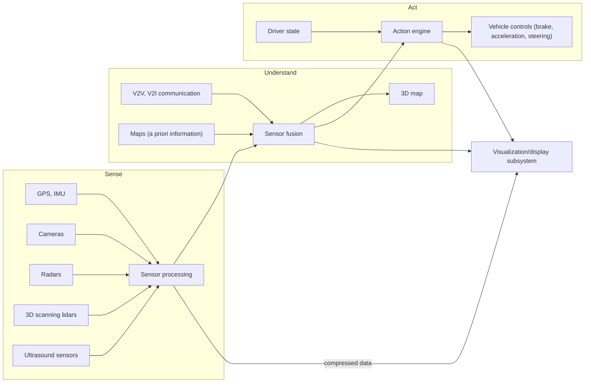

*Figure 47. Sense, understand, and act processing flow of an autonomous vehicle*

In Figure 47, sensor data are turned into object parameters (time stamp, dimensions, position and velocity) through per-sensor processing, and sensor fusion combines them with V2V and V2I communication and map information to build a 3D map. Based on the fusion result and the driver state, the action engine chooses one of doing nothing, warning, complementing, or controlling, and the vehicle controls execute braking, acceleration, and steering. The per-sensor processing results are compressed and sent to the visualization/display subsystem, which also displays the fusion result and the action decision. If any point of this flow (communication, network, software, or sensors) is attacked, it leads to wrong decisions and control, so information security must be applied to almost every element.

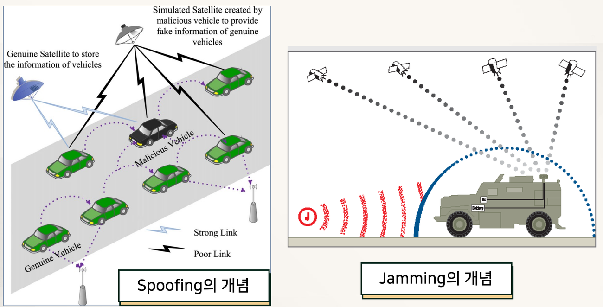

*Figure 48. Concepts of spoofing and jamming*

Typical attacks aimed at wireless communication and satellite positioning are spoofing and jamming.

- **Spoofing:** An attack that sends false information while disguised as a legitimate sender. On the left of Figure 48, a malicious vehicle creates a fake signal imitating a satellite and gives wrong position information to genuine vehicles. The genuine vehicles end up following the strong fake signal coming from nearby rather than the signal of the real satellite.
- **Jamming:** An attack that transmits strong interfering radio waves so that legitimate signals cannot be received. On the right of Figure 48, a jamming device on a vehicle blocks the reception of satellite signals.

As seen in Section 1.9, C-V2X direct communication uses GNSS not only for positioning but also for time synchronization, so spoofing and jamming aimed at GNSS can not only corrupt position information but also disrupt V2X communication itself. For this reason, vehicle security must cover not only the signing of communication messages but also anomaly detection on sensor and positioning signals.

### 3.6 Vehicle Software Updates

Medium-term task 9 is to establish criteria for vehicle software updates (MOLIT, Motor Vehicle Management Act).

- **Current:** As vehicles become more electronic, various vehicle software is in use, but there are no safety management rules for software updates.
- **Improvement:** An institutional basis, such as manufacturer obligations, a certification system, and technical conditions, is established for stable software updates (by 2024). The international standard on software updates (UN R156) was established in June 2020, and countries are preparing to adopt it.
- **Effect:** Vehicle safety is secured and software-related technology development is promoted.

OTA first became common in smartphones and then spread to vehicles [41].

| Period | Event |
|:-----|:-----|
| 2009 | The Android platform rolled out the first OTA update for the T-Mobile G1. |
| Before 2012 | OTA updates for smartphones were common. |
| 2012 | Tesla offered the first OTA software patch for the Model S, which calibrated the range calculator. |
| 2014 | Tesla added a location-based air suspension function by OTA. The function remembers the locations of potholes and steep driveways and adjusts the ride height automatically. |
| 2017 | Mack Trucks launched OTA that updated powertrain components and vehicle parameters (road speed limits, performance optimization, and so on) of trucks. |
| 2018 | GM introduced OTA updates for the 2020 Cadillac CT5. |
| 2019 | BMW introduced OTA software updates for some models. |
| 2019-2020 | Ford announced plans to add OTA capability in 2020 and to include 4G LTE connectivity in all models. |
| 2023 | GM announced plans to offer OTA updates for all its models. |

*Table 47. Development of OTA updates*

UN R156 (uniform provisions concerning the approval of vehicles with regards to software update and the software update management system) entered into force together with R155 on January 22, 2021 [42].

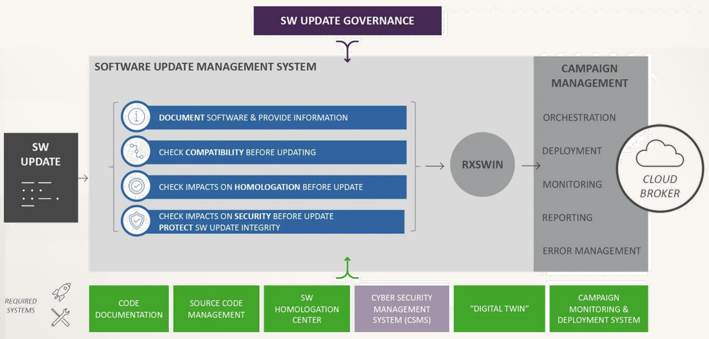

*Figure 49. Software update management system required by UN R156*

The middle of Figure 49 is the **SUMS (Software Update Management System)**, which requires four checks before a software update is released.

1. Document the software and provide the related information.
2. Check compatibility with the other configurations of the vehicle before updating.
3. Check the impacts on type approval (homologation) before the update.
4. Check the impacts on security before the update, and protect the integrity of the update.

An update that has passed these checks is managed with the RXSWIN, and campaign management on the right (orchestration, deployment, monitoring, reporting, error management) deploys it to vehicles through a cloud broker. This requires supporting systems such as code documentation, source code management, a software homologation center, the cyber security management system (CSMS), a digital twin, and a campaign monitoring and deployment system, and software update governance at the top controls the whole.

> **Definition:** The **RXSWIN (R X Software Identification Number)** is a number that identifies the vehicle software relevant to type approval under UN Regulation X. When an update changes software relevant to type approval, the RXSWIN changes too, so authorities and manufacturers use this number to track whether a vehicle is in an approved state.

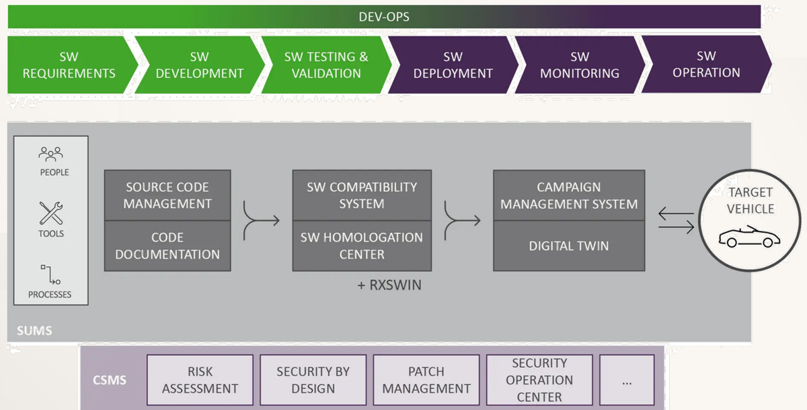

*Figure 50. SUMS and CSMS of UN R156*

Figure 50 shows how the SUMS and CSMS mesh within the software development and operations (DevOps) flow. The DevOps flow at the top runs from software requirements to development, testing and validation, deployment, monitoring, and operation. The SUMS in the middle, based on people, tools, and processes, exchanges updates with the target vehicle through source code management and code documentation, the software compatibility system and software homologation center (including the RXSWIN), and the campaign management system and digital twin. The CSMS at the bottom supports the whole from the security side with activities such as risk assessment, security by design, patch management, and a security operation center. In short, R155 requires the cyber security management system (CSMS) and R156 the software update management system (SUMS), and safe OTA requires the two systems to work together.

### 3.7 V2X Communication Mandates and Deployment Status

Around 2015, the U.S. Department of Transportation presented the following schedule for mandating V2V communication.

| Period | Connected vehicle milestones of the U.S. Department of Transportation |
|:-----|:-----|
| August 2014 | NHTSA issued an advance notice of proposed rulemaking (ANPRM) on V2V communications. |
| May 2015 | Secretary of Transportation Foxx announced the acceleration of V2V rulemaking. |
| Summer 2015 | The Federal Highway Administration (FHWA) issued a V2I guidance document. |
| Fall 2015 | The first wave of connected vehicle pilots began. |
| End of 2015 | The V2V notice of proposed rulemaking (NPRM) was sent for interagency review. |
| 2017 | New cars with connected vehicle technology were expected to become available. |

*Table 48. Connected vehicle milestones of the United States (2015 plan)*

> **Definition:** An **NPRM (notice of proposed rulemaking)** announces a concrete proposed rule.

In the schedule of Table 48, V2V rulemaking was handled by the agency responsible for vehicle safety, the U.S. National Highway Traffic Safety Administration (**NHTSA**), and the V2I guidance by the agency responsible for highways, the U.S. Federal Highway Administration (**FHWA**).

However, this plan was not realized. Citing the emergence of new V2V communication methods and the change in the 5.9 GHz rules by the U.S. Federal Communications Commission (FCC), NHTSA formally withdrew the proposed V2V mandate in November 2023 [43].

Looking at the deployment policies of major countries, the United States and China chose C-V2X, and Europe, whose communication infrastructure is complex, pursued a form that accepts several methods.

| Country | Deployment status |
|:-----|:-----|
| United States | In July 2021, the FCC rules repurposing 75 MHz of the 5.9 GHz band took effect. WAVE technology was excluded from the use of the ITS spectrum, and the upper 30 MHz of the ITS spectrum is used for C-V2X [44]. In November 2024, the detailed operating rules for C-V2X were finalized [45]. |
| Europe | In March 2020, the ITS frequency band was extended from a 70 MHz bandwidth to an 80 MHz bandwidth. In January 2019, an EC delegated regulation mandating ITS-G5 (WAVE) was submitted as the legal basis for promoting C-ITS deployment on European roads, but it was finally rejected by the Council of the EU in July 2019. A new regulation that would also include C-V2X was then expected to be enacted in 2021. |
| China | In October 2018, the 5.905-5.925 GHz range was officially designated for C-V2X. National-level testbeds based on C-V2X technology were built in more than ten regions, and about ten automakers were expected to launch vehicles capable of C-V2X direct communication by 2022. |

*Table 49. V2X deployment status abroad*

In Korea, the schedule for deciding the communication method for vehicle safety services proceeded as follows.

- In 2016, 70 MHz of the 5.9 GHz band (5.855-5.925 GHz) was allocated for ITS use, but the communication method was not specified.
- In July 2020, the C-ITS infrastructure plan included in the social overhead capital (SOC) digitalization projects of the Korean New Deal announced that C-ITS would be installed on 2,085 km, half of the national expressways, by 2022 and on the entire 4,075 km by 2025.
- **Joint working group:** On July 26, 2021, the Ministry of Science and ICT and the Ministry of Land, Infrastructure and Transport held consultations on nationwide C-ITS infrastructure deployment and formed a joint working group.
- **Demonstration:** To decide the communication method, LTE-V2X is demonstrated, including certification procedures, from the end of the fourth quarter of 2021 to the fourth quarter of 2022.
- **Selection:** After the LTE-V2X demonstration and the deployment of the underlying C-ITS infrastructure, a dual-mode pilot project using both WAVE and LTE-V2X (a 2,000 km section) compares performance in 2023, and a single V2X communication method is selected.
- **Deployment:** From 2024, the main C-ITS infrastructure deployment project proceeds with the selected communication method.

> **Note:** The original material gives the band allocated in 2016 as 70 MHz from 5.860 GHz, but the allocated band is 5.855-5.925 GHz [46]. For the pilot projects of the two methods, in March 2022 the lower 20 MHz of the 70 MHz was assigned to LTE-V2X and the upper 30 MHz to WAVE [46], and in December 2023 the Ministry of Science and ICT and the Ministry of Land, Infrastructure and Transport chose LTE-V2X as the single communication method for C-ITS [47]. The further course of each country's policy is summarized in Sections 3.7 and 3.8 of Week 1.

---

<br>

## Concept Applications

| Situation | Concept to apply |
|:-----|:-----|
| On a highway, the fact that the vehicle ahead braked hard must be reported to several following vehicles within tens of ms. | Broadcast it by PC5 direct communication (scenario 1), which does not go through a base station. Its latency is short and it works without a cellular network (Sections 1.7 and 1.9). |
| Vehicles must exchange warnings even where there is no cellular base station coverage, such as on a mountain road. | In autonomous mode (LTE-V2X mode 4), devices select resources from the resource pool themselves and align their time with GNSS (Sections 1.6 and 1.9). |
| The driver is to be informed of an accident 1 km ahead and of nearby parking lots. | This information tolerates latency, so it is received from a server by Uu-based network communication (V2N) (Section 1.13). |
| Two vehicles subscribed to different operators, and a roadside unit subscribed to no operator, must exchange safety messages. | C-V2X direct communication does not require a USIM and operates in the ITS band, so it communicates regardless of the subscribed operator (Sections 1.6 and 1.9). |
| A vehicle equipped with cellular, M5, and Wi-Fi must handle video streaming and collision warnings at the same time while driving. | CALM path and flow management selects the appropriate communication profile and path for each flow and moves the path when link conditions change (Section 2.13). |
| A manufacturer wants to update the firmware of a brake ECU remotely. | This is FOTA, and following the SUMS of UN R156, compatibility, type approval, and security impacts must be checked and the RXSWIN managed (Sections 3.4 and 3.6). |
| An attacker transmits fake GNSS signals to deceive nearby vehicles about their positions. | This is a spoofing attack, and risk assessment and treatment under the CSMS of UN R155 and anomaly detection on positioning signals are needed (Section 3.5). |

*Table 50. Concept application cases*

**True/False Check:**

| Statement | Judgment and Reason |
|:-----|:-----|
| A vehicle must have a USIM for C-V2X direct communication. | **F.** Direct communication works without a USIM. |
| Even in the PC5-based operation scenario, V2X messages are delivered through the base station. | **F.** In the PC5-based scenario, devices exchange messages directly over the sidelink. |
| In the classification of ITU-R M.2083, the self-driving car is a representative application of the URLLC category. | **T.** For vehicle safety communication, latency and reliability matter more than data rate. |
| The sidelink of Rel-14 LTE-V2X supports unicast communication. | **F.** The sidelink of Rel-14 and Rel-15 supports only broadcast, and unicast and multicast are supported by Rel-16 NR-V2X. |
| An ITS-S host forwards packets not addressed to itself to another network. | **F.** That is the function of an ITS-S router; a host does not forward packets not addressed to itself. |
| GeoNetworking can specify the destination with geographic coordinates instead of an IP address. | **T.** It specifies the target area with geographic coordinates and delivers to the stations in that area. |
| UN R155 is the regulation that requires a software update management system (SUMS). | **F.** R155 requires a cyber security management system (CSMS), and R156 requires a SUMS. |

---

<br>

## Glossary

| English | Korean | One-Line Definition |
|:-----|:-----|:-----|
| LTE-V2X | LTE-V2X | The LTE-based version of C-V2X. |
| NR-V2X | NR-V2X | The 5G NR-based version of C-V2X. |
| Analog Mobile Communication | 아날로그 이동통신 | A method that carries the waveform of the voice signal directly on a carrier. |
| AMPS (Advanced Mobile Phone System) | AMPS | The first-generation analog standard of the United States. |
| GSM (Global System for Mobile communications) | GSM | A second-generation time-division standard that started in Europe. |
| CDMA (code division multiple access) | 코드 분할 다중 접속 | A multiple access method that lets users share the same frequency at the same time by multiplying each user's signal by a different code; in the second generation, the American IS-95 standard used it. |
| GPRS (General Packet Radio Service) | GPRS | A technology that, together with EDGE (Enhanced Data rates for GSM Evolution), adds packet data transmission to GSM networks. |
| WCDMA (Wideband CDMA) | WCDMA | The third-generation standard of 3GPP. |
| HSPA (High Speed Packet Access) | HSPA | An enhancement that raises the downlink (HSDPA) and uplink (HSUPA) data rates of WCDMA. |
| TS (Technical Specification) | 기술 규격 | A 3GPP document that contains normative content that equipment must follow. |
| TR (Technical Report) | 기술 보고서 | A 3GPP document that contains the results of studying requirements, scenarios, and candidate technologies before a new feature is standardized. TR 36.885, TR 38.885, and TR 22.886, which Section 1 cites, are technical reports that studied V2X. |
| User Plane | 사용자 평면 | The path through which a user's actual data passes. |
| Control Plane | 제어 평면 | The path through which control signals such as connection setup and mobility management pass. |
| 99.99999% Availability | 가용성 99.99999% | The condition that the fraction of time during which the service does not work correctly is $10^{-7}$ or less. |
| EPC (Evolved Packet Core) | EPC | The core network of LTE. |
| 5GC (5G Core) | 5GC | The core network of 5G. Early in standardization, the 5GC was also called the NGCN (Next Generation Core Network). |
| eNB | eNB | An LTE base station. |
| gNB | gNB | An NR base station. |
| ng-eNB | ng-eNB | An LTE base station connected to the 5GC. |
| ProSe (Proximity-based Services) | 근접 서비스 | Services, defined by 3GPP in Release 12, that nearby devices provide to each other through D2D communication. |
| UE (User Equipment) | UE | The 3GPP name for a device; not only a smartphone but also a communication module installed in a vehicle is a UE. |
| Interface | 인터페이스 | In mobile communication standards, the name of a connection between two functional elements and the protocols over it, also called a reference point. |
| Uu | Uu | The radio interface between a device and a base station. |
| Resource Pool | 자원 풀 | A predefined set of time intervals and frequency ranges to be used for sidelink transmission. |
| SIB (System Information Block) | 시스템 정보 블록 | System information that a base station periodically broadcasts to all devices in the cell, containing information such as the resource pool configuration. |
| Coverage | 커버리지 | The area that a base station's signal reaches. |
| PLMN (Public Land Mobile Network) | PLMN | A public mobile network operated by one mobile operator. It is identified by the combination of the country code MCC (Mobile Country Code) and the operator code MNC (Mobile Network Code); the networks of SK Telecom, KT, and LG U+ in Korea are each one PLMN. |
| Cell | 셀 | The area served by one base station. |
| UE-type RSU | 단말형 RSU | An RSU that uses PC5 in the same way as a device. |
| eNB-type RSU | 기지국형 RSU | An RSU in which a base station also serves as the RSU. |
| Vulnerable Road User (VRU) | 교통 약자 | A road user with almost no protection in a collision with a vehicle, such as a pedestrian, cyclist, or motorcyclist. |
| USIM (Universal Subscriber Identity Module) | USIM | The chip (SIM card) that holds the information used to authenticate a mobile subscriber. |
| GNSS (Global Navigation Satellite System) | GNSS | The collective name for satellite navigation systems such as GPS, Galileo, GLONASS, and BeiDou, which provide not only position but also precise time information. |
| Broadcast | 방송 | Communication sent to all devices in range. |
| Unicast | 유니캐스트 | Communication sent to one specific device. |
| OFDM (orthogonal frequency division multiplexing) | 직교 주파수 분할 다중화 | A method that divides a wide band into many narrow subcarriers that do not interfere with each other and sends data over them in parallel. |
| DNPW (Do Not Pass Warning) | 추월 금지 경고 | A function that warns a vehicle about to overtake that a vehicle is approaching in the opposite lane. |
| IMA (Intersection Movement Assist) | 교차로 진입 보조 | A function that warns of the risk of collision with crossing vehicles at an intersection where the view is blocked. |
| PHY | PHY | In the radio protocol stack of LTE and NR, the physical layer that modulates signals and sends them as radio waves. |
| MAC (Medium Access Control) | MAC | The layer that shares radio resources. |
| RLC (Radio Link Control) | RLC | The layer responsible for segmenting and retransmitting packets. |
| PDCP (Packet Data Convergence Protocol) | PDCP | The layer responsible for header compression and ciphering. |
| CALM-aware Application | CALM 인식 응용 | An application that knows the management functions of CALM and states its communication requirements directly. |
| non-CALM-aware Application | CALM 비인식 응용 | An existing application that does not know CALM. |
| Roaming | 로밍 | Using another operator's network outside the network of the operator one has subscribed to. |
| M5 | M5 | Also called CALM-M5 or ITS-M5, the vehicular communication medium of CALM (ISO 21215) that operates in the 5 GHz band on the basis of IEEE 802.11p. |
| CEN-DSRC | CEN-DSRC | The 5.8 GHz dedicated short-range communication defined by the European Committee for Standardization (CEN), used mainly for toll collection. |
| RDS (Radio Data System) | RDS | A technology that carries data such as traffic information on FM broadcasts. |
| DAB (Digital Audio Broadcasting) | DAB | Digital radio broadcasting. |
| Probe Data | 프로브 데이터 | Data such as speed, position, and road surface conditions collected by treating moving vehicles as a kind of mobile sensor. |
| Lawful Intercept | 합법적 감청 | A function that lets investigative agencies examine communication content through procedures defined by law. |
| NPDU (network protocol data unit) | NPDU | The data unit exchanged by the network layer. |
| Octet | 옥텟 | A unit of 8 bits; communication specifications use this word instead of byte. |
| ITS-AID (ITS Application Identifier) | ITS-AID | A number that distinguishes ITS applications and uses the same numbering system as the PSID of IEEE WAVE. The FSAM of FSAP corresponds to the WSA (WAVE Service Advertisement) of WAVE seen in Week 13. |
| Path | 경로 | The route that packets take from the source to the destination. |
| AEBS (Advanced Emergency Braking System) | AEBS | A system that brakes by itself when it detects a collision risk. |
| LDWS (Lane Departure Warning System) | LDWS | A system that warns the driver when the vehicle leaves its lane. |
| PADS (Partially Automated Driving System) | PADS | A partially automated driving system that takes over driving from the driver under certain conditions. |
| NCAP (New Car Assessment Program) | NCAP | A program that assesses the crash safety and assistance system performance of new cars and publishes the results to consumers. |
| KOLAS (Korea Laboratory Accreditation Scheme) | KOLAS | Korea's accreditation scheme that recognizes the competence of testing and calibration laboratories according to international criteria. |
| Point Cloud Data | 점군 데이터 | A set of three-dimensional points measured by lidar, which is the raw material for building high-definition road maps. |
| Autonomous Vehicle Act | 자율차법 | The short name of the Act on the Promotion and Support of Commercialization of Autonomous Vehicles. |
| Firmware | 펌웨어 | Low-level software embedded in hardware such as an ECU that directly controls the device. |
| Digital Twin | 디지털 트윈 | A virtual model that replicates the hardware and software configuration of a real vehicle and is used to test an update before sending it to real vehicles. |
| ANPRM (advance notice of proposed rulemaking) | ANPRM | A preliminary notice that seeks opinions before a rule is made. |
| NHTSA | NHTSA | The U.S. National Highway Traffic Safety Administration. |
| FHWA | FHWA | The U.S. Federal Highway Administration. |

*Table 51. Glossary*

---

<br>

## Summary

| Concept | Key Summary |
|:-----|:-----|
| Evolution of mobile communication | Generations changed about every ten years, from 1G analog voice to 5G extreme speed, connectivity, and reliability, and from 4G onward the LTE family of 3GPP became the worldwide standard. |
| 3GPP | A mobile communication standards body founded in 1998 whose member companies, through seven organizational partners, develop technical specifications that are transposed into national standards and ITU international standards. |
| Three 5G categories | eMBB is for very high speed, URLLC for ultra-high reliability and low latency, and mMTC for massive connectivity, and vehicle safety communication belongs to URLLC. |
| SA and NSA | SA is a configuration in which LTE or NR operates independently, and NSA is a dual connectivity configuration in which one base station leads and a base station of another RAT assists. |
| ProSe and sidelink | The direct link between devices defined in the proximity-based services of 3GPP Rel-12 is the sidelink (PC5), the basis of C-V2X direct communication. |
| Resource allocation | Scheduled mode, in which the base station assigns resources, avoids collisions, and autonomous mode, in which devices choose from resource pools, works without a network. |
| LTE-V2X operation scenarios | There are PC5-based, Uu-based, and combined scenarios (3A, 3B), which differ in latency and delivery range. |
| NR-V2X operation scenarios | There are standalone scenarios, in which one base station controls the sidelinks, and MR-DC scenarios (NE-DC, NGEN-DC, EN-DC), in which base stations of two RATs control them together. |
| Two transmission modes of C-V2X | Uu network communication is used for V2N in licensed spectrum and PC5 direct communication for V2V, V2I, and V2P in ITS bands, and direct communication synchronizes with GNSS without a USIM. |
| Evolution of C-V2X | Rel-14/15 LTE-V2X handles broadcast-based safety services, and Rel-16+ NR-V2X handles autonomous driving services based on unicast and multicast. |
| 802.11p and C-V2X | Both operate at 5.9 GHz without a base station and use the same security services. C-V2X is rated favorably in direct communication latency and network integration, and 802.11p has evolved into the backward-compatible 802.11bd. |
| CALM | The hybrid communications standards framework of ISO TC204 WG16, which lets one ITS station choose among several access technologies and communicate without interruption. |
| ITS station reference architecture | It consists of the access, networking & transport, and facilities layers and the management and security entities, and its components are connected by named SAPs. |
| CALM-related standards | ISO 21218 defines the access layer, ISO/TS 16460 the messages common with WAVE, ISO 29281-1 FNTP, ISO 22418 FSAP, and ISO 24102 station management and path selection. |
| Regulations and standards | Regulations are state-enforced on the basis of law and standards are voluntary consensus, with UN/ECE WP.29 handling international regulation and ISO TC22 and TC204 international standards. |
| UN R155 and R156 | R155 requires a cyber security management system (CSMS) and R156 a software update management system (SUMS), and safe OTA needs both. |
| V2X deployment policies | The United States and China chose C-V2X, Europe accepted several methods, and Korea chose LTE-V2X as the communication method for C-ITS in 2023. |

---

<br>

## Self-Check Questions

1. **Latency and distance traveled:** For a vehicle driving at 72 km/h, find the distance it travels while a warning message is delayed by 20 ms and by 100 ms, and state the difference.

   <details>
   <summary>Answer</summary>

   72 km/h is $72{,}000 / 3{,}600 = 20$ m/s. The vehicle travels $20 \times 0.020 = 0.4$ m in 20 ms and $20 \times 0.100 = 2$ m in 100 ms, so the difference is $2 - 0.4 = 1.6$ m. If the latency grows by 80 ms, the vehicle receives the warning only after moving 1.6 m further, and the margin for avoiding a collision shrinks by that much.

   </details>

2. **5G service categories:** Classify the following services into the most suitable of eMBB, URLLC, and mMTC and give the reasons. (a) 8K video streaming in the rear seat, (b) a vehicle collision warning at an intersection, (c) thousands of road surface temperature sensors along the roadside

   <details>
   <summary>Answer</summary>

   (a) is eMBB because a large amount of data must be sent quickly. (b) is URLLC because it must be delivered without error within a few ms to prevent an accident. (c) is mMTC because countless devices that send small amounts of data occasionally must be connected.

   </details>

3. **Spectrum bandwidth:** In Korea's 5G auction, find the bandwidths of the 3.5 GHz block (3.50-3.60 GHz) and the 28 GHz block (26.5-27.3 GHz) that KT obtained, and state how many times wider the 28 GHz block is. Also explain why the 28 GHz band is hard to use despite its wide bandwidth.

   <details>
   <summary>Answer</summary>

   The 3.5 GHz block is $3.60 - 3.50 = 0.10$ GHz $= 100$ MHz and the 28 GHz block is $27.3 - 26.5 = 0.8$ GHz $= 800$ MHz, so the 28 GHz block is $800 / 100 = 8$ times wider. However, high-frequency radio waves do not travel far and are easily blocked by obstacles such as buildings, so covering a wide area requires deploying base stations densely.

   </details>

4. **Resource allocation methods:** Of the scheduled mode and autonomous mode of D2D communication, which can be used even outside base station coverage, and what problem arises as its cost?

   <details>
   <summary>Answer</summary>

   Autonomous mode. Out of coverage, the device selects resources itself from a preconfigured resource pool, so it works without a base station. As its cost, the base station does not coordinate resources, so several devices may choose the same resources and collide. Mode 4 of LTE-V2X reduces the chance of collision by sensing the resources used by other devices.

   </details>

5. **Tracing an operation scenario:** In LTE-V2X operation scenario 3A, state in order of links how a hazard warning sent by vehicle A reaches vehicle B, which is too far away for the sidelink signal to reach.

   <details>
   <summary>Answer</summary>

   Vehicle A broadcasts the warning over the sidelink (PC5). A UE-type RSU that receives it forwards it to the base station over the uplink (Uu). The base station broadcasts it to multiple devices in the area over the downlink (Uu), and vehicle B receives the warning on this downlink. The method combines the short latency of direct communication with the wide delivery range of the base station.

   </details>

6. **Choosing the transmission mode:** For (a) do not pass warning (DNPW), (b) road hazard warning 1 km ahead, and (c) finding a charging station, state which of C-V2X network communication and direct communication is suitable.

   <details>
   <summary>Answer</summary>

   (a) must prevent a collision with a vehicle approaching in the opposite lane, so PC5 direct communication with short latency is suitable. (b) and (c) are information about distant places or convenience information that tolerates some latency, so Uu network communication (V2N), which connects to servers, is suitable.

   </details>

7. **Numerology and Doppler:** Find the subcarrier spacing and slot length in NR when $\mu = 2$. Also find the Doppler frequency shift when two vehicles with a relative speed of 180 km/h communicate at 5.9 GHz, and state what percentage of a 30 kHz subcarrier spacing it is ($c = 3 \times 10^8$ m/s).

   <details>
   <summary>Answer</summary>

   The subcarrier spacing is $15 \times 2^2 = 60$ kHz and the slot length is $1 / 2^2 = 0.25$ ms. 180 km/h is $180{,}000 / 3{,}600 = 50$ m/s, so $f_d = 50 \times 5.9 \times 10^9 / (3 \times 10^8) = 50 \times 19.67 \approx 983$ Hz. This is $`983 / 30{,}000 \approx 3.3\%`$ of 30 kHz.

   </details>

8. **Reference architecture:** State which layer or entity of the ITS station reference architecture each of the following belongs to. (a) IPv6, (b) a 5.9 GHz radio module, (c) certificate management, (d) information support shared by many applications, (e) regulatory information management

   <details>
   <summary>Answer</summary>

   (a) belongs to the networking & transport layer, (b) to the access layer, (c) to the security entity, (d) to the facilities layer, and (e) to the management entity.

   </details>

9. **Kinds of nodes:** Classify the following in-vehicle devices as an ITS-S host, router, or gateway: (a) a device that forwards packets between the in-vehicle network and the cellular network, (b) a device that only receives V2X messages and displays them on a screen, (c) a device that interprets CAN messages, converts them into a different protocol above layer 4, and sends them outside.

   <details>
   <summary>Answer</summary>

   (a) connects two networks and forwards packets not addressed to itself, so it is an ITS-S router. (b) processes only the data addressed to itself, so it is an ITS-S host. (c) connects and converts between different protocol stacks above layer 4, so it is an ITS-S gateway.

   </details>

10. **LM NPDU:** Assuming that the fields are filled in the order of Figure 40 starting from the most significant bit of the first octet, write the first octet with Subtype 1, N-Extensions flag 0, and Version 3 in binary and hexadecimal. Also, how many subtype values are reserved for IEEE?

    <details>
    <summary>Answer</summary>

    Subtype 1 is 0001 in 4 bits, the flag is 0, and Version 3 is 011 in 3 bits, so the first octet is $`0001\ 0\ 011 = 00010011_2 = \text{0x13}`$. The values reserved for IEEE are 8-15, so there are $15 - 8 + 1 = 8$ of them.

    </details>

11. **IPv4 and IPv6:** Express how many times the number of IPv6 addresses is the number of IPv4 addresses as a power of 2 and a power of 10, and explain why C-ITS needs IPv6.

    <details>
    <summary>Answer</summary>

    It is $2^{128} / 2^{32} = 2^{96} \approx 7.9 \times 10^{28}$ times. IPv4 has only about 4.3 billion addresses, which are already exhausted, but C-ITS needs an address for every vehicle, roadside unit, and sensor, so IPv6, which provides a practically unlimited number of addresses, is needed.

    </details>

12. **Cybersecurity regulations:** State the management system each of UN R155 and UN R156 requires, and explain why both regulations are involved when a brake ECU is updated by OTA.

    <details>
    <summary>Answer</summary>

    R155 requires a cyber security management system (CSMS) and R156 a software update management system (SUMS). Under R156, an OTA update requires checking compatibility and type approval impacts and managing the RXSWIN, and at the same time the update delivered over the air must be protected from forgery and tampering, so the risk assessment and security measures covered by the CSMS of R155 are also needed. That is why the fourth check of R156 is about security impacts and the integrity of the update.

    </details>

13. **Spoofing and jamming:** State the difference between spoofing and jamming, and explain why C-V2X direct communication is also affected when the two attacks target GNSS.

    <details>
    <summary>Answer</summary>

    Spoofing is an attack that deceives the receiver by sending false information while disguised as a legitimate sender, and jamming is an attack that prevents legitimate signals from being received with strong interfering radio waves. C-V2X direct communication uses GNSS not only for positioning but also for sidelink time synchronization, so if GNSS is deceived or blocked, not only does position information go wrong, but devices also fail to agree on the timing of resource intervals, which can disrupt communication itself.

    </details>

14. **Path selection:** A vehicle with the three paths of Figure 44 must (a) download a large map update file and (b) send a collision warning to the vehicle right next to it. State the suitable path for each flow and the reason.

    <details>
    <summary>Answer</summary>

    (a) carries a large volume and tolerates latency, so path 1, which goes through cellular to the Internet (or path 2 through a roadside router if the signal is weak), is suitable. (b) needs the shortest latency and the partner is right next to it, so path 3, direct communication without infrastructure, is suitable. Choosing a path for each flow in this way is the path and flow management of ISO 24102-6.

    </details>

---

<br>

## References

1. 5G Americas, figures on the evolution of cellular technology from 1G to 5G and on eMBB, mMTC, and URLLC use cases. https://www.5gamericas.org
2. 한국정보통신기술협회(TTA), 3GPP 표준화 현황과 이동통신 표준의 발전 자료. https://www.tta.or.kr
3. 3GPP, "About 3GPP." https://www.3gpp.org/about-us
4. ITU-R, *IMT Vision - Framework and overall objectives of the future development of IMT for 2020 and beyond*, Recommendation ITU-R M.2083-0, Sep. 2015.
5. 과학기술정보통신부, 5G 이동통신 주파수 경매 결과, 2018년 6월.
6. 3GPP TSG RAN #72, document RP-161249 (NR architecture configuration options), Busan, Korea, Jun. 2016.
7. S. Martinez Lopez, "An overview of D2D in 3GPP LTE standard," presentation, Orange, Jun. 21, 2016. https://www.slideshare.net/wiless/an-overview-of-d2d-in-3gpp-lte-standard
8. 3GPP TS 23.303, *Proximity-based services (ProSe); Stage 2*, Release 12.
9. 3GPP TS 23.285, *Architecture enhancements for V2X services*, Release 14, 2017.
10. 3GPP TS 36.300, *Evolved Universal Terrestrial Radio Access (E-UTRA) and Evolved Universal Terrestrial Radio Access Network (E-UTRAN); Overall description; Stage 2*, Release 14.
11. 3GPP TS 38.300, *NR; NR and NG-RAN Overall description; Stage-2*, Release 16.
12. 3GPP TR 23.703, *Study on architecture enhancements to support Proximity-based Services (ProSe)*, Release 12.
13. 3GPP TR 36.885 V14.0.0, *Study on LTE-based V2X services*, Jun. 2016.
14. 3GPP TR 38.885 V16.0.0, *Study on NR Vehicle-to-Everything (V2X)*, Mar. 2019.
15. Qualcomm Technologies, Inc., C-V2X presentation and "5G V2X" webinar deck, Mar. 2020.
16. 3GPP, "Release 16." https://www.3gpp.org/specifications-technologies/releases/release-16
17. 3GPP TS 38.212, *NR; Multiplexing and channel coding*, Release 15.
18. 3GPP TS 38.211, *NR; Physical channels and modulation*, Release 15.
19. IEEE Std 802.11bd-2022, *Enhancements for Next Generation V2X*, amendment to IEEE Std 802.11, 2023.
20. 5G Automotive Association (5GAA), "A visionary roadmap for advanced driving use cases, connectivity technologies, and radio spectrum needs," white paper, Nov. 2022. https://5gaa.org/content/uploads/2023/01/5gaa-white-paper-roadmap.pdf
21. 5G Automotive Association (5GAA), "Timeline for deployment of LTE-V2X," Dec. 18, 2017.
22. 3GPP TR 22.886 V16.2.0, *Study on enhancement of 3GPP support for 5G V2X services*, Dec. 2018.
23. A. Alalewi, I. Dayoub, and S. Cherkaoui, "On 5G-V2X use cases and enabling technologies: A comprehensive survey," *IEEE Access*, vol. 9, pp. 107710-107737, 2021.
24. ISO 21217:2014, *Intelligent transport systems - Communications access for land mobiles (CALM) - Architecture*, International Organization for Standardization, 2014.
25. ETSI EN 302 665 V1.1.1, *Intelligent Transport Systems (ITS); Communications Architecture*, Sep. 2010.
26. IEEE Std 1609.3-2016, *IEEE Standard for Wireless Access in Vehicular Environments (WAVE) - Networking Services*, 2016.
27. ETSI EN 302 636-4-1, *Intelligent Transport Systems (ITS); Vehicular Communications; GeoNetworking; Part 4: Geographical addressing and forwarding for point-to-point and point-to-multipoint communications; Sub-part 1: Media-Independent Functionality*.
28. ETSI EN 302 636-5-1, *Intelligent Transport Systems (ITS); Vehicular Communications; GeoNetworking; Part 5: Transport Protocols; Sub-part 1: Basic Transport Protocol*.
29. ISO 21218, *Intelligent transport systems - Hybrid communications - Access technology support*, International Organization for Standardization.
30. ISO/TS 16460:2016, *Intelligent transport systems - Communications access for land mobiles (CALM) - Communications protocol messages for global usage*, International Organization for Standardization, 2016.
31. ISO 29281-1, *Intelligent transport systems - Localized communications - Part 1: Fast networking & transport layer protocol (FNTP)*, International Organization for Standardization.
32. ISO 22418, *Intelligent transport systems - Fast service advertisement protocol (FSAP)*, International Organization for Standardization.
33. ISO 24102 series, *Intelligent transport systems - ITS station management*, Parts 1-4 and 6, International Organization for Standardization.
34. UNECE, "World Forum for Harmonization of Vehicle Regulations (WP.29)." https://unece.org/transport/vehicle-regulations/world-forum-harmonization-vehicle-regulations-wp29
35. 국토교통부, "자율주행차 규제혁신 로드맵 2.0," 2021년 12월.
36. UNECE, *UN Regulation No. 155 - Uniform provisions concerning the approval of vehicles with regards to cyber security and cyber security management system*, E/ECE/TRANS/505/Rev.3/Add.154, Jan. 2021.
37. ISO/SAE 21434:2021, *Road vehicles - Cybersecurity engineering*, Aug. 2021.
38. European Parliament and Council of the European Union, Regulation (EU) 2019/2144 on type-approval requirements for motor vehicles as regards their general safety and the protection of vehicle occupants and vulnerable road users, *Official Journal of the European Union*, L 325, Dec. 2019.
39. 자동차관리법 (2024년 2월 13일 개정, 2025년 8월 14일 시행), 제30조의9, 제34조의5. 국가법령정보센터. https://www.law.go.kr
40. F. Mujica, "Scalable electronics driving autonomous vehicle technologies," Kilby Labs, Texas Instruments, technical report, 2014.
41. FutureBridge, OTA update timeline in the automotive industry, FutureBridge Analysis.
42. UNECE, *UN Regulation No. 156 - Uniform provisions concerning the approval of vehicles with regards to software update and software update management system*, E/ECE/TRANS/505/Rev.3/Add.155, Jan. 2021.
43. NHTSA, "Federal Motor Vehicle Safety Standards; V2V Communications," withdrawal of notice of proposed rulemaking, *Federal Register*, vol. 88, no. 222, pp. 80685-80686, Nov. 20, 2023.
44. Federal Communications Commission, *Use of the 5.850-5.925 GHz Band*, First Report and Order, FCC 20-164, ET Docket No. 19-138, Nov. 2020.
45. Federal Communications Commission, *Use of the 5.850-5.925 GHz Band*, Second Report and Order, FCC 24-123, ET Docket No. 19-138, Nov. 2024.
46. 과학기술정보통신부, 국토교통부, "자율주행 시대를 앞당기기 위해 과기정통부와 국토부 맞손," 보도자료, 2022년 3월 16일.
47. 김병욱, "정부, 지능형 교통체계 통신방식 'LTE-V2X'로 통합 추진," *뉴데일리*, 2023년 12월 12일.
